# Preview 下一代实现的模块边界与协议插件重构分析

> 文档状态说明（2026-10-05）：本文保留原版本的分析、计划或验收快照，文中的“当前”、完成标记、路径和测试数字均属于原记录时点。今天的 Preview 入口、已执行范围与剩余责任见[开发入口](../../Preview/README.md)和[当前执行状态](2026-10-03-preview-no-compat-status.md)。本轮不改写原始历史结果；旧任务提示词需先核对现行 AGENTS.md、无兼容层计划和真实源码，不能直接替代当前任务卡。
<!-- pathcheck:historical=本文含 2026-10-05「本轮不改写原始历史结果」声明，路径按原记录时点解释；当前坐标与 git 证据映射见 .superpowers/sdd/2026-10-09-preview-quality-modification-plan/M36-DocCitationTriage.md -->

> 日期：2026-09-28
>
> 范围：Preview 生产模块、Preview CMake 与 `tests/Preview`。
>
> 状态：当前源码的静态结构审查与迁移设计。第 1-16 节记录此前的源码盘点与问题台账，当时的 dirty 数量是历史快照；这些可见改动随后已在 `3c5b678f` 提交。第 17-18 节以该提交后工作树无可见改动的状态继续设计。本轮仅编辑本文，没有修改生产源码、构建或运行测试。源码可确认的结构事实、由结构推导的行为风险和待验证事项分别标注。

## 1. 基线与口径

本方案以当前 `Preview/Foundation/Utility/Diagnose` 的模块使用指南和文件组织作为参考，不把它抽象成机械拆文件规则。Diagnose 的关键特征是：业务调用走稳定 facade；backend 有唯一应用级 owner；内部 `Detail` 不暴露给业务层；异步边界捕获拥有型记录；安装、停止接收、排空和最终关闭有明确顺序；文档逐文件说明职责、API 契约、测试覆盖和未覆盖边界。

统计快照来自 2026-09-28 当前磁盘：

- `Preview/` 有 413 个文件；不含 CMake 支持目录时有 15 个代码域。
- Preview 实现与 CMake 源文件中有 38 个超过 600 行，其中包含 `Preview/CMakeLists.txt`。
- `tests/Preview/` 有 350 个文件，其中 45 个 C++ 测试源超过 600 行。
- Diagnose 当前列出的最大实现文件是 `Detail/ContextDecoder.hpp`，533 行；`Facade.hpp` 为 455 行，模块 README 为 427 行。
- 初次盘点时工作树已有 67 个已跟踪文件的改动，另有未跟踪的 Diagnose README 和本分析文档；审查期间工作树仍可能继续变化，文件行数与 dirty 清册仅是快照。后续实施须按每批开始时的磁盘状态重查，不能把 HEAD 当唯一基线，也不能覆盖或回退用户改动。

600 行只作为审查信号，不是成功标准。手写的 Preview `.hpp`/`.cpp`、Preview CMake 和 `tests/Preview` 测试文件即使少于 600 行，也可能存在错误的 owner 或反向依赖；完整状态机即使较长，也不能为满足行数而拆碎。配置数据、测试数据、生成文件和说明文档不计入源代码行数门槛。默认公开函数参数最多 2 个，复杂边界最多 3 个；超过时先检查职责和依赖方向，不用万能 context 掩盖参数。

`docs/preview-refactor/2026-09-27-preview-tree-audit.md` 是重要输入，但它比当前工作树早一天；凡报告涉及当前已修改的 `Application.cpp`、`Runtime/Session.hpp`、QUIC admission 或其他脏文件，都要在实施前重新追踪调用链。

## 2. Diagnose 标准

| 维度 | Diagnose 的参考做法 | 其他模块应达到的结果 |
| --- | --- | --- |
| 职责 | facade、字段/上下文、异步 backend、sink 和应用 owner 分层 | 每个模块公开一个清楚的用途和入口，不把解析、策略、生命周期、I/O 全塞进同一个类 |
| 所有权 | `DiagnoseRuntime` 是唯一 backend owner；业务调用不创建 sink 或线程池 | 对象有唯一创建者和关闭者；跨异步边界的数据由持有者拥有，不留悬空引用 |
| API | 类型化上下文、提交状态、字段约束和时序语义有文档 | 输入、输出、错误、取消、半关闭和关闭行为可从公开接口理解 |
| 依赖 | 业务 facade 与 backend 通过窄桥连接；spdlog 只在私有 backend 边界 | CMake target 依赖与源码 include 图一致；内部实现不泄露给业务消费者 |
| 文件组织 | 当前实现文件均少于 600 行，README 有逐文件责任表 | 大文件拆为有独立概念和调用者的完整类型或编译单元；不使用文本片段拼装类体 |
| 验证 | 有 API、负向、生命周期、脱敏和性能用例，并明确未覆盖项 | 每个模块有 focused tests；状态机、异常路径、关闭和并发边界按风险验证 |
| 报告 | 明确区分源码事实、测试断言、实际运行结果和未验证推断 | 不用“编译通过”代替模块验收，不把旧结果当当前树证据 |

作为验证格式的参考，`docs/preview-refactor/2026-09-26-preview-diagnose-final-evidence.md` 有 387 项定向测试结果、backend target 闭包、脱敏、Session audit、资源清理和性能测量。但当前 Diagnose 文件有未提交变化且关键文件哈希与报告不同，因此这些是历史验收记录，不能直接声称当前树再次通过。

## 3. 当前改造判断

### 已确认的行为合同问题与证据边界

- **HTTP 代理认证头**：9 月 27 日审查确认普通 HTTP 转发会把原始头块带到上游，存在将 `Proxy-Authorization` 发给目标站点的风险。`Application.cpp` 当前有大量未提交修改，因此实施前要重新验证认证成功后的真实 handler 路径，再用组合层测试证明该头不会出现在上游请求中。
- **旧 Settings JSON parser（仓内测试路径）**：`Preview/Composition/Settings/Json.hpp:178` 的数字扫描未按 JSON grammar 约束，`std::stod` 未校验完整 token，`Json.hpp:286` 对重复 key 静默 `emplace`；`Loader.hpp:654` 在解析成功前就逐字段改写输出对象。仓内 `LoadConfig` 调用仅见 `tests/Preview/core/settings`；实际 `Application::Start` 使用 Glaze `ConfigurationParser::LoadFile`。这是真实的公开辅助 API 合同问题，但不能写成当前生产启动会接受这些 JSON。
- **Pipeline 空项**：Runtime middleware `Pipeline` 的公开 `Add` 保存空 `shared_ptr`，`Run` 随后无条件解引用。应在 API 边界拒绝空值，错误策略由类型和调用合同表达，而非让运行时崩溃。
- **QUIC protocol 选择**：Ingress admission 使用字符串且未知值有落入 Hysteria2 的路径。建议改成封闭 enum/variant，所有未知值 fail-closed；但 QUIC admission 与 `Application.cpp` 有当前修改，需先重新核实路径。
- **typed mux 账户租约转移**：`Adapters/TypedResult.hpp:139` 把 `AcceptResult.AccountLease` 移进 `DataPlane.AccountLease`；`Adapters/ProtocolAdapter.hpp:93-94` 随后先以 `Context::SetDataPlane` 接收该租约，再用已被移动的旧字段覆盖 `Context.AccountLease`。`Account/Lease.hpp:102-113` 的移动赋值会释放原租约。Trojan/VLESS/VMess 等 mux adapter 可走 `MaterializeMuxDataPlane`；这是可沿源码到达的配额生命周期错误，尚无当前构建或真实请求结果，必须在移动接口前用针对性测试锁定。
- **SessionRegistry CAS 重试后会话信息**：`Runtime/SessionRegistry.hpp:192-219` 在循环中将 `SessionInfo` 移进待发布的 `Record`，`compare_exchange_weak` 失败后却直接用同一份已移动的 `Info` 重试；原 ID 作为 map key 仍正确，但 `identity/peer/Target` 等字符串在后续发布时可能为空。`Listener.hpp:531-533` 是生产注册入口。另 `Registration::Reset:121-136` 在移除时捕获并吞掉异常，`RemoveRecord:426` 复制 map 可能分配失败，届时 token 失效但记录仍留在表内。前者是有 CAS 失败条件的源码可达缺陷，后者是低内存条件下的清理风险；都需要可控失败测试，尚未运行确认。

### 已确认的结构问题

- Runtime Front 中的 UDP/QUIC 前端与 Application 实际创建的 Ingress 路径并行存在；应决定它们是测试合同、实验 API，还是生产入口，避免两套实现都对外表现为正式入口。
- Runtime Front 源码 include 了 Composition/Protocol，而 target link 图没有完整表达这些依赖；Preview CMake 里直接 `target_link_libraries` 的旁路也会绕过现有边界 helper。
- `Ingress/QuicAdmissionContext` 同时承载通用 QUIC 资源和 Hysteria2/TUIC 账户认证、DNS、拨号、stream/datagram 回调，不适合作为可扩展的 carrier-neutral context。
- 协议实现散落在错误 owner：`Application/TuicAdmission.hpp` 是 TUIC stream/datagram 业务，`Application.cpp:1304-1503` 是 Hysteria2 业务；`Composition/AnytlsService.hpp` 持有 AnyTLS 帧和 stream 状态，`Composition/VlessXudp.hpp` 持有 XUDP 帧/会话，`Ingress/Ss2022Gateway.hpp` 持有 SS2022 认证与 UDP peer 状态。Composition 应提供装配槽位，协议目录应拥有这些行为。
- 目录和 target 图掩盖反向依赖：`Foundation/Authenticator.hpp` include `Account/Directory.hpp`，Diagnose include `Statistics/Redaction.hpp`，`Foundation/SessionBase.hpp` include Transport；Lifecycle include Resource/ExecutorReclaimer，Resource include Lifecycle/TaskRegistry；三个 carrier 协议头反向 include Composition/Carrier/FacadeCarrier。具体反向边及解法见第 15 节。
- Foundation 仍有 `Coroutine::TaskRegistry` 与 `Lifecycle::TaskRegistry` 两套公共概念；`SessionBase` 还承担 StreamHandle 到 Transmission 的过渡适配，删除前要迁移其实际使用者。
- Throttle/Ban 有测试代码，但没有连接到当前 production pipeline。它们需被明确标为实验能力，或定义生产 key、状态增长限制、并发语义、过期清理和关闭行为后再接入。
- `Preview/CMakeLists.txt` 当前 744 行，把大量 INTERFACE target、源文件归属和 link 图集中在一起。INTERFACE target 对真正 header-only/template API 是合理的；非模板实现应获得真实编译 owner，不能只靠 target 名称假装隔离。
- `Composition/Api`、Fair/PriorityScheduler、`Net/Outbound`/`Net/Route` 与 `ReloadCoordinator` 在当前 Preview 生产启动/请求路径中没有直接调用点，不能凭 target 或测试存在把它们写成已启用能力；迁移前应决定接线、降为实验 API 或退役。

## 4. 模块级改造方向

| 模块 | 当前判断 | 对标 Diagnose 的目标边界 |
| --- | --- | --- |
| Account | 账户记录、凭据和运行态已有一定区分；QUIC 认证绑定仍散在 Ingress/Application/Composition | Account 只负责 immutable record、credential、lease 和账户 runtime API；协议认证适配放在协议服务，通过 typed 接口使用 Account |
| Application | 启动文件同时承担解析后装配、TCP/UDP/QUIC 入口、协议分支、Operations 和关闭流程 | 保留为 composition root；按 startup/configuration、ingress assembly、operations assembly、shutdown coordinator 建立真实 owner，Application 只协调启动/停止 |
| Composition | 现有 Builtin 只注册元数据回调、CandidateRegistry 只注册 recognition builder，QUIC factory 和 AnyTLS/UDP/Mux 服务却含协议运行态 | 建立配置期的 typed 插件槽位、prepared binding 与启动事务；将认证、帧、stream/datagram 状态和转发循环交还各协议，Composition 只保留纯装配适配 |
| Foundation | Diagnose 是参考子模块；其余还有重复 Registry 与 SessionBase 过渡接口 | Diagnose 保持独立边界；统一 task registry owner；迁移后删除旧抽象；Foundation 只保留跨模块稳定值类型、错误、ID 和原语 |
| Ingress | carrier admission context 混合协议认证和数据面 callback | 拆为通用 socket/CID/admission owner 和协议注册的 typed handler；共享 peer 元数据按值传递，协议凭据不放进通用 context |
| Lifecycle | TaskRegistry 是关键 stop/cancel/drain owner，但当前文件超过 600 行 | 先固定 exactly-once cancel、drain、join 语义；将非模板实现放入真实 `.cpp` owner，公共头只声明 API/状态合同 |
| Net | DNS 文件已分层，但 upstream/resolver 仍合并多个策略；需要并发和缓存语义证据 | Resolver 负责 orchestration；rules、upstream、transport、cache、single-flight 各有明确输入/输出和失败语义 |
| Operations | HTTP server 混合 read deadline、connection close、request parse 和 handler 逻辑 | 分离 HTTP connection 生命周期、request parser/router、query/command handler；Application 只注入操作服务 |
| Performance | 目录主要是 benchmark 源，当前报告未运行 benchmark | 每个 benchmark 指标只回答一个性能问题，固定 workload/schema，记录当前源码和环境；不把 benchmark target 当生产模块 |
| Protocols | 多数有协议子目录，但实现粒度不同；QUIC gateway/认证/业务 stream 分布在 Protocols、Ingress、Composition、Application | 每个协议拥有自己的 wire codec、auth/session 生命周期和 typed handler；公共 QUIC 层只拥有 QUIC transport/provider，不列举 Hysteria2/TUIC 业务状态机 |
| Resource | Process/Worker/Session 资源文件较小，但当前未完整作 owner/detached 审计 | 形成 L1/L2/L3 owner 表和 transfer rules；detached operation 只持有独立值快照/稳定 owner handle |
| Runtime | Session、Recognition、Listener 和 Front 接口职责重叠；Pipeline 有空指针合同缺陷 | Session 是薄生命周期 orchestrator；Recognition、auth、Mux/Pad、Dial/Relay 由 typed service contracts 组合；Production front 只留一套入口 |
| Scheduler | 文件较小且当前审查未发现独立高置信逻辑缺陷 | 明确 scheduler policy 与 worker delivery/stop owner 的边界，关闭顺序由 Lifecycle 合同提供 |
| Statistics | 统计/event/trace 文件相对集中，但 metrics 通过 session/QUIC context 跨层传播 | counters、events、snapshots、trace 分开；sink 由 runtime owner 持有，protocol context 只提供 typed observation input |
| Transport | stream 抽象清楚，但 Datagram/QUIC lifecycle 不属于现有 SharedTransmission middleware | 继续区分 byte stream、datagram、QUIC connection/stream；以独立 typed adapter 表达，不强行伪装成同一 Transmission |

## 5. 按真实请求路径实施的迁移顺序

### 阶段 0：建立不会覆盖用户工作的基线

- 保存当前 `git status --short`、`git diff --stat`、HEAD、CMake cache 配置和所有 600 行以上文件清单。
- 对每个模块建立 symbol -> public API -> owner -> CMake target -> tests -> real runtime entry 的对照表。
- 对已有 dirty diff 逐文件分类：当前任务依赖、无关但必须保留、需重新核对；绝不 reset、checkout、clean 或覆盖。
- 对所有标记为 current defect 的旧报告，重新沿当前磁盘代码和 CodeGraph 调用链验证。

### 阶段 1：锁住现有合同并建立 Composition 插件槽位

- 先补真实 handler 合同：HTTP 普通转发的认证头/Host/hop-by-hop，typed mux 租约完整生命周期，Pipeline 空项，QUIC 未知 provider 拒绝。旧 Settings parser 只按辅助 API 单独处置，不阻挡生产配置主路径。
- 将已存在的 Builtin metadata、CandidateRegistry recognition builder 与真正可执行 protocol/carrier/QUIC factory 明确分开。Composition 提供注册、配置校验、prepare、bind/start、drain/rollback 的类型化槽位；冻结时检查缺实现、重复 ID、能力与配置冲突。
- 配置链只在冷路径把协议名和 typed options 编译一次；生产入口使用 Glaze 配置，旧 Settings loader 的测试迁入或由单一兼容适配承接。详见第 12 节。

### 阶段 2：先迁三条跨 owner 的协议竖切

- QUIC 竖切：TUIC、Hysteria2 的认证与 stream/datagram handler 回归各自 Protocols；Composition 只构造 protocol binding，Ingress 只持单个已选择 provider 与 CID/socket owner。不得在 ngtcp2 处理 Initial 后试探另一个 engine。
- UDP 竖切：SS2022 gateway 的认证/peer/relay 回归协议 owner；VLESS XUDP 帧与会话回归 VLESS；Socks5/Trojan/VMess UDP 服务由各协议提供 typed packet adapter，通用 UDP exchange 只保留一份。
- mux/AnyTLS 竖切：AnyTLS frame/stream 运行态、sing-mux/H2Mux transport 与模式状态回归 Protocols/Anytls 或 Protocols/Mux；Composition 只选择、注入并持有启动结果。每条竖切单独证明认证、流量、半关闭、取消和停机。

### 阶段 3：收紧 Runtime、Ingress、Account 和 Transport 的跨层合同

- `SessionOptions -> SessionServices -> Middleware::Context -> ProtocolDataPlane` 只留一份权威目标、身份、认证租约和 transport；移除逐字段 legacy 回退后再拆 `Session::RunCore`。Runtime 只保留生产使用的一条 Ingress/Front 合同。
- Account 的三套认证/两套目录明确 canonical owner 与兼容期限；Transport 的 byte stream、带 peer 的 datagram 和 QUIC stream 不用一个无语义的 `Transmission::Type` 掩盖差异。
- Net 的 DNS 规则/cache/upstream/超时分别拥有策略；WorkerDialService、旧 Outbound/Route 与 Application 当前拨号路径先定唯一生产入口。对相关取消、timeout、半关闭和跨 executor 生命周期作合同测试。

### 阶段 4：解除基础模块回环并逐叶审协议状态机

- 依次解开 `Foundation <-> Account/Statistics/Transport`、`Lifecycle <-> Resource`、`Protocols <-> Composition`、`Runtime <-> Composition` 的源码反向边；每条边在 CMake 上也要有单一方向。
- `Quic/Native.cpp`、`Xhttp/Conn.hpp`、`Trusttunnel/Http2.hpp`、`Mux/Session.hpp` 等先按状态机、writer、连接/stream owner 画图再形成编译单元；模板保留完整定义，不用 scope-local 文本 include 拼装。
- 23 个协议叶模块分别决定是代理协议、carrier、engine 还是 helper，并按第 13 节的具体归属迁移，不统一套用一个巨型接口。

### 阶段 5：应用瘦身、辅助模块定性和性能回归

- Application 只保留顺序化启动、成功发布、失败逆序回滚、drain/stop/join；Operations 的 JSON、路由、HTTP 连接和管理服务各有 compiled owner。
- Scheduler、Composition/Api、ReloadCoordinator、旧 Net/Outbound/Route 等按真实 caller 决定接入、实验隔离或退役；不可把闲置模块当成生产能力，也不为了“每模块都改”破坏完整的 TaskState 等状态机。
- 对相同 payload、相同配置与构建记录握手/转发吞吐、UDP 包率、mux 子流、分配次数与延迟；没有前后基线时不宣称性能提升。

### 阶段 6：每批同步 CMake、测试组织和文档闭环

- 每个实现 target 只拥有自己的 compiled sources；header-only target 只提供完整 public/template API。
- 将模块 target 声明迁到各自 CMake 边界，由 root manifest 做组合；所有 link 经过断言 helper，include 图与 target graph 一致。
- 将 45 个超过 600 行的 C++ 测试按 fixture/contract/behavior 分组，保留所有断言，不靠删用例达标。
- 每个模块保留 Diagnose 风格 README：职责、file map、公开 API、数据流、所有权、生命周期、失败语义、测试索引和未覆盖项。

## 6. 当前超过 600 行的 Preview 文件

下表是当前行数快照。拆分名称只是职责候选；实施前仍需逐文件读完整声明/调用者、确认模板边界和 CMake owner，不能按表直接机械迁移。

| 模块 | 文件 | 行数 | 首选职责拆分方向 |
| --- | --- | ---: | --- |


| Application | `Application/Application.cpp` | 4408 | startup/config validation、ingress assembly、Operations assembly、shutdown coordination；`Application` 保留薄编排 |
| Application | `Application/Configuration/ConfigurationValidator.hpp` | 1978 | shared validation context + ingress/listener/protocol/security validators；校验语义集中，协议字段不复制 |
| CMake | `CMakeLists.txt` | 744 | 模块 target ownership 下放；root 只做依赖顺序、公共 helper 和最终组合 |
| Composition | `Composition/AnytlsService.hpp` | 940 | AnyTLS session factory、认证状态、stream forwarding 分开；生命周期 owner 不复制 |
| Composition | `Composition/Recognition/CandidateFactory.hpp` | 877 | candidate registry/typed builder 与具体协议 adapter 分离 |
| Composition | `Composition/Recognition/TlsCandidateFactory.hpp` | 751 | ClientHello 结构提取、特征/route 选择、candidate 构造分开 |
| Composition | `Composition/Settings/Loader.hpp` | 727 | parser adapter、typed field decoding、validation/bootstrap 分开 |
| Composition | `Composition/MuxService.hpp` | 614 | mode negotiation 与 root/stream task lifecycle 分开；以完整 public type 保持调用合同 |
| Lifecycle | `Lifecycle/TaskRegistry.hpp` | 655 | public registry API 与 state/COW map、cancel/drain 实现分开；stop/join owner 保持唯一 |
| Net | `Net/Dns/Upstream.hpp` | 629 | upstream configuration/selection 与具体 exchange/retry/error mapping 分开 |
| Operations | `Operations/HttpServer.cpp` | 1534 | connection read/deadline/close 与 parser/router/query/command 分开 |
| Protocols | `Protocols/Quic/Native.cpp` | 2580 | ngtcp2 callback adapter、connection owner、stream/datagram dispatch 分开 |
| Protocols | `Protocols/Xhttp/Conn.hpp` | 1981 | stream-one、stream-up、packet-up state machine 与共享 TLS/H2 writer 协调分开 |
| Protocols | `Protocols/Mux/Session.hpp` | 1242 | mux connection lifecycle、stream registry、write/backpressure scheduler 分开 |
| Protocols | `Protocols/Trusttunnel/Http2.hpp` | 956 | HTTP/2 CONNECT control 与 CONNECT data relay 分开 |
| Protocols | `Protocols/Socks5/Codec.hpp` | 935 | address/request/auth wire codecs 分开，保持明确 parse result/error contract |
| Protocols | `Protocols/Ws/Conn.hpp` | 922 | RFC6455 frame codec 与 handshake/connection lifecycle 分开 |
| Protocols | `Protocols/Http2/Impl.hpp` | 911 | connection/frame dispatch 与 stream/window lifecycle 分开 |
| Protocols | `Protocols/Shadowsocks2022/Conn.hpp` | 901 | handshake/auth material 与 encrypted data session 分开 |
| Protocols | `Protocols/Vmess/Conn.hpp` | 853 | request/response framing 与 chunk/relay lifecycle 分开 |
| Protocols | `Protocols/Gun/Grpc.hpp` | 816 | gRPC message framing 与 HTTP/2 stream adapter 分开 |
| Protocols | `Protocols/Reality/Codec.hpp` | 798 | wire message codecs 与 crypto/session state 分开 |
| Protocols | `Protocols/Socks5/Conn.hpp` | 797 | handshake/auth/request parse 与 TCP/UDP association 生命周期分开 |
| Protocols | `Protocols/Http3/NativeClient.hpp` | 711 | native QUIC provider bridge 与 HTTP/3 request/session lifecycle 分开 |
| Protocols | `Protocols/Vmess/Auth.hpp` | 705 | auth derivation/validation 与 wire request decode 分开 |
| Protocols | `Protocols/Shadowtls/Codec.hpp` | 680 | record framing/codec 与 relay/auth state 分开 |
| Protocols | `Protocols/Tuic/Conn.hpp` | 680 | uni auth、bidi connect、datagram handler 按 transport contract 分开 |
| Protocols | `Protocols/Http3/Session.hpp` | 653 | provider/session lifecycle 与 per-request stream state 分开 |
| Protocols | `Protocols/Vless/Codec.hpp` | 626 | request/address codec 与 XUDP/datagram adapter 分开 |
| Protocols | `Protocols/Reality/Carrier.hpp` | 617 | TLS carrier adapter 与 Reality message/session owner 分开 |
| Protocols | `Protocols/Vmess/ChunkCodec.hpp` | 612 | header/chunk mask codec 与 payload stream state 分开 |
| Protocols | `Protocols/Shadowsocks2022/RequestCodec.hpp` | 602 | request parsing 与 typed validated request result 分开 |
| Runtime | `Runtime/Session.hpp` | 1298 | session lifecycle coordinator 与 recognition/auth/mux/dial/relay services 分开 |
| Runtime | `Runtime/Recognition/Profile.hpp` | 1180 | immutable compiled profile 与 candidate metadata/config build 分开 |
| Runtime | `Runtime/Recognition/ConfiguredMode.hpp` | 933 | deterministic route selection 与 probe/prepare/commit contracts 分开 |
| Runtime | `Runtime/Listener.hpp` | 683 | accept loop/session creation 与 registry cancellation/drain 分开 |
| Runtime | `Runtime/Recognition/MixedTrialMode.hpp` | 675 | candidate race/budget state 与 carrier commit/result selection 分开 |
| Runtime | `Runtime/Recognition/Tls.hpp` | 652 | TLS record/ClientHello parsing 与 candidate feature mapping 分开 |

## 7. 大型测试文件处理

`tests/Preview` 当前有 45 个 C++ 文件超过 600 行。测试按行为边界拆分，保持 fixture 和可读命名；不得删除断言或把失败矩阵折叠成宽泛 smoke test。

| 当前大型测试 | 行数 | 候选切分方式 |
| --- | ---: | --- |
| `core/Configuration/ConfigurationTest.cpp` | 2028 | JSON grammar、typed decode、validator groups、configuration round-trip |
| `core/Application/ApplicationTest.cpp` | 1621 | startup/config failure、TCP readiness、UDP/QUIC admission、shutdown |
| `core/transport/TransportDecoratorCoverage.cpp` | 1588 | encryption、padding、stream close/half-close、error propagation |
| `core/recognition/MixedTrialModeTest.cpp` | 1430 | candidate ordering/budget、ambiguity、timeout/cancel、commit result |
| `core/recognition/ConfiguredModeTest.cpp` | 1377 | route/SNI mapping、candidate config、fallback/error contract |
| `core/fuzz/DgramErrorCoverage.cpp` | 1232 | parser input family and error-class matrix; keep generated case data separate |
| `core/recognition/TlsReassemblyTest.cpp` | 1184 | record reassembly、ClientHello parse、EOF/error/fragment cases |
| `core/runtime/MuxServiceTest.cpp` | 1134 | mode negotiation、stream lifecycle、cancel/drain、result callbacks |
| `core/runtime/ListenerE2ETest.cpp` | 1040 | listener acceptance、failure rollback、stop/drain、repeat connections |
| `protocols/stealth/anytls/AnytlsSessionDeep.cpp` | 1578 | authentication handshake、multiplex lifecycle、concurrent close/error |
| `protocols/stealth/misc/StealthVmessErrorCoverage.cpp` | 1304 | protocol-specific error families; separate codecs and session effects |
| `protocols/http3/HttpQuicCoverage.cpp` | 1013 | QUIC provider contract、HTTP/3 control streams、datagrams |
| `protocols/vless/VlessConnSession.cpp` | 997 | request parse/auth、TCP relay、UDP/XUDP and close paths |
| `core/Lifecycle/TaskLifecycle.cpp` | 996 | Task owner registration、cancel、drain、shutdown order |
| `protocols/hysteria2/Hysteria2ConnSession.cpp` | 963 | authentication、bidi streams、datagram semantics |
| `core/recognition/RecognitionCarrier.cpp` | 960 | carrier registration、prepare/commit、failure replay |
| `core/crypto/CryptoExceptionCoverage.cpp` | 900 | primitive vectors vs exception/error contracts |
| `core/recognition/RecognitionTest.cpp` | 897 | probe/parser fixtures vs coordinator behavior |
| `protocols/vmess/VmessConnSession.cpp` | 846 | request/response wire、TCP/UDP session and cancellation |
| `core/runtime/SessionRecognitionModeTest.cpp` | 816 | recognition mode selection vs session integration |
| `core/account/AccountNgxTest.cpp` | 806 | Account API contracts vs external protocol adapter |
| `core/runtime/UdpServiceTest.cpp` | 789 | service selection、resolver errors、send/receive/close |
| `protocols/trojan/TrojanConnSession.cpp` | 730 | auth/wire parse、TCP/UDP relay and failure close |
| `protocols/http2/H2CodecTest.cpp` | 720 | frame grammar vs connection/stream state |
| `core/transport/TransportTest.cpp` | 701 | interface contracts vs implementations/decorators |
| `core/runtime/SessionLifecycleTest.cpp` | 700 | shutdown/cancel/drain states, split by owner contract |
| `protocols/mux/smux/SmuxCraftDeep2.cpp` | 698 | frame lifecycle, backpressure, half-close/error paths |
| `protocols/shadowsocks2022/Ss2022CodecDeep.cpp` | 680 | codec vectors vs connection/session contract |
| `protocols/stealth/xhttp/XhttpNgxE2E.cpp` | 679 | client/server wire modes and close/error behavior |
| `core/runtime/VlessE2ETest.cpp` | 678 | auth, route, echo, upstream failure and close scenarios |
| `protocols/stealth/nested/StealthNestedPerf2.cpp` | 675 | workload definition separated from benchmark runner/helpers |
| `core/transport/CoreTransmission.cpp` | 671 | base transmission behavior vs decorator interaction |
| `protocols/mux/core/MuxWriteContract.cpp` | 656 | write order/backpressure vs lifecycle/error results |
| `protocols/hysteria2/Hysteria2ConnErrorMatrix.cpp` | 655 | input/error matrix vs session lifecycle behavior |
| `core/runtime/AdapterTest.cpp` | 649 | protocol adapter API vs each protocol construction path |
| `protocols/stealth/shadowtls/ShadowtlsRelay.cpp` | 648 | handshake/relay behavior vs failure/close behavior |
| `core/recognition/ProfileCompileTest.cpp` | 647 | compile-time invalid profile cases vs runtime profile behavior |
| `protocols/stealth/nested/StealthNestedPerf.cpp` | 628 | benchmark scenarios split by cost model, retain identical controls |
| `core/net/DnsUpstreamTest.cpp` | 626 | protocol exchange vectors vs fallback/retry/cancellation |
| `protocols/mux/core/MuxSessionTest.cpp` | 623 | session mode matrix vs close/error scenarios |
| `protocols/stealth/executor/StealthExecutorDeep3.cpp` | 623 | executor selection vs replay/close/error behavior |
| `core/protocol/TestCommonCodecDeep.cpp` | 621 | common codec vectors separated by protocol wire contract |
| `core/runtime/H2MuxStreamLifetimeTest.cpp` | 620 | stream owner registration vs cancel/drain/close |
| `core/runtime/Socks5UdpE2ETest.cpp` | 612 | association setup vs packet relay/timeout/EOF |
| `integration/InteropTuic.cpp` | 608 | reference harness setup vs request cases/result capture |

## 8. CMake 与依赖边界改造

- 根 `Preview/CMakeLists.txt` 只保留公共函数、模块 `add_subdirectory` 顺序、总组合 target 与全局一致性检查。
- 每个真实模块目录登记自己的 headers、sources、public/private include directories 和 direct dependencies；应用 glue 放在 `Preview/Application/CMakeLists.txt`。
- `INTERFACE` 只用于 header-only/template API。存在非模板实现时优先建立清晰的 `.cpp` target owner；不建只转发 include 的空壳 target。
- 删除直接 `target_link_libraries` 绕过依赖断言的路径；target graph 必须能解释源码 include graph。
- boundary checker 双向核对：target source 清单无 orphan/duplicate，Preview include 的跨模块边必须被 direct target dependency 解释。
- 建议增加统一 size gate，列出超 600 行文件和 owner，而不是自动改写文件。

## 9. 每个模块切片的验收模板

1. **职责**：README 中有模块目的、file map、输入/输出/依赖和明确排除项。
2. **API**：调用者只依赖完整的 public types；内部状态和 backend 不穿透模块边界。
3. **所有权**：每个资源、协程、timer、socket、session 有创建者、停止者和最终关闭线程。
4. **错误**：parse/accept/auth/dial/relay/close 每个阶段返回可判别错误；未知 protocol/value fail closed。
5. **测试**：覆盖正常路径、非法输入、并发/取消/关闭边界；测试按行为分文件，断言不因拆分而减少。
6. **CMake**：target link 与真实 include 边闭合，模块内部实现仅一个 owner。
7. **大小**：implementation、test C++ 和 CMake 文件均不超过 600 行；大文件按真实类型/职责拆。
8. **证据**：构建、CTest、真实互操作/性能按该模块风险执行；每条结果绑定当前 dirty source state 和产物，未执行项明确列为待验收。
9. **清理**：只结束本次启动的进程和临时产物；保留用户已有 build 内容与日志。

## 10. 实施前的限制与风险

- 当前 67 个已跟踪路径有 dirty diff，且有一个未跟踪的 Diagnose README；不以 `git checkout`、`reset`、`clean` 或自动格式化覆盖它们。
- 每一阶段的构建仍必须使用现有 `build/`。本次只交分析文档；后续构建需遵守仓库时间/并发规则和授权要求。
- 本分析没有执行测试或构建，代码缺陷/状态机结论以源码和 9 月 27 日审查为起点。与 9 月 28 日 dirty source 冲突时，以重新追踪后的当前源码为准。
- 不把“所有文件小于 600 行”视为单独的成熟证据。每一次拆分必须使职责或 owner 更清楚，否则保留完整文件并重新设计边界。


## 11. Gateway 与跨层耦合的当前路径

### 11.1 实际调用路径

当前代码不是简单的“生产 gateway 放在 Runtime”：

- 真实 UDP socket 与 QUIC CID gateway 位于 `Preview/Ingress/UdpListener.hpp`、`QuicCidRegistry.hpp`、`QuicGateway.hpp`；`Application.cpp` 装配这些对象。
- `Preview/Runtime/Front/UdpFront.hpp` 和 `QuicFront.hpp` 是另一套 Front API。当前 Application 路径没有用它们；静态审查记录的内部调用主要落在 Front 集成测试。
- Runtime Front 仍有反向耦合：`QuicFront.hpp` 经 `GatewayCommon.hpp` 引入 Composition/QUIC 语义，PreviewRuntime target 没有如实表达这些 include 边。问题是 Runtime 暴露了与生产 Ingress 不一致的第二套 gateway 合同，不是生产 gateway 类本身位于 Runtime。
- `Application::MakeQuicAdmissionContext()` 直接构造 QUIC protocol admission。它按 Hysteria2/TUIC 字符串装配凭据和 UUID/password，把 Hysteria2 stream/datagram relay lambda 写在 Application.cpp；TUIC handler 则在 `Application/TuicAdmission.hpp`。协议服务代码因此散布在 Application、Application/TuicAdmission、Ingress context、Composition/QUIC factory 和 Protocols。
- `Ingress/QuicAdmissionContext.hpp` 直接 include Hysteria2/TUIC 类型，并持有协议名、credential/authenticator、DNS resolver、Dial、两种协议的 stream/datagram handlers、TUIC UUID/password、metrics、trace 和 close callback。它同时充当 carrier state、credential bundle、service locator 和 protocol dispatcher。
- `QuicCidRegistry::Options` 暴露单个 `Context` 和 `Contexts` 向量，但当前 `Handle()` 在 `Contexts.size() != 1` 时拒绝新连接。公开形状暗示多协议候选，实际合同只支持一个确定的 QUIC provider。Hysteria2 与 TUIC 当前 ALPN 都是 `h3`，不能用 ALPN 直接区分，也不能同时试跑两套 QUIC engine。


### 11.2 协议元数据与可执行 factory 不一致

- `Composition::ProtocolCatalog` 维护 descriptor 和 TCP/UDP/QUIC 支持属性。
- `Composition::Recognition::ProtocolMatrix` 再维护 TCP recognition、UDP association、QUIC ALPN 和 carrier binding。能承载 datagram、能注册 UDP association、能经 QUIC admission 的语义不同。
- `Composition::Builtin::ProtocolBuiltins` 维护 protocol/carrier builtin descriptor 和 callback；静态 callback 是 metadata/startup callback，不等于协议 server/client factory。
- `Composition::Recognition::CandidateRegistry` 按字符串保存 recognition builders 与 carrier callbacks，只解决 candidate construction，不拥有认证、protocol session、relay 或 QUIC stream lifecycle。
- 不应把这些表简单合并成一个 `SupportsX` 巨型 catalog。应分别定义 manifest、carrier binding 和 executable protocol provider；重复的事实只保留一份，不同语义必须改名并分别测试。

### 11.3 跨模块 API、所有权与注释质量

#### Runtime API 目前暴露了哪些复杂度

- `SessionOptions` 同时接收 owner-held `Services`，又保留 `routes`、`Scheme`、`Auth`、`AcceptProtocol`、`Profile`、`ResolveCandidate`、兼容别名 `Resolver`、`Prepare`、`mux`、`pad` 裸指针、`Dial`、`udp_service`、`traffic` 裸指针和 `SourceIp`。调用者既可传完整 `Services`，也可逐字段拼装 legacy 会话；配置路径和生命周期 owner 不唯一。
- `SessionServices` 再次暴露 `AcceptProtocol`、`ResolveCandidate`/`Resolver`、`Prepare`、`ResolveMuxMode`、`Mux`、`Dial`、`UdpService` 与 `Profile`。它承担 service owner、protocol dispatch table、recognition binding 和 datagram strategy 多种职责。
- `Middleware::Context` 同时放 `ProtocolDataPlane` 和 `Target/identity/DisplayIdentity/AccountId/ProtocolAuthenticated/PostDial` 等复制值，并通过 `SetDataPlane()` 写入、`SynchronizeDataPlane()` 回写。接口允许 canonical DataPlane 与兼容字段被独立修改，存在状态漂移面。
- **建议**：迁移结束后以一个不可变 `SessionPlan` 持有已解析的 recognition profile、services 和 protocol factory；会话期 `SessionContext` 只留本会话输入、目标、auth lease、control handle 和流量句柄。将协议专用接入留在 `ProtocolSession`，不在 SessionOptions 放 protocol callback list。legacy 字段逐项移除时保持单独兼容批次，不长期双轨。
- `Preview::Transport::Transmission` 的 awaitable 读写是纯虚接口；completion-handler 重载在基类已有 `co_spawn` 默认桥接（`Transmission.hpp:149-228`），派生类**并非必须**实现两套。部分实现仍可能为性能覆写。真正的接口审点是桥接时 buffer/handler 生命周期、error-with-bytes、EOF、取消和额外调度成本，以及何时允许派生类覆写。
- **建议**：先固定两种调用形式的同一错误/关闭合同与热路径基线，再决定是否收敛虚接口；不能以“每个实现都被迫重复写两套”为前提全面重写。
- `Net::Dns::Config` 把 upstream list、mode、address/CNAME rules、blacklist、cache policy、TTLs、timeout 和 connection pool limits 展开成一组平铺字段。建议用 `UpstreamConfig`、`RuleConfig`、`CacheConfig` 和 `TimeoutConfig` 嵌套值类型，让 DNS 配置/API 跟 Resolver 内部职责对应。
- `CandidateRegistry` 同时提供按协议名注册和多个 `RegisterSocks5/RegisterVless/...` convenience methods，也将 carrier callback 放在同一 registry。建议 builder 收敛为显式 `ProtocolProvider` registration；不再让配置名字符串成为热路径的事实 ID。

#### 注释和模块说明的设计标准

Diagnose 的优势不仅是短文件：README 把每个文件的职责、调用顺序、owned/borrowed 生命周期、回执语义、关闭线程约束、性能边界和测试未覆盖项写出来；源码注释重点说明 executor、shutdown、数据借用、失败和竞态的不变量。

其他模块应统一采用以下注释合同：

- 每个公开 header 用 `@file/@brief` 定义文件目的和模块边界；不要用 `@brief` 复述类名。
- 每个 public type 说明谁创建、谁拥有、可否复制/移动、运行在哪个 executor、哪些状态可见、何时关闭/排空。
- 每个异步 public method 说明输入所有权、completion result、错误/取消效果、是否消费/关闭 transport，以及返回 `Success` 的精确含义。
- 对共享状态只注释不变量和 why：例如为何只能一个 QUIC engine、为何 async capture 要用值快照；不要逐行讲语法。
- README 维护 file map/API examples/lifecycle diagram/error matrix/test index；接口语义变化同步改 README 和对应合同测试。
- 删除失效的任务编号和与当前实现冲突的注释；标为 legacy 的兼容 API 必须有明确移除条件，而不是长期成为平行正式 API。

当前可观察到的反例：`QuicAdmissionContext` 的文件说明称其为共享 owner context，却没有表达它只应是 carrier admission contract；`SessionServices` 注释已经承认 legacy alias/raw pointer，但调用者仍需同时理解两套字段；Runtime Front 的注释表述为明确 typed API，而 Application 又有另一条生产 Ingress path。下一阶段应先同步更新这些合同，再移动代码。

### 11.4 非协议模块逐项 API/生命周期审查

| 模块 | 当前公开形状与职责 | 主要问题/建议 | 对应验证资产与风险 |
| --- | --- | --- | --- |
| Account | `Credential/SecureBytes`、不可变 `AccountRecord`、`AccountRuntimeState`、`AccountDirectory`、`AccountLease` 分别表达 secret、policy、runtime counter 和并发租约 | 这是较好的值/API起点；需要保持 Record immutable，lease 只由成功 auth 的协议 session 持有/释放。Quic admission 不应复制通用 account credential 到共享 carrier context。构造失败应检查并统一异常/typed result 合同；本轮未确认这里有具体失败语义 bug | `core/account` 3 files + `AccountNgxTest`、runtime protocol E2E；检查跨层 lease/secret 行为，而不是只测目录 map |
| Application/Configuration | `Application` 提供 Start/Run/Stop/Readiness/LastError；Configuration 有 parser/store/generation/reload/secret resolver/validator | 应分离 parse、typed validation、generation compile、secret resolution、reload transaction、service graph build。Application 保留启动/停机协调，不放协议分支/handler lambda。Start failure 必须回滚已创建资源且不泄漏就绪状态 | Application 5 sources，Configuration 有一份约 2,028 行的宽测试文件；还需每个阶段的错误回滚和真实配置 ingress 测试 |
| Foundation | Error/Expected、Fault、Exception、Identifier、Memory、Executor、Cancellation 和 Utility 是多个不同公共 API 域；Diagnose 是文件职责和生命周期文档的参照 | `Coroutine::TaskRegistry` 与 Lifecycle registry 概念重叠；SessionBase 仍被 Mux StreamState 使用，需先迁移 consumer。Error/Fault/Exception 的转换边界要由 typed mapping 说明，不再新建平行结果类型 | `core/foundation/fault/memory/coroutine/misc`；OwnershipAudit 有价值但不替代真实 detached call-path 验证 |
| Lifecycle | `TaskState` 有 Pending/Started/CancelPending/CancelRequested/Completing/Completed/Quarantined 等显式状态，并有 exactly-once completion CAS | 这是最接近 Diagnose 生命周期写法的叶模块。保留状态机合同；TaskRegistry 的 map/submit/drain/owner policy 应给出清楚边界，但不要把一个状态机按 600 行硬切成碎片 | `core/Lifecycle/TaskLifecycle.cpp` 有27个宏；补 registry-owner destruction、cancel dispatch fail、quarantine、late completion 的针对性说明和测试索引 |
| Resource | Process/Worker/Session/Stream resources 分层，另有 ExecutorReclaimer | 需要资源图说明每层谁创建/销毁、shared owner 的降级规则、detached task 可捕获哪些资源。每种 resource handle 不能把 Session owner 锁住来掩盖 snapshot 缺失 | `core/memory` 与 OwnershipAudit；当前没有完整的 L1-L4 对照验收单 |
| Scheduler | Fair/Priority policy 与 FixedTable 支撑 worker 选择 | Scheduler 只决定排队/选择，不拥有 WorkerGroup 的 start/stop 或 TaskRegistry 生命周期；输入容量、取消后任务、饥饿与公平性应写为可观察契约 | `core/Scheduler/SchedulerTest.cpp` 8个宏，另有 SchedulerBenchmark；benchmark 是性能 evidence，不是公平性正确性证明 |
| Statistics | Counters、SparseCounters、EventRing、Snapshots、TrafficDelta、Trace、Redaction 有分离文件 | sink/metrics owner 当前仍通过 Session/QUIC context 传递；应由 Process/Runtime service 所有，业务协议提交 typed observation，不持有统计 backend/raw pointer | `core/Statistics` 当前1源；需要并发快照、环覆盖、redaction 和 shutdown 后 producer 语义合同 |
| Net | Dialer、Outbound、Route、UDP relay 与 DNS 子系统分开；DNS 内又有 Cache/Coalescer/Rules/Upstream/Transport/Doh | `Dns::Config` 是多个 policy 的平铺 bag；Upstream/Resolver 有多个策略责任。API 应分离 config compile、resolve request/result、cache/coalescer owner、upstream exchange。DNS 只返回值结果，不拥有 Session | `core/net` 15 sources；需 single-flight 同键并发、cache expiry/negative timeout、cancel、rule fallback 与 socket close 的组合证据 |
| Transport | Reliable/Unreliable/Encrypted/NativeTls/Pad/Snapshot/Preview 都实现/包装 Transmission | Transmission 同时要求 awaitable 和 completion-handler 虚接口，约62种实现存在重复语义；先定唯一 canonical async API，另一种由一个 base adapter 提供。Stream、Datagram、QUIC connection 保持不同类型 | `core/transport` 9 sources、carrier/protocol tests；分列 partial read/write、0/EOF、timeout、cancel、half-close 和 peer filtering 的接口一致性 |
| Ingress | UdpListener 拥有 socket receive pump/stop/drain；UdpDemux 分类；QuicCidRegistry 按 CID 管连接；QuicGateway 是 readiness/admission lifecycle | QuicAdmissionContext 改为 carrier-neutral admission owner；按 protocol 提供 typed admission provider。当前 QuicCidRegistry 的 `Contexts` 多项 shape 与只允许单 context 的行为要统一 | `core/runtime` 中 UDP/QUIC tests + integration Task9Front；分别证明生产 Ingress 与旧 Runtime Front 是否同一合同 |
| Runtime | `SessionOptions` -> `SessionServices` -> `Middleware::Context` 三层传配置/服务/会话态；Session 聚合 recognition/auth/mux/pad/dial/relay | `Services` 与 legacy option 并存；Context duplicate DataPlane 字段；Pipeline 接受 null；Runtime Front 和生产 Ingress 双路线。改为配置编译期的 immutable plan、每会话小型上下文、单一 SessionLifecycle owner | `core/runtime` 39 sources，需按 Session/Listener/Ingress/Protocol plugin contract 分组，不把 factory test 当作 Application e2e |
| Composition | Adapters、Builtin Registry、API、Carrier facade、Recognition CandidateRegistry、QUIC factories、Settings、Mux、UDP service 聚在一起 | 需要把注册元数据与可执行 factory 分开，并把 `CandidateRegistry` 从 recognition-only scope 扩成明确的配置构造职责或改名。Application 不再注入协议具体 stream callback | `core/Composition` 只有1 source；扩展 provider registry tests: duplicate/freeze/unsupported capability/unknown protocol/lifecycle |
| Operations | Commands/Queries/Models/Redaction/Router API 较小；HttpServer.cpp 同时处理 connection read/deadline/close 和 request parser | 管理面 server owner 与 Query/Command policy 分开；HTTP parser 使用 typed request/response，不让 Application 拼 handler/Router 细节 | `core/Operations` 2 sources；要覆盖 malformed headers、request limit、timeout、redaction 和 server drain |
| Performance | 当前2个 Preview 模块 benchmark source，另有13个 tests/Preview perf runners | Benchmark 的 workload、输入、measure window、统计单位和失败阈值要在文件注释中写清；不要把 benchmark 类当 production service | `tests/Preview/perf` CMake 独立注册；当前目录存在不代表当前树已执行或达标 |
| Protocols | 23个下层/协议子目录，细节见第13节 | 每个叶模块 public API 应由对应 Protocol facade 导出；protocol engine 不依赖 Application 类型，不用 Runtime Front/Ingress context 表达协议-specific auth | 93 个 protocol test `.cpp` + runtime/application assembly tests；必须分开报告 codec/session/interop 三种证据 |

### 11.5 public API 收敛原则

- 一个对象只保留一个配置入口；若有 legacy 迁移字段，README 标出调用方和删除条件，factory/builder 负责一次性校验并返回 immutable plan。
- 生命周期状态只由一个 owner 推进；不要同时在 Application、Ingress context 和 protocol Conn 上各放一份 Ready/Authenticated/Closed。
- Session/Protocol context 分为 immutable service set、per-session owned state、per-call borrowed view 三类；异步边界把需要的数据 snapshot 成值。
- `std::function`/虚接口只放在真实 module boundary；冷路径 registry 可 type-erase，packet/read/write 热路径不做字符串扫描或不必要的 `unordered_map` 查询。
- completion style/error semantics 做一次接口级选择；适配层集中转换错误，不要求每个 Protocol/Transport type 都维护两个并行异步实现。
- 任何 `Expected<..., E>`、`ProtocolResult` 或 `CarrierResult` 公开 API 都要定义哪些阶段的错误、是否已消费 transport、是否由 caller close。
- 注释描述所有权和状态不变量；命名描述动作/返回值；测试用名描述可观察合同。不能用 README 替代错位的 C++ API。

### 11.6 非协议嵌套模块的 owner 与测试映射

下表覆盖 `Preview/` 下协议叶模块之外的主要子目录。若同一文件出现在多个调用链中，表中的 owner 是建议归属，不表示当前调用边已经满足该归属。

| 子模块 | 对外合同应是什么 | 当前结构/风险与改造重点 | 主要测试归属 |
| --- | --- | --- | --- |
| `Account/Credential` / `SecureBytes` | secret 的不可变 owned view、比较、脱敏，不暴露字符串副本 | QUIC context 当前同时带 general credential 与 TUIC password；由 protocol provider 持有协议专属凭据 | `core/account/AuthenticatorTest`、`AuthDirectoryTest`、protocol auth tests |
| `Account/Record` / `Runtime` / `Directory` | immutable policy record、runtime quota/rate owner、lookup/lease | 保持配置数据与 session counters 分开；Auth lease 必须在 relay/error/cancel 终态释放 | `core/account`、protocol E2E lease assertions |
| `Application/Configuration/Parser` / `PreviewConfigurationJson` | JSON syntax -> typed parsed configuration，错误含字段 path/offset | 不做服务创建，不引入 runtime/Protocol handler；严格输入 grammar 与整数保持由 parser/decode contract 决定 | `core/settings`、`core/Configuration` |
| `Application/Configuration/Validator` | per-config-domain semantic validation，无 I/O | 当前近 2k 行要按 ingress/listener/security/protocol domain 拆 validator，shared context 仅包含共同约束 | `core/Configuration/ConfigurationTest`，每个 validator group 单独目标 |
| `ConfigurationGeneration` / `GenerationBuilder` / `ConfigurationStore` | immutable generation compile/publish/snapshot | builder 创建 owner，store 原子发布；失败不替换当前 generation | `core/Application/ApplicationTest`、configuration profile tests |
| `ReloadCoordinator` / `ResolvedSecrets` / `SecretRefResolver` | reload transaction 与 secret resolution 的窄 API | secret raw bytes 由 secure owner 捕获；reload cancel/rollback 不能延长旧 session 的错误生命周期 | Application/configuration tests; add explicit reload race cases |
| `Composition/Adapters` | typed protocol session -> Runtime data plane adapter | 每 protocol 文件应只适配身份/目标/lease/wire result；不重复配置 validation 和 server lifecycle | `core/runtime/AdapterTest`、protocol E2E |
| `Composition/Builtin` | static metadata、capability closure、registration freeze | 当前 Builtin callback 是 metadata callback，不等同于 protocol factory；不要再称它为 handler plugin registry | `core/Builtin/BuiltinRegistryTest`、`core/Composition/Task9BuiltinTest` |
| `Composition/Api` | Operation query/command public models | model/API 不构造 HTTP socket；后端服务通过窄依赖注入 | `core/Operations/Task10OperationsTest` |
| `Composition/Carrier` | carrier commit/replay facade | carrier provider 的输入输出和 replay ownership 清晰；协议层提供实现，Ingress 不猜测 | `carrier/*CarrierTest`、`core/recognition/RecognitionCarrier.cpp` |
| `Composition/Recognition` | candidate registry, profile factory, route/carrier binding | CandidateRegistry 当前主要是 string -> `std::function` recognition builder；与协议执行 factory 分开注册 | `core/recognition`、`core/settings/ProfileBootstrapTest` |
| `Composition/Settings` | Settings syntax/decode/default merge -> typed configuration | `Json.hpp` 的 parser grammar/error semantics 应先固定，Loader 不直接创建 socket/session/provider | `core/settings/SettingsApiTest`、Configuration negative input tests |
| `Composition/Quic` | 已验证 protocol config -> `Hysteria2Provider`/`TuicProvider` factory | 两 factory 可以共享低层 Transport options builder，但不能共用一个协议-specific admission context | `core/runtime/Hysteria2FactoryTest`、`TuicFactoryTest`、QUIC integration |
| `Composition/MuxService` / `H2MuxServer` | Mux setup/stream service adapter | Service owner、stream task registry 和 H2Mux engine 分层；避免 Protocols 与 Composition 相互 include | `core/runtime/MuxServiceTest`、Mux contract tests |
| `Composition/UdpService` / `VlessXudp` | UDP association provider selection 与 XUDP adaptation | association capability 与 datagram carrier capability 使用不同 typed descriptors；source/peer ownership 跟 session | `core/runtime/UdpServiceTest`、VLESS XUDP and UDP E2E |
| `Ingress/UdpListener` / `UdpDemux` / `IngressDispatcher` | socket pump、packet classification、按 route dispatch | `UdpListener` 拥有 receive loop/socket/Drain；dispatcher 只消费 packet value 和 frozen handler binding | `core/runtime/UdpIngressTest`、IngressDispatcherTest、NetworkingStress |
| `Ingress/QuicCidRegistry` / `QuicGateway` | CID -> connection owner, admission readiness, drain | Context vector 单项限制要显式化；unknown/duplicate CID/provider/peer conflict 必须有不同结果 | `core/runtime/QuicCidRegistryTest`、QuicGatewayLifecycleTest、QuicOwnershipTest |
| `Ingress/Ss2022Gateway` / `UdpAssociation` | protocol-specific admission after demux | SS2022 wire/auth belongs to protocol provider; ingress owns socket/association lifecycle only | `core/runtime/Ss2022GatewayTest`、SS2022 UDP E2E |
| `Lifecycle/CancellationDomain` | cancellation source/signal owner | state transition thread/executor and idempotency are public contract | `core/Lifecycle/TaskLifecycle.cpp` |
| `Lifecycle/DrainBarrier` / `TaskRegistry` | tracked child registration, cancellation, drain and completion | TaskState state machine is explicit; TaskRegistry close deadlines/quarantine result need owner-level API docs | Lifecycle, SessionControl, OwnershipAudit tests |
| `Resource/ProcessResources` / `WorkerResources` | process/worker lifetime-scoped service owners | no Session-specific pointer in L1/L2 resources; shutdown order documented with Lifecycle | TaskLifecycle, WorkerGroup, ownership tests |
| `Resource/SessionResources` / `StreamResources` | session/stream lifetime resources | detach transfer must clone typed required values or hold explicit shared owner; never keep entire Session solely for a field | H2MuxStreamLifetime, SessionLifecycle, OwnershipAudit |
| `Resource/ExecutorReclaimer` | post/destroy work on correct executor | post rejection and executor stopped behavior explicit; owner defines final synchronous fallback | TaskState cancel/quarantine tests and executor-stop regression |
| `Net/Dialer` / `Outbound` / `Route` | target validation, connection attempt result, route snapshot | return typed connect failure and cancellation; DNS resolution remains a service, not a hidden blocking helper | `core/net/DialerNgxTest`, RouteOutboundTest, Tunnel tests |
| `Net/Dns/Rules` / `Cache` / `Coalescer` | rule match, immutable answer cache, single-flight ownership | rule priority and negative cache explicit; waiters can cancel without removing leader state | DnsRules/Cache/Coalescer tests |
| `Net/Dns/Transport` / `Doh` / `Upstream` / `Resolver` | DNS wire transport, DoH, upstream attempt, resolution orchestration | separate wire codec/transport policy/upstream retry/coordinator; never report resolver success on partial invalid answers | core/net DNS tests and DNS perf |
| `Operations/Models` / `Queries` / `Commands` / `Router` | management request/result contracts | immutable query snapshots; commands validate authorization and redact credentials before output | `core/Operations/Task10OperationsTest` |
| `Operations/HttpServer` | HTTP socket/request lifecycle and router invocation | separate parser/connection/deadline/close state from command/query policy; server Drain has explicit result | `core/Operations/OperationsHttpTest`, Application shutdown tests |
| `Runtime/Contract/DataPlane` / `Handler` | typed protocol-to-session dispatch result | one source of truth for target/account/transport/auth state; no protocol name strings as hidden behavior selectors | `core/runtime/AdapterTest`, protocol assembly tests |
| `Runtime/Middleware/Builtin` / `Pipeline` | ordered stream stages with explicit failure/skip result | reject null Add; Throttle/Ban are either explicitly experimental or production-wired with bounded synchronized state | middleware tests, rate tests, session E2E |
| `Runtime/Recognition` | probe/reassembly, immutable profile, selection, prepare/commit | `Profile`, Configured and MixedTrial own distinct contracts but share protocol selection/result types; eliminate duplicate alias fields after migration | `core/recognition` 17 sources, carrier tests, real listener integration |
| `Runtime/Listener` / `SessionRegistry` / `WorkerGroup` | accept/session registration/stop/drain | registration token owns exactly-once removal; listener owns registry; application owns final worker join | ListenerE2E, SessionRegistry, WorkerGroup, SessionLifecycle |
| `Runtime/Front` | typed carrier/association contract if retained | decide whether experimental seam is used in production; currently not equivalent to Application Ingress and imports upward layers | Task9FrontIntegration only; require Application path test before calling it production |
| `Runtime/SessionControl` / `SessionServices` | session cancellation/control handle and immutable shared services | remove duplicate Resolver alias/raw legacy inputs; separate process services from mutable session context | SessionControl/SessionLifecycle/SessionOrchestration tests |
| `Statistics/Counters` / `SparseCounters` / `TrafficDelta` | bounded counters and snapshots | overflow/wrap and concurrent snapshot semantics explicit; storage bounds documented | `core/Statistics/Task10StatisticsTest`, PerWorkerTrafficTest |
| `Statistics/EventRing` / `Events` / `Snapshots` / `Redaction` / `Trace` | event append/snapshot/trace context/redaction | sequence, overwrite, terminal events, secret visibility and detached lifetime are typed contracts | Task10Statistics, Diagnose SessionAudit, traffic identity tests |
| `Transport/Reliable` / `Unreliable` | TCP/UDP native socket ownership | each concrete implementation should implement one canonical async operation contract; endpoint/filter/timeout/error semantics documented | core/transport, Net UDP relay, stress tests |
| `Transport/Encrypted` / `NativeTls` | transform/TLS handshake to owned inner transport | handshake failure returns/reclaims original owner predictably; ALPN/error/replay contract separate from proxy protocol | NativeTlsTest, carrier wire tests, interop |
| `Transport/Pad` / `Snapshot` / `Preview` / `MemoryStream` | stream decorator, preread replay, deterministic test transport | preserve bytes, EOF, partial read, error-with-bytes, cancel/close exactly once | PreviewDeep, Snapshot/carrier tests, TunnelHalfClose |
| `Scheduler/FairScheduler` / `PriorityScheduler` / `FixedTable` | worker/queue selection only | fixed table and priority selection deterministic; cancellation/delivery owner stays in Runtime/Lifecycle | `core/Scheduler/SchedulerTest`, SchedulerBenchmark |


### 11.7 Preview C++ 实现文件清册

当前有 407 个 Preview `.hpp/.cpp`。下表逐个给出行数、`@brief` 自述、声明类型和前两个直接 Preview include；这是职责导航索引，不是自动代码审查结论。23 个文件没有 `@brief`，这些行的 purpose 列会明确标记，需在模块 README/头注释补充责任说明。

| Module | File | Lines | `@brief` / purpose | declared types | direct Preview includes |
| --- | --- | ---: | --- | --- | --- |
| Account | `Preview/Account/Account.hpp` | 13 | PrismPreview Account 聚合头 | aggregate/helpers or function-only | no direct Preview include |
| Account | `Preview/Account/Authenticator.hpp` | 218 | 账户认证回调类型 | AuthFailure,AuthenticationRequest | Preview/Foundation/Authenticator.hpp |
| Account | `Preview/Account/Credential.hpp` | 176 | 账户凭据视图与安全所有权 | CredentialKind,CredentialView | no direct Preview include |
| Account | `Preview/Account/Directory.hpp` | 250 | 账户凭据目录与无锁租约获取 | AcquireFailure,AccountDirectory | no direct Preview include |
| Account | `Preview/Account/Lease.hpp` | 162 | 账户与流租约 | AccountDirectory,StreamLease | no direct Preview include |
| Account | `Preview/Account/Rate.hpp` | 342 | 账户速率策略与无锁分片 | UnlimitedRatePolicy,StrictGlobalRatePolicy | no direct Preview include |
| Account | `Preview/Account/Record.hpp` | 126 | 不可变账户配置记录 | AccountDirectory,AccountRecord | no direct Preview include |
| Account | `Preview/Account/Runtime.hpp` | 288 | 账户运行时状态与配额账本 | QuotaPolicy,AccountDirectory | no direct Preview include |
| Account | `Preview/Account/SecureBytes.hpp` | 71 | 账户秘密材料的受控字节存储 | SecureBytes | no direct Preview include |
| Application | `Preview/Application/Application.cpp` | 4408 | PrismPreview 应用启动与生命周期实现。 | MuxRelaySummary,RuntimePhase | Preview/Account/Account.hpp,Preview/Application/DiagnoseRuntime.hpp |
| Application | `Preview/Application/Application.hpp` | 89 | PrismPreview 应用启动与生命周期入口。 | StartupErrorCode,StartupError | Preview/Foundation/Identifier/Id.hpp |
| Application | `Preview/Application/Configuration/Configuration.hpp` | 15 | PrismPreview 配置与代际公共入口。 | aggregate/helpers or function-only | Preview/Composition/Builtin/Registry.hpp |
| Application | `Preview/Application/Configuration/ConfigurationError.hpp` | 50 | Preview 配置错误类型。 | ConfigurationErrorCode,ConfigurationError | no direct Preview include |
| Application | `Preview/Application/Configuration/ConfigurationGeneration.hpp` | 88 | 不可变 Preview 配置 generation。 | GenerationBuilder,ConfigurationGenerationData | Preview/Application/Configuration/PreviewConfiguration.hpp,Preview/Application/Configuration/ResolvedSecrets.hpp |
| Application | `Preview/Application/Configuration/ConfigurationParser.hpp` | 162 | Preview 配置的严格 glaze 解析入口。 | ParseRequest,LoadRequest | Preview/Application/Configuration/ConfigurationError.hpp,Preview/Application/Configuration/ConfigurationValidator.hpp |
| Application | `Preview/Application/Configuration/ConfigurationStore.hpp` | 62 | 当前配置 generation 的原子快照存储。 | ConfigurationStore | Preview/Application/Configuration/ConfigurationError.hpp,Preview/Application/Configuration/ConfigurationGeneration.hpp |
| Application | `Preview/Application/Configuration/ConfigurationValidator.hpp` | 1978 | Preview 配置语义校验和 SecretRef 解析。 | ValidationOptions,ValidationRequest | Preview/Application/Configuration/ConfigurationError.hpp,Preview/Application/Configuration/PreviewConfiguration.hpp |
| Application | `Preview/Application/Configuration/GenerationBuilder.hpp` | 191 | Preview 配置 generation 构造器。 | GenerationBuildOptions,GenerationBuilder | Preview/Application/Configuration/ConfigurationGeneration.hpp,Preview/Application/Configuration/ConfigurationValidator.hpp |
| Application | `Preview/Application/Configuration/PreviewConfiguration.hpp` | 254 | PrismPreview 的严格 PascalCase 配置模型。 | ListenerEndpoint,ListenersConfiguration | no direct Preview include |
| Application | `Preview/Application/Configuration/PreviewConfigurationJson.hpp` | 338 | PreviewConfiguration 的 glaze 映射。 | glz | Preview/Application/Configuration/PreviewConfiguration.hpp |
| Application | `Preview/Application/Configuration/ReloadCoordinator.hpp` | 106 | Preview 配置 generation 的确认和原子发布协调器。 | ReloadRequest,ReloadCoordinator | Preview/Application/Configuration/ConfigurationStore.hpp,Preview/Application/Configuration/GenerationBuilder.hpp |
| Application | `Preview/Application/Configuration/ResolvedSecrets.hpp` | 49 | Preview 配置 generation 的安全 SecretRef 存储。 | GenerationBuilder,ResolvedSecrets | Preview/Account/SecureBytes.hpp |
| Application | `Preview/Application/Configuration/SecretRefResolver.hpp` | 106 | SecretRef 的显式解析边界。 | SecretRefResolver,MapSecretRefResolver | no direct Preview include |
| Application | `Preview/Application/DiagnoseRuntime.hpp` | 234 | PreviewApplication 唯一 Diagnose backend owner 的私有启动桥。 | DiagnoseRuntimeConfiguration,DiagnoseRuntime | Preview/Foundation/Utility/Diagnose/Detail/BackendLifecycle.hpp,Preview/Foundation/Utility/Diagnose/Facade.hpp |
| Application | `Preview/Application/Main/PreviewMain.cpp` | 63 | PrismPreview 独立启动入口。 | aggregate/helpers or function-only | Preview/Application/Application.hpp |
| Application | `Preview/Application/RealityCarrierRegistration.hpp` | 74 | 将配置中的 Reality carrier 转换为 Preview prepared 接入回调。 | aggregate/helpers or function-only | Preview/Application/Application.hpp,Preview/Application/Configuration/ConfigurationGeneration.hpp |
| Application | `Preview/Application/TrustTunnelCredentials.hpp` | 31 | TrustTunnel 账户凭据解析。 | aggregate/helpers or function-only | Preview/Application/Application.hpp,Preview/Protocols/Trusttunnel/Types.hpp |
| Application | `Preview/Application/TuicAdmission.hpp` | 229 | TUIC QUIC admission 后的 TCP/UDP 业务 relay handler。 | aggregate/helpers or function-only | Preview/Foundation/Utility/Diagnose/Facade.hpp,Preview/Foundation/Utility/Diagnose/FieldKey.hpp |
| Composition | `Preview/Composition/Adapters/Anytls.hpp` | 51 | AnyTLS 协议接入处理器。 | Anytls | Preview/Composition/Adapters/TypedResult.hpp,Preview/Protocols/Anytls/Anytls.hpp |
| Composition | `Preview/Composition/Adapters/Common.hpp` | 256 | adapter 公共工具（handler 共享，避免重复实现） | ReplayTransmission | Preview/Account/Authenticator.hpp,Preview/Account/Directory.hpp |
| Composition | `Preview/Composition/Adapters/DataPlane.hpp` | 99 | 协议接入的类型化数据面结果。 | DataPlaneResult | Preview/Foundation/Error.hpp,Preview/Runtime/Contract/DataPlane.hpp |
| Composition | `Preview/Composition/Adapters/Hysteria2.hpp` | 32 | Hysteria2 QUIC 数据报 adapter。 | aggregate/helpers or function-only | Preview/Composition/Adapters/DataPlane.hpp,Preview/Protocols/Hysteria2/Hysteria2.hpp |
| Composition | `Preview/Composition/Adapters/ProtocolAdapter.hpp` | 185 | 协议接入缝（唯一桥接层）— 统一适配 ProtocolHandler 到 runtime | aggregate/helpers or function-only | Preview/Foundation/Error.hpp,Preview/Foundation/Fault/Code.hpp |
| Composition | `Preview/Composition/Adapters/Socks5.hpp` | 101 | SOCKS5 协议处理器 | Socks5 | Preview/Foundation/Utility/Diagnose/Facade.hpp,Preview/Foundation/Fault/Handling.hpp |
| Composition | `Preview/Composition/Adapters/Ss2022.hpp` | 103 | Shadowsocks2022 协议处理器 | Ss2022,ProtocolResult | Preview/Runtime/Contract/Handler.hpp,Preview/Composition/Adapters/TypedResult.hpp |
| Composition | `Preview/Composition/Adapters/Trojan.hpp` | 60 | Trojan 协议处理器 | Trojan | Preview/Runtime/Contract/Handler.hpp,Preview/Composition/Adapters/TypedResult.hpp |
| Composition | `Preview/Composition/Adapters/Trusttunnel.hpp` | 93 | TrustTunnel 已完成 HTTP/2 carrier 后的协议接入处理器。 | Trusttunnel,Authority | Preview/Composition/Adapters/TypedResult.hpp,Preview/Protocols/Trusttunnel/Http2.hpp |
| Composition | `Preview/Composition/Adapters/Tuic.hpp` | 32 | TUIC QUIC 数据报 adapter。 | aggregate/helpers or function-only | Preview/Composition/Adapters/DataPlane.hpp,Preview/Protocols/Tuic/Tuic.hpp |
| Composition | `Preview/Composition/Adapters/TypedResult.hpp` | 228 | 旧 handler 接口到 typed data-plane 结果的唯一转换点。 | TypedAcceptResult | Preview/Composition/Adapters/DataPlane.hpp,Preview/Runtime/Contract/Handler.hpp |
| Composition | `Preview/Composition/Adapters/Vless.hpp` | 58 | VLESS 协议处理器 | Vless | Preview/Runtime/Contract/Handler.hpp,Preview/Composition/Adapters/TypedResult.hpp |
| Composition | `Preview/Composition/Adapters/Vmess.hpp` | 124 | VMess 协议处理器 | Vmess,ProtocolResult | Preview/Runtime/Contract/Handler.hpp,Preview/Composition/Adapters/TypedResult.hpp |
| Composition | `Preview/Composition/AnytlsService.hpp` | 940 | Preview-owned AnyTLS native stream session and target relay. | AnytlsService,Command | Preview/Protocols/Anytls/Anytls.hpp,Preview/Composition/MuxService.hpp |
| Composition | `Preview/Composition/AnytlsWire.hpp` | 153 | AnyTLS sing-mux bootstrap and StreamRequest wire helpers. | Bootstrap,StreamRequest | Preview/Foundation/Error.hpp,Preview/Net/Target.hpp |
| Composition | `Preview/Composition/Api/Api.hpp` | 4 | NO @brief | aggregate/helpers or function-only | Preview/Composition/Api/ApiManager.hpp,Preview/Composition/Api/OperationsApi.hpp |
| Composition | `Preview/Composition/Api/ApiManager.hpp` | 129 | 管理 API 接口与骨架（T5-8 O7） | ResourceNode,ApiManager | Preview/Runtime/Statistics.hpp,Preview/Runtime/SessionRegistry.hpp |
| Composition | `Preview/Composition/Api/OperationsApi.hpp` | 81 | Preview 查询与命令组合 API。 | OperationsApi | Preview/Operations/Operations.hpp |
| Composition | `Preview/Composition/Api/StatisticsApi.hpp` | 62 | Preview 统计值快照组合 API。 | StatisticsSnapshot,StatisticsApi | Preview/Statistics/Statistics.hpp |
| Composition | `Preview/Composition/Builtin/Builtin.hpp` | 7 | NO @brief | aggregate/helpers or function-only | Preview/Composition/Builtin/Capability.hpp,Preview/Composition/Builtin/Descriptor.hpp |
| Composition | `Preview/Composition/Builtin/Capability.hpp` | 193 | NO @brief | Capability,CapabilitySet | no direct Preview include |
| Composition | `Preview/Composition/Builtin/Descriptor.hpp` | 49 | NO @brief | BuiltinRequest,BuiltinDescriptor | Preview/Composition/Builtin/Capability.hpp,Preview/Foundation/Cancellation/Mode.hpp |
| Composition | `Preview/Composition/Builtin/Freeze.hpp` | 14 | NO @brief | FreezeRequest | Preview/Composition/Builtin/Capability.hpp,Preview/Foundation/Identifier/Types.hpp |
| Composition | `Preview/Composition/Builtin/ProtocolBuiltins.hpp` | 256 | Preview 协议与 carrier 的静态 builtin 描述。 | BuiltinKey,StaticBuiltinOptions | Preview/Composition/Builtin/Registry.hpp |
| Composition | `Preview/Composition/Builtin/Registry.hpp` | 91 | NO @brief | RegistryOptions,Registry | Preview/Composition/Builtin/Snapshot.hpp |
| Composition | `Preview/Composition/Builtin/Snapshot.hpp` | 158 | NO @brief | Registry,SnapshotContext | Preview/Composition/Builtin/Descriptor.hpp,Preview/Composition/Builtin/Freeze.hpp |
| Composition | `Preview/Composition/Carrier/FacadeCarrier.hpp` | 438 | Preview-owned carrier facade contract。 | CarrierKind,HandshakeStage | Preview/Foundation/Error.hpp,Preview/Transport/Preview.hpp |
| Composition | `Preview/Composition/H2MuxServer.hpp` | 458 | sing-mux H2Mux 的标准 HTTP/2 服务端桥接。 | H2Stream,H2ServerState | Preview/Protocols/Http2/Impl.hpp,Preview/Transport/Transmission.hpp |
| Composition | `Preview/Composition/MuxService.hpp` | 614 | Preview-owned smux/yamux server service contract. | Context,MuxMode | Preview/Foundation/Fault/Code.hpp,Preview/Foundation/Identifier/Id.hpp |
| Composition | `Preview/Composition/Protocol/ProtocolCatalog.hpp` | 202 | Preview 内建协议/carrier 的静态能力目录。 | DescriptorKind,ProtocolDescriptor | Preview/Composition/Builtin/Capability.hpp,Preview/Composition/Recognition/ProtocolMatrix.hpp |
| Composition | `Preview/Composition/Quic/Hysteria2Factory.hpp` | 516 | Native QUIC Server 到 Hysteria2 HTTP/3 与数据面的接线。 | Hysteria2FactoryOptions,RawParseResult | Preview/Foundation/Utility/Diagnose/Facade.hpp,Preview/Foundation/Utility/Diagnose/FieldKey.hpp |
| Composition | `Preview/Composition/Quic/TuicFactory.hpp` | 226 | Native QUIC 到 TUIC v5 uni-auth/bidi/datagram callback 的接线。 | TuicState | Preview/Ingress/QuicAdmissionContext.hpp,Preview/Protocols/Quic/Native.hpp |
| Composition | `Preview/Composition/Recognition/AnytlsCarrier.hpp` | 97 | Native TLS 外层到 AnyTLS 内层候选的 Composition 接入。 | AnytlsCarrierOptions | Preview/Composition/Recognition/CandidateFactory.hpp,Preview/Composition/Recognition/LayeredCandidateFactory.hpp |
| Composition | `Preview/Composition/Recognition/CandidateFactory.hpp` | 844 | Composition 层协议候选与 handler resolver 工厂 | CandidateOptions,HttpConfig | Preview/Composition/Adapters/Anytls.hpp,Preview/Composition/Adapters/ProtocolAdapter.hpp |
| Composition | `Preview/Composition/Recognition/CandidateRegistry.hpp` | 370 | Settings 协议候选构造器注册表 | CandidateRegistry,CarrierRegistration | Preview/Composition/Recognition/CandidateFactory.hpp,Preview/Composition/Recognition/LayeredCandidateFactory.hpp |
| Composition | `Preview/Composition/Recognition/LayeredCandidateFactory.hpp` | 187 | TLS carrier 与内层协议候选的 Composition 组合器 | LayeredCandidateFactory | Preview/Composition/Recognition/CandidateFactory.hpp,Preview/Composition/Recognition/TlsCandidateFactory.hpp |
| Composition | `Preview/Composition/Recognition/ProfileBuilder.hpp` | 121 | Composition 层识别 Profile 与候选 resolver 构建器 | ProfileBuilderOptions,ProfileBuildResult | Preview/Composition/Recognition/CandidateFactory.hpp |
| Composition | `Preview/Composition/Recognition/ProtocolMatrix.hpp` | 159 | TCP 识别、UDP 关联和 QUIC ALPN 绑定的纯元数据矩阵。 | OperationScope,TcpRecognitionBinding | Preview/Runtime/Recognition/Protocol.hpp |
| Composition | `Preview/Composition/Recognition/RealityPrepared.hpp` | 165 | recognition 提交阶段的 Reality 完整服务端握手。 | PreparedRealityRequest | Preview/Foundation/Fault/Handling.hpp,Preview/Protocols/Reality/Carrier.hpp |
| Composition | `Preview/Composition/Recognition/RestlsCarrier.hpp` | 155 | 配置驱动的 Restls 中间人 carrier 构造。 | RestlsCarrierBuildError,RestlsCarrierOptions | Preview/Composition/Recognition/TlsCandidateFactory.hpp,Preview/Net/Target.hpp |
| Composition | `Preview/Composition/Recognition/SettingsBuilder.hpp` | 349 | Settings 配置到 recognition Profile 的 Composition 接线 | aggregate/helpers or function-only | Preview/Composition/Recognition/CandidateRegistry.hpp,Preview/Composition/Recognition/ProfileBuilder.hpp |
| Composition | `Preview/Composition/Recognition/ShadowtlsCarrier.hpp` | 141 | 配置驱动的 ShadowTLS carrier 构造。 | ShadowtlsCarrierBuildError,ShadowtlsCarrierOptions | Preview/Composition/Recognition/TlsCandidateFactory.hpp,Preview/Foundation/Fault/Handling.hpp |
| Composition | `Preview/Composition/Recognition/TlsCandidateFactory.hpp` | 751 | TLS carrier 候选与 scheme executor 适配 | TlsCarrier,TlsCandidateOptions | Preview/Foundation/Error.hpp,Preview/Foundation/Fault/Handling.hpp |
| Composition | `Preview/Composition/Recognition/TrusttunnelCandidate.hpp` | 79 | Native TLS + TrustTunnel HTTP/2 分层候选。 | aggregate/helpers or function-only | Preview/Composition/Adapters/ProtocolAdapter.hpp,Preview/Composition/Recognition/CandidateFactory.hpp |
| Composition | `Preview/Composition/Settings/Json.hpp` | 415 | 最小 JSON 解析器（T5-9） | JsonError,JsonValue | no direct Preview include |
| Composition | `Preview/Composition/Settings/Loader.hpp` | 727 | 配置加载与校验（T5-9） | ConfigError,RecognitionCandidate | Preview/Composition/Settings/Json.hpp,Preview/Runtime/Recognition/Profile.hpp |
| Composition | `Preview/Composition/SingMux.hpp` | 283 | sing-mux 会话协商、虚拟流请求与服务端响应适配。 | Protocol,SessionRequest | Preview/Protocols/Mux/SessionReadLoop.hpp,Preview/Net/Target.hpp |
| Composition | `Preview/Composition/UdpService.hpp` | 577 | Preview-owned protocol UDP service factories. | UdpResolveRequest,UdpServiceOptions | Preview/Foundation/Fault/Handling.hpp,Preview/Foundation/Fault/Code.hpp |
| Composition | `Preview/Composition/VlessXudp.hpp` | 523 | VLESS XUDP（CommandMux）数据面解析与 UDP relay | Status,Frame | Preview/Foundation/Fault/Code.hpp,Preview/Foundation/Utility/Diagnose/Facade.hpp |
| Foundation | `Preview/Foundation/Authenticator.hpp` | 316 | Preview 运行时认证契约 | AuthFailure,LegacyAuthLease | Preview/Account/Directory.hpp,Preview/Foundation/Utility/Account/Directory.hpp |
| Foundation | `Preview/Foundation/ByteSpan.hpp` | 260 | 字节视图转换工具（零拷贝 span 家族） | ByteElement,BytePointer | no direct Preview include |
| Foundation | `Preview/Foundation/Cancellation/Mode.hpp` | 19 | NO @brief | Mode | no direct Preview include |
| Foundation | `Preview/Foundation/Cancellation/Types.hpp` | 2 | NO @brief | aggregate/helpers or function-only | Preview/Foundation/Cancellation/Mode.hpp |
| Foundation | `Preview/Foundation/CodecTraits.hpp` | 122 | 帧编解码器 trait（FrameCodec concept） | CodecError,FrameEvent | no direct Preview include |
| Foundation | `Preview/Foundation/Error.hpp` | 189 | 协议库统一错误码体系 | Error,ProtocolCategory | no direct Preview include |
| Foundation | `Preview/Foundation/Error/Code.hpp` | 27 | NO @brief | Error | no direct Preview include |
| Foundation | `Preview/Foundation/Error/Error.hpp` | 2 | NO @brief | aggregate/helpers or function-only | Preview/Foundation/Error/Expected.hpp |
| Foundation | `Preview/Foundation/Error/Expected.hpp` | 19 | NO @brief | aggregate/helpers or function-only | Preview/Foundation/Error/Code.hpp |
| Foundation | `Preview/Foundation/Exception/Deviant.hpp` | 145 | 异常基类定义 | Deviant | Preview/Foundation/Fault/Code.hpp,Preview/Foundation/Fault/Compatible.hpp |
| Foundation | `Preview/Foundation/Exception/Network.hpp` | 103 | 网络异常定义 | Network | Preview/Foundation/Exception/Deviant.hpp |
| Foundation | `Preview/Foundation/Exception/Protocol.hpp` | 108 | 协议异常定义 | Protocol | Preview/Foundation/Exception/Deviant.hpp |
| Foundation | `Preview/Foundation/Exception/Security.hpp` | 103 | 安全异常定义 | Security | Preview/Foundation/Exception/Deviant.hpp |
| Foundation | `Preview/Foundation/Executor/Affinity.hpp` | 21 | NO @brief | Affinity | no direct Preview include |
| Foundation | `Preview/Foundation/Executor/Types.hpp` | 2 | NO @brief | aggregate/helpers or function-only | Preview/Foundation/Executor/Affinity.hpp |
| Foundation | `Preview/Foundation/Fault/Code.hpp` | 262 | 全局错误码枚举定义 | Code | no direct Preview include |
| Foundation | `Preview/Foundation/Fault/Compatible.hpp` | 195 | 错误码标准库兼容性支持 | FaultCategory,is_error_code_enum | Preview/Foundation/Fault/Code.hpp |
| Foundation | `Preview/Foundation/Fault/Handling.hpp` | 219 | 极简错误码检查适配层 | aggregate/helpers or function-only | Preview/Foundation/Fault/Code.hpp,Preview/Foundation/Fault/Compatible.hpp |
| Foundation | `Preview/Foundation/FlatBuffer.hpp` | 221 | 连续内存缓冲区（借鉴 Boost.Beast FlatBuffer） | FlatBuffer | no direct Preview include |
| Foundation | `Preview/Foundation/Foundation.hpp` | 38 | Core 模块聚合头文件 | aggregate/helpers or function-only | Preview/Foundation/Identifier/Identifier.hpp,Preview/Foundation/Error/Error.hpp |
| Foundation | `Preview/Foundation/Identifier/Id.hpp` | 116 | NO @brief | Id,TextId | no direct Preview include |
| Foundation | `Preview/Foundation/Identifier/Identifier.hpp` | 2 | NO @brief | aggregate/helpers or function-only | Preview/Foundation/Identifier/Types.hpp |
| Foundation | `Preview/Foundation/Identifier/Types.hpp` | 2 | NO @brief | aggregate/helpers or function-only | Preview/Foundation/Identifier/Id.hpp |
| Foundation | `Preview/Foundation/Memory/Container.hpp` | 71 | 内存容器别名定义 | aggregate/helpers or function-only | no direct Preview include |
| Foundation | `Preview/Foundation/Memory/CowMap.hpp` | 121 | 写时复制映射表（T5-3 O3，O6 复用） | CowMap | no direct Preview include |
| Foundation | `Preview/Foundation/Memory/Domain.hpp` | 21 | NO @brief | Domain | no direct Preview include |
| Foundation | `Preview/Foundation/Memory/Pointer.hpp` | 229 | 会话级内存指针体系 | Restrict,FrameArena | Preview/Foundation/Memory/Container.hpp,Preview/Foundation/Memory/Pool.hpp |
| Foundation | `Preview/Foundation/Memory/Pool.hpp` | 201 | 内存池系统定义 | Policy,System | Preview/Foundation/Memory/Container.hpp |
| Foundation | `Preview/Foundation/Memory/Types.hpp` | 2 | NO @brief | aggregate/helpers or function-only | Preview/Foundation/Memory/Domain.hpp |
| Foundation | `Preview/Foundation/Parser.hpp` | 288 | 跨协议增量解析器基类（借鉴 Boost.Beast http::Parser 精髓） | FrameConfig,ParseState | Preview/Foundation/Error.hpp,Preview/Foundation/FlatBuffer.hpp |
| Foundation | `Preview/Foundation/Role.hpp` | 19 | 协议连接角色 | Role | no direct Preview include |
| Foundation | `Preview/Foundation/SessionBase.hpp` | 67 | 会话抽象基类（统一生命周期接口） | SessionBase | Preview/Foundation/Error.hpp,Preview/Transport/Stream.hpp |
| Foundation | `Preview/Foundation/Utility/Account/Authenticator.hpp` | 128 | 目录认证器（T5-1 O1） | AuthReason,DirectoryAuthResult | Preview/Foundation/Utility/Account/Directory.hpp,Preview/Foundation/Authenticator.hpp |
| Foundation | `Preview/Foundation/Utility/Account/Directory.hpp` | 330 | 账户目录（T5-3 O3） | Entry,Lease | Preview/Foundation/Memory/CowMap.hpp |
| Foundation | `Preview/Foundation/Utility/Coroutine/Registry.hpp` | 325 | detached 协程注册表 | TaskRegistry,TaskStats | Preview/Foundation/Memory/Container.hpp |
| Foundation | `Preview/Foundation/Utility/Crypto/Aead.hpp` | 394 | AEAD 加密解密工具 | evp_aead_ctx_st,AeadCipher | Preview/Foundation/Fault/Code.hpp |
| Foundation | `Preview/Foundation/Utility/Crypto/Base64.hpp` | 216 | Base64 编解码工具 | aggregate/helpers or function-only | Preview/Foundation/Memory/Container.hpp |
| Foundation | `Preview/Foundation/Utility/Crypto/Blake3.hpp` | 124 | BLAKE3 哈希与密钥派生工具 | aggregate/helpers or function-only | Preview/Foundation/Error.hpp |
| Foundation | `Preview/Foundation/Utility/Crypto/Block.hpp` | 130 | AES-ECB 单块加解密 | aggregate/helpers or function-only | Preview/Foundation/Error.hpp |
| Foundation | `Preview/Foundation/Utility/Crypto/Crypto.hpp` | 15 | Crypto 模块聚合头文件 | aggregate/helpers or function-only | Preview/Foundation/Utility/Crypto/Aead.hpp,Preview/Foundation/Utility/Crypto/Base64.hpp |
| Foundation | `Preview/Foundation/Utility/Crypto/Hkdf.hpp` | 300 | HKDF-SHA256 密钥派生工具 | ExpandParams | Preview/Foundation/Fault/Code.hpp |
| Foundation | `Preview/Foundation/Utility/Crypto/Random.hpp` | 57 | CSPRNG 字节填充工具 | aggregate/helpers or function-only | no direct Preview include |
| Foundation | `Preview/Foundation/Utility/Crypto/Sha224.hpp` | 67 | SHA224 哈希工具 | aggregate/helpers or function-only | Preview/Foundation/Memory/Container.hpp |
| Foundation | `Preview/Foundation/Utility/Crypto/X25519.hpp` | 147 | X25519 椭圆曲线 Diffie-Hellman 密钥交换 | X25519Keypair,Ed25519Keypair | Preview/Foundation/Fault/Code.hpp |
| Foundation | `Preview/Foundation/Utility/Diagnose/ContextState.hpp` | 388 | 不可变 Diagnose 上下文和值快照入口。 | ContextDecoder,ContextError | Preview/Foundation/Utility/Diagnose/FieldCatalog.hpp,Preview/Foundation/Utility/Diagnose/FieldCodec.hpp |
| Foundation | `Preview/Foundation/Utility/Diagnose/Detail/AsyncBackendState.hpp` | 152 | Preview Diagnose 唯一 spdlog async owner 的值状态和指标。 | SinkSet,BackendErrorCode | Preview/Foundation/Utility/Diagnose/Detail/SubmissionRecord.hpp,Preview/Foundation/Utility/Diagnose/RenderMode.hpp |
| Foundation | `Preview/Foundation/Utility/Diagnose/Detail/AsyncSubmission.hpp` | 259 | Preview Diagnose 对 spdlog async_logger 的轻量提交策略。 | EmergencyWriter,GateRelease | Preview/Foundation/Utility/Diagnose/Detail/AsyncBackendState.hpp,Preview/Foundation/Utility/Diagnose/Detail/ContextDecoder.hpp |
| Foundation | `Preview/Foundation/Utility/Diagnose/Detail/BackendBridge.hpp` | 69 | Diagnose 值类型与唯一 backend owner 的窄边界。 | BackendBridge | Preview/Foundation/Utility/Diagnose/ContextState.hpp,Preview/Foundation/Utility/Diagnose/Detail/AsyncBackendState.hpp |
| Foundation | `Preview/Foundation/Utility/Diagnose/Detail/BackendLifecycle.hpp` | 338 | Preview Diagnose 异步 backend 的初始化、排空和关闭。 | BackendLifecycle | Preview/Foundation/Utility/Diagnose/Detail/AsyncBackendState.hpp,Preview/Foundation/Utility/Diagnose/Detail/AsyncSubmission.hpp |
| Foundation | `Preview/Foundation/Utility/Diagnose/Detail/ContextDecoder.hpp` | 533 | 按 RenderMode 捕获并渲染 Diagnose 上下文。 | ContextDecoder | Preview/Foundation/Utility/Diagnose/ContextState.hpp,Preview/Foundation/Utility/Diagnose/Detail/SubmissionRecord.hpp |
| Foundation | `Preview/Foundation/Utility/Diagnose/Detail/SinkSet.hpp` | 357 | Preview Diagnose 的 spdlog sink 和 async logger owner。 | DrainBarrierSink,SinkSet | Preview/Foundation/Utility/Diagnose/Detail/AsyncBackendState.hpp |
| Foundation | `Preview/Foundation/Utility/Diagnose/Detail/SubmissionRecord.hpp` | 52 | 入队前拥有全部文本和上下文值的日志记录。 | CapturedField,CapturedContext | Preview/Foundation/Utility/Diagnose/FieldKey.hpp,Preview/Foundation/Utility/Diagnose/PrefixCache.hpp |
| Foundation | `Preview/Foundation/Utility/Diagnose/Detail/SubmissionRequest.hpp` | 23 | Facade 传递给 backend owner 的内部值请求。 | SubmissionRequest | Preview/Foundation/Utility/Diagnose/ContextState.hpp,Preview/Foundation/Utility/Diagnose/RuntimeOptions.hpp |
| Foundation | `Preview/Foundation/Utility/Diagnose/Facade.hpp` | 454 | Preview 业务唯一的诊断日志入口。 | SubmissionSlot | Preview/Foundation/Utility/Diagnose/ContextState.hpp,Preview/Foundation/Utility/Diagnose/Detail/SubmissionRequest.hpp |
| Foundation | `Preview/Foundation/Utility/Diagnose/FieldCatalog.hpp` | 113 | 冻结的编译期 Diagnose 字段目录。 | FieldDescriptorPack,FieldDescriptor | Preview/Foundation/Utility/Diagnose/FieldKey.hpp |
| Foundation | `Preview/Foundation/Utility/Diagnose/FieldCodec.hpp` | 163 | Diagnose 字段类型约束和边界编码。 | FieldValueCompatible,EncodedFieldValue | Preview/Foundation/Utility/Diagnose/FieldKey.hpp,Preview/Statistics/Redaction.hpp |
| Foundation | `Preview/Foundation/Utility/Diagnose/FieldKey.hpp` | 208 | Diagnose 编译期字段定义和类型化 key。 | FieldId,FieldValueKind | Preview/Foundation/Identifier/Id.hpp |
| Foundation | `Preview/Foundation/Utility/Diagnose/Observability.hpp` | 347 | 提供直方图、事件速率计和有界采样环。 | HdrHistogram,EwmaMeter | no direct Preview include |
| Foundation | `Preview/Foundation/Utility/Diagnose/PrefixCache.hpp` | 112 | Worker/Session 固定前缀缓存。 | PrefixCache | Preview/Foundation/Identifier/Id.hpp |
| Foundation | `Preview/Foundation/Utility/Diagnose/RenderMode.hpp` | 18 | Diagnose 输出模式。 | RenderMode | no direct Preview include |
| Foundation | `Preview/Foundation/Utility/Diagnose/RuntimeOptions.hpp` | 117 | Diagnose backend 的公开启动参数。 | LogLevel,RuntimeOptions | no direct Preview include |
| Foundation | `Preview/Foundation/Utility/Diagnose/SubmissionReceipt.hpp` | 49 | Diagnose 自有提交结果。 | SubmissionStatus,SubmissionKind | no direct Preview include |
| Foundation | `Preview/Foundation/Utility/Rate/TokenBucket.hpp` | 193 | 令牌桶限速（T5-4 O4） | TokenBucket | no direct Preview include |
| Foundation | `Preview/Foundation/Utility/TrafficSink.hpp` | 32 | 流量统计回调接口 | TrafficSink | no direct Preview include |
| Ingress | `Preview/Ingress/IngressDispatcher.hpp` | 79 | UDP demux 后的 QUIC/普通 datagram 分发边界。 | IngressSnapshot,IngressDispatcher | Preview/Ingress/QuicGateway.hpp |
| Ingress | `Preview/Ingress/QuicAdmissionContext.hpp` | 83 | QUIC admission 到具体协议 handler 的共享 owner context。 | QuicPeerLogContext,QuicAdmissionContext | Preview/Foundation/Utility/Diagnose/Facade.hpp,Preview/Foundation/Utility/Diagnose/ContextState.hpp |
| Ingress | `Preview/Ingress/QuicCidRegistry.hpp` | 282 | QUIC CID 到独立 Native Server state 的 owner registry。 | QuicCidRegistry,Options | Preview/Ingress/UdpDemux.hpp,Preview/Ingress/QuicAdmissionContext.hpp |
| Ingress | `Preview/Ingress/QuicGateway.hpp` | 285 | Preview UDP 入口中的 QUIC CID 生命周期与包接收边界。 | QuicReadiness,QuicGatewayHealth | Preview/Ingress/UdpDemux.hpp |
| Ingress | `Preview/Ingress/Ss2022Gateway.hpp` | 364 | SS2022 独立 UDP ingress、认证和 outbound relay。 | Ss2022Gateway,Options | Preview/Foundation/Fault/Handling.hpp,Preview/Ingress/UdpDemux.hpp |
| Ingress | `Preview/Ingress/UdpAssociation.hpp` | 240 | 独立 UDP socket 的 endpoint/association/worker 关联边界。 | UdpAssociationKey,UdpAssociationKeyHash | no direct Preview include |
| Ingress | `Preview/Ingress/UdpDemux.hpp` | 329 | Preview UDP 数据报分类与 QUIC connection id 提取。 | DatagramKind,DatagramRoute | no direct Preview include |
| Ingress | `Preview/Ingress/UdpListener.hpp` | 315 | Preview 唯一 UDP socket 的接收、停止和排空生命周期。 | UdpStartCode,UdpStartResult | Preview/Ingress/UdpDemux.hpp |
| Lifecycle | `Preview/Lifecycle/CancellationDomain.hpp` | 238 | 可分层传播的取消域 | CancellationDomain,State | Preview/Resource/ExecutorReclaimer.hpp |
| Lifecycle | `Preview/Lifecycle/DrainBarrier.hpp` | 185 | 基于真实 active 计数的异步排空屏障 | DrainBarrier,State | Preview/Resource/ExecutorReclaimer.hpp |
| Lifecycle | `Preview/Lifecycle/FailureBoundary.hpp` | 53 | 协程异常的单一收口边界 | FailureBoundary | no direct Preview include |
| Lifecycle | `Preview/Lifecycle/Lifecycle.hpp` | 10 | Preview 生命周期原语聚合头 | aggregate/helpers or function-only | Preview/Lifecycle/CancellationDomain.hpp,Preview/Lifecycle/DrainBarrier.hpp |
| Lifecycle | `Preview/Lifecycle/TaskRegistry.hpp` | 655 | Preview 任务注册表及其协程完成边界 | TaskStats,TaskRegistry | Preview/Lifecycle/DrainBarrier.hpp,Preview/Lifecycle/FailureBoundary.hpp |
| Lifecycle | `Preview/Lifecycle/TaskState.hpp` | 327 | Preview 协程的值身份、一次性完成状态和取消状态 | TaskIdentity,TaskRequest | Preview/Foundation/Identifier/Id.hpp,Preview/Lifecycle/CancellationDomain.hpp |
| Net | `Preview/Net/Dialer/Dialer.hpp` | 140 | TCP 拨号抽象（async_connect + 超时 + 取消） | DialOptions,Dialer | Preview/Foundation/Error.hpp,Preview/Transport/Transmission.hpp |
| Net | `Preview/Net/Dns/Answer.hpp` | 200 | DNS 应答热路径扫描器 | AnswerSet | no direct Preview include |
| Net | `Preview/Net/Dns/Cache.hpp` | 363 | DNS 响应缓存层 | CacheOptions,PutInput | no direct Preview include |
| Net | `Preview/Net/Dns/Coalescer.hpp` | 252 | DNS 请求合并层（single-flight） | Coalescer,Flight | no direct Preview include |
| Net | `Preview/Net/Dns/Config.hpp` | 281 | DNS 解析器配置层 | TransparentStringHash,TransparentStringEqual | no direct Preview include |
| Net | `Preview/Net/Dns/ConnPool.hpp` | 148 | DNS 传输连接池（per-server 空闲连接复用） | ConnPool,Lease | no direct Preview include |
| Net | `Preview/Net/Dns/Detail/ConfigOptions.hpp` | 57 | DNS Resolver 配置到子模块选项的纯转换 | aggregate/helpers or function-only | Preview/Net/Dns/Cache.hpp,Preview/Net/Dns/Config.hpp |
| Net | `Preview/Net/Dns/Detail/Exchange.hpp` | 85 | DNS 上游单次收发与连接池交换细节 | PooledExchangeRequest | Preview/Net/Dns/ConnPool.hpp,Preview/Net/Dns/Transport.hpp |
| Net | `Preview/Net/Dns/Detail/Fallback.hpp` | 121 | DNS 上游结果与 Fallback 查询策略细节 | aggregate/helpers or function-only | Preview/Foundation/Error.hpp,Preview/Net/Dns/Answer.hpp |
| Net | `Preview/Net/Dns/Detail/Maintenance.hpp` | 43 | DNS Resolver 后台维护协程 | aggregate/helpers or function-only | no direct Preview include |
| Net | `Preview/Net/Dns/Doh.hpp` | 212 | DoH 传输（HTTP/1.1 承载 DNS，RFC 8484，可入池） | DohOptions,DohTransport | no direct Preview include |
| Net | `Preview/Net/Dns/Format.hpp` | 555 | DNS 报文编解码层（RFC 1035） | QType,Question | no direct Preview include |
| Net | `Preview/Net/Dns/Resolver.hpp` | 544 | DNS 解析器门面（完整查询管道） | Resolver,State | no direct Preview include |
| Net | `Preview/Net/Dns/Rules.hpp` | 461 | DNS 域名规则引擎层 | RuleAction,RuleResult | no direct Preview include |
| Net | `Preview/Net/Dns/Transport.hpp` | 377 | DNS 上游传输层（UDP / TCP / DoT 三传输 + 分层概念） | TransportLink,PoolableTransport | no direct Preview include |
| Net | `Preview/Net/Dns/Types.hpp` | 46 | DNS 编排层共享结果与配置类型 | QueryResult,UpstreamOptions | no direct Preview include |
| Net | `Preview/Net/Dns/Upstream.hpp` | 629 | DNS 上游查询编排层（UDP / TCP / DoT / DoH 四协议） | Upstream | Preview/Foundation/Error.hpp |
| Net | `Preview/Net/Outbound/Outbound.hpp` | 80 | 出站拨号上下文（路由 + Dialer 组合） | Target,Outbound | Preview/Foundation/Error.hpp,Preview/Net/Dialer/Dialer.hpp |
| Net | `Preview/Net/Route/Route.hpp` | 93 | 出站路由表（positive/reverse） | Endpoint,RouteTable | no direct Preview include |
| Net | `Preview/Net/Services/WorkerDialService.hpp` | 117 | Worker-owned DNS、地址选择和 TCP outbound 拨号服务。 | WorkerDialOptions,WorkerDialService | Preview/Foundation/Fault/Code.hpp,Preview/Net/Dialer/Dialer.hpp |
| Net | `Preview/Net/Target.hpp` | 32 | 连接目标地址信息 | Target | Preview/Foundation/Memory/Container.hpp |
| Net | `Preview/Net/UdpRelay.hpp` | 376 | UDP 双向中继（T3-4 D5 完整版） | RelayOptions,UdpRelay | Preview/Foundation/Error.hpp,Preview/Transport/Transmission.hpp |
| Operations | `Preview/Operations/Commands.hpp` | 2 | NO @brief | aggregate/helpers or function-only | Preview/Operations/Models.hpp |
| Operations | `Preview/Operations/HttpServer.cpp` | 1534 | Preview Operations loopback HTTP/1.1 管理监听器实现。 | JsonWriter,QueryParameter | no direct Preview include |
| Operations | `Preview/Operations/HttpServer.hpp` | 87 | Preview Operations loopback HTTP/1.1 管理监听器。 | ParseStatus,HttpRequest | Preview/Operations/Router.hpp |
| Operations | `Preview/Operations/Models.hpp` | 297 | Preview 管理面查询、命令和结果值模型。 | OperationTag,PageRequest | Preview/Statistics/Statistics.hpp |
| Operations | `Preview/Operations/Operations.hpp` | 8 | Preview Task 10 Operations 聚合头文件。 | aggregate/helpers or function-only | Preview/Operations/Models.hpp,Preview/Operations/Redaction.hpp |
| Operations | `Preview/Operations/Queries.hpp` | 2 | NO @brief | aggregate/helpers or function-only | Preview/Operations/Models.hpp |
| Operations | `Preview/Operations/Redaction.hpp` | 93 | Operations API 的值快照脱敏。 | aggregate/helpers or function-only | Preview/Operations/Models.hpp,Preview/Statistics/Redaction.hpp |
| Operations | `Preview/Operations/Router.hpp` | 383 | Preview 管理面 typed 查询、命令和异步 Operation 路由。 | ManagementEndpoint,RouterOptions | Preview/Operations/Models.hpp,Preview/Operations/Redaction.hpp |
| Performance | `Preview/Performance/SchedulerBenchmark.cpp` | 148 | FairScheduler / PriorityScheduler 固定槽位热路径基准 | Metrics | Preview/Scheduler/Scheduler.hpp |
| Performance | `Preview/Performance/StatisticsBenchmark.cpp` | 70 | SparseCounters、TrafficDelta 和 EventRing 的独立基准。 | Metrics | Preview/Composition/Api/StatisticsApi.hpp |
| Protocols | `Preview/Protocols/Anytls/Anytls.hpp` | 97 | AnyTLS 协议入口（聚合头 + 工厂函数） | ClientConfig,ServerConfig | Preview/Foundation/Error.hpp,Preview/Transport/Transmission.hpp |
| Protocols | `Preview/Protocols/Anytls/Codec.hpp` | 98 | AnyTLS 认证帧编解码（纯函数） | aggregate/helpers or function-only | Preview/Foundation/Error.hpp,Preview/Protocols/Anytls/Types.hpp |
| Protocols | `Preview/Protocols/Anytls/Conn.hpp` | 265 | AnyTLS 会话连接对象（Transmission 装饰器） | Conn | Preview/Foundation/ByteSpan.hpp,Preview/Foundation/Error.hpp |
| Protocols | `Preview/Protocols/Anytls/Types.hpp` | 24 | AnyTLS 协议基础类型 | aggregate/helpers or function-only | no direct Preview include |
| Protocols | `Preview/Protocols/Common/Address.hpp` | 323 | 共享地址类型与编解码实现 | Ipv4Address,Ipv6Address | Preview/Foundation/Error.hpp,Preview/Foundation/Memory/Container.hpp |
| Protocols | `Preview/Protocols/Common/Form.hpp` | 34 | 传输形态枚举定义 | Form | no direct Preview include |
| Protocols | `Preview/Protocols/Common/Framing.hpp` | 93 | 共享协议帧解析函数 | aggregate/helpers or function-only | Preview/Foundation/Fault/Code.hpp,Preview/Protocols/Common/Address.hpp |
| Protocols | `Preview/Protocols/Common/Mux.hpp` | 45 | 多路复用目标检测 | MuxSwitch | no direct Preview include |
| Protocols | `Preview/Protocols/Common/Read.hpp` | 110 | 共享 I/O 读取工具函数 | RemainingOpts | Preview/Foundation/Fault/Handling.hpp,Preview/Transport/Transmission.hpp |
| Protocols | `Preview/Protocols/Ech/Ech.hpp` | 11 | ECH 伪装方案聚合头 | aggregate/helpers or function-only | Preview/Protocols/Ech/Keygen.hpp,Preview/Protocols/Ech/Scan.hpp |
| Protocols | `Preview/Protocols/Ech/Keygen.hpp` | 214 | ECH 密钥生成与 SSL_ECH_KEYS 构造（移植自主项目 handshake/ech/util/keygen） | EchKeypair,KeypairParameters | Preview/Foundation/Fault/Code.hpp,Preview/Foundation/Memory/Container.hpp |
| Protocols | `Preview/Protocols/Ech/Scan.hpp` | 124 | ClientHello ECH 扩展检测 | aggregate/helpers or function-only | no direct Preview include |
| Protocols | `Preview/Protocols/Ech/Types.hpp` | 23 | ECH 伪装方案类型定义 | Config | no direct Preview include |
| Protocols | `Preview/Protocols/Gun/Codec.hpp` | 169 | gRPC (gun) 帧编解码（纯函数） | FrameHeader | Preview/Foundation/Error.hpp,Preview/Protocols/Gun/Types.hpp |
| Protocols | `Preview/Protocols/Gun/Conn.hpp` | 303 | gRPC (gun) 会话连接对象（Transmission 装饰器） | Conn | Preview/Foundation/ByteSpan.hpp,Preview/Foundation/Error.hpp |
| Protocols | `Preview/Protocols/Gun/Grpc.hpp` | 816 | Gun 标准 gRPC/HTTP2 endpoint。 | Config,RequestHeaders | Preview/Foundation/Error.hpp,Preview/Foundation/Fault/Code.hpp |
| Protocols | `Preview/Protocols/Gun/Gun.hpp` | 70 | gRPC (gun) 协议入口（聚合头 + 工厂函数） | aggregate/helpers or function-only | Preview/Foundation/Error.hpp,Preview/Transport/Transmission.hpp |
| Protocols | `Preview/Protocols/Gun/Types.hpp` | 30 | gRPC (gun) 协议基础类型 | Config | no direct Preview include |
| Protocols | `Preview/Protocols/Http1/Conn.hpp` | 312 | HTTP/1.1 入站代理握手连接 | ServerConn,ConnectParameters | Preview/Foundation/Authenticator.hpp,Preview/Foundation/ByteSpan.hpp |
| Protocols | `Preview/Protocols/Http1/Parser.hpp` | 513 | HTTP/1.1 入站代理请求解析与构造 | HttpRequest,RequestForm | Preview/Foundation/Fault/Code.hpp |
| Protocols | `Preview/Protocols/Http2/Codec.hpp` | 543 | HPACK 头压缩编解码（自包含，RFC 7541） | HpackEncoder,HpackDecoder | Preview/Protocols/Http2/Session.hpp,Preview/Protocols/Http3/Huffman.hpp |
| Protocols | `Preview/Protocols/Http2/Frame.hpp` | 331 | HTTP/2 帧编解码（自包含实现，不依赖 nghttp2） | FrameType,FrameParameters | Preview/Foundation/Error.hpp |
| Protocols | `Preview/Protocols/Http2/Impl.hpp` | 911 | HTTP/2 会话实现（自包含，不依赖 nghttp2） | SessionImpl,StreamState | Preview/Foundation/Error.hpp,Preview/Protocols/Http2/Codec.hpp |
| Protocols | `Preview/Protocols/Http2/Session.hpp` | 135 | HTTP/2 会话抽象（接口骨架） | Header,H2Session | Preview/Protocols/Http2/Frame.hpp,Preview/Transport/Transmission.hpp |
| Protocols | `Preview/Protocols/Http2/Stream.hpp` | 218 | HTTP/2 流句柄（StreamHandle + StreamOpenResult） | StreamOpenResult,StreamHandle | Preview/Protocols/Http2/Session.hpp |
| Protocols | `Preview/Protocols/Http3/Auth.hpp` | 359 | Hysteria2 HTTP/3 认证辅助（QPACK 头块 + HTTP/3 HEADERS 帧） | AuthRequest,AuthResponseParameters | Preview/Foundation/Memory/Container.hpp,Preview/Protocols/Http3/Qpack.hpp |
| Protocols | `Preview/Protocols/Http3/Decoder.hpp` | 316 | QPACK 头块解码器 | HeaderField | Preview/Foundation/Memory/Container.hpp,Preview/Protocols/Http3/Detail/Varint.hpp |
| Protocols | `Preview/Protocols/Http3/Detail/Varint.hpp` | 126 | QPACK/HPACK 前缀整数编解码辅助 | aggregate/helpers or function-only | no direct Preview include |
| Protocols | `Preview/Protocols/Http3/DynamicTable.hpp` | 37 | QPACK 动态表能力声明 | DynamicTable | no direct Preview include |
| Protocols | `Preview/Protocols/Http3/Encoder.hpp` | 164 | QPACK 头块编码器 | EncoderBuffer | Preview/Protocols/Http3/Detail/Varint.hpp,Preview/Protocols/Http3/Huffman.hpp |
| Protocols | `Preview/Protocols/Http3/Huffman.hpp` | 355 | HTTP/3 QPACK 的 RFC 7541 Huffman 表与编解码辅助 | aggregate/helpers or function-only | no direct Preview include |
| Protocols | `Preview/Protocols/Http3/NativeClient.hpp` | 711 | HTTP/3 nghttp3 客户端与异步 QUIC provider 的会话适配 | NativeClientSessionOptions,NativeClientSession | Preview/Foundation/Fault/Code.hpp,Preview/Protocols/Http3/Server.hpp |
| Protocols | `Preview/Protocols/Http3/NativeServer.hpp` | 532 | HTTP/3 nghttp3 与异步 QUIC provider 的单执行器会话适配 | NativeServerRawData,NativeServerSessionOptions | Preview/Foundation/Fault/Code.hpp,Preview/Protocols/Http3/Server.hpp |
| Protocols | `Preview/Protocols/Http3/Qpack.hpp` | 42 | QPACK 编解码兼容聚合入口 | aggregate/helpers or function-only | Preview/Protocols/Http3/Decoder.hpp,Preview/Protocols/Http3/DynamicTable.hpp |
| Protocols | `Preview/Protocols/Http3/Server.hpp` | 230 | HTTP/3 服务端独立入口（Preview::Http3 通用封装） | ServerOptions,Server | Preview/Protocols/Http3/Session.hpp,Preview/Foundation/Fault/Code.hpp |
| Protocols | `Preview/Protocols/Http3/Session.hpp` | 653 | Hysteria2 HTTP/3 认证会话（nghttp3 服务端封装） | OutPacket,AuthServer | Preview/Foundation/ByteSpan.hpp,Preview/Foundation/Utility/Diagnose/Facade.hpp |
| Protocols | `Preview/Protocols/Http3/StaticTable.hpp` | 325 | QPACK RFC 9204 静态表和编码查找表 | StaticEntry,EncoderValueEntry | no direct Preview include |
| Protocols | `Preview/Protocols/Hysteria2/Codec.hpp` | 491 | Hysteria2 帧编解码（纯函数 + Serializer/Parser 类） | UdpFrameInput,Serializer | Preview/Foundation/Error.hpp,Preview/Protocols/Common/Address.hpp |
| Protocols | `Preview/Protocols/Hysteria2/Conn.hpp` | 599 | Hysteria2 会话连接对象（Transmission 装饰器） | Conn | Preview/Foundation/ByteSpan.hpp,Preview/Foundation/Authenticator.hpp |
| Protocols | `Preview/Protocols/Hysteria2/Dgram.hpp` | 542 | Hysteria2 UDP 包连接对象（Transmission 装饰器） | Dgram | Preview/Foundation/ByteSpan.hpp,Preview/Foundation/Error.hpp |
| Protocols | `Preview/Protocols/Hysteria2/Hysteria2.hpp` | 234 | Hysteria2 协议入口（聚合头 + 工厂函数） | ClientConfig,ServerConfig | Preview/Foundation/Error.hpp,Preview/Transport/Transmission.hpp |
| Protocols | `Preview/Protocols/Hysteria2/Types.hpp` | 61 | Hysteria2 协议基础类型 | AddressType,Address | no direct Preview include |
| Protocols | `Preview/Protocols/Mux/Client.hpp` | 144 | 多路复用客户端会话容器（共享模板） | Client | Preview/Foundation/Error.hpp,Preview/Foundation/Memory/Container.hpp |
| Protocols | `Preview/Protocols/Mux/Codec.hpp` | 63 | 多路复用帧编解码策略（concept 约束，模板传参） | FrameCodec | Preview/Foundation/Error.hpp,Preview/Protocols/Mux/Types.hpp |
| Protocols | `Preview/Protocols/Mux/H2Mux/Client.hpp` | 20 | h2mux Client 会话容器（共享模板实例化） | aggregate/helpers or function-only | Preview/Protocols/Mux/Client.hpp,Preview/Protocols/Mux/H2Mux/Codec.hpp |
| Protocols | `Preview/Protocols/Mux/H2Mux/Codec.hpp` | 320 | sing-mux（h2mux）帧编解码（纯函数，零状态，大端序） | Codec | Preview/Foundation/Error.hpp,Preview/Foundation/Parser.hpp |
| Protocols | `Preview/Protocols/Mux/H2Mux/H2Mux.hpp` | 54 | h2mux 协议聚合头（re-export 子头） | aggregate/helpers or function-only | Preview/Protocols/Mux/H2Mux/Codec.hpp,Preview/Protocols/Mux/H2Mux/Client.hpp |
| Protocols | `Preview/Protocols/Mux/H2Mux/Server.hpp` | 20 | h2mux Server 会话容器（共享模板实例化） | aggregate/helpers or function-only | Preview/Protocols/Mux/Server.hpp,Preview/Protocols/Mux/H2Mux/Codec.hpp |
| Protocols | `Preview/Protocols/Mux/H2Mux/Session.hpp` | 36 | sing-mux（h2mux）多路复用会话（共享框架 + h2mux 帧策略） | aggregate/helpers or function-only | Preview/Protocols/Mux/Codec.hpp,Preview/Protocols/Mux/H2Mux/Codec.hpp |
| Protocols | `Preview/Protocols/Mux/H2Mux/Types.hpp` | 42 | sing-mux（h2mux）协议基础类型 | FrameType,FrameHeader | no direct Preview include |
| Protocols | `Preview/Protocols/Mux/Server.hpp` | 144 | 多路复用服务端会话容器（共享模板） | Server | Preview/Foundation/Error.hpp,Preview/Foundation/Memory/Container.hpp |
| Protocols | `Preview/Protocols/Mux/Session.hpp` | 1242 | 多路复用共享会话框架（模板注入帧编解码策略） | SessionOptions,Session | Preview/Foundation/Utility/Diagnose/Facade.hpp,Preview/Foundation/Error.hpp |
| Protocols | `Preview/Protocols/Mux/SessionReadLoop.hpp` | 44 | 多路复用会话的精确读取细节 | aggregate/helpers or function-only | Preview/Foundation/ByteSpan.hpp,Preview/Transport/Transmission.hpp |
| Protocols | `Preview/Protocols/Mux/SessionWriteLoop.hpp` | 54 | 多路复用会话的底层写入细节 | aggregate/helpers or function-only | Preview/Foundation/ByteSpan.hpp,Preview/Foundation/Error.hpp |
| Protocols | `Preview/Protocols/Mux/Smux/Client.hpp` | 20 | smux Client 会话容器（共享模板实例化） | aggregate/helpers or function-only | Preview/Protocols/Mux/Client.hpp,Preview/Protocols/Mux/Smux/Codec.hpp |
| Protocols | `Preview/Protocols/Mux/Smux/Codec.hpp` | 285 | smux 帧编解码（纯函数，零状态） | Codec | Preview/Foundation/Error.hpp,Preview/Foundation/Parser.hpp |
| Protocols | `Preview/Protocols/Mux/Smux/Server.hpp` | 20 | smux Server 会话容器（共享模板实例化） | aggregate/helpers or function-only | Preview/Protocols/Mux/Server.hpp,Preview/Protocols/Mux/Smux/Codec.hpp |
| Protocols | `Preview/Protocols/Mux/Smux/Session.hpp` | 36 | smux 多路复用会话（共享框架 + smux 帧策略） | aggregate/helpers or function-only | Preview/Protocols/Mux/Codec.hpp,Preview/Protocols/Mux/Session.hpp |
| Protocols | `Preview/Protocols/Mux/Smux/Smux.hpp` | 54 | smux 协议聚合头（re-export 子头） | aggregate/helpers or function-only | Preview/Protocols/Mux/Smux/Codec.hpp,Preview/Protocols/Mux/Smux/Client.hpp |
| Protocols | `Preview/Protocols/Mux/Smux/Types.hpp` | 44 | smux 协议基础类型（兼容 Mihomo/xtaci/smux v1） | Command,FrameHeader | no direct Preview include |
| Protocols | `Preview/Protocols/Mux/Stream.hpp` | 188 | 多路复用流传输适配器（StreamHandle → Transmission） | StreamTransmission | Preview/Foundation/ByteSpan.hpp,Preview/Foundation/Error.hpp |
| Protocols | `Preview/Protocols/Mux/StreamState.hpp` | 384 | 多路复用会话的流接口与流状态 | SessionIface,StreamHandle | Preview/Foundation/Error.hpp,Preview/Foundation/Memory/Container.hpp |
| Protocols | `Preview/Protocols/Mux/Types.hpp` | 25 | 多路复用框架共享基础类型 | StreamEvent | no direct Preview include |
| Protocols | `Preview/Protocols/Mux/Yamux/Client.hpp` | 20 | yamux Client 会话容器（共享模板实例化） | aggregate/helpers or function-only | Preview/Protocols/Mux/Client.hpp,Preview/Protocols/Mux/Yamux/Codec.hpp |
| Protocols | `Preview/Protocols/Mux/Yamux/Codec.hpp` | 481 | yamux 帧编解码（纯函数，零状态，大端序） | Codec | Preview/Foundation/Error.hpp,Preview/Foundation/Parser.hpp |
| Protocols | `Preview/Protocols/Mux/Yamux/Server.hpp` | 20 | yamux Server 会话容器（共享模板实例化） | aggregate/helpers or function-only | Preview/Protocols/Mux/Server.hpp,Preview/Protocols/Mux/Yamux/Codec.hpp |
| Protocols | `Preview/Protocols/Mux/Yamux/Session.hpp` | 36 | yamux 多路复用会话（共享框架 + yamux 帧策略） | aggregate/helpers or function-only | Preview/Protocols/Mux/Codec.hpp,Preview/Protocols/Mux/Session.hpp |
| Protocols | `Preview/Protocols/Mux/Yamux/Types.hpp` | 96 | yamux 协议基础类型（兼容 Hashicorp/yamux） | MessageType,Flags | no direct Preview include |
| Protocols | `Preview/Protocols/Mux/Yamux/Yamux.hpp` | 54 | yamux 协议聚合头（re-export 子头） | aggregate/helpers or function-only | Preview/Protocols/Mux/Yamux/Codec.hpp,Preview/Protocols/Mux/Yamux/Client.hpp |
| Protocols | `Preview/Protocols/Native/Conn.hpp` | 126 | Native 方案连接装饰器（TLS 握手 + 直通） | aggregate/helpers or function-only | Preview/Foundation/Error.hpp,Preview/Foundation/Memory/Container.hpp |
| Protocols | `Preview/Protocols/Native/Native.hpp` | 9 | Native 伪装方案聚合头 | aggregate/helpers or function-only | Preview/Protocols/Native/Types.hpp,Preview/Protocols/Native/Conn.hpp |
| Protocols | `Preview/Protocols/Native/Types.hpp` | 25 | Native 伪装方案类型定义 | Config | no direct Preview include |
| Protocols | `Preview/Protocols/Quic/DatagramAdapter.hpp` | 157 | QUIC 数据报提供者与 Preview 传输适配器 | DatagramProvider,DatagramAdapter | Preview/Transport/Transmission.hpp |
| Protocols | `Preview/Protocols/Quic/GatewayCommon.hpp` | 370 | QUIC 网关公共骨架（连接绑定 + 连接表） | ConnectionProtocol,ConnectionLifecycle | Preview/Foundation/Error.hpp |
| Protocols | `Preview/Protocols/Quic/Native.cpp` | 2580 | Preview 原生 ngtcp2 QUIC 连接实现 | NativeConnection,SocketToken | Preview/Protocols/Quic/Native.hpp |
| Protocols | `Preview/Protocols/Quic/Native.hpp` | 219 | Preview 原生 ngtcp2 QUIC 客户端、服务端与网关入口 | Server,NativeConnectionHealth | Preview/Protocols/Quic/DatagramAdapter.hpp,Preview/Protocols/Quic/StreamAdapter.hpp |
| Protocols | `Preview/Protocols/Quic/StreamAdapter.hpp` | 215 | QUIC 流传输适配器（接口骨架） | StreamProvider,StreamAdapter | Preview/Transport/Transmission.hpp |
| Protocols | `Preview/Protocols/Reality/Carrier.hpp` | 617 | Reality 的 Preview carrier 边界。 | ClientHelloView,TlsRecordStream | Preview/Composition/Carrier/FacadeCarrier.hpp,Preview/Foundation/Fault/Handling.hpp |
| Protocols | `Preview/Protocols/Reality/Codec.hpp` | 798 | Reality 密钥工具与认证编解码（纯函数） | Tls13Keys,Tls13Plaintext | Preview/Foundation/Error.hpp,Preview/Foundation/Utility/Crypto/Hkdf.hpp |
| Protocols | `Preview/Protocols/Reality/Conn.hpp` | 317 | Reality 会话连接对象（Transmission 装饰器） | HandshakeParams,Conn | Preview/Foundation/ByteSpan.hpp,Preview/Foundation/Error.hpp |
| Protocols | `Preview/Protocols/Reality/Reality.hpp` | 206 | Reality 协议入口（聚合头 + 工厂函数） | ClientConfig,ServerConfig | Preview/Foundation/Error.hpp,Preview/Transport/Transmission.hpp |
| Protocols | `Preview/Protocols/Reality/Response.hpp` | 211 | Reality TLS 1.3 服务端握手响应构造。 | Ed25519Keypair,HandshakeResult | Preview/Protocols/Reality/Codec.hpp |
| Protocols | `Preview/Protocols/Reality/Types.hpp` | 27 | Reality 协议基础类型 | aggregate/helpers or function-only | no direct Preview include |
| Protocols | `Preview/Protocols/Restls/Carrier.hpp` | 149 | Restls 的 Preview carrier 边界。 | CarrierOptions | Preview/Composition/Carrier/FacadeCarrier.hpp,Preview/Protocols/Restls/Codec.hpp |
| Protocols | `Preview/Protocols/Restls/Codec.hpp` | 507 | Restls 认证编解码（纯函数，BLAKE3） | FrameOptions,DecodeOptions | Preview/Foundation/Error.hpp,Preview/Protocols/Restls/Types.hpp |
| Protocols | `Preview/Protocols/Restls/Conn.hpp` | 526 | Restls 会话连接对象（Transmission 装饰器） | Conn | Preview/Foundation/Error.hpp,Preview/Foundation/Fault/Handling.hpp |
| Protocols | `Preview/Protocols/Restls/Restls.hpp` | 96 | Restls 协议入口（聚合头 + 工厂函数） | ClientConfig | Preview/Foundation/Error.hpp,Preview/Transport/Transmission.hpp |
| Protocols | `Preview/Protocols/Restls/Server.hpp` | 415 | Restls 服务端中间人握手与首帧接管。 | ServerConfig,ServerOptions | Preview/Foundation/Error.hpp,Preview/Foundation/Fault/Code.hpp |
| Protocols | `Preview/Protocols/Restls/Types.hpp` | 67 | Restls 协议基础类型 | FlowDirection,Handover | no direct Preview include |
| Protocols | `Preview/Protocols/Shadowsocks2022/ChunkCodec.hpp` | 490 | Shadowsocks 2022 分块 AEAD 编解码状态机 | ChunkCodec | Preview/Protocols/Shadowsocks2022/Types.hpp |
| Protocols | `Preview/Protocols/Shadowsocks2022/Codec.hpp` | 14 | Shadowsocks 2022 编解码兼容聚合入口 | aggregate/helpers or function-only | Preview/Protocols/Shadowsocks2022/ChunkCodec.hpp,Preview/Protocols/Shadowsocks2022/KeyDerivation.hpp |
| Protocols | `Preview/Protocols/Shadowsocks2022/Conn.hpp` | 901 | Shadowsocks 2022 客户端会话（Transmission 装饰器） | Conn,ExactReadStatus | Preview/Foundation/ByteSpan.hpp,Preview/Foundation/Authenticator.hpp |
| Protocols | `Preview/Protocols/Shadowsocks2022/Dgram.hpp` | 447 | SS2022 UDP 包连接对象（Transmission 装饰器） | Dgram | Preview/Foundation/ByteSpan.hpp,Preview/Foundation/Error.hpp |
| Protocols | `Preview/Protocols/Shadowsocks2022/KeyDerivation.hpp` | 59 | Shadowsocks 2022 BLAKE3 会话密钥派生 | aggregate/helpers or function-only | Preview/Protocols/Shadowsocks2022/Types.hpp |
| Protocols | `Preview/Protocols/Shadowsocks2022/RequestCodec.hpp` | 602 | Shadowsocks 2022 请求头和握手状态机 | FixedHeader,Message | Preview/Foundation/Error.hpp,Preview/Foundation/Utility/Crypto/Random.hpp |
| Protocols | `Preview/Protocols/Shadowsocks2022/ResponseCodec.hpp` | 573 | Shadowsocks 2022 响应/数据报编解码 | UdpSealInput,UdpOpenInput | Preview/Foundation/Error.hpp,Preview/Protocols/Shadowsocks2022/RequestCodec.hpp |
| Protocols | `Preview/Protocols/Shadowsocks2022/Shadowsocks2022.hpp` | 290 | Shadowsocks 2022 协议入口（聚合头 + 工厂函数） | ClientConfig,ServerConfig | Preview/Foundation/Error.hpp,Preview/Foundation/Authenticator.hpp |
| Protocols | `Preview/Protocols/Shadowsocks2022/Types.hpp` | 86 | Shadowsocks 2022 协议基础类型（SIP022 规范） | CipherMethod,AddressType | no direct Preview include |
| Protocols | `Preview/Protocols/Shadowtls/Carrier.hpp` | 71 | ShadowTLS 的 Preview carrier 边界。 | aggregate/helpers or function-only | Preview/Composition/Carrier/FacadeCarrier.hpp,Preview/Protocols/Shadowtls/Server.hpp |
| Protocols | `Preview/Protocols/Shadowtls/Codec.hpp` | 680 | ShadowTLS v3 认证编解码（纯函数） | SessionIdInput,ClientHelloRecord | Preview/Foundation/Error.hpp,Preview/Protocols/Shadowtls/Types.hpp |
| Protocols | `Preview/Protocols/Shadowtls/Conn.hpp` | 597 | ShadowTLS v3 会话连接对象（Transmission 装饰器） | Conn,ExactReadResult | Preview/Foundation/ByteSpan.hpp,Preview/Foundation/Error.hpp |
| Protocols | `Preview/Protocols/Shadowtls/Server.hpp` | 455 | ShadowTLS v3 服务端标准 TLS relay | ServerOptions,ServerResult | Preview/Foundation/Error.hpp,Preview/Protocols/Shadowtls/Codec.hpp |
| Protocols | `Preview/Protocols/Shadowtls/Shadowtls.hpp` | 143 | ShadowTLS v3 协议入口（聚合头 + 工厂函数） | ConnectParameters,StandardConnectParameters | Preview/Foundation/Error.hpp,Preview/Transport/Transmission.hpp |
| Protocols | `Preview/Protocols/Shadowtls/Types.hpp` | 59 | ShadowTLS v3 协议基础类型 | ClientConfig,ServerConfig | no direct Preview include |
| Protocols | `Preview/Protocols/Socks5/Codec.hpp` | 935 | SOCKS5 消息编解码（纯函数，零状态） | Message,Kind | Preview/Foundation/ByteSpan.hpp,Preview/Foundation/Error.hpp |
| Protocols | `Preview/Protocols/Socks5/Conn.hpp` | 797 | SOCKS5 流连接对象（TCP，实现 Transmission） | Conn | Preview/Foundation/Memory/Container.hpp,Preview/Foundation/Memory/Pointer.hpp |
| Protocols | `Preview/Protocols/Socks5/Dgram.hpp` | 262 | SOCKS5 UDP 包连接对象（Transmission 装饰器） | Dgram | Preview/Foundation/Memory/Container.hpp,Preview/Foundation/Memory/Pointer.hpp |
| Protocols | `Preview/Protocols/Socks5/Socks5.hpp` | 151 | SOCKS5 协议入口（聚合头 + 工厂函数） | ConnectParameters | Preview/Foundation/Error.hpp,Preview/Transport/Transmission.hpp |
| Protocols | `Preview/Protocols/Socks5/Types.hpp` | 181 | SOCKS5 协议基础类型（RFC 1928） | AuthMethod,Command | Preview/Foundation/Authenticator.hpp |
| Protocols | `Preview/Protocols/Socks5/UdpAssoc.hpp` | 379 | SOCKS5 UDP ASSOCIATE 服务端数据面（RFC 1928 真实 UDP 语义） | UdpAssocOptions,UdpAssoc | Preview/Foundation/Error.hpp,Preview/Foundation/Utility/TrafficSink.hpp |
| Protocols | `Preview/Protocols/Trojan/Codec.hpp` | 586 | Trojan 头部编解码（纯函数，零状态） | RequestParameters,Message | Preview/Foundation/ByteSpan.hpp,Preview/Foundation/Authenticator.hpp |
| Protocols | `Preview/Protocols/Trojan/Conn.hpp` | 519 | Trojan 流连接对象（装饰器模式：内存策略模板化） | Conn | Preview/Foundation/Authenticator.hpp,Preview/Foundation/Error.hpp |
| Protocols | `Preview/Protocols/Trojan/Dgram.hpp` | 314 | Trojan UDP 包连接对象（Transmission 装饰器） | Dgram | Preview/Foundation/ByteSpan.hpp,Preview/Foundation/Error.hpp |
| Protocols | `Preview/Protocols/Trojan/Trojan.hpp` | 222 | Trojan 协议入口（聚合头 + 工厂函数） | ClientConfig,ServerConfig | Preview/Foundation/Fault/Code.hpp,Preview/Foundation/Error.hpp |
| Protocols | `Preview/Protocols/Trojan/Types.hpp` | 57 | Trojan 协议基础类型（兼容 trojan-gfw） | Command,AddressType | no direct Preview include |
| Protocols | `Preview/Protocols/Trusttunnel/Codec.hpp` | 134 | TrustTunnel 认证编解码（纯函数） | aggregate/helpers or function-only | Preview/Foundation/Error.hpp,Preview/Foundation/Authenticator.hpp |
| Protocols | `Preview/Protocols/Trusttunnel/Conn.hpp` | 354 | TrustTunnel 会话连接对象（Transmission 装饰器） | Conn | Preview/Foundation/ByteSpan.hpp,Preview/Foundation/Error.hpp |
| Protocols | `Preview/Protocols/Trusttunnel/Dgram.hpp` | 270 | TrustTunnel UDP 包连接对象（Transmission 装饰器） | Dgram | Preview/Foundation/ByteSpan.hpp,Preview/Foundation/Error.hpp |
| Protocols | `Preview/Protocols/Trusttunnel/Http2.hpp` | 956 | TrustTunnel 标准 TLS + HTTP/2 CONNECT 传输 | Http2WireWriter,WriteRequest | Preview/Foundation/Error.hpp,Preview/Protocols/Http2/Impl.hpp |
| Protocols | `Preview/Protocols/Trusttunnel/Trusttunnel.hpp` | 131 | TrustTunnel 协议入口（聚合头 + 工厂函数） | ConnectParameters | Preview/Foundation/Error.hpp,Preview/Transport/Transmission.hpp |
| Protocols | `Preview/Protocols/Trusttunnel/Types.hpp` | 38 | TrustTunnel 协议基础类型 | ClientConfig,ServerConfig | no direct Preview include |
| Protocols | `Preview/Protocols/Tuic/Codec.hpp` | 470 | TUIC 帧编解码（纯函数，零状态 + Serializer/Parser 类） | Serializer,Parser | Preview/Foundation/Error.hpp,Preview/Protocols/Common/Address.hpp |
| Protocols | `Preview/Protocols/Tuic/Conn.hpp` | 680 | TUIC 会话连接对象（Transmission 装饰器） | Conn | Preview/Foundation/ByteSpan.hpp,Preview/Foundation/Authenticator.hpp |
| Protocols | `Preview/Protocols/Tuic/Dgram.hpp` | 380 | Tuic UDP 包连接对象（Transmission 装饰器） | Dgram | Preview/Foundation/ByteSpan.hpp,Preview/Foundation/Error.hpp |
| Protocols | `Preview/Protocols/Tuic/Tuic.hpp` | 268 | TUIC 协议入口（聚合头 + 工厂函数） | ClientConfig,ServerConfig | Preview/Foundation/Error.hpp,Preview/Foundation/Authenticator.hpp |
| Protocols | `Preview/Protocols/Tuic/Types.hpp` | 92 | TUIC 协议基础类型 | AddressType,AuthenticateFrame | no direct Preview include |
| Protocols | `Preview/Protocols/Vless/Codec.hpp` | 626 | VLESS 请求头编解码（纯函数 + Serializer/Parser 类，零状态） | Message,Serializer | Preview/Foundation/Authenticator.hpp,Preview/Foundation/Error.hpp |
| Protocols | `Preview/Protocols/Vless/Conn.hpp` | 459 | VLESS 流连接对象（TCP，实现 Transmission） | Conn | Preview/Foundation/Error.hpp,Preview/Foundation/Authenticator.hpp |
| Protocols | `Preview/Protocols/Vless/Dgram.hpp` | 359 | VLESS UDP 包连接对象（Transmission 装饰器） | Dgram | Preview/Foundation/ByteSpan.hpp,Preview/Foundation/Error.hpp |
| Protocols | `Preview/Protocols/Vless/Types.hpp` | 71 | VLESS 协议基础类型（兼容 Xray/mihomo/sing-box） | Command,AddressType | no direct Preview include |
| Protocols | `Preview/Protocols/Vless/UdpTunnel.hpp` | 376 | VLESS UDP 命令服务端数据面（UDP over 流，对齐生产 FrameLoop 模型） | UdpTunnelSummary,UdpTunnelOptions | Preview/Foundation/Error.hpp,Preview/Foundation/Utility/TrafficSink.hpp |
| Protocols | `Preview/Protocols/Vless/Vless.hpp` | 221 | VLESS 协议入口（聚合头 + 工厂函数） | ClientConfig,ServerConfig | Preview/Foundation/Authenticator.hpp,Preview/Foundation/Error.hpp |
| Protocols | `Preview/Protocols/Vmess/Auth.hpp` | 705 | VMess AEAD 认证头与密钥派生 | SealInput,OpenInput | Preview/Foundation/Error.hpp,Preview/Foundation/Utility/Crypto/Random.hpp |
| Protocols | `Preview/Protocols/Vmess/ChunkCodec.hpp` | 612 | VMess 分块 AEAD 编解码与流状态机 | ShakeStream,ChunkEncryptor | Preview/Foundation/Error.hpp,Preview/Foundation/Utility/Crypto/Aead.hpp |
| Protocols | `Preview/Protocols/Vmess/Codec.hpp` | 14 | VMess 编解码兼容聚合入口 | aggregate/helpers or function-only | Preview/Protocols/Vmess/Auth.hpp,Preview/Protocols/Vmess/ChunkCodec.hpp |
| Protocols | `Preview/Protocols/Vmess/Conn.hpp` | 853 | VMess 客户端会话（Transmission 装饰器） | Conn,ExactReadStatus | Preview/Foundation/ByteSpan.hpp,Preview/Foundation/Authenticator.hpp |
| Protocols | `Preview/Protocols/Vmess/Dgram.hpp` | 198 | VMess UDP 包连接对象（Transmission 装饰器） | Dgram | Preview/Foundation/Error.hpp,Preview/Transport/Transmission.hpp |
| Protocols | `Preview/Protocols/Vmess/RequestCodec.hpp` | 487 | VMess 请求头和请求握手状态机 | RequestMeta,RequestMetaOut | Preview/Foundation/Error.hpp,Preview/Foundation/Utility/Crypto/Random.hpp |
| Protocols | `Preview/Protocols/Vmess/ResponseCodec.hpp` | 139 | VMess 响应头编解码 | RespHeaderInput,RespHeaderParseInput | Preview/Protocols/Vmess/Auth.hpp,Preview/Protocols/Vmess/RequestCodec.hpp |
| Protocols | `Preview/Protocols/Vmess/Types.hpp` | 142 | VMess 协议基础类型（兼容 Xray/mihomo/sing-vmess AEAD） | Command,Option | no direct Preview include |
| Protocols | `Preview/Protocols/Vmess/Vmess.hpp` | 180 | VMess 协议入口（聚合头 + 工厂函数） | ClientConfig,ServerConfig | Preview/Foundation/Error.hpp,Preview/Foundation/Authenticator.hpp |
| Protocols | `Preview/Protocols/Ws/Codec.hpp` | 228 | WebSocket 帧编解码（纯函数，RFC 6455） | FrameHeader,FrameInput | Preview/Foundation/Error.hpp,Preview/Protocols/Ws/Types.hpp |
| Protocols | `Preview/Protocols/Ws/Conn.hpp` | 922 | WebSocket 会话连接对象（Transmission 装饰器） | Conn | Preview/Foundation/ByteSpan.hpp,Preview/Foundation/Error.hpp |
| Protocols | `Preview/Protocols/Ws/Types.hpp` | 34 | WebSocket 协议基础类型（RFC 6455） | Opcode | no direct Preview include |
| Protocols | `Preview/Protocols/Ws/Ws.hpp` | 98 | WebSocket 协议入口（聚合头 + 工厂函数） | ClientConfig,ServerConfig | Preview/Foundation/Error.hpp,Preview/Transport/Transmission.hpp |
| Protocols | `Preview/Protocols/Xhttp/Conn.hpp` | 1981 | XHTTP 方案连接装饰器（Stream-one：TLS + h2 + 单 POST 双向流） | WireWriter,RequestState | Preview/Foundation/Utility/Diagnose/Facade.hpp,Preview/Foundation/Error.hpp |
| Protocols | `Preview/Protocols/Xhttp/Types.hpp` | 36 | XHTTP 伪装方案类型定义 | Config | no direct Preview include |
| Protocols | `Preview/Protocols/Xhttp/Xhttp.hpp` | 9 | XHTTP 伪装方案聚合头 | aggregate/helpers or function-only | Preview/Protocols/Xhttp/Types.hpp,Preview/Protocols/Xhttp/Conn.hpp |
| Resource | `Preview/Resource/ExecutorReclaimer.hpp` | 128 | 将生命周期回调收口到指定执行器，并隔离 owner 销毁后的迟到工作 | ExecutorReclaimer,State | no direct Preview include |
| Resource | `Preview/Resource/ProcessResources.hpp` | 49 | Preview 进程级资源句柄 | ProcessResources,Options | Preview/Foundation/Identifier/Id.hpp,Preview/Foundation/Memory/Container.hpp |
| Resource | `Preview/Resource/Resource.hpp` | 6 | Preview 资源生命周期原语聚合头 | aggregate/helpers or function-only | Preview/Resource/ExecutorReclaimer.hpp |
| Resource | `Preview/Resource/SessionResources.hpp` | 46 | Preview session 资源句柄 | SessionResources,Options | Preview/Foundation/Identifier/Id.hpp,Preview/Foundation/Memory/Container.hpp |
| Resource | `Preview/Resource/StreamResources.hpp` | 49 | Preview stream 资源句柄 | StreamResources,Options | Preview/Foundation/Identifier/Id.hpp,Preview/Foundation/Memory/Container.hpp |
| Resource | `Preview/Resource/WorkerResources.hpp` | 152 | Preview worker 本地资源所有者 | WorkerStatisticsSnapshot,WorkerStatistics | Preview/Foundation/Identifier/Id.hpp,Preview/Foundation/Memory/Container.hpp |
| Runtime | `Preview/Runtime/ActiveTransports.hpp` | 50 | 会话当前传输的跨 executor 所有权快照。 | ActiveTransportSnapshot,ActiveTransports | Preview/Transport/Transmission.hpp |
| Runtime | `Preview/Runtime/Contract/DataPlane.hpp` | 148 | 会话根数据面契约 | Context,StreamDataPlane | Preview/Account/Lease.hpp,Preview/Foundation/Fault/Code.hpp |
| Runtime | `Preview/Runtime/Contract/Handler.hpp` | 70 | 协议处理器接口（对象式封装，对标 mihomo Proxy） | AcceptResult,ProtocolHandler | Preview/Foundation/Error.hpp,Preview/Foundation/Fault/Code.hpp |
| Runtime | `Preview/Runtime/Front/QuicFront.hpp` | 432 | Preview QUIC 连接绑定与 typed stream/datagram front。 | QuicFrontHealth,QuicFrontOptions | Preview/Composition/Adapters/DataPlane.hpp,Preview/Composition/Recognition/ProtocolMatrix.hpp |
| Runtime | `Preview/Runtime/Front/UdpFront.hpp` | 360 | Preview UDP 关联 front。 | UdpFrontHealth,UdpFrontOptions | Preview/Composition/Adapters/DataPlane.hpp,Preview/Composition/Recognition/ProtocolMatrix.hpp |
| Runtime | `Preview/Runtime/Listener.hpp` | 683 | TCP 监听器骨架（T4-3） | AffinityBalancer,TcpListener | Preview/Foundation/Fault/Code.hpp,Preview/Runtime/Session.hpp |
| Runtime | `Preview/Runtime/Mailbox.cpp` | 7 | 固定容量 mailbox 的独立构建单元 | aggregate/helpers or function-only | Preview/Runtime/Mailbox.hpp |
| Runtime | `Preview/Runtime/Mailbox.hpp` | 140 | Preview worker 的固定容量 MPSC mailbox | Mailbox,Result | Preview/Foundation/Identifier/Id.hpp |
| Runtime | `Preview/Runtime/Middleware/Builtin/Auth.hpp` | 111 | 认证中间件（T4-1） | AuthMiddleware,CredentialInput | Preview/Account/Credential.hpp,Preview/Foundation/Authenticator.hpp |
| Runtime | `Preview/Runtime/Middleware/Builtin/Dial.hpp` | 81 | 拨号中间件 | DialMiddleware | Preview/Foundation/Fault/Code.hpp,Preview/Foundation/Fault/Handling.hpp |
| Runtime | `Preview/Runtime/Middleware/Builtin/Mux.hpp` | 71 | 多路复用引导中间件 | MuxMiddleware | Preview/Foundation/Fault/Code.hpp,Preview/Foundation/Fault/Handling.hpp |
| Runtime | `Preview/Runtime/Middleware/Builtin/Pad.hpp` | 66 | 填充中间件 | PadMiddleware | Preview/Foundation/Fault/Code.hpp,Preview/Foundation/Fault/Handling.hpp |
| Runtime | `Preview/Runtime/Middleware/Builtin/Relay.hpp` | 384 | 双向转发中间件 | RelayState,RelayMiddleware | Preview/Foundation/Fault/Code.hpp,Preview/Foundation/Fault/Handling.hpp |
| Runtime | `Preview/Runtime/Middleware/Builtin/Throttle.hpp` | 181 | 限速与封禁中间件（T5-4 O4） | ThrottleMiddleware,BanMiddleware | Preview/Foundation/Fault/Code.hpp,Preview/Foundation/Fault/Handling.hpp |
| Runtime | `Preview/Runtime/Middleware/Context.hpp` | 207 | 中间件管线上下文 | SessionControl,Context | Preview/Foundation/Fault/Code.hpp,Preview/Account/Credential.hpp |
| Runtime | `Preview/Runtime/Middleware/Pipeline.hpp` | 98 | 中间件管线编排 | Middleware,Pipeline | Preview/Foundation/Fault/Code.hpp,Preview/Foundation/Fault/Handling.hpp |
| Runtime | `Preview/Runtime/Process.hpp` | 94 | Preview 进程级唯一 owner | Process,Options | Preview/Resource/ProcessResources.hpp,Preview/Runtime/WorkerGroup.hpp |
| Runtime | `Preview/Runtime/Recognition/ConfiguredMode.hpp` | 933 | Configured recognition coordinator and shared recognition... | RecognitionControlEvent,RecognizeResult | Preview/Foundation/Fault/Handling.hpp,Preview/Runtime/Recognition/Profile.hpp |
| Runtime | `Preview/Runtime/Recognition/DecisionTable.hpp` | 259 | 固定首字节候选索引 | DecisionResult,DecisionTable | Preview/Runtime/Recognition/Types.hpp |
| Runtime | `Preview/Runtime/Recognition/DeterministicMode.hpp` | 42 | 确定性多候选识别协调器入口 | DeterministicMode | Preview/Runtime/Recognition/MixedTrialMode.hpp |
| Runtime | `Preview/Runtime/Recognition/MixedTrialMode.hpp` | 675 | MixedTrial recognition coordinator. | MixedTrialMode,Inspection | Preview/Runtime/Recognition/ConfiguredMode.hpp |
| Runtime | `Preview/Runtime/Recognition/Probe.hpp` | 155 | 首包探测（预读 + 协议类型检测） | ProbeResult | Preview/Runtime/Recognition/Protocol.hpp,Preview/Transport/Transmission.hpp |
| Runtime | `Preview/Runtime/Recognition/ProbeBuffer.hpp` | 225 | 增量预读缓冲 | ProbeBuffer | Preview/Foundation/Error.hpp,Preview/Foundation/Fault/Handling.hpp |
| Runtime | `Preview/Runtime/Recognition/ProbeDefense.hpp` | 277 | 探测行为追踪器(RFC-065 Phase 2) | AddressHash,AddressHasher | Preview/Foundation/Memory/Container.hpp |
| Runtime | `Preview/Runtime/Recognition/Profile.hpp` | 1180 | Preview 识别 Profile 编译与配置校验 | CandidateKind,PrepareContext | Preview/Foundation/Fault/Code.hpp,Preview/Runtime/Recognition/DecisionTable.hpp |
| Runtime | `Preview/Runtime/Recognition/Protocol.hpp` | 139 | 协议类型枚举与首字节识别 | ProtocolType | no direct Preview include |
| Runtime | `Preview/Runtime/Recognition/RawIngressProbe.hpp` | 158 | 单端口入口的明文/TLS ClientHello 探测结果。 | RawIngressKind,RawIngressProbeRequest | Preview/Foundation/Fault/Code.hpp,Preview/Foundation/Fault/Handling.hpp |
| Runtime | `Preview/Runtime/Recognition/Recognition.hpp` | 407 | 协议识别流水线 | Pipeline | Preview/Foundation/Memory/Container.hpp,Preview/Runtime/Recognition/ConfiguredMode.hpp |
| Runtime | `Preview/Runtime/Recognition/Route.hpp` | 262 | SNI 路由表（域名 → 伪装方案） | RouteEntry,RouteOptions | Preview/Foundation/Memory/Container.hpp,Preview/Runtime/Recognition/Protocol.hpp |
| Runtime | `Preview/Runtime/Recognition/SchemeExecutor.hpp` | 95 | 伪装方案执行器（传输装饰器注册表） | SchemeExecutor | Preview/Transport/Transmission.hpp |
| Runtime | `Preview/Runtime/Recognition/Tls.hpp` | 652 | TLS ClientHello 记录解析 | ClientHelloFeatures,ClientHelloScan | Preview/Foundation/Error.hpp,Preview/Runtime/Recognition/ProbeBuffer.hpp |
| Runtime | `Preview/Runtime/Recognition/Types.hpp` | 239 | Preview 识别基础类型 | RecognitionMode,MatchState | no direct Preview include |
| Runtime | `Preview/Runtime/Session.hpp` | 1298 | 会话编排（T4-2） | SessionOptions,Session | Preview/Foundation/Authenticator.hpp,Preview/Foundation/Utility/Diagnose/Facade.hpp |
| Runtime | `Preview/Runtime/SessionControl.hpp` | 540 | 会话级取消、关闭、异常与 tracked 操作排空控制 | SessionMetrics,SessionControl | Preview/Foundation/Fault/Code.hpp,Preview/Lifecycle/TaskRegistry.hpp |
| Runtime | `Preview/Runtime/SessionRegistry.hpp` | 449 | 会话注册、取消与异步排空注册表 | SessionInfo,SessionRegistry | Preview/Foundation/Fault/Code.hpp,Preview/Foundation/Identifier/Id.hpp |
| Runtime | `Preview/Runtime/SessionServices.hpp` | 91 | 会话运行时服务的共享所有权上下文 | RecognizeResult,SessionServices | Preview/Foundation/Authenticator.hpp,Preview/Foundation/Utility/Diagnose/ContextState.hpp |
| Runtime | `Preview/Runtime/Statistics.hpp` | 367 | 流量统计（T5-2 O2） | TrafficPod,alignas | Preview/Foundation/Utility/TrafficSink.hpp |
| Runtime | `Preview/Runtime/Worker.hpp` | 264 | Preview worker executor、mailbox 和本地资源边界 | WorkerSnapshot,Worker | Preview/Resource/WorkerResources.hpp,Preview/Runtime/Mailbox.hpp |
| Runtime | `Preview/Runtime/WorkerGroup.hpp` | 143 | Preview worker 集合及其唯一 worker owner | WorkerGroup,Options | Preview/Runtime/Worker.hpp,Preview/Net/Dns/Config.hpp |
| Scheduler | `Preview/Scheduler/Detail/FixedTable.hpp` | 301 | Scheduler 的固定容量账户/请求存储 | EntryState,Entry | Preview/Scheduler/Types.hpp |
| Scheduler | `Preview/Scheduler/FairScheduler.hpp` | 458 | worker-affine account->stream 分层 DRR 调度器 | FairScheduler | Preview/Scheduler/Detail/FixedTable.hpp |
| Scheduler | `Preview/Scheduler/PriorityScheduler.hpp` | 426 | worker-affine四档优先级调度器 | PriorityScheduler,EntrySelection | Preview/Scheduler/Detail/FixedTable.hpp |
| Scheduler | `Preview/Scheduler/Scheduler.hpp` | 8 | Preview worker scheduler 聚合头 | aggregate/helpers or function-only | no direct Preview include |
| Scheduler | `Preview/Scheduler/Types.hpp` | 100 | Preview worker-affine scheduler 的值契约 | ResultStatus,PriorityBand | Preview/Foundation/Identifier/Id.hpp |
| Statistics | `Preview/Statistics/Counters.hpp` | 3 | NO @brief | aggregate/helpers or function-only | Preview/Statistics/SparseCounters.hpp,Preview/Statistics/TrafficDelta.hpp |
| Statistics | `Preview/Statistics/EventRing.hpp` | 156 | 有界详细事件环及 terminal 保留配额。 | EventAppendStatus,EventAppendResult | Preview/Statistics/Redaction.hpp,Preview/Statistics/Types.hpp |
| Statistics | `Preview/Statistics/Events.hpp` | 2 | NO @brief | aggregate/helpers or function-only | Preview/Statistics/EventRing.hpp |
| Statistics | `Preview/Statistics/Redaction.hpp` | 203 | 统计详情的边界脱敏。 | aggregate/helpers or function-only | no direct Preview include |
| Statistics | `Preview/Statistics/Snapshots.hpp` | 120 | 统计层资源值快照。 | HealthStatus,HealthSnapshot | Preview/Statistics/Types.hpp |
| Statistics | `Preview/Statistics/SparseCounters.hpp` | 128 | 数值键稀疏计数器。 | CounterKeyLess,SparseCounters | Preview/Statistics/Types.hpp |
| Statistics | `Preview/Statistics/Statistics.hpp` | 11 | Preview Task 10 统计聚合头文件。 | aggregate/helpers or function-only | Preview/Statistics/EventRing.hpp,Preview/Statistics/Snapshots.hpp |
| Statistics | `Preview/Statistics/Trace.hpp` | 16 | Preview 扩展日志渲染的 trace 字段选择。 | TraceSelection | no direct Preview include |
| Statistics | `Preview/Statistics/TrafficDelta.hpp` | 104 | worker-local 流量增量及 exactly-once flush。 | TrafficDeltaEntry,TrafficDelta | Preview/Statistics/SparseCounters.hpp,Preview/Foundation/Identifier/Id.hpp |
| Statistics | `Preview/Statistics/Types.hpp` | 110 | Preview 统计 API 的数值键、指标和详细事件值类型。 | Scope,Metric | Preview/Foundation/Identifier/Id.hpp |
| Transport | `Preview/Transport/Algorithm.hpp` | 157 | 组合操作（Composed Operations，借鉴 Boost.Beast/Asio 精髓） | aggregate/helpers or function-only | Preview/Foundation/Error.hpp,Preview/Foundation/Fault/Handling.hpp |
| Transport | `Preview/Transport/Connector.hpp` | 450 | Socket 异步 IO 适配器 | Connector,ReadState | Preview/Foundation/Memory/Container.hpp,Preview/Transport/Transmission.hpp |
| Transport | `Preview/Transport/Encrypted.hpp` | 366 | 加密传输层实现 | Encrypted,HandshakeResult | Preview/Foundation/Utility/Diagnose/Facade.hpp,Preview/Foundation/Fault/Code.hpp |
| Transport | `Preview/Transport/MemoryStream.hpp` | 269 | 内存管道流（成对出现，测试用传输层） | MemoryStream,State | Preview/Foundation/ByteSpan.hpp,Preview/Foundation/Error.hpp |
| Transport | `Preview/Transport/NativeTls.hpp` | 140 | Preview 的原生 TLS admission 适配。 | NativeTlsResult,NativeTlsRequest | Preview/Foundation/Fault/Code.hpp,Preview/Transport/Encrypted.hpp |
| Transport | `Preview/Transport/Pad.hpp` | 358 | Transport 层记录填充装饰器 | PadTarget,PadConfig | Preview/Foundation/Memory/Container.hpp,Preview/Foundation/Utility/Crypto/Random.hpp |
| Transport | `Preview/Transport/Preview.hpp` | 280 | 预读数据回放包装器 | PreviewTransport | Preview/Foundation/Utility/Diagnose/Facade.hpp,Preview/Foundation/Memory/Container.hpp |
| Transport | `Preview/Transport/Reliable.hpp` | 406 | 可靠的流式传输实现（TCP） | Reliable,RaceState | Preview/Foundation/Fault/Handling.hpp,Preview/Transport/Transmission.hpp |
| Transport | `Preview/Transport/Snapshot.hpp` | 225 | 可回滚的传输层包装器 | Snapshot | Preview/Foundation/Memory/Container.hpp,Preview/Transport/Transmission.hpp |
| Transport | `Preview/Transport/Stream.hpp` | 45 | 统一异步传输 concept（对齐 Transmission 抽象） | Stream,ClosableStream | no direct Preview include |
| Transport | `Preview/Transport/Transmission.hpp` | 409 | 传输层抽象接口 | Transmission,Type | Preview/Foundation/Error.hpp |
| Transport | `Preview/Transport/Unreliable.hpp` | 591 | 不可靠的数据报传输实现（UDP） | Unreliable,ParsedRemote | Preview/Foundation/Fault/Handling.hpp,Preview/Transport/Transmission.hpp |

### 11.8 逐模块问题与证据台账

本节不再重复行数统计，而按“现象、代码路径、实际影响、测试能证明什么”逐项给出审查结论。结论分为：源码行为缺陷、已存在的职责/依赖问题、生产路径验证缺口、以及本轮没有确认独立缺陷。对当前工作树中已修改的文件，凡是依赖跨文件调用链的结论都显式标为待当前路径复核；不能把 9 月 27 日静态审计直接当作今天的运行结果。

#### Account

- **ACC-01：账户对象边界基本合理，QUIC 组合层却把账户细节复制进 carrier context。** Account 的 Credential、AccountRecord、AccountRuntimeState、AccountLease 分别代表秘密、账户策略、运行态计数和成功认证后的租约；AccountLease 的 Release 会清除 Record、Policy 和 Runtime owner，StreamLease 独立释放 stream quota。这是本树中可保留的清晰 owner 模型。耦合发生在 Account 之外：Application/Composition 为 QUIC admission 准备 Authenticator、credential/UUID/password 与协议 handler，再放入 Ingress/QuicAdmissionContext。Ingress 因而能持有账户凭据和协议认证依赖。影响是账户身份、认证生命周期和 carrier connection 生命周期被一个共享对象捆在一起，不是 AccountLease 本身已确认泄漏。
- **验证缺口：** AccountNgxTest 与 AuthenticatorTest 主要证明账户目录、认证和租约 API；Hysteria2FactoryTest/TuicFactoryTest 证明部分 factory 合同。现有测试索引没有一条明确组合断言证明 QUIC connection close、stream close、认证失败三种路径各自恰好释放正确的 AccountLease/StreamLease，且不把凭据复制给不相关 provider。相关资产见 tests/Preview/core/account、tests/Preview/core/runtime/Hysteria2FactoryTest.cpp、tests/Preview/core/runtime/TuicFactoryTest.cpp。
- **判定：** 不把 Account 评为实现缺陷模块；要修的是协议 provider 与账户租约的接缝和组合层测试。

#### Application 与 Configuration

- **APP-01：Application 已超过 composition root 的责任范围。** 当前 Application.cpp 的 Start 附近从服务图创建延伸到 TCP listener、UDP/QUIC admission、worker 启动、management server 和 shutdown/rollback；同一文件还含启动状态、配置策略和协议分支。启动失败时的回滚与各协议的 per-connection 行为混在同一 owner 中，增加协议或改变 stop 顺序会迫使修改中心启动文件。当前 CodeGraph 已确认 Start 的当前起点在 Application.cpp:3788；行数表是快照，拆分前仍须按具体 owner 而非按行数切块。
- **APP-02：QUIC 协议业务回调由 Application 直接组装。** 当前 MakeQuicAdmissionContext 路径不仅选择 Hysteria2/TUIC，还装配 Hysteria2 stream 与 datagram handler；回调涉及 dial、认证租约、runtime middleware context、relay、UDP resolver/socket、metrics 和日志。TUIC admission 则另放 Application/TuicAdmission.hpp，并由 Application 的启动分支配置 server。于是同一协议的 admission、auth、stream/datagram 生命周期分散在 Application、TuicAdmission、Composition/Quic、Protocols 和 Ingress；新增一个状态字段或关闭规则会跨越多个目录。
- **APP-03：协议事实重复在 validator、candidate factory 和启动分支维护。** ConfigurationValidator 对协议种类、QUIC 单协议限制、ALPN、UUID/credential 等语义作 central validation；Application 又有 protocol 字符串分派，Composition 的 ProtocolCatalog、ProtocolMatrix 和 provider factories 再保存能力信息。新协议需要多处同步，漏一处会形成“配置能通过但没有 factory”或“目录声称支持但 Application 不接线”的漂移风险。
- **验证缺口：** ApplicationTest 和多个 protocol startup tests 覆盖启动片段，但 Hysteria2FactoryTest/TuicFactoryTest 不等于覆盖 Application 创建的 admission callbacks 全链路；应明确每个测试是否到达真实 UdpListener/QuicCidRegistry/QuicGateway，而不是仅测试 factory。Application.cpp、TuicAdmission.hpp、QuicAdmissionContext.hpp 在当前工作树均有修改；APP-02 是当前结构事实，跨调用行为仍须在实施前对照完整 dirty diff 和当前配置验证。
- **具体位置：** [Application.cpp](../../Preview/Application/Application.cpp)、[ConfigurationValidator.hpp](../../Preview/Application/Configuration/ConfigurationValidator.hpp)、[TuicAdmission.hpp](../../Preview/Application/TuicAdmission.hpp)、[ApplicationTest.cpp](../../tests/Preview/core/Application/ApplicationTest.cpp)、[TuicStartupTest.cpp](../../tests/Preview/core/Application/TuicStartupTest.cpp)。

#### Composition

- **CMP-01：HTTP/1 普通正向转发存在源站头部合同问题。** 9 月 27 日审计沿 MakeRuntimeAcceptors/MakeTcpProfile → HTTP handler 认证 → ReleaseForward → BuildForwardRequest 追踪到：普通转发构造新请求行后，仍追加原始请求行之后的头部字节；没有在 forward 边界移除 Proxy-Authorization、Proxy-Connection 等代理侧字段，也没有依据 Connection 清除逐跳字段。absolute-form 请求的拨号目标取 URI authority，而转发保留客户端原 Host，因此目标 authority 与上游 Host 可以不一致。它们分别会把代理凭据交给目标站、把代理 hop-by-hop 控制头交给源站、以及制造虚拟主机/缓存路由歧义。
- **CMP-01 证据状态：** Parser/HTTP1 代码没有出现在当前 dirty 文件清单，但 Application.cpp 有未提交修改。本轮没有重新完整追踪 Application handler 到当前 BuildForwardRequest 的组合路径，因此报告保留为“上一轮源码审计确认，当前树待复核”，不声称已运行复现。源文件：[CandidateFactory.hpp](../../Preview/Composition/Recognition/CandidateFactory.hpp)、[Parser.hpp](../../Preview/Protocols/Http1/Parser.hpp)。
- **CMP-02：Settings 自维护 JSON parser 是不同且仓内测试专用的配置语义。** Json.hpp 的数字 token 扫描允许 +、-、.、e、E 任意组合，再由 std::stod 前缀转换；裸控制字符可进入字符串；\uXXXX 不处理 surrogate pair/孤立 surrogate；对象 emplace 静默保留第一个重复 key；数字统一存 double，Loader 再转换 uint64_t，会丢失超过 2^53 的整数精度。仓内 `LoadConfig` 调用只见 `tests/Preview/core/settings`，生产 `Application::Start` 使用 Glaze `ConfigurationParser::LoadFile`；这是旧公开 API 的缺陷/迁移债，不可描述为当前生产配置入口漏洞。优先将测试迁到唯一 typed 模型；保留兼容 API 时用同一解析语义承接。
- **CMP-03：四种“协议注册/能力表”不是一个可执行 provider registry。** ProtocolCatalog 是 descriptor，ProtocolMatrix 是 recognition/UDP/QUIC 能力集合，ProtocolBuiltins 是 builtin metadata/callback，CandidateRegistry 是按名称构造 recognition candidate 的 registry；它们的职责不是天然相同，但 API 名称没有显式区分“支持数据报”“可作为 UDP association”“可构造识别候选”“可创建可运行 protocol server”。当前 ProtocolCatalog::Supports 没有清晰 production 使用点，Builtin 不是 server/client factory，CandidateRegistry 也不拥有 auth/session/relay。问题是调用者无法从一个稳定 API 得到可执行能力，不应把几张表机械合并。
- **测试缺口：** SettingsApiTest 的索引显示 JsonParser 仅 3 个用例，既有 ConfigurationTest 也没有覆盖上述完整 JSON 负向矩阵；HTTP 测试把 Basic auth 与 BuildForwardRequest 分开测，没有成功认证后普通转发的原始上游字节断言；core/Composition 仅一个 C++ 测试源，未形成 builtin、能力冲突、freeze、unknown provider 与失败回滚的独立合同集。
- **具体位置：** [Json.hpp](../../Preview/Composition/Settings/Json.hpp)、[Loader.hpp](../../Preview/Composition/Settings/Loader.hpp)、[ProtocolCatalog.hpp](../../Preview/Composition/Protocol/ProtocolCatalog.hpp)、[ProtocolMatrix.hpp](../../Preview/Composition/Recognition/ProtocolMatrix.hpp)、[ProtocolBuiltins.hpp](../../Preview/Composition/Builtin/ProtocolBuiltins.hpp)、[CandidateRegistry.hpp](../../Preview/Composition/Recognition/CandidateRegistry.hpp)、[SettingsApiTest.cpp](../../tests/Preview/core/settings/SettingsApiTest.cpp)、[Http11ConnectTest.cpp](../../tests/Preview/protocols/http/Http11ConnectTest.cpp)。

#### Foundation

- **FND-01：公开了两套 task registry 概念。** Foundation/Utility/Coroutine/Registry.hpp 的 Coroutine::TaskRegistry 用于协程登记；Lifecycle/TaskRegistry.hpp 是 production worker/session shutdown 使用的 registry。全树 production owner 集中在 Lifecycle 版本，Foundation 版本主要由 RegistryTest/OwnershipAudit 保留，却仍登记为公共 Foundation header。调用者会误选 API，并承担不同的 owner/token 注销语义。OwnershipAudit 曾有针对旧实现 dangling owner 的测试；该历史用例不能被描述为当前仍可触发的 UAF。
- **FND-02：SessionBase 是尚未完成的迁移桥。** Mux/StreamState 的 StreamHandle 仍继承 Foundation/SessionBase，再由 Mux/Stream 适配为 Transmission；SessionBase 文件自己记录了 StreamHandle 直接实现 Transmission 后删除它的迁移意图。因此它不是死代码，但多一层 public abstraction 和转换边界仍在。
- **验证与边界：** Foundation 是多个 API 域的集合，不能把 Fault/Error/Exception/Expected 混为一个“统一错误类”。应逐条标注转换损失和调用场景。Diagnose 是参考模块而不是本轮无风险证明；当前 Diagnose 文件有 dirty changes。需要分别验证 registry 唯一化后的兼容面、Mux stream handle 迁移和跨 async owner 值传递。相关测试：[OwnershipAudit.cpp](../../tests/Preview/core/misc/OwnershipAudit.cpp)、[TaskLifecycle.cpp](../../tests/Preview/core/Lifecycle/TaskLifecycle.cpp)。

#### Ingress

- **ING-01：QuicAdmissionContext 同时承担 carrier 配置和两个应用协议的运行时依赖。** 当前 struct 有 executor/QUIC limits、AccountId/credential/authenticator、DNS resolver、Runtime dial、Hysteria2 stream/datagram handler、TUIC UUID/password/stream/datagram handler、close owner、metrics 和 trace。它的成员集合直接编码 Hysteria2 与 TUIC 的业务差异；Ingress 因此需要 include/理解具体协议，无法只靠实现一个通用 carrier provider 来新增协议。
- **ING-02：QUIC protocol 值是开放字符串，fallback 语义不封闭。** ReadyForTuic 检查 Protocol 字符串；ReadyForHysteria2 不检查协议值；Ready() 把所有非 tuic 值视作 Hysteria2。当前 ConfigurationValidator/Application 正常入口只允许 Hysteria2/TUIC，所以未确认合法配置可触发错误分派；直接 API 调用者或将来新增协议时，未知值会被静默归入 Hysteria2。应作为防御性合同缺陷修复，不报告为当前认证绕过。
- **ING-03：公开支持多 context 的 shape，运行时只接受单 context。** QuicCidRegistry::Options 同时公开 Context 与 Contexts vector，但新连接处理在 Contexts.size()!=1 时直接拒绝。Hysteria2/TUIC 又共用 h3 ALPN，因此当前不能把两个 engine 并行试跑来猜协议。若单 provider 是产品合同，API 应改成单一 typed binding；若要多 provider，应先定义可确定、无副作用的选择器。
- **验证缺口：** UdpIngressTest 测 UdpListener/UdpDemux；QuicCidRegistryTest 测 CID registry；QuicGatewayLifecycleTest 测 lifecycle。这些分层用例不自动覆盖 Application 的真实配置到 admission、provider、auth、stream/datagram、drain/close 全路径。Ingress 的 QuicAdmissionContext 当前 dirty，协议字段判断已按当前源重查；组合 path 仍需以后按实际 Application 配置验证。
- **具体位置：** [QuicAdmissionContext.hpp](../../Preview/Ingress/QuicAdmissionContext.hpp)、[QuicCidRegistry.hpp](../../Preview/Ingress/QuicCidRegistry.hpp)、[UdpListener.hpp](../../Preview/Ingress/UdpListener.hpp)、[QuicCidRegistryTest.cpp](../../tests/Preview/core/runtime/QuicCidRegistryTest.cpp)、[UdpIngressTest.cpp](../../tests/Preview/core/runtime/UdpIngressTest.cpp)。

#### Lifecycle

- **LIF-01：TaskState 是好的小模块，不应为达到行数目标拆散状态机。** Pending、Started、CancelPending、CancelRequested、Completing、Completed、Quarantined 等阶段和 exactly-once completion 是清晰状态合同；拆分应围绕 TaskRegistry 的提交、owner map、drain 等不同责任，不得把同一 transition 分散到多个 helper 后失去状态不变量。
- **LIF-02：最大的风险是跨 owner 的停止顺序，非已确认的单点 bug。** TaskRegistry 约 710 行并连接 SessionControl、Application rollback、worker stop/join；当前静态审计没有证实 TaskRegistry 本身有生产生命周期缺陷。已有 TaskLifecycle.cpp 覆盖多种状态，但文件本身也较大且当前被修改。后续必须证明 owner 析构、cancel dispatch 失败、late completion、quarantine、重复 stop 和 drain deadline 的结果由谁持有，而非只看 State enum。
- **相关资产：** [TaskRegistry.hpp](../../Preview/Lifecycle/TaskRegistry.hpp)、[TaskState.hpp](../../Preview/Lifecycle/TaskState.hpp)、[TaskLifecycle.cpp](../../tests/Preview/core/Lifecycle/TaskLifecycle.cpp)。本轮没有执行测试，因此只把源码状态和测试声明视为静态证据。

#### Net

- **NET-01：DNS 配置把不同生命周期的策略摊平在一个 Config。** Dns::Config 同时放 upstream list/query mode、address/CNAME rules、IPv4/IPv6 blacklist、cache enable/size/TTL、negative timeout 与 worker pool 等参数。Resolver 再从这个 bag 建 rules/cache/upstream/coalescer，并启动 maintenance loop。配置形式使调用者可以拼出语义不兼容的组合；模块实现已有 Cache、Coalescer、Rules、Upstream、Transport 子文件，但创建与策略校验仍集中在 Resolver。
- **NET-02：当前有明确的 detached owner 设计，不把它误报为泄漏。** Resolver::State 拥有 Cache、Coalescer、Upstream、maintenance timer 和 Alive token；维护协程捕获共享 State，Resolver 析构时标记 Alive 并取消 timer。这是可理解的生命周期安排。没有证据证明它已正确覆盖并发取消、错误 upstream 的所有组合，因为本轮没执行 DNS 行为测试。
- **验证缺口：** core/net 有 15 个测试源，覆盖 cache、coalescer、rules、resolver、transport、upstream；仍需以组合用例确认同 host single-flight 下一个 waiter cancel 不撤掉 leader、negative-cache timeout/expiry、多个上游失败顺序、resolver close 时 pending query 收敛。测试文件清册见第 14.4 节。

#### Operations

- **OPS-01：管理服务器一个编译单元同时负责 socket 会话与 HTTP 请求解释。** Operations/HttpServer.cpp 同时处理 read deadline、connection close、请求读取/解析、router dispatch 和管理 handler；Application 又亲自创建 Router、Query/Command handler 和 HttpServer。管理面策略因此借用 Application 的运行生命周期实现细节，HTTP connection 的关闭/超时合同也与 command/query 更改绑在同一大文件。
- **OPS-02：测试数量不足以证明真实管理面关闭和安全边界。** OperationsHttpTest 当前索引有 15 个宏，但只从数量不能推出其覆盖 malformed request、header/body limit、slow client deadline、credential redaction、shutdown drain。必须逐项从测试断言确认这些路径；当前 report 没有运行或逐个执行验证。
- **具体位置：** [HttpServer.cpp](../../Preview/Operations/HttpServer.cpp)、[HttpServer.hpp](../../Preview/Operations/HttpServer.hpp)、[OperationsHttpTest.cpp](../../tests/Preview/core/Operations/OperationsHttpTest.cpp)、[Application.cpp](../../Preview/Application/Application.cpp)。

#### Performance

- **PERF-01：这是验证资产域，不是生产模块。** Preview/Performance 当前只有 benchmark 源；tests/Preview/perf 有 13 个受 CMake 配置/标签管理的 runner。目录职责相对清晰，但报告没有运行这些 target，也没有把 workload、环境、对照基线、热身/采样窗口和误差范围重新核验。因此本轮不给性能结论、不把历史数据当当前结果。
- **验证约束：** 后续 benchmark 应说明它回答的单一问题及 workload，记录源码版本/构建配置/硬件，并与功能正确性测试分开汇报。

#### Protocols

Protocols 不是单一职责域；其 23 个叶模块分别是 proxy protocol、carrier、security helper、HTTP engine 或 mux engine。逐项问题登记见第 13.1 节。这里的总体问题是公共 QUIC engine 列举 Hysteria2/TUIC 行为，Hysteria2/TUIC admission 又分布在 Application/Ingress/Composition，另有 XHTTP/TrustTunnel/Mux 的 connection state owner 粒度过大。不能仅靠给这些目录加 facade 就认为已解耦。

#### Resource

- **RES-01：层级名不是 ownership proof。** ProcessResources、WorkerResources、SessionResources、StreamResources 和 ExecutorReclaimer 已给出生命周期切片，但本轮没有把每个 resource 的创建者、强引用方向、Session teardown 释放点、detached task 捕获项逐条画成 owner graph；不能根据类型文件数量适中就判定 L1-L4 安全。
- **RES-02：当前测试有零散 ownership 证据，缺完整层间矩阵。** OwnershipAudit、TaskLifecycle、H2Mux stream lifetime 分别覆盖部分 owner 场景，但没有一张 assertion matrix 证明 Process→Worker→Session→detached operation 的可捕获对象、转移规则和 shutdown 顺序。结论为“风险未被证明”，不是“发现确定泄漏”。
- **具体位置：** Preview/Resource 下 ProcessResources.hpp、WorkerResources.hpp、SessionResources.hpp、StreamResources.hpp、ExecutorReclaimer.hpp；tests/Preview/core/misc/OwnershipAudit.cpp、tests/Preview/core/runtime/H2MuxStreamLifetimeTest.cpp。

#### Runtime

- **RUN-01：Pipeline 公共 API 接受空 middleware，后续必然有解引用风险。** Add(shared_ptr) 无条件 append；Run 对每一项直接调用 Handle。调用者可以合法地按类型传入空 shared_ptr，执行时没有空值检查。此项是 API 行为缺陷，修复点应在 Add 的边界合同，而不应依赖每个调用点自查。
- **RUN-02：Session options/service/context 三层有重复来源。** 当前 SessionOptions 同时有 owner-held Services 和 routes、Scheme、Auth、IdleTimeout、AcceptProtocol、Profile、ResolveCandidate、Resolver compatibility alias、Prepare、Mux、Pad、Dial、udp_service、traffic、SourceIp 等 legacy 字段；SessionServices 又重复部分 resolver/service 语义；Middleware::Context 同时有 ProtocolDataPlane 和可变 Target/identity/AccountId/ProtocolAuthenticated/PostDial copies，并提供 SetDataPlane/SynchronizeDataPlane。其风险不是某个字段已被证实错，而是多个可变副本需要在 Pipeline/Session 入口保持同步；CodeGraph 对 SynchronizeDataPlane 没找到覆盖它的专门测试。
- **RUN-03：Runtime Front 测试路径不等于真实生产 Ingress。** Application 构造 Ingress UdpListener/IngressDispatcher/QuicGateway/QuicCidRegistry；Runtime/Front/UdpFront 和 QuicFront 没有 Application production 调用点，Task9FrontIntegration 只走 Front API。Front 还 include Composition/Protocols，但 PreviewRuntime target 未完整声明这些 include/link 边。测试通过不能证明 Application 的 socket/CID/provider 路径通过。
- **RUN-04：Throttle/Ban 当前不在 production middleware chain。** Session 当前 production pipeline 是 Auth/Mux/Pad/Dial/Relay；Throttle/Ban 主要由 rate tests 引用，所以不能声称生产限速/封禁已启用。若启用，Ban 的普通 unordered_map 没有并发保护、过期项未清理、NowFn 可为空后仍被调用；这些是启用前缺陷/风险，不是当前请求路径上的 race。
- **具体位置与测试：** [Pipeline.hpp](../../Preview/Runtime/Middleware/Pipeline.hpp)、[Session.hpp](../../Preview/Runtime/Session.hpp)、[SessionServices.hpp](../../Preview/Runtime/SessionServices.hpp)、[Context.hpp](../../Preview/Runtime/Middleware/Context.hpp)、[UdpFront.hpp](../../Preview/Runtime/Front/UdpFront.hpp)、[QuicFront.hpp](../../Preview/Runtime/Front/QuicFront.hpp)、[Task9FrontIntegration.cpp](../../tests/Preview/integration/Task9FrontIntegration.cpp)。Session/Context 当前为 dirty 文件，重复字段结论按当前源码结构记录，动态同步正确性尚未运行验证。

#### Scheduler

- **SCH-01：调度策略与任务生命周期 owner 必须分开。** FairScheduler、PriorityScheduler、FixedTable 应只回答选择/顺序问题；WorkerGroup 的 start/stop、队列任务取消、TaskRegistry drain 不能变成 scheduler 的隐式所有权。当前静态检查未确认 Fair/Priority 算法错误。
- **SCH-02：现有测试规模只能表明基础策略有用例。** SchedulerTest 有 8 个宏，覆盖 FairScheduler/PriorityScheduler 的基本行为；SchedulerBenchmark 不能证明公平性或无饥饿。尚需基于排队长度/取消/worker 消失/长短任务混排定义可观测合同。本轮没有运行测试或 benchmark。

#### Statistics

- **STA-01：metrics/traffic sink 通过 Session 与 QUIC admission 传播，观察责任跟协议 context 混在一起。** 协议和 middleware 需要的是 typed observation input；当前一些 context 同时携带 sink pointer/shared owner 和 peer/session metadata。这样扩展 event 字段或 sink 生命周期会向协议 admission 类型传播，shutdown 后 producer 是否可写也由多个 owner 间接决定。
- **STA-02：测试入口很少，统计状态合同未完整写出。** Task10StatisticsTest 索引只有 4 个宏，覆盖 EventRing/SparseCounters 基础用例；还需要明确 counter wrap/snapshot 并发一致性、ring overwrite 后 sequence/terminal event 语义、redaction 与 detached producer shutdown。测试数不是缺陷证据，但不足以据此认定并发行为完成。
- **具体资产：** [Types.hpp](../../Preview/Statistics/Types.hpp)、[Statistics.hpp](../../Preview/Statistics/Statistics.hpp)、[Task10StatisticsTest.cpp](../../tests/Preview/core/Statistics/Task10StatisticsTest.cpp)、[TrafficIdentityTest.cpp](../../tests/Preview/core/runtime/TrafficIdentityTest.cpp)。Types.hpp 当前 dirty，以上只陈述跨 context 的边界风险，不对当前 counter 实现作正确性结论。

#### Transport

- **TRN-01：Transmission 的两种调用形式已有默认桥接，仍需验证语义和开销。** awaitable 读写是纯虚接口；completion-handler 重载默认用 `co_spawn` 转发到 awaitable。不是所有派生类都必须重复实现两套。应审查跨异步边界的 buffer lifetime、同次返回数据与错误、cancel、timeout 和覆写版本的一致性，并用基线评估桥接额外调度，而不是预设全面重写。
- **TRN-02：byte stream、datagram 与 QUIC connection/stream 不能硬塞进同一 middleware。** 当前 SharedTransmission middleware 是可靠字节流阶段；Datagram/QUIC CID、连接关闭及多 stream 所有权在其他 owner。问题是若以后扩展 middleware 来“支持所有 transport”，Context 会含无意义字段并遮盖 close owner。应该保留 typed transport family，通过明确 adapter/阶段桥接。
- **验证缺口：** CoreTransmission、PreviewTransmission、TransportDecoratorCoverage、NativeTls 与 carrier tests 分别覆盖 base/decorator/handshake；尚需在同一 contract matrix 对齐 zero-byte、error-with-bytes、partial write、cancel pending I/O、half-close、close exactly-once。上述是接口一致性风险，不是已复现的单一实现 bug。
- **具体位置：** [Transmission.hpp](../../Preview/Transport/Transmission.hpp)、[CoreTransmission.cpp](../../tests/Preview/core/transport/CoreTransmission.cpp)、[PreviewTransmissionTest.cpp](../../tests/Preview/core/transport/PreviewTransmissionTest.cpp)、[TransportDecoratorCoverage.cpp](../../tests/Preview/core/transport/TransportDecoratorCoverage.cpp)。

#### CMake 与模块边界

- **BLD-01：CMake target 图不能完整表达源码 include 图。** Runtime/Front 直接 include Composition/Recognition/Adapters 和 Protocols/Quic，但 PreviewRuntime 显式依赖列表没有完整表达这些依赖；Composition 又依赖 Runtime，形成 target 图看不出的源码反向边。当前边界断言检查 link/include-directory 属性，不扫描头文件实际 include，因此存在“边界断言通过但源码边界已反向”的盲区。
- **BLD-02：直接调用 target_link_libraries 绕过 allowlist helper。** PreviewComposition 和 PreviewConfiguration 的直接 link 与 AssertPreviewDependency/LinkPreviewTargets 声明规则不完全一致。allowlist 并不是 target graph 的单一事实来源，后续改模块时可能改错检查 helper 但继续通过 configure。
- **BLD-03：大量 INTERFACE targets 不代表具有真实编译隔离。** 多数 Preview module targets 主要导出 header 与传递依赖；少数 .cpp owner（Application、Operations、Quic Native 等）承载主要编译工作。target 名称看似细分，但 include/inline implementation 和依赖闭包仍可能跨层。要先建立实际 consumer/include/source owner 表，再决定哪些边界应变为 compiled target。
- **具体位置：** [Preview/CMakeLists.txt](../../Preview/CMakeLists.txt)、[PreviewBoundary.cmake](../../Preview/CMake/PreviewBoundary.cmake)、[UdpFront.hpp](../../Preview/Runtime/Front/UdpFront.hpp)、[QuicFront.hpp](../../Preview/Runtime/Front/QuicFront.hpp)。

## 12. 插件桥设计建议

这里的插件是**编译期内建、配置/启动阶段注册并冻结的可执行 provider**，不是动态 DLL。`BuiltinDescriptor::Callback` 当前在 `ProtocolBuiltins.hpp:189` 仅返回成功的无 I/O 元数据回调，不能因为 registry 已冻结就把它当作协议 factory；`CandidateRegistry` 只负责 recognition candidate 与 carrier accept 映射，不能替代认证、stream/datagram 和 stop owner。新槽位必须实际产出可运行对象，并在失败时不发布半成品。

### 12.1 推荐的数据流

```mermaid
flowchart LR
    Config[Typed Configuration] --> Compile[Composition: validate + prepare + freeze]
    Compile --> Plan[Immutable generation + typed bindings]
    Plan --> Root[Application: bind/start or reverse rollback]
    Root --> Ingress[Ingress: TCP socket / UDP demux / QUIC CID]
    Ingress --> Bound[Preselected carrier/protocol binding]
    Bound --> Protocol[Protocols: auth + stream/datagram session]
    Protocol --> Runtime[Runtime: session control + dial/relay host]
```



- **Application**：读取配置，调用 Composition 编译，按依赖序启动并在失败时逆序回滚，成功后一次发布 readiness；不包含 Hysteria2/TUIC/Auth/Relay 业务 lambda，也不在启动时重复按字符串判断协议可执行性。
- **Composition**：负责静态 provider 注册、类型化配置匹配、能力闭包、prepare、bind/start 与冻结计划。查找只在配置/启动冷路径；新连接只读取已编译索引或直接 factory 句柄。
- **Ingress**：只拥有 socket、packet demux、QUIC CID、peer 信息和 drain/close，不保存具体代理协议 credential，不 include Hysteria2/TUIC handler 类型。
- **Carrier adapter**：TCP/TLS 可产出 byte stream；HTTP/2、QUIC 可产出 stream set/datagram provider。不要把 datagram/QUIC 假装成普通 stream。
- **Protocol provider**：每个协议拥有 auth、wire decode、stream/datagram 请求处理和其内部 session close。TUIC TLS exporter/token、Hysteria2 HTTP/3 auth 与 UDP egress、SS2022 peer/replay、AnyTLS stream loop 等回归对应 `Protocols/<Name>`。
- **Runtime**：只依赖窄协议接入结果与 Dial/DNS/Account/Cancellation 合同，拥有外层 session timeout/cancel/drain/close；不引用具体协议头，也不持有可让协议覆盖的第二份 AccountLease/Target。

### 12.2 Provider API 契约

| 槽位/阶段 | 输入和输出 | 必须守住的合同 |
| --- | --- | --- |
| `Describe` | 稳定 ID、类别、配置版本、真正提供/需要的能力 | 区分 TCP accept、UDP association、QUIC connection、TLS/HTTP carrier、mux root/child、辅助 extension；不能用一个 `SupportsUdp` 布尔值代替不同语义 |
| `Validate/Prepare` | typed config + 该家族所需的窄依赖 -> immutable prepared owner 或带字段路径的错误 | 配置、secret、证书、QUIC/TLS/HTTP3 状态在监听前验证/构造；失败不能留下可见 socket、registry 项或半认证 owner |
| `Bind` | prepared owner + 对应 Ingress/Runtime owner -> typed endpoint factory | 一个 ingress 绑定到已确定 provider；factory 固定 credential、executor、cancel、metrics owner，不返回空回调包 |
| `Start` | bound endpoint -> RAII active handle | 如需提前启动 timer/worker/QUIC engine，由具体协议 handle 拥有；Application 只逆序 rollback，`Drain/Stop/Close` 幂等且说明 pending 子任务何时结束 |
| `Accept` | 入站连接或 stream + 最小会话依赖 -> 唯一 typed data-plane outcome | 请求目标、认证租约、传输所有权只转移一次；错误写明是否已消费/关闭传输。UDP/QUIC 使用专属形态，不用 `IsDgram`/RTTI 猜类型 |

上述名称描述合同，不预先要求每个模块实现同一个含五个虚函数的基类。无启动动作的 TCP handler 可以只提供 `Prepare + Accept`；QUIC provider 另外提供 connection/stream/datagram 生命周期；ECH/Common/HTTP2 engine 是能力或底层服务，不伪装成可独立接入的代理协议。接口默认两个参数，第三个只用于有独立生命周期的复杂边界；request/options 必须是领域对象而非万能 services bag。

可共享的纯 carrier/accept 契约应置于 `Protocols`、`Runtime` 与 `Composition` 都能单向依赖的窄 contract target。当前 `Protocols/{Reality,Restls,Shadowtls}/Carrier.hpp` 反向 include `Composition/Carrier/FacadeCarrier.hpp`；若继续让协议实现 Composition 类型，再令 Composition include 协议，CMake 图仍是循环。先把请求、结果、replay/close 语义稳定下来，再迁移注册位置。`Runtime/Contract/DataPlane.hpp` 目前又把 `DatagramDataPlane::ServiceFn` 定义为接收 `Middleware::Context&`，不能原样宣称为中立契约。

启动期的顺序是：读取/解码 -> 本地校验 -> 注册静态实现并冻结能力 -> 解析 secret 一次 -> prepare 全部 provider -> 编译 listener/route/candidate binding -> bind/start 资源 -> 发布 generation/readiness。失败逆序释放已启动 handle；旧 generation/session 按 pin 保持到 drain，不使新旧 secret 或 factory 混用。当前 `ConfigurationGeneration` 只保存原始配置/secret/builtin，`Application::ValidateSupportedServices` 和协议工厂仍重复解释它，故这是新设计的真实迁移工作，而非改 registry 名字。

性能边界：注册、字符串规范化、map 查找和类型擦除限于冷路径；每连接可以接受一次已绑定 factory 的间接调用，packet/frame 热路径不得再查名字、复制 `std::function` 或组装通用 variant bag。迁移前后固定 payload/连接数、构建参数与环境，分别比较连接建立、UDP 包率、mux 子流、分配次数和延迟；没有当前基线不作性能承诺。

### 12.3 方案比较

| 方案 | 取舍 | 判断 |
| --- | --- | --- |
| 编译期内建 provider + typed registry + frozen factory | 静态可见；新增协议显式注册；只在冷路径擦除类型；能力闭包可测 | 推荐，符合现有静态 targets |
| 所有协议共用包含 TCP/UDP/QUIC/TLS/mux/auth hooks 的巨型 plugin interface | 表面只有一个 API，实际复刻巨型 optional context | 不推荐 |
| 动态库插件 ABI | 增加跨编译器 ABI、卸载、线程及依赖生命周期合同 | 当前没有动态扩展需求，不推荐 |

### 12.4 QUIC provider bridge

QUIC admission 与 TCP recognition 不能强行共用一个 handler 参数表：QUIC Initial 到达时就要选择 engine；Hysteria2/TUIC 不能等某个 engine 失败后再试另一个。

- 当前 listener 可先明确绑定一个 QUIC provider，把限制体现在配置/API/错误信息中。
- 同端口多 protocol 只有存在能在 engine feed 前唯一选择的 discriminator 才可支持；当前 TUIC/Hysteria2 都要求 `h3`，ALPN 本身无法区分，且读取 ALPN 还需要可靠解析 QUIC Initial 中的 TLS 数据。若设计 CID profile 或共享前置解析器，须先证明其安全性与唯一性；不能唯一选择时配置失败。
- provider 自己创建 Hysteria2/TUIC admission session，并拥有 HTTP/3 auth、TLS exporter token、uni/bidi streams、datagram 和 UDP egress。
- Ingress CID registry 只保存 CID -> `QuicConnectionOwner`，该 owner 固定 provider 与 peer/cancel/drain 状态。
- 验收覆盖指定 engine、unknown protocol fail-closed、重复注册冲突、CID alias 归属、stream/datagram close/drain。

### 12.5 TUIC 作为第一条可执行插件样板

当前路径是 `Application::Start`（`Application.cpp:4196`）创建混合 `QuicAdmissionContext` -> `QuicCidRegistry::Handle`（`Ingress/QuicCidRegistry.hpp:139`）确认只有一个 context -> `Composition::Quic::ConfigureTuicServer`（`TuicFactory.hpp:145`）创建 `TuicState`、等待 TLS exporter 与认证 uni stream，并接入 bidi/datagram -> 回调 `Application/TuicAdmission.hpp:28,131` 实施目标拨号、转发、UDP egress 和日志。一个 TUIC 连接的状态跨 Application、Ingress、Composition 和 Protocols，任何一层都无法单独解释其完整认证/关闭合同。

| 迁移步骤 | 目标行为及 owner | 不得退化的合同 |
| --- | --- | --- |
| 配置/prepare | TUIC 协议实现验证 UUID、credential、ALPN/stream/datagram 限额并返回 immutable prepared server；Composition 只注册和冻结 typed TUIC descriptor | secret 只在 prepared owner 中存活，配置错误含字段路径；`Application` 不把 password/UUID 塞进通用 Ingress context |
| QUIC bind | Composition 用 prepared TUIC endpoint 和 Ingress 的 socket/CID owner 建立一个 `QuicBinding`；Ingress 不知道 TUIC auth stream 类型 | 在处理 Initial 之前唯一选定 engine；未知协议拒绝，不能以 `h3` ALPN 对 Hysteria2/TUIC 试跑 |
| per-connection | `Protocols/Tuic` 拥有当前 `TuicState` 的 exporter、auth uni stream、bidi stream、datagram 和认证后队列；`Protocols/Tuic/Admission` 负责请求、账户租约、Dial/UDP/Relay | uni 与 bidi 到达顺序、认证失败、半关闭、流取消和 datagram close 仍按同一状态机；不借用 Application 栈变量跨 `co_await` |
| 生命周期 | TUIC active handle 持协议状态并实现幂等 Drain/Stop；Ingress 持 CID 到选定连接的 owner；Application 逆序回滚/停机 | `OnClosed`、CID alias、pending stream、UDP socket 与账户租约最终各只关闭/释放一次，不留下 detached task |
| 编译与性能 | 完整非模板协议方法归 `PreviewProtocolTuic` 的 `.cpp` owner，Composition 保留小型注册适配；热路径直接调用已绑定 handler | 不在每个 stream/datagram 上查询字符串 registry 或复制大 `std::function`；与迁移前同配置测认证、吞吐、包率、分配与关闭延迟 |

Hysteria2 复用同一**槽位和所有权语义**，不复用 TUIC 的 exporter/uni-auth 状态：`Application.cpp:1304-1498` 的 stream/UDP handler、`Composition/Quic/Hysteria2Factory.hpp:477` 的 `/auth` 接线，以及目前放在 Http3/Auth/Session/NativeClient 中的 Hysteria2 认证策略应归 Hysteria2；nghttp3/QPACK/QUIC stream 驱动仍属 Http3 engine。先用 TUIC 和 Hysteria2 两种不同状态模型验证抽象，再推广到 TCP 协议；不能预先把二者的私有字段并入一个通用 context。

## 13. Protocols 子模块职责和测试映射

`Preview/Protocols/` 至少包含代理协议、carrier/handshake、wire substrate 和 multiplex implementations。文件名有 `Types/Codec/Conn` 不代表职责自然分离。

| 子模块 | 类别/目标 API | 当前主要测试对应 |
| --- | --- | --- |
| `Anytls` | 代理协议；typed config、session factory、stream 生命周期 | `protocols/stealth/anytls`、carrier/Anytls、runtime/AnytlsWire、InteropAnytls |
| `Common` | 无状态 Address/Form/Framing/Read/Mux codecs | `core/protocol`、`core/fuzz` |
| `Ech` | TLS extension/keygen/scan helper，不是独立 proxy session | `protocols/stealth/ech`、配置及 carrier tests |
| `Gun` | gRPC framing 与 HTTP/2 stream adapter | `protocols/stealth/gun`、InteropGun/InteropGunGrpc |
| `Http1` | CONNECT/普通 HTTP proxy parsing 和 forward handoff | `protocols/http`、OperationsHttpTest；缺真实认证后上游头过滤组合断言 |
| `Http2` | frame/HPACK/connection/stream engine，不拥有代理 credential policy | `protocols/http2`、Mux H2Mux、TrustTunnel/Gun paths |
| `Http3` | HTTP/3/QPACK/native client/server session API；QUIC transport 由 carrier owner 持有 | `protocols/http3`、Hysteria2、NativeQuicLoopback |
| `Hysteria2` | QUIC auth、bidi stream 和 UDP datagram proxy | `protocols/hysteria2`、Hysteria2Factory、interop; server handlers 当前跨到 Application |
| `Mux` | facade + Smux/Yamux/H2Mux protocol engines | `protocols/mux/{core,smux,yamux,h2mux}`、MuxService、H2MuxStreamLifetime |
| `Native` | Native TLS carrier/connection API | `protocols/stealth/native`、InteropNativeTls |
| `Quic` | QUIC transport/provider stream/datagram adapter；不声明 Hysteria2/TUIC app semantics | HTTP3/Hysteria2/TUIC、QuicCidRegistry、QuicGatewayLifecycle |
| `Reality` | Reality wire/response/crypto 与 carrier binding | `protocols/stealth/reality`、RealityCarrier、keygen/response tests |
| `Restls` | record codec/server/carrier handshake contract | `protocols/stealth/restls`、RestlsCarrier/Codec |
| `Shadowsocks2022` | key derivation/request/response、TCP/UDP session | `protocols/shadowsocks2022`、runtime SS2022 E2E、interop |
| `Shadowtls` | record/server/carrier handshake 和 inner transport | `protocols/stealth/shadowtls`、carrier Shadowtls、interop |
| `Socks5` | method/auth/request/UDP association | `protocols/socks5`、runtime TCP/UDP E2E |
| `Trojan` | auth request、stream/datagram proxy | `protocols/trojan`、runtime TCP/UDP E2E、interop |
| `Trusttunnel` | HTTP/2 CONNECT proxy protocol，不是通用 H2 carrier | `protocols/stealth/trusttunnel`、HTTP2、InteropTrusttunnel |
| `Tuic` | QUIC exporter/token auth、uni/bidi stream、datagram proxy | `protocols/tuic`、TuicFactory、TuicDgramDeep、interop; handler 当前在 Application/TuicAdmission |
| `Vless` | request/address/auth、UDP/XUDP proxy | `protocols/vless`、runtime TCP/UDP E2E、interop |
| `Vmess` | auth/chunk/AEAD、UDP proxy | `protocols/vmess`、runtime TCP/UDP E2E、interop/perf |
| `Ws` | RFC6455 frame/handshake carrier | `protocols/stealth/ws`、InteropWs |
| `Xhttp` | HTTP/2 carrier modes stream-one/up/packet-up | `protocols/stealth/xhttp`、InteropXhttp; mode 状态集中在 Conn.hpp |

`Reality/Restls/Shadowtls/Native/Ws/Xhttp` 是 carrier/handshake adapters；`Ech` 是 TLS extension support；`Http2/Http3/Quic/Mux/Common` 是下层 engines。它们不该与 Socks5/VLESS/VMess/SS2022 等 proxy protocol 共用一个职责含糊的 registry kind。

### 13.1 23 个叶模块逐项问题结论

下面每行给出叶模块的实际审查结论。状态“未确认独立缺陷”是有意的证据边界，不代表模块已通过测试；结构项只表示可从实现责任和调用者确认的维护风险。测试名称和数量来自当前 tests/Preview 源码索引，均未在本轮运行。

| 叶模块 | 当前问题或明确结论 | 证据、实际影响 | 测试能证明什么 / 仍缺什么 |
| --- | --- | --- | --- |
| Anytls | Composition 中的 AnytlsService 曾是大文件候选；协议服务、认证与 stream/session forwarding 的 owner 边界需要逐函数确认。该实现文件当前有用户修改，旧行数和拆分结论不可直接当作现状。 | [AnytlsService.hpp](../../Preview/Composition/AnytlsService.hpp) 与 Protocols/Anytls；边界错置会令协议 session 生命周期由 composition service 长期掌握。 | AnytlsSessionDeep、AnytlsWire 和 AnytlsCarrier 各自覆盖协议层；未证明当前 Application 配置到实际 carrier admission 的完整部署路径。 |
| Common | 本轮没有确认独立行为缺陷。它提供 address/form/framing/read/mux codec，问题在于不能因共享目录而让无状态 codec 变成不同协议的配置/生命周期 owner。 | 应按 wire format 分文件/类型，并保持输入长度、失败游标和错误分类明确。 | core/protocol 与 core/fuzz 覆盖 codec 输入；它们不替代各协议使用该 codec 后的 session/error 行为。 |
| Ech | 本轮没有确认独立代理会话缺陷；Ech 是 TLS extension/keygen/scan 支持，不是独立 proxy protocol。 | 若被注册为可运行协议，会把能力层级混淆；应在 capability API 中标成 extension/helper。 | EchNgxTest 证明部分 key/scan 行为；没有由该 helper 单独推断 TLS handshake、client/server interoperability 全面通过。 |
| Gun | 本轮没有确认独立 gRPC framing 缺陷；具体责任跨 gRPC framing 与 HTTP/2 stream adapter。 | gRPC envelope 和 H2 stream 生命周期属于两个层级；stream reset/connection drain 不应由 codec 类型管理。 | GunCodecDeep、GunGrpcContract 与 InteropGun/InteropGunGrpc 分别覆盖 codec、contract、外部互操作；未执行互操作 runner，也未证明 Application wiring。 |
| Http1 | 上一轮静态审计确认普通 forward 有三项可达合同问题：代理认证头未移除、Connection 声明的 hop-by-hop 扩展未剔除、absolute-form URI authority 可与转发 Host 不一致。当前 Application.cpp 有 dirty changes，本轮未重新完整走 handler 组合链，故本条是高优先级待现树复核项。 | ParseRequest/ResolveTarget/BuildForwardRequest/ReleaseForward 是关键链；结果可能向源站泄漏代理凭据、保留代理私有头或产生连接主机与 Host 头错配。 | Http11ConnectTest 分开测 Basic auth 和 forward helper；缺成功认证后真实 HttpHandler→上游字节的端到端断言，且缺上述 authority/hop-by-hop 组合输入。 |
| Http2 | 未确认独立 frame/parser 缺陷。Http2 是 frame/HPACK/connection/stream engine，不应持有 proxy credential policy；TrustTunnel/Gun 的 CONNECT 或 gRPC 业务必须由上层拥有。 | H2CodecTest 是 720 行，codec grammar 与 connection/stream state 的断言集中；frame syntax 错误和 stream lifecycle 错误会被同一个大测试 target 混在一起。 | H2CodecTest、H2Mux 和 TrustTunnel/Gun 测试覆盖不同消费者；尚未从索引证明 SETTINGS/GOAWAY/stream reset、连接级错误与各消费者 close 语义有统一合同。 |
| Http3 | 不只是大文件：`Auth.hpp`、`Session.hpp`、`Server.hpp` 与 `NativeClient.hpp` 明确实现 Hysteria2 的认证头、`/auth` 和 233 响应，却归在通用 Http3 engine；QPACK 静态表、Huffman、varint 和 nghttp3 流驱动才是可复用部分。NativeServer 还协调服务端事件 loop 与 stream accept。 | [Auth.hpp](../../Preview/Protocols/Http3/Auth.hpp)、[Session.hpp](../../Preview/Protocols/Http3/Session.hpp)、[NativeServer.hpp](../../Preview/Protocols/Http3/NativeServer.hpp)；迁出 Hysteria2 policy，保留通用 H3 engine，避免把 `ServerOptions.authenticate` 空值默认通过当成通用安全合同。 | NativeHttp3Session 与 Hysteria2/NativeQuic loopback 分别覆盖片段；仍需 pending streams、H3 引擎复用和 Hysteria2 认证失败的组合证明。 |
| Hysteria2 | Hysteria2 stream/datagram admission handler 仍由 Application::MakeQuicAdmissionContext 直接装配，协议目录与实际 server-side 行为 API 不闭合。 | 当前 callback 涉及 auth lease、dial、runtime relay、UDP resolver/socket、metrics/trace；改协议业务需要改 Application 和 QuicAdmissionContext，且测试无法只从 Protocols/Hysteria2 API 构造完整 server path。 | Hysteria2ConnSession、Hysteria2FactoryTest、InteropHysteria2 覆盖分散层；factory test 不证明 Application callback、Ingress CID admission 与连接 close 的组合合同。 |
| Mux | Session 需要同时协调各 mux 模式、stream task 与 session close；旧审计统计该文件超过 1,300 行，当前 Protocols/Mux/Session.hpp 又有 dirty changes，必须重新按当前代码分 owner，不能照旧快照机械拆。 | Smux/Yamux/H2Mux 有不同 frame/control/stream state；共享 Session 若同时承载协议模式细节，任何错误/close 修改都会扩大回归面。 | MuxSessionTest、SmuxCraftDeep、MuxServiceTest、H2MuxStreamLifetime 覆盖各层；未证明所有模式在 cancel、half-close、write backpressure、late completion 上完全同语义。 |
| Native | 未确认 Native TLS handshake/connection 独立缺陷；它是 TLS carrier/connection helper，不是 proxy credential protocol。 | handshake owner 应将失败恢复/释放的 inner transport 交给明确 caller；protocol auth 和 runtime routing 应在上层。 | NativeConnTest 和 InteropNativeTls 是不同证据；本轮无 Native 互操作结果。 |
| Quic | 共享实现里有应用协议语义泄漏：GatewayCommon 列举 H3/TUIC hooks；RegisterTypedConnection 赋值 authenticated=true 早于协议认证且该字段无 production read gate；GuessProtocol 始终 Unknown 且无 production caller。没有发现直接 auth bypass。 | [GatewayCommon.hpp](../../Preview/Protocols/Quic/GatewayCommon.hpp)；把“QUIC connection typed/admitted”称为“authenticated”会给后续 gate 错误状态信号；GuessProtocol 则是名字暗示检测、实现永不检测的兼容空 API。 | QuicCidRegistryTest、QuicGatewayLifecycleTest 和 Task9FrontIntegration 覆盖不同入口；Front tests 不覆盖真实 Application Ingress，且没有测试可证明该 authenticated 字段的外部合同。 |
| Reality | Conn.hpp 当前为 dirty file；本轮没有确认其最新 session/wire behavior 缺陷，不能把旧行数或之前的 callback 结论转述成当前源码事实。 | Reality wire/response/crypto 与 carrier binding 有独立职责；应审具体握手状态 owner，而非以目录层级代替协议状态图。 | RealityCarrier、RealityKeygen、RealityResponse、carrier wire vectors 覆盖分片；当前 Conn 修改后的行为与外部互操作未运行。 |
| Restls | 本轮没有确认独立 record codec 行为缺陷。需要重点维护 server handshake、inner transport ownership、carrier commit/replay 之间的单向所有权。 | codec 不拥有业务 session；handshake 失败后原始 carrier/inner stream 由哪个对象关闭要在 API 明确。 | RestlsCodec/ConnSession/ServerHandshake/ServerRelay 与 RestlsCarrier 分层测试；当前未执行，对失败回放、重复 close 和生产装配不作通过结论。 |
| Shadowsocks2022 | 本轮没有确认独立 codec/session 缺陷；现有链条包含 request/response、TCP/UDP 和密钥派生，需保持 key scope 与 session 生命周期分离。 | 不把握手 key material 暴露给通用 Runtime/Ingress context；UDP association 生命周期与 TCP stream 不应共享含糊的 close API。 | Ss2022CodecDeep、runtime TCP/UDP E2E、interop 资产存在；未运行当前版本，不能引用历史通过结果。 |
| Shadowtls | 本轮没有确认独立 record/relay 缺陷；主要设计审点是 TLS-like outer handshake 与 inner transport 的 owner transfer。 | ShadowtlsRelay 大型测试把 handshake/relay 与失败/关闭场景放在一个源文件，分层时需保留错误传播断言。 | ShadowtlsCodecDeep、ShadowtlsConnSession、ShadowtlsRelay、carrier/interop 资产分别覆盖层级；没有当前执行证据。 |
| Socks5 | Conn.hpp/UdpAssoc.hpp 当前为 dirty files；本轮未确认其最新认证、UDP association 行为缺陷。不要用 dirty 前结论替代当前源审查。 | TCP request handler 与 UDP ASSOCIATE 有不同资源生命周期；association 需要清楚区分 TCP control socket 关闭、UDP relay socket 关闭和 peer endpoint 清理。 | Socks5 TCP/UDP E2E、Socks5DgramSession 与 LongitudinalCoverage 有较广声明；需在当前修改下验证 control EOF、idle timeout、peer replacement 与 association teardown。 |
| Trojan | 本轮没有确认独立 auth request/session bug；stream 与 datagram 的认证状态共享条件需由协议 owner 明示。 | auth bytes 消费、成功后剩余 preread bytes、relay close 应在协议 session boundary 保持一次性转移。 | TrojanConnSession、TCP/UDP runtime E2E 与 interop 文件存在；未运行，也未确认同一失败矩阵是否覆盖 preread/partial input 与双向关闭。 |
| Trusttunnel | Http2.hpp 把 TLS handshake、HTTP/2 request parse、Basic auth、CONNECT session、data stream 和 Driver lifecycle 放在一处，职责明显跨 carrier/protocol/session。 | 它是 HTTP/2 CONNECT proxy，不是通用 HTTP/2 carrier；一个 class 混 TLS/h2/proxy auth 让调用者难以单独测 CONNECT lifecycle，也容易把 TLS owner 和 CONNECT owner 一起替换。 | TrusttunnelHttp2Transport 当前索引 3 个宏，另有 stealth/interop/H2 tests；缺 Application admission 后端到端、认证拒绝后的 stream reset/connection state 组合证明。 |
| Tuic | exporter/token auth 与 uni/bidi stream/datagram protocol handler 跨 TuicFactory、Application/TuicAdmission、Ingress context 和 Quic Native；TUIC 的协议-specific handler 不归 Protocols/Tuic 自身拥有。 | 分散后 close/lease/error 状态需要在多层同步；当前有合法 TUIC 启动测试文件，故不能沿用“TUIC 未支持”的过期结论。 | TuicFactoryTest、TuicDgramDeep、TuicStartupTest、InteropTuic 分别覆盖片段；没有一条测试索引证据表明覆盖完整真实配置→Ingress→auth→stream+datagram→shutdown。 |
| Vless | UdpTunnel.hpp 当前为 dirty file；本轮未确认最新 XUDP framing、auth 或 stream lifecycle defect。VLESS TCP 与 UDP/XUDP 的 adapter/association 边界应分别表达。 | UDP tunnel 若复用 Session mutable context，应明确 target/identity/peer 与 cancellation owner；否则每条 datagram 可能依赖过期 session 字段。 | VlessConnSession、VlessE2ETest、VlessUdpE2ETest 和 XUDP tests 覆盖广；current dirty diff 后的 peer/close/timeout 语义未执行验证。 |
| Vmess | 本轮没有确认独立 auth/chunk codec defect；文件责任覆盖 auth、chunk AEAD、TCP/UDP session，必须把 codec state 与 connection state 分开。 | 避免在重试/分片时复用错误 nonce/counter；这属于需以代码和 vectors 审查的安全合同，本轮没有报告已发现 nonce bug。 | VmessConnSession、VmessE2ETest、VmessUdpE2ETest 与互操作资产存在；未运行当前源码，也未从测试索引证明 key/counter 边界完整。 |
| Ws | 本轮没有确认独立 RFC6455 framing 缺陷；WebSocket 是 carrier/handshake adapter，应在 carrier capability 中注册而非 proxy protocol auth factory。 | frame masking、fragmentation、close control 与上层 byte stream adapter 分层；WS 不应承担 account lease/relay routing。 | Ws carrier/interop 与 StealthNested tests 存在；本轮未执行 fragmented control frame/close handshake 的当前实现验证。 |
| Xhttp | Conn.hpp 是大连接状态机；当前 Run 直接执行 TLS handshake、创建 H2 session、构建串行 WireWriter/XhttpTransport 并注册 OnHeaders callback，后续再协调 stream-one/up/packet-up 模式。协议识别、连接 bootstrap 与多 stream session 责任过度集中。 | 当前源片段可见 Run 在 Conn.hpp:954 起承担上述动作；OnHeaders 还捕获 Transport/Session/配置字段形成跨对象 callback lifetime。拆分必须围绕 handshake owner、H2 wire writer、mode/session owner，而非按行数切片。 | XhttpErrorMatrix 有 12 个宏、XhttpNgxE2E 及 XhttpConnSession 覆盖模式/错误；未证明 detached read loop 的取消、对象析构、pending wire write 与 Application ingress shutdown 的组合。 |

### 13.2 跨协议结论

- 23 个叶目录不是 23 个同类 provider：Ech 是 extension helper，Native/Reality/Restls/Shadowtls/Ws/Xhttp 是 carrier/handshake adapters，Http2/Quic/Mux/Common 与 Http3 的 QPACK/nghttp3 部分是 substrate/engine，Http3 中其余 Hysteria2 认证策略必须迁出；其他目录主要是代理协议。当前 capability/registry 类型若不表达这几类，会迫使调用者靠协议字符串和零散布尔字段判断能否构造/承载/转发。
- 当前可明确定位的协议级结构问题集中在 Http3、Quic、Hysteria2、TUIC、XHTTP、TrustTunnel、Mux；Http1 有前述功能合同问题，但当前 Application 组合路径待重新核验。其余叶模块在本轮没有足够证据报告独立 bug，审查不应把“没有发现”升级成“已验证正确”。
- 对每个协议的验收证据必须拆成 codec/golden vectors、连接/session lifecycle、Application/Ingress production assembly、外部互操作四层。单个层的 GTest 或 factory test 不能代表其余三层。

### 13.3 二十三个叶目录的目标槽位与迁移责任

下表是**迁移工作项**而非二十三个已证实的运行 bug。代理协议统一对外报告 typed accept outcome、认证租约和连接/数据报生命周期；carrier 统一报告 prepare/commit/replay 与 transport owner；engine 只提供其 wire/stream 基础服务；helper 不伪装为可运行插件。每个叶目录都要在实际改造批次确认 public header、compiled owner、测试与互操作边界。

| 叶目录/类别 | 当前具体边界 | 目标 owner 与迁移工作 |
| --- | --- | --- |
| `Anytls` / 代理协议 | `Composition/AnytlsWire.hpp:37` 解析 bootstrap，`AnytlsService.hpp:48,894` 持有 frame/stream/mux 运行态 | 将 wire、stream transport、服务循环放在 `Protocols/Anytls`；Composition 只将 typed config、账户和 mux binding 编译为 provider。先保留原有 AnyTLS 内建 mux 与 generic mux 的不同语义。 |
| `Common` / 基础格式 | address/framing/read helper 由多协议消费，尚无本轮确认的独立错误 | 只保留不拥有 socket/lease 的值型 codec；逐项定义长度、游标与错误结果，不能注册为代理 endpoint。 |
| `Ech` / TLS helper | keygen/scan 是 TLS extension，不是代理 session | 由需要它的 carrier 在 prepare 时声明依赖；证书/密钥和 ClientHello 原始字节的 owner 写明，不能给 ECH 单独建 `ProtocolSession`。 |
| `Gun` / HTTP2 carrier | gRPC envelope 与 H2 stream 使用同一接入路径 | Gun 拥有 gRPC framing/handshake，Http2 engine 拥有 stream/reset；Composition 的 carrier slot 只连接两者并返回已接入传输。 |
| `Http1` / 代理协议 | `Parser/Conn` 的普通 forward 路径有认证头、hop-by-hop、authority 合同待现树组合验证 | 由 Http1 provider 拥有代理认证、目标选择、上游请求重写与回复；先锁定真实上游字节，再拆 parse、policy、serialization 和 session。 |
| `Http2` / engine | `Impl.hpp` 同时暴露 frame/HPACK 与 connection/stream 行为给 Gun、TrustTunnel、Xhttp | engine 只负责 H2 状态/flow/stream reset/GOAWAY；CONNECT、gRPC、XHTTP 模式由各使用者拥有。按 connection、stream、codec 的状态界限拆非模板实现。 |
| `Http3` / engine 与混入的 Hysteria2 adapter | `Auth.hpp:3,94,200` 解析 Hysteria-Auth，`Session.hpp:3,55` 实现 Hysteria2 AuthServer，`Server.hpp:73` 包装它，`NativeClient.hpp:402` 发 Hysteria2 请求 | H3/QPACK/QUIC-stream 驱动留在 engine；Hysteria2 `/auth`、233 响应与 client/server 认证策略迁 `Protocols/Hysteria2`。区分通用引擎与专用适配，补 pending stream/关闭合同。 |
| `Hysteria2` / QUIC 代理 | `Application.cpp:1304-1498` 的 stream/datagram/UDP egress，`Composition/Quic/Hysteria2Factory.hpp:477` 的认证接线在协议目录外 | 把认证、请求处理、UDP relay 与 connection owner 放回 Hysteria2；Composition 的 QUIC slot 创建 prepared/bound provider，Ingress 只保存已选 provider。 |
| `Mux` / engine | `Composition/SingMux.hpp`、`H2MuxServer.hpp` 和 `MuxService.hpp` 持有实际 framing、H2 stream 和 root-stop 状态；`Protocols/Mux/Session.hpp` 又直接依赖 Runtime/SessionControl | 将 sing-mux/H2Mux wire 与 root/child owner 收归 Mux；中立取消句柄替代对 Runtime 的反向依赖。`Session` 是模板，保留完整可读定义，抽出可独立编译的非模板 owner。 |
| `Native` / TLS carrier | TLS handshake 和 connection helper 是承载层，不是账户代理 | 在 carrier slot 返回带明确失败回收/关闭规则的 stream；TLS context 由准备好的 owner 持有，不把 proxy auth 放进 TLS helper。 |
| `Quic` / engine | `GatewayCommon.hpp:8,342,371` 枚举 H3/TUIC hooks，`Native.cpp` 同时实现 connection、stream/datagram、TLS/packet pump | QUIC 只提供 connection/stream/datagram 和 CID 友好的底层事件；上层协议自行解释事件。先定 socket、ngtcp2、stream 与 send queue 的 owner，再按完整编译单元拆 `Native.cpp`。 |
| `Reality` / TLS carrier | `Protocols/Reality/Carrier.hpp` 反向 include Composition facade，`Application/RealityCarrierRegistration.hpp:39` 处理注册及密钥解析 | Reality 保留握手、短 ID 和密钥格式；纯 carrier contract 下沉，Composition 插件适配负责把 typed config/secret 注册到候选，不使协议依赖 Composition。 |
| `Restls` / TLS carrier | `Protocols/Restls/Carrier.hpp` 反向 include Composition facade | 以 protocol-owned handshake/inner stream 实现中立 carrier contract，Composition 只绑定服务端入口；失败后的原始传输与 replay 谁关闭须固定。 |
| `Shadowsocks2022` / TCP+UDP 代理 | `Ingress/Ss2022Gateway.hpp:126,212` 实施认证探测、peer/replay 与 UDP 处理 | 将 SS2022 UDP server 和关联状态移入协议；Ingress 保留 UDP/QUIC 包分类及明确的已认证包优先级，不能在搬迁中改变 QUIC-like packet 判定。 |
| `Shadowtls` / TLS carrier | `Protocols/Shadowtls/Carrier.hpp` 反向 include Composition facade | ShadowTLS 自有 TLS-like 握手/relay/inner stream；Composition 只选择并注入，prepare/commit 的失败 transport 与 replay 只转移一次。 |
| `Socks5` / TCP+UDP 代理 | `Composition/UdpService.hpp:68-116` 直接构造 `Socks5::UdpAssoc`，同时认识 SOCKS5 control stream | SOCKS5 拥有 method/auth/request 与 UDP association 控制连接、peer 和结束规则；Composition 仅提供通用 UDP egress 依赖与 provider 注册。 |
| `Trojan` / TCP+UDP 代理 | `Composition/UdpService.hpp:165` 持有 Trojan datagram adapter；mux 路径的 lease 从 `AcceptResult` 移到 `DataPlane` 后又被覆盖 | Trojan 拥有认证、stream/datagram/mux 模式及 typed outcome；先修并验证 AccountLease 传递，再迁 UDP adapter 和模式接线。 |
| `Trusttunnel` / HTTP2 CONNECT 代理 | `Application/TrustTunnelCredentials.hpp:18` 解析用户名密码，`Protocols/Trusttunnel/Http2.hpp` 混 TLS、H2 driver、Basic auth、CONNECT 和 client/server | 纯凭据解析与 CONNECT policy 留在 Trusttunnel，Composition 转换 StartupError；H2 driver 依赖 Http2 engine，stream close 与 TLS owner 分开。 |
| `Tuic` / QUIC 代理 | `Application/TuicAdmission.hpp:28,131` 是 stream/datagram 业务，`Composition/Quic/TuicFactory.hpp:34` 持有 exporter/auth state，Ingress context 保存 UUID/password | TUIC 拥有 exporter token、认证状态、uni/bidi stream 与 datagram；Composition 只 prepare/bind，Ingress 无 TUIC 字段。实测认证拒绝、lease、双数据面及 drain。 |
| `Vless` / TCP+XUDP 代理 | `Composition/VlessXudp.hpp:77,411` 定义 XUDP frame/session，`UdpService.hpp:118` 构造 VLESS UDP tunnel | 将 XUDP codec/session 与 UDP tunnel 归 VLESS；Composition 的 adapter 只转换 typed 目标/身份/服务绑定。 |
| `Vmess` / TCP+UDP 代理 | `Composition/UdpService.hpp:182` 认识 VMess Dgram，`Adapters/Vmess.hpp` 将协议结果转换为通用 outcome | VMess 拥有认证、AEAD/chunk counter、UDP packet session；转换层不复制凭据/lease，迁移时以既有 vectors 固定 nonce/counter 合同。 |
| `Ws` / HTTP1 carrier | WebSocket handshake/frame 不是账户代理 | 在 carrier slot 输出可靠 stream；mask/fragment/control-close 与上层认证分别由 Ws 和代理协议持有。 |
| `Xhttp` / HTTP2 carrier | `Conn.hpp:71,217,586,933,1373` 同文件含 writer、两种 transport、单流及分流 server/client 状态 | Xhttp 自有模式和 H2 封装，Http2 仅提供 engine；按 wire writer、stream-one、stream-up/packet-up、client/server owner 划编译单元，保留跨协程写队列/取消合同。 |

## 14. 测试树完整性与覆盖分析

### 14.1 测试资产类型

当前 `tests/Preview` 有 281 个 C++ 文件：142 core、93 protocol、7 carrier、1 Contract、22 integration、1 interop、13 perf、2 stress。源码扫描找到 2,578 个 GTest 宏声明；34 个没有 GTest 宏，主要是 21 个独立互操作 runner 和 13 个 benchmark。宏数不等于 CTest 展开用例数，也不是运行结果。

- `core` 的覆盖跨度过宽；`core/runtime` 单目录有 39 个 `.cpp`，混有 Session、Listener、UDP/QUIC ingress、协议纵向 E2E 和 WorkerGroup。测试 CMake 子目录比生产 API owner 更粗。
- `protocols` 测 codec/error/session/client-server，但这些 target 大多直接链接具体协议 target；它们不自动覆盖配置加载、Application 装配、Ingress admission 和最终 relay 的完整调用路径。
- 7 个 `carrier` tests 是可复用的边界样板，应补关联 protocol provider 和真实 ingress 的 composition tests。
- 22 个 `integration` source 中，`Task9FrontIntegration.cpp` 是 GTest，其余大多是独立互操作 runner；没有 GTest 宏不表示空文件，但必须由独立 runner 记录命令、reference version、输入输出、退出码和原始日志。
- 13 个 `perf` executables 在 CMake 中单独标注 perf/timeout 并受 benchmark 配置控制；不能从 target 存在推断当前性能达标。
- 2 个 stress targets 在 `PRISM_ENABLE_STRESS` 打开时注册；报告 full CTest 时必须列出该选项和实际执行范围。
- 45 个 C++ test files 超过 600 行；分拆按 fixture、输入类、状态阶段和关闭路径，不删断言、不把矩阵缩成 smoke test。

### 14.2 当前闭环缺口

- HTTP Basic auth 检查与 `BuildForwardRequest` helper 分开测；缺 `HttpHandler` 成功认证后做普通转发，并断言上游字节不含 `Proxy-Authorization` 的组合用例。
- `Task9FrontIntegration` 直接测 Runtime Front；Application startup 走 Ingress UdpListener/QuicGateway。两组测试没有证明 Front 合同等于生产 Application path。
- Hysteria2/TUIC factory tests 只证明 Composition factories 的部分合同，不覆盖 Application 中 `MakeQuicAdmissionContext` 业务 lambdas 和 provider registration 全路径。
- 过长测试通常把 parser、factory、session、错误矩阵、benchmark fixture 混在一文件；需要保留既有 assertions 后按独立合同拆分。
- `core/Composition` 仅一个源文件，无法证明 Builtin、Settings、CandidateRegistry、ProtocolMatrix、QUIC factory 和 MuxService 都有平衡覆盖。
- 本分析没有执行测试/构建；suite 名、宏数、CMake target 和静态断言均不代表当前树已通过。

#### 14.2.1 按测试域逐项审查

| 测试域 | 已有测试实际覆盖的层级 | 当前具体问题/未证明项 | 对应测试资产 |
| --- | --- | --- | --- |
| Settings/Configuration | SettingsApiTest 声明 10 个宏，其中 JsonParser 3 个；ConfigurationTest 是 2,000 行级的大测试 target，涉及 parser、typed decode、validator 和 round-trip。 | JsonParser 测例数和已知错误面不匹配：未见非法数字 grammar、裸控制字符、surrogate、重复键、>2^53 精确整数五类负向断言。ConfigurationTest 单一 target 将词法、typed validation、secret resolve 混在一起，失败时很难归到哪个合同。 | tests/Preview/core/settings/SettingsApiTest.cpp；tests/Preview/core/Configuration/ConfigurationTest.cpp |
| Application startup | ApplicationTest 覆盖较多启停/监听场景；另有 Reality/TrustTunnel/Restls/TUIC 独立 startup tests。 | TUIC 不能再用旧测试名“RejectsTuicProtocolUntilQuicFrontIsWired”推断未支持；当前已有 TuicStartupTest。需要比对两边 fixture 的 TLS 输入、listener 实际创建与 stop 断言，消除测试合同互相过期/互相矛盾。启动 factory 测试也不直接覆盖 MakeQuicAdmissionContext 的业务 callbacks。 | tests/Preview/core/Application/ApplicationTest.cpp；tests/Preview/core/Application/TuicStartupTest.cpp；tests/Preview/core/runtime/Hysteria2FactoryTest.cpp |
| HTTP/1 proxy | codec/handler helper 对 Basic auth、target parse、forward request 各有测试声明。 | 缺一次完整普通请求：认证成功后由 handler 生成最终上游字节，并同时断言凭据头/Proxy-Connection/Connection nominated headers 已移除、URI authority 与 Host 一致。分别测试 helper 没有覆盖组件交界处的错误。该缺口对应 CMP-01。 | tests/Preview/protocols/http/Http11ConnectTest.cpp |
| Composition/registry | CandidateRegistryTest 12 个宏、ProtocolCatalogTest 4 个宏、RecognitionCarrier 24 个宏、factory tests 覆盖部分 builder/provider。 | 用例散落在 recognition/protocol/runtime 目录，缺少同一个稳定 registry 的 duplicate ID、freeze 后 mutation、capability mismatch、unknown protocol、provider construct failure、rollback 与 unregister/close 生命周期合同。Catalogue metadata 的静态测试不能证明 Application 实际使用该表。 | tests/Preview/core/recognition/CandidateRegistryTest.cpp；tests/Preview/core/protocol/ProtocolCatalogTest.cpp；tests/Preview/core/runtime/Hysteria2FactoryTest.cpp；tests/Preview/core/runtime/TuicFactoryTest.cpp |
| Ingress/Front | UdpIngressTest、IngressDispatcherTest、QuicCidRegistryTest、QuicGatewayLifecycleTest、Ss2022GatewayTest 分别验证 packet pump/demux/registry/gateway。 | Task9FrontIntegration 走 Runtime::Front，而真实 Application path 走 Ingress；两种入口分别通过也不能证明 provider selection、peer owner、drain/close 与 Application 配置相同。Context 多项拒绝和 h3 重叠应有明确 negative/selection contract。 | tests/Preview/core/runtime/UdpIngressTest.cpp；tests/Preview/core/runtime/QuicCidRegistryTest.cpp；tests/Preview/integration/Task9FrontIntegration.cpp |
| Runtime Session/Middleware | 39 个 core/runtime 测试源覆盖 session recognition/orchestration/lifecycle、listener、adapter、Mux、UDP 与多协议纵向路径。 | SessionOptions/Services/Context 有重复字段；CodeGraph 没有找到 SynchronizeDataPlane 的专门覆盖。需要针对 SetDataPlane 后 middleware 改 Target、auth result failure、PostDial 与 DataPlane copy 不同步做 invariant assertions，而不只测单个 Middleware::Handle。 | tests/Preview/core/runtime/SessionOrchestrationTest.cpp；tests/Preview/core/runtime/SessionLifecycleTest.cpp；tests/Preview/core/runtime/AdapterTest.cpp；tests/Preview/core/middleware/AuthMiddlewareTest.cpp |
| Lifecycle/Resource | TaskLifecycle 与 OwnershipAudit/H2MuxStreamLifetime 分别覆盖 task、owner/detached 与 stream lifetime。 | 测试文件体量大，覆盖资产还没有按 exactly-once cancel、owner destruction、executor stopped、late completion、quarantine、worker join 组成同一风险矩阵；已有历史 UAF regression 不应误报成当前 bug。TaskLifecycle 当前 dirty，宏计数不是本轮运行结果。 | tests/Preview/core/Lifecycle/TaskLifecycle.cpp；tests/Preview/core/misc/OwnershipAudit.cpp；tests/Preview/core/runtime/H2MuxStreamLifetimeTest.cpp |
| Net/DNS | 15 个 core/net 源覆盖 Resolver、Cache、Coalescer、Rules、Transport、Upstream 与 Dial。 | 单元文件在，但报告没有执行 concurrent same-key single-flight、waiter cancel 与 leader ownership、negative timeout/cache expiry、多个 upstream failure fallback、close pending query 等跨组件时序。仅宏数不能证明 resolver 的 AsyncResolve 故障合同。 | tests/Preview/core/net/DnsResolverNgxTest.cpp；tests/Preview/core/net/DnsCacheTest.cpp；tests/Preview/core/net/DnsCoalescerTest.cpp；tests/Preview/core/net/DnsUpstreamTest.cpp |
| Transport | CoreTransmission、PreviewTransmission、decorator、NativeTls、carrier 和 stress 有分层源文件。 | awaitable 纯虚接口与 completion-handler 默认桥接应共用 error-with-bytes、partial write、cancel、0-byte、EOF、timeout 和 close 合同；对实际覆写 completion-handler 的 wrapper 另测一致性及调度成本。单测一个实现不代表所有 adapter。 | tests/Preview/core/transport/CoreTransmission.cpp；tests/Preview/core/transport/PreviewTransmissionTest.cpp；tests/Preview/core/transport/TransportDecoratorCoverage.cpp；tests/Preview/core/transport/TransportTest.cpp |
| Protocols | 93 个 protocols C++ 源按协议测试 codec、session/error matrix、carrier wire 和部分互操作。 | 这些 target 多直接实例化协议代码，不覆盖 configuration→recognition→provider→Ingress→relay 的 production assembly。大型测试用一个源文件合并多个阶段，行数拆分计划尚未说明现有断言对应哪一个 owner/API。需参考 13.1 给每个 leaf 标注四层证据。 | tests/Preview/protocols/；tests/Preview/core/runtime/；tests/Preview/integration/ |
| Operations/Statistics | OperationsHttpTest 有 15 个宏；Task10StatisticsTest 有 4 个宏；TrafficIdentityTest 另测 session traffic identity。 | 数量本身不证明缺陷，但测试责任仍稀疏：Operations 应能指出 parse/auth/redaction/deadline/drain 的逐条用例；Statistics 应有 concurrent snapshot/ring overwrite/secret redaction/shutdown producer 的逐条结果。当前只确认索引层证据。 | tests/Preview/core/Operations/OperationsHttpTest.cpp；tests/Preview/core/Statistics/Task10StatisticsTest.cpp；tests/Preview/core/runtime/TrafficIdentityTest.cpp |
| Interop/Performance/Stress | 21 个独立 interop runner、13 个 perf runner、2 个 stress source 在 CMake 中各自有类别。 | 它们不是普通 CTest assertion count；需要记录外部版本、输入输出、退出码、原始日志、timeout 和 workload/hash。当前未执行，不能用 runner/benchmark 文件存在或旧日志声称成功。 | tests/Preview/integration/Interop*.cpp；tests/Preview/perf/；tests/Preview/stress/ |

**测试分析的证据边界：** 14.4 节的 281 行索引说明每个测试源文件的 target 类型、直接 Preview include 与 GTest suite 声明；第 7 节逐个列出 45 个超过 600 行的测试源和其声明场景。本节再对高风险跨层路径与各测试域给出内容级问题。它不声称已经人工逐行审查 281 个文件的每条断言，也不声称当前树跑过其中任何用例；下一步若要把每个大测试的断言 owner 映射到拆分方案，需要在具体重构批次逐个读取和保留断言。

### 14.3 测试与生产模块的边界验收

| 生产模块 | 测试区 | 每模块必须具备的合同测试 |
| --- | --- | --- |
| Foundation/Account | `core/foundation`、`core/account`、`core/memory`、`core/fault`、`core/coroutine` | Credential/lease owner、redaction、error mapping、唯一 TaskRegistry API、跨 async owned values |
| Configuration/Application | `core/Configuration`、`core/settings`、`core/Application` | JSON grammar、typed decode、secret resolution、startup rollback、reload generation |
| Composition/plugin registry | `core/Composition`、`core/recognition`、`core/protocol` | duplicate/freeze、能力冲突、unknown ID、provider build failure、carrier/provider pairing |
| Ingress | `core/runtime/UdpIngressTest`、IngressDispatcher、QuicCidRegistry、QuicGatewayLifecycle、Ss2022Gateway | admission selection、no-engine-trial、peer ownership、limits、cancel/drain/close |
| Lifecycle/Resource/Scheduler | `core/Lifecycle`、`core/memory`、`core/Scheduler`、OwnershipAudit | exactly-once cancel、child completion、owner destruction、shutdown races、executor reclamation |
| Net/Transport | `core/net`、`core/transport`、NetworkingStress | DNS cancellation/cache/coalescing concurrency、stream/datagram parity、half-close/pending I/O close |
| Protocol modules | `protocols/<protocol>`、`core/runtime`、integration | codec vectors、auth rejection、TCP/UDP、timeouts、close/half-close、production assembly |
| Operations/Statistics | `core/Operations`、`core/Statistics`、`core/runtime` | parser/auth/redaction、snapshot consistency、bounded event ring、metrics lifetime at shutdown |

### 14.4 全部测试源文件索引

下表逐个列出 `tests/Preview/**/*.cpp`；GTest 宏数是源码扫描结果，suite/purpose 来自宏名或文件注释。无 GTest 宏的 integration/perf 目标按 CMake target 类型标记为 runner/benchmark。索引只说明文件归属和声明意图，不证明测试执行或覆盖完整。

| 文件 | 类型 | GTest 宏声明数 | 直接引用的 Preview API | 全部 suites 与声明数 |
| --- | --- | ---: | --- | --- |
| `tests/Preview/carrier/AnytlsCarrierTest.cpp` | GTest/Carrier | 2 | Preview/Composition/Recognition/AnytlsCarrier.hpp,Preview/Composition/Recognition/ProfileBuilder.hpp,Preview/Foundation/Fault/Code.hpp,Preview/Runtime/Middleware/Context.hpp,+2 more | AnytlsCarrier(2) |
| `tests/Preview/carrier/CarrierWireVectorTest.cpp` | GTest/Carrier | 4 | Preview/Protocols/Reality/Carrier.hpp,Preview/Protocols/Reality/Codec.hpp,Preview/Protocols/Restls/Carrier.hpp,Preview/Protocols/Restls/Codec.hpp,+2 more | CarrierWireVector(4) |
| `tests/Preview/carrier/FacadeCarrierTest.cpp` | GTest/Carrier | 6 | Preview/Composition/Carrier/FacadeCarrier.hpp,Preview/Protocols/Reality/Carrier.hpp,Preview/Protocols/Restls/Carrier.hpp,Preview/Protocols/Shadowtls/Carrier.hpp | FacadeCarrier(6) |
| `tests/Preview/carrier/RealityCarrierTest.cpp` | GTest/Carrier | 4 | Preview/Protocols/Reality/Carrier.hpp,Preview/Protocols/Reality/Codec.hpp,Preview/Foundation/Fault/Handling.hpp,Preview/Transport/MemoryStream.hpp | RealityCarrier(4) |
| `tests/Preview/carrier/RestlsCarrierTest.cpp` | GTest/Carrier | 3 | Preview/Composition/Carrier/FacadeCarrier.hpp,Preview/Protocols/Restls/Restls.hpp,Preview/Transport/MemoryStream.hpp | RestlsCarrier(3) |
| `tests/Preview/carrier/RestlsCodecTest.cpp` | GTest/Carrier | 2 | Preview/Protocols/Restls/Codec.hpp | RestlsCodec(2) |
| `tests/Preview/carrier/ShadowtlsCarrierTest.cpp` | GTest/Carrier | 2 | Preview/Composition/Carrier/FacadeCarrier.hpp,Preview/Composition/Recognition/ShadowtlsCarrier.hpp,Preview/Protocols/Shadowtls/Codec.hpp,Preview/Protocols/Shadowtls/Shadowtls.hpp,+1 more | ShadowtlsCarrier(2) |
| `tests/Preview/Contract/Task9ContractTest.cpp` | GTest/Contract | 5 | Preview/Composition/Adapters/DataPlane.hpp,Preview/Composition/Adapters/TypedResult.hpp,Preview/Protocols/Hysteria2/Codec.hpp,Preview/Protocols/Tuic/Codec.hpp,+1 more | Task9Contract(5) |
| `tests/Preview/core/account/AccountNgxTest.cpp` | GTest | 39 | Preview/Account/Account.hpp,Preview/Foundation/Memory/CowMap.hpp,Preview/Foundation/Utility/Account/Directory.hpp | AccountCowMap(3),AccountDirectory(2),AccountLease(6),PreviewAccountAuthenticator(2),PreviewAccountCredential(4),PreviewAccountDirectory(6),PreviewAccountLease(3),PreviewAccountQuota(3),PreviewAccountRate(9),PreviewAccountRecord(1) |
| `tests/Preview/core/account/AuthDirectoryTest.cpp` | GTest | 6 | Preview/Account/Directory.hpp,Preview/Foundation/Authenticator.hpp,Preview/Foundation/Utility/Account/Authenticator.hpp,Preview/Foundation/Utility/Account/Directory.hpp,+4 more | DirectoryAuthenticator(6) |
| `tests/Preview/core/account/AuthenticatorTest.cpp` | GTest | 14 | Preview/Account/Account.hpp,Preview/Composition/Adapters/TypedResult.hpp,Preview/Foundation/Authenticator.hpp,Preview/Transport/MemoryStream.hpp,+4 more | Authenticator(14) |
| `tests/Preview/core/Application/ApplicationTest.cpp` | GTest | 40 | Preview/Application/Application.hpp,Preview/Composition/Adapters/ProtocolAdapter.hpp,Preview/Composition/Recognition/CandidateFactory.hpp,Preview/Protocols/Socks5/Types.hpp | PreviewApplication(40) |
| `tests/Preview/core/Application/RealityCarrierStartupTest.cpp` | GTest | 1 | Preview/Application/Application.hpp | PreviewApplication(1) |
| `tests/Preview/core/Application/RestlsStartupTest.cpp` | GTest | 1 | Preview/Application/Application.hpp | PreviewApplication(1) |
| `tests/Preview/core/Application/TrustTunnelStartupTest.cpp` | GTest | 1 | Preview/Application/Application.hpp | PreviewApplication(1) |
| `tests/Preview/core/Application/TuicStartupTest.cpp` | GTest | 1 | Preview/Application/Application.hpp | PreviewApplication(1) |
| `tests/Preview/core/Builtin/BuiltinRegistryTest.cpp` | GTest | 11 | Preview/Composition/Builtin/Registry.hpp | PreviewTask2Capabilities(2),PreviewTask2Registry(5),PreviewTask2Snapshot(4) |
| `tests/Preview/core/Composition/Task9BuiltinTest.cpp` | GTest | 7 | Preview/Composition/Builtin/ProtocolBuiltins.hpp,Preview/Composition/AnytlsService.hpp | AnytlsServiceLifetime(1),Task9Builtin(6) |
| `tests/Preview/core/Configuration/ConfigurationTest.cpp` | GTest | 79 | Preview/Application/Configuration/Configuration.hpp,Preview/Composition/Builtin/Registry.hpp,Preview/Composition/Builtin/ProtocolBuiltins.hpp | PreviewConfigPreflight(13),PreviewQuicConfiguration(2),PreviewTask3Configuration(4),PreviewTask3Generation(31),PreviewTask3ProtocolBindingCapability(12),PreviewTask4Configuration(8),PreviewTaskDConfiguration(3),PreviewTaskLoggingConfiguration(6) |
| `tests/Preview/core/coroutine/RegistryTest.cpp` | GTest | 6 | Preview/Foundation/Utility/Coroutine/Registry.hpp | TaskRegistry(6) |
| `tests/Preview/core/crypto/CoreAead.cpp` | GTest | 21 | Preview/Foundation/Utility/Crypto/Aead.hpp | CoreAead(21) |
| `tests/Preview/core/crypto/CryptoExceptionCoverage.cpp` | GTest | 71 | Preview/Foundation/Utility/Crypto/Crypto.hpp,Preview/Foundation/Utility/Crypto/Random.hpp,Preview/Foundation/Utility/Crypto/X25519.hpp,Preview/Foundation/Exception/Network.hpp,+2 more | AeadCoverage(5),Base64Coverage(10),Blake3Coverage(7),BlockCoverage(4),ExceptionDeviant(10),ExceptionNetwork(3),ExceptionProtocol(3),ExceptionSecurity(5),HkdfCoverage(12),RandomCoverage(1),Sha224Coverage(5),X25519Coverage(6) |
| `tests/Preview/core/diagnose/AsyncBackendFallbackTest.cpp` | GTest | 1 | Preview/Foundation/Utility/Diagnose/Detail/AsyncSubmission.hpp | PreviewLogger(1) |
| `tests/Preview/core/diagnose/AsyncBackendInitializationTest.cpp` | GTest | 1 | no direct Preview include | PreviewLogger(1) |
| `tests/Preview/core/diagnose/AsyncBackendQueueTest.cpp` | GTest | 3 | Preview/Foundation/Utility/Diagnose/Detail/AsyncSubmission.hpp,Preview/Foundation/Utility/Diagnose/Detail/SubmissionRecord.hpp | PreviewLogger(3) |
| `tests/Preview/core/diagnose/AsyncBackendRotationTest.cpp` | GTest | 1 | no direct Preview include | PreviewLogger(1) |
| `tests/Preview/core/diagnose/AsyncBackendShutdownTest.cpp` | GTest | 1 | no direct Preview include | PreviewLogger(1) |
| `tests/Preview/core/diagnose/ContextDecoderTest.cpp` | GTest | 3 | Preview/Foundation/Utility/Diagnose/FieldKey.hpp,Preview/Foundation/Utility/Diagnose/RenderMode.hpp,Preview/Foundation/Utility/Diagnose/ContextState.hpp,Preview/Foundation/Utility/Diagnose/Detail/ContextDecoder.hpp,+2 more | PreviewDiagnose(3) |
| `tests/Preview/core/diagnose/ContextLifetimeTest.cpp` | GTest | 1 | Preview/Foundation/Utility/Diagnose/FieldKey.hpp,Preview/Foundation/Utility/Diagnose/RenderMode.hpp,Preview/Foundation/Utility/Diagnose/ContextState.hpp,Preview/Foundation/Utility/Diagnose/Detail/ContextDecoder.hpp,+1 more | PreviewDiagnose(1) |
| `tests/Preview/core/diagnose/ContextStateTest.cpp` | GTest | 5 | Preview/Foundation/Utility/Diagnose/FieldKey.hpp,Preview/Foundation/Utility/Diagnose/ContextState.hpp | PreviewDiagnose(5) |
| `tests/Preview/core/diagnose/DiagnoseFacadeTest.cpp` | GTest | 3 | Preview/Foundation/Utility/Diagnose/Facade.hpp,Preview/Foundation/Utility/Diagnose/FieldKey.hpp | PreviewDiagnose(3) |
| `tests/Preview/core/diagnose/FieldCodecTest.cpp` | GTest | 3 | Preview/Foundation/Utility/Diagnose/FieldCodec.hpp,Preview/Foundation/Utility/Diagnose/FieldKey.hpp | PreviewDiagnose(3) |
| `tests/Preview/core/diagnose/LoggerTest.cpp` | GTest | 1 | Preview/Foundation/Utility/Diagnose/Facade.hpp,Preview/Foundation/Utility/Diagnose/FieldKey.hpp,Preview/Foundation/Utility/Diagnose/RenderMode.hpp,Preview/Foundation/Utility/Diagnose/ContextState.hpp | PreviewLogger(1) |
| `tests/Preview/core/diagnose/ObservabilityTest.cpp` | GTest | 11 | Preview/Foundation/Utility/Diagnose/Observability.hpp | EwmaMeter(2),HdrHistogram(4),SampleTracer(5) |
| `tests/Preview/core/diagnose/SessionAuditTest.cpp` | GTest | 2 | Preview/Foundation/Utility/Diagnose/Facade.hpp,Preview/Foundation/Fault/Code.hpp,Preview/Foundation/Utility/Diagnose/FieldKey.hpp,Preview/Foundation/Utility/Diagnose/ContextState.hpp,+6 more | SessionAudit(1),SessionLogging(1) |
| `tests/Preview/core/fault/CoreError.cpp` | GTest | 5 | Preview/Foundation/Error.hpp | CoreError(5) |
| `tests/Preview/core/fault/CoreFault.cpp` | GTest | 21 | Preview/Foundation/Fault/Code.hpp,Preview/Foundation/Fault/Compatible.hpp,Preview/Foundation/Fault/Handling.hpp | CoreFault(21) |
| `tests/Preview/core/fault/FaultCoverage.cpp` | GTest | 20 | Preview/Foundation/Fault/Code.hpp,Preview/Foundation/Fault/Compatible.hpp,Preview/Foundation/Fault/Handling.hpp,Preview/Foundation/Error.hpp | FaultCoverage(20) |
| `tests/Preview/core/fault/PreviewErrorTest.cpp` | GTest | 7 | Preview/Foundation/Error.hpp | PreviewError(7) |
| `tests/Preview/core/fault/PreviewFaultTest.cpp` | GTest | 7 | Preview/Foundation/Fault/Code.hpp,Preview/Foundation/Fault/Compatible.hpp,Preview/Foundation/Fault/Handling.hpp | PreviewFault(7) |
| `tests/Preview/core/foundation/FoundationValuesTest.cpp` | GTest | 4 | Preview/Foundation/Foundation.hpp | PreviewTask2Error(1),PreviewTask2FoundationValues(2),PreviewTask2Identifiers(1) |
| `tests/Preview/core/foundation/TrafficSinkContractTest.cpp` | GTest | 1 | Preview/Foundation/Utility/TrafficSink.hpp,Preview/Protocols/Socks5/UdpAssoc.hpp,Preview/Protocols/Vless/UdpTunnel.hpp | TrafficSinkContract(1) |
| `tests/Preview/core/fuzz/CodecFuzzTest.cpp` | GTest | 9 | Preview/Protocols/Hysteria2/Codec.hpp,Preview/Protocols/Shadowsocks2022/Codec.hpp,Preview/Protocols/Socks5/Codec.hpp,Preview/Protocols/Trojan/Codec.hpp,+3 more | CodecFuzz(9) |
| `tests/Preview/core/fuzz/DgramErrorCoverage.cpp` | GTest | 63 | Preview/Foundation/ByteSpan.hpp,Preview/Foundation/Error.hpp,Preview/Transport/MemoryStream.hpp,Preview/Protocols/Hysteria2/Hysteria2.hpp,+6 more | Hysteria2DgramErr(11),Socks5DgramErr(10),Ss2022DgramErr(9),TrojanDgramErr(10),TuicDgramErr(12),VlessDgramErr(9),VmessDgramErr(2) |
| `tests/Preview/core/fuzz/DnsFuzzTest.cpp` | GTest | 3 | Preview/Net/Dns/Answer.hpp,Preview/Net/Dns/Format.hpp | DnsFuzz(3) |
| `tests/Preview/core/fuzz/FuzzExtendedTest.cpp` | GTest | 8 | Preview/Protocols/Http2/Codec.hpp,Preview/Protocols/Http2/Frame.hpp,Preview/Protocols/Http3/Qpack.hpp,Preview/Protocols/Hysteria2/Codec.hpp,+6 more | FuzzExtended(8) |
| `tests/Preview/core/Lifecycle/TaskLifecycle.cpp` | GTest | 27 | Preview/Lifecycle/CancellationDomain.hpp,Preview/Lifecycle/TaskRegistry.hpp,Preview/Foundation/Identifier/Id.hpp,Preview/Resource/ExecutorReclaimer.hpp,+2 more | SessionControlLifecycle(5),TaskLifecycle(21),TcpListenerLifecycle(1) |
| `tests/Preview/core/memory/MemoryLifecycleTest.cpp` | GTest | 4 | Preview/Foundation/Memory/Container.hpp,Preview/Foundation/Memory/Pointer.hpp,Preview/Transport/MemoryStream.hpp,Preview/Protocols/Socks5/Socks5.hpp | MemoryLifecycle(4) |
| `tests/Preview/core/memory/MemoryPointerTest.cpp` | GTest | 10 | Preview/Foundation/Memory/Container.hpp,Preview/Foundation/Memory/Pointer.hpp,Preview/Foundation/Memory/Pool.hpp,Preview/Protocols/Socks5/Codec.hpp,+1 more | MemoryPointer(10) |
| `tests/Preview/core/memory/PreviewMemoryTest.cpp` | GTest | 9 | Preview/Foundation/FlatBuffer.hpp,Preview/Foundation/Memory/Container.hpp,Preview/Foundation/Memory/Pointer.hpp,Preview/Foundation/Memory/Pool.hpp | FlatBuffer(2),PreviewMemory(7) |
| `tests/Preview/core/middleware/AuthMiddlewareTest.cpp` | GTest | 10 | Preview/Account/Account.hpp,Preview/Foundation/Authenticator.hpp,Preview/Foundation/Fault/Code.hpp,Preview/Foundation/Fault/Handling.hpp,+4 more | AuthMiddleware(10) |
| `tests/Preview/core/middleware/MiddlewarePipelineTest.cpp` | GTest | 1 | Preview/Runtime/Middleware/Context.hpp,Preview/Runtime/Middleware/Pipeline.hpp,Preview/Runtime/Middleware/Builtin/Dial.hpp,Preview/Runtime/Middleware/Builtin/Relay.hpp,+4 more | MiddlewarePipeline(1) |
| `tests/Preview/core/middleware/PreviewMiddlewareTest.cpp` | GTest | 4 | Preview/Foundation/Fault/Code.hpp,Preview/Runtime/Middleware/Context.hpp,Preview/Runtime/Middleware/Pipeline.hpp,Preview/Transport/Transmission.hpp | PreviewMiddleware(4) |
| `tests/Preview/core/middleware/TimeoutRelayTest.cpp` | GTest | 10 | Preview/Runtime/Middleware/Builtin/Relay.hpp,Preview/Runtime/Middleware/Context.hpp,Preview/Runtime/Middleware/Pipeline.hpp,Preview/Transport/MemoryStream.hpp,+1 more | TimeoutRelay(10) |
| `tests/Preview/core/misc/CoreModulesCoverage.cpp` | GTest | 8 | Preview/Runtime/Middleware/Context.hpp,Preview/Runtime/Recognition/ProbeDefense.hpp,Preview/Transport/MemoryStream.hpp,Preview/Transport/Pad.hpp,+2 more | CoreModules(6),ProbeDefense(2) |
| `tests/Preview/core/misc/OwnershipAudit.cpp` | GTest | 4 | Preview/Foundation/Utility/Coroutine/Registry.hpp,Preview/Transport/MemoryStream.hpp,Preview/Transport/Pad.hpp,Preview/Protocols/Mux/Smux/Smux.hpp,+1 more | OwnershipAudit(4) |
| `tests/Preview/core/misc/TestRunnerDeep.cpp` | GTest | 11 | no direct Preview include | TestRunnerDeep(11) |
| `tests/Preview/core/net/DialerNgxTest.cpp` | GTest | 6 | Preview/Net/Dialer/Dialer.hpp,Preview/Transport/Reliable.hpp | Dialer(6) |
| `tests/Preview/core/net/DnsAnswerTest.cpp` | GTest | 11 | Preview/Net/Dns/Answer.hpp,Preview/Net/Dns/Format.hpp | DnsAnswer(11) |
| `tests/Preview/core/net/DnsCacheTest.cpp` | GTest | 9 | Preview/Net/Dns/Cache.hpp | DnsCache(9) |
| `tests/Preview/core/net/DnsCoalescerTest.cpp` | GTest | 5 | Preview/Net/Dns/Coalescer.hpp | DnsCoalescer(5) |
| `tests/Preview/core/net/DnsConfigTest.cpp` | GTest | 4 | Preview/Net/Dns/Config.hpp | DnsConfig(4) |
| `tests/Preview/core/net/DnsFormatTest.cpp` | GTest | 8 | Preview/Net/Dns/Format.hpp | DnsFormat(8) |
| `tests/Preview/core/net/DnsResolverNgxTest.cpp` | GTest | 11 | Preview/Net/Dns/Resolver.hpp | DnsResolver(11) |
| `tests/Preview/core/net/DnsRulesTest.cpp` | GTest | 14 | Preview/Net/Dns/Resolver.hpp,Preview/Net/Dns/Rules.hpp | DnsRules(14) |
| `tests/Preview/core/net/DnsTransportTest.cpp` | GTest | 10 | Preview/Net/Dns/Format.hpp,Preview/Net/Dns/Transport.hpp,Preview/Net/Dns/Upstream.hpp | DnsTransport(10) |
| `tests/Preview/core/net/DnsUpstreamTest.cpp` | GTest | 14 | Preview/Net/Dns/Format.hpp,Preview/Net/Dns/Upstream.hpp | DnsUpstream(14) |
| `tests/Preview/core/net/ForwardTest.cpp` | GTest | 7 | no direct Preview include | Forward(7) |
| `tests/Preview/core/net/RouteOutboundTest.cpp` | GTest | 7 | Preview/Net/Outbound/Outbound.hpp,Preview/Net/Route/Route.hpp | Outbound(3),RouteTable(4) |
| `tests/Preview/core/net/TunnelHalfCloseTest.cpp` | GTest | 4 | no direct Preview include | TunnelHalfClose(4) |
| `tests/Preview/core/net/TunnelTest.cpp` | GTest | 7 | no direct Preview include | Tunnel(7) |
| `tests/Preview/core/net/UdpRelayTest.cpp` | GTest | 7 | Preview/Net/UdpRelay.hpp,Preview/Transport/Unreliable.hpp | UdpRelay(7) |
| `tests/Preview/core/Operations/OperationsHttpTest.cpp` | GTest | 15 | Preview/Operations/HttpServer.hpp | OperationsHttpParser(2),OperationsHttpServer(13) |
| `tests/Preview/core/Operations/Task10OperationsTest.cpp` | GTest | 13 | Preview/Composition/Api/OperationsApi.hpp,Preview/Operations/Operations.hpp,Preview/Operations/Router.hpp | Task10Operations(6),Task10OperationsRouter(7) |
| `tests/Preview/core/protocol/PreviewProtocolTest.cpp` | GTest | 11 | Preview/Foundation/Fault/Code.hpp,Preview/Protocols/Common/Address.hpp,Preview/Protocols/Common/Framing.hpp | PreviewAddress(2),PreviewFraming(9) |
| `tests/Preview/core/protocol/ProtocolCatalogTest.cpp` | GTest | 4 | Preview/Composition/Protocol/ProtocolCatalog.hpp | PreviewProtocolCatalog(4) |
| `tests/Preview/core/protocol/Task9ProtocolMatrixTest.cpp` | GTest | 5 | Preview/Composition/Recognition/ProtocolMatrix.hpp | Task9ProtocolMatrix(5) |
| `tests/Preview/core/protocol/TestCommonCodecDeep.cpp` | GTest | 19 | Preview/Foundation/ByteSpan.hpp,Preview/Foundation/Error.hpp,Preview/Protocols/Socks5/Codec.hpp,Preview/Protocols/Tuic/Codec.hpp,+2 more | ByteSpan(3),Socks5Codec(4),TuicCodecDeep(2),VlessCodecDeep(6),WsCodec(4) |
| `tests/Preview/core/protocol/TestCommonCodecDeep2.cpp` | GTest | 21 | Preview/Foundation/Error.hpp,Preview/Protocols/Common/Address.hpp,Preview/Protocols/Common/Read.hpp,Preview/Protocols/Hysteria2/Codec.hpp,+6 more | AnyTlsCodecDeep(1),CommonAddress(4),CommonRead(7),Hysteria2CodecDeep(4),RealityCodecDeep(2),Socks5Codec(2),Socks5CodecDeep(1) |
| `tests/Preview/core/rate/RateLimitTest.cpp` | GTest | 10 | Preview/Foundation/Fault/Code.hpp,Preview/Runtime/Middleware/Builtin/Throttle.hpp,Preview/Runtime/Middleware/Context.hpp,Preview/Foundation/Utility/Rate/TokenBucket.hpp | BanMiddleware(3),ThrottleMiddleware(1),TokenBucket(6) |
| `tests/Preview/core/recognition/CandidateFactoryTest.cpp` | GTest | 12 | Preview/Composition/Recognition/CandidateFactory.hpp,Preview/Composition/Recognition/ProfileBuilder.hpp | CandidateFactory(12) |
| `tests/Preview/core/recognition/CandidateRegistryTest.cpp` | GTest | 12 | Preview/Composition/Recognition/CandidateFactory.hpp,Preview/Composition/Recognition/CandidateRegistry.hpp,Preview/Composition/Settings/Loader.hpp | CandidateRegistry(12) |
| `tests/Preview/core/recognition/ConfiguredModeTest.cpp` | GTest | 30 | Preview/Runtime/Recognition/ConfiguredMode.hpp,Preview/Runtime/Recognition/MixedTrialMode.hpp,Preview/Runtime/Recognition/Profile.hpp,Preview/Runtime/Recognition/ProbeBuffer.hpp,+2 more | ConfiguredModeTest(30) |
| `tests/Preview/core/recognition/ConfiguredRecognition.cpp` | GTest | 3 | Preview/Composition/Recognition/CandidateFactory.hpp,Preview/Composition/Recognition/ProfileBuilder.hpp,Preview/Runtime/Recognition/Recognition.hpp,Preview/Transport/MemoryStream.hpp | ConfiguredRecognition(3) |
| `tests/Preview/core/recognition/DecisionTableTest.cpp` | GTest | 13 | Preview/Runtime/Recognition/DecisionTable.hpp,Preview/Runtime/Recognition/Types.hpp | DecisionTableTest(13) |
| `tests/Preview/core/recognition/LayeredCandidateTest.cpp` | GTest | 2 | Preview/Composition/Recognition/LayeredCandidateFactory.hpp,Preview/Composition/Recognition/ProfileBuilder.hpp,Preview/Runtime/Recognition/Recognition.hpp,Preview/Transport/MemoryStream.hpp | LayeredCandidate(2) |
| `tests/Preview/core/recognition/MixedTrialModeTest.cpp` | GTest | 36 | Preview/Runtime/Recognition/MixedTrialMode.hpp,Preview/Runtime/Recognition/Profile.hpp,Preview/Runtime/Recognition/ProbeBuffer.hpp,Preview/Runtime/Recognition/Protocol.hpp,+2 more | MixedTrialModeTest(36) |
| `tests/Preview/core/recognition/MixedTrialRecognition.cpp` | GTest | 8 | Preview/Composition/Recognition/CandidateFactory.hpp,Preview/Composition/Recognition/ProfileBuilder.hpp,Preview/Runtime/Recognition/Recognition.hpp,Preview/Transport/MemoryStream.hpp | MixedTrialRecognition(8) |
| `tests/Preview/core/recognition/ProbeBufferTest.cpp` | GTest | 13 | Preview/Foundation/Fault/Handling.hpp,Preview/Runtime/Recognition/ProbeBuffer.hpp,Preview/Transport/Transmission.hpp | ProbeBufferTest(13) |
| `tests/Preview/core/recognition/ProfileCompileTest.cpp` | GTest | 35 | Preview/Runtime/Recognition/Profile.hpp | ProfileCompileTest(35) |
| `tests/Preview/core/recognition/RealityRecognition.cpp` | GTest | 1 | Preview/Composition/Recognition/TlsCandidateFactory.hpp | RealityRecognition(1) |
| `tests/Preview/core/recognition/RecognitionCarrier.cpp` | GTest | 24 | Preview/Composition/Recognition/TlsCandidateFactory.hpp,Preview/Composition/Recognition/ShadowtlsCarrier.hpp,Preview/Composition/Recognition/CandidateFactory.hpp,Preview/Composition/Recognition/CandidateRegistry.hpp,+9 more | RecognitionCarrier(24) |
| `tests/Preview/core/recognition/RecognitionTest.cpp` | GTest | 35 | Preview/Foundation/Memory/Container.hpp,Preview/Runtime/Recognition/Recognition.hpp,Preview/Runtime/Recognition/Probe.hpp,Preview/Runtime/Recognition/Protocol.hpp,+4 more | RecognitionPipeline(11),RecognitionProbe(4),RecognitionProtocol(7),RecognitionRoute(9),RecognitionStatus(1),RecognitionTls(3) |
| `tests/Preview/core/recognition/SchemeExecutorTest.cpp` | GTest | 3 | Preview/Runtime/Recognition/SchemeExecutor.hpp,Preview/Transport/Transmission.hpp | SchemeExecutor(3) |
| `tests/Preview/core/recognition/TlsReassemblyTest.cpp` | GTest | 44 | Preview/Runtime/Recognition/ProbeBuffer.hpp,Preview/Runtime/Recognition/RawIngressProbe.hpp,Preview/Runtime/Recognition/Recognition.hpp,Preview/Runtime/Recognition/Route.hpp,+3 more | TlsReassemblyTest(44) |
| `tests/Preview/core/recognition/TlsRecord.cpp` | GTest | 13 | no direct Preview include | TlsRecord(13) |
| `tests/Preview/core/recognition/TlsSignal.cpp` | GTest | 24 | no direct Preview include | TlsSignal(24) |
| `tests/Preview/core/runtime/ActiveTransportsTest.cpp` | GTest | 1 | Preview/Runtime/ActiveTransports.hpp | ActiveTransports(1) |
| `tests/Preview/core/runtime/AdapterTest.cpp` | GTest | 13 | Preview/Foundation/Error.hpp,Preview/Foundation/Fault/Code.hpp,Preview/Foundation/Fault/Handling.hpp,Preview/Account/Account.hpp,+12 more | AdapterSeam(13) |
| `tests/Preview/core/runtime/AnytlsWireTest.cpp` | GTest | 3 | Preview/Composition/AnytlsWire.hpp,Preview/Protocols/Mux/Smux/Codec.hpp | AnytlsWire(3) |
| `tests/Preview/core/runtime/DnsDialE2ETest.cpp` | GTest | 3 | Preview/Net/Dialer/Dialer.hpp,Preview/Net/Dns/Resolver.hpp,Preview/Net/Target.hpp | DnsDial(1),DnsResolver(2) |
| `tests/Preview/core/runtime/H2MuxStreamLifetimeTest.cpp` | GTest | 7 | Preview/Composition/H2MuxServer.hpp,Preview/Protocols/Http2/Impl.hpp,Preview/Transport/MemoryStream.hpp | H2MuxStreamLifetime(7) |
| `tests/Preview/core/runtime/Hysteria2FactoryTest.cpp` | GTest | 3 | Preview/Account/Account.hpp,Preview/Composition/Quic/Hysteria2Factory.hpp,Preview/Ingress/QuicAdmissionContext.hpp | Hysteria2Factory(3) |
| `tests/Preview/core/runtime/IngressDispatcherTest.cpp` | GTest | 2 | Preview/Ingress/IngressDispatcher.hpp,Preview/Ingress/UdpDemux.hpp | IngressDispatcher(2) |
| `tests/Preview/core/runtime/ListenerE2ETest.cpp` | GTest | 13 | Preview/Foundation/Fault/Code.hpp,Preview/Net/Dialer/Dialer.hpp,Preview/Runtime/Listener.hpp,Preview/Runtime/Process.hpp,+3 more | AffinityBalancer(1),TcpListener(12) |
| `tests/Preview/core/runtime/MailboxTest.cpp` | GTest | 2 | Preview/Runtime/Mailbox.hpp | Mailbox(2) |
| `tests/Preview/core/runtime/MuxE2ETest.cpp` | GTest | 2 | Preview/Foundation/Fault/Code.hpp,Preview/Runtime/Middleware/Builtin/Mux.hpp,Preview/Runtime/Middleware/Context.hpp,Preview/Runtime/Middleware/Pipeline.hpp,+4 more | MuxMiddleware(2) |
| `tests/Preview/core/runtime/MuxServiceTest.cpp` | GTest | 12 | Preview/Protocols/Http2/Impl.hpp,Preview/Protocols/Mux/Client.hpp,Preview/Protocols/Mux/H2Mux/H2Mux.hpp,Preview/Protocols/Mux/Smux/Smux.hpp,+5 more | MuxService(12) |
| `tests/Preview/core/runtime/PadE2ETest.cpp` | GTest | 3 | Preview/Foundation/Fault/Code.hpp,Preview/Foundation/ByteSpan.hpp,Preview/Runtime/Middleware/Context.hpp,Preview/Net/Dialer/Dialer.hpp,+3 more | PadMiddleware(3) |
| `tests/Preview/core/runtime/PerWorkerTrafficTest.cpp` | GTest | 9 | Preview/Runtime/Statistics.hpp | IdentityTraffic(4),PerWorkerTraffic(4),TrafficPod(1) |
| `tests/Preview/core/runtime/QuicCidRegistryTest.cpp` | GTest | 4 | Preview/Ingress/QuicCidRegistry.hpp | QuicCidRegistry(4) |
| `tests/Preview/core/runtime/QuicGatewayLifecycleTest.cpp` | GTest | 5 | Preview/Ingress/QuicGateway.hpp | QuicGatewayLifecycle(5) |
| `tests/Preview/core/runtime/QuicOwnershipTest.cpp` | GTest | 3 | Preview/Protocols/Quic/Native.hpp | QuicOwnership(3) |
| `tests/Preview/core/runtime/SessionLifecycleTest.cpp` | GTest | 16 | Preview/Foundation/Utility/Diagnose/Facade.hpp,Preview/Foundation/Fault/Code.hpp,Preview/Foundation/Utility/TrafficSink.hpp,Preview/Account/Account.hpp,+10 more | SessionControlLifecycle(5),SessionDataPlane(4),SessionRegistryLifecycle(3),SessionServicesLifecycle(2),TcpListenerLifecycle(2) |
| `tests/Preview/core/runtime/SessionOrchestrationTest.cpp` | GTest | 9 | Preview/Foundation/Authenticator.hpp,Preview/Foundation/Fault/Code.hpp,Preview/Foundation/Fault/Handling.hpp,Preview/Lifecycle/TaskState.hpp,+4 more | G2Log(2),SessionOrchestration(7) |
| `tests/Preview/core/runtime/SessionRecognitionModeTest.cpp` | GTest | 14 | Preview/Foundation/Utility/Diagnose/Facade.hpp,Preview/Composition/Recognition/CandidateFactory.hpp,Preview/Composition/Adapters/Vless.hpp,Preview/Composition/Recognition/ProfileBuilder.hpp,+10 more | SessionNativeTls(1),SessionRecognitionMode(13) |
| `tests/Preview/core/runtime/SessionRegistryTest.cpp` | GTest | 5 | Preview/Runtime/SessionRegistry.hpp | SessionRegistry(5) |
| `tests/Preview/core/runtime/Socks5LongitudinalCoverage.cpp` | GTest | 5 | Preview/Composition/Adapters/ProtocolAdapter.hpp,Preview/Foundation/Fault/Code.hpp,Preview/Net/Dialer/Dialer.hpp,Preview/Protocols/Socks5/Socks5.hpp,+3 more | Socks5Longitudinal(5) |
| `tests/Preview/core/runtime/Socks5TcpE2ETest.cpp` | GTest | 3 | Preview/Foundation/Fault/Code.hpp,Preview/Foundation/Fault/Handling.hpp,Preview/Runtime/Middleware/Context.hpp,Preview/Net/Dialer/Dialer.hpp,+6 more | Socks5TcpChain(3) |
| `tests/Preview/core/runtime/Socks5UdpE2ETest.cpp` | GTest | 5 | Preview/Foundation/Fault/Code.hpp,Preview/Foundation/Fault/Handling.hpp,Preview/Runtime/Middleware/Context.hpp,Preview/Net/Dialer/Dialer.hpp,+5 more | TcpListener(5) |
| `tests/Preview/core/runtime/SS2022E2ETest.cpp` | GTest | 5 | Preview/Foundation/Fault/Code.hpp,Preview/Runtime/Middleware/Context.hpp,Preview/Net/Dialer/Dialer.hpp,Preview/Composition/Adapters/ProtocolAdapter.hpp,+4 more | TcpListener(5) |
| `tests/Preview/core/runtime/Ss2022GatewayTest.cpp` | GTest | 3 | Preview/Ingress/Ss2022Gateway.hpp,Preview/Protocols/Shadowsocks2022/ResponseCodec.hpp | Ss2022Gateway(3) |
| `tests/Preview/core/runtime/SS2022UdpE2ETest.cpp` | GTest | 3 | Preview/Foundation/Error.hpp,Preview/Protocols/Shadowsocks2022/Shadowsocks2022.hpp | SS2022Udp(3) |
| `tests/Preview/core/runtime/TrafficIdentityTest.cpp` | GTest | 2 | Preview/Runtime/Middleware/Builtin/Relay.hpp,Preview/Runtime/Middleware/Context.hpp,Preview/Transport/Transmission.hpp | TrafficIdentity(2) |
| `tests/Preview/core/runtime/TrafficMiddlewareTest.cpp` | GTest | 5 | Preview/Foundation/Authenticator.hpp,Preview/Foundation/Fault/Code.hpp,Preview/Runtime/Session.hpp,Preview/Runtime/Statistics.hpp,+2 more | TrafficCounter(5) |
| `tests/Preview/core/runtime/TrojanE2ETest.cpp` | GTest | 8 | Preview/Foundation/Fault/Code.hpp,Preview/Runtime/Middleware/Context.hpp,Preview/Net/Dialer/Dialer.hpp,Preview/Composition/Adapters/ProtocolAdapter.hpp,+4 more | TcpListener(8) |
| `tests/Preview/core/runtime/TrojanUdpE2ETest.cpp` | GTest | 3 | Preview/Foundation/Fault/Code.hpp,Preview/Runtime/Middleware/Context.hpp,Preview/Net/Dialer/Dialer.hpp,Preview/Composition/Adapters/ProtocolAdapter.hpp,+5 more | TcpListener(3) |
| `tests/Preview/core/runtime/TuicFactoryTest.cpp` | GTest | 1 | Preview/Composition/Quic/TuicFactory.hpp | TuicFactory(1) |
| `tests/Preview/core/runtime/UdpIngressTest.cpp` | GTest | 6 | Preview/Ingress/UdpListener.hpp | PreviewUdpDemux(4),PreviewUdpListener(2) |
| `tests/Preview/core/runtime/UdpServiceTest.cpp` | GTest | 21 | Preview/Composition/UdpService.hpp,Preview/Foundation/Fault/Code.hpp,Preview/Ingress/IngressDispatcher.hpp,Preview/Ingress/QuicGateway.hpp,+17 more | IngressDispatcher(1),NativeQuicReadiness(1),QuicGateway(2),UdpAssociationTable(2),UdpDemux(2),UdpListener(1),UdpServiceFactory(12) |
| `tests/Preview/core/runtime/VlessE2ETest.cpp` | GTest | 9 | Preview/Foundation/Fault/Code.hpp,Preview/Runtime/Middleware/Context.hpp,Preview/Net/Dialer/Dialer.hpp,Preview/Composition/Adapters/ProtocolAdapter.hpp,+5 more | TcpListener(9) |
| `tests/Preview/core/runtime/VlessUdpE2ETest.cpp` | GTest | 3 | Preview/Foundation/Fault/Code.hpp,Preview/Foundation/Fault/Handling.hpp,Preview/Runtime/Middleware/Context.hpp,Preview/Net/Dialer/Dialer.hpp,+5 more | TcpListener(3) |
| `tests/Preview/core/runtime/VlessXudpTest.cpp` | GTest | 5 | Preview/Composition/VlessXudp.hpp,Preview/Transport/MemoryStream.hpp | VlessXudp(5) |
| `tests/Preview/core/runtime/VMessE2ETest.cpp` | GTest | 8 | Preview/Foundation/Fault/Code.hpp,Preview/Runtime/Middleware/Context.hpp,Preview/Net/Dialer/Dialer.hpp,Preview/Composition/Adapters/ProtocolAdapter.hpp,+4 more | TcpListener(8) |
| `tests/Preview/core/runtime/VMessUdpE2ETest.cpp` | GTest | 3 | Preview/Foundation/Fault/Code.hpp,Preview/Runtime/Middleware/Context.hpp,Preview/Net/Dialer/Dialer.hpp,Preview/Composition/Adapters/ProtocolAdapter.hpp,+5 more | TcpListener(3) |
| `tests/Preview/core/runtime/WorkerGroupTest.cpp` | GTest | 6 | Preview/Runtime/Process.hpp,Preview/Runtime/SessionControl.hpp,Preview/Runtime/Worker.hpp,Preview/Runtime/WorkerGroup.hpp | WorkerGroup(6) |
| `tests/Preview/core/Scheduler/SchedulerTest.cpp` | GTest | 8 | Preview/Scheduler/Scheduler.hpp | FairScheduler(5),PriorityScheduler(3) |
| `tests/Preview/core/settings/ProfileBootstrapTest.cpp` | GTest | 20 | Preview/Composition/Recognition/SettingsBuilder.hpp,Preview/Composition/Recognition/TlsCandidateFactory.hpp,Preview/Composition/Settings/Loader.hpp | ProfileBootstrap(20) |
| `tests/Preview/core/settings/ProfileSettingsTest.cpp` | GTest | 14 | Preview/Composition/Settings/Loader.hpp | ProfileSettings(14) |
| `tests/Preview/core/settings/SettingsApiTest.cpp` | GTest | 10 | Preview/Composition/Api/ApiManager.hpp,Preview/Composition/Settings/Json.hpp,Preview/Composition/Settings/Loader.hpp | ApiManager(3),ConfigLoader(4),JsonParser(3) |
| `tests/Preview/core/Statistics/Task10StatisticsTest.cpp` | GTest | 4 | Preview/Statistics/Statistics.hpp | Task10EventRing(2),Task10SparseCounters(2) |
| `tests/Preview/core/transport/CoreTransmission.cpp` | GTest | 25 | Preview/Foundation/Error.hpp,Preview/Transport/Transmission.hpp | CoreTransmission(25) |
| `tests/Preview/core/transport/EncryptedTest.cpp` | GTest | 7 | no direct Preview include | Encrypted(7) |
| `tests/Preview/core/transport/NativeTlsTest.cpp` | GTest | 5 | Preview/Foundation/Fault/Code.hpp,Preview/Transport/NativeTls.hpp | NativeTls(5) |
| `tests/Preview/core/transport/PreviewDeep.cpp` | GTest | 25 | no direct Preview include | PreviewDeep(25) |
| `tests/Preview/core/transport/PreviewMockTransportContractTest.cpp` | GTest | 4 | Preview/Foundation/Error.hpp,Preview/Transport/Transmission.hpp | PreviewMockTransportContract(4) |
| `tests/Preview/core/transport/PreviewTransmissionTest.cpp` | GTest | 11 | Preview/Transport/Transmission.hpp | PreviewTransmission(11) |
| `tests/Preview/core/transport/TestPsmTransport.cpp` | GTest | 10 | Preview/Foundation/ByteSpan.hpp,Preview/Foundation/Fault/Code.hpp,Preview/Foundation/Fault/Compatible.hpp,Preview/Runtime/Middleware/Builtin/Dial.hpp,+5 more | MiddlewareNames(1),PsmTransmission(5),SocketStream(1),UdpTransmission(3) |
| `tests/Preview/core/transport/TransportDecoratorCoverage.cpp` | GTest | 45 | Preview/Foundation/ByteSpan.hpp,Preview/Transport/Connector.hpp,Preview/Transport/Encrypted.hpp,Preview/Transport/MemoryStream.hpp,+5 more | Connector(8),Encrypted(4),PadTransport(8),PreviewTransport(5),Reliable(6),Snapshot(6),UdpTransmission(3),Unreliable(5) |
| `tests/Preview/core/transport/TransportTest.cpp` | GTest | 29 | Preview/Transport/Algorithm.hpp,Preview/Transport/MemoryStream.hpp,Preview/Transport/Reliable.hpp,Preview/Transport/Stream.hpp,+1 more | Transport(29) |
| `tests/Preview/integration/Hysteria2InteropBlocker.cpp` | Interop runner | 0 | Preview/Protocols/Http3/Server.hpp,Preview/Protocols/Quic/Native.hpp | Hysteria2InteropBlocker |
| `tests/Preview/integration/InteropAnytls.cpp` | Interop runner | 0 | Preview/Net/Dialer/Dialer.hpp,Preview/Protocols/Anytls/Anytls.hpp,Preview/Transport/Reliable.hpp | InteropAnytls |
| `tests/Preview/integration/InteropGun.cpp` | Interop runner | 0 | Preview/Net/Dialer/Dialer.hpp,Preview/Protocols/Gun/Gun.hpp,Preview/Transport/Reliable.hpp | InteropGun |
| `tests/Preview/integration/InteropGunGrpc.cpp` | Interop runner | 0 | Preview/Net/Dialer/Dialer.hpp,Preview/Protocols/Gun/Grpc.hpp,Preview/Transport/Reliable.hpp | InteropGunGrpc |
| `tests/Preview/integration/InteropHttp.cpp` | Interop runner | 0 | Preview/Net/Dialer/Dialer.hpp,Preview/Protocols/Http1/Conn.hpp,Preview/Transport/Reliable.hpp | InteropHttp |
| `tests/Preview/integration/InteropHysteria2.cpp` | Interop runner | 0 | Preview/Protocols/Http3/NativeServer.hpp,Preview/Protocols/Hysteria2/Hysteria2.hpp,Preview/Protocols/Quic/Native.hpp | InteropHysteria2 |
| `tests/Preview/integration/InteropHysteria2Client.cpp` | Interop runner | 0 | Preview/Protocols/Http3/NativeClient.hpp,Preview/Protocols/Hysteria2/Hysteria2.hpp,Preview/Protocols/Quic/Native.hpp | InteropHysteria2Client |
| `tests/Preview/integration/InteropNativeTls.cpp` | Interop runner | 0 | Preview/Net/Dialer/Dialer.hpp,Preview/Protocols/Native/Native.hpp,Preview/Transport/Reliable.hpp | InteropNativeTls |
| `tests/Preview/integration/InteropPrismL4.cpp` | Interop runner | 0 | Preview/Foundation/Error.hpp,Preview/Net/Dialer/Dialer.hpp,Preview/Transport/Transmission.hpp,Preview/Protocols/Socks5/Socks5.hpp,+5 more | InteropPrismL4 |
| `tests/Preview/integration/InteropRecognition.cpp` | Interop runner | 0 | Preview/Composition/Recognition/ProfileBuilder.hpp,Preview/Composition/Recognition/SettingsBuilder.hpp,Preview/Net/Target.hpp,Preview/Runtime/Listener.hpp,+3 more | InteropRecognition |
| `tests/Preview/integration/InteropShadowtls.cpp` | Interop runner | 0 | Preview/Protocols/Shadowtls/Server.hpp,Preview/Composition/Recognition/TlsCandidateFactory.hpp,Preview/Runtime/Recognition/Profile.hpp,Preview/Runtime/Recognition/Recognition.hpp,+1 more | InteropShadowtls |
| `tests/Preview/integration/InteropSocks5.cpp` | Interop runner | 0 | Preview/Net/Dialer/Dialer.hpp,Preview/Protocols/Socks5/Socks5.hpp,Preview/Transport/Reliable.hpp | InteropSocks5 |
| `tests/Preview/integration/InteropSs2022Client.cpp` | Interop runner | 0 | Preview/Protocols/Shadowsocks2022/Codec.hpp | InteropSs2022Client |
| `tests/Preview/integration/InteropSs2022Server.cpp` | Interop runner | 0 | Preview/Protocols/Shadowsocks2022/Codec.hpp | InteropSs2022Server |
| `tests/Preview/integration/InteropTrojan.cpp` | Interop runner | 0 | Preview/Net/Dialer/Dialer.hpp,Preview/Protocols/Trojan/Trojan.hpp,Preview/Transport/Reliable.hpp | InteropTrojan |
| `tests/Preview/integration/InteropTrusttunnel.cpp` | Interop runner | 0 | Preview/Protocols/Trusttunnel/Trusttunnel.hpp,Preview/Transport/Reliable.hpp | InteropTrusttunnel |
| `tests/Preview/integration/InteropTuic.cpp` | Interop runner | 0 | Preview/Protocols/Quic/Native.hpp,Preview/Protocols/Quic/StreamAdapter.hpp,Preview/Protocols/Tuic/Tuic.hpp | InteropTuic |
| `tests/Preview/integration/InteropVless.cpp` | Interop runner | 0 | Preview/Net/Dialer/Dialer.hpp,Preview/Protocols/Vless/Vless.hpp,Preview/Transport/Reliable.hpp | InteropVless |
| `tests/Preview/integration/InteropVmess.cpp` | Interop runner | 0 | Preview/Net/Dialer/Dialer.hpp,Preview/Protocols/Vmess/Vmess.hpp,Preview/Transport/Reliable.hpp | InteropVmess |
| `tests/Preview/integration/InteropWs.cpp` | Interop runner | 0 | Preview/Net/Dialer/Dialer.hpp,Preview/Protocols/Ws/Ws.hpp,Preview/Transport/Reliable.hpp | InteropWs |
| `tests/Preview/integration/InteropXhttp.cpp` | Interop runner | 0 | Preview/Net/Dialer/Dialer.hpp,Preview/Protocols/Xhttp/Xhttp.hpp,Preview/Transport/Reliable.hpp | InteropXhttp |
| `tests/Preview/integration/Task9FrontIntegration.cpp` | GTest/Integration | 8 | Preview/Composition/Adapters/DataPlane.hpp,Preview/Composition/Builtin/ProtocolBuiltins.hpp,Preview/Composition/Recognition/ProtocolMatrix.hpp,Preview/Protocols/Quic/GatewayCommon.hpp,+2 more | Task9Front(8) |
| `tests/Preview/interop/GoldenVectorTest.cpp` | GTest/Interop | 18 | Preview/Protocols/Socks5/Codec.hpp,Preview/Protocols/Socks5/Types.hpp,Preview/Protocols/Trojan/Codec.hpp,Preview/Protocols/Trojan/Types.hpp,+6 more | GoldenVector(18) |
| `tests/Preview/perf/AllProtoTransfer.cpp` | Benchmark | 0 | Preview/Transport/Reliable.hpp,Preview/Protocols/Shadowsocks2022/Shadowsocks2022.hpp,Preview/Protocols/Socks5/Socks5.hpp,Preview/Protocols/Trojan/Trojan.hpp,+2 more | AllProtoTransfer |
| `tests/Preview/perf/ChunkLimit.cpp` | Benchmark | 0 | Preview/Transport/Reliable.hpp,Preview/Protocols/Vmess/Codec.hpp | ChunkLimit |
| `tests/Preview/perf/CodecPerf.cpp` | Benchmark | 0 | Preview/Protocols/Hysteria2/Codec.hpp,Preview/Protocols/Shadowsocks2022/Codec.hpp,Preview/Protocols/Socks5/Codec.hpp,Preview/Protocols/Trojan/Codec.hpp,+3 more | CodecPerf |
| `tests/Preview/perf/ConcurrentBench.cpp` | Benchmark | 0 | Preview/Foundation/Memory/Container.hpp,Preview/Foundation/Memory/Pointer.hpp,Preview/Foundation/Memory/Pool.hpp,Preview/Protocols/Socks5/Codec.hpp,+1 more | ConcurrentBench |
| `tests/Preview/perf/CorePerf.cpp` | Benchmark | 0 | Preview/Foundation/Fault/Code.hpp,Preview/Foundation/Fault/Handling.hpp,Preview/Foundation/Memory/Container.hpp,Preview/Foundation/Memory/Pool.hpp,+2 more | BENCHMARK:BM_FaultSucceeded,BM_FaultDescribe,BM_MemoryPoolAlloc,BM_MemoryStringAppend,BM_AeadSeal16KB,BM_QpackEncodeAuth,BM_QpackDecodeAuth |
| `tests/Preview/perf/DiagnosePathBenchmark.cpp` | Benchmark | 0 | Preview/Foundation/Utility/Diagnose/Facade.hpp,Preview/Foundation/Utility/Diagnose/FieldKey.hpp,Preview/Foundation/Utility/Diagnose/RenderMode.hpp,Preview/Foundation/Utility/Diagnose/ContextState.hpp | DiagnosePathBenchmark |
| `tests/Preview/perf/DnsPerf.cpp` | Benchmark | 0 | Preview/Net/Dns/Answer.hpp,Preview/Net/Dns/Cache.hpp,Preview/Net/Dns/Format.hpp,Preview/Net/Dns/Resolver.hpp | DnsPerf |
| `tests/Preview/perf/MultiConnLinear.cpp` | Benchmark | 0 | Preview/Transport/Reliable.hpp,Preview/Protocols/Vmess/Vmess.hpp | MultiConnLinear |
| `tests/Preview/perf/ProtocolTransferBench.cpp` | Benchmark | 0 | Preview/Transport/Reliable.hpp,Preview/Protocols/Socks5/Socks5.hpp,Preview/Protocols/Vmess/Vmess.hpp | ProtocolTransferBench |
| `tests/Preview/perf/RecognitionPerf.cpp` | Benchmark | 0 | Preview/Composition/Recognition/CandidateFactory.hpp,Preview/Composition/Recognition/ProfileBuilder.hpp,Preview/Runtime/Recognition/Recognition.hpp,Preview/Transport/MemoryStream.hpp,+1 more | RecognitionPerf |
| `tests/Preview/perf/TransferPerf.cpp` | Benchmark | 0 | no direct Preview include | TransferPerf |
| `tests/Preview/perf/VmessDepth.cpp` | Benchmark | 0 | Preview/Protocols/Vmess/Vmess.hpp,Preview/Transport/Reliable.hpp | VmessDepth |
| `tests/Preview/perf/VmessMultiThread.cpp` | Benchmark | 0 | Preview/Protocols/Vmess/Vmess.hpp,Preview/Transport/Reliable.hpp | VmessMultiThread |
| `tests/Preview/protocols/http/Http11ConnectTest.cpp` | GTest | 18 | Preview/Foundation/Authenticator.hpp,Preview/Protocols/Http1/Conn.hpp,Preview/Protocols/Http1/Parser.hpp,Preview/Net/Dialer/Dialer.hpp,+2 more | Http11Connect(18) |
| `tests/Preview/protocols/http/HttpTrojanVlessBeastTest.cpp` | GTest | 6 | Preview/Protocols/Http1/Parser.hpp,Preview/Protocols/Trojan/Trojan.hpp,Preview/Protocols/Vless/Vless.hpp | TrojanBeast(3),VlessBeast(3) |
| `tests/Preview/protocols/http2/H2CodecTest.cpp` | GTest | 45 | Preview/Protocols/Http2/Codec.hpp,Preview/Protocols/Http2/Frame.hpp,Preview/Protocols/Http2/Impl.hpp,Preview/Protocols/Http2/Session.hpp | H2Frame(8),H2Hpack(5),H2Session(32) |
| `tests/Preview/protocols/http3/HttpQuicCoverage.cpp` | GTest | 30 | Preview/Protocols/Http2/Session.hpp,Preview/Protocols/Http2/Stream.hpp,Preview/Protocols/Http3/Auth.hpp,Preview/Protocols/Http3/Qpack.hpp,+4 more | Http2Session(5),Http3Auth(3),Http3Qpack(5),Http3Server(4),QuicDatagramAdapter(3),QuicGateway(3),QuicStreamAdapter(7) |
| `tests/Preview/protocols/http3/NativeHttp3Session.cpp` | GTest | 2 | Preview/Protocols/Http3/NativeServer.hpp,Preview/Protocols/Http3/NativeClient.hpp | NativeHttp3Session(2) |
| `tests/Preview/protocols/http3/NativeQuicLoopback.cpp` | GTest | 5 | Preview/Protocols/Quic/Native.hpp | NativeQuicLoopback(5) |
| `tests/Preview/protocols/http3/QpackEncodeOut.cpp` | GTest | 1 | Preview/Protocols/Http3/Qpack.hpp,Preview/Foundation/Memory/Container.hpp | QpackInterop(1) |
| `tests/Preview/protocols/http3/QpackInteropTest.cpp` | GTest | 10 | Preview/Protocols/Http3/Auth.hpp,Preview/Protocols/Http3/Qpack.hpp,Preview/Foundation/Memory/Container.hpp | QpackInterop(10) |
| `tests/Preview/protocols/http3/RecognitionQuicCarrier.cpp` | GTest | 7 | Preview/Protocols/Quic/DatagramAdapter.hpp,Preview/Protocols/Quic/GatewayCommon.hpp,Preview/Protocols/Hysteria2/Hysteria2.hpp,Preview/Protocols/Tuic/Tuic.hpp | RecognitionQuicCarrier(7) |
| `tests/Preview/protocols/hysteria2/Hysteria2ClientServerPerf.cpp` | GTest | 3 | Preview/Protocols/Hysteria2/Hysteria2.hpp,Preview/Transport/MemoryStream.hpp | Hysteria2ClientServer(3) |
| `tests/Preview/protocols/hysteria2/Hysteria2ConnErrorMatrix.cpp` | GTest | 26 | Preview/Transport/MemoryStream.hpp,Preview/Protocols/Hysteria2/Hysteria2.hpp | Hysteria2ConnError(19),Hysteria2DgramError(7) |
| `tests/Preview/protocols/hysteria2/Hysteria2ConnSession.cpp` | GTest | 20 | Preview/Transport/MemoryStream.hpp,Preview/Transport/Unreliable.hpp,Preview/Protocols/Hysteria2/Hysteria2.hpp | Hysteria2ConnSession(11),Hysteria2DgramProvider(3),Hysteria2DgramSession(6) |
| `tests/Preview/protocols/hysteria2/Hysteria2StressTest.cpp` | GTest | 3 | Preview/Protocols/Hysteria2/Hysteria2.hpp,Preview/Transport/MemoryStream.hpp | Hysteria2Stress(3) |
| `tests/Preview/protocols/hysteria2/Hysteria2TuicBeastTest.cpp` | GTest | 6 | Preview/Protocols/Hysteria2/Hysteria2.hpp,Preview/Protocols/Tuic/Tuic.hpp | Hysteria2Beast(3),TuicBeast(3) |
| `tests/Preview/protocols/mux/core/DuctDeep.cpp` | GTest | 14 | no direct Preview include | DuctDeep(14) |
| `tests/Preview/protocols/mux/core/MuxCodecTest.cpp` | GTest | 9 | Preview/Protocols/Mux/H2Mux/Codec.hpp,Preview/Protocols/Mux/Smux/Codec.hpp,Preview/Protocols/Mux/Yamux/Codec.hpp | MuxCodec(9) |
| `tests/Preview/protocols/mux/core/MuxCoreDeep.cpp` | GTest | 16 | no direct Preview include | MuxCoreDeep(16) |
| `tests/Preview/protocols/mux/core/MuxPerf.cpp` | GTest | 6 | Preview/Transport/MemoryStream.hpp,Preview/Protocols/Mux/H2Mux/H2Mux.hpp,Preview/Protocols/Mux/Smux/Smux.hpp,Preview/Protocols/Mux/Yamux/Yamux.hpp | MuxPerf(6) |
| `tests/Preview/protocols/mux/core/MuxSessionDeep.cpp` | GTest | 6 | Preview/Transport/MemoryStream.hpp,Preview/Protocols/Mux/H2Mux/H2Mux.hpp,Preview/Protocols/Mux/Smux/Smux.hpp,Preview/Protocols/Mux/Yamux/Yamux.hpp | MuxSessionDeep(6) |
| `tests/Preview/protocols/mux/core/MuxSessionDeep2.cpp` | GTest | 13 | Preview/Transport/MemoryStream.hpp,Preview/Protocols/Mux/H2Mux/H2Mux.hpp,Preview/Protocols/Mux/Smux/Smux.hpp,Preview/Protocols/Mux/Yamux/Yamux.hpp | MuxSessionDeep2(13) |
| `tests/Preview/protocols/mux/core/MuxSessionTest.cpp` | GTest | 16 | Preview/Transport/MemoryStream.hpp,Preview/Protocols/Mux/H2Mux/H2Mux.hpp,Preview/Protocols/Mux/Smux/Smux.hpp,Preview/Protocols/Mux/Yamux/Yamux.hpp,+1 more | MuxSession(16) |
| `tests/Preview/protocols/mux/core/MuxWriteContract.cpp` | GTest | 12 | Preview/Protocols/Mux/Session.hpp,Preview/Protocols/Mux/SessionReadLoop.hpp,Preview/Protocols/Mux/Smux/Codec.hpp,Preview/Protocols/Mux/Smux/Types.hpp | MuxReadLoop(1),MuxWriteContract(11) |
| `tests/Preview/protocols/mux/core/ParcelDeep.cpp` | GTest | 13 | no direct Preview include | ParcelDeep(13) |
| `tests/Preview/protocols/mux/h2mux/H2muxCraftAsync.cpp` | GTest | 10 | no direct Preview include | H2muxCraftAsync(10) |
| `tests/Preview/protocols/mux/h2mux/H2muxCraftDeep.cpp` | GTest | 11 | no direct Preview include | H2muxCraftDeep(11) |
| `tests/Preview/protocols/mux/h2mux/H2muxCraftDeep2.cpp` | GTest | 31 | no direct Preview include | H2muxCraftDeep2(31) |
| `tests/Preview/protocols/mux/h2mux/H2muxFrameError.cpp` | GTest | 13 | Preview/Protocols/Mux/H2Mux/Codec.hpp | H2muxFrameError(13) |
| `tests/Preview/protocols/mux/smux/SmuxCraftDeep2.cpp` | GTest | 30 | no direct Preview include | SmuxCraftDeep2(30) |
| `tests/Preview/protocols/mux/smux/SmuxFrameError.cpp` | GTest | 14 | Preview/Protocols/Mux/Smux/Codec.hpp | SmuxFrameError(14) |
| `tests/Preview/protocols/mux/yamux/YamuxCodecError.cpp` | GTest | 11 | Preview/Protocols/Mux/Yamux/Codec.hpp,Preview/Protocols/Mux/Yamux/Types.hpp | YamuxCodecError(11) |
| `tests/Preview/protocols/mux/yamux/YamuxCraftDeep.cpp` | GTest | 19 | no direct Preview include | YamuxCraftDeep(19) |
| `tests/Preview/protocols/mux/yamux/YamuxCraftDeep2.cpp` | GTest | 35 | no direct Preview include | YamuxCraftDeep2(35) |
| `tests/Preview/protocols/shadowsocks2022/Shadowsocks2022BeastTest.cpp` | GTest | 4 | Preview/Protocols/Shadowsocks2022/Shadowsocks2022.hpp | Shadow2022Beast(4) |
| `tests/Preview/protocols/shadowsocks2022/Ss2022ClientServerPerf.cpp` | GTest | 2 | Preview/Protocols/Shadowsocks2022/Shadowsocks2022.hpp,Preview/Transport/MemoryStream.hpp | Ss2022ClientServer(2) |
| `tests/Preview/protocols/shadowsocks2022/Ss2022CodecDeep.cpp` | GTest | 12 | Preview/Transport/MemoryStream.hpp,Preview/Protocols/Shadowsocks2022/Codec.hpp,Preview/Protocols/Shadowsocks2022/Conn.hpp,Preview/Protocols/Shadowsocks2022/Dgram.hpp,+1 more | Ss2022CodecDeep(12) |
| `tests/Preview/protocols/shadowsocks2022/Ss2022ConnErrorMatrix.cpp` | GTest | 6 | Preview/Transport/MemoryStream.hpp,Preview/Account/Directory.hpp,Preview/Foundation/Authenticator.hpp,Preview/Protocols/Shadowsocks2022/Shadowsocks2022.hpp | Ss2022ConnErrorMatrix(6) |
| `tests/Preview/protocols/shadowsocks2022/Ss2022DgramSession.cpp` | GTest | 6 | Preview/Protocols/Shadowsocks2022/Shadowsocks2022.hpp,Preview/Transport/MemoryStream.hpp,Preview/Transport/Unreliable.hpp | Ss2022DgramSession(6) |
| `tests/Preview/protocols/shadowsocks2022/Ss2022UdpWireOrder.cpp` | GTest | 3 | Preview/Protocols/Shadowsocks2022/ResponseCodec.hpp,Preview/Protocols/Shadowsocks2022/Types.hpp | Ss2022UdpWireOrder(3) |
| `tests/Preview/protocols/socks5/Socks5BeastTest.cpp` | GTest | 13 | Preview/Protocols/Socks5/Socks5.hpp | Socks5Beast(13) |
| `tests/Preview/protocols/socks5/Socks5ClientServerPerf.cpp` | GTest | 2 | Preview/Transport/MemoryStream.hpp,Preview/Protocols/Socks5/Socks5.hpp | Socks5ClientServer(2) |
| `tests/Preview/protocols/socks5/Socks5ConnErrorMatrix.cpp` | GTest | 11 | Preview/Transport/MemoryStream.hpp,Preview/Protocols/Socks5/Socks5.hpp | Socks5ConnErrorMatrix(11) |
| `tests/Preview/protocols/socks5/Socks5ConnSession.cpp` | GTest | 16 | Preview/Transport/MemoryStream.hpp,Preview/Protocols/Socks5/Socks5.hpp | Socks5ConnDeep(1),Socks5ConnSession(15) |
| `tests/Preview/protocols/socks5/Socks5DgramSession.cpp` | GTest | 9 | Preview/Transport/MemoryStream.hpp,Preview/Protocols/Socks5/Socks5.hpp | Socks5DgramSession(9) |
| `tests/Preview/protocols/socks5/Socks5StressTest.cpp` | GTest | 3 | Preview/Transport/MemoryStream.hpp,Preview/Protocols/Socks5/Socks5.hpp | Socks5Stress(3) |
| `tests/Preview/protocols/stealth/anytls/AnytlsSessionDeep.cpp` | GTest | 39 | no direct Preview include | AnytlsSessionDeep(39) |
| `tests/Preview/protocols/stealth/common/StealthSealPure.cpp` | GTest | 6 | no direct Preview include | StealthSealPure(6) |
| `tests/Preview/protocols/stealth/ech/EchNgxTest.cpp` | GTest | 7 | Preview/Protocols/Ech/Ech.hpp | EchKeygen(7) |
| `tests/Preview/protocols/stealth/executor/StealthExecutorDeep2.cpp` | GTest | 16 | no direct Preview include | StealthExecutorDeep2(16) |
| `tests/Preview/protocols/stealth/executor/StealthExecutorDeep3.cpp` | GTest | 17 | no direct Preview include | StealthExecutorDeep3(17) |
| `tests/Preview/protocols/stealth/gun/GunCodecDeep.cpp` | GTest | 6 | Preview/Protocols/Gun/Codec.hpp,Preview/Protocols/Gun/Gun.hpp,Preview/Transport/MemoryStream.hpp | GunCodecDeep(6) |
| `tests/Preview/protocols/stealth/gun/GunGrpcContractTest.cpp` | GTest | 6 | Preview/Protocols/Gun/Grpc.hpp,Preview/Transport/MemoryStream.hpp | GunGrpcContract(6) |
| `tests/Preview/protocols/stealth/misc/ConnDecoratorDeep.cpp` | GTest | 10 | Preview/Transport/MemoryStream.hpp,Preview/Protocols/Mux/Smux/Smux.hpp,Preview/Protocols/Mux/Stream.hpp,Preview/Protocols/Tuic/Conn.hpp,+3 more | ConnDecorator(10) |
| `tests/Preview/protocols/stealth/misc/StealthMuxBeastTest.cpp` | GTest | 10 | Preview/Protocols/Mux/H2Mux/Session.hpp,Preview/Protocols/Mux/Smux/Session.hpp,Preview/Protocols/Mux/Yamux/Session.hpp,Preview/Protocols/Anytls/Anytls.hpp,+6 more | AnyTlsBeast(1),GunBeast(1),MuxBeast(3),RealityBeast(1),RestlsBeast(1),ShadowTlsBeast(1),TrustTunnelBeast(1),WsBeast(1) |
| `tests/Preview/protocols/stealth/misc/StealthVmessErrorCoverage.cpp` | GTest | 50 | Preview/Transport/MemoryStream.hpp,Preview/Protocols/Vmess/Codec.hpp,Preview/Protocols/Vmess/Vmess.hpp,Preview/Protocols/Anytls/Codec.hpp,+10 more | StealthAnyTlsConnError(5),StealthGunConnError(5),StealthRealityConnError(6),StealthRestlsConnError(3),StealthShadowTlsConnError(5),StealthTrustTunnelConnError(8),StealthVmessConnError(10),StealthWsConnError(8) |
| `tests/Preview/protocols/stealth/native/NativeConnTest.cpp` | GTest | 5 | Preview/Foundation/Memory/Container.hpp,Preview/Protocols/Native/Native.hpp,Preview/Transport/MemoryStream.hpp,Preview/Transport/Transmission.hpp | NativeConn(5) |
| `tests/Preview/protocols/stealth/nested/StealthNestedPerf.cpp` | GTest | 8 | Preview/Transport/MemoryStream.hpp,Preview/Protocols/Socks5/Socks5.hpp,Preview/Protocols/Trojan/Trojan.hpp,Preview/Protocols/Vless/Vless.hpp,+7 more | StealthNested(7),TrustTunnelConn(1) |
| `tests/Preview/protocols/stealth/nested/StealthNestedPerf2.cpp` | GTest | 3 | Preview/Transport/Reliable.hpp,Preview/Protocols/Socks5/Socks5.hpp,Preview/Protocols/Trojan/Trojan.hpp,Preview/Protocols/Vless/Vless.hpp,+7 more | StealthNested2(3) |
| `tests/Preview/protocols/stealth/nested/StealthNestedPerf3.cpp` | GTest | 1 | Preview/Transport/Reliable.hpp,Preview/Protocols/Socks5/Socks5.hpp,Preview/Protocols/Trojan/Trojan.hpp,Preview/Protocols/Vless/Vless.hpp,+7 more | StealthNested3(1) |
| `tests/Preview/protocols/stealth/reality/RealityCertificateTest.cpp` | GTest | 1 | Preview/Foundation/Utility/Crypto/Hkdf.hpp,Preview/Protocols/Reality/Response.hpp | RealityCertificate(1) |
| `tests/Preview/protocols/stealth/reality/RealityKeygenTest.cpp` | GTest | 11 | Preview/Protocols/Reality/Reality.hpp,Preview/Transport/MemoryStream.hpp | RealityKeygen(11) |
| `tests/Preview/protocols/stealth/reality/RealityResponseTest.cpp` | GTest | 1 | Preview/Protocols/Reality/Response.hpp | RealityResponse(1) |
| `tests/Preview/protocols/stealth/restls/RestlsCodecDeep.cpp` | GTest | 4 | Preview/Protocols/Restls/Codec.hpp | RestlsCodecDeep(4) |
| `tests/Preview/protocols/stealth/restls/RestlsConnSession.cpp` | GTest | 4 | Preview/Transport/MemoryStream.hpp,Preview/Protocols/Restls/Restls.hpp | RestlsConnSession(4) |
| `tests/Preview/protocols/stealth/restls/RestlsServerHandshakeTest.cpp` | GTest | 5 | Preview/Protocols/Restls/Codec.hpp,Preview/Protocols/Restls/Types.hpp | RestlsServerHandshake(5) |
| `tests/Preview/protocols/stealth/restls/RestlsServerRelayTest.cpp` | GTest | 1 | Preview/Protocols/Restls/Server.hpp,Preview/Transport/MemoryStream.hpp | RestlsServerRelay(1) |
| `tests/Preview/protocols/stealth/shadowtls/ShadowtlsCodecDeep.cpp` | GTest | 10 | Preview/Protocols/Shadowtls/Codec.hpp | ShadowtlsCodecDeep(10) |
| `tests/Preview/protocols/stealth/shadowtls/ShadowtlsConnSession.cpp` | GTest | 8 | Preview/Transport/MemoryStream.hpp,Preview/Foundation/Fault/Handling.hpp,Preview/Protocols/Shadowtls/Shadowtls.hpp | ShadowtlsConnSession(8) |
| `tests/Preview/protocols/stealth/shadowtls/ShadowtlsRelay.cpp` | GTest | 4 | Preview/Protocols/Shadowtls/Server.hpp,Preview/Transport/MemoryStream.hpp | ShadowtlsRelay(4) |
| `tests/Preview/protocols/stealth/trusttunnel/TrusttunnelCodecDeep.cpp` | GTest | 5 | Preview/Protocols/Trusttunnel/Codec.hpp | TrusttunnelCodecDeep(5) |
| `tests/Preview/protocols/stealth/trusttunnel/TrusttunnelDgramSession.cpp` | GTest | 6 | Preview/Transport/MemoryStream.hpp,Preview/Protocols/Trusttunnel/Trusttunnel.hpp | TrusttunnelDgramSession(6) |
| `tests/Preview/protocols/stealth/trusttunnel/TrusttunnelHttp2Transport.cpp` | GTest | 3 | Preview/Protocols/Trusttunnel/Http2.hpp | TrusttunnelHttp2Transport(3) |
| `tests/Preview/protocols/stealth/ws/WsConnSession.cpp` | GTest | 12 | Preview/Transport/MemoryStream.hpp,Preview/Protocols/Ws/Ws.hpp | WsConnSession(12) |
| `tests/Preview/protocols/stealth/xhttp/XhttpErrorMatrix.cpp` | GTest | 12 | Preview/Foundation/ByteSpan.hpp,Preview/Protocols/Xhttp/Conn.hpp,Preview/Protocols/Xhttp/Types.hpp | XhttpErrorMatrix(12) |
| `tests/Preview/protocols/stealth/xhttp/XhttpNgxE2E.cpp` | GTest | 3 | Preview/Protocols/Http2/Impl.hpp,Preview/Transport/MemoryStream.hpp,Preview/Protocols/Xhttp/Xhttp.hpp | XhttpNgxE2E(3) |
| `tests/Preview/protocols/trojan/TrojanClientServerPerf.cpp` | GTest | 2 | Preview/Protocols/Trojan/Trojan.hpp,Preview/Transport/MemoryStream.hpp | TrojanClientServer(2) |
| `tests/Preview/protocols/trojan/TrojanCodecDeep.cpp` | GTest | 3 | Preview/Foundation/Error.hpp,Preview/Protocols/Trojan/Codec.hpp | TrojanCodecDeep(3) |
| `tests/Preview/protocols/trojan/TrojanConnErrorMatrix.cpp` | GTest | 5 | Preview/Transport/MemoryStream.hpp,Preview/Protocols/Trojan/Trojan.hpp | TrojanConnErrorMatrix(5) |
| `tests/Preview/protocols/trojan/TrojanConnSession.cpp` | GTest | 22 | Preview/Transport/MemoryStream.hpp,Preview/Protocols/Trojan/Trojan.hpp | TrojanConnSession(15),TrojanDgramSession(7) |
| `tests/Preview/protocols/trojan/TrojanStressTest.cpp` | GTest | 3 | Preview/Protocols/Trojan/Trojan.hpp,Preview/Transport/MemoryStream.hpp | TrojanStress(3) |
| `tests/Preview/protocols/tuic/TuicClientServerPerf.cpp` | GTest | 3 | Preview/Protocols/Tuic/Tuic.hpp,Preview/Transport/MemoryStream.hpp | TuicClientServer(3) |
| `tests/Preview/protocols/tuic/TuicConnErrorMatrix.cpp` | GTest | 2 | Preview/Protocols/Tuic/Tuic.hpp,Preview/Transport/MemoryStream.hpp | TuicConnErrorMatrix(2) |
| `tests/Preview/protocols/tuic/TuicConnSession.cpp` | GTest | 3 | Preview/Foundation/ByteSpan.hpp,Preview/Protocols/Tuic/Tuic.hpp,Preview/Transport/MemoryStream.hpp,Preview/Transport/Reliable.hpp | TuicConnSession(3) |
| `tests/Preview/protocols/tuic/TuicDgramDeep.cpp` | GTest | 14 | Preview/Transport/MemoryStream.hpp,Preview/Transport/Unreliable.hpp,Preview/Protocols/Tuic/Dgram.hpp,Preview/Protocols/Tuic/Tuic.hpp | TuicDgram(10),TuicDgramProvider(2),TuicWireContract(2) |
| `tests/Preview/protocols/vless/VlessClientServerPerf.cpp` | GTest | 2 | Preview/Protocols/Vless/Vless.hpp,Preview/Transport/MemoryStream.hpp | VlessClientServer(2) |
| `tests/Preview/protocols/vless/VlessConnErrorMatrix.cpp` | GTest | 8 | Preview/Transport/MemoryStream.hpp,Preview/Protocols/Vless/Codec.hpp,Preview/Protocols/Vless/Vless.hpp | VlessCodec(3),VlessConnErrorMatrix(5) |
| `tests/Preview/protocols/vless/VlessConnSession.cpp` | GTest | 27 | Preview/Transport/MemoryStream.hpp,Preview/Composition/Adapters/TypedResult.hpp,Preview/Composition/Adapters/Vless.hpp,Preview/Protocols/Vless/Vless.hpp | VlessConnSession(18),VlessDgramSession(9) |
| `tests/Preview/protocols/vless/VlessStressTest.cpp` | GTest | 3 | Preview/Protocols/Vless/Vless.hpp,Preview/Transport/MemoryStream.hpp | VlessStress(3) |
| `tests/Preview/protocols/vmess/VmessBeastTest.cpp` | GTest | 6 | Preview/Protocols/Vmess/Vmess.hpp | VmessBeast(6) |
| `tests/Preview/protocols/vmess/VmessClientServerPerf.cpp` | GTest | 3 | Preview/Transport/MemoryStream.hpp,Preview/Protocols/Vmess/Vmess.hpp | VmessClientServer(3) |
| `tests/Preview/protocols/vmess/VmessCodecDeep.cpp` | GTest | 9 | Preview/Foundation/Error.hpp,Preview/Protocols/Vmess/Codec.hpp | VmessCodecDeep(9) |
| `tests/Preview/protocols/vmess/VmessConnErrorMatrix.cpp` | GTest | 2 | Preview/Transport/MemoryStream.hpp,Preview/Protocols/Vmess/Vmess.hpp | VmessConnErrorMatrix(2) |
| `tests/Preview/protocols/vmess/VmessConnSession.cpp` | GTest | 13 | Preview/Transport/MemoryStream.hpp,Preview/Account/Directory.hpp,Preview/Foundation/Authenticator.hpp,Preview/Protocols/Vmess/Vmess.hpp | VmessConnSession(12),VmessDgramSession(1) |
| `tests/Preview/protocols/vmess/VmessStressTest.cpp` | GTest | 3 | Preview/Protocols/Vmess/Vmess.hpp,Preview/Transport/MemoryStream.hpp | VmessStress(3) |
| `tests/Preview/stress/NetworkingStressTest.cpp` | GTest/Stress | 4 | Preview/Net/Dialer/Dialer.hpp,Preview/Net/UdpRelay.hpp,Preview/Transport/Reliable.hpp,Preview/Transport/Unreliable.hpp | NetworkStress(4) |
| `tests/Preview/stress/RecognitionStabilityTest.cpp` | GTest/Stress | 5 | Preview/Composition/Recognition/CandidateFactory.hpp,Preview/Composition/Recognition/ProfileBuilder.hpp,Preview/Runtime/Recognition/Recognition.hpp,Preview/Runtime/Recognition/Types.hpp,+1 more | RecognitionStability(5) |

## 15. 本轮深化：真实路径、错位 owner 与模块回环

### 15.1 证据口径和生产路径

本轮以当前磁盘源码、CodeGraph 调用关系和仓内调用点搜索交叉核对。下列“已确认”指源码结构或确定性数据转移，不表示当前脏工作树已经编译、测试或真实互操作通过；“合同风险”指 API 可表达不安全状态但本轮未复现实际请求；“未接入”仅指仓内 Preview 生产入口没有调用，不能证明外部消费者不存在。全部迁移建议都要保留现有用户改动。

生产启动顺序能在 `Application.cpp:3812,3832,3856,4066,4196,4254-4288,4370` 追到：Glaze 配置 -> Builtin 冻结 -> GenerationBuilder -> SessionServices -> QUIC admission/UDP 服务/MuxService -> TCP SessionFactory。TCP 会话在 `Runtime/Session.hpp:352-377` 从 owner-held Services 与 legacy options 中逐字段择值，然后识别（约 778）、typed data-plane 物化（961）与 mux transport 同步（1000）、Mux/Pad（1065）、Dial（1083）、Relay（1104）。QUIC 新连接在 `Ingress/QuicCidRegistry.hpp:139-179` 选择单一 context 后创建 Server，而该 context 的 stream/datagram 回调由 `Application.cpp:1304-1503` 装配。当前首要重构单位应是这三条可达竖切，不是按照目录或行数横向移动全部文件。

### 15.2 跨模块职责错位台账

| 编号 | 当前源码证据 | 为什么属于错误 owner | 迁移后的边界 |
| --- | --- | --- | --- |
| O-01 | `Application/TuicAdmission.hpp:28,131` 实施 TUIC stream/datagram Dial、Relay、DNS/UDP | Application 为改 TUIC 协议行为被迫修改，且上下文需透传所有服务 | TUIC 服务端 session 在 `Protocols/Tuic`，Composition 注册 prepared QUIC provider；Application 只启动 handle |
| O-02 | `Application.cpp:1304-1498` 实施 Hysteria2 stream、UDP egress 和 request/audit | Application 直接持有协议 per-request 循环和认证租约 | `Protocols/Hysteria2` 自有 handler，Composition/Quic 仅适配 QUIC engine 与注册 |
| O-03 | `Application/TrustTunnelCredentials.hpp:18` 解析 `username:password` 并返回 `StartupError` | 协议语法和应用错误模型绑在同一头文件 | TrustTunnel 负责纯 credential parse；Composition 把协议错误映射为配置 path/StartupError |
| O-04 | `Application/RealityCarrierRegistration.hpp:39-82` 查 typed options/secret、解析 Reality key/short ID，再注册 CandidateRegistry | 冷路径注册可在 Composition，但密码学格式属 Reality，Application 无需知道短 ID | Reality 导出严格 key parse；Composition 的 Reality 注册适配仅接收 prepared config 和 registry |
| O-05 | `Composition/Quic/TuicFactory.hpp:34,77,145` 保存 exporter、认证状态和 stream/datagram 回调 | 这不是纯 factory，已在维护 TUIC connection 状态机 | 协议 owner 持有 `TuicState`；Composition 只生成 bound factory |
| O-06 | `Composition/Quic/Hysteria2Factory.hpp:477-539` 配 `/auth`、RawStream、OnStream/OnDatagram | 认证、HTTP3 proxy 语义和 QUIC 装配混在一起 | Hysteria2 提供服务端 endpoint；Composition 只注入 H3/QUIC 和所需 owner |
| O-07 | `Composition/AnytlsWire.hpp:37,77` 与 `AnytlsService.hpp:66-122,693,894` 包含帧解析、stream transport、服务循环 | 当前 `Protocols/Anytls` 不闭合完整服务端协议行为 | 迁 wire/stream/session 至 AnyTLS；Composition 保留选择与依赖绑定 |
| O-08 | `Composition/VlessXudp.hpp:77,96,411` 定义 XUDP frame 与 session map | XUDP 是 VLESS 数据面语义，不是跨协议依赖注入 | VLESS 自有 codec/association；Composition 只传 typed endpoint resolver |
| O-09 | `Composition/UdpService.hpp:62-212,317-395` 为 Socks5/Vless/Trojan/Vmess 做 RTTI 转换、packet adapter 与 UDP socket loop | 一个 Composition 服务必须知道多种协议 Conn 的内部类型；新增 UDP 协议会继续扩张这里 | 各协议导出 packet endpoint；通用 UDP exchange 放 Net/Runtime 的中立 owner，Composition 只注册对应服务 |
| O-10 | `Composition/SingMux.hpp:54,173`、`H2MuxServer.hpp:37,380` 是 framing、stream transport、H2 loop | mux engine 的协议状态放在 Composition，导致 MuxService 同时做 factory 和运行态 | engine 回归 `Protocols/Mux`；Composition `Mux` slot 选择模式与注入 child handler |
| O-11 | `Ingress/Ss2022Gateway.hpp:71,126,159,212` 检查已认证 wire、packet ID、peer 和 relay | Ingress 不应拥有 SS2022 认证/重放窗口 | SS2022 协议 endpoint 自有 peer/replay；Ingress 仍保留 UDP/QUIC 包分类和优先级 |
| O-12 | `Ingress/QuicAdmissionContext.hpp:40-90` 含两种协议的 UUID、密码、认证器和回调；`QuicCidRegistry.hpp:139` 仍只接受单 context | 通用 CID 路由持有协议密码和半完成插件列表，API 形状与运行合同不符 | 单一 typed `QuicBinding` + carrier-neutral peer/owner；协议私有状态不进入 Ingress |
| O-13 | `Composition/Adapters/{Socks5,Vless,Trojan,Vmess,Ss2022,Anytls}.hpp` 多数在物理 Composition 目录声明 `Preview::Runtime::Handler` | 目录、命名空间和 CMake owner 分属三处，难判断改协议或接口应改谁 | 协议实现归 Protocols；Composition adapter 在 `Composition` 命名空间只转换中立 outcome，Runtime 只定义消费合同 |
| O-14 | `Runtime/Front/{UdpFront,QuicFront}.hpp` include Composition，仓内生产 Application 无调用，只有 `Task9FrontIntegration` 引用 | Runtime 声称的前端与真实 Ingress 并行，形成反向依赖与误导性测试路径 | 决定作为实验 API 隔离或迁移测试到真实 Ingress；最终只有一个生产入口合同 |

O-09 并不意味着所有 UDP 逻辑搬进四个协议各复制一份 socket/DNS/timeout 代码；协议只拥有 packet 格式、关联和关闭语义，共用交换机制有单一中立 owner。O-11 迁移时必须保留当前 `CanAcceptUnclaimedQuic` 的认证后优先权，不可因目录更名改变未知 CID 的包分类。

### 15.3 include 与 CMake 方向冲突

| 当前反向边 | 可见证据 | 目标动作 |
| --- | --- | --- |
| `Foundation -> Account -> Foundation` | `Foundation/Authenticator.hpp:19` include `Account/Directory.hpp`，`Account/Authenticator.hpp:11` 又 include Foundation/Authenticator | 认证请求/结果放在稳定中立 contract，Account 实现目录认证；旧 Check/Lease 放边缘兼容层，不由 Foundation include 账户实现 |
| `Foundation -> Statistics -> Foundation` | Diagnose 的 `FieldCodec.hpp:15`、`Detail/AsyncSubmission.hpp:21` 等 include `Statistics/Redaction.hpp`，Statistics 类型又用 Foundation ID | 脱敏最小纯函数下沉或独立成无上层依赖的 target；Diagnose/Statistics/Operations 使用同一策略，保持日志敏感字段测试 |
| `Foundation -> Transport -> Foundation` | `Foundation/SessionBase.hpp:26` include `Transport/Stream.hpp`，Mux StreamState 仍继承 SessionBase | StreamHandle 直接实现稳定 transport contract 后移除迁移桥；不能先删掉实际 consumer |
| `Lifecycle -> Resource -> Lifecycle` | `Lifecycle/{CancellationDomain,DrainBarrier}.hpp` include `Resource/ExecutorReclaimer.hpp`，`Resource/WorkerResources.hpp:13` include `Lifecycle/TaskRegistry.hpp` | 把 executor reclaim/post 能力放入较低层窄 contract 或调整 owner，使 CMake 与 include 只有一个方向 |
| `Protocols -> Composition -> Protocols` | Reality/Restls/Shadowtls 的 `Carrier.hpp` include `Composition/Carrier/FacadeCarrier.hpp`，Composition 的 Candidate/TLS factory 又 include 协议 | 抽出中立 carrier request/result/replay contract；协议实现它，Composition 只注册并绑定 |
| `Runtime -> Composition -> Runtime` | `Runtime/Front` include Composition/Adapters 与 ProtocolMatrix；`Preview/CMakeLists.txt:358-365` 又让 Composition 依赖 Runtime | 先定唯一真实 Ingress，移除或迁出旧 Front，再对齐 target 图；不能靠 `INTERFACE` 传递 include 隐藏循环 |
| 配置 target 挂协议业务 | `Preview/CMakeLists.txt:372-393` 的 `PreviewConfiguration` sources 包含 `Application/TuicAdmission.hpp`，Runtime 还 link Configuration | TUIC 实现归协议 compiled target；配置 target 只拥有 schema/parser/validator/generation，检查 Runtime 是否真需其公开类型 |

多数 Preview target 仍是 `INTERFACE`，例如 `PreviewRuntime` 与 `PreviewComposition`；`PreviewApplication`、Operations、QUIC Native 才有显式编译 owner。把非模板方法搬到新 `.cpp` 时必须同步建立或转换真实 compiled target、public declarations、源文件清单和所有 consumer link；`.cpp` 放进 INTERFACE sources 不是独立实现边界。模板如 Mux Session 应保留完整主定义或抽出真实非模板 owner，禁止类作用域 `#include "Detail/..."` 进行文本拼装。

### 15.4 非协议小模块逐组重构工作项（一）：账户、配置、装配、基础设施

此表覆盖具体子模块，但“重构”不等于每个文件都迁目录或拆行数。已经内聚的叶模块仍需明确公开合同、consumer 和测试；无仓内生产调用的模块须先定保留/接线/退役。第 13.3 节单列全部协议叶目录。

| 子模块 | 当前可定位的设计事实或风险 | 建议的最小重构单位及验收 |
| --- | --- | --- |
| `Account/Credential`、`SecureBytes` | credential/value 与 secret owner 已有独立类型，`GenerationBuilder.hpp:45-78` 仍在 validator 回调间往返普通 string | 保持这两个类型内聚；让 generation 一次性解析、复制和擦除 secret，验证失败路径不把敏感文本传给日志或长期回调 |
| `Account/Record`、`Runtime`、`Directory`、`Lease` | immutable record、runtime quota 和 RAII lease 已分层；`Lease.hpp:102-128` 移动赋值会释放旧配额 | 不机械拆状态；统一 AccountId/lease 唯一 owner，测试成功认证、mux child、失败回滚、关闭后活动计数与 policy generation pin |
| `Account/Authenticator` | `Account/Authenticator.hpp:22-50,159-241` 与 `Foundation/Authenticator.hpp:26-194` 有两套请求/错误及 ProtocolAuthenticator 桥 | 选 Account typed 接口为账户事实，协议认证转换放窄 adapter，移除重复的 DirectoryAuthenticator/LegacyAuthLease 时逐 consumer 迁移；保留静态凭据与账户租约的不同合同 |
| `Account/Rate` 与 `Foundation/Utility/Rate` | RateShard/RateLimiter 承担账户配额策略，TokenBucket 是通用计时原语 | 通用 token 计算留底层，账户配额 owner 留 Account；以跨 worker 配额、过期、取消/退还 token 测其边界，不随便合并两个不同层级 |
| `Application/Configuration/Parser`、`PreviewConfigurationJson` | `ConfigurationParser.hpp:39-70,125-149` 先以 generic 检顶层字段，再用 Glaze typed decode 并调用 validator | 明确 JSON grammar/typed decode 与部署验证的阶段边界；保留现有字段路径和 schema 行为，避免在解析入口创建服务或多次解析同一 secret |
| `Application/Configuration/Validator` | `ConfigurationValidator.hpp:59-648` 遍历 listener/builtin/protocol/carrier/binding/account/route，`ValidateCarrier:1481-1855` 又含多种 variant 的完整校验 | 按局部字段、引用/冲突、能力/可部署性拆成命名规则组；同一规则仅一个 owner，特别是 `Application::ValidateSupportedServices:814-840` 重复的监听约束 |
| `ConfigurationGeneration`、`GenerationBuilder` | `ConfigurationGeneration.hpp:22-29` 只持 raw config、capability、builtin 和 secret；Application 随后再次解释协议字符串 | 用现有 generation 作为不可变 owner，增加可执行 typed binding/plan 的明确发布阶段；失败不发布，旧 session pin 原 generation 至 drain |
| `ConfigurationStore`、`ReloadCoordinator` | `ReloadCoordinator.hpp:40-113` 有 callback ack/publish API；仓内 Application 没有调用，样例 `HotReload.Enabled` 不等于运行时热重载 | 先定产品合同：若保留，则同一 compile/prepare/start/ack/publish/retire 事务必须覆盖 listener、协议服务与 secret；若暂不接线，标为实验 API，不宣称热重载可用 |
| `Application/DiagnoseRuntime` | backend 的 process-level 安装和排空已有 owner；Diagnose 当前另有未提交变化 | 保持单一进程 owner，检查其与配置 generation、Statistics redaction 的依赖方向，不将协议请求日志逻辑塞进 Application |
| `Application/Main`、`Application.cpp` | `Start:3788-4498` 装配所有服务且同文件含 `MakeQuicAdmissionContext`、Operations query、shutdown | Main 仅处理 CLI/退出码；Application 只编排 prepared handles 的有序启动、逆序回滚和停机，不按协议名构造业务 lambda |
| `Composition/Builtin` | `Descriptor.hpp:28-42` 的 Callback 为无 I/O `Expected<void>`，`ProtocolBuiltins.hpp:189` 注册成功占位回调 | 保留 metadata/capability freeze 的有用合同；引入独立可执行 factory slot 并在 freeze 检查实际实现，不把 metadata 调用当作已启动服务 |
| `Composition/Protocol`、`Recognition/ProtocolMatrix` | ProtocolCatalog 的 17 个描述符与 ProtocolMatrix 的 TCP/UDP/QUIC 数组分别重复部分名称；Matrix 把 Hysteria2/TUIC 都标成 ALPN `h3` | 把“可识别”“能承载 UDP”“能创建 UDP association”“能部署 QUIC server”分别命名；共享的静态事实只登记一次，不能靠 ALPN `h3` 试探两种 QUIC engine |
| `Composition/Recognition/CandidateRegistry`、`CandidateFactory` | Registry:68-127 以 string 保存 builder/carrier accept，Factory:636 起还有每协议便捷入口；只产生 recognition binding | 把候选构造与 executable protocol provider 分开；冻结后把 CandidateId 解析到直接 binding，保留模式/路由优先级与 fallback 行为 |
| `Composition/Recognition/TlsCandidateFactory` 与各 carrier 文件 | `TlsCandidateFactory.hpp:645-709` 接受四个参数并同时决定识别、Ech、fallback、Commit；Reality/Restls/Shadowtls 等连接协议 handshake | 用 typed candidate spec + carrier binding 收敛输入；通用 ClientHello 特征/决策留 Recognition，具体握手/密钥与 replay 在协议 carrier owner |
| `Composition/Adapters` | `TypedResult.hpp:22-33,169-243`、`Runtime/Contract/Handler.hpp:30-55`、`Middleware/Context.hpp:50-112` 三次复制 target/identity/lease/transport；多个 Composition 文件却定义 `Preview::Runtime::Handler` | 先修 mux lease 覆盖，再指定唯一 typed outcome 和兼容转换点；协议 handler 归 Protocols，Composition 只做一次窄映射，Runtime 不再让 legacy 字段覆盖 typed 字段 |
| `Composition/Carrier` | `FacadeCarrier.hpp` 定义 replay/handshake/result，Reality/Restls/Shadowtls 协议反向 include | 将纯请求/结果与错误/关闭合同从装配 registry 分离，消掉双向 include；在 carrier tests 锁住 prepare/commit 失败时 replay 和 transport 消费语义 |
| `Composition/Quic` | TuicFactory 有 `TuicState`，Hysteria2Factory 构建 `/auth` 和 stream/datagram 回调 | 工厂仅接收协议准备好的 endpoint 与 QUIC engine owner；协议-specific 状态和回调迁入相应协议；Ingress 只看到一个 typed binding |
| `Composition/Settings` | `Json.hpp/Loader.hpp` 是另一套 lenient/test-facing ProxyConfig，生产用 `Application/Configuration` 的 Glaze | 把测试依赖迁到生产 typed schema；外部兼容需求明确后再决定薄适配/退役，停止维护两个解析事实来源 |
| `Composition/Api` | `ApiManager/StatisticsApi/OperationsApi` 在 Preview 生产 Application 没有调用，只有测试/benchmark 入口；Operations 自有 Router/Models | 决定它是实验接口还是未来管理面 facade；若保留，收敛到 Operations/Statistics 的公开模型，不能并行发布两套管理能力 |
| `Composition/{AnytlsService,AnytlsWire,VlessXudp,UdpService,MuxService,H2MuxServer,SingMux}` | 具体状态机位置及迁移拆解见 O-07 至 O-10 | 每个完成协议 owner、Composition 注册适配、真实请求入口和关闭测试的独立竖切，不能一次性跨七文件搬移而只测编译 |
| `Foundation/Error`、`Fault`、`Exception` | `Error.hpp`、`Error/Code.hpp`、`Fault/Code.hpp` 和 `Exception/Deviant.hpp` 分别表达协议、基础设施与致命路径；转换散在适配层 | 不机械合成一个万能错误枚举；列清每个公开边界的唯一错误类型及无损/有损转换，统一取消/EOF/认证失败映射测试 |
| `Foundation/Identifier`、`Memory`、`Executor`、`Cancellation` | ID、PMR 和 executor/cancel 类型是多模块稳定基石；当前未确认要按行数拆其内部状态 | 保持值型 API，审跨协程 allocator/ID 代际/executor affinity 和配置期与热路径分配；移入这里的 contract 不得携上层协议实现 |
| `Foundation/Parser`、`CodecTraits`、`FlatBuffer` | Mux codecs 使用 Parser；这些是无 I/O 的底层解析工具 | 保持字节边界/游标/错误的纯函数合同，避免借 parser 头反向包含具体协议或应用配置 |
| `Foundation/Utility/Crypto`、`Utility/Rate` | crypto 和 token bucket 是共享原语，不应有 protocol session owner | 审密钥材料可见范围、固定时序比较、计时和错误类型；只给具体协议提供原语，不在工具层引入协议策略 |
| `Foundation/Utility/Account`、`Utility/Coroutine`、`SessionBase` | 旧 Directory/Authenticator、Coroutine::TaskRegistry 与 SessionBase 仍公共导出；生产 task owner 是 Lifecycle::TaskRegistry，Mux 仍消费 SessionBase | 给三个迁移桥各列最后 consumer 和删除门槛；旧 Account/Coroutine 实验测试不证明生产系统使用它们 |
| `Foundation/Utility/Diagnose` | facade/backend 分工较清晰，但 FieldCodec/AsyncSubmission 等反向 include Statistics，当前多文件 dirty | 保留单一 backend 生命周期与敏感字段策略；先解除下层反向依赖，再依 current diff 做静态、运行和日志等级验收 |

### 15.5 非协议小模块逐组重构工作项（二）：入口、生命周期、网络与运行态

| 子模块 | 当前可定位的设计事实或风险 | 建议的最小重构单位及验收 |
| --- | --- | --- |
| `Ingress/UdpListener`、`UdpDemux`、`IngressDispatcher` | Application:4073-4109 使用真实 socket/demux/dispatcher；dispatcher 当前直接查看 Ss2022Gateway 状态 | socket pump 只输出 owned packet，分类器只决定明确 route；由 frozen binding 注入 SS2022/QUIC 接收者，不下探协议 session。验收未知 CID 与 SS2022 已认证 wire 的原有优先级 |
| `Ingress/QuicGateway`、`QuicCidRegistry` | CID registry 提供 Context/Contexts 双形状却在 `Handle:139-146` 拒绝多 context，`Candidate` 仍用 vector | 将实际单 provider 合同写到类型与配置；连接表只持 selected owner、CID alias 和 peer，stop/drain 后不新建 server。多 provider 以后必须先有不消耗报文的确定选择器 |
| `Ingress/UdpAssociation`、`Ss2022Gateway` | UdpAssociation 是入口关联边界；Ss2022Gateway:126-362 含协议认证和 peer/UDP relay | 通用关联信息留 Ingress，SS2022 状态迁 Protocols；peer 与 socket close owner、重复 datagram/replay、跨协议包误判各自测试 |
| `Lifecycle/TaskState` | Phase 与 exactly-once completion 是内聚状态机，当前没有证据要把其 transition 拆散 | 保持状态转换在一个 owner；增补 cancel-before-start、late completion、重复 close 与 quarantine 的可观测合同 |
| `Lifecycle/TaskRegistry`、`FailureBoundary` | TaskRegistry:49 起管理 active map/submit/cancel/drain，FailureBoundary 映射异常；Runtime/SessionControl 与 WorkerResources 均调用它 | 将登记/调度/失败/排空的边界写为明确接口；非模板方法可迁 compiled owner，但 registry 与 TaskState 终态一致性由同一测试矩阵守住 |
| `Lifecycle/CancellationDomain`、`DrainBarrier` | 二者 include Resource/ExecutorReclaimer，反向于 Resource->Lifecycle 的 target 方向 | 抽最小 executor command/reclaim 合同，保持实际 active 计数与一个 close/drain owner；不要把 timer 延迟误充排空完成 |
| `Net/Target`、`Route`、`Outbound` | Target 为值类型；旧 Route/Outbound 在当前 Preview Application/Runtime 请求路径无直接调用，Application 与 WorkerDialService 自组拨号 | 先定唯一 outbound route/dial 入口；无调用的 Route/Outbound 标实验或退役，若接入必须有路由选择、错误和关闭组合测试 |
| `Net/Dialer`、`Services/WorkerDialService` | Application:671,731 直接建 Dialer，WorkerResources:124-128 自有 WorkerDialService，SessionFactory:2795 再注入 worker dial callback | 定 worker-owned dial 及 DNS 的唯一热路径，Application 只 prepare policy；避免进程级 resolver 和 worker resolver 混用导致不同目标策略 |
| `Net/Dns/{Config,Rules,Cache,Coalescer}` | Config.hpp:155 平铺 upstream、rule、cache、timeout；Resolver 再构建各 owner | 配置期编译独立规则/缓存/上游策略，Resolver 只处理 query orchestration；缓存过期、单飞等待者取消和 negative result 用组合测试 |
| `Net/Dns/{Upstream,Transport,Doh,ConnPool,Detail}` | `Upstream.hpp:151-653` 同时管理 fallback/concurrent 策略、server query、TLS context 和 UDP/TCP/HTTPS exchange | 按策略选择、一次 server exchange、连接池和超时取消划分 owner；Detail 只保留可独立读懂的完整 helper，不用 include 片段切函数体 |
| `Net/UdpRelay` | 仓内 Preview 生产源码没有直接引用；另有 Composition/UdpService 自己实现 exchange loop | 先比对功能和所有权，再选一个中立 UDP exchange 入口；不可在四个代理服务和旧 UdpRelay 并行维护超时/peer 策略 |
| `Operations/Models`、`Queries`、`Commands`、`Router` | Operations 自有 typed 管理 API；Application:3292-3577 又填充 query 结果，Composition/Api 另有一套 façade | 由 Operations 注入只读 snapshot provider 与命令执行者；Application 不处理分页、redaction 或协议字符串格式 |
| `Operations/HttpServer` | `HttpServer.cpp:130-696` 负责 JSON/response，727-1135 解释 route，1226-1364 服务连接，1364-1621 解析 HTTP 与 server lifecycle | 在同一个 Operations compiled target 下分 JSON codec、route mapping、HTTP parser、connection owner 和 server lifecycle；逐块保留 body/header limit、慢客户端、stop/drain、脱敏合同 |
| `Operations/Redaction` | API 以 Statistics::RedactSensitiveText 为实现，Diagnose 又从 Foundation 反向依赖 Statistics | 让敏感文本策略有一个低层事实来源；Operations 只按管理模型选择哪些字段需脱敏，不复制规则表 |
| `Performance` | SchedulerBenchmark 与 StatisticsBenchmark 是基准资产，前者对应尚未进入生产调度的 Scheduler | 给每个 workload 标注对象是生产热路径还是实验 API；固定运行环境、采样、基线和误差，不用 benchmark 存在推断部署性能 |
| `Resource/ProcessResources`、`WorkerResources` | WorkerResources:104-173 持 PMR、IoContext、TaskRegistry、DialService 和统计槽，Process/Worker/Session 层级是实际 owner | 保留分层数据容器，但明确每层创建/关闭者及 detached 可捕获对象；不要为了参数数目把整个 WorkerResources 注入协议 |
| `Resource/SessionResources`、`StreamResources` | session 与 stream 的 PMR/ID 生命周期短于 detached operation | 规定只能传 stable owner handle 或值快照跨挂起/脱离边界；补 stream close 后 allocator 与统计 sink 不悬垂的测试 |
| `Resource/ExecutorReclaimer` | Lifecycle 直接持此 Resource 类型而 Resource 又持 Lifecycle TaskRegistry | 按 15.3 解依赖方向，测试 executor 停止后 post 失败、drain 不能执行和 owner 析构收敛 |
| `Runtime/{Worker,WorkerGroup,Listener,Mailbox}` | `WorkerGroup.hpp:114-118` 用 round-robin 分配 worker；生产未直接用 Fair/PriorityScheduler；Listener 持 session factory 与 registry | 调度选择、任务交付、listener accept 与 close 顺序分清；若接入 Scheduler，先证明队列/取消/饥饿与吞吐，再改变生产分配策略 |
| `Runtime/Session`、`SessionServices`、`SessionControl` | Session.hpp:66-109 与 Services.hpp:53-103 重复依赖来源，RunCore:352-377 逐字段回退，Run 担最终关闭 | 一个 immutable generation/worker service binding + 一个 session-owned mutable context；在 RunCore 按识别、协议接入、数据面、转发阶段提取完整方法，SessionControl 留唯一 cancel/close/audit owner |
| `Runtime/Contract/{Handler,DataPlane}` | Handler.AcceptResult:30-55 同时有 Transmission、DataPlane、IsDgram 和独立租约；DataPlane:76-85 又有同样数据；Datagram ServiceFn 依赖 Middleware::Context | 选一个 typed outcome；分 stream/datagram/mux 根形态并定义 lease/transport 的 move-only 结果。兼容旧 handler 的转换仅一处，contract target 不依赖中间件实现 |
| `Runtime/Middleware/{Pipeline,Context,Builtin}` | Pipeline 空项合同待修；Context:50-112 同时持 typed DataPlane 与 legacy 标志/字段，`SetDataPlane:127` 与 `SynchronizeDataPlane:149` 双向同步 | 中间件只能修改它拥有的字段；将 auth/target/lease 交唯一数据面 owner，限制裸 traffic/pad 指针的寿命；Throttle/Ban 当前未进生产链，不可宣称生效 |
| `Runtime/Recognition/{Probe,Profile,DecisionTable,Route,Modes}` | Profile 编译后有决策位图，Composition 的 CandidateRegistry/TlsCandidateFactory 再把 factory 绑定进去 | 保持识别器只选 candidate，winner 才接入具体协议；模式预算、TLS 预读回放与回落的 owner 写入单一 contract，避免再添平行 protocol 名字表 |
| `Runtime/Front`、`Statistics` | Front 仅仓内集成测试调用且反向 include Composition；Runtime/Statistics 与 Statistics 公共计数另有角色 | Front 定性后收口真实 Ingress；Runtime/Statistics 只保留 worker/session 的运行态观察适配，指标存储归 Statistics owner |
| `Scheduler/{Fair,Priority,Detail/FixedTable}` | 两个算法与固定槽位 table 有独立测试/benchmark，生产 WorkerGroup 当前仍 round-robin | 不因尚未接线就判定算法错误；明确是否需要生产调度。若需要，冻结 queue/cancel/饥饿/容量合同和基线再接入，否则标实验 API |
| `Statistics/{Types,Snapshots,EventRing}` | Application 生产使用 EventRing；事件 append 在 EventRing:74-94 自动脱敏，管理页又可再脱敏 | 明确原始事件和展示快照的字段边界；测试并发 snapshot、overwrite sequence、terminal event 与重复脱敏的精确语义 |
| `Statistics/{SparseCounters,TrafficDelta,Trace}` | SparseCounters/TrafficDelta 当前主要由 Composition/Api 使用，Application 另用 EventRing 和 TrafficSink；TraceSelection 又被 Diagnose 使用 | 决定唯一生产 metrics sink/计数 owner 与 generation/worker 聚合规则；不会为了保留实验 API 复制一套 counters |
| `Statistics/Redaction` | Diagnose、Operations、EventRing 都引用此函数，形成下层反向依赖 | 把纯 redaction 原语下沉到中立模块，展示层仍各自选择字段；同一敏感输入在日志、事件、HTTP 管理面有一致断言 |
| `Transport/Transmission`、`Reliable`、`Unreliable` | Transmission:127-228 是 awaitable 纯虚 + callback 默认桥接；Unreliable:262-363 另有显式 peer API 和流式 read/write 兼容 | 以独立 byte-stream/datagram 形态界定边界；无 peer 的流式接口不能替代 UDP endpoint 语义。对桥接/覆写跑 EOF、error-with-bytes、cancel、buffer lifetime 矩阵 |
| `Transport/{Connector,Stream,Snapshot,Preview}` | Connector 做 Asio buffer/handler 适配，Preview/Snapshot 做预读回放与装饰 | 把预读所有权与 async completion lifetime 写入公共合同，避免适配器重新解释协议路由；keep `NextLayer`/release 的唯一关闭者 |
| `Transport/{Encrypted,NativeTls,Pad,MemoryStream,Algorithm}` | TLS 与 pad 包装、内存传输分别是载体/测试底层；不等于代理协议会话 | 保持装饰器与 carrier handoff 分层；TLS/Pad 失败、半关闭、inner release 和取消按实际生产组合测试，MemoryStream 不代表真实 socket 语义 |

### 15.6 参数宽度与隐藏耦合审查

Preview 的目标是一般函数最多 **2** 个输入，确有独立第三对象的复杂边界最多 **3** 个。返回值、错误、游标和结果使用 typed return；需要同生共死的一组配置或依赖可以形成真正的领域对象。不是把八个不相关成员藏进 `Options` 就算达标。下列为当前源码确认的高价值例子，不声称已机械扫描 407 个 C++ 文件的全部函数签名。

| 入口 | 现有宽度/隐藏依赖 | 应拆的职责和目标形状 |
| --- | --- | --- |
| `Application.cpp:1244` `MakeQuicAdmissionContext` | 7 个显式参数：generation、protocol、executor、resolver、dial、metrics、trace；函数内部还分 TUIC/Hysteria2 并安装业务回调 | 按协议拆 `PrepareServer(typed config, protocol deps)` 与 Composition `Bind(prepared, ingress owner)`；Application 不传协议细节，更不构造 per-stream handler |
| `Composition/MuxService.hpp:557` `RunServer` | 8 个参数：inbound、control、identity、stream request flag、protocol、mode、handler、result handler | root owner 创建时已固定 control/identity/mode/handler，运行只接收 inbound；把 sing-mux 解析和 H2/yamux/smux engine 各自的状态分别归 owner |
| `Composition/UdpService.hpp:518` `ReceiveUpstream` | 5 个参数且含 `Source`、`ErrorCode` 输出引用与 timeout；socket/缓冲/取消策略被调用方拼装 | 中立 UDP exchange 持 socket 与 deadline，`Receive(buffer)` 返回 `{bytes, peer, error}`；协议只消费 typed packet，不接管 socket 内部状态 |
| `Composition/VlessXudp.hpp:96` `ReadAddress` | 4 个参数：Data、Offset、Host、Port，三项可变输出 | XUDP codec 返回 `expected<ParsedAddress{target,consumed}, ParseError>`；该函数随 wire 归 VLESS，不以参数包留在 Composition |
| `Composition/Recognition/TlsCandidateFactory.hpp:645` `Make` | 4 个参数：Options、Executor、Accept、AcceptPrepared，且同时选择 Ech/fallback/Commit | 一个明确 candidate spec 和一个已准备的 carrier binding；旧式与 prepared 回调是迁移桥，收敛前固定两者的差异与淘汰条件 |
| `Protocols/Quic/Native.cpp:284-298` `NativeConnection` | 构造输入覆盖 role、executor、socket、peer、裸 `SSL_CTX*`、SNI/ALPN、限额和六种事件回调，超过十项；内部又同时持 engine、流表、包队列和 timer | 先分清 TLS/context owner、QUIC engine、socket pump、stream/datagram 状态及事件 sink 的生命周期，再以 coherent config + owner binding 收敛；不能只把全部参数塞进 `Options` |
| `Composition/Adapters/ProtocolAdapter.hpp:65` `MakeProtocolAccept` | 仅 1 个形式参数，却在 `AcceptResult`、`DataPlane`、`Middleware::Context` 间复制目标、租约和 transport | 先修 lease 覆盖；一个 move-only typed outcome + 一个严格转换点。形式参数少不能掩盖三份可变事实来源 |
| `Ingress/QuicAdmissionContext.hpp:40` 与 `Runtime/Session.hpp:66` | 一整个 context/options 实参，却有两种协议专有字段或 owner-held services 与 legacy 指针并行 | 按 immutable plan、process/worker-owned service、per-session state 和 per-call value view 分层；不能用万能结构只为隐藏参数 |

检查每个新参数对象时必须能回答：它是谁创建、何时冻结、谁关闭、能否跨 `co_await`、是否含凭据、是否可以在热路径复制。无法回答的对象不算完成接口瘦身。

### 15.7 迁移批次的交付门禁与目前未验证事项

1. **批次开始**：记录当前 dirty diff、HEAD、目标函数/文件、生产调用者、include/CMake owner、测试及现用配置；先写旧行为合同。对配置和协议状态，不允许用单测 factory 代替 `Application` 实际装配路径。
2. **结构门禁**：每个迁移项都列出旧 owner -> 新 owner、公开声明、非模板 `.cpp` 编译 target、依赖方向、参数收敛和删除旧入口的条件。禁止只把长函数复制进多个相互 include 的头文件、复制认证状态或同时保留两个正式 registry。
3. **行为门禁**：按模块运行解析/认证/帧/错误与生命周期 focused tests，再经真实配置跑入口、目标响应、反复连接、UDP/QUIC 数据、cancel/half-close/drain/stop；检查账户活动计数、任务收敛、退出码和未预期进程/日志残留。HTTP forward、typed mux lease、QUIC unknown provider 需单列负向用例。
4. **性能门禁**：迁移前记录固定输入下的连接建立和转发吞吐、UDP packets/s、mux 子流开闭、每操作分配量、p50/p99 延迟和内存；在同构建与硬件重测。以噪声和重复采样决定允许范围，不在没有基线时声称“零成本插件”或性能提升。
5. **集成门禁**：CMake target/source/include 闭包、Windows 与 Linux 大小写路径、`scripts/audit_detached.sh`、相关 CTest、外部互操作/真实客户端分别记录结果。测试可执行文件与配置必须对应当前代码版本；静态审查、旧日志和历史 hash 不能代替当前结果。

本轮没有执行这些门禁：用户要求仅分析与文档更新，且仓库明确规定构建需事先同意。既有 407 文件清册提供导航，本文对真实配置/TCP/QUIC、跨 owner 行为、模块依赖与参数热点做了重点源码审查；并未人工逐函数复核 407 个文件或 281 个测试源的所有断言。后续每个批次仍要在其实际触及的文件上完成该级别的审查。

## 16. 逐小模块目录复核（77 个 C++ 目录）

上一版 15.4/15.5 把多个目录及文件合并成工作项，不足以回答每个小模块当前到底承担什么。本节以 `rg --files Preview -g '*.hpp' -g '*.cpp'` 得到的 **407 个 C++ 文件、77 个实际目录**为分母，逐目录给出可在源码定位的入口和审查结论。标记 `错位` 表示业务行为处于不应拥有它的模块；`回环` 表示源码 include 与目标依赖方向相冲突；`闲置` 只指仓内生产入口没有调用；`合同` 表示边界仍需收敛；`保留` 表示目前未发现足以要求搬迁的结构证据。所有标记都是静态判断，不是运行时正确性认证。下列文件级深查另见 16.6。

### 16.1 Account、Application、Composition、Foundation（28 目录）

| 实际小模块 | 源码入口与本轮判断 | 重构动作或保留条件 |
| --- | --- | --- |
| `Preview/Account`（9） | `Authenticator.hpp:22-50,159-241` 同时提供 typed callback、目录认证和旧 `Preview::Authenticator` 桥；`Lease.hpp:102` 的移动赋值释放旧配额。合同。 | 一个 canonical typed 认证结果、一次租约转移；旧字符串 Check 只留明确适配。Record/Runtime/Directory 的分层保留。 |
| `Preview/Application`（6） | `Application.cpp:1244,1304,3788` 含 QUIC 协议 handler 和整套启动状态；`TuicAdmission.hpp`、`TrustTunnelCredentials.hpp` 等协议文件在此。错位。 | 协议行为迁归协议 owner，注册适配归 Composition；Application 只处理有序启动、逆序回滚和 stop/join。 |
| `Preview/Application/Configuration`（12） | Parser:125、Validator:59、GenerationBuilder:43 与 Application:809 重复解析/验证可部署性；ReloadCoordinator 仓内未进入启动。合同/闲置。 | 分清 decode、局部验证、引用/能力、prepare 和发布；一次 secret 解析，热重载先定产品合同再接线。逐文件拆解见 16.6。 |
| `Preview/Application/Main`（1） | `PreviewMain.cpp` 是可执行入口，实际配置由 Application 读取。保留。 | CLI/退出码与信号结果保持薄入口；不放协议注册表或配置规则。 |
| `Preview/Composition`（7） | `AnytlsService.hpp:48`、`VlessXudp.hpp:77`、`MuxService.hpp:95` 等持帧、流和 UDP 运行态。错位。 | 协议循环迁各协议或 Mux，Composition root 只留下注册、准备与装配；不得只拆行数。 |
| `Preview/Composition/Adapters`（13） | 多数文件定义 `Preview::Runtime::Handler`，`TypedResult.hpp:139` 与 `ProtocolAdapter.hpp:93` 出现租约覆盖链。错位/合同。 | 协议 Accept 实现与纯转换分开；唯一 move-only typed outcome；各适配器文件级检查见 16.6。 |
| `Preview/Composition/Api`（4） | ApiManager、StatisticsApi、OperationsApi 在 Preview 生产 Application 无调用，benchmark/test 才用。闲置。 | 与实际 Operations Router/Statistics 模型选一个公开管理面；不因存在测试即宣称已部署。 |
| `Preview/Composition/Builtin`（7） | `Descriptor.hpp:28` 的 Callback 是无 I/O `Expected<void>`，`ProtocolBuiltins.hpp:189` 注册占位成功回调。合同。 | 保留 metadata/capability freeze，增加独立可执行工厂槽位并验证冻结后实现闭包；不能把 descriptor 当 server plugin。 |
| `Preview/Composition/Carrier`（1） | `FacadeCarrier.hpp` 定义 Replay/Handshake/Result，Reality/Restls/Shadowtls 协议反向包含它。回环。 | 纯 carrier contract 下沉，中间件只持 prepared binding；失败后 replay/transport 关闭由一个 owner 决定。 |
| `Preview/Composition/Protocol`（1） | `ProtocolCatalog.hpp:104` 保存 17 个能力描述，与 ProtocolMatrix:142 的名称/能力表有交集。合同。 | 合并同一事实，保持 TCP 可识别、UDP association、QUIC 可部署等不同语义独立。 |
| `Preview/Composition/Quic`（2） | TuicFactory:34 保存 exporter/认证状态；Hysteria2Factory:477 构造协议 `/auth`。错位。 | 协议状态迁回 Tuic/Hysteria2，Composition 只把它们绑定到单个 QUIC ingress；详见 12.5。 |
| `Preview/Composition/Recognition`（12） | CandidateFactory:95 在识别装配中校验 HTTP Basic，TLS factory:645 同时处理识别与 carrier commit；Registry 只产候选。错位/合同。 | recognition 只决定候选；HTTP 认证归 Http1，carrier handshake 归协议；candidate ID 在冷路径绑定到可执行 provider。文件级见 16.6。 |
| `Preview/Composition/Settings`（2） | Json:178 自写数字词法，Loader:654 逐字段改输出；仓内仅 settings 测试调用。闲置的独立语义/合同。 | 测试迁生产 typed schema；兼容需求明确后保留一个薄适配或退役，避免双 parser。 |
| `Preview/Foundation`（9） | `Authenticator.hpp:19` include Account、`SessionBase.hpp:26` include Transport，出现底层反向边。回环。 | 抽稳定认证/stream contract，两个具体实现回各 owner；Error/Parser/FlatBuffer 不因此盲目搬迁。 |
| `Preview/Foundation/Cancellation`（2） | Mode 与 Types 只提供值型取消策略别名。保留。 | 继续无上层 include；对取消传播含义做合同测试，不为行数拆类型。 |
| `Preview/Foundation/Error`（3） | `Code.hpp` 的基础 Error 与根 `Foundation/Error.hpp`、Fault::Code 并行。合同。 | 定义每一层的错误入口和显式映射，不造第四个公共错误枚举。 |
| `Preview/Foundation/Exception`（4） | Deviant + Network/Protocol/Security 处理启动/致命异常，依赖 Fault。保留。 | 不把异常推进协程热路径；检查跨模块错误转换及 source_location，不拆一层薄子类。 |
| `Preview/Foundation/Executor`（2） | Affinity/Types 是静态能力声明，不拥有线程或 `io_context`。保留。 | executor 的创建/停止继续由 Resource/Runtime；避免在能力枚举内引入实际调度。 |
| `Preview/Foundation/Fault`（3） | Code、std/boost 兼容 category、Handling 转换分层，调用者跨 Net/Transport/Runtime。合同。 | 锁定 EOF、取消、TLS/IO/协议错误转换是否丢精度，保持热路径返回值而非异常。 |
| `Preview/Foundation/Identifier`（3） | Id/Types/Identifier 提供 typed 数值/文本 ID，跨各模块使用。保留。 | 保持 generation/worker/session/account 等 ID 不可互换；别名重复只在真实迁移批次清理。 |
| `Preview/Foundation/Memory`（6） | Pool/Pointer/Container/CowMap 管 PMR；`SessionResource` 与 detached lifespan 不同。合同。 | 按 allocator owner 和析构时序审流/会话快照，CowMap 旧 Account consumer 迁完才考虑删除；不以热路径“零分配”口号替代测量。 |
| `Preview/Foundation/Utility`（1） | TrafficSink 是计量抽象，目前通过 Session/QUIC context 传播。合同。 | 接口留底层，sink 实例由 process/worker owner 持有；协议上报 typed observation，不把统计 backend 带进会话参数包。 |
| `Preview/Foundation/Utility/Account`（2） | 旧 Directory/Authenticator 使用 CowMap，并被 Foundation/Authenticator 反向 include；生产账户另在 Preview/Account。回环/兼容。 | 先迁旧 Check 和测试 consumer，逐项对齐租约/速率语义，再移除旧 directory；不能直接删。 |
| `Preview/Foundation/Utility/Coroutine`（1） | Registry:152 与 Lifecycle/TaskRegistry 并行，仓内生产用 Lifecycle，旧版在 RegistryTest/OwnershipAudit。闲置/兼容。 | 给 token/cancel/drain 语义做对照，迁完消费端再退役；当前测试不代表两套 registry 应长期公开。 |
| `Preview/Foundation/Utility/Crypto`（9） | AEAD/HKDF/X25519/Base64/Block/Random 等是共享原语；`Sha224.hpp:67` 的 NormalizeCredential 仓内无消费，Trojan 另有协议 SHA224 输出。保留核心/清理候选。 | 保持原语与协议 credential policy 分开；先比较输出格式再去重，不把未使用 helper 当生产接口。 |
| `Preview/Foundation/Utility/Diagnose`（10） | Facade/Context/FieldCatalog 是公开层；FieldCodec:15 反向依赖 Statistics/Redaction。回环。 | 保留单 backend owner 与日志等级合同，把纯 redaction 下沉或建中立 contract；当前 dirty 变化需逐批再测。 |
| `Preview/Foundation/Utility/Diagnose/Detail`（8） | BackendLifecycle、AsyncSubmission、SinkSet、ContextDecoder、Record/Request/State/Bridge 各有内部责任，却通过 Statistics 实现脱敏。合同/回环。 | 先解依赖方向，再按安装、入队、渲染、排空的阶段做目标化测试；文件级见 16.6。 |
| `Preview/Foundation/Utility/Rate`（1） | TokenBucket:74 只做计时/取 token，Account/Rate 与 Throttle 消费不同策略。保留。 | bucket 原语不拥有账户或封禁表；测试溢出/时间回退，生产限速状态在明确 owner 启用前标未接入。 |

### 16.2 Ingress、Lifecycle、Net、Operations、Performance（11 目录）

| 实际小模块 | 源码入口与本轮判断 | 重构动作或保留条件 |
| --- | --- | --- |
| `Preview/Ingress`（8） | UdpListener/Demux/Dispatcher 是实际入口；`Ss2022Gateway.hpp:126,212` 却实现协议认证/UDP relay，`QuicAdmissionContext.hpp:40` 携两协议私有字段。错位。 | 留 socket、包分类、CID 与选定连接 owner；SS2022/TUIC/Hysteria2 状态归协议，验证未知 CID 与认证 SS2022 包的当前优先权。 |
| `Preview/Lifecycle`（6） | TaskState/Registry 管终态与追踪任务；CancellationDomain/DrainBarrier include Resource/ExecutorReclaimer。回环。 | 完整状态机保留；executor post/reclaimer 抽中立窄接口，TaskRegistry 对 late completion、cancel、drain 的唯一终态负责。 |
| `Preview/Net`（2） | Target 是共享目标值类型；UdpRelay 有独立 UDP 数据流而 Composition/UdpService 又实现一套。合同/闲置。 | Target 保持不含协议凭据；对齐 UDP exchange 后只留一个 socket/timeout owner，不复制每协议 loop。 |
| `Preview/Net/Dialer`（1） | Dialer::Connect 被 Application:671,731 直接使用，WorkerDialService 又包装拨号。双装配路径。 | 指定 worker-owned 拨号入口及 Happy Eyeballs/超时/取消合同；Application 只编译 dial policy。 |
| `Preview/Net/Dns`（12） | Resolver:95-104 建 Rules、Cache、Coalescer、Upstream 并启动维护；Upstream:151-653 兼 query policy、连接池与四传输。合同。 | 按 resolver orchestration、rule/cache/single-flight、server exchange 与池生命周期划 owner，保持同键取消/negative cache/关闭语义。逐文件见 16.6。 |
| `Preview/Net/Dns/Detail`（4） | ConfigOptions 转换平铺 Config；Exchange 是池化模板；Fallback 是结果/选择策略；Maintenance 捕获共享 State。已有概念边界。 | 不强制搬出 Detail；公开每个 helper 的输入/错误/owner，避免用文本 include 拼 Upstream；分别测 fallback 顺序、失败连接不入池和维护停止。 |
| `Preview/Net/Outbound`（1） | Outbound 依赖 RouteTable，仓内 Preview Application/Runtime 无调用。闲置。 | 先与 WorkerDialService 对比路由/错误语义；保留作实验需标注，接入生产需真实 route+DNS+dial 测试。 |
| `Preview/Net/Route`（1） | RouteTable 目前只被上述 Outbound 引用，生产配置还显式拒绝非空 Routes（Application:985-990）。闲置。 | 不把配置 Routes 写成已支持；是否接线先定义优先级、反向/正向命中和更新原子性。 |
| `Preview/Net/Services`（1） | WorkerDialService 由 WorkerResources:124 创建，SessionFactory:2795 注入会话；与进程级 resolver 并存。生产。 | worker 资源拥有拨号与 DNS policy，明确共享/独享 resolver、generation pin 和跨 executor 请求的取消。 |
| `Preview/Operations`（8） | HttpServer.cpp:130-1621 同时有 JSON writer、route、HTTP parser、连接和 server lifecycle；Router/Models 又被 Application query 填充。职责混合。 | 在 Operations compiled target 内形成完整 parser/codec/route/connection/server 单元，管理模型与查询 provider 注入，不把处理逻辑交回 Application。 |
| `Preview/Performance`（2） | SchedulerBenchmark 对仓内未接入生产的 Fair/Priority 算法；StatisticsBenchmark 对 Composition/Api。验证资产。 | 标明实验或生产 workload、构建和硬件；只有同输入前后对照才作性能结论。 |

### 16.3 Resource、Runtime、Scheduler、Statistics、Transport（11 目录）

| 实际小模块 | 源码入口与本轮判断 | 重构动作或保留条件 |
| --- | --- | --- |
| `Preview/Resource`（6） | Process/Worker/Session/Stream 四层 owner；WorkerResources:104-173 实持 IoContext、DialService、TaskRegistry；ExecutorReclaimer 被 Lifecycle 引用。回环/合同。 | 按真实创建与析构顺序定义强引用、PMR 和 detached 捕获；reclaimer 放在依赖图较低层，资源容器不变成万能服务定位器。 |
| `Preview/Runtime`（12） | Session:338 的大协程统筹 recognition/auth/mux/dial/relay；WorkerGroup:114 round-robin，Listener:313 绑定 socket，SessionServices 与 SessionOptions 并行。合同。 | Session 持唯一状态与关闭者，Worker/Listener 只交付，配置期绑定固定服务；按阶段提取而不改变 cancel/close 时序。 |
| `Preview/Runtime/Contract`（2） | Handler.AcceptResult:30-55 和 DataPlane:76-85 重复 Target/AccountLease/transport；Datagram ServiceFn 又引用 Middleware::Context。合同。 | 一个 move-only typed outcome + 中立 contract target，旧格式只在一个转换点存在；Mux 租约覆盖先修。 |
| `Preview/Runtime/Front`（2） | QuicFront/UdpFront include Composition，仓内 Application 不调用，Task9FrontIntegration 独用。回环/闲置。 | 先决定是试验 API 还是迁到真实 Ingress；不能用 Front 测试证明生产 UDP/QUIC 路径。 |
| `Preview/Runtime/Middleware`（2） | Pipeline.Add 可纳入空项，Context 既含 DataPlane 又有旧 Target/Identity/IsDgram/AccountLease。合同。 | 拒绝空项；各阶段只修改权威数据面内属于自己的状态，删除双向字段同步而保留明确过渡测试。 |
| `Preview/Runtime/Middleware/Builtin`（6） | Auth/Mux/Pad/Dial/Relay 在 Session 生产路径；Throttle.hpp 的限速与封禁未注册到该路径。混合状态。 | 五个生产阶段分别固定输入/输出/错误/关闭；Throttle/Ban 先定并发、过期和容量再决定接线，不能因文件名 Builtin 就认为启用。 |
| `Preview/Runtime/Recognition`（15） | Profile/DecisionTable 只负责候选；Configured/Mixed/Deterministic 控制探测；Tls.hpp:64-683 又解析 TLS record/ClientHello。合同。 | 识别仍只选择 winner；TLS 字节解析与策略/预算可拆成稳定纯解析层，候选实际握手由协议/Composition binding 持有。逐文件见 16.6。 |
| `Preview/Scheduler`（4） | Fair/Priority 基于 FixedTable，但生产 WorkerGroup 直接 round-robin。闲置算法。 | 保持策略计算独立；若替换生产分发，先给 queue/cancel/饥饿/p99 和吞吐基线，未接线时不称生产调度。 |
| `Preview/Scheduler/Detail`（1） | FixedTable:52 保存固定槽与账户链，供两种 scheduler 算法使用。保留。 | 不拆链表状态不变量；测试槽位释放、容量上限、取消后重入与公平性，不能仅测吞吐。 |
| `Preview/Statistics`（10） | Application 使用 EventRing，Composition/Api 另持 SparseCounters/TrafficDelta；Redaction 被 Diagnose 和 Operations 反向 include。合同/回环。 | 确定生产 metrics owner 和日志/管理共用脱敏原语，区分事件存储、快照展示与流量累积；不重复公开两套统计 API。 |
| `Preview/Transport`（12） | Transmission 有 awaitable 纯虚和 completion 默认桥；Unreliable:262-363 同时暴露有 peer UDP 与无 peer stream 形态，Connector 做 buffer/handler 适配。合同。 | 分清可靠流、数据报、QUIC provider；保持 replay/inner release 的唯一 owner，按 partial I/O、EOF、取消、半关闭与 buffer 寿命验收。 |

### 16.4 Protocols 及其嵌套实现（27 目录）

13.1/13.3 给出了协议家族的整体方向；这里复核实际目录里的实现细分，特别是通用 engine 内混入的业务策略和薄包装文件。没有来源证据的“可能存在 bug”不列为已确认缺陷。

| 实际小模块 | 源码入口与本轮判断 | 重构动作或保留条件 |
| --- | --- | --- |
| `Preview/Protocols/Anytls`（4） | Conn/Codec/Types 提供接入和 wire 基础，实际 frame/stream server loop 在 Composition/AnytlsService。owner 不闭合。 | 将该运行态迁回此目录，保持 AnyTLS 自有 mux 与 generic Mux 的独立关闭/认证语义。 |
| `Preview/Protocols/Common`（5） | 共享 address、framing、read 等纯协议原语；本轮未见独立 session owner。保留。 | 无状态 codec 的输入长度、错误游标和资源引用必须稳定，不注册为可运行代理 provider。 |
| `Preview/Protocols/Ech`（4） | keygen/scan 支持 TLS extension，不能单独处理代理请求。保留 helper。 | carrier prepare 声明 ECH 能力/密钥 owner，不给 ECH 虚构 Session/Ingress 槽。 |
| `Preview/Protocols/Gun`（5） | Grpc.hpp 实施 gRPC envelope 与 H2 stream 配合。carrier。 | Gun 持有 gRPC wire，Http2 engine 持 stream/flow/GOAWAY；Composer 只装配传输，不让 codec 持 proxy account lease。 |
| `Preview/Protocols/Http1`（2） | Parser/Conn 实施代理认证、目标解析和普通 forward；已有认证头/authority/hop-by-hop 静态风险。协议 owner。 | 先用真实 handler+上游原始字节定合同，再按 parse、policy、serialization、session 拆；不把 Basic 检查复制到 Recognition/CandidateFactory。 |
| `Preview/Protocols/Http2`（5） | Frame/Codec/Impl/Session 是多使用者 H2 engine，Gun、TrustTunnel、Xhttp 均用它。保留 engine。 | 只管理 H2 wire/stream/flow/GOAWAY/reset，三种上层业务各自负责自己的 path、credential 和 close policy。 |
| `Preview/Protocols/Http3`（11） | Auth:3、Session:3、Server:73、NativeClient:402 明确含 Hysteria2 `/auth`、hysteria-auth 和 233；NativeServer 驱动 QUIC/nghttp3。错位。 | Hysteria2 认证请求/响应和 client/server policy 迁回 Hysteria2；静态 QPACK/Huffman/stream engine 留 H3。`DynamicTable.hpp` 明示 disabled，不得宣称通用动态 QPACK。 |
| `Preview/Protocols/Http3/Detail`（1） | Varint.hpp:27,83 处理 QPACK/HPACK 前缀整数；与 Auth.hpp:43 的 HTTP/3 frame varint 是不同 wire grammar。保留。 | 不因同名 Varint 而合并；分别用 RFC 向量和越界/截断测两个编码。 |
| `Preview/Protocols/Hysteria2`（5） | Conn:180 消费 Http3::ParseAuthRequest，Codec/Dgram 管代理 wire；stream/UDP handler 仍在 Application。owner 不闭合。 | 自有 H3 auth policy、stream/datagram 和 UDP egress，Composition 的 QUIC slot 只绑定已准备服务；保留真实互操作与关闭证据。 |
| `Preview/Protocols/Mux`（9） | Session.hpp 是跨模式模板状态机，StreamState 依赖 Foundation/SessionBase，Composition/MuxService 又维护 root-stop/stream handler。回环/双 owner。 | 先定 root/child、写队列、half-close 和 task registry 的唯一 owner；模板定义保持完整，非模板公共生命周期迁 compiled owner。 |
| `Preview/Protocols/Mux/H2Mux`（6） | Codec.hpp:75,100,116 有 window update/ping/close，Session.hpp:25-40 只是 `Mux::Session<Codec>` 别名。保留薄模式层。 | H2Mux 独有控制帧、错误和 backpressure 测试单列；不能因 alias 文件短就把语义塞回通用 Session。 |
| `Preview/Protocols/Mux/Smux`（6） | Codec.hpp:108,172 解析 smux 帧，Session.hpp:25-40 是共享模板别名。保留薄模式层。 | 固定 SYN/DATA/FIN、ID 奇偶、半关闭/取消合同；与 sing-mux 的 StreamRequest 附加语义分别测试。 |
| `Preview/Protocols/Mux/Yamux`（6） | Codec.hpp:206,278,397-442 有 flags/window ACK 与控制帧，Session.hpp 同样只做模板别名。保留薄模式层。 | Yamux 流窗口、GOAWAY、window ACK 和 writer backpressure 必须有模式专属用例；通用模板不抹掉协议差异。 |
| `Preview/Protocols/Native`（3） | native TLS carrier/Conn 没有独立代理身份策略。保留 carrier。 | 保持 TLS context、inner transport release、失败回落的单一 owner；Composition prepare 注入证书与上下文。 |
| `Preview/Protocols/Quic`（5） | GatewayCommon:8,342,371 列举 H3/TUIC hook；Native.cpp 实施 ngtcp2 connection/stream/datagram/TLS/packet pump。engine 含上层分支。 | QUIC 只发布中立连接事件与 stream/datagram provider，协议 slot 消费；按 socket、TLS、pump、stream owner 拆编译单元，不按行号切。 |
| `Preview/Protocols/Reality`（6） | Carrier.hpp include Composition/FacadeCarrier，Codec/Conn 持 Reality 密钥与握手。回环。 | 密钥/短 ID 和握手保留 Reality，纯 carrier contract 下沉，Composition 注册适配不持密码学状态。 |
| `Preview/Protocols/Restls`（6） | Carrier.hpp 反向依赖 Composition；Codec/Conn 提供 restls script/handshake。回环。 | 协议 own 解析/握手，Composition 只选择绑定；replay/inner stream 失败后的消费及关闭一次性转移。 |
| `Preview/Protocols/Shadowsocks2022`（9） | Request/Response/Chunk/Conn 处理 SS2022，UDP gateway 却在 Ingress:41-362。owner 不闭合。 | 协议持 key scope、AEAD、peer/replay 和 UDP relay，Ingress 只做包入口；保留已认证 QUIC-like 包优先判定。 |
| `Preview/Protocols/Shadowtls`（6） | Carrier.hpp include Composition facade，Codec/Conn 处理伪 TLS 与 inner stream。回环。 | 协议实现握手与 relay，纯 contract 下沉；服务器转发与失败回退 owner 分开。 |
| `Preview/Protocols/Socks5`（6） | Codec/Conn/UdpAssoc 已在协议目录，Composition/UdpService:68 仍构造 UdpAssoc 并解释 control stream。部分错位。 | SOCKS5 own 方法/认证/请求与 UDP association close；Composition 只注入通用 UDP 交换依赖。 |
| `Preview/Protocols/Trojan`（5） | Conn/Codec/Dgram 在协议内，Composition/Trojan adapter:39-42 的 mux typed lease 后继转换可能提前释放配额。合同。 | 先修 typed lease 一次移动，再区分 stream/datagram/mux 三种 outcome 和认证后回放。 |
| `Preview/Protocols/Trusttunnel`（6） | Http2.hpp 同时管 TLS、H2 driver、Basic、CONNECT 与 client/server，Application/TrustTunnelCredentials 解析协议凭据。错位/职责混合。 | 纯凭据/CONNECT policy 回协议，H2 engine 提供流；将连接/stream 关闭 owner 与 TLS 握手 owner 分离。 |
| `Preview/Protocols/Tuic`（5） | Codec/Conn/Dgram 提供 wire，Application/TuicAdmission 和 Composition/Quic/TuicFactory 承担服务端接入及 exporter/auth 状态。owner 不闭合。 | 依 12.5 的完整样板收归协议服务端会话，保留 uni/bidi 到达顺序、认证后队列和 UDP close 合同。 |
| `Preview/Protocols/Vless`（6） | Codec/Conn/UdpTunnel 在协议内，Composition/VlessXudp:77,411 定义 XUDP 帧与 session map。错位。 | XUDP codec/association 回 VLESS；Composition 只绑定 typed resolver、Dial 和 endpoint owner。 |
| `Preview/Protocols/Vmess`（9） | Auth/ChunkCodec/Conn/Dgram 分层，但 Composition/UdpService:182 直接转换 VMess Dgram。部分错位。 | VMess own nonce/counter/UDP packet 会话；通用 adapter 不复制 auth lease 或猜 datagram 类型。 |
| `Preview/Protocols/Ws`（4） | Conn/Codec 提供 WebSocket 握手与 frame，是 carrier。保留。 | masking、fragment/control close 归 Ws；代理认证和目标仍由上层协议承担。 |
| `Preview/Protocols/Xhttp`（3） | Conn.hpp:71,217,586,933,1373 同文件有 writer、两种 transport、server/client 与不同模式状态。职责混合。 | 先画 stream-one、stream-up、packet-up 与连接 writer 的状态图，再拆完整 owner；H2 engine 仍独立，保持 pending write/取消/析构合同。 |

### 16.5 密集小模块的文件级责任判定

下表补足目录表无法表达的内部边界。每项基于当前文件的实际入口和仓内调用，不把 `@brief`、文件长度或测试文件名本身当正确性证明。

#### 16.5.1 `Composition/Adapters`（13 个文件）

| 文件/当前入口 | 源码责任与判断 | 下一步 |
| --- | --- | --- |
| `Anytls.hpp:24-51` | `Runtime::Handler::Anytls::Accept` 调协议 Accept，再将结果塑成 mux root；协议握手已在 Anytls，转换是 Composition 职责，但类型声明在 Runtime 命名空间。 | 统一 namespace/公开边界；确认静态凭据路径与 generic mux 不重复认证，AnyTLS stream loop 归协议。 |
| `Common.hpp:48` | `ReplayTransmission` 是通用预读回放装饰器，却位于 Composition 的 Runtime::Detail。 | 与 Transport/Preview 或 recognition replay 合同对照后保留单一回放 owner，不让每个协议复制 preread。 |
| `DataPlane.hpp:16` | `DataPlaneResult` 再封 `Runtime::ProtocolDataPlane` 与错误状态，是第二份结果类型。 | 与 Handler.AcceptResult/TypedAcceptResult 合并为一次性转移的 typed outcome，保留 stream/datagram/mux 形态。 |
| `Hysteria2.hpp:16` | `MakeHysteria2Datagram` 仅把已认证 QUIC provider 适配到协议 Dgram，没有持连接状态。 | 可留在 Composition 作为薄绑定；协议身份验证与 UDP 会话必须由 Hysteria2 owner 持有。 |
| `ProtocolAdapter.hpp:39,65,127` | ResetContext、object handler 到 Session 回调及 typed 转换同文件；93-94 发生 mux AccountLease 再覆盖。 | 先修租约错误并锁定活动配额；之后仅留一个公共转换点，不在 `Preview::Runtime` 命名空间由 Composition 声明新 API。 |
| `Socks5.hpp:58-99` | 包装 SOCKS5 Accept，按 UDP 控制连接形成 DatagramDataPlane，并移动租约。 | 保留薄转换或由协议直接产 outcome；UDP association 的控制 socket 终止条件归 Socks5。 |
| `Ss2022.hpp:19,36,82-106` | 同时处理普通与候选重放 Accept、typed 目录租约及结果封装。 | 将协议握手分支归 SS2022，Composition 仅提供一个 prepared/legacy 兼容适配并列淘汰门槛。 |
| `Trojan.hpp:20,39-57` | 根据 Mux/UDP/stream 命令决定根形态，Mux 路径会把 lease 移进 DataPlane。 | 与 ProtocolAdapter 共同修复 lease 一次转移；协议决定 mode，Composition 只装配结果。 |
| `Tuic.hpp:16` | `MakeTuicDatagram` 与 Hysteria2 版一样是两参数纯 QUIC provider 适配。 | 可留薄绑定；TUIC exporter、auth 和 datagram close 不进入此函数或通用 Ingress context。 |
| `Trusttunnel.hpp:23,55` | 对接协议 Accept，内部还解析 CONNECT authority。 | authority wire/policy 放 Trusttunnel，Composition 只把 target 与 transport 映射到共用 outcome。 |
| `TypedResult.hpp:22,40,112,139,169` | 认证完整性检查、DataPlane 物化和再次转换结果混在一个适配头；Mux lease 的双存储在此起源。 | 分清协议结果校验与一次性所有权交接，避免对同一 lease/target/transport 有多份可写副本。 |
| `Vless.hpp:22,43-55` | 以 VLESS 命令分 stream/mux/datagram 并从 Conn 取 lease。 | VLESS 提供 typed command outcome，Composition 仅绑定必要服务；XUDP frame/session 不回流此层。 |
| `Vmess.hpp:21,38-127` | 兼普通/重放 Accept、账户目录与三种数据面，具体协议分支多于纯转换。 | VMess 专用识别/认证入口回协议；Composition 只处理单一 typed outcome 的冷路径工厂。 |

#### 16.5.2 `Composition/Recognition`（12 个文件）

| 文件/当前入口 | 源码责任与判断 | 下一步 |
| --- | --- | --- |
| `AnytlsCarrier.hpp:52,87` | 组合 Native TLS 外层与 AnyTLS 内层候选，是明确的 Composition glue。 | 保留装配，但 TLS 握手和 AnyTLS 服务端循环分别归 carrier 与协议；不将其改造成第三个认证 owner。 |
| `CandidateFactory.hpp:95,196,630` | 同时含 HTTP Basic 判定、各协议首包 Inspect/Prepare 和逐协议 factory；识别规则和协议认证混放。 | HTTP Basic policy 回 Http1；协议专用 wire 检查由协议导出纯 probe，Factory 只绑 CandidateId、优先级和可执行 handler。 |
| `CandidateRegistry.hpp:52,68-127,135-224` | string -> recognition builder、按方案/实例 ID 注册 carrier，另有八个逐协议便捷注册入口。 | 冻结后一次转换到 typed ID/factory；区别 recognition registry 与真正 provider，不永久维护两套插件名表。 |
| `LayeredCandidateFactory.hpp:38,142` | TLS carrier commit 后分发内层协议，确为跨协议组合职责。 | 留在 Composition，但只接 prepared carrier 与内层 provider；不要直接掌握握手私有状态或长期保存 L3 裸指针。 |
| `ProfileBuilder.hpp:29,42,69` | 编译 Runtime Profile 和 winner-only resolver，并在失败时不发布半成品。 | 保留事务式发布；把 resolver 从多个旧命名收敛到一个只读绑定，测 candidate ID 丢失/冲突。 |
| `ProtocolMatrix.hpp:58,142-177` | TCP、UDP association、QUIC ALPN、carrier 静态数组共文件，TUIC/Hysteria2 同 ALPN `h3`。 | 用各槽位的独立能力名表达事实，不能以相同 ALPN 当成自动可区分的 QUIC 多 provider。 |
| `RealityPrepared.hpp:30,41` | `AcceptPreparedReality` 执行完整 Reality 服务端握手，已经是协议行为。错位。 | 移至 `Protocols/Reality` 的 prepared server API；Composition 只接可执行工厂和映射错误。 |
| `RestlsCarrier.hpp:32,50,111` | 同文件既解析配置 host/port 又制造 Restls 服务端接入回调。 | typed host/port 校验留配置编译边界；握手与 transport 消费归 Restls，注册适配留 Composition。 |
| `SettingsBuilder.hpp:150,216,344,360` | 旧 Settings ProxyConfig 构建 Profile、SessionOptions、Listener 和启动，横跨配置、识别、Runtime 入口；仓内非 Application 生产路径。 | 测试迁生产 typed generation；若保留兼容，只做 Profile 构建，不再直接启动第二条 listener 路径。 |
| `ShadowtlsCarrier.hpp:36,66,103,148` | 与 Restls 类似，包含配置 parse 和 ShadowTLS server accept 装配。 | 解析、协议握手、Composition binding 三段分别归 owner，固定失败回落 transport/replay。 |
| `TlsCandidateFactory.hpp:639,645-709` | 同时定 TLS feature、ECH/fallback 与 carrier Commit，主 Make 为四参数。 | 纯 ClientHello 特征筛选与 prepared carrier binding 分开，`Make(spec, binding)` 使参数有语义，不能把四项塞成万能 options。 |
| `TrusttunnelCandidate.hpp:25` | 绑定 Native TLS 和 TrustTunnel 内层候选，是 Composition glue。 | 留薄装配；TrustTunnel Basic/CONNECT 会话只在协议模块维护。 |

#### 16.5.3 `Application/Configuration`（12 个文件）

| 文件/当前入口 | 源码责任与判断 | 下一步 |
| --- | --- | --- |
| `Configuration.hpp` | 聚合 parser/store/generation/reload/secret API；消费者可能一次引入过宽头闭包。 | 公共入口只导出实际稳定接口，重载/实验 API 明确标注，不以聚合头掩盖编译依赖。 |
| `ConfigurationError.hpp:15,41` | typed code/path/message 能表达配置失败，职责内聚。 | 保留唯一配置错误模型；Composition provider 错误在编译边界映射，不让协议持 StartupError。 |
| `ConfigurationGeneration.hpp:22-29,50` | 不可变代际保存 raw config、capabilities、builtins、secrets，但没有可执行 binding。 | 在发布前补 prepared owner/typed binding，旧 session pin 代际；新代际失败不替换旧代际。 |
| `ConfigurationParser.hpp:39,125,163` | generic 顶层字段检查 + Glaze typed decode 后立即做完整语义验证；LoadFile 自读文件。 | 语法/typed decode 与外部资源可部署性分层；保持错误 path/字段约束，不重复调用有副作用的 secret resolver。 |
| `ConfigurationStore.hpp:18,37` | 保存当前 generation 并提供 Publish，模块本身可维持小 API。 | 测 generation 单调、旧引用存活与 publish 失败原值不变；不能把 socket 切换塞进 store。 |
| `ConfigurationValidator.hpp:59,1481` | 一函数跨 listener、builtin、protocol、carrier、binding、account、route，Carrier variant 也在同类做所有验证；与 App 服务检查重复。 | 以局部语义、引用冲突、冻结能力、协议专属条件分规则 owner；每条规则只执行一次，保留首错 path 合同。 |
| `GenerationBuilder.hpp:43,86,130-198` | 构建 secure secret store，再跑 validator 与配置遍历；协议/carrier secret 搜集硬编码在 builder。 | secret 引用从 typed provider 描述编译，解析一次并安全持有；输出完整 prepared generation，不让新协议改中心 switch。 |
| `PreviewConfiguration.hpp:107,140,260` | carrier 使用 variant，但协议仍由 Name/Builtin/字符串配置，值类型尚未是可运行方案。 | 保留外部 JSON 兼容，编译时转稳定 enum/provider ID；不把外部格式类型传播到 Session 热路径。 |
| `PreviewConfigurationJson.hpp:137,349` | Glaze meta 显式映射 variant 与总配置，是生产语法单一事实来源。 | schema 变更同步负向解析与 roundtrip 用例，插件登记不通过第二个手写 JSON 实现。 |
| `ReloadCoordinator.hpp:40,67,109` | build、worker callback ACK、publish 已有接口；仓内 Application 未调用。闲置。 | 若实施热重载需准备/激活/回滚 listener 和 provider，不只发布配置指针；未实现前禁止报告已热重载。 |
| `ResolvedSecrets.hpp:23,39` | 代际只读 secret store，返回 borrowed view；消费者须 pin generation。 | 查找视图的 owner 和跨 `co_await` 借用规则写入 contract，协议不得复制明文到通用 context。 |
| `SecretRefResolver.hpp:19,62,100` | callback、map、chained resolver 提供多源查找，解析器与 builder 都可调用。 | 一次 generation 编译中 memoize/失败分类；外部回调抛出和轮换时的重复解析须有测试。 |

#### 16.5.4 `Net/Dns` 与 `Net/Dns/Detail`（16 个文件）

| 文件/当前入口 | 源码责任与判断 | 下一步 |
| --- | --- | --- |
| `Answer.hpp:53,112` | DNS 应答热路径扫描与 name 跳转校验，无 socket owner。 | 保留纯扫描；压缩指针环、截断、伪造记录和 TTL 边界与缓存消费分层验收。 |
| `Cache.hpp:81,119` | 正/负缓存、TTL/stale 与容量策略同一缓存 owner。 | 缓存 key 与 query type 一致，过期/负缓存/重查的组合合同明确；不让 Resolver 重写淘汰逻辑。 |
| `Coalescer.hpp:175,199,253` | Flight map 键是指向 Flight 自有字符串的 `string_view`，清理由标记/Flush 两阶段完成。 | 保持 Flight 比 map key 活得久的不变量；同键 waiter 取消不撤 leader，完成/清理后不留下悬垂 view。 |
| `Config.hpp:155,261` | 服务器、规则、缓存、上游模式与 ParseServer 混在一份平铺配置。 | 配置编译时产 Rules/Cache/Upstream 专属选项；ParseServer 错误与默认端口可独立测。 |
| `ConnPool.hpp:35,62,88` | 每 server 桶中的健康闲置连接复用，文档声明单 io_context 非线程安全。 | 保持 owner 与串行 executor 合同；复用首次失败重连、idle TTL、满池淘汰和 stop 时丢弃分别验收。 |
| `Doh.hpp:44,57` | DoH 以 HTTP/1.1 承载 DNS 且可入池，是传输实现而非解析策略。 | Host/path/TLS/HTTP response 合同归此处，选哪个上游及 fallback 归 Upstream 策略。 |
| `Format.hpp:318,339,400` | RFC1035 Message pack/unpack、名称规范化与 TCP framing；无网络对象。 | 保留完整 wire parser；压缩指针、长度、记录数和包复用失败游标由纯测试覆盖。 |
| `Resolver.hpp:95,126,138,198` | 创建 Rules/Cache/Coalescer/Upstream、串行化异步解析，含字面量/规则/缓存/single-flight 决策。 | Resolver 只编排各已编译 owner，过宽策略下沉；维护协程捕获 State 的关闭/取消保证要单测。 |
| `Rules.hpp:80,268,326` | DomainTrie 与 RulesEngine/地址黑名单共存，属于纯规则查找。 | 保留 trie，但明确 wildcard、CNAME 单跳、IPv4/IPv6 blacklist 优先级，不移入 Upstream。 |
| `Transport.hpp:99,190,265,331` | UdpTransport 和 TCP/TLS framed transport 处理 wire 收发。 | 不将 fallback/缓存混入 transport；timeout、partial frame、失败重用由连接池与本层联合测试。 |
| `Types.hpp:32,47` | QueryResult、UpstreamOptions 作为上游值类型。 | 保持错误、TTL 与地址集合的结果语义独立，避免 `optional` 空值同时代表 NXDOMAIN 与 I/O 失败。 |
| `Upstream.hpp:151,219,339-569` | 服务器查询、四传输、TLS context、pool、fallback/concurrent mode 同类管理。 | 按一次 exchange、池与选择策略形成可测边界；同一请求失败顺序、取消和不同 server 超时写明。 |
| `Detail/ConfigOptions.hpp:22,38,54` | 从平铺 Config 转三个组件选项的纯转换，实际由 Resolver 构造使用。 | 可保留为完整纯 helper，等配置 schema 分层后减少隐式默认值；不能当任意 include 碎片。 |
| `Detail/Exchange.hpp:31,47,66` | pool lease、首次尝试和新建重试的模板操作，实际被 Upstream 的 TCP/TLS/DoH 查询使用。 | 模板保留完整定义，明确何时归还/丢弃连接，失败或取消不把坏连接放回池。 |
| `Detail/Fallback.hpp:34,82,108` | fallback 验证结果与 `SelectBest` 策略；Upstream 还有同名包装。 | 合并策略事实但保留不同 server 结果的错误分类，避免选择函数与协议收发互相 include。 |
| `Detail/Maintenance.hpp:29` | 后台清缓存/flight/idle pool，捕获共享 State 以脱离 Resolver 栈对象。 | 保留独立维护 owner；关闭后 timer 取消、Alive 变化和 pending 查询排空需要真实调度测试。 |

#### 16.5.5 `Foundation/Utility/Diagnose/Detail`（8 个文件）

Diagnose 当前已有大量用户未提交改动，本表确认模块责任与依赖方向，不把历史 387 个定向用例直接当成当前树通过。此处大多数文件已有明确分工，主要结构问题是从 Foundation 反向依赖 Statistics 的策略函数/类型。

| 文件/当前入口 | 源码责任与判断 | 下一步 |
| --- | --- | --- |
| `SubmissionRequest.hpp:19` | Facade 向 backend 发送的短生命周期请求；可能含借用视图。 | 必须在异步入队前于 BackendBridge/Decoder 转为 owned record；测试调用栈原数据销毁后的输出。 |
| `SubmissionRecord.hpp:24,38,49` | 入队记录拥有字段、上下文、文本和渲染选项。 | 保持 value/owner 边界，不因缩小参数把活的 ContextState 指针塞回队列。 |
| `AsyncBackendState.hpp:54,67` | backend 设置、队列统计、错误/丢弃计数和 sink 指针的单一值状态；include Statistics/Trace。 | 将 trace 选择值与统计后端脱耦；stop 后提交、drop counter 和 queue high-water 与当前实例绑定。 |
| `ContextDecoder.hpp:41,95,127,166` | 在提交阶段 Capture，之后 human/structured Render；include Statistics/Redaction/Trace。 | 保留 capture/render 分工，纯 redaction/trace 选择接口下沉，测试敏感字段不进入异步记录明文。 |
| `BackendBridge.hpp:37` | 窄 Submit 边界：取得 state、捕获 Context、转 AsyncSubmission；也 include Statistics/Redaction。 | 不在桥里重新实现脱敏/业务日志策略；解除反向依赖并保留提交回执语义。 |
| `AsyncSubmission.hpp:32,52,109,132` | payload、紧急写入、队列提交/失败回退与 GateRelease。 | 按队列满、sink 失败、terminal fallback、同步/异步失败分别固定回执；大 payload 与关闭竞争由同一 owner 管。 |
| `SinkSet.hpp:36,101,218,316` | spdlog sink/async logger、drain barrier、轮转/存档在一个 backend 资源 owner 内。 | 保留独立资源 owner，拆函数只围绕 sink 安装、轮转、排空；文件/线程清理依当前版本测试。 |
| `BackendLifecycle.hpp:32,51,118,156,202` | 安装、提交、排空、关闭与状态快照总控。 | `Application/DiagnoseRuntime` 是唯一进程 owner；安装失败可阻止启动，普通日志回执不回滚网络请求。保持 idempotent shutdown。 |

#### 16.5.6 `Runtime/Middleware/Builtin`（6 个文件）

| 文件/当前入口 | 源码责任与判断 | 下一步 |
| --- | --- | --- |
| `Auth.hpp:39,77` | 通用认证中间件消费 `Context` 的 Credential/账户，并可能由协议认证标志跳过；Session:1045 有生产调用。 | 协议完成认证的 typed lease 是唯一事实来源；不能由布尔标志跳过而缺 AccountId/lease。校验静态凭据例外与取消释放。 |
| `Dial.hpp:34,64` | 消费 Context.Target/DialFn 并写 Outbound；Session:1084 注册。 | 从 prepared worker dial service 取绑定，目标只由协议 outcome 写一次；post-dial 应答成功/失败各触发一次。 |
| `Mux.hpp:35,64` | 根传输交给 MuxFn 替换/包装；Session:1066 注册，Session:998 又直接运行 root mux。 | 分清装饰器与 mux-root 两条合法路径，AccountLease 不在子流复制；root/child cancel、half-close 与吞吐联合测。 |
| `Pad.hpp:36,53` | 读取 Context.pad 指向的配置并包装 Inbound；Session:1067 注册。 | pad 配置应由 generation 持有并 pin 到 session，不能借用先销毁的栈对象；验证零填充/上下界与 close。 |
| `Relay.hpp:67,302,350` | 双向转发、统计、错误/半关闭终态；Session:1104 和 App 的协议 lambda 直接调用。 | 保留单一 relay owner/方向结果，协议 lambda 迁回协议后只调用共用转发服务；half-close 与流量一次上报不得变。 |
| `Throttle.hpp:38,101,128,170` | Throttle 与 Ban 同文件，未进入当前 Session 生产管线；Ban 有可增长的封禁 map。 | 两者若启用，先定义 key、executor/并发、时间源、容量/过期与关闭；未接入前标实验，不能只为“Builtin”目录名就接入。 |

#### 16.5.7 `Runtime/Recognition`（15 个文件）

这里应区分**配置期编译**（Profile/DecisionTable）、**请求期候选选择**（Probe/Modes）和**协议字节解析**（Tls）。现有 core/recognition 测试分别覆盖这些层，但不自动覆盖 Application 配置到协议服务端的可执行绑定。

| 文件/当前入口 | 源码责任与判断 | 下一步 |
| --- | --- | --- |
| `Types.hpp:106,216,241` | bitmap、预算、ProbeSnapshot 等值类型；多个模式共享。保留。 | 热路径固定容量与预算失败结果保持 typed，不把协议 credential 放入快照。 |
| `Protocol.hpp` | 明文/TLS/代理识别种类的稳定枚举与名称。合同。 | 与 Composition 的 ProtocolCatalog/Matrix 映射只编译一次，热路径不回到字符串。 |
| `Probe.hpp:113` | 读首包并进行基础类型检测，输出给不同模式。保留。 | 预读字节在回放和失败回落时仅消费一次；边界长度/超时有针对性测试。 |
| `ProbeBuffer.hpp:34` | 保存预读缓存及所有权，供 TLS 重组与候选检查。保留。 | 限额与跨协程 view 有明确 lifetime；用 ProbeBufferTest/TlsReassemblyTest 覆盖重新分配后的引用。 |
| `DecisionTable.hpp:38,135,159` | 首字节候选位图构造、Seal、Lookup 分明，是冷构造/热查询的边界。保留。 | 构造失败不发布半索引；lookup 保持无动态注册与有界扫描。 |
| `Profile.hpp:311,361,512,582-1040` | 同文件持编译/验证/路线索引与热路径 CandidateHandle/Lookup。职责可拆。 | 以完整 cold compiler 与 immutable hot snapshot 分 owner，模板/句柄保留可读声明；ProfileCompileTest 锁定优先级、fallback、route。 |
| `ConfiguredMode.hpp:68,504,587,630` | 包含控制超时/取消、候选 prepare/commit、传输清理和 Configured 路径。职责过宽。 | 控制竞速与 cleanup 作为窄状态 owner，Configured 只执行其模式选择；取消/失败后原始与包装 transport 谁关闭需统一。 |
| `MixedTrialMode.hpp:32,96` | 串行候选试探依赖 ConfiguredMode 的准备/提交语义。合同。 | 只共享有定义的 prepare/commit 原语；失败分类、预算耗尽与已试候选的 transport 回放不能靠模式间复制代码。 |
| `DeterministicMode.hpp:27,32` | 决定性路由模式的薄协调入口，依赖 MixedTrial/Configured 的底层行为。保留薄模式。 | 测 SNI/ALPN/默认路由冲突，保证误识别时不试跑另一协议的已消费握手。 |
| `ProbeDefense.hpp:86,207` | 地址失败计数/挑战策略有实现；仓内 Application/Session 无实例化调用。闲置。 | 不宣称生产探测防御已启用；接入前定义源地址、并发窗口、容量/过期与拒绝策略。 |
| `RawIngressProbe.hpp:51,54` | Session:698 实际用它完成单端口首包/TLS 分类。生产。 | 保留 carrier-neutral 分类结果，错误、timeout 与原始 transport handoff 写入接口；不暗中构造协议 handler。 |
| `Tls.hpp:64,320,608,652` | 解析 TLS record/ClientHello、SNI/ALPN/keyshare，是 wire parser 与识别策略混在 Runtime。错位候选。 | 将纯 TLS 字节解析移到可被 Recognition 消费的中立 wire 模块；选哪种 carrier/协议仍归 Runtime+Composition。TLS 重组/截断测试随 parser。 |
| `Route.hpp:53` | SniRouteTable 有快照查找，旧 Routes 裸指针也可从 SessionOptions 输入。合同。 | 路由 owner 固定在 generation，Session 只借 immutable snapshot；保留 lookup 优先级与 wildcard 规则。 |
| `SchemeExecutor.hpp:28` | 方案执行回调接口服务 TLS carrier commit，实际实现由 Composition/协议提供。合同。 | 不把 Reality/Restls/ShadowTLS 私有握手写入 Runtime executor；prepared binding 对象持 callback lifetime。 |
| `Recognition.hpp:49,73,108` | Pipeline 把 Profile 模式、旧 routes/scheme 路径和原始探测包装起来。双入口。 | 逐 consumer 迁到 frozen Profile/候选执行路径后移除旧裸指针入口，按真实 Session request 证明相同识别结果。 |

#### 16.5.8 `Protocols/Mux` 与 Smux/Yamux/H2Mux（27 个文件）

这里的目录细分有一部分是合理的：三种模式各自的 `Session.hpp:25-40` 只是 `Mux::Session<Codec>` 的薄别名，`Client.hpp`/`Server.hpp` 也委托共享模板。真正的结构风险在共享 Session 的任务/flow/writer owner 与 Composition 中另一套 MuxService/H2MuxServer/SingMux，而不是“薄文件数量多”。

| 文件群/当前入口 | 源码责任与判断 | 下一步 |
| --- | --- | --- |
| `Mux/Types.hpp`、`Codec.hpp` | 定 StreamEvent 与 codec concept，三种模式在编译期注入 Codec。 | 保留无协议分支的共享规范，模式独有控制帧不能被 concept 静默当作 DATA。 |
| `Mux/Session.hpp:92,693,815,877,955` | 共享模板持流表、flow window、writer、frame loop、任务和 teardown；直接依赖 Runtime/SessionControl。 | 拆出中立 cancel/task 句柄、完整 writer/flow owner；模板本体保持可读，不以 scope-local include 切字节数。 |
| `Mux/StreamState.hpp:42,103,332` | SessionIface/StreamHandle 持读队列与 SessionBase 过渡抽象。 | StreamHandle 的 Session↔Stream shared_ptr 关系、半关闭和 RX 上限作为独立合同，迁完才删 Foundation/SessionBase。 |
| `Mux/Stream.hpp:43` | 把 StreamHandle 适配为 Transmission，另有独立 close/cancel/写入接口。 | Stream 适配只管 ownership 和 I/O，不复制协议 flow 规则；测试 release/close/parent session 终态。 |
| `Mux/SessionReadLoop.hpp:27`、`SessionWriteLoop.hpp:28` | exact read 与写帧 helper 是完整小函数。保留。 | 不拆出未命名 Prelude 片段；保证 partial read/write、EOF-with-bytes、取消和预算。 |
| `Mux/Client.hpp:42`、`Server.hpp:42` | 共享会话容器分别对外 Connect/Accept。 | 保留角色分离；构造/stop 不另起第二套 session owner。 |
| `Smux/Types.hpp:19`、`Codec.hpp:108,172` | xtaci/smux v1 的 SYN/PUSH/FIN 等 wire 和帧策略。 | 独立 malformed frame、流 ID、半关闭/取消矩阵，别用 Yamux/H2Mux 的 window 规则替代。 |
| `Smux/{Session,Client,Server,Smux}.hpp` | 会话/容器/聚合入口薄绑定共享模板，无独立协议状态机。保留。 | 保证测试真到 Smux Codec+Session 组合；不为凑重构而复制 Mux Session。 |
| `Yamux/Types.hpp:29,42,80`、`Codec.hpp:206,278,397-442` | flags、window ACK、GOAWAY 与字节序是模式特有。 | 专测 flow control、window 更新与 GOAWAY；共享 Mux 模板需要显式消化这些事件。 |
| `Yamux/{Session,Client,Server,Yamux}.hpp` | 同样是模板实例与聚合，无多余 per-mode owner。保留。 | 将 close/reset/backpressure 与对应 Codec 联合验收，保持模式 API 小。 |
| `H2Mux/Types.hpp:21`、`Codec.hpp:75,100,137,212` | sing-mux/h2mux 特有的 window update、ping、close 和帧策略。 | 独立校验控制帧与目标 StreamRequest 的先后顺序；不能假设它与 HTTP/2 engine 同一种 mux。 |
| `H2Mux/{Session,Client,Server,H2Mux}.hpp` | 薄模板实例；实际 sing-mux StreamRequest/H2 server transport 还在 Composition/SingMux/H2MuxServer。部分 owner 错位。 | 把协议相关 framing/stream transport 归 Mux，并保留 Composition 仅选择模式与注入 child handler。 |

#### 16.5.9 `Protocols/Http3` 与 `Detail/Varint`（12 个文件）

| 文件/当前入口 | 源码责任与判断 | 下一步 |
| --- | --- | --- |
| `Auth.hpp:3,94,130,200` | Hysteria2 `/auth`、hysteria-auth、233 与 UDP/CC-RX 响应明确写在 Http3 名下。错位。 | 请求/响应 policy 与字段验证归 `Protocols/Hysteria2`；复用的 QPACK 编解码继续调用 Http3 engine。 |
| `Session.hpp:3,55,255` | `AuthServer` 是 Hysteria2 认证服务端 nghttp3 状态机。错位。 | 分出可复用 nghttp3 connection/stream driver 与 Hysteria2 auth server；不把整个 nghttp3 实现机械搬走。 |
| `Server.hpp:39,78,193,240` | 自称通用 Server，实为 `AuthServer` 薄封装；authenticate 回调为空默认通过，OnData 仍预留。合同/命名误导。 | 迁业务后给通用 H3 server 定真实 DATA/stream/认证上层回调；未实现时标 limited auth adapter，不宣称全能 H3。 |
| `NativeClient.hpp:52,68,87,402` | 客户端 H3 驱动内持 Password 与 hysteria-auth 请求。错位。 | H3 client driver 只喂 stream/事件，Hysteria2 client session 持 secret、path 和认证重试/关闭。 |
| `NativeServer.hpp:57,82,99,260` | 把 QUIC provider 驱动、H3 事件、OnAuthenticated/OnRawData 组合在一起；OnRawData 注释直指 Hysteria2 TCP。边界混合。 | 保留通用 QUIC↔nghttp3 pump，把 Hysteria2 auth 与 RawData 交协议 adapter；cancel/FIN/短写必须守住。 |
| `Decoder.hpp:212`、`Encoder.hpp:134` | QPACK 静态表头块解码/编码，供上述 auth 和测试。保留 engine。 | 输入长度/动态表引用/非法 Huffman 与输出容量要有 codec 向量；不因迁 auth 复制编码器。 |
| `Huffman.hpp:119,195,274`、`StaticTable.hpp:129,301` | RFC 表与编解码辅助，无连接或认证 owner。保留。 | 编译期校验表完整性；热路径查找/输出误差用 golden vectors。 |
| `DynamicTable.hpp:21,31` | 显式空动态表，InsertCount 永远 0；文档明示当前只支持静态表。限制而非已复现 bug。 | 将限制写到 H3 能力声明和测试；要声称通用动态 QPACK 时必须真正实现，并测阻塞流/插入计数。 |
| `Qpack.hpp:29,42` | 兼容聚合入口，封装 Huffman 编解码与子头。保留。 | 新调用者优先直引窄头，避免聚合头使整个 Hysteria2/H3 闭包传播。 |
| `Detail/Varint.hpp:27,83` | QPACK/HPACK 前缀整数，与 `Auth.hpp:43` 的 HTTP/3 帧头 varint 是不同格式。保留独立。 | 不因同名而合并；各自按协议边界测不完整输入/溢出，迁 Hysteria2 auth 时仍使用通用 QPACK helper。 |

### 16.6 审查进度和不能冒充完成的部分

- **已完成的静态目录覆盖**：实际 77 个 C++ 目录与 16.1-16.4 的 77 行一一对应；其中每行都有入口、owner 判断及动作/保留条件。16.5 又对 Adapters、Recognition、Configuration、DNS、Diagnose Detail、Middleware、Mux 和 Http3 的密集内部按文件或职责群下钻。新增的 Http3/Hysteria2 认证错位是读源后修正的结论，并非从文件长度推断。
- **尚未完成的逐函数审计**：407 个实现文件并未每行读完。下一轮重点是 `Protocols/Quic/Native.cpp` 的 TLS/packet pump/stream/datagram owner、`Protocols/Xhttp/Conn.hpp` 的三模式 client/server/write queue、`Protocols/Trusttunnel/Http2.hpp` 的 TLS/H2/CONNECT 生命周期、`Protocols/Mux/Session.hpp` 的 flow/writer/task 竞争、`Operations/HttpServer.cpp` 的 HTTP 解析/连接关闭，以及当前 dirty 的协议 Conn/UDP 文件。每个只能在画出状态转移与 caller 后制定代码切分。
- **尚未完成的测试断言审计**：现有 281 个 `tests/Preview` C++ 源索引只记录 include、suite 和声明数；未逐条验证断言是否命中真实 Application/Ingress 路径。TUIC/Hysteria2、typed mux 租约、HTTP 普通转发、SS2022 未知 CID、DNS 同键取消和 stop/drain 是首先要补的组合矩阵。
- **尚未完成的运行证明**：本次没有构建、CTest、互操作或 benchmark，且工作树在审查期间继续变化。此前的可执行文件/日志/性能结果不能证明当前源码。任何声称某小模块已安全重构、性能不退化或所有协议组合可用，都须在相应代码批次用当前源码与配置重新验证。

因此本节回答的是“**每个小模块现在负责什么、哪里越界、该保留还是迁移、下一批如何验收**”；它没有把静态设计台账伪装成所有源文件的行为正确性结论。没有结构证据的完整小模块不应为满足‘每个都改’而拆坏；每个模块都必须经过审查，但改动规模由真实问题决定。

### 16.7 五个大状态机的内部 owner 切分草案

| 状态机及源码证据 | 当前状态/关闭关系 | 拆分前必须锁定的不变量和可能的编译边界 |
| --- | --- | --- |
| QUIC Native：`Protocols/Quic/Native.cpp:158-273,275-545,801-903,1074-1345,1376-1510,1635-1818,2090-2435` | `NativeConnection` 持 socket、裸 SSL_CTX、SSL/ngtcp2、六类事件回调、stream/datagram state、CID、receive/send/pump 循环和关闭标志；Stream/Datagram provider 以 weak owner + shared state 引用它。 | 先证明 SSL_CTX owner 长于所有连接、close executor 上所有队列和通知完成、stream weak owner 失效后的返回结果确定、CID alias 不重启 engine。再把 TLS/ngtcp2 callbacks、packet pump、stream/datagram owner 形成私有 compiled source；公开 Server/Client 保持小 façade。十五项构造输入须按同生共死的 config、socket/TLS owner、事件 sink 划界，而不是套一层万能 struct。 |
| XHTTP：`Protocols/Xhttp/Conn.hpp:71,217,586,933,1122,1373,1575,1822` | 一个文件内有唯一 WireWriter、stream-one XhttpTransport、split transport、split server/client state、两套 H2 session 和 TLS handshake；回调/driver 捕获 session、wire、transport 的 shared owner。 | 分别定义 writer 队列只一个消费者、每个 H2 stream 的 END_STREAM/FIN 与 pending write 完成规则、split upload/download 与 packet-up 的 session ID/序号归属；TLS 失败的 `Recovered` 只能由一个 owner close。之后按 writer、server 单流、server split、client 单流、client split 提取完整类型/compiled owner，保留模式互操作。 |
| TrustTunnel：`Protocols/Trusttunnel/Http2.hpp:55,175,504,513,721,733,949,1002` | 同文件有 H2 writer/transport、TLS server handshake、CONNECT+Basic auth callback、client state 与含借用引用/string_view 的 `Http2ConnectParameters`；失败处多次关闭 transport/wire/encrypted。 | 认证拒绝应只 reset 相应 H2 stream，不能误留活动连接；借用 TLS context/config/target 在跨 `co_await` 的 client 参数内需有明确 owner；writer 待处理请求与 connection close 必须各完成一次。按 TLS/H2 driver、CONNECT 服务端、客户端、stream transport 分，不把 Basic policy 移到通用 Http2 engine。 |
| Mux Session：`Protocols/Mux/Session.hpp:92-103,117-161,693-757,815-955,1154-1189,1288-1305` | 通用模板持 flow 状态、Streams_ -> StreamHandle 的强引用、Incoming_、writer 队列和 SessionControl；StreamHandle 又持 session owner，靠 Teardown 清表破循环。 | 创建/失败时流 ID、flow budget 和 queued bytes 一起回滚；FrameLoop/WriteLoop/Cancel 顺序必须唤醒所有等待者并打破环，half-close 不误关 sibling。保留完整模板，抽出真正可共享的非模板 writer/flow/task owner；Smux/Yamux/H2Mux 的协议专属控制帧不合并。 |
| Operations HttpServer：`Operations/HttpServer.cpp:130,700,727,875,1082,1157,1196,1226,1364,1501-1621` | JSON writer、URL/query parser、路由到 command/query、每连接读时限与 RAII guard、socket accept/server drain 都在一个编译单元；State 保存 ActiveSockets/计数/DrainTimer。 | parser 的请求边界、response size/redaction 与 router 不变；连接结束只能减一次 ActiveConnections，读时限的 detached timer 必须在成功/失败后取消，Stop/Drain 对慢客户端有上限。继续用 Operations compiled target，但分 HTTP parse、model codec、route adapter、connection owner、server lifecycle 的独立 `.cpp`。 |

这些草案是源码责任图，不是可直接执行的文件移动清单。下一批必须先以当前 dirty 文件及真实请求固定状态转移、异常和取消合同，再决定类、头和 CMake target 的最终位置；此轮未做运行验证。

### 16.8 完整度复核：路径齐全，深度尚未齐全

2026-09-28 再次按当前磁盘文件树核对：第 11.7 节的 407 个生产 `.hpp/.cpp` 路径与实际文件一一对应，第 14.4 节的 281 个 `tests/Preview` C++ 路径也一一对应；生产清册两处随用户改动漂移的行数已更新。第 16.1-16.4 节的 77 行覆盖实际 77 个 C++ 目录，且没有重复目录。**这仅证明清册和目录判断覆盖完整，不证明每个文件已完成实现级审查。**

第 16.5 节九组密集目录共包含 121 个文件，已经按文件或文件群写明入口、owner 和下一步；其中一些仍只审了接口和关键状态，不能称逐行代码审计。其余 **286 个文件**在第 11.7 节有导航记录、在第 16.1-16.4 节有目录结论，部分又被第 15 节和 16.7 节重点追过，但尚无同等粒度的逐文件责任判断。具体分布如下：

| 顶层域 | C++ 文件 | 第 16.5 节明确覆盖的文件群 | 尚未同粒度覆盖 |
| --- | ---: | ---: | ---: |
| Account | 9 | 0 | 9 |
| Application | 19 | 12 | 7 |
| Composition | 49 | 25 | 24 |
| Foundation | 64 | 8 | 56 |
| Ingress | 8 | 0 | 8 |
| Lifecycle | 6 | 0 | 6 |
| Net | 22 | 16 | 6 |
| Operations | 8 | 0 | 8 |
| Performance | 2 | 0 | 2 |
| Protocols | 148 | 39 | 109 |
| Resource | 6 | 0 | 6 |
| Runtime | 39 | 21 | 18 |
| Scheduler | 5 | 0 | 5 |
| Statistics | 10 | 0 | 10 |
| Transport | 12 | 0 | 12 |
| **合计** | **407** | **121** | **286** |

因此本报告当前不能自称“所有模块和小模块的深度分析已完成”。下一轮源码审查应先补 `Protocols` 余下 109 个文件的 auth/codec/conn/datagram 内部边界，再补 Foundation 56、Composition 24、Runtime 18 及其余域的逐文件 owner/调用者/失败关闭合同；每轮同步检查用户的脏改动。测试断言、真实请求、外部互操作和性能仍属于另外的验证门禁，不能由这一静态矩阵代替。

## 17. 目标架构与大小模块的分批重构设计

本节是**待实施的设计**，不是代码已经迁移或性能已经改善的结论。第 16 节覆盖了 77 个 C++ 小目录的入口与 owner 判断，但第 16.8 节明确还有 286/407 个生产文件未取得同粒度逐文件判断。因此以下批次的实施条件包括继续复核触及文件的完整调用、失败和关闭路径；不能把目录表当作修改许可清单。文件长度仅决定审查优先级，不能决定是否拆分。

### 17.1 依赖方向与唯一事实来源

目标编译依赖只允许从装配端指向实现端：`Application -> Composition -> Protocols`；`Application -> Ingress/Runtime/Operations`；`Composition -> Ingress/Runtime`；`Protocols/Ingress/Runtime -> 窄的公共 Contract -> Foundation/Transport/Account 等稳定原语`。`Ingress` 只从绑定句柄取得传输入口，不 include 具体代理协议；`Protocols` 只实现公共接入合同，不 include `Composition`；`Runtime` 不为调用协议再反向 include `Composition`。协议内部可以依赖通用 QUIC、H2、TLS、DNS 等 engine，但 engine 不理解 TUIC/Hysteria2 等代理认证。这里的 Contract 是小的类型与所有权边界，不是一个携带全项目服务的 context 包。

| 唯一事实 | 创建和持有者 | 消费者只能做什么 | 当前需要消除的重影 |
| --- | --- | --- | --- |
| 配置及 secret | 配置 generation 持 immutable typed options、具名 secret owner；会话 pin generation | provider 在 prepare 期验证/解析，运行期借稳定只读视图 | `GenerationBuilder` 与 `Application::ValidateSupportedServices` 重复解释配置，协议私有项塞进总 validator |
| 能力及可执行 factory | Composition 冻结具体 provider descriptor 与 prepared binding | Ingress/Runtime 使用已绑定句柄，热路径不按字符串再查 registry | Builtin metadata、CandidateRegistry 和实际协议回调各有一套“已注册”含义 |
| 入站传输 | Ingress 接受 socket/CID 并一次性交给选定 carrier/protocol owner | 协议明确接管、返回或关闭；Runtime 按 typed outcome 接续 | QUIC context 带业务凭据和 callback，TCP/UDP/QUIC 又有平行入口 |
| 目标、身份、账户租约 | 协议认证得到一个 move-only outcome，Runtime 拿到唯一租约/目标 | Middleware 可以观察或消费拥有权，不能覆盖第二份可变字段 | `AcceptResult -> DataPlane -> Context` 的租约重复移动；legacy option 回退 |
| 取消、排空、关闭 | 对应连接/stream 的 Runtime、协议或 Ingress active handle | 上层按依赖逆序 Drain/Stop；hook 只能通知，不二次 close | Application lambda、Composition service、协议状态机各自持一部分关闭逻辑 |

新 Contract 的公开类型需在设计时分别写清 `StreamAccept`、`DatagramAccept`、`QuicConnectionAccept`、`MuxChildAccept` 的输入、输出、错误与传输消耗语义。不能用一个带 `IsDgram` 的返回包掩盖四种生命周期；也不应让 `Runtime/Contract/DataPlane.hpp` 当前依赖 `Middleware::Context&` 的 `ServiceFn` 直接充当中立边界。默认函数最多两个参数，复杂的独立生命周期边界最多三个；结构体只有在成员同一 owner、同一冻结/销毁时机时才能收敛参数。

### 17.2 配置链重构：用户举出的长函数问题

生产入口使用 `ConfigurationParser::LoadFile` 和 Glaze。`ConfigurationValidator::Validate` 从 `ConfigurationValidator.hpp:59` 开始同时处理 schema、listener、builtin、协议和 carrier 引用、QUIC 私有字段、路由、mux、DNS、日志、Operations、停机；`ValidateCarrier` 从约 1481 行又用长 `std::visit/if constexpr` 分派私有 carrier 规则。`GenerationBuilder::Build:43-205` 再逐个遍历账户、carrier、QUIC 配置收集 secret；`Application::ValidateSupportedServices:809` 继续解释能否启动。此处的主要缺陷是**策略 owner 和成功发布点分散**，不是 if 本身，也不应靠把这些 if 原样搬进几个短文件解决。

| 阶段及目标 owner | 输入 -> 产物 | 保留/迁走的判断 |
| --- | --- | --- |
| `Configuration/Decode` | JSON bytes -> typed `PreviewConfiguration` 或带 JSON 位置的解析错误 | 保留 Glaze 与顶层字段严格检查；不加入 provider 启动或 secret 读取。旧 `Composition/Settings/Json` 只有测试调用，先定兼容/退役合同，不能替换生产 parser。 |
| `Configuration/Schema` | typed config -> 字段路径化错误 | 只管版本、数值边界、公共 endpoint、timeout、ID 语法等协议无关约束；不列举 TUIC/Reality/AnyTLS 的私有字段。 |
| `Composition/ReferenceGraph` | 配置 ID、binding、route -> 编译期引用/能力图 | 一次建立 ID 索引并检查重复、缺引用、冲突、能力闭包和一个 QUIC listener 的 provider 唯一性。当前 `Validate` 在 binding 循环里反复 `find_if` 协议/carrier，属于冷路径成本，先以可读性和错误定位为目标。 |
| `Protocols/<Name>/ValidatePrepare` 与 carrier 同名 owner | typed 私有 options、具名 secret source -> immutable prepared server/carrier 或错误 | TUIC UUID/exporter、Hysteria2 H3 auth、SS2022 replay、Reality key、XHTTP 模式等规则归实现者；Composition 调用具体注册项，不复制私有 `if`。 |
| `Composition/GenerationCompiler` | 已验证引用图、prepared owners -> frozen route/candidate/factory 索引 | secret 按引用解析一次并由 generation 持有；准备失败时不发布半成品；热路径只读 ID/句柄。 |
| `Application/Startup` | frozen generation、进程资源 -> active handles/readiness | 只按依赖顺序 bind/start，失败逆序回滚；不再二次判断协议私有支持与装配业务 lambda。 |

迁移时保留旧配置 schema 和具体错误路径作为兼容合同；对同一配置 corpus 做旧/新 validator 差异对照，差异逐条判定为旧缺陷修正或意外行为变化。先让新路径覆盖一个协议和一个 carrier，再逐项迁移，不在中间阶段同时维护两个正式 validator。`ConfigurationError{Code, Path, Detail}` 一类结果应由校验阶段返回，不能用输出引用和多级布尔值传递错误。secret 明文不能进入错误、日志或 benchmark 样本。

### 17.3 完整但分型的 Composition 插件槽位

这里的插件仍是编译期内建。槽位按 **stream 代理、datagram 代理、QUIC connection、carrier、mux/辅助能力** 分型；一个协议可以提供多个明确的入口，但不强制实现没有语义的虚方法。每个 descriptor 包含稳定 ID、配置类型/版本、提供与要求的能力，以及实际可调用的 prepare/bind factory；冻结时拒绝仅有 metadata 而无实现、重复 ID、缺能力与无法唯一选定的 QUIC engine。`ProtocolCatalog::Find:52-78` 当前只查一个小的静态 descriptor 数组，优先解决可执行闭包，不为这几项查找额外引入复杂索引。

```text
Decode -> Schema/ReferenceGraph -> provider Validate/Prepare -> Freeze
       -> Bind ingress and runtime owners -> Start active handles -> Publish
       -> Drain -> Stop -> release generation when last pinned session ends
```

- `Prepare` 不开启对外监听，返回拥有 secret、TLS/QUIC 预备资源和失败信息的协议对象；有副作用的资源必须由 RAII 对象负责回滚。
- `Bind` 取得已准备对象与一类明确的 Ingress/Runtime owner，只产出对应 typed factory。TCP/TLS、UDP、QUIC、mux child 不共用一张宽 callback 表。
- `Start` 只在确需提前启动计时器、QUIC engine 或服务任务的 provider 上存在；其 active handle 有幂等 `Drain/Stop`，Application 逆序处理。对纯 TCP handler 不制造空 `Start`。
- `Accept` 返回唯一的 move-only 目标、身份/账户租约与传输结果；错误明确字节是否已消费、谁负责 close。先固定 `TypedResult.hpp:139` 与 `ProtocolAdapter.hpp:93-94` 的租约错误，再移动其他协议。
- QUIC 在 Initial 交给 engine **之前**由 frozen binding 唯一选择 provider。当前配置只支持一个 QUIC provider 的限制可以明确保留；TUIC/Hysteria2 都使用 `h3`，不能靠 ALPN 区分。将来若支持同端口多个，必须先证明单独的前置判别可靠且唯一，不能试跑两个 ngtcp2 engine。

首个完整样板仍选 TUIC：把 `Application/TuicAdmission.hpp` 的目标拨号/UDP/转发、`Composition/Quic/TuicFactory.hpp` 的认证与 stream/datagram 状态收回 `Protocols/Tuic`；`Ingress/QuicCidRegistry` 只保留 CID/peer/connection owner，Composition 只保留 registration 与 binding。通过这个样板验证槽位真的覆盖配置、启动、请求、取消、关闭，不以接口形状相似为验收。随后按同样责任原则迁 Hysteria2，但其 H3 engine 可以共享，`Protocols/Http3/Auth.hpp` 等 Hysteria2 `/auth` 业务不能继续冒称通用 HTTP/3。

### 17.4 小模块工作包与大状态机拆分边界

第 16.1-16.4 节逐一列出 77 个小目录，第 13 节列出 23 个协议叶目录的形态与槽位。本表把它们放进实施包；“保留”同样需要证明入口、依赖、关闭和测试，而非为了覆盖率机械改名/拆文件。一个工作包完成时，应更新第 16 节相应行的源码证据和验收状态。

| 工作包 / 涉及目录群 | 实际变更边界 | 验收结果 |
| --- | --- | --- |
| 合同与基础：`Foundation`、`Resource`、`Lifecycle`、`Transport` | 提取稳定值类型与 cancel/task/传输拥有权合同；清除 `Foundation -> Account/Statistics/Transport`、`Lifecycle <-> Resource` 回环。Diagnose backend 继续由 Application 唯一持有；完整的 `TaskState` 不按行数拆。 | include/CMake 图单向；detached 只持有效 owner；close、cancel、drain exactly-once。 |
| 账户与运行态：`Account`、`Runtime/Middleware`、`Runtime/Session` | 把认证租约和目标合为唯一结果，协议适配 Account；Middleware 不靠布尔认证标志凭空跳过 lease，Mux child 不重复释放 parent lease。 | 认证成功/失败、并发上限、mux child、取消、回滚后的活动计数归零。 |
| 配置与装配：`Application/Configuration`、`Composition/{Builtin,Protocol,Recognition,Carrier,Adapters}` | 按 17.2-17.3 将 schema/引用图、provider 私有校验、prepared binding 分开；删除完成迁移后的旧 callback/legacy 路径。 | 旧/新配置 corpus 差异解释，真实 Application 启动可执行 provider，失败无半发布资源。 |
| 入站与识别：`Ingress`、`Runtime/{Front,Recognition}` | 单一生产入口；Profile cold compiler 与 immutable hot lookup 分开；TLS parser 保持中立，transport replay/commit/close 只有一个 owner。 | TCP/UDP/QUIC 的配置到请求路径，未知类型 fail-closed、路由优先级和预读回放相同。 |
| 协议竖切：`Protocols` 23 个叶目录及 `Composition/{AnytlsService,VlessXudp,MuxService,UdpService}`、`Ingress/Ss2022Gateway` | 按代理协议、carrier、engine、helper 分类；TUIC/Hysteria2、SS2022/VLESS XUDP、AnyTLS/Mux 优先；HTTP2/Http3/TLS 公用 engine 保持协议无关。 | 各协议真实 auth、stream/datagram、错误、半关闭、互操作、stop 都归同一 owner 解释。 |
| 网络与服务：`Net/{Dns,Outbound,Route}`、`Operations`、`Statistics` | DNS cache/coalescer/upstream 分开；拨号路径只留一个生产入口；Operations parser/connection/command 分 compiled owner；统计事件语义与存储分开。 | DNS TTL/取消、管理慢连接与关闭、统计一次上报；旧 Outbound/Route 明确接入或标实验。 |
| 辅助模块：`Scheduler`、`Performance`、`Composition/Api`、`ReloadCoordinator` | 先核实真实生产 caller；Scheduler 当前不是 WorkerGroup 的生产选择器，benchmark 不代表生产收益。闲置能力可隔离为实验，不宣称已接入。 | 文档和 CMake 标示真实状态；接入时补负载和生命周期合同，退役时不遗留第二套 API。 |

大文件只在找到**可独立拥有状态与失败语义**的边界后拆，详细不变量见第 16.7 节。实施顺序建议是：`Operations/HttpServer.cpp` 的 parser/connection/server owner 与 `ConfigurationValidator.hpp` 的冷路径分工先做，借此验证 compiled target 规则；再迁 `Protocols/Mux/Session.hpp` 的 writer/flow/task owner；最后在 TUIC/Hysteria2 竖切保护下处理 `Protocols/Quic/Native.cpp`，在模式互操作测试保护下处理 `Xhttp/Conn.hpp`、`Trusttunnel/Http2.hpp`。`std::map`/`std::unordered_map` 等结构选择属于第 18 节实验，不能靠拆文件顺手更换。

### 17.5 可提交的迁移波次和硬门禁

| 波次 | 入口条件与交付范围 | 放行条件 |
| --- | --- | --- |
| 0：锁当前行为 | 每次重查 worktree、配置/二进制 hash、目标调用链；以真实 Application 路径固定 HTTP header、typed lease、QUIC 未知 provider、SessionRegistry CAS 重试与移除失败等合同。 | 原有坏行为与期望行为分开记录；有能失败的针对性测试设计，不拿旧结果当现状。 |
| 1：公共合同 + 配置图 | 单一 move-only outcome；独立 Contract target；Schema/ReferenceGraph 与 provider 校验槽位先覆盖一条协议。 | 无新增反向 include；旧配置输入、错误路径和 secret 生命周期有差异报告。 |
| 2：TUIC 竖切 | TUIC 的 prepare、QUIC bind、认证、bidi/datagram、主动关闭完整迁回协议 compiled owner。 | Initial 前唯一 engine、real payload、CID alias、取消/半关闭、账户计数、drain 与旧路径对拍。 |
| 3：其余错位协议 | Hysteria2 H3 auth，SS2022、VLESS XUDP、AnyTLS、Mux，再处理其他协议目录实际错位；每次只迁一条完整数据路径。 | 每条有 auth + 数据 + 负向 + stop 证据，通用 engine 不残留该协议业务。 |
| 4：Runtime/Net/Operations 收口 | Session/Listener 选唯一入口，DNS 与拨号 owner，Operations compiled 分层，移除已无人调用的兼容分支。 | 所有可执行配置达到请求/响应、取消、释放和停机；CMake/头依赖同步。 |
| 5：全叶审计与性能选择 | 补第 16.8 节未同粒度审查文件，执行第 18 节 A/B；按测量决定数据结构与 I/O 改动。 | 23 个协议叶、77 个目录更新为已审或明确保留；每项性能改动有当前源码的正确性与比较记录。 |

每个波次应能独立验证与回滚，并在获得当次用户授权后形成独立提交；跨文件重命名遵守 Windows 两步 `git mv` 与 Linux 大小写检查。非模板行为只有在真实 `.cpp` 编译 target 中才算形成编译边界；`INTERFACE` 适合完整 header-only/template 实现，不能把新 `.cpp` 挂名其下。禁止 scope-local `#include "Detail/..."`、文本 Prelude/Public/Private 拼接和按行数裁剪。每个 public API 调整都要写调用者、所有权、参数数目、失败状态、CMake target 和测试映射；无真实问题的小文件可原样保留。

## 18. 数据结构、I/O 和算法对照实验任务

本节新增的是**待实验任务**。源码能证明操作次数或渐近复杂度，不能单凭这些推导实际瓶颈、吞吐或延迟收益。尤其要分清配置冷路径、每连接路径、每 DNS 查询、每 QUIC packet 与每 mux frame；把未接入生产路径的 benchmark 优化写成产品改进属于错误结论。候选方案均保留现状或最小行为修复后的现状作为 A 组，先做正确性差异测试，再在同一 workload 横向比较。

### 18.1 候选结构与需要回答的性能问题

| 优先级 / 源码事实 | 当前结构与成本模型 | 候选 B/C，选择前需守住的语义 |
| --- | --- | --- |
| P0 `Runtime/SessionRegistry.hpp:184-219,400-435`；`Listener.hpp:475,531-533` | 每个会话注册和移除都复制一张 `std::map` COW 快照并 CAS；单次更新约 O(S) 节点复制，竞争时可能重试。查询持快照 O(log S)。CAS 重试前移动 Info 的正确性缺陷与 Reset 吞异常须先处理；是否成为性能瓶颈**未测**。 | A 组先做最小行为修复；B：按 worker 分片 COW，把复制量降至各片会话数；C：executor/strand 拥有的可变 hash/树表，管理查询按需生成 immutable snapshot。跨 worker cancel、Shutdown 的最后一次注册、snapshot 一致性和无阻塞协程是硬合同。 |
| P0 `Net/Dns/Cache.hpp:119-149,269-295` | `unordered_map` 定位槽，命中 `Promote` 追加代际 deque；超过 `LiveCount*2+64` 后分配、排序压实。均摊成本与 p99/分配量需测，“命中零堆分配”不能由 lookup 本身推出。 | B：固定槽加 intrusive 双向 LRU，命中/驱逐 O(1)；C：CLOCK/second-chance 槽环，近似 LRU 且更少写入。比较 TTL、负缓存、过期、容量和热点倾斜；不能只比一次 hash lookup。 |
| P1 `Ingress/QuicCidRegistry.hpp:86-146,291-295` | 已知 CID 通过 `unordered_map<string,Entry>`，构造 key 产生临时 string；未知/空 CID 的 peer 回退线性扫连接，约 O(C)。这与 packet 频率相关，未知包比例**未测**。 | B：支持借用字节视图的异构 CID 查找以避开临时 key；C：CID 索引 + 有界 peer/connection 辅助索引，alias 指向一个 canonical owner。迁移/NAT、短头、peer 冲突和关闭 alias 时不能按 peer 错投其他连接。 |
| P1 `Runtime/Recognition/Profile.hpp:321-325,512,914-973` | exact SNI 是 hash；wildcard 按后缀长度排序的 `vector` 顺序匹配，最坏 O(W*后缀比较)，只在 TLS 握手发生。小 W 时连续 vector 可能更优。 | B：按反向 DNS label 的 trie/radix；C：逐层 suffix hash。必须保持最长后缀、精确优先、大小写规范化、fallback 与配置预算；比较构建时间/RSS，不能只比查找。 |
| P1 `Protocols/Mux/Session.hpp:92-103,693-757,815-955` | Streams/Flow 是按 stream ID 的 `std::map`，帧处理多次 `find`，约 O(log M) 且有节点分配；有序迭代/稳定引用可能正被关闭逻辑依赖。 | B：预留容量的 `unordered_map` 或 flat hash；C：按 ID 分段的 radix/page table。比较稀疏恶意 ID、rehash 与跨 `co_await` 引用、open/close、flow/window、半关闭和内存。 |
| P1 `Account/Directory.hpp:116-130,189` | immutable vector 快照的凭据 `Find` 逐项调用恒时比较函数，但命中后提前返回，整体目录查找并非恒定时间；最坏约 O(A*凭据长度)。热认证成本与位置相关时间差都待测。 | B：先优化非秘密的 `FindById` 索引；C：带密钥的摘要/指纹桶，再在桶内恒时完整比较。任何凭据索引都需先确定时间侧信道、collision、轮换/撤销、secret 生命周期模型，不能直接换 `unordered_map<明文凭据>`。 |
| P1 `Net/Dns/Coalescer.hpp:199-213` | `FindCreate` 先组装域名+qtype 的 owning string，再用 `string_view` 查 flight 表；重复请求也可能支付 key 构造成本，flight 是 key view 的 lifetime owner。 | B：结构化 `(domain,qtype)` 异构查找；C：受长度限制的栈内 query key/短字符串优化。要保留同键合并、不同 qtype 隔离、最后 waiter 取消和 flight 清理，不制造悬空 view。 |
| P1 `Transport/Transmission.hpp`、`Connector.hpp:178,237`、`Protocols/Xhttp/Conn.hpp` | completion/awaitable 桥与部分 adapter 每次 I/O 分配 shared state、scratch/vector；并非所有具体 Transmission 都必经默认桥，实际命中率需先沿请求路径统计。 | B：具体 adapter 直接完成回调/awaitable；C：会话拥有的可复用 buffer/state 或 scatter-gather。分别测 syscall、拷贝、alloc/op 和 p99；partial I/O、EOF-with-bytes、cancel、handler 与 buffer 生命周期必须相同。 |
| P2 `Scheduler/Detail/FixedTable.hpp`、`Runtime/WorkerGroup.hpp:114-118` | Fair/PriorityScheduler 有固定数组和线性选择；生产 worker 当前 round-robin。`Performance/SchedulerBenchmark.cpp` 仅固定 32 请求/8 账户，优化 scheduler 不会自动改变生产路径。 | 只有决定实际接入该策略后，才比较固定表、索引化固定槽/空闲链、账户队列或优先队列；公平性、饥饿、取消和容量失败比单次选择耗时更重要。 |
| P2 `Statistics/EventRing.hpp` | 实现是有界 `deque` 追加，满时按规则丢弃，不是覆盖型 ring；是否改用环形数组首先取决于期望的事件丢弃合同。 | B：固定容量环形数组；C：按事件优先级分队列。只有明确终态事件保留、drop count 和读取 snapshot 语义后才实验，不因名字包含 Ring 就替换。 |

这里的 `std::map` 是平衡树，适合有序迭代和稳定节点；hash 期望 O(1) 但有扩容、碰撞和内存代价；trie/radix 对公共前缀有效但会增加节点与启动构建成本；CLOCK 牺牲精确 LRU 换轻量更新。以上都是候选，不预设某种“算法导论里更低复杂度”的结构一定更快。冷路径的 `ConfigurationValidator` 重复 `find_if` 可在引用图编译时顺手变成索引，但应以可维护性为首要目标，避免用其微基准挤占热路径实验。

### 18.2 现有基准能证明什么、缺什么

- `tests/Preview/perf/DnsPerf.cpp` 已测 cache 命中及并发回环 DNS，`benchmarks/DnsCacheBench.cpp` 有 CachePut/Get/Coalescer 微基准；都不是 LRU/CLOCK/异构键的同工作负载 A/B，也没有上述尾延迟与每次命中分配统计。
- `Preview/Performance/SchedulerBenchmark.cpp` 固定 32 请求/8 账户，不能推出大量账户、负载不平衡或生产 WorkerGroup 的收益。`tests/Preview/perf/RecognitionPerf.cpp` 的候选规模用例不等于 wildcard SNI 条数对照。
- 现有 perf target 可复用构建/注册方式，但新实验应以独立小 harness 接收**同一预生成 trace**并在相同可执行文件/编译选项中选择 A/B/C 策略。先隔离纯结构算法，再用本机 loopback 做最小真实 I/O 验证；微基准胜出不能替代 Application 完整请求对拍。
- 2026-09-28 本轮没有运行任何 perf、CTest、编译或真实互操作，因此本表所有“可能更快”都是假设，未给出加速倍数或回归结论。

### 18.3 最小并行对照与采纳规则

“并行”先指被测系统承受多个同时连接/查询，而不是同时跑多组 benchmark 进程互相污染结果。各候选独立完成正确性，再串行交错运行 A/B/C；每组使用相同编译器、优化参数、CPU/内存环境、输入 trace 和预热。记录当前源码/配置 hash、可执行文件 hash、系统负载、每组重复次数与原始样本，报告中位数、p95/p99、吞吐、alloc/op 与分配字节、CPU、峰值 RSS、错误/丢弃/公平性。至少 5 轮交错重复并给离散程度，差异未超出噪声就保持现状。

| 首批最小实验 | 负载与并发层级 | 必须先通过的行为用例 |
| --- | --- | --- |
| SessionRegistry A/B/C | 活动 S=64/1024/8192，90% 注册/移除 + 10% 管理查询；1、2、4 个 worker，各组同 ID/停机 trace | 注册 token 恰好移除一次；并发注册/关闭、Cancel/Drain、快照内容一致、没有未完成控制器。 |
| DNS cache A/B/C | 容量 64/1024，命中率 95%/50%/5%，均匀与 Zipf 热点；1、2、4 个查询执行者，各自按当前 resolver 的 cache owner/串行约束访问 | TTL/负缓存、更新覆盖、过期与驱逐、容量上限；同键并发合并另由 Coalescer 测，不假设 Cache 自身线程安全。 |

这两组首先验证“结构成本是否足以影响并发 p99”。若没有稳定差异，就不实施对应替换；若有差异，第二批再测 QUIC CID 的已知/未知比和连接规模、SNI wildcard 8/64/1024 条、mux 活跃流 8/64/256/1024、账户数/认证分布、DNS coalescer 取消、I/O 8B/1KiB/64KiB payload 与不同短写比例。第二批仍采用相同 trace 和 1/2/4 并发层级，不一次性改所有生产结构。

横向报告应有“现状 A / 候选 B / 候选 C / 正确性 / p50-p99 / 吞吐 / 分配 / RSS / 不利场景 / 选择理由”逐行结果。采纳需同时满足：正确性和安全合同无回退、在目标负载的收益超过重复测量噪声、尾延迟和内存有可接受界、生产入口的端到端复测同向。对于低频或未接入模块，保持简单现状可能是最佳结果。测试获仓库构建许可后只使用既有 `build/`，构建前先查上海时间按 `AGENTS.md` 限制并发；实验所启进程和临时产物用完即清，不触碰用户已有进程或构建资产。

## 19. 执行台账（2026-09-28 起）

本节是已获实施授权的长期任务台账；第 1-18 节仍是静态分析和设计依据。主代理只更新文档、调度、审查与验证，不编辑生产/测试代码；代码只由至多两名同时运行的 `gpt-6-luna`（`max`）子代理修改（2026-09-29 按用户最新指定调整；此前已完成的 5.6 任务作为历史保留）。所有代理禁止 commit/push/amend。每张任务卡的可编辑路径互斥；`Application.cpp`、`Preview/CMakeLists.txt`、Ingress 分发与公共 Adapter 的集成修改由当波唯一代理串行持有。构建与 benchmark 串行，代码编辑暂停后由主代理用当前源码验证。

### 19.1 起始基线与记录口径

| 项目 | 2026-09-28 开始实施前的事实 |
| --- | --- |
| HEAD | `3c5b678f2e06227b2a5da5b1ac406b5f79ea9828` |
| 执行分支 | `codex/preview-refactor-20260928`；从上述 HEAD 建立，保留此前文档改动，不提交或推送。 |
| 工作树 | 仅本文有上轮留下的未提交改动（`125` 行新增、`3` 行删除）；不得覆盖。后续新改动逐卡记录。 |
| 源码清单 | `Preview/` 中 `.hpp/.cpp` 共 407 文件，分属下面 77 个目录。第 16.8 节的 286 文件尚未达到同粒度逐文件审查。 |
| 生产配置 | `Preview/Application/Configuration/PreviewConfiguration.json` SHA-256 `C245C56845ACC08F415F14CB372F1FABE54F541241E914880A0BE536D80E3501`。 |
| 构建目录 | `build/CMakeCache.txt` 存在，最后修改时间为 2026-09-26 22:47:37；现有生成物不证明当前源码通过。只用该 `build/`。 |
| 未执行 | 本执行波尚未重新配置、构建、运行 CTest、真实请求或 benchmark；这些均标记“未运行”，不能继承旧报告的 PASS。 |

每张卡须提交：旧/新 owner、涉及的所有函数与调用者、状态/失败/关闭图、公开 API 和参数数目、准确的生产与测试文件清单、CMake 实体 owner、focused tests、真实请求证据、进程清理和性能变化。默认函数参数不超过 2，复杂边界不超过 3；不接受万能参数包、复制一份认证/目标/租约状态、作用域内 `Detail` include 或只为缩行数拆状态机。目录完成的条件是该目录有可解释的实质源码变更或整目录退役，并通过主代理的结构和行为双审；单纯测试、注释、文件名变化不计数。

### 19.2 当前可分派任务卡

| 卡 | 代理可编辑范围 | 旧 owner -> 目标 owner 与接口合同 | 前置、测试和拒收条件 | 状态 |
| --- | --- | --- | --- | --- |
| B00 Session Trace 编译门禁 | 仅 `Preview/Runtime/Session.hpp`；不改 Adapter 或 SessionRegistry | `RunCore` 的 `WriteRecognition` lambda 在 `Session.hpp:510-566` 使用局部 `Trace` 却未捕获，导致包含 Session 头的 AdapterTest 无法编译；用现有稳定 Trace owner 修正捕获/引用，不改变日志级别、字段、热路径和异步生命周期。 | 先证实 lambda 的调用时机及 `LogState->Trace` 所有权；修复后 `AdapterTest` 编译可通过该错误点，相关 Session/Recognition 日志测试不退化。不得把它伪装为 B02 新测试编译错误。 | 编译已恢复；SessionRecognitionMode 14/14，日志文本断言未跑 |
| B00b Native TLS 日志合同 | 第一阶段只读追当前 `Preview/Runtime/Session.hpp` 的 base Trace/RecognitionTrace、Native carrier 事件与 Diagnose Context 字段，及 `tests/Preview/core/Application/ApplicationTest.cpp` 四条失败用例；审定后仅由代理修改准确相关源码/测试，不能改 HTTP/DNS/Registry | 当前 Application 全集 40 条中 4 条 Native TLS 日志断言失败：有旧 lowercase token 预期，也有 Carrier/Sni/NativeError 结构字段的当前输出缺口。须以已发布 PascalCase 等级/字段策略为权威，逐字段判定应更新测试还是恢复生产上下文，不能仅删断言。 | 先稳定复现并给每条旧期望/新政策/真实输出对照，审出字段来源与 owner，写针对性日志断言后最小修复；再跑四条、全部 ApplicationTest、Diagnose 相关测试。B00 一行编译修复不自动背书日志语义。 | 当前源码构建；原失败 4/4、Application 40/40、SessionAudit 2/2、SessionRecognitionMode 14/14。真实独立 PrismPreview 进程与多线程 close 仍待验 |
| B01 SessionRegistry | `Preview/Runtime/SessionRegistry.hpp`、`tests/Preview/core/runtime/SessionRegistryTest.cpp`；不得改 `Session.hpp`、CMake 或别的模块 | `Register` 当前在 CAS 失败可重试的循环里移动 `SessionInfo`，后续候选记录可能失去 `identity/peer/Target`；将重试中的输入保持完整。`Registration::Reset` 吞掉删除期间的异常，须明确并实现低内存失败后的记录/关闭合同。 | 先列出 `Listener::StartSession` 到 `RunSession::Reset` 的真实生命周期，再补并发不同 ID 的完整快照、取消与删除失败测试；不得以仅测试 `Put/Remove` 代替 `Register`。需说明是否改变当前 COW 结构；算法替换属于后续 A/B 卡。 | CAS 已验证 7/7；删除合同转 B01b |
| B01b Registry 删除合同 | 第一切片仅 `Preview/Runtime/SessionRegistry.hpp`、`tests/Preview/core/runtime/SessionRegistryTest.cpp`；性能 harness/生产策略替换留后续独立卡。不得改其它 Runtime/Composition/CMake | 当前 `Reset` 在 COW map 整表复制失败时吞掉异常并丢失 token，旧 token 按 ID 还可删除随后注册的新会话；预分配 EntryState 身份与原子 Removed 作为无分配逻辑删除线性化点，物理 COW 压实尽力而为、失败留可观测 pending。按 worker 分片 COW 与 strand-owned map 作为后续跨接口候选。 | `OldRegistrationCannotRemoveReusedId`、`ResetKeepsLogicalRemovalWhenCompactionAllocationFails`、`RetiredGenerationHooksCannotReportForReusedId` 三条修复前红灯已复现；另验 Find/Size/Snapshot/Cancel/Shutdown/Drain 与其他活会话。绿灯后再与当前 COW 同 trace 比较分配、p99；若损失显著回到 B/C 扩域设计。 | 三条红灯后当前源码 15/15；结构/性能与真实请求待验 |
| B01p Registry 数据结构选择 | D02 释放 `tests/Preview/perf/CMakeLists.txt` 后，独占新增 `tests/Preview/perf/SessionRegistryCompare*.{hpp,cpp}` 与该 CMake；第一步只建候选与验证 harness，不直接换生产 `SessionRegistry.hpp`。 | A 为 B01b 当前可正确删除的 COW/EntryState；B 为分片 COW；C 为 executor 持有的可变表。三者须同样表达 token 身份、低内存逻辑删除、快照值隔离、取消/关闭及跨线程入口。C 的投递与同步查询代价必须算入端到端结果，不能只测表内 `find`。 | 预生成并校验相同 Register/Find/Size/Snapshot/Cancel/Reset trace，64/1024/10000 活跃会话、1/2/4 执行者、读重与 churn 两类负载，至少五轮 A/B/C 交错采样；报告吞吐、p50/p95/p99、分配、RSS、正确性散列及压实待删量。任何替换另开 owner 卡并重测生产 Listener/Operations；收益落在噪声内保留 A。 | 同一可执行文件的 18 场景、每场五轮交错 A/B/C 样本退出 0；oracle 初次误报已修，完整中位数见 19.6。后续 B01q 修正 hook 注入预检并复测，C 仍是跨 owner 最差路径；真实 Listener/Operations 尚待验 |
| B01q Registry 同语义故障与测量 owner | B01p 后只改 `tests/Preview/perf/SessionRegistryCompare*.{hpp,cpp}` 和必要的 perf CMake；不改 `SessionRegistry.hpp`、Listener、Operations 或其他测试。与 D02 perf CMake 编辑串行交接。 | 先列明 A/B/C 在注册 hook 安装失败、旧 token 删除新 ID、snapshot 旧值隔离、并发关闭与在途 hook 的共同线性化合同；把故障注入放在等价的逻辑阶段，不能用模型内部不同的分配点伪造公平性。`SessionRegistryCompareMeasure.cpp` 的 trace、计时、分配和报告按 correctness/sampling/report owner 拆为编译单元，不以行数和文本 include 拼装。 | 同一确定性 trace 与故障点先逐变体断言最终大小、pending、hook/关闭次数和一致散列，再重跑 B01p 的 18 场景、五轮交错和 1/2/4 执行者；报告跨 owner 投递与最差延迟。故障合同或真实 Listener/Operations 路径未证实时继续拒绝生产结构替换。 | 5.6-luna/max 已交回 perf-only 改动；主代理审出 B/C Error hook 错依赖 Metrics，已修为各自安装状态门控。当前 `SessionRegistryCompare` 构建、`--validate-only` 通过；18 场景各五轮、每轮 A/B/C 共 270 样本均退出 0，状态散列一致、pending 为零，更新后的中位数见 19.7。生产 Error 安装至回滚的并发窗口和真实 Listener/Operations 仍未验证，生产替换继续拒收 |
| B02 Typed Mux Lease | `Preview/Composition/Adapters/{TypedResult,ProtocolAdapter}.hpp`、`tests/Preview/core/runtime/AdapterMuxLeaseTest.cpp` 与该测试目录 CMake；不得改 SessionRegistry、生产 CMake 或配置 | `MaterializeMuxDataPlane` 将 lease 移入 DataPlane，`MakeProtocolAccept` 又从已移动字段覆盖 Context lease；保持一次转移、一位最终释放者，旧 `AcceptResult` 过渡结构暂不扩大。 | 覆盖 Trojan/VLESS/VMess/AnyTLS 的 mux 接入成功、拒绝、子流关闭、账户活动连接归零与重复 close；不能仅靠无租约 mock 通过。 | 红灯 3/5 -> 绿灯 5/5；既有 AdapterTest 13/13，真实入口待验 |
| B03 HTTP forward | `Preview/Protocols/Http1/{Parser,Conn}.hpp`、新增独立的 `HeaderFields.{hpp,cpp}` 与 `ForwardRequest.{hpp,cpp}`、`Preview/CMakeLists.txt` 中 Http1 target/必要的 Composition 直接依赖（此卡唯一 owner）；`tests/Preview/protocols/http/HttpForwardSecurityTest.cpp` 与该测试目录 CMake；不得改其它协议 | `BuildForwardRequest:465-489` 仅改写请求行并原样复制头字段；协议 owner 必须在成功代理认证后剥离 `Proxy-Authorization`、`Proxy-Connection` 指名的 hop-by-hop 字段，并保持合法 Host/authority 与共包正文。将有界字段解析、请求解析、转发构造分完整 owner；复杂非模板 builder 在 `.cpp`，`PreviewProtocolHttp` 是真实 compiled target。 | 先捕获当前 `HttpHandler::Accept -> ReleaseForward` 到上游的原始字节，再测带凭据的 absolute/origin-form、重复字段、Connection token、非法 header、无凭据与 CONNECT 分支；安全修正不泄漏凭据，也不误删端到端字段。CMake 要注册新源、依赖经边界 helper，不用 scope-local include。 | 5/5 + 18/18；PrismPreview 构建成功；真实 HTTP 请求/性能待验 |
| B03r HTTP 生产入口验收 | B00b 交回 Application 测试目录后，独占新 `tests/Preview/core/Application/HttpForwardIngressTest.cpp` 与该目录 `CMakeLists.txt`；第一步只加测试，不改生产 Http1/Composition/Application，发现行为失败再交 B03b/B03c 唯一 owner。 | 当前 `SelectsConfiguredTcpProtocolFactory` 只启动/停止 HTTP factory；B03 的 MemoryStream 用例虽沿 handler 到上游读字节，却不走 `Application::MakeRuntimeAcceptors`、TCP listener、识别、拨号及通用 relay。以真实 Application listener、环回原始字节源站和客户端建立跨模块合同。 | 使用临时动态端口/配置并清理所有自启 socket/线程；覆盖带/不带凭据的普通转发、absolute/origin-form、共包正文、CONNECT、上游失败与关闭，记录源站精确字节、客户端响应、账户/会话归零。另以 pipelined 与 `https://` absolute-form 构造 B03b/B03c 现状红灯，不把预期失败写成通过；测试不得靠固定 1080/9090 或旧构建结果。 | B03c 后当前源码真实 Application 入口 8/8 PASS；HTTPS 收到 400、源站无连接且最终资源归零。现有 fixture 文件过长待 B03d 收敛；完整 Preview 回归与独立进程尚未运行 |
| B03b HTTP 消息边界 | `Protocols/Http1` 的 request/body/keep-alive owner、Composition HttpHandler 接线与 Runtime 通用 relay 边界须共同审查；候选编辑限于 Http1、`CandidateFactory.hpp` 与协议测试，超出范围先交接。 | `ServerConn::ReadRequest` 读取首个 header 后，`ReleaseForward` 回放全部共包 tail，后续数据交给透明 relay；真实 Application POST + pipelined GET 已把第二个请求送到源站 `Origin.Extra()`。由 Http1 协议 owner 决定逐请求重认证/安全拒绝与 framing 消费，不让 generic relay 猜 HTTP 边界。 | 以同连接多请求、CL 短于共包 tail、chunked 结束后追加请求和半关闭做真实上游字节测试；锁定转发/拒绝策略后再改生产路径。现为已复现缺陷；任何方案需保持合法共包正文与 CONNECT tunnel。 | 有界传输已在独立 `.cpp` 编译；`Http11ConnectTest` 当前 30/30、真实入口 pipelined 转绿。origin 响应保持 keep-alive 时的下行结束需另卡验证，尚无完整 Preview 回归/外部互操作 |
| B03d HTTP 首响应边界 | B03c 交回 Http1 文件后，先从 `tests/Preview/core/Application/HttpForwardIngressTest.cpp` 提取复用的动态端口、源站、客户端和 Operations fixture 到独立测试 owner；再在新目标语义/响应测试文件与必要目录 CMake 增加真实入口用例。生产可编辑范围须由红灯调用链重新裁定，只能由本卡唯一集成代理接线。 | 当前 `ForwardRequestTransport::ReadAfterBody` 在首请求结束返回 clean EOF，通用 relay 向源站半关闭写端；但它的下行 `async_write_some` 只观察 Upgrade 的 101，不解析普通响应长度。真实源站发完 `Content-Length: 9` 后保持连接，客户端收到完整响应却等待 EOF，Session 仍存活。请求 body framing、响应 framing、Upgrade 门控当前同在约 860 行传输状态机，后续按实际状态 owner 拆开。 | 真实 Application listener 红灯 `CompletesContentLengthResponseBeforeKeepAliveOriginCloses`：当前构建的 71 字节完整响应已到客户端，但 2 秒内无 EOF，Operations `sessions_items=1`；fixture 已分成配置/Application、源站、客户端、Operations 四个编译单元。生产修复需覆盖 HEAD、1xx、204/304、CL、chunked、close-delimited、101 与取消；通用 Runtime 不解析 HTTP。 | 新用例旧源码 1/1 FAIL；HTTP 其余 8 条和修复后门禁待跑 |
| B03e HTTP 响应定界 owner | B03d 红灯已确认；唯一代理新增 `Preview/Protocols/Http1/ForwardResponseFields.{hpp,cpp}`、`ForwardResponseFraming.{hpp,cpp}` 与 `ForwardResponseTransport.{hpp,cpp}`，编辑 `Preview/CMakeLists.txt` 的 `PreviewProtocolHttp` source 注册；新增 `tests/Preview/protocols/http/HttpForwardResponseTest.cpp` 和该目录 CMake。不得改 Runtime、Composition、Application、请求侧 `ForwardRequestTransport.cpp` 或其它协议。 | HTTP/1 协议拥有源站响应状态行/头、body framing 与增量 read 传输；响应字段语法和首部/Trailer 禁用项由独立 `ForwardResponseFields` 编译单元负责，不直接复用带请求专属条件的 `HeaderFields::Parse`。解析 API 返回 typed 元数据/错误，默认至多 2 参数、复杂至多 3 参数。按 HEAD、1xx、204/304、Content-Length、chunked、close-delimited、101 明确返回继续、完成 clean EOF 或协议错误。响应读取字节准确转发，不向 relay 交出本次消息后的字节；`Close/Cancel/Shutdown` 只委托内层，不能自行关闭客户端。parser 与 transport 分为真实编译单元，buffer/header/trailer 有界，不能在每字节做不必要分配或重扫。 | 测分片头/正文、CL=0、HEAD、1xx 后最终响应、204/304、chunked extensions/trailers、conflicting CL、TE+CL、截断、close-delimited EOF、101 tunnel、取消/错误；旧 `Http11ConnectTest` 的 CONNECT/Upgrade/请求边界不退化。仅协议测试绿灯不宣称生产红灯已解。 | 当前源码 compiled target 构建成功，协议 `HttpForwardResponseTest` 20/20、旧 `Http11ConnectTest` 32/32、安全 `HttpForwardSecurityTest` 7/7，相关 CTest 59/59；生产接线另见 B03f |
| B03f HTTP 响应接线 | B03e 协议合同和 source 注册稳定后，唯一集成代理仅改 `Preview/Runtime/Contract/DataPlane.hpp` 的 `StreamDataPlane`、`Preview/Runtime/Session.hpp` 拨号成功到 relay 之间、`Preview/Composition/Recognition/CandidateFactory.hpp` HTTP handler，以及必要的 HTTP 测试；不添加 `AcceptResult`、`ProtocolDataPlane`、`Middleware::Context` 的重复 callback 字段，不改 `Application.cpp`。 | `StreamDataPlane` 可持一次性 outbound 装饰回调；HTTP handler 在 `MaterializeTypedDataPlane` 后只给普通转发流安装协议响应定界，CONNECT 保持原始 tunnel。Session 在 Dial 成功后、保存 Active outbound 前调用该回调，得到协议包装的源站 transport；失败关闭已拨号 raw owner 并返回明确 fault。Runtime 不 include Http1，不按协议名动态查找，PostDial 仍只负责协议应答。 | `HttpForwardIngress.CompletesContentLengthResponseBeforeKeepAliveOriginCloses` 须由红转绿且上游原始完整响应、客户端 EOF、Operations 会话归零；同时跑 HTTP 8 旧入口、HTTP 协议/安全、CONNECT/101、取消停机、mux/其他 stream adapter。响应 keep-alive 头与代理单请求关闭的语义一致性另做明确决策；不得以提前 `Close()` 客户端掩盖缺少 clean EOF。 | 当前源码夜间 `-j 1` 构建真实入口，`HttpForwardIngressTest` 12/12 PASS，含 CL keep-alive、HEAD、103+chunked、101 双向 tunnel；共享 Adapter/CandidateFactory/Session/SOCKS5 相关 CTest 62/62、ApplicationTest 40/40，`PrismPreview.exe` 已重新链接。完整 Preview CTest、独立进程、外部互操作与 keep-alive 响应语义决策待验 |
| B03c HTTP 目标语义 | B03b 已交接共享 Http1 文件；协议改动限 `Preview/Protocols/Http1/Parser.hpp`、必要时 `ForwardRequest.cpp`；识别交接限 `Preview/Composition/Recognition/CandidateFactory.hpp` 与 `tests/Preview/core/recognition/CandidateFactoryTest.cpp`；协议测试限 `tests/Preview/protocols/http/{HttpForwardSecurityTest.cpp,Http11ConnectTest.cpp}`，真实入口断言由 B03r 交接。Application/Net 不在编辑范围。 | `AbsoluteAuthority` 接受 `https://` 并给默认端口 443，普通 TCP Dialer 会以明文连接源站；`OriginForm` 对 `/path#fragment` 保留字面量片段。`ResolveTarget` 拨号前拒绝这些目标。首次修正后发现 `InspectHttp` 在识别阶段也调用 `ResolveTarget`，使请求变成 `NoMatch`，协议 handler 无机会返回 400；识别只校验 HTTP/1.1 请求结构，目标语义由 handler 唯一裁决。 | 合法 HTTP/CONNECT 与非法目标分别有协议负例；识别回归覆盖 HTTPS、fragment、非法 authority 与响应报文；真实 Application HTTPS 用例断言 400、无源站连接、关闭与账户/会话归零。fragment 真实入口与 HTTP/1.1 absolute-form 缺 Host 的严格性留后卡，不把本切片视为完整 HTTP 合规。 | 当前源码 `CandidateFactoryTest` 14/14、`HttpForwardIngressTest` 8/8、`Http11ConnectTest` 32/32、`HttpForwardSecurityTest` 7/7；尚无完整 Preview 回归、独立进程或 fragment 真实入口验收 |
| B03p HTTP 分配对照 | 先只读映射 `Protocols/Http1` 请求与响应实际链路；代码卡固定为新 `tests/Preview/perf/HttpForwardCompare{,Trace,Runner}.{hpp,cpp}` 中适用文件及该目录 CMake，候选生产解析/缓冲 seam 必须另交接后开放。 | `HeaderFields::Parsed` 的两个 vector、`ServerConn::ReadRequest` 深复制、请求头 string 到 byte vector 二次复制是可计量成本；B03f 新增一次性 `OutboundDecorator`、response `make_shared` 和 framing 三个预留 string，也必须进入完整路径计数。不能只测 HeaderFields 或预设所有 `std::function` 都分配。 | 同 trace 少/多头、CL/chunked、keep-alive 与 1/32 并发；完整 `HttpHandler -> Session Dial -> OutboundDecorator -> Relay` 路径至少五轮交错，报告吞吐、p50/p95/p99、普通分配/字节、RSS、上下游 wire/EOF/资源归零。没有可注入 B 候选时只报 A 基线并拒绝替换；真实 Application 入口另行同配置验证。 | 5.6-luna/max 只读映射已完成，候选 parser/buffer seam 和性能 harness 尚未编码/运行；没有性能结论 |
| C00 中立接入合同 | 第一阶段只读映射 `Runtime/Contract/{Handler,DataPlane}`、`Middleware/Context`、`Composition/Adapters`、`AccountLease` 及实际调用者/CMake；方案经主代理审定后才开放这些目录、新 `Preview/Contract/`、`Preview/CMakeLists.txt` 和边界 helper 的唯一编辑权。不得碰 B01b Registry/HTTP/DNS 文件。 | 形成分型 stream/datagram/QUIC/mux 接入结果和一个 move-only 账户租约/目标事实来源；协议实现不 include Composition，Runtime 不反向 include 具体协议；外部配置与 wire 此卡不改。 | 首片 SOCKS5 TCP CONNECT 必须从生产 `Application::MakeRuntimeAcceptors -> MakeAcceptSocks5` 进入新路径，不能只迁测试用 CandidateFactory。需补精确 input/error/close 类型与过渡期每路径唯一事实来源；B00b 的同文件日志回归已关闭。 | 分型方案已审；B00b 共享文件门禁已通过，尚未编码或真实接线 |
| C00a SOCKS5 stream 竖切设计 | 本阶段只读 `Preview/Protocols/Socks5/`、`Preview/Composition/Adapters/{Socks5,ProtocolAdapter,TypedResult}.hpp`、`Preview/Runtime/Contract/{Handler,DataPlane}.hpp`、`Preview/Runtime/Middleware/Context.hpp`、`Preview/Application/Application.cpp` 的 `MakeRuntimeAcceptors`、相关 `tests/Preview` 和 `Preview/CMakeLists.txt`；不编辑文件。B03f 交回共享 `DataPlane.hpp`、`Session.hpp` 后，主代理另定唯一代码 owner。 | 列出 SOCKS5 TCP CONNECT 从 wire/auth、`AccountLease`、typed stream、PostDial 到 relay/close 的实际状态与调用图；给中立 stream 接入结果的准确字段、输入/输出/错误/取消合同，以及唯一旧结果转换点。`UdpAssociate` 保留自己的 datagram 路径，不强填 stream target；Application 只绑定 factory。 | 交付准确现有及拟新增文件、include/CMake 方向、所有调用者与函数参数、各失败点释放者；证明 CandidateFactory 和生产 factory 复用同一协议 owner，不能留下两个正式 SOCKS5 TCP 接入实现。代码阶段沿现有 C00-R 三条真实入口作红/绿，并补拒绝/取消与账户/会话归零；设计未审不编辑生产代码。 | 5.6-luna/max 只读设计已交回并经主代理退回一次：复用现有 `ProtocolDataPlane`，不造第三份宽结果；SOCKS5 wire/reply/关闭从 Composition 归协议，非模板实现在真实 compiled target。首个代码切片 C00a1 已分派；factory 与 typed handoff 后续串行接线 |
| C00a1 SOCKS5 延迟应答协议归位 | 唯一代码代理仅新增 `Preview/Protocols/Socks5/Reply.{hpp,cpp}`、编辑同目录 `Socks5.hpp` 聚合入口、`Preview/Composition/Adapters/Socks5.hpp` 的 reply helper/绑定点、`Preview/CMakeLists.txt` 中 Socks5 target/公共依赖循环、新增 `tests/Preview/protocols/socks5/Socks5DeferredReplyTest.cpp` 并登记该测试目录 CMake。不得改 Runtime、Application、CandidateFactory、UDP service、其他协议或 perf CMake；B03p 与此卡路径不重叠。 | 旧 `Composition/Adapters/Socks5.hpp::ToReplyCode/SendDeferredReply` 解析 SOCKS5 ReplyCode、写 wire、决定 Conn 失败关闭，改由协议 `Reply.cpp` 的非模板 `ToReplyCode(Fault::Code)->ReplyCode` 与 `SendConnectDeferredReply(shared_ptr<Conn<>>, Fault::Code)->awaitable<Error>` 持有；Composition 只捕获 Conn 并把中立 `Fault::Code` 传给协议 helper，不解析 ReplyCode、不关闭协议 Conn。成功写 reply 保持 Conn 打开；拨号失败、写失败、取消竞争由协议 Conn 幂等关闭。`ProtocolDataPlane` 是现有唯一 typed 值，不新增宽 result。 | 将 `PreviewProtocolSocks5` 从 `INTERFACE` 改为编译 `Reply.cpp` 的 `STATIC` target；仿 `PreviewProtocolHttp` 给 `.cpp` PRIVATE 源根 include 与 `PreviewProtocolsCommon` 私有边，头文件 PUBLIC 登记，原通用 INTERFACE 依赖循环不重复该边，C02 target/闭包门禁通过。新测试覆盖完整映射、真实写回字节、成功保持连接、故障/写失败/取消关闭；主代理再建 `PrismPreview`、Socks5 协议/adapter 和 C00-R 真实入口三条。只加 inline 非模板 helper、将 `.cpp` 放进 INTERFACE_SOURCES、Composition 留 wire/close、破坏 UDP Associate 或 lease/Operations 归零都拒收。 | 5.6-luna/max 已交回并经主代理验收：STATIC target、`PrismPreview` 链接与 C02 门禁通过；协议/Adapter/真实 Application/TCP/UDP 当前相关 CTest 共 65/65，通过的挂起写取消用例另重复 20 次。PostDial 回执缺口转 C00a4；全局 CTest 枚举仍被旧零字节 `QuicGatewayE2E.exe` 阻断 |
| C00a2 SOCKS5 typed 资源单次交接 | C00a1 补件交回后，唯一代理可编辑 `Preview/Composition/Adapters/{Socks5,TypedResult,ProtocolAdapter}.hpp`、`Preview/Runtime/Middleware/Context.hpp`、新增 `tests/Preview/core/runtime/Socks5TypedHandoffTest.cpp` 与该目录 CMake；测试确需修复时可编辑现有 `AdapterTest.cpp` 的对应断言。不得改 `Application.cpp`、`CandidateFactory.hpp`、`Session.hpp`、其它协议或生产 CMake。 | `Socks5::Accept` 仍返回过渡 `Handler::AcceptResult`；`MaterializeTypedDataPlane` 把唯一 AccountLease、传输、PostDial 移入已有 `ProtocolDataPlane`，旧资源字段应为空；`MakeProtocolAccept` 的 typed 分支只向 `Context::SetDataPlane` 移交一次，不能用空旧 PostDial 覆盖 typed 回调。Context 取得最终 AccountLease 和 PostDial owner，失败由协议/适配边界关闭传输并释放租约。Target、身份暂为值语义兼容字段，不创造新的 wide result 或万能 context。 | 先逐条记录 SOCKS5 直接 handler、candidate、Application factory、Context 和 Session 的当前调用者与失败/半关闭路径，再做红/绿；新增测试检查资源字段在每个转移点只剩一个有效 owner、成功/拒绝/取消后账户与会话归零，旧 `ToTypedResult` 非生产调用者不退化。回归 Adapter、Socks5 协议、C00-R、TCP/UDP E2E、HTTP PostDial 与 Application；若必须触及共享工厂或 Session，停止并向主代理交接后另卡。 | 首阶段 5.6-luna/max 已交 4 条测试与真实握手 watchdog，源码及测试 CMake 审查完成；旧源码红灯尚未构建运行，未授权生产修改；factory 归位另列 C00a3 |
| C00a3 SOCKS5 唯一 Composition factory | C00a2 通过后，由当波唯一集成代理编辑 Composition factory、`CandidateFactory.hpp`、`Application.cpp`、相关 TCP/UDP/E2E 测试和必要 `Preview/CMakeLists.txt`；具体文件白名单在分派前按 C00a2 实际 diff 冻结。不得同 C11/C01 共享 CMake 编辑并发。 | 将 `MakeAcceptSocks5` 从 Runtime 命名空间的 Composition 头中归位为 Composition 拥有的编译型工厂；生产配置绑定与识别候选调用同一 factory，Runtime 只持中立 `ProtocolAcceptFn`。不复制 SOCKS5 handler、认证或旧结果转换。 | 拆清编译 target 的 owner 和依赖方向，完整迁移现有调用者并删除旧正式入口；对照认证、拨号回复、UDP associate、关闭和真实 Application 请求。不得留下两个生产 factory 或把非模板实现塞回 `INTERFACE_SOURCES`。 | 待 C00a2 |
| C00-L typed stream 租约回归 | 第一阶段只改 `tests/Preview/core/runtime/AdapterTest.cpp`，以现有账户目录和 StubHandler 构造带有效 `AccountLease` 的 stream `AcceptResult`，调用真实 `MaterializeTypedDataPlane` 和 `MakeProtocolAccept`；红灯后唯一代理仅改 `Preview/Composition/Adapters/TypedResult.hpp` 与该测试文件。不改协议、Runtime、配置或 Registry。 | `MaterializeTypedDataPlane` 原未移动 `Result.AccountLease`，typed 分支也不接收旧字段；临时结果提前释放计数。现于成功物化 stream/datagram 时把有效 lease 唯一 move 到 `ProtocolDataPlane`，由 `Context::SetDataPlane` 接管；mux 仍走原转换函数。VMess/SS2022 旧测试改查新 owner，拒绝/无传输 guard 不变。 | 新 `AdapterSeam.TransfersTypedStreamAccountLeaseToContext` 修复前 1/1 FAIL（空 lease、活动数 0），修复后 1/1 PASS；当前源码 Adapter 14/14、Mux lease 5/5、SOCKS5 TCP 3/3、纵向 5/5、Task9 合同 5/5。真实 Application 生产接线另由 C00-R 验证，聚焦绿灯不关闭 P-13 或完成 C00a。 | 聚焦修复已验；真实入口/全量回归待验 |
| C00-T VLESS typed lease 测试合同 | 唯一代理只改 `tests/Preview/core/runtime/SessionRecognitionModeTest.cpp` 的 `ProtocolHandlerTransfersAccountLease` 用例；不改生产 `TypedResult`、VLESS、Session、其它测试、CMake 或 docs。 | 旧测试要求 `Handler::AcceptResult.AccountLease` 有效并从该字段释放；当前 VLESS handler 在返回前已物化 typed `DataPlane.AccountLease`，因此旧字段为空但活动连接仍为 1。应断言新 typed owner 唯一有效、旧 owner 空，并通过新 owner 释放后检查计数归零，不能改掉协议认证与账户 ID 断言。 | 当前源码 62 条相关 CTest 中仅该条红灯，精确失败为旧 lease 为空和 ActiveConnections=1；修后主代理重新构建 `SessionRecognitionModeTest` 并重跑单条及上述 62 条。若发现生产同时持有两份有效 lease 或释放后未归零，退回诊断，不能靠放宽断言通过。 | 5.6-luna/max 仅修改该测试；主代理审 diff/构建后单条 1/1、相关 62/62 PASS；无生产代码变更 |
| C00-R SOCKS5 真实租约生命周期 | B03d 交回 Application 测试 CMake 后，唯一代理新增 `tests/Preview/core/Application/Socks5AccountIngressTest.cpp` 和专属 fixture/client/Operations 编译单元，并在同目录 `CMakeLists.txt` 登记；未修改 `Application.cpp`、协议、Runtime、Composition 或 HTTP fixture。 | 真实 `Application.Start`、TCP listener、profile recognition 和生产 `MakeRuntimeAcceptors` 完成 SOCKS5 UserPass/CONNECT，接入 echo 源站。Operations `/Accounts` 的 `active_sessions` 是账户运行时连接计数，`/Sessions` 是 Session registry；两者分别观测，不能互相代替。 | 动态端口、有限 I/O 超时和 RAII 清理；连接已进入 relay 且 echo 成功时要求账户活动数 1、Session 1；客户端关闭并排空后要求账户与 Session 为 0，Application.Stop 后线程/socket 退出。还测认证拒绝和上游拒绝的归零；不能用 CandidateFactory 或直接 Runtime listener 冒充生产路径。此卡先测现有最小修复，若失败须重新追根因。 | 当前源码夜间 `-j 1` 构建成功，真实 Application 用例 3/3 PASS；拒绝拨号的 1 秒窗口无回复，按当前拨号配置给 8 秒有界窗口后收到 `ConnectionRefused` 且资源归零。其它协议/完整回归待验 |
| C01 Runtime 编译 owner | 在 C00a1 与共享 `Preview/CMakeLists.txt` 交接后，允许 `Runtime/Mailbox.{hpp,cpp}`、该 CMake 文件的 Runtime target 定义、`tests/Preview/core/runtime/MailboxTest.cpp` 及必要的性能测试；不得顺手迁 Front/Composition。 | 当前 `PreviewRuntime` 是 `INTERFACE`，却把 `Mailbox.cpp` 列为 interface source；该 7 行文件只 include 头，`Mailbox` 非模板构造、Post/Receive/Close 等仍在头内。Worker::DrainMailbox 是唯一消费者，WorkerGroup/Listener 从其它 executor 投递。先核实当前功能与性能基线，再把非模板实现放入真实编译 owner，使 header、target source、include/link 图一致；不能以空 `.cpp` 或新 facade 伪装拆分。 | 对照改造前后的多生产者容量、Close/Generation 拒绝、Stop 丢弃、WorkerGroup 真实线程请求路径及 1/2/4 生产者吞吐/p50/p95/p99/分配；`Close()` 与 ticket 已预留但未发布的竞争窗口要定义线性化结果。`Size()` 包含预留槽位，当前无可等待 Mailbox Drain，不能宣称 Stop 等于 Drain。target 变更须经 C02 依赖闭包和 `PrismPreview` 链接验证。 | 5.6-luna/max 已完成只读状态机/调用者/CMake 审查；现有 `MailboxTest` 2 条、`WorkerGroupTest` 6 条偏 `Pump()`，`ListenerE2ETest` 有真实 worker StopRace；代码与 1/2/4 producer 基线仍待 C00a1 交接 |
| C02 CMake 真实依赖图门禁 | 唯一代理编辑 `Preview/CMake/PreviewBoundary.cmake`、`Preview/CMakeLists.txt` 与必要的配置门禁用例；不得变更协议行为或 C11 compiled owner。 | `LinkPreviewTargets` 固定以 `INTERFACE` 链接；`PreviewComposition`、`PreviewConfiguration` 等还有直接 `target_link_libraries`，仅经 helper 的边才调用 `AssertPreviewDependency`。`CollectPreviewTargetClosure` 读取 `LINK_LIBRARIES`/`INTERFACE_LINK_LIBRARIES` 却只查少数禁用目标，不对所有实际边套用 allowlist。统一读取有效的 `PRIVATE/PUBLIC/INTERFACE` 依赖并按 owner 判断，区分外部库白名单与 Preview 内部方向。 | 当前图须 configure/build 通过；分别注入 Runtime->Composition、Protocols->Application、Foundation->Runtime 等违规实际 link，配置必须失败，合法静态 target 私有 link 必须通过。现存反向 target 边只能以逐边、具名、记录后续迁移卡的临时例外放行，不可扩大整个 owner 白名单。源码 include 图另列独立检查。配置负例只复用既有 `build/`，不得另建 fixture build dir。 | 新图门禁正向 configure PASS；三种直接非法边负向 configure 均由扫描器拒绝，默认配置已恢复。仅证明当前 CMake 图，源码 include 回环/C01 compiled owner 待迁移；无单独 C++ 构建 |
| C10 配置 Decode/Schema | 第一切片独占 `Preview/Application/Configuration/{ConfigurationParser,PreviewConfigurationJson,PreviewConfiguration,ConfigurationError}.hpp`、新同目录 Decode/Schema 文件、`tests/Preview/core/Configuration/ConfigurationTest.cpp`；`ConfigurationValidator.hpp` 的接线由后续唯一集成卡做。 | 当前 `ConfigurationParser::Parse` 先以 `glz::generic` 解析顶层键，再以严格 Glaze 解码，并在解析入口调用完整 validator；公共 schema 的必填键、类型及默认值与引用/协议私有验证混在同一路径。抽出公共 schema 合同并保持 Glaze 结构化解码，保留外部 JSON v1 值与现有错误 code/path/首错顺序；若单次解码无法满足该合同，不在 C10 擅自改变版本语义。 | 对现有配置 corpus 按成功值、错误 code/path、未知/重复键、数值边界、嵌套缺失字段逐项对照；用相同 JSON 测解析分配/延迟，不能仅凭源码双 parse 宣称性能收益。结构化 parser 不退回自写字符串扫描。 | v1 root 必填键抽入 schema，保留 Glaze generic 预检与严格 typed decode；当前 `ConfigurationTest` 85/85 PASS，覆盖不同值重复键及组合错误首错。尚未做同输入解析性能对照；不宣称提速 |
| C11 配置引用/能力图 | C10 的 schema 合同冻结后，独占 `Preview/Application/Configuration/ConfigurationValidator.hpp` 与新 ReferenceGraph/CapabilityBinding 编译单元及配置测试；C12/C13 不同时改总 validator。接线前先由唯一集成代理证明配置 schema、Composition 校验与 Runtime 的无环 target/include 归属。 | 当前 `Validate` 一次函数持有跨 Builtins、Protocols、Carriers、Bindings、Accounts 的 ID 集、描述符、能力与路由判断；Binding 回查 Protocol/Carrier 使用多次 `find_if`，协议私有条件也混在该函数。抽出有明确输入/输出的引用索引和能力绑定结果，总 validator 只串联阶段并保持错误的原始 JSON path。 | 按 ID 重复/缺失、alias、carrier 关系、TCP/UDP/mux 能力、优先级冲突和环逐项对照；规模 64/1024 节点测试构图分配/延迟。不得引入万能 ValidationContext 或每次绑定线性全表搜索；CMake target 真实编译归属由唯一集成代理接线。当前 `PreviewRuntime -> PreviewConfiguration` CMake 边无对应 Runtime 配置头 include，而 `ConfigurationValidator.hpp` 引用 Composition builtin snapshot；先裁定并移除这条伪边/拆分 schema 与可执行校验 owner，不能靠扩大 allowlist 掩盖环。 | 5.6-luna/max 第二轮只读设计交回：可执行 `BuiltinSnapshot` 留 Composition，Foundation 只读 metadata/capability 投影供 Configuration 使用；Application 保留启动期 `Invoke()`。拟移除无源码需求的 Runtime->Configuration 边，15 阶段首错顺序不变。尚未编码、构建或量测；编译 target 改造与 C00a3 串行 |
| C12 协议私有配置校验 | C11 完成公共图接线后，协议目录分别独占自身 `Protocols/<Name>/` 的 typed options 校验与 prepare；`ConfigurationValidator.hpp`/Composition provider 接线一次只由唯一集成代理改。首批 QUIC TUIC 与 Native carrier 验证槽位形状，Hysteria2 保持独立认证状态。 | 当前 `ConfigurationValidator::Validate` 在公共循环内按 `Builtin == "tuic"` 判断 UUID，又用 `ValidateCarrier` 的 variant visitor 承担 Reality、ShadowTLS、Restls、WS、XHTTP、Gun、TrustTunnel 等协议私有字段。私有合法性归协议 owner；公共层仅检查 type、引用、声明能力并把私有错误映射回稳定 path。 | 每个 provider 的正负配置矩阵与原 corpus 的 code/path 对照；不得从协议反向 include Application/Composition，槽位不把所有协议可选回调塞进一个接口。逐协议准备与回滚独立验收。 | 待 C11/typed provider |
| C13 Generation/secret 单次解析 | C10-C12 阶段合同稳定后，独占 `Preview/Application/Configuration/{GenerationBuilder,ConfigurationGeneration,SecretRefResolver,ReloadCoordinator}.hpp` 与必要配置测试；Application 发布接线串行。 | 当前 Parser 的验证可调用 `SecretRefResolver`，`GenerationBuilder::Build` 再构造缓存 resolver 并再次校验/收集 secret；当前源码可见跨阶段重复调用的路径，是否在具体配置上发生、次数和开销需先记录。让每代 secret 解析具有唯一 owner、失败与清零合同，冻结后只发布不可变 generation，旧代继续服务直到 drain。 | 用计数 resolver 覆盖同一 secret 被账户/协议/carrier 多次引用、解析异常、失败回滚、reload 旧代保留；记录实际回调次数和敏感内存生命周期。外部 JSON 升版另卡，不与此卡混改；热路径不得按名称重新查询 provider。 | 待 C10-C12 与 provider 事务 |
| D01 DNS cache 对照基准 | `tests/Preview/perf/` 下拆分完整的候选策略、场景/语义预检、CLI/测量/报告源文件与该目录 CMake；不得改生产 `Net/Dns/Cache.hpp`、Resolver、全局 CMake 或 B03/B02 测试 | 在同一可执行文件内支持 A=当前 Slots/Index/惰性 Order、B=固定槽 intrusive LRU、C=CLOCK；CLI 明确变体/容量/命中分布/并发，预先生成相同 trace，按当前 Cache owner 约束为每执行者独立 cache，不跨线程共享非线程安全实例。 | 先差异校验 TTL/负缓存/覆盖/驱逐与容量，再测容量 64/1024、命中 95/50/5%、均匀与热点、1/2/4 执行者；每次变体单独进程，主代理交错运行至少 5 轮并报告吞吐、p50/p95/p99、分配/内存。首批计时仅 Get，写入/驱逐成本不在采样内；不能仅凭此选生产算法。 | 实验工具与首批五轮对照完成；生产选择仍待 D02/真实 Resolver |
| D02 DNS 混合写入/驱逐对照 | 待 D01 验证后另开独立卡；限制在 perf 实验目录，除非结果支持生产替换 | 同一预生成 trace 增加入、覆盖、过期和驱逐，分别测热点 skew 与 1/2/4 worker 独立 cache；CLOCK victim 差异单列命中率与延迟取舍，不假装精确 LRU。 | D01 的 Get-only 结果若差异有意义才执行；同一 build/、相同输入 A/B/C 串行交错至少 5 轮。生产 cache 变更另卡并需真实 Resolver 复测。 | 当前 `DnsCacheCompare` 重链接、`--validate-only` PASS；3 场景各五轮交错 A/B/C 共 45 样本退出 0，A/B checksum 逐场一致，C mandatory probes 和 `value_mismatches=0`。完整 p50/p95/p99、吞吐、分配、RSS 中位数见 19.8。生产替换与真实 Resolver 未验 |

**C50 Operations/Statistics 小模块只读审查卡。** 5.6-luna/max 代理本轮只读 `Preview/Operations/` 的 Commands、Queries、Models、Redaction、Router、HttpServer 与 `Preview/Statistics/` 的 Counters、SparseCounters、EventRing、Events、Snapshots、Trace、TrafficDelta、Redaction，并追 `Application`、`Runtime`、`Composition/Api` 的直接调用者和 `Preview/CMakeLists.txt` target 归属；不得编辑、构建或运行。旧 owner 的真实状态转移、executor、队列/快照/关闭者、查询和命令的错误及敏感字段路径要逐文件列出；提出新 owner 后分别说明 API 输入/输出、取消/Drain、最多 2（复杂 3）参数和非模板编译单元。先给现有测试与真实 Operations listener 覆盖缺口，再列有价值的计数器/事件队列数据结构及 I/O 候选和公平 trace，不能只按文件长度拆。若发现 `Composition/Api` 是第二套正式入口，只报告调用证据和迁移顺序，不在本轮删除。后续任何代码卡先由主代理定唯一共享 `Application.cpp`、CMake 和测试目录编辑者；只读报告不能记入 77 目录完成数。

**C50 读审裁定。** 当前 `PreviewOperations` 是编译 `HttpServer.cpp` 的 `STATIC` target，`PreviewStatistics` 仍为 `INTERFACE`；`Foundation/Utility/Diagnose` 多个头反向 include `Statistics/{Redaction,Trace}.hpp`，源码方向与只声明 `Statistics -> Foundation` 的 target 图不符。Application 创建默认 `EventRing`，但 `SessionServices::Traffic` 未接入 `TrafficCounter`；`Operations.Timeout` 未传给 HTTP server 的 `ReadDeadline`，`Statistics.Enabled/Interval` 未控制生产采集。Operations 的 Stream/Task cancel、Revoke.CloseSessions、Drain.Worker/StopAccepting/Force 等模型字段没有相应执行语义；`Composition/Api` 只见测试调用，属于待退休或迁移的第二套 dormant API，不计为生产入口。以上是源码审查结论，尚未经过真实流量、并发和配置行为复验，不把 50 个非协议目录中的相关目录标成已完成。修复顺序先关闭有可观测失败的 Drain 合同，再拆 Foundation 脱敏/trace 反向依赖，接入唯一 traffic owner，最后对命令模型及统计存储做逐项决策；不得把合成 StatisticsBenchmark 当成生产性能证据。

**C50a Operations Drain 超时结果。** 唯一代码代理首阶段仅新增 `tests/Preview/core/Operations/OperationsDrainContractTest.cpp` 并登记 `tests/Preview/core/Operations/CMakeLists.txt`；主代理确认旧源码红灯后，第二阶段可编辑 `Preview/Operations/HttpServer.{hpp,cpp}`、`Preview/Application/Application.cpp` 中 Operations server 配置及 shutdown 消费点、上述新测试、`tests/Preview/core/Operations/OperationsHttpTest.cpp` 中原构造调用，必要时仅修改 `tests/Preview/core/Application/ApplicationTest.cpp` 的既有 stalled Operations 用例。不得触碰 C00a2 的 Composition/Runtime 文件、其它协议、全局 Preview CMake 或旧版代码；`Application.cpp` 在本卡独占，C00a3/C11 接线待本卡交回。当前 owner `HttpServer::Drain()->awaitable<void>` 对活动连接到达 `ReadDeadline` 后正常返回，而 `AwaitShutdownOperation` 仅用异常判成败；新合同使用单一 `DrainStatus` 和剩余连接数表达 drained、timed out、取消，Application 只有真正 drained 才报告成功。`Operations.Timeout` 应控制管理请求读取期限，`Shutdown.Timeout` 应控制停机 Drain 期限；目前 `ReadDeadline` 同时承担两者，第二阶段须拆清并对齐 Application 的全局 shutdown deadline。当前 4 参数 HttpServer 构造只有 Application 和 OperationsHttpTest 两处调用，本卡删除它并改用单个语义明确的 `Options`；同一 executor 上重复/并发 Stop、Close、Drain 的最终关闭者仍是 HttpServer，取消与迟到回调不能访问已销毁对象。红灯用受控挂起的 Router handler 保持服务端连接活跃超过短 deadline，证明旧行为假成功，另测及时排空、重复 Drain、socket 关闭和 Application 停机退出码；测试全部有独立 watchdog。拒收以 `void` 正常返回掩盖超时、只测 idle socket（它会被 Close 立即取消）、忽略 Application 消费或把泛用 `AwaitShutdownOperation` 的其他 owner 改坏。构建和 CTest 由主代理在代码交回后串行执行，并复查原有 `OperationsHttpTest` 与 `ApplicationTest`。

**C51a Diagnose 脱敏与 trace 所有权迁移卡（待 C50a 构建窗口结束后分派）。** 旧 owner `Preview/Statistics/Redaction.hpp` 用 inline 扫描器同时服务 Diagnose、Transport、Runtime、Http3、EventRing 和 Operations；`Preview/Statistics/Trace.hpp` 声明纯值 `TraceSelection`，Foundation Diagnose 的 `FieldCodec`、`ContextDecoder`、`BackendBridge`、`AsyncSubmission`、`AsyncBackendState` 反向 include Statistics，`ContextState` 还依赖 FieldCodec 的传递 include。新 owner 是 `Preview/Foundation/Utility/Diagnose/Redaction.{hpp,cpp}` 的单一非模板 `RedactSensitiveText(string_view)->string` 与 `Trace.hpp` 的纯值 `TraceSelection`；输入只在调用期间借用，输出拥有文本，分配失败仍按调用者既有边界传播或捕获，脱敏函数不持有 executor/静态状态。私有扫描 helper 留在 `.cpp`；Stats 旧头只保留 `using` 兼容名称，不复制实现，仓内未被调用的 helper 可显式退休。`PreviewFoundation` 必须成为真正编译 `Redaction.cpp` 的 `STATIC` target，并保持 OpenSSL/Blake3/Boost 对消费者的传播；`PreviewStatistics -> PreviewFoundation` 单向，C02 target 图和源码 include 图均要成立。固定可编辑范围：上述三个新文件，`Preview/Foundation/Utility/Diagnose/{FieldCodec,ContextState}.hpp` 与 `Detail/{ContextDecoder,BackendBridge,AsyncSubmission,AsyncBackendState}.hpp`，`Preview/Statistics/{Redaction,Trace,EventRing,Statistics}.hpp`，`Preview/Transport/Encrypted.hpp`，`Preview/Runtime/Middleware/Builtin/Relay.hpp`，`Preview/Protocols/Http3/Session.hpp`，`Preview/CMakeLists.txt` 的 Foundation/Statistics 登记，`tests/Preview/core/diagnose/{RedactionTest.cpp,CMakeLists.txt}` 以及 `tests/Preview/core/Statistics/Task10StatisticsTest.cpp`。`Application.cpp`、`Operations/HttpServer.*`、`Operations/Redaction.hpp` 与其它代码均不得触碰；全局 Preview CMake 由本卡唯一代理编辑，C50a 不编辑它。测试先覆盖大小写敏感字段、Bearer 的冒号/等号差异、引号/截断输入、结构化日志转义、EventRing 入库及丢弃行为，再跑 FieldCodec/ContextDecoder/DiagnoseFacade/Task10Statistics/Task10Operations 的现有用例；真实 Application 日志、错误路径和关闭落盘在后续集成波次使用同源码/配置/可执行 hash 验证。拒收 Foundation/Transport/Runtime/Http3 仍 include Statistics 的两个旧头、脱敏字段表复制两份、把非模板 `.cpp` 列进 `INTERFACE_SOURCES`、改变现有 canary 输出或只换路径没有关闭 target/include 方向。当前仅是源码审查裁定，尚未编辑或构建此卡；任务开始前须再次核对 C50a 交回后的 dirty diff。

**C00a4 PostDial 回执合同，待 C00a2/C00a3 后单列集成。** 现有 `Runtime::Session::RunCore` 在认证、装饰、拨号、出站装饰失败以及成功分支调用 `ctx.PostDial(Fault::Code)`，回调类型为 `awaitable<void>`；SOCKS5 适配器丢弃 `SendConnectDeferredReply` 返回的 `Error`，拨号成功但 wire 写失败时 Session 仍继续进入 relay。先由唯一 owner 对照 SOCKS5、HTTP 的真实回调、关闭、半关闭和日志，决定中立的回执结果及 Session 传播规则；协议继续拥有应答码和 wire，Runtime 只消费中立失败。可编辑范围须含 `Runtime/Contract/DataPlane.hpp`、`Runtime/Middleware/Context.hpp`、`Runtime/Session.hpp`、两个协议的 Composition 接线及对应当前测试，由主代理在 C00a3 后冻结。拒收只改返回类型却不处理所有 Session 分支、成功应答失败后仍启动 relay、HTTP CONNECT/普通 forward 回归缺失或回调重复调用。当前是源码确认的错误传播缺口，未作独立生产请求红灯；不得计为已修复。

B01/B02 互不触及共同源文件，可以同时编辑；主代理审完 diff 后暂停两名代理的编辑，再串行配置/构建/测试。若某卡必须越过可编辑范围，先向主代理交接，由主代理重新分配唯一 owner；代理不可自行跨界。B03、配置图、中立 Contract、可执行 provider、TUIC 等后续卡按前置关系逐一分派并补同等粒度证据，不以本表代表整项完成。

Ruling（B01b）：在现有同步管理 API 与已发布快照合同下，先用预分配 EntryState/tombstone 解决 `Reset` 低内存逻辑删除；分片 COW 单独仍需删除分配，真正 worker 分片要改 `Register` 调用者，strand-owned mutable map 要改变同步 API。此裁定的成本是每条记录增加共享状态、读路径原子检查与旧 COW 的压实成本；是否接受须由同 trace 性能实验决定，不能只凭正确性绿灯。

B01p 补充审查点（未复现，不能标成缺陷）：`RetireRecord` 在逻辑删除后调用 `TryCompact`，而 `CompactRemoved` 成功发布新 COW map 后会继续循环检查；持续 churn 下应测 `Registration::Reset` 的 p99/最大完成时长及压实失败后的 pending 数量。`DispatchError/DispatchMetrics` 在读取 `EntryState::Removed=false` 后到实际调用 registry hook 之间存在并发窗口；现有顺序测试不能证明 ID 重用时绝无旧回调抵达。需要定向交错与可定义的 in-flight hook 合同，再决定是否加额外同步或以 entry/generation 身份传递事件。

Ruling（C00）：拒绝把 stream/datagram/QUIC/mux 五种生命周期重新包成单一 `Accepted` variant；修订后采用分型入口。首个 SOCKS5 TCP 切片仍须证明真实 Application 生产 factory 接线；在 B00b 完成 `Session.hpp` 日志合同前，C00 不修改该共享文件。选择此顺序的代价是合同迁移稍后启动，但避免空类型壳和把四条失败日志掩进大范围 Session 重构。

C00 本轮调用点核验：`Handler::AcceptResult`、`ProtocolDataPlane`、`TypedAcceptResult` 与 `Middleware::Context` 均保存部分重复的 Target、identity、AccountId 和 AccountLease；`Context::SetDataPlane` 又将 typed 结果复制到旧字段。`Composition/Adapters/ProtocolAdapter.hpp` 位于 Runtime 命名空间，包含 SOCKS5/VLESS/Trojan/VMess/SS2022/TrustTunnel 具体协议适配器，`Application::MakeRuntimeAcceptors` 通过它建立生产 handler，`Session::RunCore` 再调用 `MaterializeDataPlane`。C00 须先冻结一次性旧结果转换点及每条路径的最终 lease owner，SOCKS5 TCP 为第一条真实竖切；datagram、QUIC connection 和 mux child 采用各自生命周期合同，不能让无目标的连接强填 Target。含协议工厂的定义归 Composition，Runtime 对外只见中立接入回调。上述是源码调用图事实，尚非已实现状态。

C00a 修订后采用现有 `Runtime::ProtocolDataPlane` 作为唯一 typed 接入值，`Handler::AcceptResult` 只作为逐协议迁移期间的旧输入；`TypedAcceptResult` 不进入 Application 生产路径。SOCKS5 TCP 的 `Conn::AuthLease_ -> AcceptResult.AccountLease -> ProtocolDataPlane.AccountLease -> Context.AccountLease` 每步只准一份有效租约，Context 是 Session 期间最终 owner；`Target`、身份和 `PostDial` 同样只沿这个过渡方向传递，不加一份 `StreamAcceptResult`。首片 C00a1 将协议 reply/关闭行为归到 `Protocols/Socks5` 并建立真实编译 owner；下一串行卡才收敛唯一旧结果转换点、Composition factory 和 `Application::MakeRuntimeAcceptors` 接线。UDP associate、QUIC connection 和 mux child 各按自己的生命周期另卡设计，不能强填 stream target 或预造空类型。C00a1 的具体可编辑路径、测试与拒收条件见 19.2 台账；这段是方案，不代表代码已实现。

C02 只读 target 图核验：实际 `LINK_LIBRARIES` 与 `INTERFACE_LINK_LIBRARIES` 中目前没有 `Runtime -> Composition`、`Protocol* -> Application`、`Foundation -> Runtime` 三类示例反向边，但直接 `target_link_libraries` 已绕过 helper 的即时检查。`PreviewRuntime` 的 `INTERFACE_SOURCES` 中仍列 `Runtime/Mailbox.cpp`；`PreviewConfiguration` 的 interface sources 尚缺 C10 新增的 `PreviewConfigurationSchema.hpp`。当前 `Ingress -> Quic/SS2022` 等具体协议、`Configuration -> Account`、`Composition -> Operations/Statistics` 是需要逐边列明的过渡依赖，不可借门禁修订宣布符合目标架构。源码 include 图另有 Foundation/Account/Statistics/Transport、Lifecycle/Resource、Protocols/Composition、Runtime/Composition 等反向边，C02 先报告，不在当前 configure 强制失败。C11 不得让 Configuration link Composition：`BuiltinSnapshot` 含 callback 与 `Invoke()`，配置需要的只读 metadata 应由 Composition 冻结后投影到中立 contract，而不是下沉整个可执行 snapshot。任何新编译型配置 target 需先解决该依赖方向。

C10 差分裁定：HEAD 用 Glaze generic 先验证 JSON 根对象及 14 个必填顶层键，再做 strict typed decode；顶层和嵌套重复键均以后值覆盖。当前一次 typed decode 版在第二个顶层字段处主动拒绝重复键，且遇到未知键或类型错误会先返回，缺失键检查不再运行；`expected_brace` 的错误分类也从原 `Parse` 变为 `InvalidType`。Glaze 当前选项无法在遇到这些错误后继续收集缺失字段，因此不为“单次解析”隐式改变 v1 合同。C10 原代理应保留 Glaze 结构化预检、抽清 schema 责任并补四类组合输入对照；减少解析次数另列同输入性能与显式版本任务。

### 19.3 77 目录覆盖表

目录名相对于 `Preview/`。`B01/B02` 是已具体化的首批卡；`C1-C6` 和 `P1-P5` 是第 17 节及下表中已定的工作包。`待审`表示还需按第 16.8 节完成该目录的文件级调用与失败路径核验，不表示可跳过代码改动。每一行后续填写具体代码 diff、合同测试、构建/互操作证据和主代理签核；删去闲置目录时记录消费者迁移与删除证明。

| 序号 | 目录 | 工作包 | 进度 |
| ---: | --- | --- | --- |
| 1 | `Account` | C2 | 待审 |
| 2 | `Application` | C3 | 待审 |
| 3 | `Application/Configuration` | C10-C13、C3 | C10 schema、C11c 引用索引与 C11d1 公共设置编译 owner 已验；当前源码 `ConfigurationTest` 85/85、顺序 12/12、三阶段 4/4、preflight 13/13；C11d2 真实同代 resolver 3 次 vs 1 次红灯已由 C11d4 修复验证，prepared handoff 7/7；性能复测、能力图、协议私有校验与 Composition snapshot 解环未完成 |
| 4 | `Application/Main` | C3 | 待审 |
| 5 | `Composition` | C3 | 待审 |
| 6 | `Composition/Adapters` | B02、C00-L、C3 | mux 与 stream typed 租约聚焦修复已验；C00a1 的 SOCKS5 wire/关闭已移出此目录并通过真实入口，写中取消测试待补；过渡结果与其余协议归位待审 |
| 7 | `Composition/Api` | C3 | 待审 |
| 8 | `Composition/Builtin` | C3 | 待审 |
| 9 | `Composition/Carrier` | C3 | 待审 |
| 10 | `Composition/Protocol` | C3 | 待审 |
| 11 | `Composition/Quic` | C3 | U01c 静态 typed 凭据接线已编译；U01d0 当前源码 `TuicFactoryTest` 2/6、`TuicConnectionLeaseTest` 0/2，红灯符合预期；协议 admission 与租约 owner 迁移未完成 |
| 12 | `Composition/Recognition` | B03c、C3 | HTTP 目标语义识别接线聚焦/真实入口已验；candidate 注册与具体协议工厂归位待审 |
| 13 | `Composition/Settings` | C3 | 待审 |
| 14 | `Foundation` | C1 | 待审 |
| 15 | `Foundation/Cancellation` | C1 | 待审 |
| 16 | `Foundation/Error` | C1 | 待审 |
| 17 | `Foundation/Exception` | C1 | 待审 |
| 18 | `Foundation/Executor` | C1 | 待审 |
| 19 | `Foundation/Fault` | C1 | 待审 |
| 20 | `Foundation/Identifier` | C1 | 待审 |
| 21 | `Foundation/Memory` | C1 | 待审 |
| 22 | `Foundation/Utility` | C1 | 待审 |
| 23 | `Foundation/Utility/Account` | C1 | 待审 |
| 24 | `Foundation/Utility/Coroutine` | C1 | 待审 |
| 25 | `Foundation/Utility/Crypto` | C1 | 待审 |
| 26 | `Foundation/Utility/Diagnose` | C1 | 待审 |
| 27 | `Foundation/Utility/Diagnose/Detail` | C1 | 待审 |
| 28 | `Foundation/Utility/Rate` | C1 | 待审 |
| 29 | `Ingress` | C4 | 待审 |
| 30 | `Lifecycle` | C1 | 待审 |
| 31 | `Net` | C4 | 待审 |
| 32 | `Net/Dialer` | C4 | 待审 |
| 33 | `Net/Dns` | C4 | 待审 |
| 34 | `Net/Dns/Detail` | C4 | 待审 |
| 35 | `Net/Outbound` | C4 | 待审 |
| 36 | `Net/Route` | C4 | 待审 |
| 37 | `Net/Services` | C4 | 待审 |
| 38 | `Operations` | C5 | 待审 |
| 39 | `Performance` | C6 | 待审 |
| 40 | `Protocols/Anytls` | P3 | 待审 |
| 41 | `Protocols/Common` | P4 | 待审 |
| 42 | `Protocols/Ech` | P4 | 待审 |
| 43 | `Protocols/Gun` | P5 | 待审 |
| 44 | `Protocols/Http1` | B03、B03e/f、P5 | 首请求头安全/请求边界/目标语义局部修复已验；响应 owner 已进 compiled target，真实 Application keep-alive/HEAD/103+chunked/101 入口 12/12、相关共享回归 62/62；完整互操作与 HTTP 分配对照待审 |
| 45 | `Protocols/Http2` | P5 | 待审 |
| 46 | `Protocols/Http3` | P1 | U02a 确认目前只传 UDP 能力标记，无 Native provider queue 消费；U02b 五条 DatagramInbox 容量规格测试已写、未编译；Native owner 与跨协议回归待审 |
| 47 | `Protocols/Http3/Detail` | P1 | 待审 |
| 48 | `Protocols/Hysteria2` | P1 | U02a 源码确认 `/auth` 与 Native datagram closure 无 per-connection 状态共享，Application datagram path 可进入 UDP egress；真实客户端与协议认证语义仍待验证 |
| 49 | `Protocols/Mux` | P3 | 待审 |
| 50 | `Protocols/Mux/H2Mux` | P3 | 待审 |
| 51 | `Protocols/Mux/Smux` | P3 | 待审 |
| 52 | `Protocols/Mux/Yamux` | P3 | 待审 |
| 53 | `Protocols/Native` | P4 | 待审 |
| 54 | `Protocols/Quic` | P1 | U02a 确认 Native receive queue 无 count/byte bound、`MaxDatagrams_` 无读取点；容量与 overflow 代码卡待设计 |
| 55 | `Protocols/Reality` | P4 | 待审 |
| 56 | `Protocols/Restls` | P4 | 待审 |
| 57 | `Protocols/Shadowsocks2022` | P2 | 待审 |
| 58 | `Protocols/Shadowtls` | P4 | 待审 |
| 59 | `Protocols/Socks5` | P2 | C00a1 新增编译型 Reply owner，协议/Adapter/Application/TCP/UDP 当前相关测试已过；写中取消竞争、Codec/Conn/UdpAssoc 文件级重构及外部互操作待审，目录未完成 |
| 60 | `Protocols/Trojan` | P2 | 待审 |
| 61 | `Protocols/Trusttunnel` | P5 | 待审 |
| 62 | `Protocols/Tuic` | P1 | U01c exporter-first 与静态账户凭据协议认证 5/5 已验；U01d0 新测试已构建，bidi lease 0/1 与 UDP-only admission/lease 0/1 按旧实现预期失败；生产 connection admission 与真实互操作未完成 |
| 63 | `Protocols/Vless` | P2 | 待审 |
| 64 | `Protocols/Vmess` | P2 | 待审 |
| 65 | `Protocols/Ws` | P4 | 待审 |
| 66 | `Protocols/Xhttp` | P5 | 待审 |
| 67 | `Resource` | C1 | 待审 |
| 68 | `Runtime` | B00、B00b、B01/B01b/B01p、C01、C2 | Trace/Native 日志聚焦、Registry CAS/删除 15/15 已验，COW 对照已测但未采纳替换；Mailbox compiled owner、真实会话/停机与整体模块归位待审 |
| 69 | `Runtime/Contract` | C2 | 待审 |
| 70 | `Runtime/Front` | C2 | 待审 |
| 71 | `Runtime/Middleware` | C2 | 待审 |
| 72 | `Runtime/Middleware/Builtin` | C2 | 待审 |
| 73 | `Runtime/Recognition` | C2 | 待审 |
| 74 | `Scheduler` | C6 | 待审 |
| 75 | `Scheduler/Detail` | C6 | 待审 |
| 76 | `Statistics` | C5 | 待审 |
| 77 | `Transport` | C1 | 待审 |

工作包的默认代码方向：C1 清 Foundation/Lifecycle/Resource/Transport 回环及重复旧工具；C2 唯一会话/认证结果、Runtime 服务和关闭者；C3 配置阶段及 Composition 可执行槽位，退役旧 Api/Settings；C4 入口、DNS/拨号与单一 UDP exchange，退役未部署的 Outbound/Route；C5 Operations compiled 拆分与 Statistics/redaction 唯一 owner；C6 Scheduler 标定真实生产状态、Performance 增加同输入对照。P1 QUIC/H3/TUIC/Hysteria2，P2 五个 TCP/UDP 代理，P3 AnyTLS/Mux 四目录，P4 七个 carrier/helper，P5 HTTP 家族。第 13.3 与 16.1-16.4 节为每一目录提供具体旧/新职责；执行前须补第 16.8 节要求的文件级事实。允许配置/API/wire 显式不兼容，但 wire 变更必须单开版本卡、保留旧/新字节样本和真实客户端迁移验证，不得跟纯目录搬迁混用。

### 19.4 验证流水（只记录本执行波）

| 时间（上海） | 动作 | 结果与解释 |
| --- | --- | --- |
| 2026-09-28 19:52 | `ctest --test-dir build -N -R 'SessionRegistry\|Adapter'` | 退出码 1；旧 CTest 注册文件试图运行 `build/tests/LaunchDeep.exe` 时失败，未执行 B01/B02 测试。`build/CMakeCache.txt` 为 9 月 26 日生成，不能把此结果当当前源码的测试失败或通过。后续先在既有 `build/` 重新配置并构建定向 target。 |
| 2026-09-28 20:04 | `cmake --build build --config Release --target SessionRegistryTest -j 16`，随后直接运行两个 B01 新用例 | 构建成功；旧 `SessionRegistry.hpp` 上 `ConcurrentRegisterPreservesCompleteInfoAndSnapshots` 失败，多条记录的 `identity/peer/Target` 为空；`RegisteredControlCancelsAndClosesBeforeTokenRemoval` 通过。测试退出码 1，属于修复前预期红灯，尚无修复后通过证据。 |
| 2026-09-28 20:07 | B01 源码审查 | `Register` 每次 CAS 候选改为复制完整 `SessionInfo`，没有更换 COW 结构；改动范围仅 B01 允许的两个文件，`git diff --check` 通过。`Reset` 的 OOM ghost record 风险不能靠一行异常处理安全关闭，裁定拆到 B01b；此刻尚未 green-run。 |
| 2026-09-28 20:11 | B01 修复后定向构建与运行 | `SessionRegistryTest` target 构建成功，直接运行整个可执行文件 7/7 PASS；此前并发测试的 `identity/peer/Target` 空值现已消失。仅证明 B01 CAS 路径，B01b 仍未测试或修复。 |
| 2026-09-28 20:11 | B02 测试侧首次编译 | `AdapterTest` target 编译失败；现有 `Runtime/Session.hpp:566` lambda 未捕获 `Trace`，单列 B00。B02 新测试还使用不存在的 `DataPlane.Close()`、把 `vector<uint8_t>` 传入 `string_view`，并引入 6/4 参数 helper；已退回 B02 代理修测试、改为独立文件与 2 参数 fixture。尚未运行 B02 红灯测试。 |
| 2026-09-28 20:22 | 同一 `build/` 重新配置 | CMake 配置/生成成功，Preview standalone、Diagnose backend、生产与测试 link 边界断言均通过；新 `AdapterMuxLeaseTest` target 已注册。此项只验证构建图，不代表代码编译或请求成功。 |
| 2026-09-28 20:23 | B02 旧适配层红灯 | `AdapterMuxLeaseTest` target 构建成功，说明 B00 的 Trace 捕获编译门禁已越过；直接运行 5 条用例：Trojan、VLESS、VMess 账户型 mux 的 `Context.AccountLease` 为空，3 FAIL；AnyTLS mux 握手与 VLESS 未知账户拒绝 2 PASS。退出码 1 是修复前预期红灯，尚未运行修复后测试。 |
| 2026-09-28 20:27 | B02 修复后定向构建与运行 | `ProtocolAdapter.hpp` 删除 HasDataPlane 分支对已移动旧租约的二次赋值；`AdapterMuxLeaseTest` 与既有 `AdapterTest` targets 构建成功，直接运行分别为 5/5 与 13/13 PASS。证明测试传输下的 lease 生命周期，不替代真实 Application ingress/mux 互操作。 |
| 2026-09-28 20:47 | B03 旧转发实现红灯 | 重新配置既有 `build/` 后，`HttpForwardSecurityTest` 与 `SessionRecognitionModeTest` 构建成功。前者 5 条新测试中 3 FAIL：真实 `HttpHandler::Accept -> ReleaseForward` 返回的上游字节含 Proxy-Authorization/连接字段和未按 URI 归一的 Host；拒绝凭据与 CONNECT 2 PASS。旧实现红灯，不是修复结果。 |
| 2026-09-28 20:48 | B00 Session/Recognition 回归 | 直接运行 `SessionRecognitionModeTest` 14/14 PASS，覆盖识别、认证、取消和 Native TLS fallback 的请求路径。该套未逐条断言 Diagnose 日志文本，不能据此宣称日志语义完整验证。 |
| 2026-09-28 21:45 | B03/D01 新 target 构建 | 原 `build/` 重新配置成功，PreviewProtocolHttp STATIC 编译/链接成功；`HttpForwardSecurityTest`、`Http11ConnectTest` targets 构建成功。`DnsCacheCompare` 在 MinGW 下报 `std::aligned_alloc` 不存在，尚无 benchmark 可执行或数值；代理修 perf allocation hook。 |
| 2026-09-28 21:46 | B03 修复后聚焦用例 | `HttpForwardSecurityTest` 5/5 PASS，旧 `Http11ConnectTest` 18/18 PASS；这证明测试传输的代理头剥离、Host 归一、framing 负向与 CONNECT 路径。审查另发现 `Connection: Host` 未 fail-closed，已退回代理补负向；普通 forward 的首请求之后消息边界和分配回归列 B03b/B03p，未冒称完成。 |
| 2026-09-28 21:52 | B03 边界补测与 D01 编译 | Http1 静态库、新 HTTP 安全/旧测试、`DnsCacheCompare` 均构建成功；HTTP 两个可执行文件直接运行分别 5/5、18/18 PASS，含新增 `Connection: Host` 拒绝。DNS `--validate-only` PASS，A/B/C 容量 64、95% 命中、单执行者各运行 1000 操作 smoke 且结果 trace hash 相同；样本太小且只计 Get，未作性能优劣判断。 |
| 2026-09-28 21:58 | 真实生产构建 | `cmake --build build --config Release --target PrismPreview -j 16` 退出码 0；`PreviewApplication` 与 `PrismPreview` 均构建成功。可执行文件 SHA-256 `C7DAE14EBB07267D9F68DCC2BDD3C10EBA0428D4056D91CFFEC7F153EC1B2365`，`build/src/PreviewConfiguration.json` 与源配置 SHA 同为 `C245C56845ACC08F415F14CB372F1FABE54F541241E914880A0BE536D80E3501`。尚未运行真实请求或外部互操作。 |
| 2026-09-28 22:04 | D01 五轮最小并行横向对照 | A/B/C 在三组 1/2/4 执行者 Get-only trace 中分别交错运行五轮，所有对应组 trace hash 和命中/未命中一致；原始 45 个样本、中位数、范围、分配计数在 19.5。B/C 在三组中的吞吐中位数高于 A，但尚无写入/驱逐/RSS/真实 Resolver 数据，未选择生产替代。 |
| 2026-09-28 22:14 | Application 配置/请求回归扩大检查 | `ApplicationTest` target 夜间 `-j 1` 构建成功，HTTP 配置选择、loopback readiness 和 Operations health 定向 3/3 PASS；直接运行全 40 条则 36 PASS、4 FAIL，均为 Native TLS 日志断言。四条单独复跑稳定失败，TLS 成功/失败路径仍有请求与关闭日志，预期值含旧小写 token，部分结构字段未见。列 B00b 调查，不归因为 Http1 或单行 Trace 修复。 |
| 2026-09-28 22:52 | B01b 新测试预检与 ABA 红灯 | 首次 `SessionRegistryTest` 编译被测试侧 `steady_timer::cancel(error_code)` 不存在挡住；代理改为当前 Asio 的零参 `cancel()`。夜间 `-j 1` 重建成功；仅运行 `OldRegistrationCannotRemoveReusedId` 退出码 1，旧 token Reset 后新记录 `Find=false`、`Size=0`，构成确定性行为红灯。其它四项新并发/Drain/Shutdown 测试尚未运行。 |
| 2026-09-28 23:04 | B01b OOM 与旧 hook 红灯 | 代理仅加私有 one-shot COW 压实 `bad_alloc` 注入及待删计数 API，未加 EntryState 行为；`SessionRegistryTest` 夜间 `-j 1` 构建成功。单独运行 OOM 用例失败：已 Reset 的旧记录仍可 Find/Cancel、Size 仍为 2、Pending 为 0，后续 Put 也未收敛；旧 hook 用例失败：已移除 Control 仍上报 Error 1 次、Metrics 2 次，旧 token 又删新 ID 记录。两条退出码均 1，是修复前红灯。 |
| 2026-09-28 23:53 | B01b 逻辑删除、身份与关闭回归 | `SessionRegistryTest` 在既有 `build/` 夜间 `-j 1` 构建成功，当前源码直接运行 15/15 PASS（102 ms）；覆盖三个既有红灯、hook 安装失败回滚、并发 Cancel/Reset、快照、Drain、Shutdown。源码审查确认 token 持有 `EntryState` 身份、移除先置原子 tombstone 并清 Control，压实异常尽力吞掉且可查询 pending；并发测试增加 1/2 秒 watchdog。尚未测同 trace 的吞吐/p99/分配，未跑真实 Application 会话及全量 CTest；`Size()` 现在扫描记录，成本待量化。 |
| 2026-09-29 00:25 | B00b Native TLS 日志合同回归 | 原 `build/` 夜间 `-j 1` 构建 `ApplicationTest`、`SessionAuditTest`、`SessionRecognitionModeTest` 均成功；四条原失败用例 4/4、完整 Application 40/40、SessionAudit 2/2、SessionRecognitionMode 14/14 PASS。源码审查确认成功路径补回 Carrier/Sni/TlsVersion 到会话 Trace，失败日志的 Stage/Status/FaultCode/NativeError 进入结构字段；测试使用 Glaze 解析 JSONL。未运行独立 PrismPreview 进程、全量 Preview CTest 或多线程关闭竞态验证。 |
| 2026-09-29 01:09 | C10/D02/B03r 定向构建 | 首次 C10 编译被 `PreviewConfigurationSchema.hpp:146` 对 `glz::error_code` 使用 `!` 拦下；原代理改为显式比较 `error_code::none`。复建在同一 `build/` 夜间 `-j 1` 成功生成 `ConfigurationTest`、`DnsCacheCompare`、`HttpForwardIngressTest`；配置头变更导致 `PreviewApplication` 重编译。此项不代表完整 PrismPreview 可执行文件已同步构建。 |
| 2026-09-29 01:13 | C10 配置 corpus 与 D02 语义烟测 | 当前 `ConfigurationTest` 83/83 PASS，包括新增顶层缺失路径、重复键、默认值和数值边界用例。DNS `--validate-only` PASS；mixed 容量 64/偏好 95%/uniform/单执行者/10k/seed 173 的 A/B/C 均退出 0、trace hash `1354824064d53fa7`、`value_mismatches=0`，A/B 命中 3542、C 命中 3541（CLOCK victim 策略差异）；强制 hit/miss probe 分别 2538/409，动态 Get 6266/6787。D01 Get-only A 的百万操作 trace hash 仍为 `5bd46730fa99288b`。未做五轮矩阵、生产 cache 替换或 Resolver 复测。 |
| 2026-09-29 01:15 | B03r 真实 HTTP 入口 | 基础六条中 5 PASS：带认证 absolute/origin-form、缺凭据拒绝、CONNECT payload、源站关闭与会话/账户排空；上游拨号失败用例等待客户端关闭 2 秒超时，响应是否发出待补观测。另两条预期红灯稳定复现：同连接 POST 后的 GET 到达源站 `Origin.Extra()`；`https://` absolute-form 使环回源站被连接。所有用例经 Application listener/真实 socket，不是测试传输；生产行为尚未修复。 |
| 2026-09-29 01:33 | B03r 拨号失败进一步观测 | 对应 fixture 的拨号超时为 5 秒，将该用例独立读/排空窗口调为 8 秒后重建单跑：502 响应与 EOF 断言通过，只有 `WaitForResourcesEmpty` 失败，总耗时约 10.1 秒。需要拆开观察 Operations 的 Sessions.items 与 Accounts.active_sessions，不能从合并 bool 判定是哪一层资源未归零；B03r 正在补测试侧诊断。 |
| 2026-09-29 01:34 | B03b 首请求 framing 红灯 | `Http11ConnectTest` 新增 9 条真实 MemoryStream/ServerConn 用例并重建；按 `ReleaseForward*` 跑前 10 条时，原有 1 条 PASS、随后 8 条 FAIL：CL 共包/分片、chunked、无正文的后续 GET 被转发；CL 提前 EOF、非法/超长 chunk 行与 trailer 未返回协议错误。第 9 条新测试在旧实现中等待下行而挂住，核对 `Http11ConnectTest.exe` 路径与本次创建时间后仅终止本次 PID 54304，测试进程退出。测试需补 watchdog，不能以这次被终止的运行计作完整测试结果。 |
| 2026-09-29 01:45 | B03r fixture 修正后全集 | Operations 真实 JSON 分页路径为 `value.items`，测试先前查顶层 `items` 导致资源排空假失败；修正后 `HttpForwardIngressTest` 当前 8 条在真实 Application listener/环回源站运行 6 PASS、2 FAIL。通过项包含 authenticated absolute/origin-form、缺凭据 407、CONNECT 共包 payload、上游拨号失败 502+EOF+会话/账户归零、源站主动关闭；失败项仍为后续请求被透传及 https absolute-form 建立明文上游连接。fixture 当前 1176 行，验收前需按复用 owner 收敛，不能把测试文件增长当作生产模块重构完成。 |
| 2026-09-29 01:51 | B03b watchdog 红灯复核 | 新增半关闭测试的第一次重建因测试侧 `std::error_code` 与 Boost timer API 不匹配而失败；原代理仅修正 watchdog 类型和 `cancel()` 调用。随后夜间 `-j 1` 重建 `Http11ConnectTest` 成功；单跑 `ReleaseForwardAllowsDownstreamResponseAfterRequestHalfClose` 在旧生产实现中 258 ms 红灯，`TimedOut=true`，测试进程正常退出。这是失败路径可终止的验证，尚不是修复后的通过证据。 |
| 2026-09-29 02:14 | C02 target 图门禁正负例 | 首次正向配置因显式表漏掉现有 `PreviewProtocolHttp3 -> PreviewProtocolsCommon` 而失败；原代理补全该边并把 Runtime fault 改为适合 `INTERFACE` target 的链接 scope。复跑同一个 `build/`：默认 `cmake -S . -B build -DPRISM_PREVIEW_BOUNDARY_FAULT=` 配置/生成通过；`RuntimeComposition`、`ProtocolApplication`、`FoundationRuntime` 三次各退出 1，错误分别指向 `PreviewRuntime -> PreviewComposition` 的 `INTERFACE_LINK_LIBRARIES`、`PreviewProtocolHttp -> PreviewApplication` 的 `LINK_LIBRARIES`、`PreviewFoundation -> PreviewRuntime` 的 `INTERFACE_LINK_LIBRARIES`。之后再次用空 fault 值配置/生成成功并恢复可构建状态。扫描器覆盖当前静态 Http target 的合法 PRIVATE `PreviewProtocolsCommon` 边。未做源码 include 图门禁或 C++ 构建。 |
| 2026-09-29 02:48 | C10/B03b 当前源码定向构建 | 在 B01p 暂停且 B03b 交回代码后，原 `build/` 默认配置/生成成功，C02 target 图、路径大小写及独立闭包门禁通过。上海夜间核时后用 `-j 1` 构建 `ConfigurationTest`、`Http11ConnectTest`、`HttpForwardSecurityTest`、`HttpForwardIngressTest` 全部成功；编译了新增 `ForwardRequestTransport.cpp` 并重编译 `PreviewApplication`。尚未重建独立 `PrismPreview.exe`。 |
| 2026-09-29 02:53 | C10 与 HTTP 聚焦行为 | `ConfigurationTest` 85/85 PASS，`HttpForwardSecurityTest` 5/5 PASS；`Http11ConnectTest` 29/30，唯一半关闭测试 watchdog 约 264 ms 失败，独立重跑约 266 ms 复现。查明测试使用 `Transmission::AsyncRead(128)` 等待读满或 EOF，短响应后服务端未半关闭，原代理已改为一次 `async_read_some`，待重建；不能把这条归为生产失败。真实 `HttpForwardIngressTest` 7/8，首请求后 pipelined GET 已不进入源站；唯一 https absolute-form 仍建立环回明文 TCP 连接，归 B03c。此处测试均为当前构建的二进制，尚无完整 Preview CTest 或外部互操作。 |
| 2026-09-29 03:00 | B03b 半关闭测试复验 | 在 B01p 暂停编辑后，核对上海夜间时间并用 `-j 1` 重建 `Http11ConnectTest`，当前源码 30/30 PASS，21 ms；生产 HTTP 传输对象未因这次失败修改。此前真实入口 7/8 的 https absolute-form 红灯仍归 B03c，不计为 B03b 通过。 |
| 2026-09-29 03:07 | Preview CTest 聚焦注册 | `ctest --test-dir build/tests/Preview -R 'Http11Connect|HttpForwardSecurity|PreviewTask3Configuration' --output-on-failure -j 1` 在当前二进制上 45/45 PASS。先从仓库根 `build/` 执行同筛选时，尚未开始匹配用例便被旧版 `build/tests/LaunchDeep.exe` 的 GoogleTest 发现拦住；核查该文件为 2026-09-26 留下的 0 字节既有产物，发现步骤限时 5 秒、无输出。未删除或覆盖它；本轮 Preview 子树 CTest 的成功不等于仓库根全量 CTest 成功。 |
| 2026-09-29 03:14 | B03c 只读根因与代码交接 | `ResolveTarget` 将 HTTPS absolute-form 的 Host/443 交给无 TLS 能力的普通 TCP dial；`OriginForm` 可保留 `#fragment`。真实入口已见 HTTPS 上游 TCP accept，完整出站字节和 fragment 尚未实测。确认当前 absolute-form 冲突 Host 使用 URI authority 重写，CONNECT 按 authority 建隧道；限定 B03c 协议代码及测试在拨号前拒绝 unsupported target，真实入口 fixture 收敛另卡。 |
| 2026-09-29 03:17 | C00 前置 include owner 快照 | 源码扫描确认 `Runtime/Front/{QuicFront,UdpFront}.hpp` 直接 include `Composition/Adapters/DataPlane.hpp` 与 `Composition/Recognition/ProtocolMatrix.hpp`；`Ingress/{QuicAdmissionContext,QuicCidRegistry,Ss2022Gateway}.hpp` include 具体 QUIC/TUIC/Hysteria2/SS2022 协议头；`Protocols/{Reality,Restls,Shadowtls}/Carrier.hpp` 反向 include `Composition/Carrier/FacadeCarrier.hpp`。这些属于 QUIC、UDP、carrier 后续各自 owner 卡，C00 首片只证明 SOCKS5 TCP 中立合同及生产接线，不把首片成功记为整张 include 图解环。 |
| 2026-09-29 03:23 | B03c 首次构建与真实入口红灯 | 同一 `build/` 重新配置通过 C02 target/路径/闭包门禁；核对上海夜间时间后 `-j 1` 重建三个 HTTP target 成功。`Http11ConnectTest` 32/32、`HttpForwardSecurityTest` 7/7；真实 `HttpForwardIngressTest` 7/8，HTTPS 已无源站连接但客户端没有 400。沿 `InspectHttp -> ResolveTarget -> MixedTrialMode::NoMatch` 找到识别阶段提前丢弃的原因；不是已证实的 TCP 写回故障。 |
| 2026-09-29 03:32 | B01p 数据结构对照预检与拒收 | `SessionRegistryCompare` target 在现有 `build/` 夜间 `-j 1` 构建成功，`--validate-only` 的 16 步 A/B/C 语义预检通过；1024 活跃会话、1 executor、churn、五轮正式对照的 A 首样本退出 1（`invalid=true`，final_size=757，pending=0）。复核发现 Reset 用旧 snapshot 检查其后新注册的 ID，误报快照隔离；代理已修 oracle 并加分类诊断，尚未重建复验。B/C 的 hook 安装故障注入尚不等价；现有结果只作诊断，禁止选择替换实现。 |
| 2026-09-29 03:38 | B03c 识别边界复验 | `CandidateFactory.hpp::InspectHttp` 改为只判 HTTP/1.1 报文结构，由 Http1 handler 裁决目标并返回 400；非法 IPv6 authority 候选从 `Rejected` 改为 `Structural`，现由 handler 决定 400。核对夜间时间以 `-j 1` 重建 `CandidateFactoryTest`、`HttpForwardIngressTest`、`HttpForwardSecurityTest`，`Http11ConnectTest` 本轮检查为最新；当前二进制分别 14/14、8/8、7/7、32/32 PASS。此验证不覆盖有认证配置的非法目标、fragment 真实入口或完整 Preview CTest。 |
| 2026-09-29 03:56 | B01p 测量 oracle 复验 | 现有 `build/` 夜间 `-j 1` 重建 `SessionRegistryCompare` 通过；修正后 64/1024/10000 会话、1/2/4 executor、读重/churn 共 18 场景，每场五轮交错的 A/B/C 样本全部退出 0，最终状态散列按场景相同，pending 均为 0。64/1024 场景每轮 4000 工作操作，10000 场景每轮 1000，详细中位数和拒收条件见 19.6 节；这不是生产替换的授权或证明。 |
| 2026-09-29 05:17 | C00-R SOCKS5 真实入口首轮 | 既有 `build/` 夜间 `-j 1` 构建 `Socks5AccountIngressTest` 成功，直接运行 3 条真实 Application listener 用例为 1 PASS、2 FAIL。成功项是错误 UserPass 拒绝并排空；成功认证的 echo 响应前残留 `\0\0`，源码检查定位测试客户端 IPv4 BND 回复少读 2 字节端口；拨号拒绝用例在 2 秒内未读到完整回复，仍需独立追因。不能据此关闭账户租约 P-13。 |
| 2026-09-29 05:21 | B03e HTTP 响应 owner 聚焦验证 | `PreviewProtocolHttp` 的三个响应 `.cpp` 已在现有 `build/` 夜间 `-j 1` 编译链接；首次 `HttpForwardResponseTest` 12/20 是测试用 `ErrorCode.message().empty()` 把零值错误码文本 `Success` 当失败。修正为 typed code 判断并重建后，当前源码 20/20 PASS（47 ms）。仅证明协议 parser/transport 测试，尚未接线真实 Application keep-alive 响应、未跑 HTTP 既有用例或全量 Preview。 |
| 2026-09-29 05:26 | B03e HTTP 既有用例与 CTest 注册 | `Http11ConnectTest`、`HttpForwardSecurityTest` 夜间 `-j 1` 重建后分别直接运行 32/32、7/7 PASS；`ctest --test-dir build/tests/Preview -R 'HttpForwardResponse|Http11Connect|HttpForwardSecurity' --output-on-failure -j 1` 对当前二进制 59/59 PASS。真实 Application keep-alive 响应红灯仍待 B03f 接线，不算已解决。 |
| 2026-09-29 05:40 | C00-R SOCKS5 真实入口复验 | 测试客户端初版少读 SOCKS5 IPv4 BND 的 2 字节端口，修正后 relay/账户排空和认证拒绝通过；拨号拒绝 1 秒 read header 窗口得到 `bytes_written=16 bytes_received=0 deadline_exceeded`。保留 `ConnectionRefused` 断言、给该负例 8 秒有界回复窗口后在相同 `build/` 夜间 `-j 1` 重建，单跑拒绝 1/1、全组三条 3/3 PASS。真实 socket 和 Operations 已验证，端到端拨号耗时分布及其它协议路径未测。 |
| 2026-09-29 05:57 | B01q Registry 故障合同与矩阵复验 | 代理将 B/C 的 Error 与 Metrics hook 门控按实际独立安装状态分开；A 在生产故障注入后对已安装 Error hook 触发晚到回调。主代理夜间 `-j 1` 构建 `SessionRegistryCompare`，`--validate-only` 通过。修正执行脚本把 `--operations` 按每 lane 计数的误用后，18 场景各五轮 A/B/C 共 270 个样本均退出 0，场景内最终散列一致、pending=0、invalid=false；最新中位数见 19.7。第一次超量脚本已中断并核对无残留 benchmark 进程。生产注册 Error 安装至回滚之间的并发窗口仍无测试 seam，未采纳候选替换。 |
| 2026-09-29 06:12 | B03f HTTP 生产接线复验 | 在相同 `build/` 夜间 `-j 1` 构建 `HttpForwardIngressTest` 成功；首次全集 11/12，101 Upgrade 在源站 clean EOF 后测试提前等待会话归零，但客户端上行还未 FIN。代理保留双向 tunnel 测试并要求客户端发送后续 payload、源站精确接收，再显式关闭客户端；主代理重新构建后 101 单条 1/1、真实 Application 入口全集 12/12 PASS（3.83 秒）。CL keep-alive、HEAD、103+chunked 与 101 均经过真实 listener/socket 和 Operations drain；共享 Session/Adapter 回归仍待验。 |
| 2026-09-29 06:23 | B03f/C00-T 共享 Session 与 typed lease 回归 | 相同 `build/` 夜间 `-j 1` 重建 Adapter、MuxLease、CandidateFactory、SessionRecognitionMode、ActiveTransports、Socks5AccountIngress 与 ApplicationTest；ApplicationTest 40/40 PASS。62 条相关 CTest 首跑 61 PASS、1 FAIL：`ProtocolHandlerTransfersAccountLease` 仍检查旧 `AcceptResult.AccountLease`，而 VLESS handler 的租约已由 `MaterializeTypedDataPlane` 唯一移动到 `DataPlane.AccountLease`。代理仅修该条测试，保留旧 owner 空、新 owner 有效及释放后活动数零的断言；主代理重新构建，单条 1/1、同一组 62/62 PASS。未跑全量 Preview CTest、独立 `PrismPreview.exe` 或互操作。 |
| 2026-09-29 06:25 | B03f 独立可执行文件链接 | 核对上海夜间时间后在原 `build/` 用 `-j 1` 构建 `PrismPreview`，当前源码目标链接通过；尚未启动该 exe 做独立进程的真实配置/请求，不能以链接代替运行。 |
| 2026-09-29 06:31 | D02 DNS mixed 正式对照 | 相同 `build/` 夜间 `-j 1` 重链接 `DnsCacheCompare`，`--validate-only` PASS；固定 seed 173，容量/命中/分布/执行者三组，每执行者一百万操作，A/B/C 五轮交错，每组 15 个样本。首次汇总缺 p50/p95，随后完整复采 45 个样本均退出 0；同场景 trace hash 一致、A/B checksum 一致、C mandatory probes 通过且 `value_mismatches=0`。19.8 记录完整中位数和范围。未接入生产 Cache 或真实 Resolver。 |
| 2026-09-29 06:54 | C00a1 SOCKS5 协议应答编译与聚焦回归 | 主代理审查新增 `Reply.{hpp,cpp}`、Composition 转发、STATIC target 与测试；在原 `build/` 重新配置通过 C02 target/大小写/standalone 闭包门禁，核对上海夜间时间后以 `-j 1` 构建 `Socks5DeferredReplyTest`、`Socks5ConnSession`、`Socks5DgramSession`、`AdapterTest`、`Socks5AccountIngressTest`、`PrismPreview` 成功。协议 29/29、Adapter 19/19、真实 Application 3/3 当前 CTest PASS。取消状态测试先 Cancel 再写，尚不覆盖挂起写中取消，已退回原代理补件。 |
| 2026-09-29 06:57 | C00a1 TCP/UDP E2E 与全局枚举障碍 | 同一 `build/` 夜间 `-j 1` 重建 `Socks5TcpE2ETest`、`Socks5UdpE2ETest` 和旧 `LaunchDeep`；当前 TCP relay/拒绝/断开/半关闭/超时 8/8、UDP associate 5/5 通过，合计本卡相关 64 条。全局 `ctest -N` 起初因旧零字节 `LaunchDeep.exe` 失败；重建后继续被另一旧零字节 `QuicGatewayE2E.exe` 阻断。局部目录 CTest 均可运行；全量 Preview 回归和独立 PrismPreview 进程尚未执行，不能以 64 条代替。 |
| 2026-09-29 06:59 | C11 配置图只读依赖裁定 | 5.6-luna/max 代理追到 `ConfigurationValidator` 与 `ConfigurationGeneration` 持有可执行 `BuiltinSnapshot`、`Configuration.hpp` 导出 Composition registry，而 Runtime->Configuration 的 CMake 边没有对应源码 include。候选设计把只读 capability/metadata 放 Foundation，由 Composition 冻结后投影，Application 保留可执行 snapshot 用于启动期回调检查；按现有 validator 阶段驱动 graph，避免改变 JSON code/path 首错。该设计未编码、未测性能，且不能与 C00a3 同时编辑共享 CMake。 |
| 2026-09-29 07:05 | C00a4 PostDial 错误回执审查 | `Session::RunCore` 成功拨号后 `co_await ctx.PostDial(Success)` 即进入 relay；当前回调类型 `awaitable<void>`，SOCKS5 adapter 丢弃协议 helper 的 wire 写回 `Error`。失败写回时协议 Conn 会关闭，但中立 Session 未收到明确失败结果。将 SOCKS5/HTTP 两个回调及 Session 五处调用另列共享合同卡；尚无针对生产成功拨号+写失败时不启动 relay 的独立红灯，不能宣称当前行为已修。 |
| 2026-09-29 07:09 | C00a1 写入中取消补件与 C01 基线 | 代理只在 SOCKS5 测试文件增加受控挂起写入传输；主代理夜间 `-j 1` 重建测试，六条 deferred reply 测试 6/6，挂起写收到取消后返回错误且 Conn/底层关闭的单条重复 20 次全部通过。此前相关 64 条加该新用例共 65 条当前 CTest 通过。另在原 `build/` 夜间构建 Mailbox/WorkerGroup/ListenerE2E，现有容量、generation 和真实 worker StopRace 基线 9/9；C01 多生产者/Drain/性能尚未验证。 |
| 2026-09-29 07:30 | C50a Drain 合同旧源码编译红灯 | 新 `OperationsDrainContractTest` 要求 typed `DrainResult`、排空状态和剩余连接数；原 `build/` 配置/生成通过 C02 target 图、大小写、独立闭包与 Diagnose 门禁。核对上海夜间时间后 `-j 1` 只构建该目标，在测试文件第 42 行因现有 `HttpServer::Drain()->awaitable<void>` 没有 `DrainResult` 编译失败（后续赋值报错为连带错误）。这是预期的合同编译红，不是运行时复现；真实超时和 Application 失败传播均待生产代码及绿灯测试。 |

### 19.5 D01 首批 Get-only 对照原始样本

同一 `DnsCacheCompare.exe`、固定 seed `173`，三组场景各 1,000,000 次 Get；A=生产 Cache，B=intrusive LRU 候选，C=CLOCK 候选。每组按五轮交错次序 `ABC/CBA/BAC/CAB/BCA` 串行启动独立进程；每执行者持自己的 cache。运行前 `--validate-only` 通过。下表吞吐是五轮中位数与最小-最大范围，不是生产性能结论。

| 场景（容量/命中/分布/执行者） | 变体 | trace hash | QPS 中位数（范围，百万次/秒） | p99 中位数(ns) | 普通 new 次数/字节中位数 |
| --- | --- | --- | ---: | ---: | ---: |
| 64 / 95% / uniform / 1 | A | `5bd46730fa99288b` | 7.95 (7.82-8.19) | 200 | 36822 / 22622864 |
| 64 / 95% / uniform / 1 | B | `5bd46730fa99288b` | 9.49 (9.37-9.58) | 200 | 0 / 0 |
| 64 / 95% / uniform / 1 | C | `5bd46730fa99288b` | 9.61 (9.11-9.66) | 100 | 0 / 0 |
| 1024 / 50% / hotspot / 2 | A | `3d7af80af316125a` | 12.00 (11.74-12.34) | 200 | 16070 / 15498720 |
| 1024 / 50% / hotspot / 2 | B | `3d7af80af316125a` | 15.69 (15.34-18.35) | 200 | 0 / 0 |
| 1024 / 50% / hotspot / 2 | C | `3d7af80af316125a` | 15.53 (14.25-15.94) | 200 | 0 / 0 |
| 1024 / 5% / uniform / 4 | A | `ee2b9c23eefbf3f7` | 26.19 (24.85-27.19) | 200 | 1608 / 1524672 |
| 1024 / 5% / uniform / 4 | B | `ee2b9c23eefbf3f7` | 30.55 (28.41-31.68) | 200 | 0 / 0 |
| 1024 / 5% / uniform / 4 | C | `ee2b9c23eefbf3f7` | 31.78 (29.08-33.33) | 200 | 0 / 0 |

三组内 A/B/C 的 trace hash 与命中数一致：S1=950,000，S2=500,000，S3=50,000。B/C 在这三组 Get-only 负载中的吞吐中位数均高于 A；A 的惰性 LRU 压实带来可计数的普通 `new/new[]`，B/C 在本计时窗口为 0。p99 读数主要落在 100/200ns 档，分辨率不足以独立证明尾延迟改善。未测写入、真实驱逐、RSS、真实 Resolver 流量及不同进程负载；D02 和生产请求门禁完成前**不采纳缓存替换**。

<details><summary>45 个原始样本</summary>

| 场景 | 轮次 | 变体 | QPS | p99(ns) | 普通 new 次数 | 分配字节 | 命中/未命中 |
| --- | ---: | --- | ---: | ---: | ---: | ---: | ---: |
| S1 | 1 | A | 8185998.99 | 200 | 36822 | 22622864 | 950000/50000 |
| S1 | 1 | B | 9369981.20 | 200 | 0 | 0 | 950000/50000 |
| S1 | 1 | C | 9606793.92 | 100 | 0 | 0 | 950000/50000 |
| S1 | 2 | C | 9657646.10 | 100 | 0 | 0 | 950000/50000 |
| S1 | 2 | B | 9495747.33 | 100 | 0 | 0 | 950000/50000 |
| S1 | 2 | A | 7817483.65 | 200 | 36822 | 22622864 | 950000/50000 |
| S1 | 3 | B | 9486423.98 | 200 | 0 | 0 | 950000/50000 |
| S1 | 3 | A | 7952476.00 | 300 | 36822 | 22622864 | 950000/50000 |
| S1 | 3 | C | 9607827.69 | 100 | 0 | 0 | 950000/50000 |
| S1 | 4 | C | 9112356.26 | 200 | 0 | 0 | 950000/50000 |
| S1 | 4 | A | 8033696.54 | 200 | 36822 | 22622864 | 950000/50000 |
| S1 | 4 | B | 9578250.48 | 100 | 0 | 0 | 950000/50000 |
| S1 | 5 | B | 9417348.64 | 200 | 0 | 0 | 950000/50000 |
| S1 | 5 | C | 9550760.86 | 100 | 0 | 0 | 950000/50000 |
| S1 | 5 | A | 7895644.84 | 300 | 36822 | 22622864 | 950000/50000 |
| S2 | 1 | A | 12336753.90 | 200 | 16070 | 15498720 | 500000/500000 |
| S2 | 1 | B | 18349297.22 | 200 | 0 | 0 | 500000/500000 |
| S2 | 1 | C | 15531061.35 | 200 | 0 | 0 | 500000/500000 |
| S2 | 2 | C | 15703197.01 | 200 | 0 | 0 | 500000/500000 |
| S2 | 2 | B | 15665730.90 | 200 | 0 | 0 | 500000/500000 |
| S2 | 2 | A | 11999054.47 | 300 | 16070 | 15498720 | 500000/500000 |
| S2 | 3 | B | 18093423.58 | 200 | 0 | 0 | 500000/500000 |
| S2 | 3 | A | 12069481.59 | 200 | 16070 | 15498720 | 500000/500000 |
| S2 | 3 | C | 15313091.47 | 200 | 0 | 0 | 500000/500000 |
| S2 | 4 | C | 14249784.47 | 300 | 0 | 0 | 500000/500000 |
| S2 | 4 | A | 11743732.96 | 200 | 16070 | 15498720 | 500000/500000 |
| S2 | 4 | B | 15337964.38 | 200 | 0 | 0 | 500000/500000 |
| S2 | 5 | B | 15685708.59 | 200 | 0 | 0 | 500000/500000 |
| S2 | 5 | C | 15937016.91 | 200 | 0 | 0 | 500000/500000 |
| S2 | 5 | A | 11955158.59 | 200 | 16070 | 15498720 | 500000/500000 |
| S3 | 1 | A | 25811780.50 | 300 | 1608 | 1524672 | 50000/950000 |
| S3 | 1 | B | 30550115.94 | 200 | 0 | 0 | 50000/950000 |
| S3 | 1 | C | 32551871.41 | 200 | 0 | 0 | 50000/950000 |
| S3 | 2 | C | 30225360.29 | 200 | 0 | 0 | 50000/950000 |
| S3 | 2 | B | 31677748.60 | 200 | 0 | 0 | 50000/950000 |
| S3 | 2 | A | 27187580.71 | 200 | 1608 | 1524672 | 50000/950000 |
| S3 | 3 | B | 30723759.61 | 200 | 0 | 0 | 50000/950000 |
| S3 | 3 | A | 24852747.47 | 200 | 1608 | 1524672 | 50000/950000 |
| S3 | 3 | C | 29077374.89 | 200 | 0 | 0 | 50000/950000 |
| S3 | 4 | C | 33332000.05 | 200 | 0 | 0 | 50000/950000 |
| S3 | 4 | A | 26283419.37 | 200 | 1608 | 1524672 | 50000/950000 |
| S3 | 4 | B | 29836228.94 | 200 | 0 | 0 | 50000/950000 |
| S3 | 5 | B | 28413611.26 | 200 | 0 | 0 | 50000/950000 |
| S3 | 5 | C | 31775083.25 | 200 | 0 | 0 | 50000/950000 |
| S3 | 5 | A | 26194399.11 | 200 | 1608 | 1524672 | 50000/950000 |

</details>

### 19.6 B01p SessionRegistry 数据结构候选矩阵

B01p 当时的同一 `SessionRegistryCompare.exe`、固定 trace、A/B/C 轮次交错顺序 `ABC/CBA/BAC/ACB/BCA`；每个场景五轮。B01q 修正故障预检后重新测量的当前结果见 19.7，本表只保留旧测量对照。A=当前 COW/EntryState，B=分片 COW，C=executor 拥有的可变表并计入跨 owner 投递、等待及结果转移。64/1024 活跃会话每轮 4000 工作操作，10000 活跃会话每轮 1000 工作操作；因此仅在同一行内横比。表中各数为五轮中位数；吞吐单位 ops/s，延迟 `p50:p95:p99` 单位 ns，分配为计时窗口普通 `new/new[]` 次数；每组斜线顺序为 A/B/C。每一行的 A/B/C 最终状态散列相同、`invalid=false`、`pending_removals=0`，没有跨场景比较散列。

| 活跃/执行者/负载 | 吞吐 A/B/C | p50:p95:p99 A / B / C (ns) | 分配次数 A/B/C |
| --- | ---: | --- | ---: |
| 64/1/read | 396467/491551/69941 | 101:14401:18901 / 101:10001:12801 / 11601:35401:38801 | 178908/133909/133131 |
| 64/1/churn | 275397/295965/74924 | 4401:10901:13301 / 4301:7601:10501 / 11701:29501:34101 | 280422/248656/97150 |
| 64/2/read | 433835/749443/125534 | 201:24301:34301 / 201:15501:19501 / 11501:46701:53601 | 189435/101606/135909 |
| 64/2/churn | 217087/534074/135300 | 7001:25901:87001 / 3501:12101:16901 / 11701:40001:47501 | 364546/149458/99157 |
| 64/4/read | 445023/1087725/202038 | 301:38801:70901 / 201:23301:34801 / 11401:69001:81401 | 218020/85466/141603 |
| 64/4/churn | 195685/938306/216705 | 11501:72201:148201 / 3101:17101:24601 / 11601:60401:71101 | 525505/99843/103330 |
| 1024/1/read | 25755/28857/23055 | 201:246101:320701 / 301:207901:248401 / 11701:337601:367501 | 2693950/1981242/1806286 |
| 1024/1/churn | 15939/15332/28404 | 72101:214801:304701 / 89401:174701:218301 / 12001:292501:337801 | 4304294/3833173/1199299 |
| 1024/2/read | 32340/60325/35342 | 301:390401:510001 / 301:225401:279701 / 12201:422801:479801 | 2870202/1527597/1808798 |
| 1024/2/churn | 15711/39244/45999 | 90801:424001:1160601 / 50601:199901:290901 / 12101:350301:446401 | 5427411/2272881/1202182 |
| 1024/4/read | 33641/87121/50380 | 401:672301:1081401 / 301:368201:444301 / 12001:610901:712901 | 3339235/1300435/1812997 |
| 1024/4/churn | 13857/73796/67835 | 126301:894001:3281701 / 35401:270401:456901 / 12101:451901:624201 | 8196292/1492423/1206471 |
| 10000/1/read | 2187/2925/2527 | 601:3278101:3897701 / 601:2177101:2644601 / 12201:3535201:3875701 | 6574927/4503335/5224070 |
| 10000/1/churn | 1203/1342/2757 | 74401:3312201:3850101 / 73801:2249901:2783301 / 13001:3467901:4104901 | 11784296/9934300/4669181 |
| 10000/2/read | 3248/5545/4298 | 801:4211801:5087201 / 601:2675301:3061001 / 12401:4039801:4587701 | 6774166/3825500/5224751 |
| 10000/2/churn | 1507/3377/4609 | 90101:4551301:10357901 / 93601:2762001:3296801 / 13101:4179901:4702001 | 14226083/6374732/4670583 |
| 10000/4/read | 3658/7684/5081 | 901:6522901:8975601 / 601:3668501:4489801 / 12301:5949501:6697001 | 7272346/3486420/5225824 |
| 10000/4/churn | 1283/6013/5603 | 92001:10877001:34462801 / 102401:4021801:5138601 / 12601:6377101:7594001 | 20587685/4594823/4671903 |

RSS 取进程工作集、在每个候选完成计时而未 shutdown 时采样；候选在同一进程依次运行，allocator 保留和初始装配影响绝对值。在 10000/4/churn 中，A 的工作集增量约 10.8-12.4 MB，B 约 5.0-6.2 MB，C 约 6.4-8.0 MB；这些只是诊断范围，不能解释成候选对象自身的常驻堆占用。`observation_hash` 包含并发中途 snapshot/hook 观测，执行者超过一个时受调度影响；正确性门禁使用最终散列和逐操作断言。计数只覆盖普通 `new/new[]`，不含对齐分配、setup、trace 存储或 allocator retention。

候选判断：B 在多执行者读重和 churn 场景的吞吐及 p99 均优于 A；C 在部分 churn 场景吞吐更高，但 64 会话全部场景明显慢于 A/B，跨 owner 排队的 p99 也更高。**仍拒绝替换生产 A**：B/C 的 hook 注入预检当时尚未与 A 等价；C 用 `Id % executors` 强制跨 owner，是最差路径而非真实 Worker 亲和策略，也未覆盖协程取消和 executor shutdown 竞态。B01q 已修正故障阶段的 Error/Metrics 安装门控，生产 Error 安装与回滚之间的真正并发窗口、同 worker 亲和 trace 及真实 Listener/Operations 请求仍待验证。

### 19.7 B01q 故障合同修正后的 SessionRegistry 对照

当前源码重新构建 `SessionRegistryCompare` 并先以 `--validate-only` 检查旧 token、新 ID、snapshot 旧值、逻辑删除后晚到 hook 与注入失败后零记录。固定 trace 下，64/1024 活跃会话每轮共 4000 工作操作，10000 活跃会话每轮共 1000；1/2/4 executor、读重/churn 共 18 场景，每场五轮交错 A/B/C。每行 15 个样本的最终状态散列一致、`invalid=false`、`pending_removals=0`。下表为五轮中位数，斜线依次为 A=当前 COW、B=分片 COW、C=executor owner；吞吐单位 ops/s，p99 单位 ns，分配为计时窗口普通 `new/new[]` 次数。

| 活跃/执行者/负载 | 吞吐 A/B/C | p99 A/B/C (ns) | 分配次数 A/B/C |
| --- | ---: | ---: | ---: |
| 64/1/read | 394112/486790/70661 | 18801/13101/37901 | 178908/133909/133131 |
| 64/1/churn | 264009/300788/83444 | 15001/10301/34001 | 280422/248656/97150 |
| 64/2/read | 461734/757662/126793 | 33301/19601/53101 | 190689/101647/135911 |
| 64/2/churn | 221892/584770/134087 | 81001/15501/47401 | 364471/149465/99130 |
| 64/4/read | 464495/1132824/199740 | 72101/31201/80101 | 220351/85574/141628 |
| 64/4/churn | 209336/1015125/217457 | 123201/22901/71001 | 518548/99933/103424 |
| 1024/1/read | 25288/28403/24100 | 326101/241901/360701 | 2693950/1981242/1806286 |
| 1024/1/churn | 16543/15489/31793 | 304401/227301/329701 | 4304294/3833173/1199299 |
| 1024/2/read | 33398/60438/36353 | 475601/278501/471901 | 2857666/1527609/1808761 |
| 1024/2/churn | 16461/42133/47496 | 1103001/262101/419801 | 5386418/2272406/1201982 |
| 1024/4/read | 33501/83373/50028 | 1005901/492701/728101 | 3350947/1300391/1812927 |
| 1024/4/churn | 12838/72568/66772 | 3820401/430401/623701 | 8485174/1492522/1206508 |
| 10000/1/read | 2185/2907/2339 | 3916401/2644001/4683101 | 6574927/4503335/5224070 |
| 10000/1/churn | 1239/1392/2730 | 3873901/2563401/4029501 | 11784296/9934300/4669181 |
| 10000/2/read | 3259/5454/4351 | 5053101/3305201/4587701 | 6734258/3825525/5224741 |
| 10000/2/churn | 1530/3485/4749 | 10574101/3109601/4344001 | 14184711/6374717/4670673 |
| 10000/4/read | 3840/7718/5040 | 8475301/4646601/6898801 | 7372081/3486466/5225801 |
| 10000/4/churn | 1331/6118/5972 | 35728001/4954901/6761401 | 21489702/4594931/4671974 |

B 的吞吐在多数多执行者场景高于 A，但 1024/1/churn 低于 A；C 在 64 活跃会话下额外跨 owner 投递显著拖慢吞吐。计数口径与 19.6 相同；RSS 没有本轮可复核的跨候选归因值。`--validate-only` 只覆盖故障返回后已安装 Error hook 被逻辑删除门控，生产 `InstallHooks` 中从 Error 安装至回滚的并发窗口没有 seam；生产 Listener/Operations 真实请求和 shutdown 竞态尚未验证。**不据此替换生产结构。**

### 19.8 D02 DNS cache mixed 写入与驱逐对照

同一重新链接的 `DnsCacheCompare.exe` 先通过 `--validate-only`。固定 seed `173`、每执行者 1,000,000 次操作；每个执行者拥有独立 cache，S1/S2/S3 因而分别计入 1/2/4 百万次总操作。每组按 `ABC/CBA/BAC/CAB/BCA` 顺序五轮交错，三种变体各自独立进程。A 是现有惰性压实 exact LRU，B 是固定槽 intrusive exact LRU，C 是 CLOCK second chance。混合模式的 `--hit-rate` 是 Get 选择偏好，不是观测命中率；混合 trace 含 Get、插入、覆盖、零 TTL 过期写入和显式过期清扫，不跨场景比较吞吐。

| 场景 | 变体 | trace hash | 吞吐中位数（最小-最大，百万 ops/s） | p50:p95:p99 中位数(ns) | 普通 new 次数/字节中位数 | 命中中位数 | RSS 增量中位数(bytes) |
| --- | --- | --- | ---: | ---: | ---: | ---: | ---: |
| S1: 64/读取偏好95%/uniform/1 | A | `a8531c49339d7068` | 4.96 (4.86-5.07) | 100:400:700 | 1475956 / 63565196 | 354535 | 147456 |
| S1: 64/读取偏好95%/uniform/1 | B | `a8531c49339d7068` | 6.79 (6.76-6.86) | 100:300:400 | 654239 / 23374117 | 354535 | 147456 |
| S1: 64/读取偏好95%/uniform/1 | C | `a8531c49339d7068` | 6.62 (6.53-6.74) | 100:300:400 | 654239 / 23374117 | 354512 | 143360 |
| S2: 1024/读取偏好50%/hotspot/2 | A | `71834862319350da` | 5.71 (5.62-5.76) | 200:600:3000 | 2941880 / 132770346 | 637060 | 520192 |
| S2: 1024/读取偏好50%/hotspot/2 | B | `71834862319350da` | 9.33 (8.71-9.72) | 100:500:900 | 1307456 / 46709446 | 637060 | 241664 |
| S2: 1024/读取偏好50%/hotspot/2 | C | `71834862319350da` | 9.07 (8.58-9.67) | 100:500:1000 | 1307456 / 46709446 | 589558 | 241664 |
| S3: 1024/读取偏好5%/uniform/4 | A | `255c9baba9ccd01a` | 10.41 (9.92-10.57) | 200:800:3400 | 5878980 / 257694348 | 1016128 | 544768 |
| S3: 1024/读取偏好5%/uniform/4 | B | `255c9baba9ccd01a` | 15.83 (15.02-16.12) | 100:600:1000 | 2615108 / 93420752 | 1016128 | 286720 |
| S3: 1024/读取偏好5%/uniform/4 | C | `255c9baba9ccd01a` | 16.39 (16.25-16.71) | 100:600:1000 | 2615108 / 93420752 | 1016140 | 282624 |

每组 15 个样本的 trace hash 一致，`value_mismatches=0`。A/B 的结果 checksum 在每组五轮一致；C 的强制 hit/miss probe 通过，但其 victim 不保证 exact LRU，因此不要求 checksum 与 A/B 一致。S2 的 C 比 A/B 少 47,502 次命中，是可观察的策略代价；S1 少 23 次，S3 多 12 次。B 三组都保持 A 的命中数并降低普通 `new` 次数，具备进入真实 Resolver 流量验证的价值。p50/p95/p99 为采样分位数，RSS 是不同独立进程的工作集增量，包含运行时/线程/分配器因素，不能据此直接归因 cache 对象内存。该计数不覆盖 aligned new、malloc 调用者或 setup。**生产 Cache 不变**；真实 Resolver 请求、TTL 兼容和停机测试通过前不选择替换实现。

**C50a 08:04 构建闭包增补。** `OperationsDrainContractTest` 的第一次生产编译在当前 Boost.Asio 的 `steady_timer::cancel(error_code&)` 不存在处失败；修正后 `PreviewOperations` 自身编译通过，但独立测试链接缺少 Windows `AcceptEx`/`GetAcceptExSockaddrs`，证明 `Operations/HttpServer.cpp` 的 `mswsock` 依赖此前由上层 target 隐式带入。本卡唯一代码代理暂时取得 `Preview/CMakeLists.txt` 中 `PreviewOperations` 的 Windows 系统库链接行编辑权：将真实 socket 系统库依赖声明在生产 target，而不是只补测试 target；不可改 Foundation/Statistics 等其它 CMake 段。C51a 对该共享文件的编辑仍在 C50a 交回并经主代理串行配置、构建和 focused tests 后开始。两次失败均非通过证据，C50a 新测试尚未运行。

**C50a 08:13 重复门禁裁定。** 当前源码 `OperationsDrainContractTest` 2/2、原有 `OperationsHttpTest` 15/15、`PreviewApplication` 44/44 均通过，`ApplicationTest` 与 `PrismPreview` 已从当前源码重新链接；但双 IO 线程的受控挂起用例在 `--repeat until-fail:20` 第 14 次暴露测试时序误判：handler 的 `Gate::IsExited()` 先于 `Serve` 末尾 `ConnectionGuard` 投递到 StateStrand 的连接清理，第三次 Drain 合法地暂报 `TimedOut/1`。原代理已把测试改为最多 200 次、每次 1ms 的有界异步重试，只有观测到 `Drained/0` 才算连接归零；本修订尚未构建或重跑，C50a 仍未接收。Application 真实停机失败退出码尚无可控挂起的生产 Router 注入，现有 `EnforcesShutdownTimeoutForStalledOperationsConnection` 只核对及时退出，不能把模块级超时测试称为该退出码的行为证明。

**C00a2 08:14 旧代码行为红灯。** `Socks5TypedHandoffTest` 在现有 `build/`、白天 `-j 1` 编译并链接成功；运行 4 条当前 CTest 时 3 FAIL、1 PASS。`MaterializeTypedStreamConsumesLegacyOwners` 在 281/283 行确认旧 `Transmission` 与 `PostDial` 仍有效；`TypedAcceptKeepsDataPlanePostDialAsSingleContextOwner` 在 331/333/341 行确认 typed 回调被空旧回调覆盖且复制仍存；真实 `RealUserPassConnectTransfersLeaseAndReplyCallback` 在 449 行确认 `Context.DataPlane.PostDial` 重复持有。拒绝认证的关闭/租约释放用例通过。这个红灯定位资源所有权缺陷，允许 C00a2 仅在任务卡固定文件中修生产代码，仍不得触及 Application、Session 或共享 CMake；绿灯和真实入口回归待完成。

**C50a 08:16 当前验收。** 修订后的 `OperationsDrainContractTest` 重新编译，双 IO 线程挂起用例 `--repeat until-fail:20` 为 20/20 PASS；修订前仅 13/20，故只以修订后二十轮为本轮稳定性证据。当前源码的模块合同 2/2、原有 Operations HTTP 15/15、Application 44/44、`PrismPreview` 链接均通过；未执行外部进程互操作或全量 Preview CTest。`StateStrand` 管辖 `ActiveSockets` 与连接计数，但 `Acceptor` 的 Start/Stop/Close 在基础 executor 上仍需单独审查双线程竞态；Application 的真实超时失败退出码仍无行为证明。C50a 接受为 Operations Drain 的局部切片，不将 Operations/Statistics 或 Application 目录标记完成。

**C50b Acceptor 并发关闭与 Application 失败观察只读卡。** 第二名 5.6-luna/max 代理只读追 `HttpServer::{Start,Stop,Close,Drain}`、`StartOnExecutor`、`AcceptLoop`、`CloseOnExecutor`、socket executor、`Application::AwaitShutdownOperation` 和 `ShutdownRuntime`；不得编辑、构建、测试或启动进程。要明确 `Acceptor` 与 socket 操作是否发生同对象跨线程调用，`StopRequested` 的线性化点、异步回调和状态释放时点；提出一个最小且可控的并发/退出码验收方案。若发现需要新增测试 seam 或改变 owner，先列旧/新合同、固定可编辑路径、测试和拒收条件交主代理审定，不能直接扩展 C50a diff；不得把已经通过的 20 次重复测量当作无数据竞争的证明。

**C00a2 08:24 合同测试权限增补。** 当前源码 `Socks5TypedHandoffTest` 4/4 PASS，旧 `Task9ContractTest` 5 条中仅 `CompositionMaterializesRuntimeTypedRootWithoutRtti` 在第 83 行 FAIL：typed `DataPlane.Transport()` 有效，而 `Legacy.Transmission` 已按新单次移交合同变为空，旧测试仍比较两者当前指针。仅授权原 C00a2 代理编辑 `tests/Preview/Contract/Task9ContractTest.cpp` 的该用例：物化前保存原传输身份，物化后断言 typed 指针仍是原对象且 legacy 槽位为空；不得删除 RTTI/variant 或真实传输断言，不得编辑其它用例、生产代码或 CMake。之后重编该 target、跑完整 Task9 及 Adapter/Mux/协议/真实入口回归。该失败是过期测试合同的直接证据，不视作生产回退理由。

**C50b 08:26 只读裁定。** 当前 `StateStrand` 只串行 `ActiveSockets`、计数与 Drain timer；`Acceptor` 仍在基础 `io_context` executor 上由 `StartOnExecutor`/`AcceptLoop`/`Stop`/两个并发 `Drain` 访问，单个 socket 又由 Serve、ReadDeadline 协程和 StateStrand 关闭路径分散操作。当前 Boost.Asio 的 `basic_socket_acceptor` 与 `basic_stream_socket` 文档均注明 shared objects unsafe；双 worker 的 20/20 行为通过不能证明这些访问无数据竞争。`Stop()` 投递失败还会从调用者线程直接关闭 Acceptor，AcceptLoop 注册 post 失败和 Start 后 co_spawn 异常没有一致的 Running/失败回滚。Application 的非 Drained 状态确会经窄 adapter、`AwaitShutdownOperation`、`MarkShutdownFailed` 影响退出码；但现有真实 Application 测试只有 idle socket 且未断言退出码。Operations Drain awaitable 在提交前持有 shared State，故当前 `OperationsServer.reset()` 不造成这一 child 的直接 UAF；它的最终完成与失败原因仍未被 Application 明确观测。该只读结论不新增代码通过证据。

**C50c Operations socket/acceptor 串行 owner 代码卡（待 C00a2 构建结束后分派）。** 原 C50a 代理唯一可编辑 `Preview/Operations/HttpServer.{hpp,cpp}`、`tests/Preview/core/Operations/{OperationsDrainContractTest,OperationsHttpTest}.cpp`，必要时只改同目录 CMake 的新目标登记；不得碰 `Application.cpp`、全局 Preview CMake、Composition、Runtime 或其它协议，C51a 仍等待共享构建与 CMake 交接。Acceptor 的 open/bind/listen/async_accept/cancel/close 全部归已有 `StateStrand`，Start/Stop/Drain 的状态切换由该 strand 串行；投递失败只能标记明确失败并由 owner 析构回收，不得从任意调用者线程直接操作共享 Acceptor。每个已接受 socket 建立独立 connection strand，Serve、ReadDeadline 的 cancel 与该 socket 的 shutdown/close 全部在该 connection strand；StateStrand 只拥有 registry、连接数、共享 Drain deadline，并在连接真正结束后收取 FinishConnection。`Router` 的同步 handler 若故意不合作并阻塞其 connection strand，Drain 应在共享 deadline 返回 `TimedOut/remaining`，socket 的实际关闭可待 handler 释放后发生；受控测试应先断言超时与最终关闭/归零，不能要求跨 strand 强行关 socket。现有 idle socket 的及时关闭测试必须保持。异常路径须回滚 Started/Running、关闭已经接受的 socket，并让 Drain 可见失败；重复/并发 Stop、Close、Drain 不重置 deadline。拒收仍在基础 executor 并发操作 Acceptor、从 StateStrand 直接关闭其它 strand 的 socket、用 mutex 包住协程或用轮询替代事件驱动 timer、在 handler 未释放前为过测试偷偷跨线程 close。主代理静态审 ownership 后串行编译 `OperationsDrainContractTest`、`OperationsHttpTest`、`ApplicationTest`、`PrismPreview`，跑现有相关 CTest 与双 worker 重复测试；实际 Application 失败退出码另列 C50d，不能以模块测试代替。

**C00a2 08:35 当前绿灯与范围。** 唯一代理将 `MaterializeTypedDataPlane` 的账户租约、PostDial 和传输 move 到已有 `ProtocolDataPlane`，typed adapter 只调用 `Context::SetDataPlane`，该方法再接管回调；Mux root 的传输也从旧字段移交。初始旧源码下 `Socks5TypedHandoffTest` 为 1/4，修后 4/4；两条 VLESS/Trojan static credential 旧断言和 Task9 的旧传输别名断言按单次移交合同更新，并保留原对象身份、认证和租约语义。当前源码重新编译 `Task9ContractTest`、`AdapterTest`、`ApplicationTest` 均成功；Runtime Adapter/Mux/识别/typed handoff 36/36、Task9 5/5、Application 44/44 PASS，先前同一生产源码的 SOCKS5 协议 21/21、Socks5/HTTP 真实 Application 请求 15/15、Http11Connect 32/32、VlessConnSession 18/18 PASS。`git diff --check` 对 C00a2 生产与测试范围 PASS。此处仅接受 typed 资源单次交接切片；C00a3 的唯一 factory、C00a4 的 PostDial 错误传播、全量 Preview 与外部互操作仍待执行，不能据此关闭整个 SOCKS5 或 77 目录任务。

**C50c 08:33 派发。** C00a2 最后一组测试断言编辑完成后，主代理在同一路径无交叉的条件下将 C50c 交回原 5.6-luna/max Operations 代理；代理只编辑卡内 Operations 源码和测试，不构建、运行或提交。主代理串行执行构建与回归，C51a 的共享 CMake 编辑继续等待 C50c 交回和门禁结论。

**C00a3 唯一 SOCKS5 factory 固定交接。** 当前 `Runtime::MakeAcceptSocks5` 定义在 Composition 的 `ProtocolAdapter.hpp`，Application 生产 `MakeRuntimeAcceptors` 调用它；`CandidateFactory::MakeSocks5` 则自行构造 `Runtime::Handler::Socks5` 再调同一个通用 adapter；四个 Runtime SOCKS5 测试文件还直接调用旧 factory。此卡新建 `Preview/Composition/Adapters/Socks5Factory.{hpp,cpp}`，公开一个由 `Preview::Composition::Adapters` 拥有、只接收 `Socks5::ServerConfig` 的 `MakeSocks5Accept`，在编译单元中构造唯一 handler/adapter；Application 和候选绑定都调用该函数，删除旧 `Runtime::MakeAcceptSocks5`，不留兼容的第二个正式入口。将 `PreviewComposition` 改为真实编译型 target，`.cpp` 只归该 target；明确其自身 PRIVATE 源根 include 和 Runtime/Socks5 直接编译依赖，同时保留消费者需要的 PUBLIC/INTERFACE 闭包，C02 target 图与独立链接门禁均须通过。此卡可编辑 `Preview/Composition/Adapters/{ProtocolAdapter.hpp,Socks5Factory.hpp,Socks5Factory.cpp}`、`Preview/Composition/Recognition/CandidateFactory.hpp` 中仅 SOCKS5 分支、`Preview/Application/Application.cpp` 中仅 SOCKS5 factory 调用、`Preview/CMakeLists.txt` 中仅 Composition target/依赖与新文件登记，以及 `tests/Preview/core/runtime/{Socks5TypedHandoffTest,Socks5TcpE2ETest,Socks5UdpE2ETest,Socks5LongitudinalCoverage}.cpp` 的旧调用迁移；确需加强候选入口行为测试，可编辑 `tests/Preview/core/recognition/CandidateFactoryTest.cpp`。现有 Application.cpp 的 Operations 停机改动、CandidateFactory.hpp 的 HTTP 改动、CMake 的 HTTP/Operations/Socks5 协议改动均须原样保留；C50c 不碰这些文件，可与本卡并发编辑。先按 `rg` 和 CodeGraph 核对所有旧符号调用者、构造输入和失败关闭者，再做最小修改；拒收把 `.cpp` 塞进 `INTERFACE_SOURCES`、让 Runtime include Composition、复制 handler 业务、保留两个 SOCKS5 factory、扩大到其它协议或修改 wire。主代理重配置既有 `build/` 后串行构建 `PrismPreview`、候选、SOCKS5 TCP/UDP/typed 测试，跑真实 Application echo/auth/dial-failure/关闭和 C02 边界门禁；PostDial wire 写失败仍归 C00a4。

**C00a3 08:51 调用者补查与白名单扩展。** 首轮代码交回后全仓符号搜索还找到 `src/prism/preview/ProductionWorkerServices.hpp:135` 的旧 factory 调用；该头被 `tests/Contract/PreviewProductionBridgeTest.cpp` 直接包含，而该测试当前只链接 `PreviewRuntime`。这是会导致当前 Contract target 编译失败的真实兼容调用者。原代理续卡仅可再编辑这个头中 SOCKS5 factory include/调用和 `tests/Contract/CMakeLists.txt` 中该测试的 `PreviewComposition` 显式链接；不更动其它旧版行为，也不恢复 Runtime 别名。主代理在现有 Preview focused 构建外，追加 `PreviewProductionBridgeTest` 构建与 CTest，并核对 `src/preview_main.cpp` 虽引用同一头、当前 CMake 未登记为 executable 源；后续如发现其它实际 target 仍须交回而非留下隐性破坏。

**C00a4 08:41 静态调用图及下一卡验收输入。** `Runtime::Session::RunCore` 在通用认证失败、装饰失败、拨号失败、出站响应装饰失败、拨号成功五条互斥分支调用 `ctx.PostDial(Fault::Code)`；当前 `Handler::AcceptResult`、`ProtocolDataPlane`、`Middleware::Context`、`TypedAcceptResult` 均以 `awaitable<void>` 保存回调。SOCKS5 的协议 `SendConnectDeferredReply` 已返回 `Error` 并在写失败时关闭连接，但 Composition 的 lambda 明确丢弃该错误；HTTP candidate 的 lambda 也丢弃 `Http11::SendResponse` 已返回的 `Fault::Code`。因此成功拨号后的应答写失败仍落入 relay；现有 `ReplyWriteFailureAfterClientDisconnect` 只证明链路有界结束，没有断言 Session 结果和 relay 未启动。下一卡应让回调返回中立 `Fault::Code`，由 `Session` 在成功应答失败时记录 response 阶段并直接返回错误、关闭当前双向传输和释放账户；原认证/拨号/装饰错误仍是该分支的主错误，应答失败另行可观察。五处调用都要统一一次性消费回调，不能只修成功分支；无回调维持原行为，HTTP 普通 forward 成功不发提前响应，CONNECT 的成功/失败字节不变。先设计受控写失败测试：可触发 SOCKS5 和 HTTP 的 callback 写失败，断言成功拨号后 relay 不启动、Session 返回非成功、上游/下游关闭、账户与 Session 计数归零；再回归真实 Application 的 SOCKS5 echo/拒绝、HTTP CONNECT 与 forward、取消与半关闭。此卡涉及 `Runtime/Contract/{Handler,DataPlane}.hpp`、`Runtime/Middleware/Context.hpp`、`Runtime/Session.hpp`、Composition SOCKS5/HTTP 接线和对应测试，固定白名单须待 C00a3 交回后按其实际 diff 冻结；当前只有静态缺陷证据，没有行为红灯或修复通过证据。

**C50d Application 失败观察前置。** 当前 `Application::ShutdownRuntime` 会把 Operations 的非 Drained 或通用 deadline 失败送入 `MarkShutdownFailed`，`Application::Run()` 返回 `State->ExitCode`；但 `AwaitShutdownOperation` 的 timeout 分支发取消后立即返回，child 最终完成与 `DrainStatus/RemainingConnections` 尚无明确观察点。现有 `EnforcesShutdownTimeoutForStalledOperationsConnection` 只连接 socket、不发送完整请求，`Run()` 返回值被丢弃；它不是 handler 卡住、失败退出或 child 清理的证据。C50d 必须先确定受控完整管理请求进入 Router 的注入边界和 shutdown receipt 的 owner，再固定编辑白名单；优先使用后续 Composition/Operations 的类型化 provider 槽位，不为测试在 Application 添加隐藏业务分支。验收至少覆盖请求进入 handler 后的固定截止时间、非零退出码与 Failed phase、gate 释放后 child 完成和连接计数归零；若 IO 已停止导致 child 无法继续，须显式记录未完成状态并由 owner 回收。C50c 当前只修 Operations socket/Acceptor 串行 owner，不能顺手修改 Application 或把模块级 Drain 用例冒充 C50d。

**C13 配置解析与 secret 实际调用补证。** 当前 `ConfigurationParser::Parse` 先以 Glaze generic 构建 DOM 检查 14 个 v1 必填根字段，再严格解码 typed 配置；C10 保留这个两遍路径是为保持既有首错语义，尚无解析性能收益。`Application::Start` 在 `Application.cpp:3823` 调 `LoadFile`，`Parse` 在 `ConfigurationParser.hpp:78-85` 组装 inline/外部 secret resolver 并执行完整 `ConfigurationValidator::Validate`；默认 `ValidationOptions.CheckSecrets=true`。启动随后在 `Application.cpp:3867` 调 `GenerationBuilder::Build`，该函数在 `GenerationBuilder.hpp:45-98` 创建新的 per-build `Resolved` 缓存并重新校验，外部 resolver 的缓存不跨这两个阶段。因此有被引用的外部 secret 会在同一次真实启动中被查询两次；若 resolver 的结果变化，前置验证与 generation 值甚至可能不同。`ConfigurationTest` 的 `CachesRepeatedCarrierSecretReferences` 只直接调用 Builder，证实其内部同一引用缓存，不能证明 Application 每代只解析一次。C13 红灯先在真实 Application 启动入口注入计数且逐次返回不同值的 resolver，分别检查回调次数、最终 generation 的值与首错/失败回滚；再覆盖 reload 对旧代继续服务及新代独立缓存。协议私有字段提取前不得通过关闭 `CheckSecrets` 而使旧公开 `Parser::Parse` 合同退化；明确一个 decode-only 内部入口或共享 per-generation 缓存的 owner 后串行接线。Builder 当前从安全缓存 `View()` 再拷贝临时 `std::string` 给 validator（第 77-79 行），应审查明文临时副本和失败路径的清零，不以 resolver 计数测试冒充内存安全验收。

**C00a3 09:00 局部门禁。** C00a3 补齐旧 bridge caller 后，全仓生产及测试源码旧 `MakeAcceptSocks5` 符号为零；现有 `build/` 重配置退出 0，`AssertPreviewTargetGraph`、exact-case、standalone closure、test link boundaries 均通过。按上海时间 08:54:57 检查后以 `-j 1` 构建 `PreviewProductionBridgeTest` 退出 0，直接运行新可执行文件 3/3 PASS。此处只证明桥接契约和新 `PreviewComposition` 工厂的编译/链接，SOCKS5 focused、生产 Application 与性能尚未按本卡复测。`ctest --test-dir build -N -R PreviewProductionBridge` 在全树发现阶段被旧 `QuicGatewayE2E.exe` 的 `GoogleTestAddTests.cmake` 执行错误挡住，并非桥接用例失败；本次用可执行文件直接运行替代。构建日志同时显示 `Runtime/Mailbox.cpp` 被编入 `PreviewComposition` 和 `PreviewProductionBridgeTest`，原因是 `PreviewRuntime` 仍把 `.cpp` 放在 `INTERFACE_SOURCES`；C01 必须将真实非模板实现迁入 Runtime compiled target，再重建验证一次性归属。构建期间 C50c Operations 源码仍由另一代理编辑，此次构建中的 `PreviewOperations` 仅为时间点快照，不作 C50c 验收。

**C01a Mailbox 基线固定卡，首阶段派发前。** 旧 owner 是 `Preview/Runtime/Mailbox.hpp` 内的非模板 MPSC 实现；`Preview/Runtime/Mailbox.cpp` 只有 include，`PreviewRuntime` 是 INTERFACE，`.cpp` 在 `INTERFACE_SOURCES` 中被每个消费者重复编译。阶段 1 的 5.6-luna/max 代理只能编辑 `tests/Preview/core/runtime/MailboxTest.cpp`，新增 `tests/Preview/perf/MailboxCompare{,Trace,Measure}.{hpp,cpp}` 中实际需要的文件及 `tests/Preview/perf/CMakeLists.txt` 的独立目标登记；不改生产源码、全局 `Preview/CMakeLists.txt`、已有 SessionRegistry/DNS perf harness，也不构建、运行或提交。先逐调用者核实 `Worker::DrainMailbox` 的单消费者、`WorkerGroup::Dispatch/Stop` 的 producer 与停止竞态。测试应以确定性同步点覆盖 Capacity/FIFO/Generation、多个 producer 每个成功 ticket 只执行一次、Close 与预留未发布窗口的空槽推进、Stop 下丢弃及线程 join 后资源销毁；无法确定性卡住预留点时不要加测试专用生产 hook，记录可观察的竞态边界。基准在相同预生成命令轨迹与容量下提供 1/2/4 producer 的可复跑参数，至少报告吞吐、发布到消费 p50/p95/p99、分配与 RSS；明确 accepted/Full/Closed 和最终消费计数，非成功退出不能进入性能比较。主代理先构建并运行旧实现的测试与 A 基线、记录可执行文件和输入，再交由唯一代理将非模板方法搬到自己的 `PreviewRuntime` compiled target；后阶段只改 `Mailbox.{hpp,cpp}`、`Preview/CMakeLists.txt` 的 Runtime target 与必要测试，保持 public API、错误码、无阻塞语义和单消费者内存序，C02 target/include 闭包及真实 WorkerGroup/Listener 回归后作相同输入 B 复测。由于这是 owner 迁移，收益在噪声内亦可采纳，但不得声称性能提升。

**C11 引用图实现的顺序约束补查。** 当前总 validator 的可观察首错顺序从 schema/runtime/recognition、listener 与 NativeTls，依次进入 Builtins、Protocols、Carriers、Bindings、路由歧义、Accounts、Routes、DNS/日志/Operations/停机字段，最后汇总 capability；全局 `Ids` 在每个类别循环中按原 JSON 顺序逐步插入。若先构建完整图并提前报告重复 ID，会改变“较早字段错误优先”的 v1 合同。C11 的引用索引因此应先只提供稳定 lookup 或按原循环增量登记，错误仍由对应阶段返回；`Binding` 内目前在存在 CarrierId 时扫描一次 Protocol 和 Carrier，在能力检查时再次扫描 Protocol（`ConfigurationValidator.hpp:390-437`），carrier 歧义收集每条绑定又线性扫描候选（第 1253 行）。前一类可由一次 Protocol/Carrier ID→索引复用解决；后一类仍有 SNI/ALPN overlap 的成对语义，不能宣称全图已经线性化。对小配置的线性扫描、按索引 vector/排序数组及 hash lookup 保留 A/B 候选，在 64/1024 节点相同错误 corpus 和成功配置上比较构图成本、分配与总验证延迟；不要只测单次 lookup 后忽略构图。尤其保持 `Carriers[RightIndex].Match` 的现有冲突报错位置和 effective priority/fallback 规则。C12 处理 `Builtin == "tuic"` 等协议私有字段时，再从公共引用图中移除名称分支；C11 先不暗改协议校验语义。

**F-Rate-1 小模块逐文件审查及待测缺陷。** `Foundation/Utility/Rate` 只有 `TokenBucket.hpp`：容量、补发数在构造时钳到 32 位，`TryTake(Count, Now)` 把令牌和相对上次补发时刻压进一条 64 位 CAS；输入时间由调用方拥有，`Base_` 在首次调用时原子确定。源码调用者是 `Runtime/Middleware/Builtin/Throttle.hpp` 和 `tests/Preview/core/rate/RateLimitTest.cpp`；当前 Preview 生产入口没有装配 `ThrottleMiddleware`，因此不能称它为当前已部署请求的限速绕过。现有测试覆盖容量、通常补发、突发、`UINT64_MAX` 单次调用、算术上限和 8 线程同一时刻无超发；未覆盖相对时刻跨 `0xFFFFFFFF` 后相同 `Now` 的重复调用。具体缺陷在 `TokenBucket.hpp:109-127`：`RelNow` 仍为完整 64 位，而 `NextRel` 饱和至 32 位最大值；跨界后第一次取令牌使 `RelLast=0xFFFFFFFF`，若固定 `Now=0xFFFFFFFF+1000` 且补发间隔为 100ms，之后每次调用都重新计算 `Elapsed=1000`、补发 10 个，却无法推进 `NextRel`，因此同一时刻可重复成功取令牌。此为源码算术推导，尚未运行红灯。下一张独立卡先在 `RateLimitTest.cpp` 加跨界同刻重复取令牌与并发不超发红灯，再评估保留 64 位 CAS 的模环时间方案、扩展原子状态或单值虚拟调度时间；每案须说明长时间无调用、时间回拨、精度和锁自由合同。只在相同 trace 的正确性通过后做 1/2/4 并发及分配/吞吐/p95 对照，不以一次微基准采纳更复杂实现。此卡仅能编辑 `TokenBucket.hpp`、`RateLimitTest.cpp` 和必要的专属性能测试；未分派、未修复、未构建。

**C01a 09:23 旧 Mailbox 基线。** HEAD 为 `3c5b678f2e06227b2a5da5b1ac406b5f79ea9828`，生产 `Mailbox.{hpp,cpp}` 尚未迁移；上海时间 09:22:05 核对后以既有 `build/`、`-j 1` 构建 `MailboxTest` 和 `MailboxCompare` 成功，构建输出再次证实 `Mailbox.cpp` 被编入 benchmark 本身。直接运行 `MailboxTest` 5/5 PASS、`MailboxCompare --validate-only` PASS。固定 seed `3222929409`、100000 条预生成命令、trace hash `55dd08a878580798`，容量 131072 时每个 1/2/4 producer 场景各五轮均 `accepted=consumed=100000`、`full=closed=unavailable=0`、`invalid=false`，普通/对齐 `new` 计数 0；吞吐五轮中位数约 5.98/8.07/8.79 百万命令每秒，p99 中位数约 150400/2125100/5387600 ns。`Mailbox.hpp` 的 SHA-256 为 `3E5CC368CD4E56EF6EDFA06854EB0A020109A5C872BF441B0D4AA21F27D24B68`；旧版可执行文件 SHA-256 为 `49EA996879E253253D84F5094067C2E00DA871E252D4AB868D851E65C693A108`，暂存于既有 `build/tests/Preview/perf/MailboxCompareBaseline.exe` 供迁移后交错采样，用毕清理。容量 1024 的五轮同 trace 均通过计数校验，但 `Full` 和接收数随调度显著变化，不能把该组的吞吐或最终顺序 hash 当成与迁移后逐字节相同的工作量。高容量组的多 producer 消费顺序及 p99 也受调度影响；比较须交错重采样并分别报告压力组接收率。此处是 owner 迁移前的 A 组，不代表性能选择已完成。

**C00a3b HTTP/3 QPACK ODR 与编译归属固定卡。** C00a3 改为 `PreviewComposition STATIC` 后，09:16 用当前源码、既有 `build/`、`-j 1` 构建 `PrismPreview` 时，`libPreviewComposition.a(Socks5Factory.cpp.obj)` 与 `libPreviewApplication.a(Application.cpp.obj)` 在链接阶段重复定义 `Preview::Http3::Qpack::Detail::{HuffmanDecodeTo,HuffmanEncodeTo,HuffmanEncodeImpl,HuffmanDecodeImpl}`；此为确认的生产构建失败，C00a3 不得据 bridge 3/3 宣称整卡完成。四个函数的非内联非模板定义位于 `Preview/Protocols/Http3/Huffman.hpp`，由跨 TU include 暴露；`PreviewProtocolHttp3Core` 仍是只列头文件的 INTERFACE target。旧 owner 是该公共头的每个消费者 TU；新 owner 应是 HTTP/3 Core 的唯一编译单元。唯一 5.6-luna/max 代码代理可编辑 `Preview/Protocols/Http3/Huffman.hpp`、新建 `Preview/Protocols/Http3/Huffman.cpp`，以及 `Preview/CMakeLists.txt` 的 `PreviewProtocolHttp3Core` target 块，不可改 Composition factory、Application、其它协议或 CMake target；全局 CMake 同期由该代理独占。保留四个公开函数的签名、错误与缓冲回滚语义，内部 Huffman 常量/查表只由一个 `.cpp` 拥有；将 Core 改为真实编译型 target 并保持 HTTP/2、Hysteria2、HTTP/3 消费者的直接依赖闭包。不得只给函数加 `inline` 消除链接症状，也不得引入帧级字符串查找、动态分派或额外分配。主代理串行重配置和构建 `PrismPreview`、`PreviewProductionBridgeTest`、`QpackEncodeOut`、`QpackInteropTest`、`H2CodecTest`、`NativeHttp3Session`，执行 focused codec/装配测试、C02 target 图及生产请求；任一字节向量变化、链接仍重复、target 依赖倒置或测试未运行均拒收。C01 Runtime target 的共享 CMake 修改须在此卡交回后才可开始。

**F-Rate-1 TokenBucket 边界修复固定卡。** 旧/新 owner 都是 `Preview/Foundation/Utility/Rate/TokenBucket.hpp` 的 `Preview::Rate::TokenBucket`，调用者传入单调非递减毫秒时间，`TryTake(Count, Now)` 应对同一时刻保持容量上限、补发仅计一次、并发成功次数不超发；时间倒退须按既有钳制行为处理。此卡独立于 QPACK/CMake，无共享源码交接；唯一 5.6-luna/max 代理第一阶段仅可编辑 `tests/Preview/core/rate/RateLimitTest.cpp`，加入 `TokenBucket` 的跨 `2^32` 同刻重复请求、长时间空闲再取及跨界并发用例，不能削弱现有容量/补发/饱和/中间件测试。主代理在旧头上构建并直接运行 `RateLimitTest` 确认红灯；第二阶段才授权原代理编辑 `TokenBucket.hpp` 的时间状态和所需测试断言，不改 `Throttle.hpp`、其它 Foundation、CMake 或测试 harness。实现前比较 64 位单值虚拟调度、32 位模环与原子扩展状态三案的正确性、长时间空闲和 lock-free/性能代价，选择能覆盖完整 `uint64_t` 时间轴且不会重复补发的最简单合同；不接受饱和后永久不补发或超过半环即失效的暗中限制。主代理验收旧测试及红灯变绿、固定时刻 1/2/4 并发无超发、源文件 include/参数宽度、相同 trace 的吞吐/p95/分配比较；收益噪声内只报告不声称加速。当前生产装配尚未启用 `ThrottleMiddleware`，故本卡不得宣称修复了已部署请求的限速行为。

**C01b 待证并发边界。** 当前 `Mailbox::Post` 先 relaxed 读取 `Tail_`，后 acquire 读取 `Head_`，在消费方推进 `Head_` 而生产方的先前 `Tail_` 读仍为旧值时，`Position - Head` 的无符号下溢可使未满队列返回 `Full`。这是 C++ 原子可见性和源码顺序推导，现有测试尚未构造该交错，不能报为运行复现。`Worker::DrainMailbox` 在清除 `DrainPosted_` 后以 `Size()` 决定是否重新 `Notify()`，也须检查 `Tail_/Head_` 不同原子的快照是否可能漏掉待处理命令。C01 的编译 owner 迁移先保留现有行为；后续正确性卡以受控交错或模型检查证明问题与修复，再做真实 WorkerGroup Stop/Dispatch 验收，不凭普通压力测试未失败就关闭风险。

**F-Rate-1 09:45 红灯与性能基线前置。** 当前源码只增加了 `RateLimitTest.cpp` 的三个边界用例，生产 `TokenBucket.hpp` 未变。上海时间 09:44:11 核对后既有 `build/`、`-j 1` 重新构建成功；直接运行 13 项中 11 PASS、2 FAIL。`DoesNotRepeatRefillAtSameTimestampAfterUint32RelativeTime` 在同一 `Now` 的第二次请求仍返回 true；`ConcurrentNoOverdrawAfterUint32RelativeTime` 的 16 线程容量 4 桶出现 16 次成功，余量 3 而非 0。长空闲恢复及其余旧测试通过。旧缺陷由行为证据证实，不能通过只把 `RelNow` 饱和导致永久停止补发来修复。第二阶段在更改生产头前，原代理可另增 `tests/Preview/perf/TokenBucketCompare.cpp` 和 `tests/Preview/perf/CMakeLists.txt` 的独立 target 行，若保持可读性确需拆出 trace/measure 头源可先报主代理扩展；不得碰已有 Mailbox/DNS/Registry harness 或生产 CMake。对照仅运行旧实现仍正确的时间域：固定 `Now` 且容量足够容纳全部尝试的 1/2/4 线程，及单线程、单调未跨界的补发 trace；各五轮，报告成功数、吞吐、p95、分配和 RSS、输入 hash/可执行文件 hash，错误计数拒绝进入性能表。主代理构建旧程序、暂存既有 `build/` 内基线 exe 后才授权修改 `TokenBucket.hpp`；修复后交错 A/B 重采样并清理旧 exe。基线只测正常路径开销，不能作为跨界正确性的替代。

**C00a3b 09:45 当前门禁。** `PreviewProtocolHttp3Core` 的 Huffman 编译单元、`PreviewComposition`、`PreviewApplication` 与最终 `PrismPreview.exe` 均从当前源码在上海时间 09:40:58 检查后的既有 `build/`、`-j 1` 构建成功，先前四个 QPACK 重复定义链接错误不再出现。重配置时 `AssertPreviewTargetGraph`、exact-case、standalone closure、test link boundaries 通过；09:44:11 检查后 focused 目标重建，直接运行 `QpackEncodeOut` 1/1、`QpackInteropTest` 10/10、`H2CodecTest` 45/45、`NativeHttp3Session` 2/2、`PreviewProductionBridgeTest` 3/3 PASS。QPACK 输出的 Go 对照字节为 `0000d451846076a67f2f029fd2125b0c35876a6788ac684783d92044cf`。这是编译归属与既有 codec 向量的局部验收；未做本轮 HTTP/3 外部客户端互操作、热路径性能对照或完整 Preview CTest，不能关闭 P1 协议目录。C00a3 的 SOCKS5 真实生产装配测试仍待重建执行。

**C01c Mailbox 编译 owner 迁移固定卡。** C01a 已取得当前旧实现的 5/5 正确性与 `MailboxCompare` A 组，基线 exe 暂存于同一 `build/`；C00a3b 已交回全局 `Preview/CMakeLists.txt` 并通过生产链接。下一张唯一 5.6-luna/max 代码卡可编辑 `Preview/Runtime/Mailbox.hpp`、`Preview/Runtime/Mailbox.cpp` 和 `Preview/CMakeLists.txt` 的 `PreviewRuntime` target 块；如现有 Mailbox/Worker 测试确实缺少所有权迁移合同，可仅编辑 `tests/Preview/core/runtime/MailboxTest.cpp` 并在交回时逐项说明，不改 perf trace/harness、Application、协议或其它 CMake 段。旧 owner 是每个包含头的消费者 TU 加 `INTERFACE_SOURCES` 复制编译空 `.cpp`；新 owner 是 `PreviewRuntime` 唯一 `STATIC` 编译单元，公共头保留类型、纯短访问器及声明，构造、析构、Post/TryReceive/Close/Size 等非模板实现在 `.cpp`。将 `.cpp` 只列为 Runtime 私有源，公共头列为 PUBLIC/INTERFACE，给编译单元明确源根 include 和其真实 PRIVATE 编译依赖，同时保留消费端既有接口依赖闭包；`LinkPreviewTargets` 当前只写 INTERFACE 链接属性，不能把它误当 compiled target 自身依赖。保留 `Post/TryPost` 的错误码、固定容量、无阻塞/单消费者内存序和 Close 空槽推进语义；C01b 的待证虚假 `Full` 与可能漏通知不在这张迁移卡上暗改。主代理验 `AssertPreviewTargetGraph`、exact-case、standalone closure、源码 include、`Mailbox.cpp` 在构建输出中只编入 Runtime；重建 `MailboxTest`、`MailboxCompare`、WorkerGroup/Listener/真实 Application 相关目标及 `PrismPreview`，旧/新基准在同 trace、1/2/4 线程和至少五轮交错对照，随后删除旧 exe。公共 API 或字节/任务执行合同变化、Runtime 反向依赖 Composition/Configuration、`.cpp` 仍由消费者重复编译或未通过真实 worker 停机路径均拒收。

**C00a4 PostDial 写失败合同固定卡，待派发。** 已沿当前生产路径核查 `CandidateFactory::MakeSocks5/MakeHttp -> MakeProtocolAccept -> ProtocolHandler::Accept -> AcceptResult -> MaterializeTypedDataPlane -> ProtocolDataPlane -> Context::SetDataPlane -> Session::RunCore`；`AcceptTyped` 是另一条适配入口，单测它不能替代 Session 证据。旧 owner 分散在 Runtime/Contract、Composition/Adapters、Runtime/Middleware 的四份 `std::function<Net::awaitable<void>(Fault::Code)>` 和协议 callback 中；SOCKS5 的 `SendConnectDeferredReply` 与 HTTP CONNECT 的 `SendResponse` 返回值被丢弃，成功拨号分支无条件进入 relay。新合同为上述四处统一 `Net::awaitable<Fault::Code>(Fault::Code)`：输入表示已得会话状态，输出只表示协议响应写入状态；SOCKS5/HTTP 保有各自 wire，Runtime 只处理通用故障码。`Session` 从 Context 移出 callback 并清空原槽位，至多调用一次；认证、装饰、拨号、response decorator 四条失败分支保留原始错误并单独观察应答失败；成功拨号后的应答失败须记录 response stage、关闭双向传输、返回应答错误且不启动 relay。普通 HTTP forward 成功路径仍不提前发送 CONNECT 200。

C00a4 第一阶段只准 5.6-luna/max 代理编辑 `tests/Preview/core/runtime/PostDialReplyFailureTest.cpp`、`tests/Preview/core/runtime/CMakeLists.txt` 中该目标行；若确需复用测试 fixture，须先报可审核的路径扩展，不得改生产源码或构建。以现有 `PreviewMockTransport::WriteFailAt` 注入具体 deferred reply 写失败：SOCKS5 UserPass 验证 method/auth 写成功、CONNECT reply 失败；HTTP CONNECT 的首个成功响应写失败。两条都通过当前 `CandidateFactory` 和真实 `Session::Run`，Dial 返回成功的独立 mock outbound；有界运行并断言 Dial 已成功、Session 非成功返回、双向传输关闭、outbound 未被 relay 读取、账户 active connection 归零、registry registration 归零。测试 registry 的 reset 时点必须与 Listener owner 一致，不能让手动 `Reset()` 掩盖 Session 未退出。主代理在未改生产实现时构建直接运行并记录可重复红灯，不能以客户端立即断开模拟确定性写失败。

第二阶段由同一代理在红灯确认后编辑 `Preview/Runtime/Contract/{Handler,DataPlane}.hpp`、`Preview/Runtime/Middleware/Context.hpp`、`Preview/Composition/Adapters/{TypedResult,Socks5}.hpp`、`Preview/Composition/Recognition/CandidateFactory.hpp`、`Preview/Runtime/Session.hpp`，以及确因签名变化须更新的 `tests/Preview/core/runtime/{Socks5TypedHandoffTest,AdapterTest}.cpp`；不得触碰 Application 生产装配、协议 wire、全局 CMake 或其它共享文件。主代理复建 Session/adapter/真实 `Socks5AccountIngressTest`、`HttpForwardIngressTest` 和相关 Application 用例，审查五个 RunCore 分支、callback 唯一消费、AccountLease/registry 最终释放、HTTP 普通 forward 的状态码及字节，再做 Preview CTest。若四份回调类型不统一、成功应答失败仍启动 relay、原始失败被应答错误覆盖、只有 helper 测试而没有真实 Session 红灯、关闭或账户/registry 证据不足，即拒收。`SessionLogState::PhaseSequence` 当前没有 Response phase；本卡至少要求可观察的 response 错误事件，是否扩展 close phase 字段须先与既有日志合同核对，不为凑阶段名改日志格式。

**C13 配置解析与每代 secret 唯一解析固定卡，待 C11 共享校验边界交接。** 当前生产链 `Application::Start -> ConfigurationParser::LoadFile/Parse -> ConfigurationValidator::Validate -> GenerationBuilder::Build -> ConfigurationValidator::Validate` 在 Parser 和 Builder 分别创建 secret resolver/cache；同一外部引用会被查询两次。第一阶段 5.6-luna/max 代理只准编辑 `tests/Preview/core/Application/ApplicationTest.cpp` 与确需复用的 `tests/Preview/core/Configuration/ConfigurationTest.cpp`，不得改生产代码或其它 fixture/CMake；使用现有 `TemporaryConfiguration` 的 `SecretRef` 注入逐次返回不同值的计数 resolver，要求同一次真实 `Application::Start` 只查询一次、启动生成的账户使用该值，缺失 secret 的公开 `Parser::Parse` 仍返回既有 code/path，失败时 listener/账户/generation 均未发布。再以直接 `ReloadCoordinator`/`GenerationBuilder` 测旧代可继续服务、新代各自只查询一次同一引用；不将 Builder 单测冒充 Application 启动证据。主代理先在旧实现上构建运行，分别记录回调次数、失败 stage、错误路径和是否进入 Ready。

第二阶段才冻结生产白名单：`Preview/Application/Configuration/{ConfigurationParser,GenerationBuilder,SecretRefResolver,ConfigurationGeneration,ReloadCoordinator}.hpp` 中实有必要的文件、一个具有单代所有权的 typed secret 解析结果/缓存，以及 `Preview/Application/Application.cpp` 的读取到发布区段；共享 `ConfigurationValidator.hpp` 与 `Preview/CMakeLists.txt` 必须待 C11 交回后由当波唯一集成代理串行接线，不允许 C11/C13 同时编辑。实现前比较两案：保留 Parser 完整校验并共享安全缓存到 Builder，或增加仅供 Application 的 decode-only 入口、由同一 build transaction 保证首错顺序；须明确缓存初始化、失败清零、发布时移动所有权、reload 时旧/新代隔离。公开 `ConfigurationParser::Parse/LoadFile` 仍完整验证 secret、默认 `CheckSecrets` 语义和 v1 JSON code/path 首错；不得通过全局关闭 secret 检查、把 secret 值放入日志或万能 context 取得一次调用假象。Builder 从 `SecureBytes::View()` 拷贝临时 `std::string` 返回 validator 的现状要独立审查清零和异常路径，计数测试不等于明文内存安全。验收包含配置 corpus、真实 Application Start/Stop、失败回滚、reload 旧代服务、当前源码构建和同输入解析/分配成本；只有单个 Builder 缓存命中或一次配置测试通过不算完成。

**C01c 10:11 编译 owner 局部门禁与 C01b 新证据。** 现有 `build/` 在上海时间 10:10:44 核对后以 `-j 1` 构建 `MailboxTest`、`MailboxCompare`、`TokenBucketCompare`、`PostDialReplyFailureTest` 成功；构建输出只把 `Mailbox.cpp` 编入 `PreviewRuntime`，消费者仅链接 `libPreviewRuntime.a`。重配置的 target 图、大小写、独立闭包及测试链接门禁通过；迁移后 `MailboxTest` 5/5、`MailboxCompare --validate-only` PASS。旧/新可执行文件在容量 131072、总命令 100000、seed 3222929409、trace hash `55dd08a878580798` 下按 A/B、B/A 交错，每个 1/2/4 producer 五轮。1 producer 的 A/B 吞吐中位数为 6.77/6.15 百万 ops/s，p99 为 114000/112900 ns；2 producer 为 8.46/9.02 百万、1026800/1970500 ns；4 producer 为 9.30/9.13 百万、4637600/4758800 ns。所有样本 `invalid=false`、分配 0，但 B 的 2 producer 第四轮 `Full=2`、4 producer 第四轮 `Full=1`，且两组均 `accepted=consumed` 仅 99998/99999；A 均 100000、`Full=0`。总请求数少于容量，所以任意 `Full` 都违反固定容量合同；源码在搬迁前后保持同样原子操作，此处说明调度暴露潜伏并发缺陷，不能归因性能回退或据此采纳 B 吞吐。C01c 的编译归属门禁已过，WorkerGroup/Listener/真实 Application 以及 C01b 修复前均不能报整卡完成；旧基线 exe 仍待最终对照后清理。`MailboxCompare` 目前把这种不可能 `Full` 记为 `invalid=false`，测试 oracle 也必须修正。

**C01b1 容量未满却返回 Full 的固定卡，待派发。** 先由 5.6-luna/max 代理只编辑 `tests/Preview/core/runtime/MailboxTest.cpp` 和 `tests/Preview/perf/MailboxCompareMeasure.cpp` 中的容量语义 oracle；保持既有 trace、CLI、Worker 停机测试不变。用总 Post 次数严格小于容量的 2/4 producer 加消费者同步压测，出现任何 `Full` 即红灯；性能 harness 在同条件下也须 `invalid=true` 并非零退出。测试应有有界重复和计数/资源回收断言；普通 stress 未复现不抵消上述实测和源码证明。主代理确认旧生产实现上的红灯后，代理第二阶段只编辑 `Preview/Runtime/Mailbox.cpp` 的 `Post` 原子快照顺序与相关测试，不借此改变 `Worker::DrainMailbox` 通知（另列 C01b2），也不改 CMake、公开 API、错误码或固定容量语义。具体竞态是 `Tail_` relaxed 旧值先于 `Head_` acquire 新值读取，`Position-Head` 无符号下溢而误判 Full；修复须在重取 Tail/Head 时建立足够的 happens-before 并覆盖 CAS 失败重试，不以扩大容量掩盖。验收要能解释线性化点与 Close、预留槽、单消费者回收，再跑 Mailbox/WorkerGroup/Listener、同 trace 1/2/4 五轮交错和 CMake 一次归属；不可能 Full 或 oracle 仍当成功均拒收。

**F-Rate-1 10:19 旧实现 A 组。** `TokenBucketCompare` 在未改 `TokenBucket.hpp` 时构建，`--validate-only` PASS；旧头 SHA-256 `10EA5846A9018FE57EB16A4A5B2330D5605592F87C2BC372162FF99B97775CB2`，旧 exe SHA-256 `D509534AECC1BE425A31250ADA0CAF5F22A9BCC3AACF4DBFFD138F3B682FCC64`，副本保存在 `build/tests/Preview/perf/TokenBucketCompareBaseline.exe`，用毕清理。固定 Now 容量 250000、100000 次请求和单线程补发轨迹共同 hash `082d307f6f3a0a7b`；1/2/4 线程各五轮的固定 Now 吞吐中位数约 19.40/21.50/33.27 百万次每秒，所有请求成功、余量 0、失败/分配均 0。各轮补发场景同样 100000 成功、余量 0，吞吐约 18 百万次每秒；p95 均报告 100 ns，当前时钟量化过粗，不作为细小延迟收益证据。RSS 在约 9-10 MB 间波动，没有观察到 timed phase 分配；该 A 组只覆盖旧实现在 32 位时间边界内仍正确的路径，跨界红灯 2/2 仍由 `RateLimitTest` 证明。

**C00a4 10:20 确定性红灯。** 新 `PostDialReplyFailureTest` 只通过当前 `CandidateFactory` 的 accept、`MakeProtocolAccept` 和真实 `Session::Run`：SOCKS5 UserPass 的第三笔、HTTP CONNECT 的第一笔入站写在 `PreviewMockTransport` 上确定失败。初次构建 2/2 预期失败：两条 Session 均返回 `Success`，outbound `ReadsDone=1`。测试审查发现断言前手动 `Session.Close()` 会遮掩关闭责任，原代理删掉两处后于上海时间 10:19:25 核对、既有 `build/` `-j 1` 重建；复跑仍 2/2 预期失败，且两条的 inbound/outbound 已关闭、Dial 时租约为 1、返回后租约为 0、registry 由 Listener 等价 owner 在 Run 返回后 Reset 归零。当前红灯只证明成功拨号后的应答失败传播和 relay 门禁，其他四个失败分支与真实 Application 回归待第二阶段。

**C11a 配置引用图首错与成本基线固定卡，待当前共享构建交接。** 首阶段 5.6-luna/max 代理只编辑 `tests/Preview/core/Configuration/ConfigurationTest.cpp`，补充同一配置中同时存在两个或更多错误的对照测试；覆盖 listener/builtin/protocol/carrier/binding/account 的跨阶段首错，以及同一 Binding 内缺失引用、非法 carrier 组合、Recognition、mux、能力声明等先后次序。每个样本记录公开 `ConfigurationParser::Parse` 与提供 frozen builtin snapshot 的 `ConfigurationValidator::Validate` 的 `Code`、完整 `Path` 和首错，不能只断言失败。当前 `Validate(ValidationRequest)` 在 `Protocols`、`Carriers`、`ProtocolBindings` 顺序收集 ID，Binding 段先检查引用，再在第 390、394、437 行重复 `find_if` 查回协议/carrier；`ValidateCarrierRouteAmbiguity` 第 1247 行还按 Binding 线性找 carrier。索引必须在既有逐项验证之后使用，不能提前扫描后改变重复 ID 或私有字段的首错。主代理在未改生产代码前构建运行新测试并记录基线；新测试不能仅镜像当前实现，要证明外部错误合同。第二阶段才允许独占 `ConfigurationValidator.hpp`、有明确只读输入/索引输出的 ReferenceGraph 编译单元和必要的同目录 CMake 接线；先处理 `Runtime -> Configuration` 伪边及配置与 Composition snapshot 的所有权，再选择 vector 索引、排序索引或 hash 索引。64/1024 个节点的同配置 trace 须包含重复引用和 carrier 路由冲突，比较构图加校验总成本、分配、RSS 及首错，至少五轮交错；收益落在噪声内则保留较简单结构。任何 public JSON v1 错误 code/path、首错顺序或协议热路径的名字查找变化均拒收。

**C01b1 10:27 旧生产实现红灯。** 只改 `MailboxTest.cpp` 和 `MailboxCompareMeasure.cpp` 的首阶段已交回；上海时间 10:26:47 核对后，既有 `build/` 以 `-j 1` 重建 `MailboxTest`、`MailboxCompare` 成功。新高容量测试每轮 100000 投递、容量 131072、2/4 producer 各五轮；第一次直接运行在 4 producer 第二次重复时 `Accepted=99999`、`Full=1`、`Consumed=99999`，退出 1；接着四次独立运行通过，证明此竞态依赖调度而非测试必现。同 trace（hash `55dd08a878580798`、seed 3222929409）的 `MailboxCompare --producers 4 --capacity 131072 --commands 100000 --rounds 5` 在首轮再次得 `Full=1`、`Accepted=Consumed=99999`，现正确输出 `invalid=true`、`invalid_reason=full_before_capacity` 并以退出码 1 结束。旧生产 `Mailbox.cpp` 尚未修改；上述证据放行仅修 `Mailbox::Post` 的原子快照/重试，不放行更改 Worker 通知、容量或公开错误码。修后须按相同测试、trace 和交错 A/B 复验，随机绿灯不得代替源码线性化审查。

**F-Rate-1 并发补发追加审查。** `TokenBucket.hpp:130-140` 的令牌不足分支从循环开头的 `State` 计算 `Packed`，却另行 `State_.load()` 到 `Cur`，再以 `Cur` 为 CAS 期望值。另一线程若在两次读取之间扣减或补发，该 CAS 可成功把旧计算结果覆盖到新状态；这与 32 位时间跨界重复补发是两个独立错误。生产修复卡新增断言：任何不足路径的补发提交须以计算时的状态为比较对象，CAS 失败要依据新状态重新判断，不得凭新读取的当前值提交旧结果；并发成功取令牌总量不得超过初始容量加已经经过的补发额度。测试应给出受控并发交错或有界重复的反例证据，同时保留已有跨界红灯和旧实现正常时间域 A 组基线。此段目前是源码竞态推导，尚无单独可重复的旧实现行为红灯，不能与已运行的跨界 2/2 红灯混报。

**C00a4/C01b1 10:36 focused 验收与 Mailbox 对照。** 上海时间 10:33:32 核对后，既有 `build/` 以 `-j 1` 构建 `MailboxTest`、`MailboxCompare`、`PostDialReplyFailureTest`、`Socks5TypedHandoffTest`、`AdapterTest` 全部成功。直接运行 PostDial 2/2、typed handoff 4/4、Adapter 14/14、Mailbox 6/6 PASS；原先 2/2 失败的 PostDial 写回故障在同一真实 `Session::Run` 测试中转绿。高容量 Mailbox 用例另外独立运行 20 次全过；修复前同一测试首跑失败，故此重复仅是调度抽样，仍需结合 `Post` 的原子状态审查。Mailbox 旧 A exe 与修复后 B exe 在同 seed 3222929409、trace hash `55dd08a878580798`、容量 131072、100000 命令下，按 A/B、B/A 交错各做两组每个 1/2/4 producer 五轮；第二组全部 30 个样本退出 0、`Accepted=Consumed=100000`、`Full=0`、`invalid=false`、计时区分配 0。第二组中位数如下，吞吐单位百万次/秒，p50/p95/p99 单位 ns，RSS 单位 MB（工作集采样包含测量阶段前后的运行时保留）：

| Producer | A 吞吐 / p50 / p95 / p99 | B 吞吐 / p50 / p95 / p99 | A RSS 前→后 | B RSS 前→后 |
| --- | --- | --- | --- | --- |
| 1 | 6.52 / 300 / 190600 / 211900 | 6.04 / 300 / 119200 / 194000 | 12.52→13.30 | 12.55→14.09 |
| 2 | 8.51 / 929100 / 1687900 / 1748800 | 8.76 / 898000 / 1621800 / 1682300 | 12.54→14.09 | 12.54→14.09 |
| 4 | 9.08 / 3622300 / 4801100 / 4848300 | 9.38 / 2884400 / 4104600 / 4188500 | 12.59→14.10 | 12.60→14.10 |

第一组的 1/2/4 producer A/B 吞吐分别为 6.81/6.63、8.45/8.95、9.67/9.02 百万次/秒，方向并不一致；只得出未见稳定大幅回退，不能声称加速。旧基线 exe 仍待 WorkerGroup/Listener 与真实 Application 回归后清理；C01c/C00a4 均未完成全路径验收。

**C00a4/C01c 10:45 生产入口与关闭回归。** 上海时间 10:38:26 核对后，既有 `build/` 以 `-j 1` 从当前源码重建 `WorkerGroupTest`、`ListenerE2ETest`、`CandidateFactoryTest`、`SessionRecognitionModeTest`、`Socks5AccountIngressTest`、`HttpForwardIngressTest`、`ApplicationTest`、`OperationsHttpTest`、`OperationsDrainContractTest` 与 `PrismPreview`，全部编译/链接成功。直接执行依次 6/6、13/13、14/14、14/14、3/3、12/12、40/40、15/15、4/4 PASS。真实 `Application::Start` 的 SOCKS5 UserPass CONNECT/echo、认证拒绝、拨号拒绝及 Operations 账户/Session drain，HTTP absolute/origin/HEAD/chunked/upgrade/CONNECT、认证拒绝、上游拒绝与关闭都由本轮二进制覆盖；`PrismPreview.exe` 只证明链接，本轮未单独运行其默认外部配置。Mailbox compiled owner、固定容量及 Worker/Listener 相关路径局部门禁完成；PostDial 成功拨号后的应答写失败和现有真实成功/失败请求门禁完成。PostDial 另四个失败分支的应答写失败保留原错目前主要靠源码审查，需独立测试后才关闭整卡；完整 Preview CTest、外部客户端互操作与生产同配置性能复测均未运行。旧 Mailbox A exe 在本轮对照后可立即清理。

**F-Rate-1 10:54 第二个竞态的旧实现红灯。** `RateLimitTest.cpp` 最初新并发用例只数成功调用，旧头下独立运行 50 次全过；审查发现 2-token 与 1-token 成功混算会漏掉实际超发，退回原代理改为分别统计成功消费的令牌数和各角色成功数。上海时间 10:53:53 核对后重新以既有 `build/`、`-j 1` 构建；修正后的 `InsufficientRefillDoesNotOverwriteConcurrentConsumption` 在旧头上独立运行 20/20 次均按预期失败，样本有总发放 1026/1024、1027/1024 且 2-token 的不足线程成功 2/3 次。每轮同一 `Now`，从 1 到 1024 单调推进，初始容量 8 已在时刻 0 用尽，每轮只补发 1 个令牌；故超额不能归因于 32 位时间边界。完整 `RateLimitTest` 在旧头 14 项中 11 PASS、3 FAIL：跨界同刻重复补发、跨界并发超发、这个不足路径覆盖并发扣减。生产 `TokenBucket.hpp` 至此尚未修改；以上两类错误各有独立行为证据。旧正常时间域 perf A exe 暂存于 `build/tests/Preview/perf/TokenBucketCompareBaseline.exe`，修后同 trace 对照再清理。

**C11a 10:57 首错测试基线及整理门禁。** 5.6-luna/max 代理在已有的 `ConfigurationTest.cpp` 脏改动后追加 9 个多错误样本，用公开 v1 `Parser::Parse` 及带静态 frozen builtin snapshot 的 `Parser::Validate` 对照 Listener、Builtin、Protocol、Carrier、Binding、Account 和同一 Binding 内的引用/Recognition/mux/能力首错。上海时间 10:56:57 核对后既有 `build/`、`-j 1` 编译链接 `ConfigurationTest` 成功，新增 suite 9/9 PASS；这是旧生产 validator 的 code/path 基线，尚未做 C11 图索引。审查发现新增 helper `MakeFullConfiguration()` 对解析失败仅 `EXPECT_TRUE` 后继续解引用，以及原已过长的测试文件再增加约 300 行；下一步须先将这组测试整理成独立编译单元并让 fixture 失败可终止，再重新运行现有 85 项和新增 9 项。不能把这次仅改测试计入 77 目录生产重构完成数。

**C00a4b PostDial 双重失败与唯一回调测试卡，待代理槽位。** 旧/新 owner 均为 `Runtime::Session` 消费中立回执、具体协议负责应答字节；本卡先只准编辑 `tests/Preview/core/runtime/PostDialReplyFailureTest.cpp`，不得碰生产代码、CMake、其他测试或同目录新文件。对照当前 `Session::RunCore` 第 1092、1120、1139、1155 行四条失败出口，分别使原错误与 `PostDial` 应答写失败同时出现，断言返回原错误、应答回调恰好调用一次且收到原错误、没有 relay、入站与已有出站最终关闭、账户租约和 owner-held registry 归零。测试必须通过当前 `Session::Run` 和受控 accept/dial/装饰入口，不能只测孤立 lambda；优先覆盖可实际触发的认证、拨号、出站装饰失败，装饰管线失败若无法注入须列出源码路径和独立阻碍，不得虚构覆盖。将现有两条成功应答写失败测试的重复装配收敛为该文件内部有明确生命周期的 fixture，解析失败不继续解引用，不更改现有断言。主代理先用当前生产源码编译运行该测试，记录每条旧行为；若发现失败才另开生产修复卡固定路径。`PostDial` 在回调抛异常时会经 `Session::Run` 的 catch 置 `IoError` 并重抛，此异常传播与原错误优先级另作合同决定，不能把上述返回码测试冒充异常用例。拒收：只检查回调次数、手动 `Session.Close()` 遮蔽关闭责任、把 `SessionRegistry::Registration::Reset()` 当 Session 自身关闭行为、忽略失败分支上的原始错误。

**C11b 配置引用索引和真实 target 边界的预备卡，待 C11a 独立测试验收后分派。** 当前 `ConfigurationValidator.hpp` 在 Protocol/Carrier 分别完成逐项验证后才将 ID 加入集合，随后 Binding 先验引用，再对相同 Protocol/Carrier 重复 `find_if`，并在能力判断前又线性找 Protocol；路由冲突检查还按 Binding 线性找 carrier。索引不能在逐项校验前预扫，必须在原插入点建立 `ID -> 已验证配置的索引/指针`，保留现有 `Ids` 的全局重复 ID 首错及 `Protocols -> Carriers -> Bindings -> Accounts` 的公开 `Code/Path` 顺序。优先复用现有 ProtocolIds/CarrierIds 存储完成查找，比较 `string_view`/整数索引、排序 vector 与 hash 索引的构图加完整验证成本，不因局部查找更快而增加整体验证成本。新非模板实现须有一个编译型 `PreviewConfiguration` target 的唯一 `.cpp` owner，不能把 `.cpp` 挂到 `INTERFACE_SOURCES`；函数参数默认不超过 2 个，不能为消除 `find_if` 引入持有所有服务的宽 context。当前 CMake 存在 `PreviewRuntime -> PreviewConfiguration` target 边，而 `Preview/Runtime` 源码无配置 include；配置头却直接包含 `Composition/Builtin/Snapshot.hpp`。唯一集成代理必须先对照完整源码 include 与 `PRIVATE/PUBLIC/INTERFACE` 链路，移除没有源码根据的反向边并明确 frozen snapshot 合同的实际 owner，再调整 target，不允许靠传递链接掩盖源码方向。可编辑白名单在代理接线前定为 `Preview/Application/Configuration/ConfigurationValidator.hpp`、该目录新增的专用索引 `.hpp/.cpp`、`Preview/CMakeLists.txt` 的 `PreviewConfiguration`/`PreviewRuntime` 相关行、以及本卡专用测试/perf 文件与其目录 CMake；`Application.cpp`、协议配置字段、公开 JSON v1、其他 CMake 区域不在本卡内。主代理验收 C11a 两个测试 target 的全部用例、配置 corpus 首错对照、C02 target/include 断言、`PrismPreview` 链接、真实配置加载；64/1024 节点且带重复引用/路由冲突的同 trace 至少五轮交错记录吞吐、延迟、分配与 RSS，正确性不一致或整体收益落入噪声时保留较简单实现。此处只冻结方向与放行条件，尚未授权代理修改共享 CMake。

**F-Rate-1 11:10 第一版静态退回。** 5.6-luna/max 代理将旧的单原子打包状态改为完整 `LastRefill_` 与独立 `Tokens_`，消除了原先可重复提交的不足路径；但根代理审查发现两个新的合同风险，不能因旧红灯可能转绿就验收。第一，旧 `Base_` 在首次 `TryTake` 设定基准；新 `LastRefill_{0}` 在首次 `Now=150`、间隔 100 的调用后记录 100，下一次 `Now=200` 已允许补发，而旧合同须到 `Now=250` 才补发。必须加首次非零时刻的顺序回归并在旧源码上先通过。第二，`Refill` 先将 `LastRefill_` CAS 推进再单独 `AddTokens`：容量 1、初始满，线程 A 在 `Now=1` 认领后暂停，B 在 `Now=2` 认领并向满桶补发而封顶，C 在 `Now=2` 消费 1，A 此时补发，D 在同一 `Now=2` 又消费 1；即使总发放不超“初始 + 两个间隔”，也突破同一时间点容量 1 的串行桶语义。新的状态转移必须对容量封顶、调度推进和扣减给出可线性化的整体顺序，拒绝把拆成两原子 CAS 的两个独立线性化点当作一个事务。根代理尚未构建这版源码；后续先补反例测试与修复，再测当前 14 项、重复并发与同 trace A/B 性能。暂不记为已完成目录。

**F-Rate-1 11:13 第一版有限构建和测试修正。** 上段“尚未构建”是当时状态；上海时间 11:12:33 核对后在既有 `build/` 以 `-j 1` 构建 `RateLimitTest`，CMake 重新配置与该 target 编译链接完成。直接运行 14 项为 13 PASS、1 FAIL；失败的 `InsufficientRefillDoesNotOverwriteConcurrentConsumption` 断言 `SuccessfulInsufficient == 0`，但并发的一令牌消费者可能错过一轮、令牌留到下一轮，随后二令牌请求合法成功。该断言本身不应作为正确性合同；保留“已成功消耗的加权令牌数 + 余量 <= 全部补发预算”的约束，删除或改成确定性调度的过强断言。旧生产代码的 20 次失败中有明确的预算超发样本，但此前未逐轮记录每次失败断言，修正测试后要重新确认旧 A 组预算红灯。第一版代码因首次基准和延迟补发问题继续退回；此次 13/14 不是修复通过证据。构建会话已经结束，没有保留本轮服务进程。

**C11a 11:20 独立测试目标验收。** 代理将 9 个多错误用例及专用 JSON/snapshot fixture 移至独立 `ConfigurationOrderTest.cpp` 与单独 CMake target；原 `ConfigurationTest.cpp` 的 C11a 追加部分已撤去，保留此前已有的 92 行配置解析测试脏改。新 fixture 的解析失败会在解引用前返回，9 项仍同时断言公开 Parser 与 frozen snapshot Validator 的完整 `Code/Path`。上海时间 11:19:01 核对后既有 `build/`、`-j 1` 构建 `ConfigurationTest` 与 `ConfigurationOrderTest` 均成功；本轮直接运行旧目标 85/85、新目标 9/9 PASS，工作树 HEAD 为 `3c5b678f`，`git diff --check` 对相关 tracked 文件通过。这里只建立 C11b 之前的错误顺序基线；没有修改生产 validator，也不把测试拆分计入 77 目录生产完成数。

**U01 TUIC 竖切前的所有权与并发证据卡。** 本轮重新沿真实 Application 入口核对 `Application.cpp:1502-1503,4245`、`Application/TuicAdmission.hpp:28-235`、`Composition/Quic/TuicFactory.hpp:34-239`：Application 头内的 stream handler 直接取 TUIC 租约、拨号和调用通用 relay；datagram handler 自己创建 UDP egress、每个 packet 关闭重开 socket、等待一笔响应并输出统计。Composition factory 持 `TuicState` 的认证流、exporter、`Authenticated`/`Closed`、首个 bidi 认证和后续 stream 构造，`OnStream`/`OnDatagram` 使用 detached 协程，`OnClosed` 只更新状态并通知 `CloseOwner`。这说明协议运行态跨 Application/Composition 分裂，且状态共享、UDP 接收等待、关闭后的 detached 任务是否会被及时取消/排空需行为测试确认；源码形状本身不能证明已有数据竞争或泄漏。TUIC 迁移的第一张测试卡须分别给认证 uni/bidi 到达顺序、重复/失败认证、两个 bidi 并发、datagram 收发/无响应取消、QUIC close 中断等待、CID alias 与真实 Application 端口准备建立旧行为证据，覆盖现有 `TuicFactoryTest`、`TuicStartupTest`、TUIC session/interop 用例实际盲区。随后由唯一集成代理把 TUIC 认证、stream/datagram 服务、connection close owner 编成 `Protocols/Tuic` 的实现，`Composition/Quic` 只把 prepared server provider 绑定到既有 `Quic::ServerOptions`，`Ingress` 只持 socket/CID，`Application` 只注册/启停 handle；公共接入合同不能包含 TUIC 私有字段或三参数以上业务回调。迁移前后分别测完整客户端真实 TCP/UDP payload、取消、半关闭、drain 与外部互操作，不能以 codec/session 单测或 `QuicReady` 布尔值代替。U01 尚未分派、构建或运行，拒绝把上述静态风险记为已确认运行故障。

**C00a4b 11:29 双重失败初验。** 代理只编辑现有 `PostDialReplyFailureTest.cpp`，以统一 fixture 保留 SOCKS5 与 HTTP CONNECT 两条成功拨号后的真实写回失败测试，并添加认证、Mux 装饰、拨号、出站装饰四条经过 `Session::Run` 的双重失败测试。上海时间 11:28:32 核对后既有 `build/`、`-j 1` 编译链接该 target 成功，直接运行 6/6 PASS。前三条原错误分别为 `AuthFailed`、`BadGateway`、`ConnectionRefused`，均与真实 HTTP 响应写失败的 `IoError` 不同，证明原错优先、回调一次、无拨号/relay 越界及关闭和租约归零。出站装饰分支的原错恰好也是 `IoError`，与回执写失败同码；当前用例证明触发、唯一回调、无 relay 和收口，却不能仅凭返回码区分优先级。已退回原代理补一个保留实际 wire 写失败观察、但向 Session 返回可区分中立回执错误的受控场景，然后复测；整张卡暂未关。

**C00a4b 11:38 差异码复验。** 代理在同一测试 fixture 中分开记录真实 HTTP 回执写入结果和 PostDial 回调返回值；出站装饰分支的实际写入仍为 `IoError`，但受控回调向 `Session::Run` 返回 `ConnectionRefused`，测试断言 Session 最终保留原始 `IoError`。上海时间 11:37:31 核对后仅在既有 `build/`、`-j 1` 重建 `PostDialReplyFailureTest` 成功，直跑 6/6 PASS；从 `build/tests/Preview` 运行包含该 suite 与 C11a 首错用例的 CTest 12/12 PASS。四条失败出口现均有原错优先、回调一次、租约及关闭断言；成功拨号的 SOCKS5/HTTP 回执写失败继续阻止 relay。此卡的 focused 行为证据放行，但完整 Preview 回归、外部客户端互操作与整个 C00 协议迁移仍待后续波次，不能据此把相关目录判为已重构完成。

**F-Rate-1 11:37 第二版链接失败。** 第二版把令牌、首次调用标记和完整 64 位补发时刻放在同一个 16 字节 `std::atomic<PackedState>`，源码审查认为其单次 CAS 可表达所需状态转移，但当前工具链的可执行闭包尚不满足。上海时间 11:36:51 核对后在既有 `build/`、`-j 1` 构建 `RateLimitTest`，链接因 `__atomic_load_16`、`__atomic_compare_exchange_16`、`__atomic_store_16` 未定义而失败，后续 `PostDialReplyFailureTest` 目标未在这次命令中继续构建。已退回原代理调查 16 字节原子运行库、是否 lock-free 及较窄状态方案的成本；第二版没有测试通过或性能 B 组证据，不能验收。旧实现 A 组 exe 暂保留以待同 trace 对照。

**Preview CTest 枚举边界。** 根目录 `ctest --test-dir build -N` 会在旧版测试目录遇到零字节历史可执行文件而中止，已单独重建 `QuicGatewayE2E`，其后仍在另一个旧版目标处受阻；不继续为 Preview 验收重建无关旧版目标。`ctest --test-dir build/tests/Preview -N -R 'PostDialReplyFailure|ConfigurationOrder|ConfigurationTest'` 可正常枚举 Preview 相关用例，子树中的上述 12 项已执行通过。全量 Preview CTest 应使用此子树，并对直跑 GoogleTest 与 CTest discovery 的计数分别记录。

**C11/C03 11:40 源码边与 target 边复核。** `PreviewRuntime` 是持有 `Runtime/Mailbox.cpp` 的 STATIC target，但 `Preview/CMakeLists.txt` 仍通过 `LinkPreviewTargets(PreviewRuntime PreviewConfiguration)` 留有 Runtime→Configuration 的编译/链接边；Runtime 源码没有 Configuration 头引用，当前反向边无源码根据。相反，列在 `PreviewRuntime` PUBLIC sources 中的 `Runtime/Front/UdpFront.hpp`、`QuicFront.hpp` 直接包含 Composition 的 `Adapters/DataPlane.hpp` 与 `Recognition/ProtocolMatrix.hpp`；在 `Preview/` 生产源码内未找到这两个旧 Front 类型的使用点，现有测试仍直接实例化。它们应按 Front 退役卡处理，不能在 C11 移除 Runtime→Configuration 后宣称整个 Runtime 源码图已经干净。`PreviewConfiguration` 自身仍为 INTERFACE target，且 Validator/Generation 持有 `Composition/Builtin/Snapshot.hpp` 类型；C11 实现需要先厘清 frozen snapshot 契约 owner，并把新增非模板索引实现编入唯一的编译型配置 target。`PreviewConfiguration` 的 sources 列表还误收 `Application/TuicAdmission.hpp`，在 TUIC 迁移时纠正归属；C11 不借共享 CMake 接线顺手改变 TUIC 运行态。

**U01a TUIC datagram 时序红灯卡。** 源码调用顺序现已可确定：`Protocols/Quic/Native.cpp:2078-2083` 在 `NativeConnection::OnHandshakeComplete()` 中仅一次调用 `OnDatagram_(DatagramProvider())`；`Composition/Quic/TuicFactory.hpp:204-213` 的回调此时要求 `State->Authenticated`，否则立即 `Provider->Close()`；该标志只在后续首个 bidi 的 `AcceptBidi` 成功后于第 105 行置真。由这条生产接线可推出，普通 TUIC 握手后才发送认证 uni/bidi 的顺序会提前关闭 datagram provider。更进一步，`InteropTuic` 的 UDP 客户端仅发送认证 uni stream 和 DATAGRAM，不开 bidi；当前 `OnUnidirectional` 只保存 stream，第一个 bidi 不到达就永远不会执行 `ReadAuthentication`。因此仅延迟 provider close 仍不足以让 UDP-only 客户端接入，连接级认证须由协议 owner 在 uni stream 到达后独立驱动，同时把认证结果/账户租约按真实连接生命周期保留。`TuicFactoryTest` 当前只检查 `OnDatagram` 非空，`TuicStartupTest` 只检查 `QuicReady`/socket；`InteropTuic` 的 UDP 场景直接使用 Native Server/Client 和 TUIC codec，未经过 `ConfigureTuicServer`/Application。下一张测试卡先以可控 Native 回调或真实 Application QUIC 客户端固定“握手交付 provider→认证 uni→UDP-only payload”及“认证 uni→bidi→UDP payload”的旧代码红灯，观察 provider close、回调次数、认证租约和最终关闭者；再由唯一 TUIC 集成代理迁移并修复协议 owner。运行故障和客户端影响尚未以本轮可执行文件验证，不能把静态推论写作已测通过的失败样本。

**U01a 固定编辑与验收合同，待代理槽位。** 旧 owner 为 `Composition/Quic/TuicFactory.hpp` 中的 TUIC 连接状态，目标 owner 为 `Protocols/Tuic` 的认证/stream/datagram 服务；`Composition` 只装配 provider，`Ingress` 只持 QUIC socket/CID，`Application` 只启停。首阶段 5.6-luna/max 代理仅可编辑 `tests/Preview/core/runtime/TuicFactoryTest.cpp`、专用新增 `tests/Preview/core/Application/TuicUdpAdmissionTest.cpp` 及该测试目录 CMake；如需复用已有 native loopback fixture，先确认不改动其他代理脏文件。测试必须经过 `ConfigureTuicServer`，至少验证 provider 在握手回调时不被提前关闭、未认证 datagram 不进入业务 handler、uni stream 独立认证后的 UDP-only payload、认证失败关闭、连接 Close 时等待中的认证/datagram 任务被取消并归零；真正的 Application 端口/UDP payload 可作为下一张集成卡，但不能把 `TuicStartupTest` 的 ready 布尔值充当此证据。根代理先在旧生产实现上编译运行并保存确定性红灯；不得为了让测试通过而由测试代理改生产代码。第二阶段的生产编辑白名单及共享 `Application.cpp`/`Preview/CMakeLists.txt` 交接需按红灯证明单独冻结；拒收只改回调存在性、仅跑绕过工厂的 `InteropTuic`、手动关闭 provider 掩盖 owner、没有 bounded cancellation 的等待测试。

**U01 关闭链补充。** 当前 `Preview/` 生产源码里 `QuicAdmissionContext::CloseOwner` 只有声明以及 TUIC/Hysteria2 factory 的读取，没有 Application 赋值；TUIC 的 `OnClosed` 只设置 `State->Closed` 并唤醒认证等待者。`Application/TuicAdmission.hpp:200-202` 的 UDP egress 可能挂起在独立 socket 的 `async_receive_from`，此 socket 的 `cancel/close` 只写在该业务协程退出以后，QUIC provider 的关闭不能从现有源码直接传递到这个等待。U01 第二阶段须明确连接关闭者与取消句柄，并以无响应 UDP 目的地、QUIC close、stop/drain 的有界测试证明任务和租约释放；当前只记源码风险，不伪称已测出泄漏。

**U01 预认证 datagram 容量约束。** `Protocols/Quic/Native.cpp:176-187` 的 `DatagramState::Received` 是未设容量的 `deque<vector<byte>>`，`NativeConnection::OnDatagram()` 在第 2009-2017 行直接追加包；仅把 TUIC `OnDatagram` 的提前关闭改为保留 provider、但等待认证才启动读取，会扩大未认证连接可积压的内存。U01a 红灯和后续修复须区分 provider 存活、未认证包不进入业务、预认证包有界丢弃/限量、认证成功后的正常包处理四个合同；Native 通用接收队列上限如需调整，由唯一 QUIC 集成卡接线并对 Hysteria2/Http3 回归，不能在 TUIC 工厂私自加无界等待队列。

**F-Rate-1 12:03 硬件 CAS 候选的正确性与成本。** 原代理撤销了会跳过补发的 `atomic_flag` 中间方案，使用 `cx16` 标注的 `__sync_val_compare_and_swap` 在 x86_64 GCC/Clang 上对完整 128 位状态做 CAS，当前 MinGW 无需 `-latomic` 即可链接。上海时间 12:01:12 核对后现有 `build/`、`-j 1` 编译 `RateLimitTest` 和 `TokenBucketCompare` 成功；直跑 RateLimit 15/15 PASS，三条并发测试独立重复 30/30 PASS，性能 harness `--validate-only` PASS。旧 A exe SHA-256 为 `D509534AECC1BE425A31250ADA0CAF5F22A9BCC3AACF4DBFFD138F3B682FCC64`，当前 B exe 为 `E45A9BB6C15B2A55BA12FD552AE2BA863A939EAC53991E5E417DFE8219A54805`。相同 trace hash `082d307f6f3a0a7b`，1/2/4 线程各五轮按 A/B、B/A 交错；固定时间轨迹吞吐中位数 A/B 约为 19.34/16.39、20.91/18.00、28.69/27.57 百万次每秒，均成功 100000、失败/末余量/计时内分配为零、`invalid=false`。单线程补发轨迹在三批中的 A/B 中位数分别约为 16.10/15.14、18.34/15.10、18.31/15.26 百万次每秒；该轨迹始终只有一个 worker，批间波动明显。p95 多为 100 ns 时钟量化，当前 harness 未报告 p50/p99；RSS 本次交错脚本未汇总，故延迟及内存门禁仍不完整。候选修复了旧代码已验证的超发/回绕行为，但 1/2 线程固定时间吞吐显示约 14-15% 回退，已退回代理分析 CPU 兼容性和更优算法，不据此宣称性能采纳或整卡完成。

**C11b 12:03 A 组 harness 初验与退回。** 代理新增 `ConfigurationValidationCompare`，用结构化配置经 Glaze 序列化后走真实 JSON v1 `Parser::Parse`，再用 frozen builtin snapshot 跑 `Parser::Validate`。上海时间 11:59:20 直接构建提示新 target 尚未生成；仅在既有 `build/` 运行 `cmake -S . -B build`，Preview target 图、大小写和独立闭包断言通过，随后 12:01:12 核对并以 `-j 1` 编译链接该 target 成功。`--validate-only` 中 64/1024 节点的合法与 carrier route conflict 四个样本均 PASS，哈希分别为 `eaf040f7be424770`、`56d515a463d4bcec`、`452d5a226461103d`、`e0b133dcbd30058d`；运行时性能尚未采样。审查发现新 `.cpp` 共 1269 行，混合输入构造、测量、输出、CLI 与全局分配器，且拒绝 `--rounds 1`，不能按计划逐轮 A/B 交错。已退回原代理按完整 owner 拆编译单元并允许单轮外部编排；此时不冻结 A 组 executable，也不启动生产 ReferenceGraph 修改。

**F-Rate-1 12:15 属性收敛后的复验。** 原代理只把公开 `TryTake`/`Available` 上的 `target("cx16")` 属性收回到内部原子适配器，保持完整 128 位状态合同；CPU 的 `CMPXCHG16B` 运行时要求依然存在，尚无不支持该指令的平台退路。上海时间 12:14:52 核对后在既有 `build/`、`-j 1` 重建 `RateLimitTest` 与 `TokenBucketCompare` 成功；15/15 直跑通过，三条并发用例另重复 30/30 轮，`--validate-only` 通过。新 B exe SHA-256 为 `CAD298D6CA614A589C2FA8CDDB5D66829EED7C2C93EDEF5BD2F81DE12535771E`；旧 A exe 仍为 `D509534AECC1BE425A31250ADA0CAF5F22A9BCC3AACF4DBFFD138F3B682FCC64`，两者的固定与补发 trace hash 一致。1/2/4 线程各五轮、逐轮 A/B 与 B/A 交错，固定时间轨迹吞吐中位数 A/B 分别为 19.32/16.37、18.72/18.29、28.70/30.30 百万次每秒；单 worker 补发轨迹在三批的 A/B 分别为 18.02/14.80、17.88/15.12、18.33/15.22 百万次每秒。每条采样均成功 100000 次、失败和余量为零、计时内普通及对齐分配为零、`invalid=false`。4 线程固定时间样本范围交叠且波动显著；1 线程固定时间及补发轨迹存在可见成本，旧 A 又不满足跨界正确性。当前 harness 只给量化到约 100 ns 的 p95，没有 p50/p99；交错脚本未汇总 RSS。此轮不宣称无性能回退，也不以错误旧实现作为可采纳替代；硬件适配与完整性能门禁仍待后续决策。

**U01a 12:15 派工状态。** 已把测试先行卡交给唯一 `gpt-5.6-luna/max` 代理，编辑范围限定为 TUIC factory/UDP admission 专用测试及其测试 CMake；配置性能 harness 由另一名同型号代理并行拆编译单元，二者路径互不交叉。根代理仍只改台账、串行构建与审查，TUIC 生产迁移未启动。

**C11b 12:28 配置 A 组冻结。** 代理把原 1269 行性能工具按场景、计时、分配、报告和 CLI 拆为各自编译单元；主 `.cpp` 约 207 行，场景/计时/报告实现分别约 253/229/245 行，`--rounds 1` 可供外部交错采样。上海时间 12:21:02 核对后仅在既有 `build/` 重新配置，Preview target 图、路径大小写和独立闭包断言通过；12:22:34 核对后 `-j 1` 构建 `ConfigurationValidationCompare` 成功。拆分后的 `--validate-only` 四场景 PASS，单轮输出含首错 Code/Path、构图/Parser/Validator 分段、普通/对齐分配及 RSS。重构前 A exe 保留在 `build/tests/Preview/perf/ConfigurationValidationCompareBaseline.exe`，SHA-256 `31B5E0D2051DD6A6FAE68AF2511B903E794DC0B33162E2E317A0B0A598023BA9`；四份固定 JSON 暂存 `build/preview-refactor-c11-a-20260929/`，trace hash 依次为合法 64 `eaf040f7be424770`、冲突 64 `56d515a463d4bcec`、合法 1024 `452d5a226461103d`、冲突 1024 `e0b133dcbd30058d`。每个场景用冻结输入由 A exe 分进程运行五轮，均 `correctness_invalid=0`；Parser/Validator 时间中位数（微秒）为合法 64 `406.7/89.5`、冲突 64 `394.8/57.9`、合法 1024 `9435.7/3958.2`、冲突 1024 `8624.7/3377.9`，Parser/Validator 普通分配次数中位数分别为 `3653/737`、`3434/488`、`58307/12231`、`53324/7218`。这批是 A 单边基线，尚非交错 A/B 胜负结论；四份 JSON 和 A exe 在 B 组验收前保留，随后按本轮临时产物清理。

**C11c ReferenceGraph 固定代码卡，待代理执行。** 当前 `ConfigurationValidator.hpp:59-649` 的首错顺序为 schema/runtime/listener、builtin、protocol、carrier、binding、账户与后续项；binding 内第 390-397、437-440 行重复 `find_if` 协议/carrier，第 1231-1308 行的 carrier 歧义检查再次按每个 binding 线性查 carrier。旧 owner 是 validator 的散落 ID 集合和线性查找；新 owner 是 `Application/Configuration` 内只在一次 Validate 调用存活的 `ReferenceGraph`，以配置协议/carrier 数组的稳定索引或只读指针做 ID 查找，不拥有配置、secret、Composition snapshot 或运行时服务。`AddId` 及各字段校验的出现顺序、公开错误 `Code/Path`、首个 carrier 歧义右侧索引必须不变。代理可编辑 `Preview/Application/Configuration/ConfigurationValidator.hpp`、新 `ReferenceGraph.hpp/.cpp`、`Preview/CMakeLists.txt`、`Preview/CMake/PreviewBoundary.cmake`、`tests/Preview/core/Configuration/ConfigurationOrderTest.cpp` 与该目录 CMake；不得触碰其他生产/测试路径、性能 harness、TUIC 文件或用户已有脏改。新非模板实现编入 `PreviewConfiguration` 编译型 target；该 target 从 INTERFACE 改为 STATIC 时检查 PRIVATE/PUBLIC/INTERFACE 链接闭包，移除没有源码依据的 `PreviewRuntime -> PreviewConfiguration` 链接并禁止其再引入，不能声称尚未处理的 `ConfigurationGeneration`/Validator 对 Composition snapshot 和 `Runtime/Front` 对 Composition include 已清除。测试至少保留现有 9 个多错误样本，并追加引用缺失、重复 ID、carrier 歧义同时出现时的首错判定；根代理构建、运行现有 85+9 测试和固定四输入五轮交错 A/B。拒收万能 context、重新扫描隐藏在 helper、用超过三参数包装器掩盖耦合、纯移动代码未减少查找、改变静态 builtin 验证和错误顺序、未编译的新 `.cpp`。这只是配置索引/编译归属的阶段卡，validator 的协议私有逻辑迁移、文件按 owner 拆分和 snapshot 中立化另卡继续，不能据此将配置目录判为全部完成。

**U01 连接租约与 UDP 身份归属补查。** `Protocols/Tuic/Conn.hpp:117-175` 的 `ReadAuthentication` 从认证器取得 move-only `AccountLease` 放入 `Conn::AuthLease_`；`Composition/Quic/TuicFactory.hpp:90-124` 只在第一个 bidi 调 `Tuic::Accept` 做此认证，成功后 factory 状态只记录 `AccountId/Identity`，后续 bidi 通过 `MarkAuthenticated(AccountId, {}, Identity)` 接入而无租约。`Application/TuicAdmission.hpp:85-107` 的第一个 stream handler 把 `TakeAuthLease()` 移入该 stream 的 `Middleware::Context`，`Account/Lease.hpp:116-129` 的析构释放活跃连接计数；若首个 stream 先结束而 QUIC/UDP 会话继续，当前源码没有连接级租约 owner。UDP handler 在 `TuicAdmission.hpp:131-235` 不接收租约或认证结果，日志与统计沿用 `QuicAdmissionContext::AccountId`，不是 factory 保存的本次认证账户。U01a 与后续真实 Application 测试需区分账户凭据、已认证 ID、lease 活跃计数及 stream/QUIC/UDP 各自关闭时刻，并明确一个 QUIC connection 占用一次连接租约、各 stream 的额度另用 StreamLease；在运行红灯前只记所有权推导，不宣称已复现配额绕过。

**C11/C03 启动校验重复与快照解环后续卡。** `Application.cpp:810-1012` 的 `ValidateSupportedServices` 用约 200 行再次检查 TCP/UDP/QUIC listener、协议数与候选数、按协议名分支的重复/QUIC 规则、TrustTunnel/AnyTLS 的 TLS 前置条件、八种 carrier 名称白名单、Routes 未接线以及逐个 builtin `Snapshot->Invoke`；它与 `ConfigurationValidator.hpp:59-649` 的 schema/引用/能力检查并存，失败 `StartupError` 与 `ConfigurationError` 顺序不同。下一阶段先固定同一配置语料在 `Parser::Parse -> GenerationBuilder::Build -> Application::Start` 三层的首错与回滚，再把 schema/引用校验留 Configuration，把可执行 provider 是否存在、协议私有 prepare 和依赖能力判定交给 Composition 的冷路径 typed provider，Application 只消费编译结果及启动事务。`ConfigurationGeneration.hpp:9,26-28,67-70` 和 `GenerationBuilder.hpp:27-34,86-104,198-204` 当前直接持 Composition snapshot 与 CapabilitySet，而生产 Application 不调用 `Generation::Builtins()`，仅配置测试依赖此访问器；可设计只含元数据的中立 builtin catalog/能力值供配置校验，实际可调用 snapshot 由 Composition 的 prepared generation 保持，Application 同时 pin 两个不可变 owner。迁移前须验证 snapshot 生命周期和测试兼容，不能简单删字段或把 callback 放入中立 catalog。C11c 的索引优化不动这些所有权和启动行为，因此不把 200 行名称分支算作已解决。

**C11c 12:49 编译与性能对照，测试门禁尚未全绿。** 现有 `build/` 重新配置通过 Preview target 图、路径大小写及独立闭包断言；核对上海时间 12:42:50 后以 `-j 1` 构建 `ConfigurationOrderTest`、`ConfigurationTest`、`ConfigurationValidationCompare` 均通过，`PreviewConfiguration` 已将 `ReferenceGraph.cpp` 编译进 STATIC target，并移除无源码依据的 Runtime→Configuration target 边。原有 `ConfigurationTest` 85/85 通过，四场景 B harness `--validate-only` 通过。新增 `ConfigurationOrderTest` 初跑 11/12：冲突 carrier 用例在 `Base.has_value()` 失败，因为把故意非法的 JSON 误作合法结构化 fixture；原代理已改从合法配置派生冲突条件，修订版尚未重编/运行。该失败是测试构造错误，不计作生产回归，也不提前宣布 12/12。

相同冻结 JSON、seed `3239730925`、A/B 与 B/A 交错五轮、各自独立进程的 C11c 对照中，四场景 trace hash 仍依次为 `eaf040f7be424770`、`56d515a463d4bcec`、`452d5a226461103d`、`e0b133dcbd30058d`；每条采样的 Parser/Validator 首错 Code/Path 与预期一致，`correctness_invalid=0`。本轮 A/B Parser 与独立 Validator 耗时中位数（微秒）分别为：合法 64 `491.4/474.1` 与 `105.7/87.4`；冲突 64 `469.1/467.9` 与 `75.1/58.5`；合法 1024 `9570.2/6854.6` 与 `3943.0/1582.4`；冲突 1024 `8726.1/6662.4` 与 `3468.2/1000.8`。前者为 A/B Parser，后者为 A/B Validator；64 节点 Parser 差距接近运行波动，1024 节点 Validator 改善稳定。普通 `new` 次数 A/B 的 Parser/Validator 分别为合法 64 `3653/3650`、`737/734`，冲突 64 `3434/3430`、`488/484`，合法 1024 `58307/58301`、`12231/12225`，冲突 1024 `53324/53317`、`7218/7211`；收益主要是查找 CPU 时间而不是分配。RSS 增量跨进程有波动，合法 1024 的 A/B 样本范围约为 492-532 KiB / 484-492 KiB，而冲突 1024 约为 240-452 KiB / 524-560 KiB，不能归因单个索引对象。此 harness 是单线程启动校验，不对应数据面 1/2/4 并发吞吐；它的单轮 p50/p95/p99 相同，五轮外部分位样本也太少，不能当尾延迟保证。旧 A exe 和四个 JSON 在行为门禁结束前保留，尚未清理。

**U01a 12:50 旧实现红灯与测试修订。** TUIC test-only 卡的 `TuicFactoryTest` 编译后由 Preview CTest、每用例 15 秒超时运行，6 条中 2 PASS、4 FAIL。`KeepsHandshakeDatagramProviderBeforeAuthentication` 见 provider 实际已关闭；`AuthenticatesUdpOnlyUniBeforeDatagramWithoutBidi` 的认证调用、UDP handler、payload 均为零；`ConcurrentBidiStreamsShareOneAuthentication` 只处理 1 条而预期 2 条；`CloseCancelsPendingAuthenticationAndCallsOwnerOnce` 的 CloseOwner 调用 2 次而预期 1 次。认证失败关闭测试和原有 callback 映射测试通过。这些失败由当前 Composition factory 源码构建的可执行文件产生，构成生产迁移前红灯。审查发现并发测试 gate 只靠第二次认证 Read 唤醒，正确的单次认证实现反而会挂起；已退回原代理改为独立有界唤醒。新增 `TuicUdpAdmissionTest` 首次构建有测试代码的 Asio error_code、UDP socket 类型和 channel 返回类型错误，未运行；原代理修正中。不能把尚未编译的新 UDP 测试视为行为证据，更不能以这些工厂红灯代替真实 Application QUIC/UDP、关闭或租约验证。

**U01b TUIC 协议 owner 与关闭合同只读卡。** 旧 owner 是 `Composition/Quic/TuicFactory.hpp` 内的 `TuicState`、`WaitForAuthMaterial` 和 `AcceptBidi`，以及 `Application/TuicAdmission.hpp` 中无法由 QUIC close 中断的 UDP egress；目标是 `Protocols/Tuic` 拥有单连接认证、等待队列、已认证账户身份/唯一 `AccountLease`、bidi/datagram 业务任务及关闭状态机，Composition 只负责把 Native callback 绑定到协议服务，Application 只注入拨号/解析和进程停机 owner。只读代理无可编辑路径，不构建、不测试、不启动进程；需追 `Native::OnHandshakeComplete`、`Tuic::Conn::ReadAuthentication`、`Tuic::Accept/AcceptPacket`、`QuicAdmissionContext`、`TuicAdmission`、`Application.cpp` 的创建与停机路径、`AccountLease/StreamLease`、Native datagram 接收队列和 CMake 依赖。输出须列出入口/成功/失败/取消/半关闭/最终关闭者/executor 和 2 参数为默认、最多 3 参数的接口草案；指出需要迁移/新建/删除的精确生产和测试文件，现有其他协议影响及 CMake 静态 target 交接。拒收只把现有 `TuicState` 改名移动、另造万能 context、继续由 Composition 执行认证、把租约交首条 bidi、未认证 UDP 无界积压、关闭无法取消无响应 egress、以及在工厂测试之外缺失真实 Application UDP 与外部客户端证据。主代理审定并写正式生产白名单后才允许代码实施。

**C11d 配置校验 owner 只读卡。** `ConfigurationValidator.hpp` 当前约 2044 行，公开 `Validate(ValidationRequest)` 跨约 580 行，`ValidateCarrier` 跨约 370 行；文件长度只是定位入口，实际问题是 schema、标识/引用、builtin 能力、协议私有校验、carrier 路由歧义、账户/日志/Operations 等责任混排。只读代理无可编辑路径、不构建/运行；先用 CodeGraph 追 Parser、GenerationBuilder、Application 的实际调用和错误顺序，再逐个列出 helper 的输入字段、引用 owner、返回 Code/Path、触发测试与热/冷路径。提出分阶段的类型化校验合同、编译型 target 分单元方案及精确代码/测试/CMake 白名单，保留每阶段首错顺序和静态 snapshot 语义；协议私有规则最终由对应协议 provider 的 prepare/validate 拥有，配置层只保留公共 schema、引用图及能力合同。说明 `ValidateSupportedServices` 重复规则与不可变 generation 的边界，以及如何以固定 JSON corpus 和当前 C11c A/B harness 复验。拒收只按行数切 `.cpp`、用字符串注册每个热路径 packet、把 Composition callback 偷放到中立配置 catalog、或在未固定错误顺序前一次性重写所有规则。根代理审定后才派代码。

**C11c/U01a 13:01 本轮追加门禁。** 配置 fixture 修订后，核对上海时间 12:54:55 并用既有 `build/`、`-j 1` 重编 `ConfigurationOrderTest`，直跑 12/12 PASS；Preview CTest 的 12 条顺序用例和 13 条 `PreviewConfigPreflight` 均通过。`ConfigurationTest` 85/85 直跑已通过。13:01:01 核对时间后重建 `PrismPreview` 链接通过；尚未以该可执行文件发起配置 reload 或真实代理请求，亦未跑全量 Preview CTest。TUIC 测试辅助/API 和并发 gate 修正后，12:56:05 核对时间、`-j 1` 重建两个目标成功；Preview CTest 的 `TuicUdpAdmission` 两条通过，`TuicFactory` 两条通过、四条在现有生产行为上仍按 U01a 红灯失败。`TuicUdpAdmission` 仅覆盖 loopback echo 后关闭和 stream 拨号失败归零，不证明无响应 egress 取消、连接级租约或真实 QUIC listener。固定 JSON 输入将供 C11d 后续 A/B 复用；旧 A 可执行副本本轮已完成使命，但针对该单文件的 `Remove-Item` 被自动执行策略拒绝，仍留在既有 `build/`，未尝试绕过策略。

**U01 认证分叉与生产装配新增事实。** `Protocols/Tuic/Conn.hpp:137-174` 现有 `ReadAuthentication` 先读 UUID/token，随后 `if (Auth_)` 分支直接以收到的 wire token 调账户认证器并取得租约，未调用 TLS exporter/常量时间 token 比对；`else` 分支才验证 exporter，却不建立 `AccountLease`。`Application.cpp:1290-1302` 的 TUIC 装配明确 `Mutable->Authenticator.reset()`，因此真实 Application 走无连接租约的后者；U01a factory fixture 手工注入 DirectoryAuthenticator 并将 wire token 配成账户凭据，不能代表真实部署。U01 正式生产卡必须先验证 UUID 与当前会话 exporter token，再以配置中已持有的静态账户凭据向目录取得一次 quota/rate 租约，连接关闭释放；不得认证未验证的 raw wire token，也不得因有 Authenticator 而跳过 exporter。须分别测试 exporter 不匹配但账户凭据存在、exporter 匹配但账户被撤销/额度满、UDP-only 无 bidi、并发双 bidi 与连接继续存在时首个 stream 提前结束。`InteropTuic.cpp` 的 UDP 客户端可提供 uni-only wire 参考，但其 server/client 直连 Native，不经过 Application factory；Application 真实 UDP 证据需单独建立。

**U01a2 协议认证分叉 test-only 红灯卡。** 旧输入合同为 TUIC uni auth frame 的 UUID/token、当前 QUIC exporter、配置静态密码与可选账户认证器；期望输出合同为任何分支都先校验当前 exporter token，再以静态账户凭据取得恰好一份 move-only `AccountLease`，失败不创建租约。5.6-luna/max 代理唯一可编辑 `tests/Preview/protocols/tuic/TuicConnSession.cpp`，不改生产、CMake、factory 或其他测试；保留已有 3 条用例。新增至少两条确定性测试：认证器会接受输入而 exporter 与 wire token 不匹配时必须 `BadAuth` 且账户计数为零；exporter 正确且账户目录保存静态密码时认证成功，认证器实际收到静态密码而非 wire token，连接 lease 在持有期间使 active connections 为一、释放后为零。若当前 `Conn` API 不足以表达测试，先报告精确阻碍，不得在测试里替换生产校验语义或伪造成功。根代理先用现有生产代码构建/运行，记录旧行为红灯，再决定 U01 生产卡；拒收仅检查 callback 次数、把 wire token 保存为账户静态凭据、没有验证错误分支不占额度或通过修改生产代码做出绿灯。

**C11d0 三层首错 corpus test-only 卡。** 旧 owner 分别是 Parser 的 Glaze/公共校验、GenerationBuilder 的 frozen snapshot+secret、Application 的 `ValidateSupportedServices`；目标是记录三层在同一配置上的输入、`Code/Path/Message`、阶段与 rollback 观察，为后续将 schema/reference、provider prepare、启动事务归位提供兼容边界。第二名 5.6-luna/max 代理可编辑 `tests/Preview/core/Configuration/ConfigurationOrderTest.cpp`、`tests/Preview/core/Application/ApplicationTest.cpp`；为避免继续增长这两个大测试文件，优先新建 `tests/Preview/core/Application/ConfigurationStageOrderTest.cpp` 并仅改该目录 `CMakeLists.txt` 登记/链接。除此不改生产、共享 Preview CMake 或其他测试；保留 C11a/C11c 现有 12 条顺序用例及 Application 40 条。至少覆盖“前段 binding 引用错误优先于后段 unsupported service”、“Parser/GenerationBuilder 通过而 Application provider/route 拒绝”的不同阶段，以及一项 alias 或 disabled Operations endpoint 的真实当前行为，断言公开 Code/Path，必要时 Message 的稳定关键词；测试 fixture 使用 JSON v1 与真实 Application.Start/Stop，不以重实现 Validator 冒充该层。红灯如揭露既有阶段不一致，应记录为缺陷，不得在这张卡私自改生产；根代理串行构建、focused CTest 和真实 loopback 请求回归。拒收仅复制现有单层测试、没有真实阶段对照、启动失败残留 listener/任务、以及为凑测试修改行为。

**U01b 只读审查结论与拆卡。** `Native::OnHandshakeComplete` 在握手回调中交付 datagram provider；旧 `TuicFactory` 把认证放在首条 bidi 的处理协程，既使 UDP-only 的独立 uni 认证永远没有消费者，也使后续 bidi 只复用身份而没有连接租约 owner。正式 owner 应为 `Protocols/Tuic` 的连接级 admission：收到 uni 和 exporter 后启动一次认证操作，独立于 bidi 数量；在成功前只保存有界的 provider/stream 句柄，禁止未认证 packet 进入业务；成功后由连接状态持有唯一 `AccountLease`，每条 bidi 独立取得 `StreamLease`，Close/drain 取消认证等待、UDP egress 接收和所有 child，最终关闭者只执行一次。`Composition` 仅绑定 Native callback，`Application` 注入拨号/解析服务并负责进程停机，`Ingress` 保持 socket/CID owner。后续生产工作分为协议认证校验、协议 admission 状态机、唯一集成代理串行接线和真实 Application/互操作四张卡；不允许在单张卡中同时改 `Application.cpp`、`Native.cpp` 和全部协议。`Native::DatagramState::Received` 的无界队列需单列通用 QUIC 容量卡，并对 Hysteria2/Http3 回归；仅延迟启动 TUIC 读取不能解决预认证内存增长。接口的请求类型只承载真实同寿命输入，默认至多 2 个参数、复杂边界至多 3 个，不能用万能 context 藏入 Composition 或 Runtime 的状态。

**U01 协议当前源码基线。** 上海时间本轮核对后用既有 `build/`、`-j 1` 构建 `TuicConnSession`、`TuicConnErrorMatrix`、`TuicDgramDeep` 成功；当前源码直接运行分别 3/3、2/2、14/14，共 19/19 PASS。它们覆盖既有 exporter-only 流握手、错误矩阵和 datagram codec，不覆盖“认证器接受但 exporter 错误”、静态账户凭据租约、UDP-only admission、真实 Application QUIC listener 或关闭取消。现有 `Application.cpp` 为 TUIC 显式清除 authenticator，故这 19 条通过不能证明生产连接持有账户租约。

**C11d 只读审查结论与阶段边界。** `ConfigurationValidator.hpp` 的主校验约 580 行、carrier 校验约 370 行；问题是公共 schema、ID/引用、能力、协议私有选项和路由歧义在同一函数中交错，而不只是文件长度。`ValidateCarrier` 虽用 typed `std::visit` 分支，其 TrustTunnel options 分支在早先 stack/protocol 拒绝下不可达；`ValidateServerNameList` 的 5 参数须收敛为有独立策略语义的输入，不能机械包装。`Application::ValidateSupportedServices` 既重复 schema/能力检查，也检查可执行 provider 与 callback，迁移时后者应进入 Composition 的 prepare。`ConfigurationGeneration/GenerationBuilder` 目前直接持 Composition `BuiltinSnapshot`，且 Build 再次校验/解析 secret；下一步先建立只读中立 builtin 元数据与配置首错 corpus，再把可调用 snapshot 放在 Composition 的已准备 generation，最后迁协议私有规则；不可把 callback 放进中立 catalog，也不可在一张卡内改 JSON、首错顺序和所有协议。`Application::RequiredCapabilities`、alias `websocket`/`shadowsocks2022` 及 disabled Operations endpoint 的不同阶段行为需由当前源码测试固定，不能预设它们等价。

**U01a2/C11d0 13:24 验收。** 上海时间 13:22:20 核对后，既有 `build/` 以 `-j 1` 重建 `TuicConnSession` 成功；Preview CTest 5 条中旧有 3/3 PASS、新增 2/2 预期 FAIL。错误 exporter 的 wire token 在有认证器时被接受，返回 `Error::None` 且目录 active connection 为 1；正确 exporter 加独立静态账户密码却返回 `BadAuth`，认证器看到的是 `Token` wire 值而非 `Password` 静态值。两条共同确定 `Conn::ReadAuthentication` 的认证分叉。上海时间 13:24:22 核对后，既有 `build/` 以 `-j 1` 构建独立 `ConfigurationStageOrderTest` 成功，当前源码的四条 Preview CTest 4/4 PASS：binding 引用首错早于 route、Parser/Generation 接受而 Application 拒绝 route、静态 builtin descriptor 存在但 callback 不可调用，以及 disabled Operations endpoint 仍校验。此为当前错误/启动阶段基线，不把测试改动计入目录生产完成数。

**U01c TUIC 认证修复固定卡。** 旧 owner 是 `Protocols/Tuic/Conn.hpp` 中“有 Authenticator 则只查 wire token、否则只查 exporter”的互斥分支；新 owner 仍为协议认证，输入要区分当前 TLS exporter context 和有类型、持有寿命的静态账户凭据。唯一代码代理可编辑 `Preview/Protocols/Tuic/Conn.hpp`、`Preview/Protocols/Tuic/Tuic.hpp`、`Preview/Composition/Quic/TuicFactory.hpp` 中静态凭据绑定的最小位置，以及 `tests/Preview/protocols/tuic/TuicConnSession.cpp`、`tests/Preview/core/runtime/TuicFactoryTest.cpp`；不碰 `Application.cpp`、Native、CMake 或其他目录。`ReadAuthentication` 须先完整解析、常量时间核对 UUID、从当前 exporter 算并常量时间核对 token，失败不调用账户认证器；成功后如有认证器，必须用配置静态凭据的原始 `CredentialKind` 与 bytes 取得一次 move-only `AccountLease`，缺失静态凭据拒绝，不能向目录传 wire token。使用有真实认证语义和挂起寿命的材料类型将操作参数缩至 2；Composition 只从已有 `QuicAdmissionContext::Credential` 设置协议配置，不执行认证。更新旧 factory fixture 中把 wire token 错当静态凭据的设置，保留 U01a 的其余红灯；原有 exporter-only 兼容用例可继续通过，但明确未解决真实 Application 清除 Authenticator 的问题。根代理验收 `TuicConnSession` 新 2 红转绿、旧 3 绿、`TuicFactory` 已知四红原因未被测试破坏，并审租约释放、重复认证、异步输入寿命及无 secret 日志。拒收仅把 `if` 顺序反转、认证器仍消费 raw wire token、四参数新 API、万能 context、修改 wire/生产 Application 或把租约交首条 bidi 后宣称连接级完成。

**C11d1 公共设置校验 owner 固定卡。** 旧 owner `ConfigurationValidator.hpp` 将 Logging、Operations endpoint 和通用 timeout 的公共设置规则混在协议/carrier/引用校验类私有长实现中；新 owner 为同目录独立 `PublicSettingsValidator.hpp/.cpp` 的纯配置错误合同，非模板实现编入现有 `PreviewConfiguration` STATIC target。唯一代码代理可编辑 `Preview/Application/Configuration/ConfigurationValidator.hpp`、新 `PublicSettingsValidator.hpp/.cpp`、`Preview/CMakeLists.txt`；必要的 focused 测试限 `tests/Preview/core/Configuration/ConfigurationOrderTest.cpp`，不碰 `Application.cpp`、Composition、TUIC 或共享测试 CMake。保留 `Validate` 中 Logging→Operations endpoint→Statistics/Operations/HotReload/Shutdown timeout 原顺序，以及每项公开 `Code/Path/Message`；不可因 `Operations.Enabled=false` 跳过 endpoint 校验。迁移完成要删去旧私有重复实现和已无用常量，不以 inline header 或 `Detail` 文本 include 冒充编译单元。函数默认至多 2 参数，不用万能 options 袋；CMake 检查 PRIVATE/PUBLIC/INTERFACE 实际链接闭包。根代理用新三阶段 corpus 4 条、旧配置顺序 12 条、配置 suite 85 条、`PreviewConfigPreflight` 13 条和 Application 请求回归验收；若变化触及性能，再用 C11c 固定 JSON 同 trace 五轮对照。拒收纯形式挪动、错误顺序变化、依赖反向、对 shared CMake 无交接、或把 provider 是否可执行误归公共 schema。

**C11d2 secret 解析次数与首错 test-only 卡。** 当前 `Application::Start` 在 `ConfigurationParser::LoadFile` 传入外部 `SecretResolver`，`Parser::Parse` 合成链后在 Validator 中校验引用；随后 `GenerationBuilder::Build` 以同一外部 resolver 再建 `Resolved` 缓存、再次校验并拷入 generation。5.6-luna/max 测试代理可编辑新 `tests/Preview/core/Configuration/SecretResolutionStageTest.cpp`、该目录测试 `CMakeLists.txt`，以及现有 `tests/Preview/core/Application/TuicStartupTest.cpp` 中独立启动用例；不动生产、共享 Preview CMake、其他测试或文档，不构建。两个独立公开 API 的 Parser→Builder 调用只记录当前两次 resolver 基线；“每代一次”的红灯必须通过真实 `Application::Start` 同一代事务断言。其余用例固定缺失 secret 与较后 route 错误并存时的首个 `Code/Path`，以及 generation pin 后的密钥查找与无额外解析。测试不得自造生产缓存、记录密钥内容或让失败启动遗留进程。

**U01c 审查追加白名单。** 旧三参 `Conn::ReadAuthentication` 唯一剩余调用者是 `tests/Preview/integration/InteropTuic.cpp` 的 UDP-only 直连参考服务端。为避免协议头长期保留第二套认证 API，准许原 U01c 代理额外只编辑该测试文件的认证调用，改用持有型两参 `ServerAuthenticationMaterial`，随后删除旧三参重载。此变更不表示外部互操作已运行；`PRISM_ENABLE_INTEROP=OFF`，后续须按客户端矩阵单独验收。连接租约在 `TakeAuthLease()` 移交后的最终 owner 仍属于 U01 admission 卡，不能以 `Conn::Close()` 的局部释放宣称全连接配额已解决。

**C11d1/U01c/C11d2 14:01 当前源码验收。** C11d1 的 `PublicSettingsValidator.cpp` 已编入 `PreviewConfiguration` STATIC target，CMake target 图、大小写路径和闭包断言通过；`ConfigurationTest` 85/85、`ConfigurationOrderTest` 12/12、`ConfigurationStageOrderTest` 4/4、`PreviewConfigPreflight` 13/13、`ApplicationTest` 40/40（含真实 loopback 请求）均由重建后的当前源码二进制通过；`PrismPreview` 链接通过但本轮未独立跑其默认外部配置。U01c `TuicConnSession` 5/5 PASS，其中旧实现 2/2 红灯转绿；`TuicFactory` 6 条中 2 PASS、4 条继续按 U01a 的 provider 提前关闭、UDP-only 无认证、第二 bidi 丢失和 CloseOwner 两次调用失败。C11d2 修订后的 `SecretResolutionStageTest` 从当前源码重建并 3/3 PASS：两个独立 Parser/Builder 调用外部 resolver 共 2 次是基线，不是“同代一次”缺陷证据；缺失 secret 的 `Accounts[0].SecretRef` 首错与 generation pin 查找合同仍通过。当前源码的 `TuicStartupTest` 原启动用例 PASS、新 `ResolvesTuicSecretOncePerStartedGeneration` 预期 FAIL：真实 `Application::Start` 同一代配置对同一外部引用调用 resolver 3 次，目标 1 次；两个用例均执行停机。首次新目标自动重配后外层 make 使用旧目标表而报错，后续单独构建成功，并非源码编译失败。`InteropTuic.cpp` 的旧三参调用已迁为两参，但 `PRISM_ENABLE_INTEROP=OFF`，未编译/运行外部互操作。完整 Preview CTest 和生产同配置性能复测仍未运行，以上局部门禁不能替代它们。

**C11d3 secret 单代解析 owner 只读设计卡。** 前置为 C11d2 的真实启动红灯；本卡由 `gpt-6-luna/max` 代理只读执行，无可编辑路径，不构建、不运行。旧 owner 为 Parser 校验时逐引用调用的 `SecretRefResolver` 与 Builder 自有的 `Resolved` 缓存；新 owner 应是一次启动或 reload generation 准备事务中的已解析、可销毁密钥状态，最终只由不可变 generation 持有需要长期存在的值。检查 `ConfigurationParser`、`ConfigurationValidator`、`GenerationBuilder`、`ResolvedSecrets`、`ReloadCoordinator`、`Application::Start` 的调用者、错误顺序和清理路径，分别比较“事务内 memoized resolver”和“Parser 输出 typed 已校验密钥供 Builder 消费”两种可行方案，列出重复引用、缺失引用、内联密钥覆盖外部回调、reload 失败回滚、异常与敏感字节清理的差异。交付精确生产/测试/CMake 白名单、接口签名与输入/输出/错误/最终 owner、首错与性能风险，以及分派给代码代理的最小卡。拒收全局缓存、仅关掉 Parser `CheckSecrets`、让独立公开 API 暗中共享状态、把可执行 callback 放进中立 schema、以万能 context 或宽参数包隐藏耦合。根代理审定后方可派代码，接线共享 `Application.cpp` 的代码任务串行执行。

**C11d3 只读裁定。** 推荐 Parser 在真实 generation 准备流程中返回 move-only `PreparedConfiguration`：包含已清除 inline secret 字段的普通配置和按唯一 ref 存储的 secure `ResolvedSecrets`。Parser 仍按原字段顺序解析并报告首错；Builder 对 prepared secret view 复验后将唯一安全存储交给 generation，不接收外部 resolver。保留独立 `Parse`、`LoadFile` 与直接 Builder/Reload API；独立调用有独立 resolver 事务，不共享隐藏缓存。当前 3 次调用由 `Parser` 为 `Protocols[...].Quic` 与 `Accounts[...]` 分别解析相同 ref，再加 Builder 自己一次造成。`ReloadCoordinator` 只走 Builder，worker 拒绝或异常时旧 generation 保持发布，候选析构清零。`SecureBytes`/`ResolvedSecrets` 适合作最终 owner，但当前配置 `Secrets` map、Parser JSON buffer 和 resolver 临时 string 仍可能保留普通明文，需在准备、Builder 成功与失败路径逐一清理；未引用 inline 项不应进入 generation。建议接口形状 `PrepareFile(LoadRequest)` 和 typed 单参 Builder request。详细来源与边界见当前 C11d3 只读报告；其结论已写入下列 C11d4 卡，未代表实现或测试通过。

**C11d4 单代 typed SecretRef 准备与 generation handoff。** 前置为 C11d2 当前源码真实 `Application::Start` 3 次 vs 目标 1 次的红灯及 C11d3 只读裁定。唯一 `gpt-6-luna/max` 代码代理可编辑 `Preview/Application/Application.cpp`、同目录 `Configuration/{ConfigurationParser,ConfigurationValidator,GenerationBuilder,SecretRefResolver,ResolvedSecrets}.hpp`、新增 `PreparedConfiguration.hpp/.cpp`（如拆出事务 owner，再增加对应完整 `.hpp/.cpp`）、`Preview/CMakeLists.txt` 的 PreviewConfiguration STATIC 源清单，以及 `tests/Preview/core/Configuration/SecretResolutionStageTest.cpp` 和 `tests/Preview/core/Application/TuicStartupTest.cpp`；`Application.cpp` 与全局 Preview CMake 在本卡由该唯一代理接线。不得改 JSON schema、Composition/provider、ReloadCoordinator、其他模块/测试/旧版，也不得提交。Parser 新增单次准备入口 `PrepareFile(LoadRequest)->expected<PreparedConfiguration, ConfigurationError>`；Builder 新增只接收有类型的 prepared 请求的单参入口，最终将安全字节唯一移交 `ConfigurationGeneration::ResolvedSecrets`。保留当前独立 `Parse(ParseRequest)`、`LoadFile(LoadRequest)` 和直接 `GenerationBuilder::Build`/`ReloadCoordinator` 行为，独立 API 各自一个解析事务，不使用静态/全局缓存，也不让 callback 或 prepared state 跨 generation 保存。`ConfigurationValidator` 保持 `CheckSecrets=true`，secret 可用性按 `ResolvedSecrets::View` 检查，Builder 不把 secure bytes 转成普通字符串，也不调用外部 resolver。Application 仍按 Parse→RequiredCapabilities→Builtin Freeze→Supported Services→Build 的当前先后执行；缺失项仍在 validator 原位置先报同一个 `Code/Path`。同一 generation 中 Account 与 Protocol.Quic（及任意重复引用）共享一个 ref 时，外部 resolver 只调用一次；非空 inline 值仍优先，缺失/空值才回退外部 resolver，未引用的 inline secret 不进入 generation。成功后 `PreviewConfiguration.Secrets` 不留明文字段，generation 只通过 pin-scoped `LookupSecret` 暴露只读 view；失败/异常清理由 RAII 完成。`LoadFile` 自有的 Glaze 输入 buffer、inline map 中已消费和未引用的字符串、外部 callback 返回的临时 `optional<string>` 均须有异常安全清零；借用 `string_view` 传入的 `Parse` 不得声称能清理调用方 buffer。新增非模板逻辑放进真实编译型 PreviewConfiguration target，不用 `INTERFACE_SOURCES`、Detail include 或 header 文本拼接。focused 验收：C11d2 三条阶段测试继续通过、准备结果上的重复引用计数 1 且 generation pin 查询不再回调、缺失 secret 仍先于后续 route 错误、inline precedence、reload 候选失败不替换旧 generation、TUIC 真实 Start 1 次并 Stop/Run 清理；再跑 `ConfigurationTest`、`ConfigurationOrderTest`、`ConfigurationStageOrderTest`、`PreviewConfigPreflight` 和 `TuicStartupTest`。拒收只在 Application 外面包缓存 callback 而仍保留 generation 中的 inline 明文/Builder 字符串复制、重排错误顺序、弱化独立 API 合同、用万能 options/context 隐藏依赖或将非模板实现继续留在大头文件。

**C11d4 主代理结构审查追加。** 当前 `PreparedConfiguration.cpp` 同时实现 Glaze 配置解析、Parser 的 Parse/Load/Prepare API、GenerationBuilder 两条 Build API、secret transaction/wipers 与 SecretRefResolver map 适配，职责跨越 parser、prepared secret stage 和 generation factory。代码代理须将非模板实现拆到 `ConfigurationParser.cpp`、`GenerationBuilder.cpp`、`PreparedConfiguration.cpp` 三个 owner 文件并全部登记进 `PreviewConfiguration STATIC`；PreparedConfiguration 单元只留 move-only handoff、secret transaction 和 scrub helpers，Parser 单元拥有 strict decode/Load/Prepare，Builder 单元拥有 direct/prepared Build、ValidatePrepared 与 generation publish candidate assembly。新增两个 `.cpp` 加入本卡允许路径；不修改函数行为/首错顺序，不得用作用域 `Detail` include 或文本拼装。主代理据此审查文件依赖和 CMake 闭包后再构建。

**U01d1 TUIC connection admission owner 只读裁定卡。** 以前置 U01c 认证修复、U01d0 当前源码两条 lease/admission red tests 为输入；`gpt-6-luna/max` 代理只读，不改文件、不构建/运行。用 CodeGraph 和实际源码追 `Application/TuicAdmission.hpp`、`Application.cpp` 的 Hysteria2/TUIC admission creation、`Ingress/QuicAdmissionContext`、`Composition/Quic/TuicFactory`、`Protocols/Quic/Native` 的所有 callbacks、`Protocols/Tuic/Conn` 认证和 `AccountLease/StreamLease`。输出精确的目标 target/include 图，判断 TUIC 的连接状态、UDP egress 和 stream relay 应归 `Protocols/Tuic`、Composition、Ingress、Runtime 哪个 owner；重点解决“协议 owns业务”但 Protocols 不依赖 Application/Composition、Ingress 不持协议字段、Runtime/Composition 目前依赖关系下 generic Relay 如何复用的问题。提供 typed API 草案（每函数最多 2 参数，复杂至多 3），分别写明 auth stream / exporter readiness、单次认证、认证前有界 provider 等待、per-connection `AccountLease`、每 bidi `StreamLease`、stream/datagram service 输入、取消/half-close/drain 和最终 CloseOwner/executor；不能用 `Ingress::QuicAdmissionContext` 万能袋或仍将 wire loop/UDP relay 留在 Application。将实施拆成 target 不重叠的代码卡：Protocols/Tuic 编译型 admission owner、Composition/Ingress 一次性绑定转换、Application 只注入通用 dial/resolve 并启动/停机、真实 listener/QUIC UDP/互操作验收；逐卡列出文件/CMake共享 owner/tests/拒收项。当前源码 test evidence 是 U01d0 bidi lease `0/1`（`OnClosed` 前 active count 0）和 UDP-only `0/1`（认证器未被调用）；U01a 四条 factory admission 红灯仍保留。U02a Native datagram byte/count bound 与 Hysteria2 HTTP `/auth` 状态断开分属独立卡，避免与 TUIC 一次合并。拒收 `Composition::TuicState` 仅改名搬移、Protocols include Ingress/Application、Application 继续定义 TUIC handler、在每包热路径按协议名 dispatch 或把 lease 按首条 stream 生命周期释放。

**U01d1 只读结果与拆卡。** `Application/TuicAdmission.hpp` 直接包含 Ingress context 和 Runtime relay，负责取走 `Conn` 的 `AccountLease`、拨号、构造 Runtime context 与整段 UDP resolve/socket/send/receive；Composition 的 `TuicFactory` 则保存 auth/exporter 状态、认证后只留 AccountId/identity，并关闭认证前 datagram。`QuicAdmissionContext` 同时带协议名、凭据、resolver/dial、H2/TUIC callbacks、UUID/password、metrics/trace/close，是跨层参数袋；`PreviewConfiguration` 还把 `Application/TuicAdmission.hpp` 错列为 PUBLIC source，`PreviewProtocolTuic` 目前是 INTERFACE。新方向是 TUIC 编译型 admission owner 持 connection state、唯一 `AccountLease`、每 bidi `StreamLease`、uni/exporter gate、预认证 provider、任务取消和幂等 close；Application 只提供 generic dial/resolve 并负责 start/stop，Composition 从 TUIC typed services 接口绑定 QUIC Native 并以 `RelayStream` adapter 调现有 Runtime relay。当前 target 图 `PreviewComposition -> PreviewRuntime` 存在、`PreviewRuntime` 不反向 link Composition，因此 Composition 注入 relay callback 不形成 target cycle；Protocols/Tuic 不 include Runtime/Ingress/Application/Composition。`QuicFrontOptions.MaxDatagramsPerConnection` 只限 adapter 数，与 U02a Native queue 分开。以上为只读结论和后续拆卡依据；未编辑或构建。

**U01d2 TUIC protocol admission state machine。** 前置 U01d0 当前源码红灯和 U01d1 owner 裁定。唯一 `gpt-6-luna/max` 代理可编辑 `Preview/Protocols/Tuic/Conn.hpp`、`Tuic.hpp`、新增 `Admission.hpp/.cpp`，新 `tests/Preview/protocols/tuic/TuicAdmissionTest.cpp` 与其 TUIC test CMake；不动 Composition、Ingress、Application、全局 Preview CMake、Interop、QUIC Native/H2、别的 tests 或文档，不构建。`ConnectionAdmission` 以单一连接状态等待 auth uni + exporter，完整认证一次；认证前保留并等待 datagram provider，不关闭/执行；成功持唯一 `AccountLease`，并发 bidi 共用结果，每条 bidi 从该 lease 获取独立 `StreamLease` 并在 handler/relay await 完成后释放；connection Close/OnClosed 幂等取消 uni/bidi/datagram 子任务并释放 root lease/调用 close owner 一次。协议服务输入采用类型化 `AdmissionServices` 的 `Dial(Target)`、`Resolve(ResolveRequest)`、`RelayStream(StreamRelayRequest)`、`ExchangeDatagram(DatagramRequest)`，每个 callback 不超过 1 参数，复杂 bind 最多 2；不含 Ingress `QuicPeerLogContext` 或 universal service locator。此卡先实现 protocol 状态和纯协议 handler，不在 Composition/Application 接线；可以新增测试 target/source 并更新仅 TUIC protocol test CMake，测试编译依赖等待 U01d3 静态 target 接线后由 root 一次验收。拒收复用首条 bidi Conn 持根 lease、第二 bidi 重新认证、预认证 datagram 丢弃、protocol include Runtime/Ingress、只搬现有 TuicState 名称或在每个包查字符串。

**U01d3 TUIC typed binding 与 Application 收口。** 前置 U01d2 protocol API 冻结。唯一 `gpt-6-luna/max` 集成代理可编辑 `Preview/Composition/Quic/TuicFactory.hpp`、`Preview/Ingress/QuicAdmissionContext.hpp`、`Preview/Ingress/QuicCidRegistry.hpp`、`Preview/Application/Application.cpp`，删除 `Preview/Application/TuicAdmission.hpp`，更新 `Preview/CMakeLists.txt`、`Preview/Application/CMakeLists.txt`、runtime/Application 相关测试 CMake 和 `tests/Preview/core/runtime/{TuicFactoryTest,TuicConnectionLeaseTest}.cpp` 以及 `tests/Preview/core/Application/TuicUdpAdmissionTest.cpp`；`Application.cpp` 和两个生产 CMake 由本卡唯一 owner。将 `PreviewProtocolTuic` 从 INTERFACE 转真实 compiled target 并登记 `Protocols/Tuic/Admission.cpp`，明确 PreviewProtocolTuic 对 Account/Foundation/Transport/Net/QUIC 的直接 link 闭包；Ingress 删除 H2/TUIC 专属字段/target 边，只接收已经绑定的 Native server factory/CID/peer 生命周期；Composition 只把 typed Tuic `AdmissionServices` 和 Native callbacks 连接起来，并将 StreamRelayRequest 的 StreamLease 携带到 Runtime relay completion；Application 删除协议 wire/UDP handler，仅创建 generic Dial/Resolve/metrics/services 和启动/停止。将 TUIC Factory 4 条红灯、2 条 ConnectionLease、H2/TUIC startup 和 UDP loopback 回归转绿；单独调整现有预认证 datagram 测试事件顺序时须保持其“provider 先到，认证后再消费”的合同。CMake 通过 include/target 闭包审计；禁止在此卡改 `Protocols/Quic/Native.cpp` 队列、Hysteria2 `/auth` 状态机或所有协议共用泛型 auth/session 接口。

**U01d4 真实 TUIC Application/互操作验收。** 前置 U01d3 当前源码 build 与 focused tests 通过。唯一 `gpt-6-luna/max` 代理可编辑 `tests/Preview/integration/InteropTuic.cpp`、其 integration `CMakeLists.txt`、新增 TUIC Application listener/UDP E2E test 与所属 Application test CMake、`tests/go/tuic/main.go`，以及需要的 Preview 专用 interop runner/config fixture；不碰生产代码、`Application.cpp`、全局 Preview CMake、旧 `tests/go/run_go_test.ps1`，不构建/运行；root 负责配置、构建、启停进程与验收。`PRISM_ENABLE_INTEROP=ON` 时通过 Preview 专用 runner 启动当前 `PrismPreview.exe` 和独立 `metacubex/quic-go` client，client 使用动态 TCP/UDP loopback echo target，不占用固定 UDP/53；覆盖正确 exporter/凭据、坏认证拒绝、并发 bidi、仅 uni-auth + datagram UDP echo、provider/egress 取消与 Application drain。优先让测试 runner 在同一受控流程内收集 Application/Operations 可观测的账户/stream quota；若接口不暴露某计数，明确用已通过的 Admission lease 单测补充，不能伪称真实 Application 观测。记录 source/target/config/binary hashes、真实 TCP/UDP payload/次数、可观测 quota 前后计数、取消/half-close/close log、PrismPreview PID 及资源归零；不以 factory 单测、现有 native C++ client/server harness 或旧版 `Prism.exe` Go runner 代替。`PRISM_ENABLE_INTEROP` 关闭时明确报告未运行，不提交伪通过；Go client 不可用则保留代码并列具体未运行项。

Ruling（U01d4 interop harness scope）：当前 `InteropTuic.cpp` 是 Preview Native QUIC C++ client/server standalone harness，并未启动 `Application`；`tests/go/tuic/main.go` 才使用 `metacubex/quic-go`，而 `tests/go/run_go_test.ps1` 显式验证并启动旧 `Prism.exe`，其 UDP target 固定为 `127.0.0.1:53`。当前 host `go version` 为 `go1.26.1 windows/amd64`。U01d4 因此可修改独立 Go TUIC client 的 echo/并发参数，并新建 Preview 专用 runner/config fixture，把 quic-go 流量指向真实 PrismPreview QUIC listener；保留旧脚本和旧客户端默认行为，不复用其结果声称 Preview 互操作通过。代价是测试范围扩入一个已有 Go helper 和 Preview-only runner；若继续只跑 C++ standalone 或旧版 runner，会错误声称覆盖了 `Application -> Ingress -> CID Registry -> Composition factory -> TUIC admission`。

Ruling（U01d4 process runner contract）：`tests/go/tuic/main.go` 增加 `tcp`、`concurrent-bidi`、`bad-auth`、`udp-only`、`auth-close`、`udp-pending` 模式；TCP/UDP loopback echo使用动态端口，pending UDP 由 runner-owned sink确认已收到数据报后通过 stdin 请求 client 关闭 QUIC。新的 `tests/Preview/integration/Run-TuicApplicationInterop.ps1` 为每次 run 生成唯一 config/log 目录和动态 listener/Operations ports，用 argv[1] 启动指定 `PrismPreview.exe`，把 secret 只放在该子进程环境，READY 同时检查 Operations Health 的 QUIC flags 与 PID/规范化 exe path。优雅 drain 后以 PrismPreview 正常 exit=0 作为停止证据；finally 仅在 PID 与完整路径仍匹配时强制清理本 runner 启动的进程。integration CTest 仅在 `PRISM_ENABLE_INTEROP=ON` 注册并设置 `RUN_SERIAL`；默认关闭不影响常规 Preview 构建。Operations 目前没有公开 TUIC AccountLease/StreamLease 计数，外部 runner 不伪称观测这些内部额度，保留 Admission/ConnectionLease 单测证据。若未串行或未校验 process ownership，可能与用户现有 PrismPreview 实例冲突或留下进程；若把 Operations drain响应截断当失败而非等待最终进程退出，也会误报正常停机。

Ruling（U01d1）：保留 `Protocols/Tuic` 对 Runtime 零依赖，由 Composition 注入一条 typed `RelayStream` adapter 调现有 Runtime relay；当前 CMake 单向 `Composition -> Runtime`，无需抽取 relay 算法。代价是 Composition 需要维护一个薄的 protocol-to-runtime request adapter；若 target/include gate 失败，再单开纯 Relay helper 抽取卡，不能让 Protocols/Tuic 反向依赖 Runtime。

**U02a QUIC Native datagram 队列容量只读审查。** 由第二名 `gpt-6-luna/max` 代理只读，无编辑路径、不构建、不运行；与 C11d4 配置生产实现并行。先 CodeGraph 追 `NativeConnection::OnDatagram`、`DatagramState::Received`、provider `Receive/Close/Cancel`、Native `MaxDatagrams_` 的配置传播和 `OnHandshakeComplete` 交付时机；再核对 Hysteria2/TUIC `AcceptPacket` 与 Http3 的所有 Native datagram consumer、关闭/取消 owner、现有测试。报告 `MaxDatagrams` 到底限制并发/流数还是本地接收队列，未认证前是否也能无限积压，以及当前无界 `deque<vector<byte>>` 的单连接最大保留字节数。提供有界 count+byte 合同和超限行为（丢 newest/oldest、拒绝或读端 drain）的优缺点；若比较 deque 与预分配 ring，须将分配、包大小、突发与 steady-state 一起测，不能只微基准 push/pop。交付精确 Native 生产/测试/CMake 白名单、正常/过载/关闭/取消时的 provider 结果和 metrics/log 合同，并附 Hysteria2、TUIC、Http3 无回归的 focused 测试矩阵。根代理据结果后续单开唯一 CMake 集成代码卡；拒收只把 `MaxDatagrams_` 直接当队列深度、只设条数不设字节上限、预认证数据无界、在 Native 热路径执行协议名查询、丢包静默改变接收错误合同或只因代码行数把队列搬出 `.cpp`。

**U01d0 TUIC 连接租约生命周期 test-only 卡。** 前置为 U01c 认证修复和 U01a 四条可复现红灯。唯一 `gpt-6-luna/max` 代理可编辑 `tests/Preview/core/runtime/TuicFactoryTest.cpp`、新 `tests/Preview/core/runtime/TuicFactoryFixture.hpp/.cpp`、新 `tests/Preview/core/runtime/TuicConnectionLeaseTest.cpp` 及该目录 `CMakeLists.txt`；不动生产、`Application.cpp`、TUIC 协议/Composition、其他测试和文档，不构建。先把现有测试中的 fake stream/datagram provider、认证器、wire helper 与 fixture 按真实测试支持职责移到独立编译单元，两个测试目标链接同一支持实现；保留原六条既有用例及断言，不用作用域内 include 或文本拼接。新增一条可单独归因的连接租约测试：有效 uni/exporter 认证后首条 bidi handler 结束并关闭自己的 stream Conn 时、QUIC 尚未 `OnClosed`，账户 `ActiveConnections()==1`；只在 `OnClosed` 后归零。另将 UDP-only 路径的 handler 命中、payload 与结束后连接租约保持至 `OnClosed` 作为一条完整合同；旧工厂当前连 handler 都不启动，因此这条旧实现红灯先证明 admission 缺陷，不把它误报成孤立租约缺陷。用显式阶段驱动或测试 gate 固定事件顺序，不靠睡眠；每个挂起操作有明确结束事件，测试结束不留任务。若 fixture 提取改变原六条行为则退回；拒收只测 `Authenticator` 返回瞬间持租约、把连接租约交首条 stream、将全部辅助实现堆入 header、未编译的伪测试，或单纯拉长现有测试文件。根代理串行构建并用 Preview CTest 记录原六条和新增合同的准确通过/失败数。

**C11d4/U01d0 当前源码验收 16:44。** `cmake --build build --config Release --target PrismPreview -j 1` 成功，且 CMake 输出的 Preview target graph、exact-case path、standalone closure 断言均通过；另以 `-j 1` 成功构建 SecretResolutionStageTest、TuicStartupTest、ConfigurationTest、ConfigurationOrderTest、ConfigurationStageOrderTest、ApplicationTest、TuicFactoryTest 和 TuicConnectionLeaseTest。当前源码直接运行：SecretResolutionStageTest 7/7、ConfigurationTest 85/85、ConfigurationOrderTest 12/12、ConfigurationStageOrderTest 4/4、TuicStartupTest 2/2、ApplicationTest 40/40；PreviewConfigPreflight CTest 13/13。真实 TUIC Start 的 resolver 调用数为 1，原始启动/停机仍通过。`TuicFactoryTest` 6 条中 2 PASS、4 FAIL：握手阶段 datagram provider 被提前关闭、UDP-only uni 没有认证、第二 bidi handler 未执行、CloseOwner 被调用两次。新增 `TuicConnectionLeaseTest` 0/2：bidi handler 关闭 Conn 后 `OnClosed` 前 active connection 已归零；UDP-only 先失败于认证调用数为 0，尚未到租约末态断言。以上红灯和 U01d0 定位一致，留待协议 admission 生产卡修复；目前未跑全量 Preview CTest、Interop、独立运行 PrismPreview 或性能复测。`NativeDatagramInboxTest` 只写入且尚未编译。

**U02a 只读结果。** 当前 `NativeConnection::OnDatagram` 将完整包复制进 `DatagramState::Received`，队列为无条数/累计字节预算的 `deque<vector<byte>>`；`Notify` 容量 1 只是合并唤醒，不是数据队列上限。QUIC datagram 最大通告大小 1400 bytes，粗略 10 万个满包约 140 MB、100 万约 1.4 GB，未计容器分配。正常 Receive 每次弹一包；小读缓冲会截断并丢弃尾部。Cancel 为一次性 Canceled 状态且保留队列；Close 后当前语义是排完已有队列再 `BrokenPipe`，连接关闭会关闭 provider。`MaxDatagrams` 配置只要求非零，Application 将它传到 Native 并存进 `MaxDatagrams_`，当前没有读取点；`QuicFrontOptions.MaxDatagramsPerConnection` 限绑定 adapter 数且 Preview 无运行时调用，不是本地队列保护。初步建议 Native 为每连接队列设分开的条数和字节预算（64 包/64 KiB 仅候选测量值，不是已批准产品常量），保留串行 deque；预算耗尽时同步丢新包、FIFO 留存、不阻塞 QUIC 回调、不关闭连接，并用低频可观测计数。当前 Hysteria2 Native provider 在 QUIC/TLS 握手成功后直接交付；Hysteria2 `/auth` lambda 与 datagram lambda 没有共享 per-connection auth state，Application datagram closure 直接进入 DNS/UDP egress。此为源码可达 dispatch/effect 路径，真实外部可利用性未测试，不能表述为已验证漏洞。TUIC factory 对未认证 provider 同步拒收；已有 UDP-only 测试按先 `OnDatagram`、后 uni/exporter 的顺序覆盖预认证 provider，当前预期是 admission 红灯。Http3 仅传递 UDP 能力标记，没有直接消费此 provider 队列。Native queue focused 建议复用 `NativeQuicLoopback`；Hysteria2 auth 需 factory + Application egress 测试，TUIC 使用 `TuicFactoryTest`，包格式复用现有 Hysteria2/TUIC protocol tests。现有 Native loopback 只有单包 roundtrip，未测 overcapacity；Hysteria2 factory 只测 `MaxDatagrams` 传播。未改文件、未构建或运行。后续独立代码卡需先决策字节/条数配置 owner 与 overflow 可观测合同，队列优化不强推 ring buffer。

**U02b DatagramInbox 容量 test-only 卡。** 前置为 U02a 只读结果。第二名 `gpt-6-luna/max` 代理仅可编辑新 `tests/Preview/protocols/http3/NativeDatagramInboxTest.cpp` 和对应 `tests/Preview/protocols/http3/CMakeLists.txt`；不改任何生产、全局 Preview CMake、其它测试或文档，不构建/运行。测试规格固定为未来 `Preview::Quic::DatagramInbox` 的 executor-serialized FIFO 值队列：构造输入是有真实领域语义的 `{MaxDatagrams, MaxBytes}` limits；`Enqueue(span<const byte>)->bool` 表示入队或丢新包，`Dequeue()->optional<vector<byte>>` 移交一个数据报；`PendingCount/Bytes` 和 `DroppedCount` 用于契约观测。覆盖 FIFO 与弹出后的字节归还、条数达到上限、字节达到上限及精确边界、空 datagram 仍占条数、单包超过 byte limit、超限丢 newest 后旧队列不变并可继续恢复。测试用小 limits 构造每种独立边界，不把 64/64 KiB 候选产品默认值写死，也不以真实 UDP 时序或 sleep 代替。该 target 链接现有 `PreviewProtocolQuicNative`，不得添加生产实现或测试本地假队列。主代理仅审测试合同；后续 Native 实现卡须把此类编入真正 STATIC owner，并将条数/字节配置、取消/关闭语义、Hysteria2/TUIC/Http3 regressions 分别接线验证。拒收只测 ring/deque 微基准、没有字节预算、空包绕过 count、超过一条后误拆包、或将 Native `MaxDatagrams` 字段未经设计直接复用。

**U02c Native QUIC bounded datagram inbox 生产卡。** 前置为 U02a 只读结果与 U02b 五条规格测试。唯一 `gpt-6-luna/max` 代理可编辑 `Preview/Protocols/Quic/Native.cpp`、新增 `DatagramInbox.hpp/.cpp`、`Preview/CMakeLists.txt` 的 `PreviewProtocolQuicNative STATIC` 源清单；必要时只能改 `Native.hpp` 增加有明确 owner 的 queue limits，不得改 JSON/`MaxDatagrams` 语义、Application/Composition/Hysteria2/TUIC、其他生产模块或其他测试。以 `DatagramInbox` 真正持有 executor-serialized FIFO、累计 payload bytes、pending count 和 dropped count；`NativeConnection::OnDatagram` 仅在 Enqueue 成功后唤醒，超限丢新包、保留已排队包，不阻塞 native callback、不把合法 UDP 损失升级成 connection error。保持 Native 的 Cancel（一次性 Canceled 后保留队列）、Close（按当前语义排出已排队包后 BrokenPipe）和 empty datagram 边界；不分片一个 QUIC datagram，不在每包路径做字符串/协议 dispatch。采用独立默认 limits `64 datagrams / 64 KiB payload`，不映射旧 `MaxDatagrams` 字段；包括空包在 count 内、oversize 单包不入队。该上限是 Native 暂存资源保护，不限制协议累计 UDP 流数。低频输出每连接 drop 观测，不逐包写日志、不包含 credential/UUID。focused 验收 U02b `NativeDatagramInboxTest` 五条、`NativeQuicLoopback.HandshakeStreamAndDatagramRoundtrip`、Native provider close/cancel、Hysteria2Factory、TuicFactory、相关 datagram codec；TUIC 已知 admission/red lease 用例按当前阶段分别列出，不要求此卡误修协议状态机。报告实际 drop count、接受/丢弃/排空后的 bytes/count、关闭/取消错误、分配变化和对 default 64/64KiB 是否足够的理由。拒收 `MaxDatagrams_` 直接复用、无字节上限、每包动态类型/字符串选择、ring buffer 仅凭微基准替代 deque、越界改 Hysteria2/TUIC auth 或 `Application.cpp`。

Ruling（U02c）：Native 每 connection queue 先设 64 datagrams 和 64 KiB payload 的独立上限，越界丢 newest 并保留 FIFO；因为当前默认 QUIC frame 上限为 1400 bytes，这将允许约 46 个满包的待处理 payload，并同时限制大量小包的 node/allocation 数。该值不复用未使用的 `MaxDatagrams` 配置。成本是合法突发超过预算时会丢包；QUIC DATAGRAM 本来允许丢失，`DatagramInbox::DroppedCount()` 保留队列级计数，并由 `NativeConnectionHealth.DroppedDatagrams` 提供连接级快照。成功入队的热路径不更新额外 atomic；快照字段不参与 `Healthy()`，不通过 Diagnose 输出逐包日志。后续可按同一 Native loopback burst 场景调参，不能仅凭微基准提高上限。

U02c Native.hpp 观测白名单修订：允许且仅允许新增 `NativeConnectionHealth.DroppedDatagrams` 快照字段；`NativeConnection` 持有对应 atomic，在 `DatagramInbox::Enqueue` 拒绝时递增，并由 `Server::Health()` 返回。该字段不参与 `Healthy()`，不增加 Diagnose 或 `PreviewBoundary` 依赖。

**U02b test-only 结果。** 新增 `tests/Preview/protocols/http3/NativeDatagramInboxTest.cpp` 和该目录 CMake 登记，五条用例覆盖 FIFO/字节返还、count limit、byte limit、empty datagram count 和 oversized drop newest，使用小 limits 固定边界；不依赖 loopback 发包时序或本地 fake。当前没有 `Preview/Protocols/Quic/DatagramInbox.hpp` 生产类型，所以本轮按规格写入，尚未编译、运行；后续唯一 Native 生产卡接入真正编译 owner 后再由主代理构建/测试。

**U02c observability ruling.** `PreviewBoundary` disallows adding `PreviewFoundation`/Diagnose to `PreviewProtocolQuicNative`; do not bypass that gate. Expose `DroppedDatagrams` as an atomic Native-owned field in `NativeConnectionHealth` / `Server::Health()` instead of logging from `Native.cpp`. The Native connection increments only on the overflow branch, so accepted packet hot path adds no counter operation; `DatagramInbox::DroppedCount()` remains the deterministic queue-level test oracle. This gives callers a typed snapshot without an Application/Composition callback bag or reverse target edge. Update the U02c card whitelist to authorize this single `Native.hpp` health-field change; no `PreviewBoundary.cmake` or Foundation link changes.

**U02c/U01d2 当前源码验收 18:17。** 当前工作树基于 HEAD `3c5b678f`，配置为 Release；源码有大量本任务先前已记录的未提交改动，测试均从这份工作树重建。`cmake --build build --config Release --target NativeDatagramInboxTest NativeQuicLoopback Hysteria2FactoryTest TuicFactoryTest TuicConnectionLeaseTest TuicAdmissionTest -j 1` 已构建 Native QUIC 静态库、inbox/loopback 测试、Hysteria2 factory 与 TUIC factory/lease 测试；末尾因 Make 报 `No rule to make target 'TuicAdmissionTest'` 以 exit 1 结束。`--target help` 与 CTest 清单随后确认 TUIC admission target 已生成；单独构建 `TuicAdmissionTest` 又发现测试源码编译失败：`ToBytes(vector<uint8_t>)` 收到 `BuildAuthenticate()` 的 `array<uint8_t, N>`，并缺少显式 `<boost/asio/io_context.hpp>`，其余 `Executor` 报错由 incomplete `io_context` 引起。U01d2 代理正在按 scoped review 修复，当前不得验收此卡。

当前源码 CTest `NativeDatagramInbox|NativeQuicLoopback|Hysteria2Factory|TuicFactory|TuicConnectionLease` 共 21 条，15 PASS、6 FAIL：Native inbox 五项、Native loopback 五项、Hysteria2 factory 三项均通过；TUIC factory 仍是预先记录的四条 admission 红灯，`TuicConnectionLease` 两条仍红。另构建并运行 `NativeHttp3Session`，2/2 PASS。Native 新代码已有真实 QUIC 单数据报 roundtrip 和连接关闭回归，但尚未单独触发 provider Cancel 的一次性错误/保留队列合同，也未在 Native 接收路径造成超限并核对 `Health().DroppedDatagrams`。

该批测试二进制 SHA-256：`NativeDatagramInboxTest=91842BF7906096FB8E10CCAD61342D3B4695D16333C8DC71462A19841EAC03D0`；`NativeQuicLoopback=BE219D9A0F4EE00A336CBFBCE838A5F93534FC6844ADE4A3E18A543FF4480CB5`；`Hysteria2FactoryTest=ADEB853C1DEF061BA3A0B3F364C92A77DE346ADCA2848F15ADFBEADE9821246F`；`TuicFactoryTest=A6CC7990F7FD8A8E467D98300027BE1C879F3F94EC4F472F824CE23DE22EECBD`；`TuicConnectionLeaseTest=6A6702DC3CC25AF5779AC7E293AD6C6F59B8528A026BD8E5142814C1408CE73F`。本轮没有重建或运行 `PrismPreview.exe`，未跑外部互操作、全量 Preview CTest、真实 Application TUIC 路径或 allocation 对照；因此不据此宣告 U02c 的性能与真实过载验收完成。

**U01d2 首轮独立审查：拒收并退回修正。** 首次单独构建新增 `TuicAdmissionTest` 时发现 `BuildAuthenticate()` 的固定数组无法传给仅接受 `vector<uint8_t>` 的 `ToBytes`，且测试缺少 `<boost/asio/io_context.hpp>`。源码审查还确认四个 Important 生命周期缺口：认证完成后重复 uni stream 会滞留；`Dial/Resolve/RelayStream/ExchangeDatagram` 挂起时 Close 无法取消 service coroutine，可能长期持有 StreamLease；缺少 authenticator 时仍可能标记已认证并进入 Dial/Relay；最后一个 shared owner 在外部线程销毁时析构直接调用 `CloseOnExecutor()`，可能在 TUIC connection strand 外操作 I/O 和 CloseOwner。现有关闭测试只覆盖 auth stream 读取，不覆盖 service await、重复 uni 或异线程析构。U01d2 不验收；原代理正按原白名单补 typed child cancellation、强制账户认证、executor-affine destruction 和回归断言。U01d3 必须消费 U01d2 最终冻结的取消 API，并在绑定时确保每条 child task 能取消/排空；不可按首轮未取消合同提前接线。

**U01d2 修订后的跨卡接口冻结候选。** `StartStream` 在读取 bidi 握手前取得 move-only `StreamLease`，并由 child coroutine 从 handshake 持有到 Dial/RelayStream 完成或取消；`StreamRelayRequest.Lease` 是同一份租约，U01d3 adapter 必须直接转交，不得再次申请。`AdmissionServices` 每个操作仍接收一个领域 request 并返回 awaitable，child cancellation state 随直接 `co_await` 传入服务；若 Composition adapter 另起 `co_spawn`，必须绑定并转发当前 cancellation slot，不能 detached。该 API 尚待独立 re-review、编译和 focused 测试确认后才作为 U01d3 放行合同。

**U01d2 re-review/18:50 focused 验收。** 第二轮独立 re-review 确认重复 uni、强制 authenticator/root lease、strand-affine destruction、握手前 StreamLease 和 typed service cancellation API 已按源码实现；最新 test-only `CloseAndDrain` 修订在 14 个普通 harness 用例中统一关闭、核 lease、释放最后 owner 并 drain deleter，异线程 owner 测试单列。`cmake --build build --config Release --target TuicAdmissionTest -j 1` 于上海时间 18:50:21 成功编译/链接。之后 CTest `-R "^TuicAdmission\." --repeat until-fail:10 -j 1` 共 15 项：13 项十轮全过；`CloseCancelsSuspendedRelayAndReleasesBothLeases` 与 `CloseCancelsSuspendedDatagramExchange` 首轮都在 `CallbackCancelled` 断言失败，`CallbackExited`、account stream/connection quota 和 CloseOwner 断言未失败。由此只能说明 callback 最终退出和额度回收，**不能**证明当前 cancellation slot 合同给两类外部服务 await 传递了预期取消结果。该问题已退回原 U01d2 代理；本卡不验收，U01d3 不放行。

**U01d2 当前源码验收 19:11。** 本地 Boost 1.89 的 channel 取消结果为 `boost::asio::experimental::error::channel_cancelled`（`asio.channel:2`），两个 service-await 测试据此严格断言错误码与 category，同时验证 Close 已在 gate 注册后到达、callback 退出、stream/root lease 归零。主代理于 19:05:39 以 `-j 1` 重建 `TuicAdmissionTest` 成功；CTest `-R "^TuicAdmission\." --repeat until-fail:10` 为 15/15 test cases 通过，合计 150 次执行。

随后当前工作树 `-j 1` 重建 `TuicConnSession`、`TuicDgramDeep`、`TuicConnErrorMatrix`、`TuicFactoryTest`、`TuicConnectionLeaseTest` 与 `Hysteria2FactoryTest` 成功。相关 CTest 共 33 条，27 PASS、6 FAIL；通过项包含 admission 15/15、TUIC session/datagram/error codec 9/9 与 Hysteria2 factory 3/3。失败仍是 U01d0 已记录、须 U01d3 接线修复的旧路径红灯：TUIC factory 的握手 datagram 过早关闭、UDP-only 无认证、第二 bidi handler 丢失、CloseOwner 双调用；ConnectionLease 两条分别在 handler 后根租约为 0、UDP-only 认证调用为 0。另在 19:09:33 后当前源码 `cmake --build build --config Release --target PrismPreview -j 1` 成功完成 Application 编译及可执行文件链接。Scoped 独立 re-review clean；U01d2 的 TUIC protocol admission 状态机切片按源码/测试范围接收。

最终测试二进制 SHA-256：`TuicAdmissionTest=49E441FC74BFC23B9F368DF54B37AF9A352EC25C57985484D78BD0ADAC69C58C`；最终 `PrismPreview.exe=4BB78AF9E937591A99E8AC9C399CAD346284D808D109959C4AADDD1FC9A1D0BD`。U01d2 的 `Admission.cpp` 目前由 `TuicAdmissionTest` 编译，`PreviewProtocolTuic` 生产 target 仍为 INTERFACE；U01d3 还须建立真正生产 owner、接入 Native/Composition/Ingress/Application、传入 MaxPendingBidiStreams 并消费 cancellation/已有 StreamLease 合同。尚未跑真实 Application TUIC TCP/UDP、独立客户端互操作、全量 Preview CTest 或性能对照；本记录不代表 TUIC 家族完成。

**U02d Native QUIC datagram provider lifecycle test-only 卡。** 前置 U02c 当前源码构建及 `NativeDatagramInboxTest`/`NativeQuicLoopback` 基础回归。唯一 `gpt-6-luna/max` 代理仅可编辑 `tests/Preview/protocols/http3/NativeQuicLoopback.cpp` 和 `tests/Preview/protocols/http3/NativeDatagramInboxTest.cpp`；不改 Preview/Native 生产代码、任何 CMake、Application、TUIC/Hysteria2、其他测试或文档，不构建/运行/提交。新增 Native 真 QUIC provider 合同：一条测试启动受测端挂起 `DatagramProvider::Receive`，用显式 channel gate 确认 receive 已注册后调用 `Cancel()`，断言一次性 `Canceled` 结果、provider 仍可用、随后 peer 发来的完整 datagram 可由下一次 Receive 原样读出；另一条在 Receive 挂起时本地 `Close()` provider，断言该 receive 以 `BrokenPipe` 结束且 Native QUIC connection 没被误关。可追加一个纯值健康快照断言，验证 `DroppedDatagrams>0` 不改变 `Healthy()`；不得用它冒充 Native 热路径超限观测。沿用本文件已有连接 fixture/双向闭包，不复制大型 client/server setup；测试用 `co_spawn + io_context.run()` 驱动，不得 `run_for`、`poll`、sleep 或依赖定时器抢时序。主代理串行重建 `NativeQuicLoopback` 和 `NativeDatagramInboxTest`，运行其 CTest 并重复新增 lifecycle 用例，检查 Close/Cancel 错误、peer payload 与清理。U02b inbox 用例已覆盖队列级 FIFO、bytes/count 限额、drop-newest 和队列 DropCount；Native callback 真实 overcapacity 的 drop-health 采样、allocator count/RSS 和 deque/ring 横向对照仍列 U02 阶段 7，不在本卡伪造证据。

Ruling（U01d3 H2 binding owner）：`Composition/Quic/Hysteria2Factory.hpp` 当前直接读取 `Ingress::QuicAdmissionContext` 的 H2 专属参数和 callbacks；若只移除 Ingress 的 TUIC 字段，会留下 Hysteria2 协议参数袋，若删去整个 context 则会破坏 H2 factory。U01d3 白名单因此增补 `Preview/Composition/Quic/Hysteria2Factory.hpp` 与 `tests/Preview/core/runtime/Hysteria2FactoryTest.cpp`；将 H2 admission/binding 参数归 Composition 并迁移对应 factory 合同测试，保持 H2 `/auth` wire 与认证状态机不变。该裁定扩大本卡一项类型归属与测试迁移；若 H2 factory 仍依赖 Ingress，Ingress 的低耦合目标就没有达到，代价是本波需要同时稳定两种 QUIC binding API。

Ruling（U01d3 QuicCidRegistry test caller）：`tests/Preview/core/runtime/QuicCidRegistryTest.cpp` 是旧 `QuicAdmissionContext`、三参 factory、`Contexts` 向量和 `FindContext()` 的真实测试调用者。U01d3 白名单增补该测试文件，须将它迁到已绑定、两参 `ServerFactory(CID, Peer)` 合同并保留 CID alias、peer-conflict、drain/close 行为断言；不添加仅测试 target 可见的 legacy adapter。代价是本卡再迁一份既有 Ingress 合同测试；若保留旧 shim，测试会继续认可被移除的协议 context 所有权，掩盖生产边界回退。

Ruling（U01d3 Hysteria2 scope）：`Composition/Quic/Hysteria2Factory.hpp` 拥有 Native server callback binding、HTTP/3 `/auth`、raw stream admission 与 datagram dispatch；`Application.cpp` 仍提供 Hysteria2 的具体 TCP dial/Runtime relay 与 UDP resolve/egress/accounting callbacks。U01d3 只将 Ingress `QuicAdmissionContext` 输入换成 Composition-owned typed Hysteria2 options、接好 CID/Native lifecycle 并保持现有 wire 和 stream/datagram 行为，不在本卡改写协议状态机。该卡验收不得报告 Hysteria2 protocol owner 已完成；后续阶段 3 必须把 H2 特有 auth/raw stream/datagram业务从 Application/Composition 迁入 `Protocols/Hysteria2`，通用双向转发仍通过 Runtime adapter 提供。代价是当前仍有协议数据面代码位于 Application/Composition；若后续卡不跟进，Preview 所有权规则仍未满足。

**U02d 静态交付待 root 验收。** 新增 `NativeQuicLoopback.DatagramCancelIsOneShotAndKeepsConnectionUsable` 与 `DatagramCloseReturnsBrokenPipeWithoutClosingConnection`，取消测试完成一次 `Canceled` 后继续收完整 peer payload；close 测试完成 `BrokenPipe` 后仍用 bidi stream 交换一字节。两个场景使用 tracked child `co_spawn` completion、共享 `PendingDatagramRead`、Started/Completed channel 和同 executor post barrier；Receive 异常经 parent 传播，异常/正常路径均清理 provider/peers。Inbox 新增 `DroppedDatagramsDoNotChangeHealthStatus` 值合同，不声称验证真实 Native overflow。复用 loopback TLS/socket fixture 后，当前 `NativeQuicLoopback.cpp` 为 616 行；`RunDatagramProviderLifecycle` 为 120 行，其余新增 helper/test 未超过本项目单函数门槛。`git diff --check` 与新 inbox test 行尾检查无发现；未构建/运行，待 root 串行验收。真实 Native burst drop snapshot、allocation/throughput 对照仍留后续算法/I/O实验卡。

**U02d 独立静态审查与修正卡。** 独立 reviewer 发现 `RunDatagramProviderLifecycle` 的 `Ioc.run()` 没有时间上限；若握手或挂起读卡住，测试进程可无限等待。函数本身 119 行，异常传播与 provider/peer cleanup 其余静态路径成立。已退回原测试代理只改 `tests/Preview/protocols/http3/NativeQuicLoopback.cpp` 与 `NativeDatagramInboxTest.cpp`，添加有界失败清理并在完成时取消 watchdog；改后由主会话构建、运行并重复两条新增 lifecycle 用例。

Ruling（U02d failure watchdog）：允许使用 `steady_timer` 作为最长 10 秒的失败保护；它只在测试卡住时设置 timeout 状态并关闭 providers/peers，让 `io_context.run()` 有机会排空，不参与 Started/Completed channel barrier、post barrier、Cancel/Close 的选择或排序。现有显式 channel 和 executor 顺序仍是同步依据，成功路径必须取消 timer。没有 watchdog 时一个回归会令 CTest 永久挂住；若 watchdog 超时过短，会把拥挤 CI 上的慢运行误判为产品缺陷，因此保留比本测试常规握手宽裕的 10 秒，且小于 CTest 的 30 秒上限。

**U02d scoped re-review。** P1 `Ioc.run()` 无限等待已 ADDRESSED：可配置 10 秒 watchdog 的成功路径取消 timer，超时路径标记失败并关闭 provider/peer，runner restart 后排空已启动 child；channel/post barrier 仍决定操作顺序。fix diff 未发现新问题，`git diff --check` 无输出；`RunDatagramProviderLifecycle` 当前 117 行。仅静态 re-review，通过构建和 Native QUIC 测试仍待 root 验收。

**U02d root runtime failure 与 fix round 2/5。** focused CTest 显示 cancel 的 `NativeDatagram::Receive` 返回 numeric value 12、close 返回 value 14，均为 `std::generic_category`；`Native.cpp::ToStdError(Preview::Error)` 明确按 Preview enum 值转换到 generic category，因此此前测试预期 `prism.protocol` category 不符合实际 Native API。Close case 的 Receive 已返回 value 14，10 秒超时发生在 bidi follow-up：`Client::OpenBidirectionalStream()` 只分配本地 stream，不发送 packet；`Server::AcceptBidirectionalStream()` 要等 `OnStreamOpen` 收到首个 stream frame 入队，测试却并发等 open+accept 完成后才写数据，形成测试侧循环等待。修正合同：断言 `generic_category` 的对应 Preview enum value；close provider 后先 open client stream 并写首字节，使服务端排队 stream，再 Accept/Read，保留连接仍可用验证。根因是 loopback 顺序和测试错误类别预期，不是 Native datagram close 关闭 QUIC connection。

**U02d deferred finding。** reviewer 指出 `DroppedDatagramsDoNotChangeHealthStatus` 是合成 `NativeConnectionHealth` 值测试，Inbox 其他用例只测队列本身，当前并未验证实际 Native 收包超限到 `Server::Health().DroppedDatagrams` 的连线。U02d 任务卡明确不允许在此测试卡增加生产 overflow 注入；该项继续留在 U02 算法/I/O 对照与真实过载采样任务，不将合成值断言记作 Native overflow 验收。

**U01d3 Registry interim review finding.** 当前重写把新 CID alias entry 作为共享 `shared_ptr<Quic::Server>` 加入 map，但 `Remove(alias)` 会直接 `Server->Close()`；同一 Native owner 的 primary CID 仍在 map 时也会被关，残留 entry 此后指向 closed owner。`Close()` 也会对每个 alias 重复调用同一个 Server 的 Close。新 `AliasesNewCidToExistingPeerOwner` 只检查 Size，尚未断言删除 alias 后 primary server 仍可用。已退回 U01d3 唯一 Registry 集成人员：仅最后一个 CID alias 删除时才 close owner；connection closed 时清理其全部 alias；Registry.Close 按 owner 身份去重关闭，并测试删除 alias 后 primary owner 保持打开直到最终 CID removed。此项未通过前不得接收 Registry 代码或启动 CMake/全量联调。

Ruling（U01d3 deterministic CID alias contract）：真实 `Quic::Server` 对空/畸形 payload 返回 `ReceivePacket=false`，此值不能冒充 Native 已接受合法 CID 轮换包。允许 `QuicCidRegistry::Register` 在相同 peer 下为同一个 Server owner 注册额外 CID；相同 peer 配不同 Server 仍拒绝。用此确定性入口验证移除非最终 CID 不关闭 owner、最终移除关闭一次、Registry.Close 对 alias 去重；另验证 `Handle` 的拒绝 alias 只清理新 alias、新连接首包拒绝则清理并关闭该 Native owner。此卡不搭真实 packet-number/CID-rotation loopback，真实有效轮换仍须在后续 Application/QUIC 互操作中验证。若不清拒绝 alias，会保留 peer-CID 映射污染；若用失败 payload 声称有效 alias 已接受，则会给出错误验收证据。

**U01d3 root lifecycle review finding.** 当前生产启动只设置 registry `Handle()` / `Close()`，没有连接关闭路径调用 `Remove()`；`DispatchAndPrune()` 只有同一 CID/peer 后续再收到包时才观察到 `Health().Closed`。QUIC owner 正常关闭后若 peer 不再发包，Registry 会长期保留 closed Server 与它的全部 CID alias，随连接 churn 累积。修正合同：在 Application 创建的 per-CID ServerOptions `OnClosed` 中向同一 Native executor `post` 弱持有 Registry owner 的 `Remove(initial CID)`；不能同步调用，因为 Native `CloseOnExecutor()` 会先通知 `OnClosed_`、稍后才设置 `ClosedAtomic_`。现有 TUIC/Hysteria2 Composition factory 必须链式保留 previous OnClosed，queued Remove 运行时看到 closed owner 后一次清除全部 alias。用真实执行器测试断言关闭后不发后续 packet，Registry Size 最终降为 0、owner callback 只执行一次且所有 alias 消失；不得通过新通用 context 或强引用环实现。此 finding 在修复及测试通过前阻塞 U01d3 接受。

**U01d3 scoped review findings 与 fix round 1/5。** 独立 reviewer 确认 closed Native owner 没有主动从 Registry 移除、Hysteria2 factory 会覆盖掉预先设置的 `Options.OnClosed`、两个 Application factory builder 分别 7/6 个参数且约 240/158 行、Ingress boundary allowlist 仍允许直接依赖 Hysteria2/TUIC。原 U01d2 接线代理接手修复：弱 Registry owner 的 initial-CID OnClosed 清理及 H2/TUIC previous callback 链接；同 owner 跨 peer 注册拒绝；协议专属 builder request/service handlers 拆分并将函数压到 <=120 行/最多3参；移除 Ingress 两条协议 allowlist 并补负向 configure 检查。全部修复须经 scoped re-review 和 root 串行构建。

Ruling（U01d3 Hysteria2 function-size cleanup）：本卡触及的 `ConfigureHysteria2Server`（约 177 行）与 `Detail::RunRawStream`（约 145 行）仍超过 Preview 的 120 行函数体上限。允许在同一 `Composition/Quic/Hysteria2Factory.hpp` 内抽出 typed authentication/session/datagram callback builders 与 raw request/handshake parser，使各函数缩至 120 行内；保留 H2 在 Composition/Application 的现有 owner，禁止更改 `/auth` wire、状态顺序或数据报转发语义。成本是当前卡增加一项小型同模块拆分；若抽取误改协议行为，focused H2 factory/HTTP3 测试应能发现。

Ruling（U01d3 multiple QUIC config review adjudication）：reviewer 报告 Hysteria2 与 TUIC 可同时通过配置校验，但当前 `ConfigurationValidator` 的 `QuicProtocolNames.size()>1` 明确返回 InvalidValue，`GenerationBuilder::Build` 调用该 validator，`PreviewTaskDConfiguration.RejectsMultipleProtocolsOnSharedQuicListener` 断言此 JSON 被拒绝。因此这不是当前用户配置可触发的 U01d3 缺陷，不重复在 Application 增加同一业务校验。若未来 generation 能绕过 validator，单 factory fallback 会留下空 server factory；配置 builder 的 validator 路径及对应回归测试必须继续作为启动前置条件。

Ruling（U01d3 UDP echo test deadline）：fix round 5 的 local echo/egress awaitable pair 没有测试内部 deadline，若直接运行该 test executable 且本地 socket 永不响应，测试进程可能一直等待。按项目验收合同，该 suite 仅通过带 `--timeout 30` 的 CTest 命令接受；因此把“内部 watchdog/统一异步 fixture deadline”记为后续 test-harness minor，不再扩展已达五轮的 U01d3 fix loop。代价是绕过 CTest 直接运行该 test executable 仍可能挂起；若官方 CTest 在 30 秒内失败或超时，本轮不能通过。

**U01d3 root CMake boundary verification（2026-09-29 23:57 +08:00）。** 主会话在既有 `build/` 串行运行 `cmake -S . -B build -DPRISM_PREVIEW_BOUNDARY_FAULT=`，默认 configure/generate exit 0；依次注入 `RuntimeComposition`、`ProtocolApplication`、`FoundationRuntime`、`IngressHysteria2`、`IngressTuic`，五次均 exit 1 且分别报 `PreviewRuntime -> PreviewComposition`、`PreviewProtocolHttp -> PreviewApplication`、`PreviewFoundation -> PreviewRuntime`、`PreviewIngress -> PreviewProtocolHysteria2`、`PreviewIngress -> PreviewProtocolTuic` forbidden target edge。最后再次执行空 fault 值默认 configure/generate exit 0，恢复 `build/` 默认 cache。此阶段只有 CMake configure/generate，没有 C++ 构建、CTest 或进程运行。

**U01d3 root build 与 focused CTest 验收（2026-09-30 01:17 +08:00）。** 夜间按 `-j 1` 成功构建 `PrismPreview`、`ApplicationTest`、`TuicStartupTest`、`TuicUdpAdmissionTest`、`Hysteria2FactoryTest`、`QuicCidRegistryTest`、`TuicFactoryTest`、`TuicConnectionLeaseTest`、`TuicAdmissionTest`、`TuicConnSession`、`TuicDgramDeep`、`TuicConnErrorMatrix`、`NativeQuicLoopback`、`NativeDatagramInboxTest`。相关 focused CTest 为 57/57 PASS；`PreviewApplication` startup/readiness suite 为 45/45 PASS；8 个关键启动/UDP/CID/H2/TUIC/Native close/cancel用例各重复 10 次全通过；`TuicAdmission` 16 项各重复 10 次，共 160 次全通过。执行时均为 `--timeout 30 -j 1`。当前 build executable SHA-256：`PrismPreview=87BBBEB1E7E169FA700DD4EF646AE24FB424B9B20E5E76B0F381E5863776CB21`；`ApplicationTest=C69EAF02902C68EBDD5A85C85BB0103B54B0E9CF42DF054B9FF9ACB99588EBE5`；`TuicStartupTest=0D993F496F88AE3C6615E6998EC853EAEE3B8F871719DCFC7FC058555C00E5FB`；`TuicUdpAdmissionTest=668652B9A656D57B2B7EE16A96FB68AA0DEC31274B44D4F9997EAA3C12DAE8EB`；`Hysteria2FactoryTest=71B1EFFC79B5A592BA036D1B7ED49E286B63AC8802BAC3CA982400E209C17203`；`QuicCidRegistryTest=B550DCF5D0A0B8DD2B64C4F3B4CC198373170BD79947CCF5DD7A1E28ECB3FC44`；`TuicFactoryTest=8148407B153A921E2995FEC6845F1A374BEAACFA9F4E5A64FED334E30412398E`；`TuicConnectionLeaseTest=CADF68FB11A667D54A2C2F37CFD64CAF3C76C3F78C352AFD6E5F47987D3D221B`；`TuicAdmissionTest=F56B90119C250143CCCCB4E0FC09103700707A77A6CA15ED02265C6AA6775D49`；`TuicConnSession=9AE9219A67535F579A17694974E2524FE374FFF60389F174F39A76E5D76A8D29`；`TuicDgramDeep=03D2AE0057CC451DB211F0AFA6752092C426CB15318613682F8D4903C609558A`；`TuicConnErrorMatrix=F36D5AE40A5E4464B9CB18F95BC23D291279F34435AEB46536B95F417FA1F1DF`；`NativeQuicLoopback=5ABCBD9D6CDF665807091D900490B77B89BCCACFCBF1831E7149A0EC5C88E90A`；`NativeDatagramInboxTest=48754842FD90F7D9CF66E110A219BA92CACAD4B28A1A1A964832CB9979353614`。未运行全量 Preview CTest、外部 quic-go/Application TUIC TCP/UDP 互操作、正式 Native overcapacity 健康计数或性能对照；这些仍属后续卡，不能由当前 factory/loopback tests 代替。

**U01d3 root build fix round 2/5（2026-09-30 00:01 +08:00）。** 夜间按 `-j 1` 首次串行构建目标 `PrismPreview ApplicationTest TuicStartupTest TuicUdpAdmissionTest Hysteria2FactoryTest QuicCidRegistryTest TuicFactoryTest TuicConnectionLeaseTest TuicAdmissionTest TuicConnSession TuicDgramDeep TuicConnErrorMatrix NativeQuicLoopback NativeDatagramInboxTest`。依赖构建及 `PreviewProtocolTuic` 的 `Admission.cpp` static target 成功；编译 `PreviewApplication/Application.cpp` 时在 `Composition/Quic/TuicFactory.hpp:327` 失败：CloseOwner lambda 传入旧 `shared_ptr<weak_ptr<Quic::Server>>`，但 `CloseServer` 已改为接收 `shared_ptr<NativeCloseState>`。已退回 U01d2 原接线代理修复；`PrismPreview` 未链接、其余后续目标未确认、CTest 未运行。修复后从 `PreviewApplication` 重建并再跑 focused suites。

**U01d3 build fix round 2 re-review。** 原代理将 `CloseOwner` capture 改为 `shared_ptr<NativeCloseState>`，其内部仍只通过 `weak_ptr<Server>` 锁定 Native owner；scoped reviewer 确认签名、ownership 与 Close-then-previous callback 顺序匹配，没有新问题。修复仅静态 review，尚待 root 重建确认。

**U01d3 root build fix round 3/5（2026-09-30 00:09 +08:00）。** 修复 round 2 后再次按 `-j 1` 构建同一目标列表。`PreviewApplication`、`PrismPreview` 链接、`ApplicationTest` 与 `TuicStartupTest` 成功；`TuicUdpAdmissionTest.cpp:95,102,115` 随后因 Exchange lambda 未捕获局部 `EchoServer` 而编译失败，命令停止，后续 H2/Registry/TUIC/Native test targets 未确认且 CTest 未运行。源码审查还发现该 UDP test 用 `detached co_spawn` 的 `EchoOnce` 引用栈上 socket；不能只补 capture。已要求原代理改用共享 socket owner、tracked child completion，在错误/关闭路径取消并 join，再由 root 重建。

**U01d3 fix round 3 scoped re-review。** Echo server 改由 `shared_ptr<UdpEchoState>` 持有，`EchoOnce` 经 `co_spawn(..., use_awaitable)` 成为 tracked task，并与 egress 分支通过 awaitable `operator&&` join；异常传播、失败时 stop、成功路径及末尾 cleanup 均由 reviewer 静态确认。统计断言保留单个 datagram 与上传/回显下载字节数。reviewer 另指出测试直接使用 `Net::any_io_executor` 但未 include `<boost/asio/any_io_executor.hpp>`，目前借 fixture 间接 include；作为 fix round 4 的小型自包含性修正。

Ruling（U01d3 QUIC owner close callback）：`ServerFactory(CID, Peer)` 保持两参数合同；Application 在 registry 建立后通过弱 owner slot 将 initial CID cleanup closure 注入 `ServerOptions.OnClosed`，closure 用同一 Native executor 的 `post` 安排 `Registry.Remove(initial CID)`，确保 `CloseOnExecutor()` 已设置 `ClosedAtomic_` 后再清全部 aliases；Composition factory 链接既有 callback 并执行 admission close。闭包只持弱 registry，避免 Registry→Factory→Registry 强环。若同步移除，closed 状态尚未发布时非最终 alias 会被保留；若不由 OnClosed 触发，owner 关闭后没有后续包的连接会留在 Ingress map；若传入强 owner，registry 与 factory/server 会形成生命周期环。

Ruling（U01d3 TUIC UDP accounting）：旧 `Application/TuicAdmission.hpp` 在每个 TUIC datagram association 关闭时，以 authenticated AccountId 调用 `TrafficSink::Report(Uploaded, Downloaded)` 并输出 datagram/byte summary。新 typed Exchange 若只收 Target/Payload 且 Composition `Metrics` 只接 TCP relay，会丢失 UDP 每账户流量。U01d3 必须沿单个 typed request/result/accounting port 保留已认证 AccountId 与上下行累计报告，不得重新查询目录、传万能 context 或逐包重复生成不必要的 identity 字符串；需有 `TuicUdpAdmissionTest` 断言账户归属及 UDP 上下行计数。允许更新 `Protocols/Tuic/Admission.{hpp,cpp}` 与 `TuicAdmissionTest.cpp` 以给 request/result/summary 增加最小领域字段，具体签名由实现代理冻结并报根审查。代价是 admission API 会再有一次向上游 Composition adapter 的契约调整；若不保留，统计会静默漏记，而只改 TCP `RelayStream` 不能补回 UDP bytes。

Ruling（U01d3 TUIC target dependency）：`Protocols/Tuic/Admission.hpp` 直接使用 Account credential/lease 类型，编译单元还调用 `AccountLease::TryAcquireStream()`；因此真正编译 Admission 的 `PreviewProtocolTuic` 必须声明直接 `PreviewAccount` 依赖，不能依赖 Composition/Application 的传递链接。U01d3 白名单增补 `Preview/CMake/PreviewBoundary.cmake`，只允许 `PreviewProtocolTuic → PreviewAccount` 这一条边，并同步更新 `AssertPreviewDependency` 与 target graph allowlist；其余禁止边和负向断言维持原样。验收须证明目标直接边被接受且其他反向/越层边仍被拒绝。若省略该边，模块依赖图会隐瞒真实类型依赖并可能因 target 闭包变化而构建失败；若放宽成一般正则，则其他违规边也可能漏检。用户计划已授权的 TUIC compiled owner/CMake 调整覆盖这一必要边界文件扩展，无需扩大到其他 gate 或 target。

Ruling（U01d3 Composition QUIC factory dependencies）：当前 Composition 的 TUIC/Hysteria2 公共 factory headers 直接 include `Account/Credential.hpp`、Foundation auth/diagnose/metrics、`Net/Dns/Resolver.hpp`、QUIC API、Hysteria2/HTTP3/TUIC protocol headers 和 Runtime relay contracts；编译接线还实际构造并调用 `Quic::Server`。因此 `PreviewComposition` 必须显式拥有 `PreviewAccount`、`PreviewFoundation`、`PreviewNet`、`PreviewProtocolQuic`、`PreviewProtocolQuicNative`、`PreviewProtocolHysteria2`，并保留现有 `PreviewProtocolHttp3`、`PreviewProtocolTuic`、`PreviewRuntime` direct edges；这些都是 Composition 到下层的单向装配依赖，不形成 Protocols/Runtime 回指 Composition。U01d3 可更新 `Preview/CMake/PreviewBoundary.cmake` 的 `AssertPreviewDependency` 和 graph allowlist 精确放行上述缺失边，同时为对应 public headers 使用 PUBLIC usage requirements；不得放宽成任意 module/protocol target。配置验收要证明所列边被接受、既有 Runtime→Composition、Protocol→Application 等负例仍被拒绝。若不声明直接 owners，target graph 会掩盖公开接口和工厂实现的实际编译/link 依赖；若用通配规则，可能让越层依赖绕过审查。

Ruling（U01d3 TUIC admission dependencies）：`Protocols/Tuic/Admission.hpp` 直接 include Account credential/lease、Foundation authenticator/error、QUIC datagram adapter 与 `Transport/Transmission.hpp`；TUIC compiled target 应直接链接并在 graph allowlist 中精确列出 `PreviewAccount`、`PreviewFoundation`、`PreviewProtocolQuic`、`PreviewTransport`，保留既有 `PreviewProtocolsCommon`。当前 Admission API 没有直接 include `PreviewNet` 的项目头，故不因原计划中的预期项虚增此边；后续若冻结 API 出现 Net owner 类型，再按实际 include 复核。若缺少这些 direct edges，静态依赖无法表达 TUIC admission 的 lease/error/transport/QUIC ownership，且可能依赖 Composition 的传递链接；若泛化允许规则，则协议层仍可能反向依赖运行时/应用。

**2026-09-29 模型约定更新。** 按用户最新指示，从本条起主会话及后续代码/审查子代理统一使用 `gpt-6-luna`、`max`。此前日志保留为当时实际派工记录，不回写历史。

**2026-09-30 模型约定更新。** 按用户最新指示，从本条起主会话及后续代码/审查子代理统一使用 `gpt-5.6-luna`、`max`。此前历史台账保留实际派工模型，不回写旧记录。

**U01d4 root Application/Go QUIC 外部请求观测。** 当前 `build/`、`PRISM_ENABLE_INTEROP=ON`、`PrismPreview=7194B9EC0252825284DE28D974BB7F11858AEC63762F6D2891487345556FC1DE` 下，真实 quic-go/Application 路径已观察到：正确 TCP 凭据双向回显各 21 bytes；错误认证 uni 帧完整写出后 bidi 读取 0 bytes 并在 8s read deadline 超时，target 收到 0 bytes，前后正确 TCP control 都成功；4 路并发 bidi target 共收到 80 bytes；UDP-only target 收到 1 datagram/23 bytes 并回显，服务端报告 `1/23/23`；auth-close client 成功；pending UDP sink 收到 `prism-tuic-pending-egress` 的 25 bytes，Go client 在 runner 确认 sink 后收到 stdin `close` 并正常退出，服务端报告 `1/25/0`。Operations Drain 返回 `completed`，`PrismPreview` exit 0，结束后未发现残留 app/client PID。一次运行只因 runner 将 summary 总数误设为 2 而报告失败；实际有三条合法 `0/0/0` summary 和上述两条目标 summary，matcher 已改为精确验证两条目标并只容忍其他全零项。

**Ruling（U01d4 bad-auth black-box signal）。** `ConnectionAdmission::Authenticate` 对 `BadAuth` 关闭 admission；当前 Native/Application 路径没有 auth-specific QUIC close code 或拒绝日志，真实 client 收到的是 0-byte silent read timeout，而非可观察的 remote reset。U01d4 因此只报告 `wrong credential + full auth frame sent + 0-byte timeout + zero upstream payload + valid TCP controls before/after`，不声称外部 client 观察到协议级拒绝原因；TUIC Admission 单测负责断言内部 `BadAuth` 合同。若将普通网络错误、EOF、写失败或有 payload 的结果也计作认证拒绝，会误报；若后来增加服务端拒绝 reason，须单独演进稳定协议/诊断合同。

**U01d4 follow-up：QUIC 同 peer tuple 重连诊断。** 相同真实 Application CTest 在前述模式成功后，pending Go client 的 QUIC dial 连续两次返回 `timeout: no recent network activity`，发生于 auth-close 后、认证/UDP 发送之前；另一次相同模式已成功收到 pending sink。每次失败时 Operations QUIC readiness 为 true，既有 TCP、并发 bidi、UDP-only 与 auth-close 都成功，app log 没有 pending datagram summary 或 egress error，故这不是 pending sink 被错误解码的证据，根因尚未确认。需要 test-only 地让串行 quic-go clients 复用一个动态选择且避开 listener/sink 的本地 UDP source port，并记录本地 endpoint，以稳定覆盖关闭后同一 peer tuple 发起新 Initial。编辑白名单仅 `tests/go/tuic/main.go` 和 `tests/Preview/integration/Run-TuicApplicationInterop.ps1`；新增可选 `-local-port` 时使用锁定依赖的 `quic.Transport.Dial`，旧调用未指定端口时继续走 `quic.DialAddr`，保留旧 `-udp` 默认目标/路径。不得为通过而跳过 auth-close、无限重试、忽略 dial timeout 或改生产代码。独立审查后 root 重跑完整 CTest；若固定 tuple 可复现新 Initial 被旧 Registry peer alias 吞掉，则 U01d4 保持未通过，另立 Ingress/QUIC CID registry 生产 TaskCard，要求区分新 Initial 与既有 owner 的 CID alias 后再验收。若固定 tuple 下多轮均通过，也只把偶发握手失败记作未复现，不宣称已经解释。

**U01d4a 同 peer tuple 重连诊断 TaskCard。** 前置：U01d3 当前源码与 focused CTest 已通过，`PreviewTuicApplicationIngress` 已用随机 source port 跑出完整 pending UDP sink 的成功样本和两次 app-ready/pending-dial timeout 样本。唯一 `gpt-6-luna/max` 实现代理仅编辑 `tests/go/tuic/main.go`、`tests/Preview/integration/Run-TuicApplicationInterop.ps1`，不编辑 C++ 生产代码、CMake、旧 `tests/go/run_go_test.ps1`，不构建/运行/提交；主会话负责审查、构建和运行。把现有每进程 OS 随机 UDP source endpoint owner 替换为本次 run 动态分配的一个显式 loopback `ClientUdpPort`，供串行启动的每个 quic-go 模式连接复用；端口必须不同于 PrismPreview QUIC listener 与 pending UDP sink，记录端口及每次客户端实际 `LocalAddr`。Go helper 新增可选 `-local-port`：提供时通过固定版本 `quic.Transport.Dial` 绑定该 UDP socket；不提供时保留 `quic.DialAddr`，因此旧 `-udp` 命令、默认 `127.0.0.1:53` 和原随机 source 行为不变。先后运行 `tcp → bad-auth → tcp → concurrent-bidi → udp-only → auth-close → udp-pending`，不得移除/重排 auth-close 来回避问题；任一 mode dial timeout、认证、payload、UDP sink、summary、Operations drain 或进程清理不符均失败。主会话至少运行 3 次完整 `PreviewTuicApplicationIngress` CTest，记录源码/Go binary/config/App hash、source endpoint、每个 mode payload、UDP summary、App exit/PID 回收；若同 tuple 下 pending handshake 仍失败，保存 Go stderr 和 App日志，TaskCard 不接受，并由主会话决定是否另立 QuicCidRegistry 区分 Initial 与 CID alias 的生产卡。拒收未验证旧 CLI 分支、以增加重试隐藏连接丢失、以 sleep/重排序抑制 race、或把 CTest 单次通过解释为 race 已修复。

**U01d4a root build 与 Application/Go 真实互操作验收（2026-09-30 04:03 +08:00）。** `cmake -S . -B build -DPRISM_ENABLE_INTEROP=ON` configure/generate 成功；`ctest -N -R '^PreviewTuicApplicationIngress$'` 注册 1 条。夜间按 `-j 1` 构建 `PrismPreview InteropTuic` 和 `PreviewTuicGoClient` 均通过。随后执行 `ctest --test-dir build/tests/Preview -R '^PreviewTuicApplicationIngress$' --repeat until-fail:3 --output-on-failure --timeout 900 -j 1`，固定同一 source UDP tuple 的三个完整 run 全部 PASS，耗时分别 10.40s、10.50s、10.46s，总计 31.55s。三次都按 `tcp → bad-auth → tcp → concurrent-bidi → udp-only → auth-close → udp-pending` 顺序完成，7 个 Go mode 每次均记录同一 `LocalAddr`；每轮正确 TCP echo 两次各 21 bytes，坏凭据在完整错误认证帧后只得到 0-byte silent timeout 且 target 收到 0 bytes，4 路 bidi 共 80 bytes，UDP-only echo 为 `Datagrams=1/UpBytes=23/DownBytes=23`，pending sink 实收 25 bytes 并在 payload 验证后才发 `close` gate，服务端 summary 为 `Datagrams=1/UpBytes=25/DownBytes=0`。每轮另有三条合法 `0/0/0` summary；summary matcher 对缺日志、缺/重目标 summary、额外非零或未知记录均失败。Operations Drain 三次均为 `completed`，`PrismPreview` exit `0`；PID 分别为 `6372`、`34220`、`36668`，每轮结束及最终进程查询均无 App/Go client/InteropTuic 残留。

三次 source tuple 与 config hash：`ClientUdpPort=52849`（QUIC listener `52848`，TCP/Operations `54157/54158`，config `BF87BDB7BB64C1EDC24991937728511BCC52DAC8E77921B8D7BEB1E9346105AA`）；`ClientUdpPort=52958`（QUIC listener `52957`，TCP/Operations `54178/54179`，config `3998DED6CD3C37EB854821C17FF7A3A97AA05C12B924C6496D9B2AAAAB193477`）；`ClientUdpPort=54549`（QUIC listener `54548`，TCP/Operations `62828/62829`，config `95F708CA41E81DD802CBAE1A490FF9D64463E3AA4DAACD802E0E4647DA2A14A1`）。三轮共同 SHA-256：Go source `F640FF9181863D6581CEF5E7927236DAC38075DE5480691AA6F67ED7BFFDC142`；runner `8F70568C179C0FBD91429F09F9C8CDDD2C487FB1EFE710485C5AFD1C62B6FA93`；`go.mod` `9651E5003C457B42A5ECCE8359B7F1FCD54B7CC960458532B37710820327E217`；Go binary `FE084AFD364EDA68B99DCF51681994D89B1E956AF5E512B6D56F43FC7C3B8F1C`；`PrismPreview.exe` `7194B9EC0252825284DE28D974BB7F11858AEC63762F6D2891487345556FC1DE`。Operations 目前没有公开 TUIC AccountLease/StreamLease 计数，外部 runner 不声称直接观测；该内部生命周期由本轮已通过的 U01d3 `TuicConnectionLeaseTest` 覆盖。

**U01d4a ruling and residual limit。** 用共享 source tuple 连续发送新 QUIC Initial 后三次端到端均成功，早期随机 source port 下观察到的两次 `no recent network activity` 未在固定 tuple 三轮中复现；记录为偶发 dial timeout 已未复现，不宣称确定根因或证明 CID alias 无竞态。坏认证 wire 没有 auth-specific close code/log；外部验收只证明 full bad-auth frame、0-byte silent timeout、零上游 payload 和前后正确凭据 controls，不把客户端 timeout 表述成服务端发送了 auth reject reason。Interop gate 验收后已在同一 `build/` 恢复 `PRISM_ENABLE_INTEROP=OFF`，`AssertPreviewTargetGraph`、exact-case、standalone/test link/source boundaries 均通过，`ctest -N -R '^PreviewTuicApplicationIngress$'` 显示 `Total Tests: 0`。本轮未跑完整 Preview CTest、外部其他协议互操作或性能对照。

**U01e1 Hysteria2 protocol owner migration 只读设计卡。** 前置 U01d4a 固定 source tuple 真实 Application/Go 互操作 3/3 PASS；本卡不改文件、不构建/运行。唯一 `gpt-6-luna/max` 代理只读追当前 `Preview/Application/Application.cpp` 的 `Hysteria2OptionsBuildRequest`、`RelayHysteria2Stream`、`RelayHysteria2Datagrams`、`MakeHysteria2FactoryOptions`、server factory/startup/rollback；`Preview/Composition/Quic/Hysteria2Factory.hpp` 的 HTTP/3 `/auth`、raw stream、QUIC callback 绑定；`Preview/Protocols/Hysteria2/{Hysteria2,Conn,Dgram,Codec,Types}.hpp`；`Preview/Protocols/Http3/{Auth,Server,Session,NativeServer}.hpp`；Resolver/Dial/Runtime Relay、Account lease、QUIC datagram provider 的真实调用者；CMake static/interface 闭包；`Hysteria2FactoryTest`、HTTP/3 auth/session 测试、standalone InteropHysteria2 与 Application test asset 的实际覆盖差异。交付需逐条画出输入 owner → HTTP/3 engine → Hysteria2 auth/session → Runtime dial/relay/UDP exchange → QUIC/UDP close 的调用与状态转移，列明取消传播、半关闭、最终 socket/stream owner、credential/AccountLease/StreamLease 生命周期、错误映射和现有统计；区分 generic HTTP/3/QPACK frame engine 与 Hysteria2 的 `Hysteria-Auth`/`/auth`/TCP response/UDP semantics。比较可维护的 Hysteria2 protocol-provider API，给出最多 2 参数（复杂独立操作最多 3）签名、typed request/result/error、executor/lifetime contract、确切生产/测试/CMake 文件白名单与 target dependency 方向、分阶段 TaskCards 和每卡 focused/application/interop/perf gates。拒收把 QUIC socket/CID owner 搬进 Protocols、把 H3/QPACK 通用 engine 搬入 Hysteria2、继续让 Composition/Application 负责协议业务、万能 context/service locator/超过 3 参数、INTERFACE target 放非模板实现、只改测试不改实质生产 owner；若合法实现需要修改本卡输入白名单以外的共享 target/测试，先在设计输出中提出，不由本卡修改。Root 审查此设计并冻结代码 TaskCard 后，才派实现；Application.cpp 与公共 Composition/CMake 接线由波次唯一集成代理串行接线。

**U01e1 root 设计复核与裁定。** 只读设计报告通过当前源码复核：真实 Application 路径是 `Application::Start -> MakeHysteria2FactoryOptions -> QuicCidRegistry ServerFactory -> Native QUIC Server -> Composition NativeServerSession -> HTTP/3 /auth -> Composition RawStream -> Hysteria2 TCP parser -> Application Dial -> Runtime RelayMiddleware`；DATAGRAM 路径由 Native `OnDatagram -> Hysteria2::AcceptPacket -> Application::RelayHysteria2Datagrams`，旧 `Hysteria2::Accept` 与 `Application::RelayHysteria2Stream` 不属于真实当前路径。`ConfigureHysteria2Server` 明确把 Native `OnStream` 设成 no-op，实际 bidi 由 `NativeServerSession` 接收。`Http3/Auth.hpp`、`Http3/Server.hpp` 存在 `Hysteria-Auth`、`/auth`、233 响应、UDP 协商等 H2 语义；HTTP3 target 当前不是通用 engine。`AuthenticateHysteria2Request` 的局部 `AuthenticationResult.Lease` 只用于判断 `Accepted` 后即析构，H2 connection 没有 AccountLease owner，RawStream/DATAGRAM handler 没有 per-stream admission。`co_spawn(..., detached)` 的 H3 session/raw/UDP child 与 Application 本地 UDP `async_receive_from` 的 cancellation/drain 尚无可验证完整合同。`PreviewProtocolHysteria2` 和 `PreviewProtocolHttp3` 目前均为 `INTERFACE`；H2 factory test 与 standalone `InteropHysteria2` 均不覆盖 Application listener/Registry/Runtime path。以上是具体实现与覆盖缺口；detached child 强引用环、QUIC close 后各 child 是否均已完成仍标为待测试/review，不在此伪称已确认。

Ruling（U01e Hysteria2/HTTP3 owner split）：generic HTTP/3 必须保留 QPACK、frame decode/encode、stream event/FIN 与任意 response headers/status 写回；`Hysteria-Auth`、`/auth` policy、status 233、Hysteria-UDP/CC-RX/Padding、raw TCP prelude/response 和 UDP association/session 都属于 Hysteria2。HTTP3 事件 API 不携带 Account 或 Hysteria2 state；Hysteria2 authenticated-session owner 持有 AccountId/Identity/AccountLease，单条 bidi raw request 持有一个 move-only StreamLease 至 dial/relay/close 完成。UDP association 是否计入连接/stream quota须明确为协议合同；其 egress socket、pending receive、traffic report 必须由可取消、可 join 的 session owner 收尾。QUIC socket/CID/peer/Native Server 仍由 Ingress/Native owner 持有，Composition 只把 frozen protocol binding 接到 server callbacks，Application 仅提供 generation/config 和通用 Dial/Resolve/datagram exchange/metrics 服务；如这些服务需要公共类型，应先下沉到中立 contract，不让 Protocols 回指 Composition/Application，也不向 H2 塞万能 Runtime Context。

**U01e2 HTTP/3 generic request/response 与 Hysteria2 auth wire relocation 实现卡。** 前置 U01e1 root 裁定、U01d4a 当前源码与应用外部请求 baseline。唯一 `gpt-6-luna/max` 实现代理可编辑 `Preview/Protocols/Http3/{Auth.hpp,Server.hpp,Session.hpp,NativeServer.hpp}`、新增 `Preview/Protocols/Hysteria2/{Http3Auth.hpp,Http3Auth.cpp}`、`Preview/Composition/Quic/Hysteria2Factory.hpp` 的适配处、`Preview/CMakeLists.txt`/`Preview/CMake/PreviewBoundary.cmake` 的必要 H2 compiled-target/direct-edge 声明、`tests/Preview/protocols/http3/{HttpQuicCoverage.cpp,QpackInteropTest.cpp,NativeHttp3Session.cpp,CMakeLists.txt}`、新 `tests/Preview/protocols/hysteria2/Hysteria2Http3AuthTest.cpp` 与该目录 CMake、`tests/Preview/core/runtime/Hysteria2FactoryTest.cpp`。HTTP/3 对调用方只暴露 typed H3 request/response/event contract（headers/stream id/FIN/response）；不得保留 H2-only `EnableUdp`、`/auth`、Hysteria headers/status 等语义在通用 Http3 target。Hysteria2 protocol compiled `STATIC` owner 承接其 auth request/response wire helper 与 codec，Composition factory 只把 H2 handler 绑定到 generic H3 event，不持有 H2 auth state machine。认证 callback 的结果必须 move-own 到有明确定义 close 的 H2 per-connection state，不能再次以 bool 丢掉 AccountLease；本卡只建立 auth/session owner seam，完整每条 stream lease、raw stream、UDP task cancellation/drain 由 U01e3 完成。保留现有 H3/H2 字节行为与状态顺序。验收：HTTP3 generic header/FIN/request-response tests、迁移后的 H2 QPACK/auth positive/negative/golden vector、auth lease held-until-session-close test、Hysteria2Factory existing callbacks、exact CMake graph/compiled-source checks；root 构建与 focused CTest 串行。拒收把 QPACK/HTTP3 engine 搬入 H2、H3 泛型回调使用字符串 selector/万能 context、H2 target 继续 `INTERFACE_SOURCES` 装非模板 `.cpp`、auth lease 未保留或只改测试不改 production owner。

**U01e2 API Freeze。** `Http3::HeaderBlock` 持有 `shared_ptr<Memory::SessionResource<>> Owner` 和由同一 Arena 分配的 `Memory::Vector<Qpack::HeaderField> Fields`，声明顺序确保 Fields 先析构；QPACK decoded vector直接 move到 HeaderBlock，不复制字段容器或名称/值字符串。`RequestHead{HeaderBlock Headers, bool Fin}` 不含 stream id；服务端 `RequestEvent{int64 StreamId, RequestHead Head}` 与 `ResponseHead{int64 StreamId, uint16 Status, HeaderBlock Headers, bool Fin}` 携带分配/回送的 stream id。`DataEvent{StreamId, vector<byte> Data, Fin}` 在 QUIC read buffer到owned vector仅复制一次，event channel与handler之后仅move；`ResetEvent{StreamId, Fault::Code}`、拥有 `SharedStreamProvider` 的 `RawStreamEvent` 和 `StreamMode::{Http3,Opaque}` 属于通用 HTTP/3 承载事件，不包含协议名或 Hysteria selector。`SessionAction{optional<ResponseHead>, StreamMode}` 是 generic handler 输出；server event handler在 owning Executor上串行 await。`NativeClientSession::SendRequest(RequestHead)` 返回任意 `ResponseHead`，不接收 Password/Authority/Path，不解释特定 status/header；nghttp3消费完成前 NativeClient owner 保留请求 HeaderBlock，response block通过 move持有到消费完成。H3 session关闭拥有 H3 control/QPACK/provider task 并取消/唤醒自身等待；不关闭 Native QUIC server，最终 QUIC/socket仍由 Native/Ingress owner关闭。

H2 server seam 为 `Http3AuthSessionOptions{Executor, SharedAuthenticator}` 和 per-connection唯一owned `Http3AuthSession`；`HandleRequest(Http3::RequestEvent)` 返回 `expected<Http3::ResponseHead, AuthError>`，`AccountId()`/`Identity()`只读，`Close()` executor-affine、幂等并 reset 完整 `AuthenticationResult` 以释放 `AccountLease`。对象析构须在 Close 后或 owning Executor执行；不得要求任意 shared_ptr 最后释放自动跨线程处理。成功认证先 move-own AuthenticationResult再产生 status 233 和 Hysteria headers；HTTP/3 generic layer 不识别 `/auth`、Hysteria headers/status/UDP。client auth request builder/response parser同归 Hysteria2；standalone Hysteria2 interop callers迁移到 generic NativeClient + H2 auth helper，保留协议 wire 回归。

**U01e3 Hysteria2 admission/stream/datagram lifecycle owner 实现卡。** 前置 U01e2 frozen HTTP/3 contract 与 H2 auth session state。唯一 `gpt-6-luna/max` 代理按 U01e2 review 后固定的 protocol API 只编辑 `Preview/Protocols/Hysteria2/{Admission.hpp,Admission.cpp}` 与确需新增的同目录 H2-owned session/cancellation/typed-service `.hpp/.cpp`、`tests/Preview/protocols/hysteria2/{Hysteria2AdmissionTest.cpp,相关fixture与CMakeLists.txt}`；不改 Application、Composition/CMake shared wiring 或其它协议。H2 owner 消费 Http3 generic request events 和 QUIC stream/datagram provider；拥有 `/auth` success/fail 状态、connection AccountLease、raw TCP request parse/response ordering、每条 bidi StreamLease、UDP association codec/state、child cancellation/join、一次性 close/report 与 provider error 映射；所有外部 resolve/dial/UDP exchange 通过有领域类型的服务请求，默认 callback ≤2 个参数、独立复杂边界最多3，不依赖具体 Runtime/Composition/Application。显式规定 UDP association 的 quota 计数与 AccountLease 生命周期。验收新增 H2 provider state tests：invalid/duplicate/reordered auth，auth success lease held、stream admission quota 与取消释放，TCP prelude+trailing payload+response+half-close，UDP valid/malformed/drop/accounting，pending dial/resolve/UDP receive 的 Close/Cancel/drain，callbacks/exceptions 下 lease 归零且 reporter exactly once；focused旧 Conn/codec tests同步通过。拒收 detached child 不 join、父连接 close 前丢 lease、每包动态字典/字符串 dispatch、Application UDP socket/session状态仍留协议外。

**U01e4 Hysteria2 Composition/Application vertical integration 与真实请求验收卡。** 前置 U01e2/U01e3 API/review/focused tests 通过。唯一 `gpt-6-luna/max` integration 代理作为该波 shared-file owner，可编辑 `Preview/Composition/Quic/Hysteria2Factory.hpp`、`Preview/Application/Application.cpp`、确需的中立 `Preview/Runtime/Contract/*`/`Preview/CMake/PreviewBoundary.cmake` direct-edge 声明、`tests/Preview/core/Application/{Hysteria2...Test.cpp,CMakeLists.txt}`、新 Preview-only H2 runner、`tests/go/hysteria2/main.go`；不改旧 `tests/go/run_go_test.ps1`、生产 QUIC socket/CID owner、其它协议或宽泛 modules。Composition 把 frozen H2 protocol provider 与 Native server typed-bound，Application 移除当前 Hysteria2 protocol-specific RawStream/UDP loops与未消费的 `OnStream` 回调，只注入 typed Authenticator/Dial/Resolver/DatagramExchange/TrafficSink；通用 Runtime service adapter 不持有 HTTP/3/H2 wire 状态。新真实 `PrismPreview` ingress E2E 使用动态 loopback TCP/UDP echo，覆盖正确/错误 auth及明确错误语义、TCP response/尾随 payload/半关闭、UDP payload 与上下行 bytes、pending egress cancellation、connection drain/lease/task归零、Operations Ready/Drain、binary/config/source hashes 与 PID/进程清理；旧 `InteropHysteria2.cpp` 只报 standalone。PRISM_ENABLE_INTEROP gate默认关闭、CTest RUN_SERIAL，root 在既有 build 下串行 configure/build/运行，完成后恢复OFF。拒收 standalone/factory test 冒充 App path、H2 业务留 Application/Composition、auth lease失主、无进程/hash/payload/close evidence或只以 compile 通过验收。

Ruling（U01e2 HTTP/3 public caller allowlist）：对照 `rg` 当前所有 consumer，`Preview/Protocols/Http3/NativeClient.hpp` 同样内置 Hysteria2 `Password/Authority/Path=/auth`、status 233 和 UDP response-header 解析，必须与 `Auth.hpp`/`Server.hpp` 一起划清 protocol-neutral client API；`tests/Preview/integration/InteropHysteria2.cpp` 与 `InteropHysteria2Client.cpp` 是 standalone H2 server/client harness，直接构造 H2-specific `NativeServerSession`/`NativeClientSession`，须迁到 Hysteria2 protocol API 并继续作为 standalone compatibility regression；对应 `tests/Preview/integration/CMakeLists.txt` 需要同步加 H2 compiled-target 直接依赖。`Hysteria2InteropBlocker.cpp` 只断言 HTTP/3 Native server 在缺失 QUIC unidirectional provider 时拒绝 Init，可留作 generic Http3 provider contract；不得把这些 standalone harness 记为 Application 互操作。此 ruling 将 `NativeClient.hpp`、两个 `InteropHysteria2*.cpp` 与 integration CMake 纳入 U01e2 白名单，成本是同一 server/client API 迁移需要同步编译旧 harness；若遗漏，CMake 仍可留下使用 H2 field/status 的并行旧入口。

Ruling（U01e2 Hysteria2 public API/aggregator）：`Hysteria2::Http3AuthSession` 是 Hysteria2 provider 的 protocol-owned public contract，供 Composition 的特定 factory header 调用，因此新增 `Preview/Protocols/Hysteria2/Http3Auth.hpp` 必须进入 `Hysteria2.hpp` canonical aggregate 和 `PreviewProtocolHysteria2` 的 PUBLIC header/target source 清单；Composition 实现仍优先 include 具体 Http3Auth header，避免通过 aggregator 引入无关 Conn/Dgram 面。U01e2 当前只有一名代码代理，该代理同时是本卡 Hysteria2Factory、Preview CMake、Boundary、test CMake 与 standalone H2 harness 的唯一 shared-file integration owner，按 API 冻结后串行接线，不与别的实现 agent 并行。

Ruling（U01e2 API freeze）：H3 `HeaderBlock` 是 move-only，持有共享的 `Memory::SessionResource` owner 与同 Arena 的 `Memory::Vector<Qpack::HeaderField>`；QPACK decoded fields move 到 event，不复制第二份 header/string list。`RequestHead{StreamId,Headers,Fin}`、`ResponseHead{StreamId,Status,Headers,Fin}` 是通用 H3 value；`DataEvent` 只在 QUIC read buffer→owned vector 时复制一次，之后 event channel/handler 均 move，持有至 awaited handler 结束；`ResetEvent` 只携带 generic Fault。`RawStreamEvent` 必须含 owning QUIC `SharedStreamProvider`、StreamId 和方向；generic `StreamMode` 仅表示 H3/opaque，不得承载 Hysteria2 selector。`NativeServerSession` 在同 executor 顺序 co_await 一个 typed EventHandler，返回通用 `SessionAction`（可选 response 与模式）；server Close 只关闭/排空 HTTP/3 child，不关闭 Ingress/Native QUIC server。Client `SendRequest(RequestHead)` 返回任意状态与字段的 `ResponseHead`，options 不含 Password/Authority/Path/H2 auth状态；调用方仍拥有最终 Native QUIC client close。H2 `Http3AuthSessionOptions{Executor,SharedAuthenticator}` 单参构造 H2 per-connection auth owner；`HandleRequest(RequestHead)` 返回 H2 typed AuthError 或通用 H3 response，并把整个成功 `AuthenticationResult` move存为 session state，AccountLease 持有到同 executor 上幂等 `Close()`。Close 清空 lease 后对象允许在任意线程析构；未 Close 时由每连接 H2 owner保证 destructor executor-affine，不能通过裸 view/万能上下文隐藏生命周期。此卡负责把 generic event、H2 auth、公开 client/server callers、CMake STATIC owner、standalone compatibility callers一起串起来；U01e3再增加 per-stream lease 与 full stream/datagram child owner。

Ruling（U01e2 generic HTTP/3/Hysteria2 API freeze）：`Http3::HeaderBlock` move-only owning `{shared_ptr<Memory::SessionResource>, Memory::Vector<Qpack::HeaderField>}`；QPACK decoder直接在Owner arena解码后move vector，Request/Response header block保持Owner到handler/writer不再引用。`RequestHead{StreamId,Headers,Fin}`、`ResponseHead{StreamId,Status,Headers,Fin}`、拥有payload的 `DataEvent{StreamId,Data,Fin}`、`ResetEvent` 和携带 QUIC SharedStreamProvider 的 `RawStreamEvent{StreamId,Direction,Provider}` 构成通用 H3 event；`SessionAction{optional<ResponseHead>, StreamMode}` 的 mode 只限 `Http3/Opaque`，不出现 protocol 字符串。Server EventHandler 是一个typed event参数并在Executor串行co_await；Client `SendRequest(RequestHead)` 返回任意状态码/header。H3 Server/Client只拥有各自 H3 stream/control/event state，server不关闭Native QUIC，client保留原 per-client final close。H2 `Http3AuthSessionOptions{Executor,SharedAuthenticator}` 是单参数H2 auth owner；`HandleRequest(RequestHead)`返回typed `AuthError`或通用H3 response，完整认证结果/AccountLease存入per-connection H2 state，`Close()`在owner executor幂等 reset lease；已Close对象可任意线程析构，未Close析构要求executor-affine。H2 Client只提供 `BuildAuthRequest(ClientAuthOptions)` 与 `ParseAuthResponse(Http3::ResponseHead)`，authority/password/path/status233/UDP negotiation留在H2。HTTP/3 不保留 `Authenticate/Password/Authority/Path/EnableUdp/StatusAuthOk` 字段或方法。

Ruling（U01e2 request stream-id ownership）：客户端不能指定由 H3 server/QUIC 分配的 stream id。最终 generic contract 使用 client `RequestHead{Headers,Fin}`；server `RequestEvent{StreamId,Head}` 携带真实来源流 ID；`ResponseHead` 返回同一 server-assigned `StreamId`。`Http3AuthSession::HandleRequest` 接收单个完整 `RequestEvent` 并构造带相同 stream id 的 generic response；Data/Reset/RawStream event 各自携带所属 stream id。此修订替代前文“RequestHead 自带 StreamId”的草案，保持任意 request/response 的 stream correlation 显式且不允许调用方伪造 transport identity。

Ruling（U01e2 Hysteria2 auth response stream）：当前旧 `AuthServer::SubmitAuthResponse` 使用 headers-only body producer (`HoldAuthResponseBody`/`NGHTTP3_ERR_WOULDBLOCK`) 保持 auth response stream open，客户端在 response headers/status 233 已完成后继续使用同一 QUIC connection 的后续 raw streams；这不是把响应误判成未完成，而是 Hysteria2 wire 状态合同。U01e2 必须保留 `ResponseHead.Fin=false`、client headers-ready success 和 owner Close 时释放 session/lease，并补一条测试/注释证明该语义；U01e2 不得为了“每个 response 都有 FIN”改成 Fin=true。若未来协议要结束 auth stream，必须单独有兼容/版本任务和 wire 样本。

**U01e2 root configure/build/focused verification（2026-09-30 07:20-07:46 +08:00）。** root 在现有 `build/` 以 `PRISM_ENABLE_INTEROP=OFF` 重新配置，先发现并拒绝了 `PreviewProtocolHttp3 -> PreviewProtocolQuicNative` 越界、Hysteria2 生产头仍引用已删除 generic HTTP/3 auth symbols、以及 H2 Huffman 没有真实编译 owner；代理随后将 Hysteria2 wire varint/parser 放入 `Protocols/Hysteria2/Http3Auth.{hpp,cpp}`，把 `Huffman.cpp` 唯一归入静态 `PreviewProtocolHttp3Core`，增加 generic `Session.cpp` 编译单元，并在 boundary 中加入精确的 `PreviewProtocolHttp3 -> PreviewProtocolQuicNative` 允许边。root 再次 configure/generate exit 0，`AssertPreviewTargetGraph`、`AssertPreviewStandaloneClosure`、exact-case、test-link、source-boundary 等断言全部通过；配置保持 `PRISM_ENABLE_INTEROP=OFF`。

首轮夜间 `-j 1` 构建先通过 `PreviewProtocolHttp3/Core`、`PreviewProtocolHysteria2`、`PrismPreview`、`H2CodecTest`，随后暴露三处接线错误：NativeServer/NativeClient 局部变量遮蔽 `Event` 类型、NativeServer opaque 分支把 `SessionAction` 返回到 `awaitable<Fault::Code>`、Hysteria2 factory 使用双层 `shared_ptr<Http3AuthSession>`；这些均由代理修复。新增 vector `Server::Feed` 还使旧测试的空初始化产生 overload 歧义，测试改为显式空 span。最终以下目标均由 root 串行成功链接：`PrismPreview`、`H2CodecTest`、`HttpQuicCoverage`、`NativeHttp3Session`、`Hysteria2ConnSession`、`Hysteria2Http3AuthTest`、`Hysteria2FactoryTest`、`QpackInteropTest`、`Hysteria2InteropBlocker`、`InteropHysteria2`、`InteropHysteria2Client`。

**Generic H3 测试最初有一项失败。** `Http3Server.EmitsGenericRequestEventFromNghttp3` 的测试输入直接喂 SETTINGS/QPACK payload，缺少真实 peer unidirectional stream type，因而没有产生 `RequestEvent`。测试补入 control stream `0x00` 与 QPACK encoder stream `0x02` 前缀，未改变生产代码；重新构建后 `build/tests/Preview` 聚焦集合 86/86 PASS，包括 H2 frame/HPACK/session/Huffman、QPACK、generic HTTP/3 server/contracts、Native HTTP/3 FIN、Hysteria2 Conn、Hysteria2 auth lease/negative matrix、factory 和 QpackInterop。另直接运行 `Hysteria2InteropBlocker.exe`，输出 `PASS: HTTP3 rejects unavailable unidirectional stream IDs`，exit 0；QpackInterop 单独重跑 7/7 PASS。

本轮现有二进制 SHA-256：`PrismPreview=74C027A60ECE9926DFC521D0FFF5295DE6443309E3F9A86EBE454CE6D2307160`；`H2CodecTest=6E8913F110541F99B4D8C515D4D30FE8EB23FAE23B8F0ED5F4947757245FF416`；`HttpQuicCoverage=5DCCDC8405B87B598CAAFDDFC49037C328A1CFAF6E280F3B6BD4AAFF567C2570`；`NativeHttp3Session=BE7B5CB5BD007D8C2D8C785001FCD1FD5CBFB2C6A01EAE0B4A5CA54619B143FE`；`Hysteria2Http3AuthTest=2C36EA2342D30A50614D3CD864620852942599D6758A941EB96518B4A2BE5188`；standalone `InteropHysteria2=7B24F6E37761476B39DCFDE418C81A8D5337DC6DB4E35466171538D1B2C88CE9`、`InteropHysteria2Client=0F3E1E65FA3B925C2632D4AF57BF563FCF1F2CA32B6D813ED51692484680354E`。

本波没有运行全量 Preview CTest、真实 quic-go Hysteria2 外部互操作或性能对照。root 级 `ctest -N` 曾被无关的 `WorkerLauncher` discovery 错误阻断，因此本波验收明确使用已成功生成的 `build/tests/Preview` 注册测试；这不等价于全量 CTest 通过。standalone Hysteria2 server/client harness 仅完成当前源码的编译/链接和 QPACK/初始化门禁，不冒充 `PrismPreview` Application listener 路径；Application 真实 H2 请求、per-stream lease、child cancellation/drain 仍属于 U01e3/U01e4。

**U01e3 dispatch（2026-09-30）。** 前置 U01e2 root configure/build/86 focused tests 已验证；唯一代码代理继续使用 `gpt-5.6-luna/max`。代理可编辑 `Preview/Protocols/Hysteria2/` 内 admission、session、cancellation、typed service 的新增/实现文件，以及 `tests/Preview/protocols/hysteria2/` 对应 fixture、测试和该目录 CMake；不得改 `Preview/Application`、`Preview/Composition`、Ingress/QUIC socket/CID owner、其他协议或共享 CMake wiring，除非先在报告中提出必要的中立契约并由 root 重新冻结。输入是 U01e2 的 `Http3::RequestEvent`/`DataEvent`/`RawStreamEvent`、`Http3AuthSession` connection owner 和已有 `AccountLease::TryAcquireStream`；输出必须是协议拥有的 typed admission/session result、错误和 close completion，默认函数参数不超过 2，复杂生命周期边界最多 3，不使用万能 context/service locator。

U01e3 验收门禁：认证成功后的 connection lease 在父 owner 关闭前保持；每条 bidi raw request 获取一个 move-only `StreamLease`，dial/relay/失败/半关闭完成后恰好释放；UDP association 明确是否计入同一 quota，codec、malformed/drop、上下行 bytes 和账户归属可独测；pending dial/resolve/UDP receive 在 Close/Cancel 后可唤醒并 join，异常/重复 close 不重复 report；provider close、child completion、lease release 和一次性 reporter 顺序写入测试。必须覆盖 invalid/duplicate/reordered auth、TCP prelude+trailing payload+response+half-close、UDP valid/malformed/drop/accounting、取消/关闭/drain；测试不得用 detached child 遗留栈引用或以 sleep 代替 completion。root 负责审查、串行 configure/build/CTest；U01e4 才接 Composition/Application 真实 listener 和外部请求。

**U01e3 root structure/build/focused verification（2026-09-30 08:22-08:28 +08:00）。** 代理先把 789 行单头实现拆成 `Admission.{hpp,cpp}`、`StreamSession.{hpp,cpp}`、`DatagramSession.{hpp,cpp}`；root 静态审查确认 public contracts、connection owner、stream child、datagram child 各有独立编译单元，未发现 `detached` child、sleep、万能 Runtime Context、跨层 Composition/Application/Ingress include。`PreviewProtocolHysteria2` STATIC source owner 只增加三个 Hysteria2 `.cpp`，协议测试 target 只链接该 target 与 `PreviewTestSupport`；未改 Application/Composition/QUIC/CID 接线。

首次白天 `-j 16` 构建已成功编译并链接三个 U01e3 production `.cpp`、`PreviewProtocolHysteria2` 和 `PrismPreview`；随后新测试只因未直接 include Hysteria2 `Codec.hpp` 暴露 `BuildUdp/UdpFrameInput` 而停止，补齐 self-contained include 后重新构建全部目标通过。`build/tests/Preview` 聚焦集合仍为 86/86 PASS，其中新增 `Hysteria2Admission` 4/4 覆盖 auth stream quota/connection lease、child close ordering、TCP prelude/trailing/report-once、UDP malformed/valid/drop/accounting/report-once；原 H2/QPACK/HTTP3/Conn/factory/native suites 同步通过。未运行全量 Preview CTest、Application Hysteria2 listener 真实请求、外部 quic-go Hysteria2 互操作或性能对照；factory 的 `OnEvent`/`OnDatagram` 与 typed services 接线仍属于 U01e4。

**U01e4 dispatch（2026-09-30）。** 唯一 integration 代理继续使用 `gpt-5.6-luna/max`。允许修改 Composition Hysteria2 factory、Application typed service injection、必要中立 contract/boundary 声明和 Preview Application/H2 runner；不修改旧 standalone Hysteria2 harness、QUIC socket/CID owner 或其他协议。接线目标是每条真实 Native QUIC connection 一个 `ConnectionAdmission`，Native HTTP/3 event 与 QUIC datagram 同归该 owner，connection close 完成 child cancel/join、lease/report、Native/session/registry close 顺序；Application 只提供 typed Dial/Resolve/Relay/Datagram/Reporter。验收必须使用真实 `PrismPreview` listener/config/provider，覆盖 auth、TCP trailing/half-close、UDP bytes、pending cancellation、Ready/Drain、hash/PID 清理；standalone/factory tests 只能作辅助回归，不能替代 Application gate。

**U01e4a root factory binding verification（2026-09-30 08:54 +08:00）。** Composition factory 已收敛为每个 established Native QUIC server state 持有 `Http3AuthSession`、`ConnectionAdmission` 和 `NativeServerSession`；Native HTTP/3 events 与 QUIC datagrams 进入同一 admission，close 由 admission 延迟到 child completion/lease release 后再执行 owner callback。旧 `RawStream`/`OnStream`/`OnDatagram` 字段暂留为兼容字段但 configured path 不消费，H2 raw/UDP parser 和 detached business child 已从 factory 删除；CloseOwner 使用 weak state，legacy OnStream 为 no-op。root configure、`PrismPreview` 和 `Hysteria2FactoryTest` 构建通过，`Hysteria2Factory` 3 项与 `Hysteria2Admission` 4 项共 7/7 PASS。typed `AdmissionServices` 当前仍为空，真实 Application TCP/UDP service、listener 请求和外部互操作留在 U01e4b，不能用本卡结果代替。

**U01e4b root real Application gate（2026-09-30 09:20-09:31 +08:00，未通过）。** Runner 使用真实 `PrismPreview` listener/config、动态 TCP/QUIC/Operations 端口、当前 `tests/go/hysteria2/main.go` TCP/UDP client 和 Operations health/drain/cleanup。两次完整尝试均 READY（`quic_ready/quic_socket_ready/quic_protocol_ready=true`），但 wrong-password 与 correct TCP `DialConn` 都在 10 秒内 `context deadline exceeded`；Application log 只有 `RuntimeReady`，没有 `OnEstablished`、HTTP/3 auth 或 admission event。第一次 runner hashes：Prism `6833A1530DB4B262D6E625E77E3AF5433FAA563E28086421D88CE44DAB254F32`，config `D2090BC09F4C333C96C8FD387A431972D42E5695B324F3C960F4E13D9539170F`；第二次在改用 UDP4 client socket后仍失败，config `9CC39B9E8EE95D368B25EE61D96C7D01A53FD9F71D6CBA9C8ADB04C1F462245D`，Go source `7A2F9782DD84CB16ADB15559C9C5C03F7C888B1550A311A49170909034494176`。两次 finally 均回收 PrismPreview；没有把失败解释成 auth/lease 通过，也没有增加重试掩盖。

同一 Go Hysteria2 client 对仓库 reference `hysteria2_server` 在本机 `127.0.0.1:19089` 的独立诊断 TCP echo PASS，说明 client/module 基线可用；该 reference server 诊断不计 PrismPreview gate。当前 U01e4b 的阻塞范围缩小为 Application Native QUIC registry/factory/handshake 接线，需要下一轮专门定位；在看到真实 `OnEstablished`、TCP/UDP payload、Operations drain、lease/task/report 证据前，U01e4b 保持 `UNVERIFIED/FAILED`，U01e4 全卡不得标记完成。

失败后 root 重新构建 `PrismPreview`、`Hysteria2FactoryTest`，并运行当前 `Hysteria2Factory` 3 项与 `Hysteria2Admission` 4 项，7/7 PASS；这只证明静态/局部接线仍可编译，不改变真实 Application gate 的失败结论。

## 20. 参考资料

- `Preview/Foundation/Utility/Diagnose/README.md`
- `docs/preview-refactor/2026-09-26-preview-diagnose-final-evidence.md`
- `docs/preview-refactor/2026-09-26-preview-diagnose-header-only-plan.md`
- `docs/preview-refactor/2026-09-27-preview-tree-audit.md`
- `docs/ngx-test-data/migration-decision.md`
- `Preview/CMakeLists.txt`

**Application slice A（2026-09-30 13:50-13:57 +08:00）。** 作为 600+ 行单体拆分的第一片，`Preview/Application/Startup/StartupErrors.hpp` 收回 `MakeStartupError` 与 `DescribeException` 两个启动错误 owner，使用自包含头、inline 实现和 `Preview::Application::Startup` 命名空间；`Application.cpp` 的调用点改为 typed owner 调用。该片没有改变启动状态机、配置、listener、Operations 或 shutdown 行为，Application.cpp 从 4926 行降至 4901 行，仍远超目标，后续必须继续按完整 owner 拆分，不能把这一小片解释为大文件已完成。重新配置时 `AssertPreviewTargetGraph`、exact-case、standalone closure、test-link boundary 等门禁通过；白天按 `-j 16` 构建 `PrismPreview` 与 `ApplicationTest` 退出 0；`PreviewApplication` focused suite **45/45 PASS**。本片未新增生产 `.cpp`，也未提交。

**Application slice B（2026-09-30 13:58-14:01 +08:00）。** `Preview/Application/Assembly/CapabilityAssembly.hpp` 收回 `ApplicationCapabilities` 与 `RequiredCapabilities` 两个不依赖 `RuntimeState`、QUIC、Boundary、Operations 或 shutdown 的纯能力组装 helper；两个调用点改为 `Assembly::` typed owner，新增头仅依赖 Application/Configuration、StartupErrors、Builtin capability 和 `<expected>`，全部 inline。Application.cpp 从 4901 行降至 4874 行；重新配置与白天 `-j 16` 构建 `PrismPreview`/`ApplicationTest` 通过，Application focused suite 仍 **45/45 PASS**。该片仍只是低风险切片，不能替代后续 ConfigurationAssembly、ServiceAssembly、BoundaryAssembly、OperationsAssembly、ShutdownAssembly 和最终 `<=600` 行/无生产 `.cpp` 门禁。

**Application slice C（2026-09-30 15:38-15:42 +08:00）。** `Preview/Application/Assembly/DnsAssembly.hpp` 收回原 `MakeDnsConfig`，保持 `TimeoutMs`、`DisableIpv6`、`ParseServer` 和返回值行为不变；新头只依赖 `PreviewConfiguration.hpp` 与 `Preview/Net/Dns/Config.hpp`，Application 的两个启动调用点改为 `Assembly::MakeDnsConfig`。Application.cpp 从 4874 行降至 4862 行。代理按其检查到的上海时间 23:38 使用夜间 `-j 1` 构建 `PrismPreview` 退出 0；随后当前 PreviewApplication focused suite **45/45 PASS**，没有残留构建或运行进程。该片仍是纯 helper 切片，不能替代剩余 Configuration/Service/Boundary/Operations/Shutdown 大块拆分。

**U01e4c-e root real Application repair and verification（2026-09-30 12:57-13:44 +08:00）。** 本轮没有把 READY 状态当作真实请求通过，而是先在 Boundary、QUIC registry、Native QUIC 和 HTTP/3/Hysteria2 admission 之间加入 typed lifecycle observer，再用新二进制逐阶段复现。最初的新二进制已经证明 `BoundaryDispatch -> QuicRegistry -> ServerInitialized -> TlsInitialized -> TlsHandshakeComplete -> Established` 全部可达；随后请求日志显示 Hysteria2 headers 事件 `Fin=false`、字段完整，旧 auth 条件错误地要求 headers 事件带 FIN，且错误密码没有 HTTP 错误响应。修复包括：

- `Preview/Boundary/Contract/BoundaryDispatcher.hpp` 增加入口阶段 observer；`Preview/Boundary/Quic/QuicConnectionRegistry.hpp` 增加 factory/start/receive 阶段 observer；`Preview/Protocols/Quic/Native.hpp/.cpp` 增加 packet、TLS、ALPN/SNI、Established、Closed 阶段 observer。observer 只通过现有 typed Diagnose context 输出，不把 Foundation 依赖反向接入 QUIC target。
- `Preview/Protocols/Http3/NativeServer.hpp` 增加 `Run/OpenHttp3Streams/InitializeHttp3/NewStream/Data/Request/SubmitResponse/DrainOutput` 阶段 observer；`Preview/Composition/Quic/Hysteria2Factory.hpp` 将这些阶段和 auth header 名称/长度接入 trace，值不写入日志。
- `Preview/Protocols/Hysteria2/Http3Auth.cpp` 接受合法的 headers-only `POST /auth`（headers 事件的 `Fin=false` 由后续空 FIN data 事件完成）；新增 typed auth failure response，Unauthorized/InvalidRequest/AuthenticatorUnavailable 等分别映射 401/400/503，成功响应保持 233 且 `Fin=false`。
- `Preview/Protocols/Hysteria2/StreamSession.cpp` 在拨号成功、relay 前向客户端写入完整三段 TCP response varint `{status=0,message-length=0,padding-length=0}`，处理 partial write；这保持上游初始 payload 只写入 outbound，避免客户端把 echo 数据误解析为 Hysteria2 response header。
- `Preview/Protocols/Hysteria2/DatagramSession.cpp` 构造 `Dgram` 时启用 `StandardWire=true`，使用标准 Hysteria2 QUIC DATAGRAM 格式；对应 `Hysteria2AdmissionTest` fixture 改为标准 8-byte/session-packet + address-length varint wire，保留 malformed、valid、drop、report exactly-once 断言。
- `tests/Preview/integration/Run-Hysteria2ApplicationInterop.ps1` 修复 PowerShell 5.1 UTF-8 无 BOM 写入、相对 output/config 路径、预期的 BAD_AUTH 非零退出捕获；每次运行记录源码/config/Go/runner hash、动态端口、READY、drain 和 PID 清理证据。

最终真实 gate 使用当前 `PrismPreview` SHA-256 `9D0F82A1974E618E03BE419C36389A545B063C60FF46A64772AF3A71949BCAD8`，证据目录为 `build/interop-results/hysteria2-application/hysteria2-app-f2457fcabe6840edb4a87eaaa123a5ae`，配置 hash 为 `28253852496A809BFE0138C22946B92439507E4E1FF42489B6712F956DAA66D5`，Go source hash 为 `7A2F9782DD84CB16ADB15559C9C5C03F7C888B1550A311A49170909034494176`。结果：READY（`quic_ready/quic_socket_ready/quic_protocol_ready=true`）通过；BAD_AUTH 得到 HTTP 401 且 exit 1；真实 TCP echo `23 bytes` PASS；真实 UDP echo `27 bytes` PASS；Operations drain `completed`；PrismPreview exit 0，PID 37872 已回收。该证据覆盖了真实 listener、CID registry、Native handshake、HTTP/3 auth、TCP prelude/relay、标准 UDP datagram、drain 和清理路径。

当前源码重新构建 `PrismPreview` 退出码 0。`build/tests/Preview` focused CTest 选定的 QUIC/Boundary/Hysteria2 集合为 **39/39 PASS**：QuicConnectionRegistry 8、Hysteria2Factory 3、BoundaryDispatcher 2、NativeQuicLoopback 7、NativeDatagramInbox 6、Hysteria2Http3Auth 7、Hysteria2Admission 6。Hysteria2Admission 单独重跑为 6/6 PASS；其中包含 headers-only auth、401 错误响应、TCP response header/lease、标准 UDP wire、malformed/drop/report once。`git diff --check` 通过，仅保留既有 CRLF 转 LF warning。

根目录 `ctest --test-dir build -N` 仍会在无关历史测试目录的零字节/失效 `WorkerLauncher.exe` discovery 处中止；本轮不重建无关旧版目标，也不把这个 CTest 枚举基础设施问题归因于 Preview。Preview 子树的已生成目标可按精确 regex 枚举并运行，上述 39 条已在 `build/tests/Preview` 子树完成。全量 Preview 回归、全部 43 个生产长文件拆分、28 个生产 `.cpp` 全量 header-only 迁移、完整 provider catalog 和性能横向对照仍未完成，不能用本轮 Hysteria2 竖切 gate 代替整张重构计划的完成。

**Live audit snapshot（2026-09-30 当前工作树）。** 现场统计 `Preview/` 生产文件 445 个，其中 `.cpp` 仍有 28 个，超过 600 行的文件仍有 43 个；`Preview/Application/Application.cpp` 当前为 4862 行。Composition 已新增最小 `ProviderCatalog`/`ProviderDescriptor`/`PreparedProvider`/`FrozenCatalog` 冷路径合同，但尚未形成计划中的 `BoundProvider`/typed `Bind` 阶段，也没有接入具体协议 factory 或 Application；当前 builtin registry 不能直接算作计划中的 `Register -> Validate -> Prepare -> Freeze -> Bind` 完整槽位。`Preview/Ingress` 在文件系统上仍是一个空目录，Git 路径迁移虽已把生产入口改到 `Preview/Boundary`，旧分析文档中的 Ingress 文字仍是历史台账内容。以上数字说明本任务处于“局部竖切已验证、总重构未完成”，不是整项验收通过。

**Provider catalog slice A（2026-09-30 15:52-15:59 +08:00）。** 新增 [ProviderCatalog.hpp](/I:/code/Prism/Preview/Composition/Provider/ProviderCatalog.hpp) 和 [ProviderCatalogTest.cpp](/I:/code/Prism/tests/Preview/core/provider/ProviderCatalogTest.cpp)，实现按值拥有的 provider key/capability/descriptor、`Register -> Validate -> Prepare -> Freeze` 冷路径合同和 typed `ProviderError`；覆盖空 key、重复 key、能力缺失、未 Validate 直接 Prepare、Prepare 失败、冻结后禁止注册/重复准备/重复冻结。`ProviderCatalogContract` **4/4 PASS**，target 链接边界通过。该片明确还没有 `BoundProvider` 和 typed `Bind`，没有伪称完整插件槽位已完成。

**Provider catalog slice B（2026-09-30 16:06-16:16 +08:00）。** 在同一 provider 合同上补齐 typed binding：`ProviderTypes.hpp`（267 行）承载纯 key/capability/prepare/binding contracts，`ProviderCatalog.hpp`（489 行）承载 `PreparedCatalog/FrozenCatalog/BoundCatalog` 和一次性 Bind gate；typed binding owner 由 `ProviderBindingOwner` 管理，`ProviderBindingServices` 只持有明确的 runtime/cancellation 领域服务，不引入万能 context。Bind failure、重复 Bind、owner Close exactly once 均有测试。`ProviderCatalogContract` **7/7 PASS**；两个生产头均低于 600 行，没有新增生产 `.cpp`，但具体 Hysteria2/TUIC provider 尚未迁入该 catalog，Application 也尚未改为消费 BoundCatalog。

**ConfigurationValidator slice（2026-09-30 16:34-17:02 +08:00）。** `ConfigurationValidator.hpp` 从 1938 行 facade 收敛到 41 行；schema/runtime/listener/native TLS/account/route、protocol-independent rules、reference graph、capability、secret、carrier 和整体编排分别落在 `Configuration/Validation/` 下 9 个自包含 header，最大文件 588 行。`ConfigurationAssembly.hpp` 同时承接纯配置 helper，Application 不再拥有这些校验细节。配置子树 CTest **106/106 PASS**，`PrismPreview` 与 Configuration focused targets 重新构建通过。该片保持原校验顺序和错误合同，但协议私有校验仍需要后续按 provider owner 继续归位。

**Operations HttpServer slice（2026-09-30 16:24-17:02 +08:00）。** `HttpServer.cpp` 实际收敛到 188 行生命周期 owner；accepted connection/drain registry 迁到 `HttpConnection.hpp`（471 行），HTTP request parsing 迁到 `Routes/RequestParser.hpp`（238 行），route/query dispatch 迁到 `Routes/RouteDispatch.hpp`（474 行），JSON/response framing 迁到 `Routes/HttpJson.hpp`（600 行）。所有 Operations 生产文件均不超过 600 行；`PreviewOperations`/`PrismPreview` 重建通过，Operations focused CTest **20/20 PASS**。这张卡保留了 async accept、read deadline、drain、close 和 loopback API 行为，没有把路由业务移进 Application。

本轮最新真实 Hysteria2 Application gate 使用当前二进制 hash `5632D2430F0065ED5D02274712E6165D8BAE4998D0088296DA12685C81016CD4`，runner exit 0：BAD_AUTH 401、TCP 23 bytes、UDP 27 bytes、Operations drain completed、PID 清理。当前总审计仍为生产 `.cpp` 28 个、超过 600 行的生产文件 41 个、Application.cpp 4862 行；完整 `.cpp` 清零、剩余长文件、具体协议 provider 接入 catalog、性能对照和全量 Preview 回归仍未完成。

**Runtime Session/XHTTP slices（2026-09-30 17:08-17:44 +08:00）。** `Runtime/Session.hpp` 已从 1499 行收敛到 316 行，拆出 `LogState`、`Logging`、`RecognitionLogging`、`ClosePolicy`、`RunContext`、`RecognitionAdmission`、`DataPlaneRelay` 七个 owner；Session module contract 和原 lifecycle/recognition focused 集合共 **38/38 PASS**。`Protocols/Xhttp/Conn.hpp` 已从 2108 行收敛到 20 行聚合入口，拆出 Wire、transport、split path、server/client state、TLS 和 Entry owners；XHTTP focused CTest **15/15 PASS**，所有 XHTTP 生产文件均小于 600 行。两张卡均保留原 executor、cancel、half-close、close owner、relay/wire 行为；当前总生产 `.cpp` 仍为 28 个，剩余超过 600 行文件为 39 个，Application/其他协议长文件和全量 `.cpp` header-only 迁移仍未完成。

**SOCKS5 codec slice（2026-09-30 17:57-18:10 +08:00）。** `Protocols/Socks5/Codec.hpp` 从 981 行收敛到 15 行聚合入口，拆出 `AddressCodec`（152）、`AuthCodec`（80）、`MessageCodec`（310）、`BeastCodec`（347）和 `TransportCodec`（112）；保留 ATYP、RFC 1929、request/reply、UDP wire、partial read/write、EOF、超读和 reset 行为。所有 owner 均低于 600 行；`Socks5CodecOwnerTest` 新增独立 include/半帧合同，Socks5 子树 CTest **62/62 PASS**，`PrismPreview` 重新链接通过。Conn.hpp/UdpAssoc.hpp 属于后续 SOCKS5 长文件卡，本片没有伪称协议全模块已完成。

**Runtime SessionRegistry storage slice（2026-09-30 19:24-19:27 +08:00）。** `Runtime/SessionRegistry.hpp` 原本同时拥有公开注册/查询 API、COW 快照、逻辑删除压实、hook 安装和错误/指标投递；新增 `SessionRegistryModel.hpp` 保存公开 `SessionInfo` 值模型，新增 `SessionRegistryStorage.hpp` 负责 `Entry/Record/State`、CAS 发布、compaction、clear、hook dispatch。`SessionRegistry` 保留 `Register/Put/Remove/Cancel/Drain/Shutdown` 和 move-only `Registration`，未用作用域 include 拼装。主文件从 **695 行降至 458 行**，两个新 owner 分别为 32、267 行；现有 `SessionRegistryTest` 直接重建运行 **15/15 PASS**，覆盖并发注册、ID 复用、压实分配失败、hook 安装失败、取消/Reset 竞争和 shutdown drain。该片只收敛 Runtime owner，未声称 CAS 结构性能已优于其它候选，性能对照仍待专门卡。

**Hysteria2 I/O owner slice（2026-09-30 19:29-19:33 +08:00）。** `Protocols/Hysteria2/Conn.hpp` 中精确读、完整写和地址体读取原来与握手、帧状态、账户租约混在同一个类；新增 `Protocols/Hysteria2/Io.hpp`，以 `SharedTransmission` 值语义承接 `ReadExact/SendBytes/ReadAddressBody`，Conn 仅保留小型 forwarding boundary。`Conn.hpp` 从 **637 行降至 591 行**，I/O owner 86 行，CMake source boundary 已登记；`Hysteria2ConnSession` 直接运行 **20/20 PASS**，覆盖 TCP/UDP、IPv6、认证失败、截断帧、关闭和 Dgram provider，`Task9ContractTest` **5/5 PASS**。未改变 Hysteria2 wire 或账户认证 owner，真实 Application gate 仍按前述记录单独验收。

**当前执行状态（2026-09-30 19:35 +08:00）。** 上述切片均已落盘并通过各自 focused 证据，但整项计划仍未完成。当前仍需继续处理 `Application.cpp` 单体、剩余协议/Runtime/Composition 长文件、28 个生产 `.cpp` 的 header-only 迁移、具体 Hysteria2/TUIC/SS2022/SOCKS5 provider 接入 `Register→Validate→Prepare→Freeze→Bind` 目录、完整 Preview 回归和性能横向对照；任何局部通过均不能替代这些总门禁。

**HTTP/3 Session owner slice（2026-09-30 19:26-19:33 +08:00）。** `Protocols/Http3/Session.hpp` 从约 637 行收敛为 14 行公开聚合入口；`Detail/SessionContract.hpp` 拥有 Session 状态和公开 API，`SessionLifecycle.hpp` 拥有 nghttp3/QPACK 初始化与关闭，`SessionInput.hpp` 拥有 Feed 输入，`SessionOutput.hpp` 拥有 output/response 提交，`SessionCallbacks.hpp` 拥有 nghttp3 callback 到 typed event 的转换。所有 owner 小于 600 行；header contract **1/1**、Http3 coverage **5/5** 通过，Native session 源编译通过但既有 BoringSSL archive 在某个最终链接目标暴露未解析符号，未将其冒充运行时回归。

**ShadowTLS connection owner slice（2026-09-30 19:52-19:57 +08:00）。** `Protocols/Shadowtls/Conn.hpp` 从 634 行降至 **516 行**，`Io.hpp`（142 行）承接 SharedTransmission 精确读、干净 EOF 和完整写，`Wire.hpp`（42 行）承接 ClientHello wire 构造；Conn 保留握手、record 保护状态和 Transmission 装饰器。串行登记两个新头到 `PreviewProtocolShadowtls` 后，`ShadowtlsConnSession` **8/8**、`ShadowtlsCodecDeep` **10/10** 通过；`Codec.hpp` 仍有 721 行，后续还需将 parser/record crypto 再分离。

**Trojan codec owner slice（2026-09-30 19:52-19:57 +08:00）。** `Protocols/Trojan/Codec.hpp` 从 619 行收敛到 16 行聚合入口，凭据、地址、UDP framing、request wire 和 Beast 增量状态分别落在五个 owner，最大 245 行；CMake 已登记所有新头。`TrojanCodecDeep` 当前源码直接运行 **4/4 PASS**，Conn/Dgram compile-only 通过；标准 CTest discovery 仍受已有 `WorkerLauncher.exe` 阻断，未将 whole-archive 辅助链接结果冒充完整 Trojan 回归。

**Runtime Listener owner slice（2026-09-30 19:39-19:45 +08:00）。** `Runtime/Listener.hpp` 原本同时拥有 affinity hash、completion signal、连接容量、session ID 和 TCP accept/admission；新增 `AffinityBalancer.hpp`、`ListenerCompletion.hpp`、`ListenerConnectionGate.hpp`、`SessionIdAllocator.hpp`，Listener 现在 **596 行**，连接关闭/容量、completion guard 和 ID 分配各有单一 owner。`ListenerE2ETest` **13/13 PASS**，包含 full chain、max connections、factory reject close、worker executor、ID 唯一性和 stop race；未改变 SessionRegistry/Session owner。

**Application account assembly slice（2026-09-30 19:47-19:54 +08:00）。** `Application/Assembly/AccountAssembly.hpp` 新增 430 行 owner，承接静态协议识别、UUID/PSK/Trojan credential typed conversion、普通 account directory、QUIC credential matching 和 authenticator context；`Application.cpp` 从 **4862 行降至 4473 行**，启动状态机只通过 using-bound typed helpers 消费结果。`PreviewApplication` 重建成功，当前 Application focused 直接运行 **40/40 PASS**，含 loopback、QUIC readiness、secret generation、协议 factory、rollback 和 shutdown；新 owner 的 `Shadowsocks2022.hpp` include 闭包问题已修正并重建验证。

**Live audit snapshot（2026-09-30 19:58 +08:00）。** 当前 `Preview/` 生产文件统计为 **500 个 `.hpp`、28 个 `.cpp`**；超过 600 行的生产文件由此前 33 个降至 **25 个**，`Application.cpp` 为 4473 行。已完成的局部 owner 切片仍不等于总计划完成：剩余长文件、生产 `.cpp` header-only 迁移、Application/Composition 的具体 provider catalog 接线、QUIC/TUIC/UDP 全路径互操作、全量 Preview 回归和算法/I/O 性能对照均未完成，执行继续进行。

**DNS Upstream owner slice（2026-09-30 19:56-20:00 +08:00）。** `Net/Dns/Upstream.hpp` 原本同时持有 endpoint 解析/cache、TCP/DoT/DoH connection pool、TLS context cache 和上游编排；现在收敛到 **269 行**，新增 `Detail/EndpointResolver.hpp`（60 行）和 `Detail/QueryExecutor.hpp`（429 行）。Upstream 只保留服务器顺序、Fallback/First/Fastest、request ID/EDNS0 和并发查询生命周期，endpoint 与单上游执行各有 owner；CMake 已登记两个新头。`DnsUpstreamTest` **14/14**、`DnsTransportTest` **10/10** 通过，覆盖 UDP/TC fallback、NXDOMAIN/SERVFAIL、超时、连接池 stale 重试、DoT/DoH 和 owner 释放。

**最新执行状态（2026-09-30 20:05 +08:00）。** 当前已完成的长文件职责切片包括 Application account assembly、Runtime Listener/SessionRegistry、DNS Upstream、Operations HttpServer、Runtime Session、HTTP/3 Session、XHTTP、SOCKS5 Codec、Trojan Codec、ShadowTLS Conn、Hysteria2 Conn 和 Recognition Profile/MixedTrial/Candidate 等；这仍不是整项计划完成。下一阶段继续处理 ShadowTLS Codec、VLESS/VMess/Reality/HTTP2/Mux 等剩余长文件，并开始把生产 `.cpp` 按真实 owner 迁移为 header-only；provider catalog 仍缺少具体协议绑定接入和真实 Application 事务消费。

**Recognition TLS record owner slice（2026-09-30 20:06-20:10 +08:00）。** `Runtime/Recognition/Tls.hpp` 原本把 Transmission record 补读和 ClientHello extension 解析放在同一头中；新增 `TlsRecordReader.hpp`（118 行）承接 record header/payload 补齐、EOF/IoError/BadLength 映射与上限常量，`Tls.hpp` 现在 **598 行**，只保留 SNI、ALPN、supported versions、key share、ECH/PSK 和 probe-buffer 语义。`TlsReassemblyTest` **44/44**、`RecognitionTest` **35/35**、`ConfiguredRecognition` **3/3** 通过；现有 HTTP/TLS replay、跨 record、partial EOF 和 cancellation 语义保持。

**Live audit snapshot（2026-09-30 20:10 +08:00）。** 当前 `Preview/` 生产文件为 **505 个 `.hpp`、28 个 `.cpp`**，超过 600 行的生产文件为 **23 个**，`Application.cpp` 为 4473 行。ShadowTLS Codec/VLESS Codec 两张代理卡仍在执行；生产 `.cpp` 清零、剩余长文件、provider catalog 具体绑定和完整回归/性能门禁继续未完成。

**ShadowTLS codec owner slice（2026-09-30 20:13-20:18 +08:00）。** `Protocols/Shadowtls/Codec.hpp` 从 721 行收敛到 13 行聚合入口；`ClientHello.hpp`（374 行）拥有 ClientHello/ServerHello record parser、SessionId 生成/验证，`RecordProtector.hpp`（365 行）拥有 FrameHmac、KDF、XOR 和状态化 application record protector。`ShadowtlsCodecDeep` 专属 CTest **10/10 PASS**，保留认证失败不推进 HMAC 链、方向校验和 wire 行为；CMake 已登记两个 owner。

**VLESS codec owner slice（2026-09-30 20:14-20:18 +08:00）。** `Protocols/Vless/Codec.hpp` 从 655 行收敛到 15 行聚合入口；地址、request、UDP framing、Beast Serializer/Parser 分别落在四个 owner，最大 221 行。当前源码目标构建和直接测试合计 **60/60 PASS**（VlessConnErrorMatrix 8、VlessConnSession 27、HttpTrojanVlessBeast 6、CommonCodec 19）；CMake 已登记四个新头，UUID 常时校验、Mux 兼容值和 partial parser 语义保持。

**Application network assembly slice（2026-09-30 20:16-20:24 +08:00）。** 新增 `Application/Assembly/NetworkAssembly.hpp`（typed dial/resolve/UDP target owner），Application 不再直接持有 `MapDialFailure`、目标端口解析、resolver dial 和 UDP endpoint 解析实现；`Application.cpp` 从 4473 行降至 **4312 行**。`PreviewApplication` 重建及当前 Application focused **40/40 PASS**，包含 loopback、dial failure、UDP/QUIC readiness、shutdown 和真实 relay；新 owner 已登记 CMake。

**Live audit snapshot（2026-09-30 20:25 +08:00）。** 当前 `Preview/` 生产文件为 **508 个 `.hpp`、28 个 `.cpp`**，超过 600 行的生产文件为 **22 个**，`Application.cpp` 为 4312 行。局部协议与 Application 装配门禁持续通过，但具体 provider catalog 仍未接入真实启动事务，28 个生产 `.cpp` header-only 迁移、剩余 600+ 文件、全量 Preview 回归和性能对照仍在进行。

**Composition UDP service logging slice（2026-09-30 20:26-20:30 +08:00）。** `Composition/UdpService.hpp` 原本把 SOCKS5/VLESS/Trojan/VMess UDP service factory、stream datagram loop、目标解析和诊断日志全部放在一个类中；新增 `UdpServiceLogging.hpp`（112 行）承接 context fields、request log 和 UDP summary，`UdpService.hpp` 降至 **525 行**。`Task9ContractTest` **5/5 PASS**，原 UDP service factory/typed data-plane contract 保持。

**Live audit snapshot（2026-09-30 20:31 +08:00）。** 当前 `Preview/` 生产文件为 **509 个 `.hpp`、28 个 `.cpp`**，超过 600 行的生产文件降至 **21 个**，`Application.cpp` 为 4312 行。Reality carrier 与 HTTP/2 Impl 两张长文件卡仍在执行；provider catalog 具体绑定、生产 `.cpp` header-only 迁移、全量 Preview 回归和性能对照仍未完成。

**Mux root registry slice（2026-09-30 20:34-20:42 +08:00）。** `Composition/MuxService.hpp` 原本同时拥有 mux 模式协商、stream operation、root stop COW registry 和 cancellation 状态；新增 `MuxRootRegistry.hpp`（195 行）承接 root phase、COW register/unregister/stop 和 sibling root isolation，MuxService 降至 **515 行**。`MuxServiceTest` target 原有链接闭包缺少 `PreviewProtocolHttp3Core`，已补齐后当前源码重建，**12/12 PASS**，覆盖 H2Mux/Yamux/Smux、silent stream、root stop、sibling cancellation 和 drain。

**Live audit snapshot（2026-09-30 20:43 +08:00）。** 当前 `Preview/` 生产文件为 **518 个 `.hpp`、28 个 `.cpp`**，超过 600 行的生产文件为 **18 个**，`Application.cpp` 为 4312 行。剩余长文件主要集中在 Quic Native、Application、Vmess/Mux/HTTP2/TrustTunnel/Reality/WS/Shadowless protocol；Reality/HTTP2 两张代理卡仍在执行，provider catalog 具体绑定和生产 `.cpp` header-only 迁移仍未完成。

**Reality Carrier owner slice（2026-09-30 20:34-20:40 +08:00）。** `Protocols/Reality/Carrier.hpp` 从 656 行降至 **200 行**，新增 `CarrierRecord.hpp`（138）承接 record I/O，`CarrierHandshake.hpp`（252）承接 ClientHello/ServerHello wire，`CarrierStream.hpp`（175）承接 TLS record stream 加解密、sequence、close/half-close 委托；Carrier 保留认证编排、X25519、SNI/ShortId、Finished 和 Facade 接入。相关 focused/局部 CTest 去重后 **21/21 PASS**，Application Reality startup **1/1 PASS**；既有 `RealityCertificateTest` 链接缺少 HMAC/EVP symbols，未归因于本卡。

**Live audit snapshot（2026-09-30 20:45 +08:00）。** Reality carrier 已从长文件清单移除；当前仍有 **18 个**超过 600 行的生产文件和 **28 个**生产 `.cpp`，说明剩余工作集中在 Application 单体、Quic Native、Mux/HTTP2/TrustTunnel/VMess/WS、生产编译单元迁移及 provider catalog 具体接线。

**HTTP/2 Impl owner slice（2026-09-30 20:46-20:52 +08:00）。** `Protocols/Http2/Impl.hpp` 从 947 行收敛到 13 行聚合入口；`Detail/ConnectionState.hpp`（184）持有连接缓冲/窗口/帧抽取，`CodecState.hpp`（42）持有 HPACK 动态表，`StreamController.hpp`（424）持有 stream table、半关闭和流控发送，`FrameProcessor.hpp`（362）持有帧校验/分发与 callback，`SessionImpl.hpp`（109）只组合公开 Session API。`H2CodecTest` **45/45**、`H2MuxStreamLifetimeTest` **7/7**、`PrismPreview` 重建通过；补齐 `MuxServiceTest` 的 `PreviewProtocolHttp3Core` 链接闭包后，Mux focused **12/12** 通过。

**Live audit snapshot（2026-09-30 20:55 +08:00）。** 当前 `Preview/` 生产文件仍为 **518 个 `.hpp`、28 个 `.cpp`**，超过 600 行的生产文件为 **18 个**；HTTP/2/Reality/ShadowTLS/VLESS/Mux/UDP/DNS/Recognition/Application 局部 owner 已有 focused 证据，剩余大文件、生产 `.cpp` header-only 迁移、provider catalog 真实绑定和全量回归/性能门禁仍需继续。

**HTTP/3 placeholder translation-unit removal（2026-09-30 20:59-21:03 +08:00）。** `Protocols/Http3/Session.cpp` 只有 `static_assert(sizeof(Session)>0)`，实现已经由 Session 聚合头和 Detail owners 持有；该断言移入 `Session.hpp`，`PreviewProtocolHttp3` 转为 header-only `INTERFACE` target，并从 CMake/source tree 移除该纯占位 `.cpp`。`H2CodecTest` 当前重建 **45/45 PASS**，target graph/standalone closure 重新配置通过。其余 27 个生产 `.cpp` 仍需逐个按真实 owner 迁移，不能把本卡当作全量 header-only 完成。

**Live audit snapshot（2026-09-30 21:05 +08:00）。** 当前生产 `.cpp` 统计应从 28 个降为 **27 个**；剩余长文件仍需继续，provider catalog 真实协议绑定、全量 Preview 回归和性能对照仍未完成。

**Socks5 Conn owner slice（2026-09-30 20:57-21:12 +08:00）。** `Protocols/Socks5/Conn.hpp` 从 850 行降至 **192 行**，新增 `ConnTransport.hpp`（223）、`ConnAuth.hpp`（148）和 `ConnHandshake.hpp`（381），分别拥有底层 I/O/close、RFC1929/typed AccountLease 和 greeting/request/response/延迟应答。Socks5 的 UDP association 仍由 `UdpAssoc.hpp` 拥有；重新编译的目标集合直接运行 **66/66 PASS**，覆盖 codec、认证、partial I/O、TCP/UDP E2E、typed handoff、租约和 DatagramService。新头已登记 CMake。

**Shadowsocks2022 Conn owner slice（2026-09-30 20:58-21:15 +08:00）。** `Protocols/Shadowsocks2022/Conn.hpp` 从 957 行降至 **202 行**；`ConnSession`（124）、`ConnRecord`（268）、`ConnHandshake`（312）、`ConnDatagram`（227）分别拥有会话资源、AEAD chunk/partial I/O、salt/时间窗/账户租约握手和流上 UDP framing。专属 owner contract 与现有目标合计 **29/29 PASS**；唯一剩余长文件是未触及的 `RequestCodec.hpp`（634 行），单列后续卡，不归入本次 Conn 验收。

**Live audit snapshot（2026-09-30 21:20 +08:00）。** 当前 `Preview/` 生产文件为 **525 个 `.hpp`、27 个 `.cpp`**，超过 600 行的生产文件为 **16 个**，`Application.cpp` 为 4312 行。已完成局部拆分的目录继续通过 focused 证据；剩余长文件、27 个生产 `.cpp` header-only 迁移、provider catalog 具体协议绑定、全量 Preview 回归和性能对照仍未完成。

**TUIC Conn owner slice（2026-09-30 21:21-21:31 +08:00）。** `Protocols/Tuic/Conn.hpp` 从 742 行降至 **233 行**，新增 `ConnSession`（246）、`ConnIo`（307）、`ConnAuth`（212）、`ConnStream`（144）、`ConnDatagram`（108），分别拥有连接资源、I/O/close、exporter+typed credential/account lease、stream 和 datagram。当前重建的 TUIC Conn/Admission/Dgram 目标直接运行 **37/37 PASS**（5+2+14+16），覆盖 exporter/密码、UDP-only、pending auth、stream/datagram lease、cancel/close/drain。

**VMess Conn owner slice（2026-09-30 21:21-21:33 +08:00）。** `Protocols/Vmess/Conn.hpp` 从约 909 行降至 **188 行**，新增 `ConnSession`（125）、`ConnIo`（166）、`ConnChunk`（286）、`ConnHandshake`（404），保留认证、chunk AEAD、partial I/O、账户身份和关闭 owner。重新编译/直接运行 VMess focused 集合 **35/35 PASS**（ConnSession 14、Beast 6、Codec 9、ErrorMatrix 2、Stress 3、throughput 1），吞吐对照约 1014 MB/s、p99 0.026 ms。

**Live audit snapshot（2026-09-30 21:35 +08:00）。** TUIC/VMess Conn 已从长文件清单移除；当前生产 `.cpp` 仍为 27 个，长文件剩余集中在 Application、Quic Native、Mux/TrustTunnel/WS、Reality Codec、Vmess Auth/Chunk（以及 Shadowsocks RequestCodec），provider catalog 的真实 Application 绑定和全量回归/性能门禁仍未完成。

**SOCKS5 Reply header-only slice（2026-09-30 21:39-21:48 +08:00）。** `Protocols/Socks5/Reply.cpp` 只有 Fault 到 ReplyCode 映射和延迟 CONNECT 应答 helper；实现已 inline 收回 `Reply.hpp`，`PreviewProtocolSocks5` 转为 header-only `INTERFACE` target 并移除该编译单元。重新构建的 codec/Conn/TCP/UDP focused 集合 **26/26 PASS**（其中 owner 2、Conn 16、TCP 3、UDP 5），没有改变 deferred reply、close 或 error mapping。

**Live audit snapshot（2026-09-30 21:50 +08:00）。** 当前生产文件为 **541 个 `.hpp`、26 个 `.cpp`**，超过 600 行的生产文件为 **14 个**，`Application.cpp` 4312 行。已完成的 header-only 编译单元仍只是占位/小 owner，剩余实际 `.cpp`、Quic Native、Application 单体、TrustTunnel/WS/VMess/Reality/Mux/HTTP1 长文件和 provider catalog Application 接线继续处理。

**Reality Codec and WebSocket Conn owner slices（2026-09-30 21:52-22:08 +08:00）。** Reality `Codec.hpp` 从 837 行收敛到 13 行，新增 `KeyMaterial.hpp`（294）、`SessionId.hpp`（215）、`Tls13.hpp`（382）；WS `Conn.hpp` 从 972 行降至 181 行，新增 close/frame/handshake/session/stream/transport 六个 owner，最大 457 行。`RealityKeygenTest` **12/12**、`RealityResponseTest` **1/1**、`WsConnSession` **12/12** 直接通过，覆盖 crypto vectors、SessionId/AES-GCM、TLS record、HTTP upgrade、mask/fragment/ping/close 和 partial I/O；CMake 已登记新头。

**Live audit snapshot（2026-09-30 22:10 +08:00）。** 当前 `Preview/` 生产文件为 **544 个 `.hpp`、26 个 `.cpp`**，超过 600 行的生产文件降至 **12 个**：Application、Anytls、Settings Loader、TaskRegistry、Gun、HTTP1 ForwardTransport、Mux Session、Quic Native、SS2022 RequestCodec、TrustTunnel Http2、VMess Auth/Chunk。下一步继续清理这些长 owner 与剩余 26 个生产 `.cpp`，并把 Standard provider descriptors 接入真实 Application generation/bind 事务。

**Concrete provider descriptor slice（2026-09-30 21:13-21:18 +08:00）。** 新增 `Composition/Provider/Builtin/StandardProviders.hpp`，固定注册 Hysteria2、TUIC、SS2022、SOCKS5 四个内建 key，补齐 `QuicConnection/Http3/TcpControl/RawDatagram/UdpRelay` typed capability 位；descriptor 只拥有冷路径 `Prepare/Bind`，Bind 通过 `ProviderBindingRuntime` 注入，不把 wire、认证或 socket 状态塞进 catalog。`StandardProviderTest` **2/2**、原 `ProviderCatalogTest` **7/7** 通过。Application 尚未消费 `BoundCatalog`，真实 provider 接线仍是后续卡，不能把本片当作完整插件化完成。

**Application provider bind slice（2026-09-30 22:01-22:12 +08:00）。** 新增 `Application/Assembly/ProviderAssembly.hpp`，按当前 generation 的 Hysteria2/TUIC/SS2022/SOCKS5 配置筛选内建 descriptor，执行 `Register→Validate→Prepare→Freeze→Bind`；`RuntimeState` 持有 move-only `BoundCatalog`，停机时由 `ReleaseRuntimeResources` 关闭。Application 仍在后续 profile/factory 中拥有真实协议装配，本卡把 provider catalog 接入启动事务并验证 generation/能力/typed bind，不把 catalog 伪装成热路径分发。Application focused **40/40 PASS**，`StandardProviderTest` **2/2**、`ProviderCatalogTest` **7/7** 通过。

**Live audit snapshot（2026-09-30 22:15 +08:00）。** 当前 `Preview/` 生产文件为 **554 个 `.hpp`、26 个 `.cpp`**，超过 600 行的生产文件降至 **10 个**，`Application.cpp` 因 provider bind 接线为 4324 行。剩余长文件仅集中在 Settings Loader、TaskRegistry、Gun、HTTP1 ForwardTransport、Mux Session、Quic Native、SS2022 RequestCodec、VMess Auth/Chunk；26 个生产 `.cpp` 的 header-only 迁移、全量 Preview 回归和性能对照仍未完成。

**TrustTunnel/AnyTLS long-owner slices（2026-09-30 22:13-22:25 +08:00）。** `Protocols/Trusttunnel/Http2.hpp` 从 1016 行降至 14 行聚合入口，拆出 Http2Wire/Stream/Server/Client owners，`TrusttunnelHttp2Transport` **3/3 PASS**；`Composition/AnytlsService.hpp` 从 986 行降至 130 行，拆出 Session/Frame/Stream/Relay/Close owners，`AnytlsCarrierTest` **2/2**、`Task9BuiltinTest` **7/7** 通过。两张卡均保持 HTTP/2/AnyTLS frame、auth、relay、close/cancel 语义，CMake 已登记新头。

**Live audit snapshot（2026-09-30 22:28 +08:00）。** 当前 `Preview/` 生产文件为 **554 个 `.hpp`、26 个 `.cpp`**，超过 600 行的生产文件为 **10 个**，Application provider bind 和局部协议 owner 均已有 focused 证据；剩余长文件、生产 `.cpp` header-only 迁移、完整 provider 热路径替换、全量 Preview 回归与性能对照继续执行。

**QUIC DatagramInbox header-only slice（2026-09-30 22:17-22:25 +08:00）。** `Protocols/Quic/DatagramInbox.cpp` 只有有界 FIFO 队列实现，已 inline 收回 `DatagramInbox.hpp`，从 `PreviewProtocolQuicNative` source list 移除该编译单元。`NativeDatagramInboxTest` **6/6 PASS**，覆盖 FIFO、datagram/byte budget、empty packet、drop counter 和 recovery；Native QUIC 其它真实实现保持编译单元 owner。

**Live audit snapshot（2026-09-30 22:30 +08:00）。** 当前生产 `.cpp` 为 **25 个**，生产 `.hpp` 为 **554 个**，超过 600 行仍为 **10 个**。本轮已证明小型编译单元可逐个迁回 header-only；剩余 `.cpp` 中仍有 Hysteria2/QUIC/HTTP1/HTTP3/Configuration/Application 等真实非模板逻辑，不能机械搬迁，需按 owner 和 ODR 风险继续分卡。

**Settings Loader model/helper slice（2026-09-30 22:31-22:45 +08:00）。** `Composition/Settings/Loader.hpp` 从 766 行降至 **561 行**；纯值模型移到 `LoaderModels.hpp`（64），recognition numeric/normalization/string-list helper 移到 `LoaderRecognitionHelpers.hpp`（136）。`SettingsApiTest` **10/10**、`ProfileSettingsTest` **14/14** 通过，首错、legacy protocol aliases、recognition budget/routes 和 unknown fields 保持。

**TaskRegistry state/command owner slice（2026-09-30 22:46-22:59 +08:00）。** `Lifecycle/TaskRegistry.hpp` 从 710 行降至 **595 行**；`TaskRegistryState.hpp`（128）持有 State、ID reservation 和 TaskStats，`TaskRegistryCommands.hpp`（44）持有 blocked/seal/post command 门控。现有 `SessionRegistryTest` **15/15**、`TaskLifecycle` **27/27** 直接运行通过，覆盖多线程 cancel/complete、drain/quarantine、reclaimer failure、ID collision 和 listener identity。

**ReferenceGraph header-only slice（2026-09-30 23:16-23:20 +08:00）。** 配置 `ReferenceGraph.cpp` 只有索引构建与两个查询函数，已 inline 收回 `ReferenceGraph.hpp`，从 PreviewConfiguration source list 移除该编译单元。`ConfigurationTest` **86/86**、`ConfigurationOrderTest` **12/12** 通过，首错和引用图行为保持。

**Live audit snapshot（2026-09-30 23:00 +08:00）。** 当前长文件清单已降至 **9 个**；生产 `.cpp` 仍为 **25 个**，Application.cpp 4324 行。剩余长文件集中在 Application、Gun、HTTP1 ForwardTransport、Mux Session、Quic Native、SS2022 RequestCodec、VMess Auth/Chunk；夜间构建固定 `-j1`，继续处理 header-only 迁移、provider 热路径替换、全量回归和性能对照。

**Shadowsocks2022 RequestCodec owner slice（2026-09-30 23:01-23:12 +08:00）。** `Protocols/Shadowsocks2022/RequestCodec.hpp` 从 634 行收敛到 12 行聚合入口；新增 `RequestWire.hpp` 与 `RequestState.hpp` 分别拥有 fixed/variable header/address wire 和 Stateful Serializer/Parser。`Ss2022CodecDeep` **13/13**、`Ss2022ConnErrorMatrix` **6/6**、`Shadowsocks2022BeastTest` **4/4** 通过，保留 AEAD partial parser、timestamp freshness、padding 和 initial payload 语义；CMake 已登记两个 owner。

**Live audit snapshot（2026-09-30 23:15 +08:00）。** 当前 `Preview/` 生产文件为 **560 个 `.hpp`、25 个 `.cpp`**，超过 600 行的生产文件为 **7 个**：Application、Gun、HTTP1 ForwardTransport、Mux Session、Quic Native、VMess Auth/Chunk。下一波已分派 Gun/QUIC Native；Application 单体、HTTP1/Mux、VMess Auth/Chunk 和剩余编译单元继续由根会话收敛。

**Gun/QUIC Native owner slices（2026-09-30 23:16-23:28 +08:00）。** `Protocols/Gun/Grpc.hpp` 已收敛到 13 行聚合入口，拆出 GrpcTypes/Metadata/Framing/Session/Stream owners，最大 339 行；`Protocols/Quic/Native.cpp` 从 2823 行降至 16 行聚合入口，连接状态、providers、lifecycle、streams、datagrams、transport、callbacks 和 facades 分别落入 8 个 headers。`QuicOwnershipTest` **3/3 PASS**，Quic Native public facade 消费者链接闭包已修正；CMake 已登记 owner headers。Native.cpp 仍是 ABI/编译入口，后续还需完成真正 header-only target 迁移。

**Live audit snapshot（2026-09-30 23:30 +08:00）。** 当前长文件主要剩 Application、HTTP1 ForwardTransport、Mux Session、VMess Auth/Chunk；生产 `.cpp` header-only 迁移、Application 单体最终拆分、provider catalog 热路径替换、全量 Preview 回归和性能对照仍未完成。

**Current source audit（2026-09-30 23:45 +08:00）。** 重新统计当前工作树得到 **573 个生产 `.hpp`、25 个生产 `.cpp`、5 个文件超过 600 行**：`Application.cpp` 4324、`Http1/ForwardRequestTransport.cpp` 861、`Mux/Session.hpp` 1307、`Vmess/Auth.hpp` 746、`Vmess/ChunkCodec.hpp` 657。Gun/Quic Native/TrustTunnel/AnyTLS/Settings/TaskRegistry/SS2022/WS/Reality 等长 owner 已有独立拆分和局部验证；这五张长文件卡与其余 `.cpp` 迁移仍未完成。

**Recognition slices（2026-09-30 18:18-18:46 +08:00）。** `Runtime/Recognition/ConfiguredMode.hpp` 从 1020 行收敛到 459 行，拆出 `RecognitionConfig`、`CandidateSelection`、`ConfiguredAcceptor` 等 owner；Configured recognition focused **80/80 PASS**，recognition 子目录 scoped CTest **313/313 PASS**（排除既有未构建的 ProfileComponentsTest）。`Composition/Recognition/CandidateFactory.hpp` 从 941 行收敛到 470 行，拆出 candidate model/helpers、TLS candidate model、carrier/recognition helpers；recognition scoped CTest **55/55 PASS**，`PrismPreview` 构建通过。当前 Profile.hpp（1281 行）、MixedTrialMode.hpp（716 行）、Tls.hpp（689 行）仍未拆，属于下一批长文件卡。

**Header-only and Application completion snapshot（2026-10-01 00:05-01:55 +08:00）。** Application 已完成第二轮职责拆分：`Application.cpp` 删除，公共生命周期入口落在 `Application.hpp`，启动实现按 `GenerationPhase`、`ProtocolProfile`、`ProtocolAcceptors`、`BoundaryStartup`、`QuicStartup`、`OperationsStartup`、`MuxStartup`、`Shutdown` 和 `RuntimeState` 分组；`Start.hpp` 为 587 行，所有 Application 生产文件均不超过 600 行。`ProtocolProfile` 477 行、`ProtocolAcceptors` 535 行、`BoundaryStartup` 414 行、`QuicStartup` 535 行、`GenerationPhase` 262 行，未使用作用域内 include、`.inc` 拼接或万能 context。

**Header-only and target ownership snapshot（2026-10-01 00:05-01:55 +08:00）。** DatagramInbox、Mailbox、QUIC Native facade、HTTP/3 Huffman/Core、SOCKS5 factory/reply、HTTP/1 ForwardRequest/ForwardResponse transport/framing/field owners、Hysteria2 Http3Auth/Admission/StreamSession/DatagramSession、TUIC Admission、VMess ChunkMask 和配置 Parser/GenerationBuilder/PreparedConfiguration/PublicSettingsValidator 已迁回 inline header owners；`PreviewRuntime`、`PreviewProtocolQuicNative`、`PreviewProtocolHttp3Core`、`PreviewProtocolHysteria2`、`PreviewProtocolTuic` 和 `PreviewOperations` 的 source ownership 已同步为接口 target 或只保留真实实现 source。当前源码盘点：**603 个生产 `.hpp`、1 个生产 `.cpp`、0 个生产文件超过 600 行**。唯一保留的 `.cpp` 是 `Application/Main/PreviewMain.cpp`，因为它是 executable entry；两个 performance benchmark 已改为 header source 并由 CMake `LANGUAGE CXX` 编译。

**Current evidence（2026-10-01 00:05-01:55 +08:00）。** 使用现有 `build/`、夜间 `-j 1` 完成并直接运行：`ApplicationTest` **40/40**、`ConfigurationTest` **86/86**、`OperationsHttpTest` **16/16**、`HttpForwardSecurityTest` **7/7**、`HttpForwardResponseTest` **20/20**、`Http11ConnectTest` **32/32**、`H2CodecTest` **45/45**、`Hysteria2AdmissionTest` **6/6**、`TuicAdmissionTest` **16/16**、`VmessCodecDeep` **9/9**、`VmessBeastTest` **6/6**、`QuicOwnershipTest` **3/3**、`MailboxTest` **6/6**、`WorkerGroupTest` **6/6**；Mux 既有拆分证据为 **68/68**。`PrismPreview` 主 target 已成功链接。Benchmark header source 也已构建并直接运行：Scheduler fair/priority 各 200000 operations，`ns_per_operation` 约 450.7/565.9；Statistics 100000 iterations，flush 100000、events 99968、dropped 32。

**Remaining gates and limits（2026-10-01 01:55 +08:00）。** 根级 `ctest -N`/discovery 仍可能被工作树已有 `WorkerLauncher.exe` 的 `unknown error` 阻断，因此本轮 focused 证据以新构建 executable 直接运行记录；尚未把这个 discovery 阻塞伪装成全量 CTest 通过。全量 Preview CTest、完整真实 TCP/UDP/QUIC 外部互操作矩阵、同 trace 的多方案性能横向对照、生产 `.cpp` 入口是否进一步改由平台启动器承接，以及 provider catalog 是否完全替换现有协议 profile/factory 热路径仍需单独验收。当前 provider catalog 已接入 Application 冷启动 `Register→Validate→Prepare→Freeze→Bind` 门控，但不能声称已经替换所有旧协议装配。

**Full regression closure（2026-10-01 08:13-08:31 +08:00）。** 重建工作树中 0 字节的 `WorkerLauncher.exe`、`HandshakeTimeout.exe`、`Validator.exe`、`Config.exe` 后，根级 discovery 成功枚举 4677 个测试。完整 `ctest --output-on-failure -j 1 --timeout 30` 实际运行 4652 个测试，4644 个首次通过；首次失败为 Go client YAML 矩阵缺少 `TUIC v5 QUIC`、一个 recognition exactly-once 测试的瞬态失败，以及 6 个未构建目标占位。补入 `PrismPreviewClient.yaml` 的 pending TUIC v5 节点和 ProtocolMatrix、重建 5 个缺失 target、为 `RealityCertificateTest` 补 `OpenSSL::Crypto` 后，`ctest --rerun-failed` **7/7 PASS**。disabled nested matrix 仍按 CTest 标记不运行。

**Final source gate（2026-10-01 08:31 +08:00）。** 当前 `Preview/` 为 **603 个生产 `.hpp`、1 个生产 `.cpp`、0 个超过 600 行文件**；唯一 `.cpp` 是 `Application/Main/PreviewMain.cpp` executable entry。Scheduler/Statistics benchmark 已改为 header source 并成功构建/运行。`PrismPreview`、Application 40/40、Configuration 86/86、Operations 16/16、HTTP/1、HTTP/2、QUIC、Hysteria2、TUIC、VMess、Mux、Mailbox/Worker focused evidence 均已在当前源码快照上取得。provider catalog 仍是冷启动 typed bind 门控；外部客户端互操作矩阵和算法横向对照仍是独立验收项。

**Post-regression performance preflight（2026-10-01 08:35-08:40 +08:00）。** `SessionRegistryCompare --validate-only`、`DnsCacheCompare --validate-only`、`MailboxCompare --validate-only`、`ConfigurationValidationCompare --validate-only` 和 `TokenBucketCompare --validate-only` 全部返回 `semantic_preflight=pass`。SessionRegistry harness 明确标记 async Cancel/Drain、真实 Listener/Operations integration 和 concurrent hook window 为未验证，replacement gate 保持 reject；DNS CLOCK 只保证 TTL/negative/overwrite/capacity contract，不宣称精确 LRU victim identity。Scheduler/Statistics 和完整 CTest 的 performance labels 已通过，但这些 preflight 结果不等于生产方案替换。

**Provider typed accept-path closure（2026-10-01 08:56-09:02 +08:00）。** 冷启动 provider catalog 现在把 `ProviderKind`（并保留 `ProviderId` 作为同义类型）写入 `ProviderDescriptor -> PreparedProvider -> BoundProvider`，`BoundCatalog::Find/Contains` 只按稳定枚举检查冻结结果；字符串只在配置冷路径 `ProviderKindForBuiltin` 转换一次。`Assembly::SelectQuicProvider` 要求每个 QUIC 配置先存在已绑定的 Hysteria2/TUIC typed slot，并明确拒绝共享 listener 上的第二个 QUIC owner；QUIC factory 不再在 `Start` 内按 `Builtin` 字符串选择。SOCKS5/SS2022 入口和 TCP acceptor 通过 `ProviderAcceptAdapter` 检查冻结 slot，未绑定的 provider 协议不会落回旧 callback，其他静态协议仍可使用 legacy acceptor。Application 的 `ProtocolFactoryContext` 只借用 `BoundCatalog`，关闭责任仍由 `RuntimeState::ProviderBindings` 在 shutdown 释放。

本卡没有把 wire、认证、QUIC socket 或 UDP relay 塞进 provider catalog；provider 仍只负责 `Register -> Validate -> Prepare -> Freeze -> Bind` 和 typed 接入门禁，具体协议 owner 继续位于 `Protocols/<Name>`，Boundary 继续拥有 packet/CID/socket 生命周期。新构建证据：`ProviderAcceptPathTest` **2/2**、`ProviderCatalogTest` **7/7**、`StandardProviderTest` **2/2**、`ApplicationTest` **40/40**，`PrismPreview` Release 目标链接成功。此次夹具修正只把 VLESS legacy callback 从空 HTTP 槽改为已设置的 SOCKS5 槽，没有放宽 provider 门禁。

**Final source and target gate（2026-10-01 09:03 +08:00）。** 重新扫描 `Preview/` 得到 **603 个生产 `.hpp`、0 个生产 `.cpp`、0 个超过 600 行的生产文件**；`Application/Main/PreviewMain.hpp` 通过 CMake `LANGUAGE CXX` 作为 executable entry 编译，程序入口也不再保留 `.cpp`。`Preview/Ingress` 的 tracked 内容已全部迁到 `Preview/Boundary`，工作树中只剩空目录残留，源码和 CMake 均无旧 include、target 或类名引用。`git diff --check` 通过（仅报告既有 CRLF 转 LF 提示）。

当前仍需单独保留的验收边界：全量 CTest 首轮 4652 项中 4644 项通过，修复配置/缺失 target 后 `ctest --rerun-failed` 7/7 通过；这不是一次无失败的单次全量运行。真实 Hysteria2 Application gate 已有 READY、BAD_AUTH 401、TCP 23 bytes、UDP 27 bytes、drain 和 PID 清理证据；TUIC/其他 QUIC 外部互操作矩阵仍未宣称通过。SessionRegistry/DNS 等算法 harness 目前只通过 semantic preflight，未达到生产方案替换门槛；disabled nested matrix 仍按 CTest 标记未运行。没有执行 commit、push 或 amend。

09:04 的 focused CTest `ProviderCatalogContract|StandardProvider|ProviderAcceptPath|PreviewApplication` 共 **56/56 PASS**，包含 provider 生命周期、typed accept 门禁、TCP/UDP/QUIC readiness、停止/回滚、SNI 路由和 loopback relay。该结果建立在刚重新配置的 `build/` 和当前工作树目标上。

**Current TUIC Application interoperability gate（2026-10-01 09:06-09:07 +08:00）。** 使用当前 `PrismPreview` SHA-256 `04ACC4B13E187D72969F06A54647E24759EA12E7A4CDA5CD5AB2E15ADA254FD8`、当前 TUIC client `FE084AFD364EDA68B99DCF51681994D89B1E956AF5E512B6D56F43FC7C3B8F1C` 和 runner 绝对路径重新执行真实 Application gate。结果：READY `ready/quic_ready/socket/protocol=true`；TCP echo 两次各 21 bytes；bad-auth 建连后无 egress silent timeout；4 路并发 bidi 共 80 bytes；uni-auth UDP-only 1 packet/23 bytes；auth-close 通过；pending UDP sink 收到 25 bytes 后关闭；Operations drain `completed`；PrismPreview exit 0，PID 32112 已回收。第一次相对路径调用只失败于 runner 工作目录导致找不到 `PreviewConfiguration.json`，不计入协议 gate；第二次绝对路径调用完整通过。

**QUIC peer/CID rollover repair（2026-10-01 09:18-09:26 +08:00）。** 真实 Hysteria2 gate 首次用错误的 `-Go hysteria2.exe` 参数，随后用系统 `go.exe` 暴露了 Boundary registry 的实际问题：bad-auth 连接完成 401 后，客户端复用 UDP source port 建立新 Initial，旧实现按 peer 把新 long-header CID alias 到已完成 TLS 的旧 server；过宽地禁止 alias 又会切断同一握手期间的 CID 轮换。最终修复在 `QuicConnectionRegistry::Handle` 中区分三种状态：无 CID/非 Initial 继续 peer alias；同一握手阶段的 long-header CID 继续投递旧 server；旧 server `HandshakeReady` 且收到新的 Initial 时先移除并关闭旧 owner，再按新 CID 调用 factory。没有改变协议 wire 或 TLS owner。

修复后的当前二进制 Hysteria2 gate：SHA-256 `986820ABD958B46BE66320E9B7860DA36D90282213ED6BAE7F40AEC8DB3B88F2`，bad-auth 401、TCP **23 bytes**、UDP **27 bytes**、drain `completed`，PID 17516 已回收；`QuicConnectionRegistryTest` **8/8 PASS**。同一二进制的 TUIC gate 也重新通过：TCP 21 bytes、bad-auth no-egress、4 路 bidi 80 bytes、UDP-only 23 bytes、pending 25 bytes、drain completed、PID 23676 已回收。两条真实 QUIC 协议都覆盖了 peer/CID 重用后的重新准入路径。

09:28 的 focused CTest 在 registry 修复和当前 Application/provider targets 重新构建后仍为 **56/56 PASS**。最终源码复核：`Preview/` **604 个生产 `.hpp`、0 个生产 `.cpp`、0 个超过 600 行文件**；`Preview/Ingress` 目录已删除，tracked 的旧路径、旧 target 和旧 include 不再存在。工作树没有本轮启动的 Prism/Go/测试进程；`git diff --check` 仅保留既有 CRLF 转 LF 提示。

**Final full regression（2026-10-01 09:30-09:44 +08:00）。** 在最终 QUIC registry/provider/application 源码快照上重新执行 `ctest --test-dir build --output-on-failure -j 1 --timeout 30`：discovery **4740**，实际运行 **4715**，**4715/4715 PASS**，总耗时 **833.52 秒**。其中 `perf` label 104 项全部通过，`Perf_Recognition` 单项 600.22 秒；QUIC E2E、Preview、协议深度、stress、configuration 和 interop 均无失败。仅以下 25 项按既有 CTest 标记 Disabled 未运行：`StealthNested2.AllHashInProcess`、各 carrier 的 VLESS/Trojan/SOCKS5 组合和 DirectVless/DirectTrojan/DirectSocks5；它们不是本轮失败。最终测试进程已结束，没有执行 commit、push 或 amend。

**Plan status matrix（2026-10-01 09:45 +08:00）。** 这一节是对原始《Preview 全模块重构执行计划》的真实完成状态，不能用“文件数量达标”替代未完成的 owner 合同：

| 计划波次/门禁 | 状态 | 当前证据与缺口 |
| --- | --- | --- |
| Wave 0 清单、dirty/HEAD、长文件和 `.cpp` 台账 | 部分完成 | 当前 source/CMake/test 快照和台账已记录；但“77/77 目录逐目录有实质生产变更或明确删除”的最终逐目录核签还没有独立报告。 |
| Wave 1 `Ingress -> Boundary` | 完成 | 旧目录、旧 target、旧 include 和旧类名已迁移；604 headers、0 production cpp、全部文件 <=600。 |
| Wave 2 中立 Datagram/QUIC 合同、配置拆分 | 部分完成 | Datagram/QUIC contract、配置 schema/reference/secret/validation owner 已拆；外部 JSON/API 升版和所有 UDP 协议的统一 provider slot 仍未作为独立版本任务完成。 |
| Wave 3 QUIC 竖切与真实请求 | 完成 | Hysteria2/TUIC 当前二进制真实 TCP/UDP/bad-auth/drain gate 通过；QUIC peer/CID rollover 修复后全量回归通过。 |
| Wave 4 UDP owner 迁移 | 部分完成 | SS2022 gateway 已移回协议目录，Boundary socket/CID owner 已收敛；SOCKS5/Trojan/VLESS/VMess 的所有 UDP 语义仍有旧 `Composition::UdpService` 适配路径，尚未全部改为独立 provider-owned binding。 |
| Wave 5 AnyTLS/Mux/HTTP/carrier | 主要完成 | 长 owner 已拆并有 focused/full CTest 证据；协议 factory 与 provider catalog 的完全解耦仍未完成。 |
| Wave 6 Runtime/Account/Foundation/Net/Operations 收尾 | 部分完成 | 长文件、CMake source ownership 和多套 owner 已收敛；Runtime Front/旧 Settings parser/旧入口的“消费者迁完后完全退役”还没有逐项删除证明。 |
| Wave 7 算法横向对照和完整回归 | 部分完成 | full CTest 4715/4715、Perf 104/104 通过；SessionRegistry/DNS 等 compare 已有五轮/分位数数据，但 replacement gate 仍因真实 Listener/Operations async Cancel/Drain、Resolver 流量和精确 eviction 合同缺证据而拒绝替换生产实现。 |
| Composition provider 完整插件槽位 | 未完成 | `Register -> Validate -> Prepare -> Freeze -> Bind` 和 typed accept gate 已接入；但 `StandardProviders::BindStandard` 的 Application runtime owner 仍为空 owner，Hysteria2/TUIC 实际 factory 仍由 `Application/QuicStartup.hpp` 构造，尚未做到 provider descriptor 完整拥有 protocol binding factory。 |

因此当前准确结论是：**结构重构和主要行为验收已完成，但原始计划不是 100% 完成；剩余工作集中在 provider 真正接管装配、77 目录逐项核签、UDP provider owner 全迁移、旧消费者退役和 compare replacement gate。**

**Provider runtime owner / accept adapter slice（2026-10-01 13:12-13:18 +08:00）。** 在既有 `ProviderKind`、`BoundCatalog::Find/Contains` 和 `ProviderAcceptAdapter` 基础上，`StandardProviders::BindStandard` 现在通过 typed `ProviderKind` 请求最终 owner；`Application/Assembly/ProviderAssembly.hpp` 的 binding runtime 以共享 generation state 记录 attach 状态，owner 的 `Close()` 对对应 provider 槽位执行一次幂等释放，不再返回无状态空 owner。`ProviderAcceptAdapter::Resolve` 明确返回冻结 catalog 允许的现有 `ProtocolAcceptFn`，TCP profile 的 accept callback 由该单一过渡 adapter 选出；未绑定的 SOCKS5/SS2022 不会回落到旧 callback，HTTP/VLESS/Trojan/VMess/AnyTLS/TrustTunnel 继续使用原有 handler。QUIC 的 Hysteria2/TUIC 仍通过 typed provider slot gate 后由现有 `QuicStartup` factory 创建，wire、认证和 socket owner 未迁移到 catalog。

新增 `ProviderAcceptPathTest` 第 3 项覆盖：绑定 provider 的 typed lookup 与 accept resolve、缺失 provider 的拒绝，以及 `StandardBind` typed owner 的 exactly-once close。当前验证为 `ProviderAcceptPathTest` **3/3**、`ProviderCatalogTest` **7/7**、`StandardProviderTest` **2/2**、`ApplicationTest` **40/40**；按 `ProviderCatalogContract|StandardProvider|ProviderAcceptPath|PreviewApplication` 筛选的 CTest **57/57** 通过，`PrismPreview` Release 目标也重新链接成功。`PreviewApplication` 与 provider focused targets 使用现有 `build/`、白天 `-j 16` 构建通过。该 slice 仍是单一过渡 adapter，尚未把 Hysteria2/TUIC/SS2022/SOCKS5 的具体 protocol factory 实现全部移入 provider descriptor，因此不能宣称 Composition provider 完整插件槽位已经完成；真实 Hysteria2/TUIC gate 沿用当前已有证据，未因本次 owner-only 变更重新执行。

**Provider-owner current gate and TUIC runner stability（2026-10-01 13:27-13:35 +08:00）。** 当前 owner 版本 `PrismPreview` SHA-256 `6274FE1F11256D422683BB0906EDDA378D117CC2F6D5F06A9BC18682DF742842` 的 Hysteria2 gate 通过：bad-auth 401、TCP 23 bytes、UDP 27 bytes、drain completed、PID 33376 清理。TUIC runner 已修正为每个模式使用独立 UDP source port，并在非 pending 模式之间等待 250ms 的 close settle；当前版本的 TCP、bad-auth、并发 bidi、UDP-only 各单独阶段和 isolated UDP-only 23-byte echo 均通过，但完整序列仍会在不同模式间偶发出现 QUIC handshake timeout。日志显示失败发生在新连接初始包被 registry 延迟接纳或本地 egress sink 收不到回包，尚未形成可签收的完整 TUIC gate；该证据明确标为 **FLAKY/UNVERIFIED**，不把一次局部通过冒充全链路通过。

**G7/source ownership repair（2026-10-01 13:44 +08:00）。** `scripts/check_common_headers.ps1` 已从只解析根 `Preview/CMakeLists.txt` 改为解析 Preview 子目录 CMake owner、`add_library/add_executable` header source 和多行 `target_sources`；旧 `Preview/Ingress` root 改为 `Preview/Boundary`。同时登记缺失的 Application/Runtime headers，移除 QUIC Native 重复 target source 和 Diagnose `SubmissionRequest` 重复 source。当前 G7 gate 输出：**610 headers、610 unique owners、PASS**；随后重新 configure、Release 构建 `PrismPreview`/Application/provider targets，focused CTest **57/57 PASS**。这修复了 source ownership 检查器本身的缺口，不等于 provider factory 已完全迁移。

**Typed UDP adapter slice（2026-10-01 14:43-14:58 +08:00）。** 新增 `Composition/Adapters/DatagramService.hpp`，协议 adapter 在握手完成时把已确认的 SOCKS5/VLESS/Trojan/VMess carrier 绑定到 `DatagramDataPlane.Service`；`SessionDataPlaneRelay` 继续只消费 typed service，不再按 detected protocol 选择 carrier。`UdpServiceFactory` 保留兼容 fallback，SOCKS5 的实际 typed path 使用显式 `Conn<>` overload，共享既有 UDP ASSOCIATE、BND reply、resolver、timeout、traffic 和 close 逻辑；其余三种 adapter 先通过 typed wrapper 固定 `Context.Inbound` 为已确认 carrier。新增 `TypedDatagramServiceTest` 3 项和 Session typed datagram 测试，当前 typed UDP focused **4/4 PASS**；G7 source ownership 更新为 **611 headers / 611 unique owners PASS**。该 slice 仍不等于所有 UDP 协议已从中心 `Composition/UdpService` 完全退役，SS2022/QUIC DATAGRAM 和旧 fallback 仍按第 19 节状态核签。

当前直接磁盘复核为 **605 个 Preview 生产 `.hpp`、0 个生产 `.cpp`、0 个超过 600 行文件**；新增 typed UDP adapter 已登记在 `PreviewComposition`，没有改变 header-only 或 source ownership 门禁。

typed UDP slice 的协议/adapter focused 回归随后按 `DatagramService|TypedDatagramService|Socks5Udp|Socks5Tcp|Vmess|Trojan|Vless|SessionDataPlane|Task9Contract` 筛选完成：**460/460 PASS**，16 个既有 StealthNested2 组合按 Disabled 标记未运行。该结果覆盖 SOCKS5/VLESS/Trojan/VMess wire、UDP service、Session typed data-plane、close/lease 和既有协议 E2E；不改变第 19 节中 SS2022/QUIC DATAGRAM 和中心 fallback 尚未退役的结论。

**Latest full regression after provider/G7 changes（2026-10-01 13:49-14:21 +08:00）。** 在 provider typed owner、G7 checker、CMake source ownership和 TUIC runner stability修改后的当前工作树上重新执行完整 CTest：discovery **4741**，实际运行 **4716/4716 PASS**，总耗时 **1880.04 秒**；`perf` label 104 项通过，其中 `Perf_Recognition` 单项 **1616.05 秒**。25 个 `StealthNested2` 组合仍按 Disabled 标记未运行，没有失败或 rerun 项。这个结果替代此前 4740/4715 的历史快照，作为当前全量测试证据。

## 19. 77 个目录最终执行状态矩阵（2026-10-01 当前工作树）

本节是对第 16 节历史 77 项清单的当前静态核签，保留第 16 节及前文所有历史记录，不改写当时的快照结论。分母仍固定为原清单的 77 个目录；当前磁盘已经增加了 `Application/Assembly`、`Boundary`、`Composition/Provider`、`Runtime/Session`、各协议 `Detail` 等拆分目录，因此不能把新增目录偷偷并入原分母。当前直接盘点得到：`Preview/` 有 **604 个 `.hpp`、0 个 `.cpp`、0 个超过 600 行的生产文件**；共有 **112 个目录**，其中 **87 个目录含 C++ 文件**；原 `Preview/Ingress` 路径已不存在。

状态含义固定如下：`已完成` 表示当前路径的保留或迁移目标在源码/CMake 上已经有唯一 owner；`部分完成` 表示已有实质 owner/拆分但仍有旧消费者、重复事实或未闭合的依赖方向；`未完成` 表示原计划动作仍没有当前生产接线或退役证据；`明确删除` 表示原目录已经从工作树删除，但仍需检查辅助脚本和外部引用。所有证据均为当前工作树静态路径；文档中已有的 CTest、真实请求和性能数字仍按其原时间戳理解，不能被本表重新解释为本轮运行。

当前 77 项统计为：`已完成 20`、`部分完成 48`、`未完成 8`、`明确删除 1`。其中“已完成”包含无需迁移、且当前 owner 已清晰的纯值/协议 engine 目录；它不等于该目录的真实请求、互操作或性能门禁已经在本轮重跑。

| # | 原清单目录 | 状态 | 当前 owner | 当前证据路径 | 缺口 | 拒收条件 |
| ---: | --- | --- | --- | --- | --- | --- |
| 01 | `Preview/Account` | 部分完成 | `Preview::Account` directory/authenticator/lease | `Preview/Account/Account.hpp`; `Preview/Application/Assembly/AccountAssembly.hpp` | `Foundation/Authenticator.hpp` 仍同时包含新 Account 和 `Foundation/Utility/Account`，旧 `Check` 仍可被候选/协议调用。 | 仍有生产路径构造旧 Utility account，或认证成功不能证明唯一 `AccountLease` 转移。 |
| 02 | `Preview/Application` | 部分完成 | `Application.hpp` + `Application/Startup`、`Assembly`、`Shutdown` | `Preview/Application/Application.hpp`; `Preview/Application/Startup/Start.hpp`; `Preview/Application/RuntimeState.hpp` | `Start.hpp` 仍直接装配 `Composition::UdpService`、`VlessXudp`、`AnytlsService`，QUIC factory 仍由 Application 构造。 | provider descriptor 不能独立产生已绑定 factory/active handle，或 Application 继续持有协议业务循环。 |
| 03 | `Preview/Application/Configuration` | 部分完成 | `ConfigurationParser`、`GenerationBuilder`、`PreparedConfiguration`、`Validation` | `Preview/Application/Configuration/`; `Preview/Application/Startup/GenerationPhase.hpp`; `Preview/CMakeLists.txt` | generation/store/reload 设计存在，但 `ReloadCoordinator`/`ConfigurationStore` 未形成真实运行期切换门禁，旧 validator 与装配期校验仍有重影。 | 新 generation 未 pin 到会话，或旧/新配置存在两套 secret/semantic validation 事实。 |
| 04 | `Preview/Application/Main` | 已完成 | 薄 executable entry | `Preview/Application/Main/PreviewMain.hpp`; `Preview/Application/Main/PreviewMain.cpp` 已删除; `Preview/Application/CMakeLists.txt` | 入口文件注释仍写旧 `.cpp` 名称，属于文案残留。 | 重新保留 `.cpp` 入口，或入口自行解析配置、注册协议/监听器。 |
| 05 | `Preview/Composition` | 部分完成 | `Composition/Provider`、`Recognition`、`Adapters` 的冷路径装配 | `Preview/Composition/Provider/`; `Preview/Application/Assembly/ProviderAssembly.hpp`; `Preview/Application/Startup/Start.hpp` | root 仍暴露 AnyTLS、VLESS XUDP、UDP service 和 Mux 运行态；provider 目前主要是 typed bind 门控。 | Composition 仍拥有 per-request wire/auth/session loop，或 provider bind 仍只返回空 owner。 |
| 06 | `Preview/Composition/Adapters` | 部分完成 | typed protocol adapter / `Runtime::Contract` 转换点 | `Preview/Composition/Adapters/ProtocolAdapter.hpp`; `Preview/Composition/Adapters/TypedResult.hpp`; `Preview/Runtime/Contract/` | DataPlane、Handler result 与 adapter 仍重复保存 target/lease/transport，协议分支仍在转换层展开。 | 同一 lease/target 有两个可写副本，或新增协议必须修改 RTTI/中心分支。 |
| 07 | `Preview/Composition/Api` | 未完成 | 尚无生产 owner；仅管理 API 试验资产 | `Preview/Composition/Api/`; `Preview/CMakeLists.txt:378-381`; `Preview/Performance/StatisticsBenchmark.hpp` | Application/Operations 没有消费该 API，当前只由 benchmark/test 间接使用。 | 在没有真实 Operations route、生命周期和配置合同前宣称已部署；或者保留却不作退役/接线决定。 |
| 08 | `Preview/Composition/Builtin` | 部分完成 | builtin descriptor/capability metadata，具体 typed catalog 在 `Composition/Provider` | `Preview/Composition/Builtin/`; `Preview/Composition/Provider/Builtin/StandardProviders.hpp`; `Preview/Application/Assembly/ProviderAssembly.hpp` | `Register -> Validate -> Prepare -> Freeze -> Bind` 已接入，`BindStandard` 已有 generation-bound owner 和 exactly-once close；但 descriptor 仍未拥有 Hysteria2/TUIC/SS2022/SOCKS5 的完整 protocol factory。 | descriptor bind 仍不能产生真实协议 factory/active handle，或只凭 metadata 通过 readiness；owner-only 过渡 adapter 不得算完整插件槽位。 |
| 09 | `Preview/Composition/Carrier` | 未完成 | 应下沉的 neutral carrier contract | `Preview/Composition/Carrier/FacadeCarrier.hpp`; `Preview/Protocols/Reality/Carrier.hpp`; `Preview/Protocols/Restls/Carrier.hpp`; `Preview/Protocols/Shadowtls/Carrier.hpp` | 三个协议仍 include `Composition/Carrier/FacadeCarrier.hpp`，协议到装配层的反向 include 仍在。 | 任一 `Preview/Protocols/*` 继续直接依赖 `Preview/Composition/*`，或关闭/replay owner 仍有两份。 |
| 10 | `Preview/Composition/Protocol` | 部分完成 | `ProtocolCatalog` + recognition protocol matrix | `Preview/Composition/Protocol/ProtocolCatalog.hpp`; `Preview/Composition/Recognition/ProtocolMatrix.hpp` | 能力/名称事实仍在两个表中维护，provider kind 与旧字符串映射仍并存于冷路径。 | 新协议需要同时修改两个无约束表，或热路径重新按字符串选择 provider。 |
| 11 | `Preview/Composition/Quic` | 部分完成 | QUIC factory adapter，协议状态应迁至 `Protocols/Hysteria2`/`Tuic` | `Preview/Composition/Quic/Hysteria2Factory.hpp`; `Preview/Composition/Quic/TuicFactory.hpp`; `Preview/Application/QuicStartup.hpp` | factory 仍保存认证/stream/datagram 状态，Application/QuicStartup 仍构造它们；typed provider 尚未拥有完整 protocol binding factory。 | Composition/QUIC factory 继续成为协议状态机 owner，或 provider catalog 不消费其绑定结果。 |
| 12 | `Preview/Composition/Recognition` | 部分完成 | candidate registry/factory 与 carrier binding | `Preview/Composition/Recognition/CandidateFactory.hpp`; `LayeredCandidateFactory.hpp`; `TlsCandidateFactory.hpp`; `SettingsBuilder.hpp` | CandidateFactory 仍包含 HTTP Basic/协议 inspect，`SettingsBuilder` 仍是旧生产 consumer。 | 识别阶段执行协议认证/业务，或旧 SettingsBuilder 与新 generation 并列成为生产入口。 |
| 13 | `Preview/Composition/Settings` | 部分完成 | `Loader` + `LoaderModels` + `LoaderRecognitionHelpers` | `Preview/Composition/Settings/Loader.hpp`; `Preview/Composition/Settings/`; `Preview/Composition/Recognition/SettingsBuilder.hpp` | 新 loader 已拆分并被候选路径使用，但旧 settings builder/parser 仍在 Application/Profile/CandidateRegistry 闭包内。 | 两个 parser 都可接受同一配置，或未证明错误 path/default/secret 语义一致就删除旧入口。 |
| 14 | `Preview/Foundation` | 部分完成 | Foundation value/error/transport contracts | `Preview/Foundation/Foundation.hpp`; `Preview/Foundation/Authenticator.hpp`; `Preview/CMakeLists.txt:28-94` | `Foundation/Authenticator.hpp` 仍引入 Account 与旧 Utility Account；底层公共边界仍承载兼容桥。 | Foundation 直接拥有账户/协议业务，或反向 include 上层 Runtime/Composition。 |
| 15 | `Preview/Foundation/Cancellation` | 已完成 | cancellation mode/types value contracts | `Preview/Foundation/Cancellation/Mode.hpp`; `Preview/Foundation/Cancellation/Types.hpp` | 取消传播只在使用者合同中验证，目录自身不拥有 executor。 | 在该目录创建线程/定时器，或用枚举替代可观察的取消通知/最终关闭。 |
| 16 | `Preview/Foundation/Error` | 部分完成 | 配置/基础错误值模型 | `Preview/Foundation/Error.hpp`; `Preview/Foundation/Error/Code.hpp`; `Preview/Foundation/Fault/Code.hpp` | 根 Error、Error/Code 与 Fault/Code 仍有并行入口，映射边界需要唯一事实。 | 第三套公共错误枚举进入热路径，或不同入口把 EOF/cancel/TLS 映射为不可区分结果。 |
| 17 | `Preview/Foundation/Exception` | 已完成 | startup/fatal exception hierarchy | `Preview/Foundation/Exception/Deviant.hpp`; `Network.hpp`; `Protocol.hpp`; `Security.hpp` | 需要在跨模块边界持续验证 source location 和映射。 | 异常进入正常协程热路径，或协议错误绕过 typed fault 返回值。 |
| 18 | `Preview/Foundation/Executor` | 已完成 | executor capability/value declarations | `Preview/Foundation/Executor/Affinity.hpp`; `Preview/Foundation/Executor/Types.hpp` | 目录不拥有实际 `io_context`/线程，所有权仍由 Resource/Runtime。 | 在 capability enum 中隐式创建或停止 executor，或出现跨 worker 隐式切换。 |
| 19 | `Preview/Foundation/Fault` | 已完成 | fault enum/category/handling conversion | `Preview/Foundation/Fault/Code.hpp`; `Category.hpp`; `Handling.hpp` | 转换精度仍需按 EOF、取消、TLS、IO、协议错误逐类固定。 | 用序号/字符串猜测 fault，或把可恢复热路径故障升级为异常。 |
| 20 | `Preview/Foundation/Identifier` | 已完成 | typed id and snapshot identifiers | `Preview/Foundation/Identifier/Id.hpp`; `Types.hpp`; `Identifier.hpp` | 旧别名清理仍可随真实迁移批次进行。 | Worker/Session/Account/Generation ID 可隐式互换或被字符串热路径替代。 |
| 21 | `Preview/Foundation/Memory` | 部分完成 | PMR pool/container/COW primitives | `Preview/Foundation/Memory/`; `Preview/Resource/`; `Preview/Runtime/Session/` | detached 生命周期、session pin 和 allocator owner 的闭包仍需逐路径核签。 | 跨 executor 释放 frame arena，或以“零分配”口号替代分配/所有权证据。 |
| 22 | `Preview/Foundation/Utility` | 部分完成 | `TrafficSink`/共享 utility contracts | `Preview/Foundation/Utility/TrafficSink.hpp`; `Preview/Runtime/SessionServices.hpp` | observation/sink 仍随 Session/QUIC context 传播，进程/worker owner 边界未完全收敛。 | 把 metrics backend 或可变全局状态塞入协议会话参数包。 |
| 23 | `Preview/Foundation/Utility/Account` | 未完成 | 兼容层（目标应退役） | `Preview/Foundation/Utility/Account/Directory.hpp`; `Authenticator.hpp`; `Preview/Foundation/Authenticator.hpp`; `Preview/CMakeLists.txt:41-43` | 旧 Directory/Authenticator 仍在 target 和公共 Foundation 闭包中，和 `Preview/Account` 双轨并存。 | 还有生产 consumer 依赖旧 `Check`/Directory，或未建立 lease 语义对拍就删除。 |
| 24 | `Preview/Foundation/Utility/Coroutine` | 未完成 | 兼容 Registry（目标应由 Lifecycle 唯一化） | `Preview/Foundation/Utility/Coroutine/Registry.hpp`; `Preview/Foundation/Foundation.hpp`; `Preview/CMakeLists.txt:43` | `Lifecycle/TaskRegistry` 已是当前 owner，但旧 Registry 仍公开登记且有旧测试/审计闭包。 | 未完成 consumer 盘点就删除，或两套 registry 同时拥有 cancel/drain 终态。 |
| 25 | `Preview/Foundation/Utility/Crypto` | 部分完成 | crypto primitives only | `Preview/Foundation/Utility/Crypto/`; `Preview/Protocols/Vmess/AuthCrypto.hpp`; `Preview/Protocols/Trojan/` | `Sha224::NormalizeCredential` 等 helper 无当前生产 consumer，协议 credential policy 仍需明确归属。 | Utility 开始解释协议 credential policy，或删除 helper 前没有输出格式对照。 |
| 26 | `Preview/Foundation/Utility/Diagnose` | 部分完成 | `Application/DiagnoseRuntime` 唯一 backend owner + public facade | `Preview/Application/DiagnoseRuntime.hpp`; `Preview/Foundation/Utility/Diagnose/Facade.hpp`; `Preview/CMakeLists.txt:977-989` | backend/header-only owner 已集中，但 `FieldCodec`/Detail 仍 include `Statistics/Redaction`，方向未完全中立。 | 出现第二个 spdlog owner，或日志提交/回退错误进入业务错误路径。 |
| 27 | `Preview/Foundation/Utility/Diagnose/Detail` | 部分完成 | backend lifecycle/submission/sink internals | `Preview/Foundation/Utility/Diagnose/Detail/BackendLifecycle.hpp`; `AsyncSubmission.hpp`; `SinkSet.hpp` | 安装、提交、排空已分文件；redaction 反向依赖和当前变更后的运行证据仍未完全闭合。 | 普通日志变成同步业务阻塞，或 stop 后仍能向已关闭 sink 提交。 |
| 28 | `Preview/Foundation/Utility/Rate` | 已完成 | TokenBucket primitive | `Preview/Foundation/Utility/Rate/TokenBucket.hpp`; `Preview/Account/Rate.hpp` | 该 bucket 不是已接入的全局 ban/throttle owner，性能结论需单独对照。 | 以 bucket 单测宣称生产限速/封禁已接线，或把账户状态放进 bucket。 |
| 29 | `Preview/Ingress` | 明确删除 | `Boundary/{Contract,Datagram,Quic}` + protocol owner | `Preview/Boundary/`; `Preview/Protocols/Shadowsocks2022/Ss2022Gateway.hpp`; `Preview/Ingress` 不存在; `Preview/CMakeLists.txt:237-251` | `scripts/check_common_headers.ps1:23` 仍列旧目录，属于辅助检查器残留；历史文档中的旧路径保留为记录。 | 旧路径仍被生产/CMake/test include，或删除后 checker 仍因旧根路径失败而未作兼容更新。 |
| 30 | `Preview/Lifecycle` | 部分完成 | `TaskRegistry` + lifecycle detail state | `Preview/Lifecycle/TaskRegistry.hpp`; `Preview/Lifecycle/TaskRegistryState.hpp`; `TaskRegistryCommands.hpp`; `Preview/Resource/` | TaskRegistry 已降至 595 行，但 reclaimer/Resource 依赖、late completion/cancel/drain 的唯一终态仍需全链路签核。 | 仍有第二个生产 task registry，或 late completion 能在 drain 后重新发布状态。 |
| 31 | `Preview/Net` | 部分完成 | target/address/UDP transport primitives | `Preview/Net/Target.hpp`; `Preview/Net/UdpRelay.hpp`; `Preview/Composition/UdpService.hpp`; `Preview/CMakeLists.txt:207-235` | Net UDP relay 与 Composition UDP service 仍是两套数据面 owner。 | 同一 UDP exchange 可被两个 socket/timeout owner 关闭或统计。 |
| 32 | `Preview/Net/Dialer` | 部分完成 | Dialer plus worker dial service | `Preview/Net/Dialer/Dialer.hpp`; `Preview/Net/Services/WorkerDialService.hpp`; `Preview/Application/Assembly/` | Application/worker 仍存在两种拨号装配入口，超时/取消/Happy Eyeballs 归属未唯一化。 | 新请求必须回 Application 建 Dialer，或跨 executor 使用未 pin 的 worker service。 |
| 33 | `Preview/Net/Dns` | 部分完成 | Resolver orchestration + cache/coalescer/upstream | `Preview/Net/Dns/Resolver.hpp`; `Cache.hpp`; `Coalescer.hpp`; `Upstream.hpp` | compare harness 只达 semantic preflight；真实 listener/流量、取消、精确 eviction replacement gate 未放行。 | 用 preflight 或 codec test 替代真实 resolver traffic/cancel/eviction 证据。 |
| 34 | `Preview/Net/Dns/Detail` | 已完成 | config conversion/exchange/fallback/maintenance helpers | `Preview/Net/Dns/Detail/`; `Preview/Net/Dns/Upstream.hpp` | Fallback wrapper 与 Upstream 选择策略仍需保持单一语义，关闭 timer/坏连接回池需运行证据。 | 用 scope include 拼回 Upstream，或失败/取消把坏连接重新放入 pool。 |
| 35 | `Preview/Net/Outbound` | 未完成 | 尚无生产 owner；实验 outbound facade | `Preview/Net/Outbound/Outbound.hpp`; `Preview/CMakeLists.txt:213-214` | 当前 Preview Application/Runtime 没有真实 consumer。 | 在无 route+DNS+dial 真实链路前把它标成生产出站实现。 |
| 36 | `Preview/Net/Route` | 未完成 | 尚无生产 route owner | `Preview/Net/Route/Route.hpp`; `Preview/Application/Configuration/` 的 Routes 校验 | Application 当前拒绝非空 Routes，正/反向优先级和更新原子性没有生产接线。 | 配置声称支持 Routes，但没有真实命中、失败和更新合同。 |
| 37 | `Preview/Net/Services` | 部分完成 | `WorkerDialService` worker-owned dial/DNS binding | `Preview/Net/Services/WorkerDialService.hpp`; `Preview/Resource/WorkerResources.hpp`; `Preview/Runtime/Session.hpp` | 进程级 resolver 与 worker resolver 并存，generation pin/跨 executor 取消仍需唯一合同。 | Session 使用已销毁 generation/service，或 worker service 退化成全局 service locator。 |
| 38 | `Preview/Operations` | 已完成 | Operations HTTP/parser/model/route/server owners | `Preview/Operations/HttpServer.hpp`; `Preview/Operations/Detail/`; `Preview/Operations/Routes/`; `Preview/Operations/HttpServer.cpp` 已删除 | 结构和 CMake ownership 已迁回 header/接口 target，慢客户端 drain/cancel 仍需独立运行门禁。 | 仅凭 HTTP parser 单测宣称 stop/drain 完成，或连接计数/关闭回调能执行两次。 |
| 39 | `Preview/Performance` | 部分完成 | header benchmarks as validation assets | `Preview/Performance/SchedulerBenchmark.hpp`; `StatisticsBenchmark.hpp`; `Preview/CMakeLists.txt` | benchmark 已迁回 header，但 Fair/Priority、Statistics 等仍不是生产 replacement；compare gates 仍拒收。 | 没有同构建/同输入基线就宣称性能改进，或把实验算法当 WorkerGroup owner。 |
| 40 | `Preview/Resource` | 部分完成 | Process/Worker/Session/Stream resource containers | `Preview/Resource/`; `Preview/Resource/WorkerResources.hpp`; `Preview/Lifecycle/` | reclaimer 与资源层依赖方向、detached 捕获和销毁次序仍需全路径证明。 | Resource 持有万能 service locator，或 detached 协程借用 L3/L4 已释放对象。 |
| 41 | `Preview/Runtime` | 部分完成 | Listener/Worker/Session/registry and runtime session owners | `Preview/Runtime/Session.hpp`; `Preview/Runtime/Session/`; `Listener.hpp`; `SessionRegistry.hpp` | Session 已拆阶段，但 `SessionServices`/旧 options、识别/数据面过渡入口仍并存。 | 同一请求存在两个关闭者、两个识别入口，或跨 `co_await` 保存栈引用。 |
| 42 | `Preview/Runtime/Contract` | 部分完成 | Handler/DataPlane typed handoff contracts | `Preview/Runtime/Contract/Handler.hpp`; `DataPlane.hpp`; `Preview/Composition/Adapters/TypedResult.hpp` | Handler/DataPlane 仍重复 target/account lease/transport 字段，Mux lease 覆盖风险需要唯一交接点。 | 接受结果可以复制或二次移动同一 lease，或未认证结果可构造可转发 DataPlane。 |
| 43 | `Preview/Runtime/Front` | 未完成 | 无生产 owner；真实入口应为 `Boundary` | `Preview/Runtime/Front/UdpFront.hpp`; `QuicFront.hpp`; `tests/Preview/integration/Task9FrontIntegration.cpp`; `Preview/CMakeLists.txt:319-320` | Application 不构造 Front，只有集成测试和 target source 登记；它既未接入也未删除。 | 以 Front 集成测试代替真实 Boundary/Application，或在未迁移测试前删除它。 |
| 44 | `Preview/Runtime/Middleware` | 部分完成 | Pipeline/Context middleware | `Preview/Runtime/Middleware/Context.hpp`; `Pipeline.hpp`; `Preview/Runtime/Session.hpp` | Context 同时保存 typed DataPlane 与旧 target/identity/dgram/lease 字段，双向同步合同未收敛。 | middleware 可绕过唯一认证租约/target，或空 pipeline item 被视为成功阶段。 |
| 45 | `Preview/Runtime/Middleware/Builtin` | 部分完成 | Auth/Dial/Mux/Pad/Relay production stages | `Preview/Runtime/Middleware/Builtin/{Auth,Dial,Mux,Pad,Relay}.hpp`; `Throttle.hpp` | Throttle/Ban 仍未注册到当前 Session 管线；协议 lambda 与 Relay 的 owner 仍在迁移。 | 仅因目录名 Builtin 就宣称限速/封禁已启用，或 relay/traffic 在协议与 middleware 双报。 |
| 46 | `Preview/Runtime/Recognition` | 部分完成 | profile/candidate/mode/probe/TLS recognition owners | `Preview/Runtime/Recognition/`; `ConfiguredMode.hpp`; `MixedTrialMode.hpp`; `Profile.hpp`; `Tls.hpp` | 新 model/attempt/cleanup slices 已存在，但 legacy `Recognition.hpp`、TLS policy 和 Composition SettingsBuilder 仍共存。 | 同一 preread 被两个模式消费，或 legacy route/scheme 指针绕过 frozen profile。 |
| 47 | `Preview/Scheduler` | 未完成 | Fair/Priority experiment only | `Preview/Scheduler/{FairScheduler,PriorityScheduler}.hpp`; `Preview/Runtime/WorkerGroup.hpp`; `Preview/Performance/SchedulerBenchmark.hpp` | WorkerGroup 仍 round-robin，调度 compare 尚无生产替换 gate。 | 只凭 benchmark 吞吐把实验 scheduler 接入生产，或没有 queue/cancel/starvation/p99 基线。 |
| 48 | `Preview/Scheduler/Detail` | 已完成 | FixedTable shared algorithm detail | `Preview/Scheduler/Detail/FixedTable.hpp` | 仅作为 Fair/Priority 实现细节，生产调度替换仍不成立。 | 把 FixedTable 直接当 worker delivery owner，或缺少容量/取消后重入不变量。 |
| 49 | `Preview/Statistics` | 部分完成 | EventRing/counters/snapshots/redaction | `Preview/Statistics/`; `Preview/Statistics/EventRing.hpp`; `SparseCounters.hpp`; `TrafficDelta.hpp`; `Preview/Operations/Redaction.hpp` | EventRing 与 SparseCounters/TrafficDelta 双轨，Redaction 又被 Diagnose/Operations 共用，metrics owner 未唯一化。 | 两套 counters 都被报告为生产事实，或日志/管理脱敏规则分叉。 |
| 50 | `Preview/Transport` | 部分完成 | reliable/unreliable transmission and adapters | `Preview/Transport/Unreliable.hpp`; `UnreliableEndpoint.hpp`; `Preview/Transport/Transmission.hpp`; `Preview/CMakeLists.txt:185-205` | Unreliable 同时表达 peer datagram 与 stream-like形态，Connector/Endpoint/inner release 合同仍需收敛。 | partial I/O、EOF、半关闭、取消有多个 close owner，或 buffer view 跨异步悬空。 |
| 51 | `Preview/Protocols/Anytls` | 部分完成 | AnyTLS wire/connection types | `Preview/Protocols/Anytls/`; `Preview/Composition/AnytlsService.hpp`; `Preview/Application/Startup/Start.hpp` | frame/stream service loop 仍在 Composition，Application 仍直接调用 `AnytlsService::Run`。 | AnyTLS 协议运行态未回到 `Protocols/Anytls`，或 generic Mux 重复认证/关闭。 |
| 52 | `Preview/Protocols/Common` | 已完成 | stateless common address/framing/read primitives | `Preview/Protocols/Common/`; `Preview/CMakeLists.txt:467-475` | 仍需持续覆盖输入长度、错误游标和 view lifetime。 | Common 引入账户/协议状态或注册为可运行 provider。 |
| 53 | `Preview/Protocols/Ech` | 已完成 | ECH keygen/scan helpers | `Preview/Protocols/Ech/`; `Preview/CMakeLists.txt:822-829` | 只提供 carrier prepare helper，没有 session owner；能力声明仍需和 Composition binding 对齐。 | ECH helper 获得代理 auth/session/Ingress 生命周期。 |
| 54 | `Preview/Protocols/Gun` | 已完成 | gRPC types/metadata/framing/session/stream | `Preview/Protocols/Gun/Grpc.hpp`; `GrpcTypes.hpp`; `GrpcSession.hpp`; `Preview/CMakeLists.txt:831-845` | 结构 owner 已闭合，真实 carrier path 仍需与 Http2 engine 的 stream/reset 合同保持。 | Gun codec 持有 proxy account lease，或把 gRPC 业务反塞到 Http2 engine。 |
| 55 | `Preview/Protocols/Http1` | 已完成 | parser, forward request/response, transport, session | `Preview/Protocols/Http1/`; `Preview/CMakeLists.txt:560-574`; `tests/Preview/protocols/http/` | owner 已拆为窄头，普通 forward 的真实上游字节、hop-by-hop、half-close 仍是独立行为门禁。 | 仅凭 parser/codec 测试宣称真实 forward 完成，或 Basic/authority policy 回到 Recognition。 |
| 56 | `Preview/Protocols/Http2` | 已完成 | H2 frame/codec/connection/stream engine | `Preview/Protocols/Http2/Impl.hpp`; `Detail/`; `Preview/CMakeLists.txt:477-490` | engine 结构已拆，Gun/TrustTunnel/XHTTP 的业务 close/auth 仍必须在各自 owner。 | H2 engine 解释代理 credential/path，或动态流/GOAWAY/reset 无独立状态合同。 |
| 57 | `Preview/Protocols/Http3` | 部分完成 | QUIC-nghttp3 engine plus legacy Hysteria2 adapter | `Preview/Protocols/Http3/Auth.hpp`; `Session.hpp`; `NativeClient.hpp`; `NativeServer.hpp`; `Preview/CMakeLists.txt:494-605` | `Auth.hpp`/`NativeClient.hpp` 仍包含 Hysteria2 auth/233/密码语义，通用 H3 与专用协议未完全分离。 | 在 Hysteria2 auth 未迁出前宣称通用 Http3 owner 完成，或 H3 engine 持协议账户。 |
| 58 | `Preview/Protocols/Http3/Detail` | 已完成 | QPACK/HPACK varint/session detail helpers | `Preview/Protocols/Http3/Detail/`; `Varint.hpp`; `SessionContract.hpp` | 动态 QPACK 当前明确 limited/static；能力声明和向量测试必须保持同步。 | 以静态表实现声称支持动态 QPACK，或把不同 wire grammar 的 varint 合并。 |
| 59 | `Preview/Protocols/Hysteria2` | 部分完成 | Hysteria2 auth/admission/stream/datagram owners | `Preview/Protocols/Hysteria2/{Http3Auth,Admission,StreamSession,DatagramSession}.hpp`; `Preview/Composition/Quic/Hysteria2Factory.hpp`; `Preview/Application/BoundaryStartup.hpp` | per-session owner 已迁入协议，但 QUIC factory/启动装配仍在 Composition/Application；provider 尚未完全拥有 binding factory。 | Application/Composition 继续实现 Hysteria2 stream/datagram 业务，或只通过 readiness bool 放行。 |
| 60 | `Preview/Protocols/Mux` | 部分完成 | shared Mux template/session flow/writer owners | `Preview/Protocols/Mux/Session.hpp`; `Session{Contract,State,FlowControl,Writer,Teardown}.hpp`; `Preview/Composition/MuxService.hpp` | Session 已分 owner，但 Composition MuxService/SingMux 仍有 root-stop/handler 运行态，provider 解耦未完成。 | 两套 root/child task owner，或 half-close/cancel 只关闭一侧。 |
| 61 | `Preview/Protocols/Mux/H2Mux` | 部分完成 | H2Mux codec/session aliases | `Preview/Protocols/Mux/H2Mux/`; `Preview/Composition/H2MuxServer.hpp`; `Preview/Composition/SingMux.hpp` | 模式层薄化完成，但 sing-mux StreamRequest/H2 server transport 仍在 Composition。 | 只因 alias 很短就删除模式控制帧，或未迁 Composition transport 就签收完整 owner。 |
| 62 | `Preview/Protocols/Mux/Smux` | 已完成 | Smux-specific types/codec + shared session instantiation | `Preview/Protocols/Mux/Smux/`; `Preview/CMakeLists.txt:793-799` | 仍需模式专属 malformed/SYN/DATA/FIN/half-close 组合门禁。 | 把 Smux 控制帧默认为 Yamux/H2Mux 规则，或另起第二套 session owner。 |
| 63 | `Preview/Protocols/Mux/Yamux` | 已完成 | Yamux-specific types/codec + shared session instantiation | `Preview/Protocols/Mux/Yamux/`; `Preview/CMakeLists.txt:799-805` | window/ACK/GOAWAY 与 shared backpressure 仍需组合证据。 | 没有 GOAWAY/window 合同就宣称通用 Mux 已覆盖 Yamux。 |
| 64 | `Preview/Protocols/Native` | 已完成 | native TLS carrier/connection | `Preview/Protocols/Native/`; `Preview/CMakeLists.txt:847-853` | TLS context 注入和 inner transport release 仍需所有失败回落路径核验。 | Native carrier 持有代理账户/目标策略，或失败回落有第二 close owner。 |
| 65 | `Preview/Protocols/Quic` | 部分完成 | QUIC native connection/stream/datagram engine | `Preview/Protocols/Quic/{Native,NativeConnection,ConnectionLifecycle}.hpp`; `Preview/CMakeLists.txt` | Native loopback 9/9、CloseLifecycle 4/4、candidate16 scoped green；这些是当前对应层证据，provider/Application binding、ODR 和最终互操作仍待。 |
| 66 | `Preview/Protocols/Reality` | 部分完成 | Reality key/codec/connection/carrier owners | `Preview/Protocols/Reality/`; `Carrier.hpp`; `CarrierHandshake.hpp`; `Preview/Composition/Recognition/RealityPrepared.hpp` | key/session/TLS slices 已有，但协议仍依赖 Composition FacadeCarrier，prepared server 适配仍在 Recognition。 | Protocols->Composition 反向 include 未消除，或 Composition 持有 Reality key/handshake 状态。 |
| 67 | `Preview/Protocols/Restls` | 部分完成 | Restls codec/conn/server/carrier | `Preview/Protocols/Restls/`; `Carrier.hpp`; `Preview/Composition/Recognition/RestlsCarrier.hpp` | carrier contract 仍来自 Composition，配置 parse/服务端 callback 与协议行为未完全分开。 | 协议继续依赖 Composition，或 replay/inner transport 失败后由两个 owner 关闭。 |
| 68 | `Preview/Protocols/Shadowsocks2022` | 部分完成 | SS2022 request/response/conn/gateway owners | `Preview/Protocols/Shadowsocks2022/`; `Preview/Application/Startup/Start.hpp`; `tests/TestSupport/Preview/ProviderBindings.hpp` | SS2022 consumer source 已使用真实 `ProviderDirectory` AccountId=1；最新编译 batch exit0，但 TrafficIdentity runtime 尚未执行，不能把 numeric account 断言写成通过。 | App 继续实现 SS2022 auth/relay，或 typed provider 未成为唯一 UDP/QUIC admission owner。 |
| 69 | `Preview/Protocols/Shadowtls` | 部分完成 | ShadowTLS codec/conn/carrier/server | `Preview/Protocols/Shadowtls/`; `Carrier.hpp`; `Preview/Composition/Recognition/ShadowtlsCarrier.hpp` | carrier FacadeCarrier 反向依赖仍在，server fallback/replay close owner 未完全下沉。 | Protocols->Composition include 仍存在，或伪 TLS/inner relay 由 Composition 复制。 |
| 70 | `Preview/Protocols/Socks5` | 部分完成 | SOCKS5 codec/conn/auth/UDP association | `Preview/Protocols/Socks5/`; `UdpAssoc.hpp`; `Preview/Composition/UdpService.hpp`; `Preview/Application/Startup/Start.hpp` | current consumer Options 迁移已完成；Socks5 longitudinal 5/5 current XML 已实际通过，UDP service/协议 owner 尚未全闭合。 | `dynamic_pointer_cast`/中心 UdpService 仍是 SOCKS5 UDP 唯一入口，或 association close 不由协议 owner 决定。 |
| 71 | `Preview/Protocols/Trojan` | 部分完成 | Trojan credential/address/request/stream/datagram owners | `Preview/Protocols/Trojan/`; `Preview/Composition/Adapters/Trojan.hpp`; `Preview/Composition/UdpService.hpp` | 5 TCP + 3 UDP consumer 已迁唯一 Listener Options；Trojan current 8/8 XML 已实际通过并覆盖 weak-signal context；Composition datagram/provider完整路径仍待。 | lease 可在 adapter 被覆盖/提前释放，或 Trojan UDP 仍依赖多协议中心 factory。 |
| 72 | `Preview/Protocols/Trusttunnel` | 部分完成 | TrustTunnel HTTP2 wire/stream/client/server | `Preview/Protocols/Trusttunnel/`; `Preview/Application/TrustTunnelCredentials.hpp` | 最新 Trust source `D853053E...` 的修复尚未编译/运行；Application credential parse、carrier admission和stream reset/close runtime未最终签。 | Application 继续解释 TrustTunnel credential，或 generic Http2 engine 持 Basic/CONNECT 业务状态。 |
| 73 | `Preview/Protocols/Tuic` | 部分完成 | TUIC admission/runtime/conn stream/datagram owners | `Preview/Protocols/Tuic/{Admission,AdmissionRuntime,ConnAuth,ConnStream,ConnDatagram}.hpp`; `Preview/Composition/Quic/TuicFactory.hpp`; `Preview/Application/QuicStartup.hpp` | TUIC 业务状态已迁入协议，但 Composition factory 和 Application QUIC startup 仍是实际绑定 owner。 | TUIC provider descriptor 不能直接拥有 admission/factory/close，或 App 继续实现 stream/datagram 业务。 |
| 74 | `Preview/Protocols/Vless` | 部分完成 | VLESS codec/conn/datagram/tunnel owners | `Preview/Protocols/Vless/`; `Preview/Composition/VlessXudp.hpp`; `Preview/Composition/UdpService.hpp` | 7 TCP + 3 UDP consumer 已迁 Options；VLESS TCP 9/9、UDP 3/3 current XML 已实际通过；XUDP/session map和中心 UDP service 仍需协议 owner闭合。 | VLESS UDP 新增语义仍需修改中心 UdpService/VlessXudp，或 target/lease 有重复 owner。 |
| 75 | `Preview/Protocols/Vmess` | 部分完成 | VMess auth/chunk/request/conn/datagram owners | `Preview/Protocols/Vmess/`; `Preview/Composition/UdpService.hpp`; `tests/Preview/core/runtime/VMessE2ETest.cpp` | CandidateFactory 16/16 scoped green且第二 Directory UUID red已修生产；TrafficIdentity 已改为 listener Shutdown 后检查 Completed/bytes，最新编译 exit0但 runtime 尚未执行；UDP service/完整 App路径仍待。 | legacy Authenticator/字符串 Check 仍是生产认证事实，或 VMess UDP 不能由协议 typed endpoint 独立拥有。 |
| 76 | `Preview/Protocols/Ws` | 已完成 | WebSocket frame/handshake/session/stream/transport owners | `Preview/Protocols/Ws/Conn.hpp`; `Conn{Close,Frame,Handshake,Session,Stream,Transport}.hpp`; `Preview/CMakeLists.txt:913-926` | 真实上层代理认证、mask/fragment/control-close 组合仍需独立互操作门禁。 | WS carrier 解释代理账户/目标，或拆分只靠聚合头却产生第二个连接 owner。 |
| 77 | `Preview/Protocols/Xhttp` | 部分完成 | XHTTP wire/stream/client/server transport slices | `Preview/Protocols/Xhttp/Conn.hpp`; `StreamClient.hpp`; `StreamServer.hpp`; `SplitClient.hpp`; `Preview/CMakeLists.txt:928-944` | 聚合入口已变薄，但 stream-one/stream-up/packet-up、writer/cancel/close 的完整状态合同和真实 interop 尚未独立签收。 | 只凭头文件拆分宣称三种模式完成，或 pending write/取消后仍有两个 transport owner。 |

### 19.1 旧消费者退役核签

以下项目单独记录“旧目录已删除”和“旧消费者已退役”的差别。`已迁移`只表示新 owner/path 已存在；只有 `已退役`才允许从计划结论中删除旧入口。当前没有一项可以在不补充证据的情况下整体签为“旧消费者已退役”。

| 旧消费者/入口 | 当前静态结果 | 新 owner/证据 | 退役缺口与拒收条件 |
| --- | --- | --- | --- |
| `Preview/Ingress/*` | 目录及 tracked 源路径已删除；生产/CMake/test 旧 include 已清空 | `Preview/Boundary/{Contract,Datagram,Quic}`; `Preview/Protocols/Shadowsocks2022/Ss2022Gateway.hpp` | `scripts/check_common_headers.ps1:23` 仍列 `Preview/Ingress`；更新 checker 并重新跑路径审计前，旧入口只可签“明确删除”，不可签“退役闭环”。 |
| `Preview/Runtime/Front/{UdpFront,QuicFront}.hpp` | 未退役；不被 Application 构造，仍在 `PreviewRuntime` target 和 `Task9FrontIntegration` | `Preview/Boundary/` 是生产 TCP/UDP/QUIC 边界 | 必须迁测试到真实 Boundary/Application 后删除，或把 Front 接入唯一生产入口；保留测试独有的双入口不收签。 |
| `Preview/Composition/Settings/Loader.hpp` + `Recognition/SettingsBuilder.hpp` | 未退役；`Application/ProtocolProfile.hpp`、`CandidateRegistry.hpp` 仍 include | `Application/Configuration/` + `Runtime/Recognition/Profile*` | 消费者迁完并证明错误/默认/secret 语义一致前不得删；双 parser 任一可部署即拒收。 |
| `Preview/Composition/UdpService.hpp` | 未退役；`Application/Startup/Start.hpp`、`Assembly/NetworkAssembly.hpp` 直接创建四种 UDP service | 各协议 `Protocols/{Socks5,Trojan,Vless,Vmess}` + `Boundary/Datagram` | 要求 typed provider-owned datagram binding、逐协议真实 UDP/close/cancel 证据；中心 RTTI/packet adapter 仍在即拒收。 |
| `Preview/Composition/VlessXudp.hpp` | 未退役；`Start.hpp` 仍调用 `VlessXudp::Run` | `Protocols/Vless/UdpCodec.hpp`, `UdpTunnel.hpp` | XUDP session/association 完整迁入协议并替换 Start 调用前不收签；只拆 codec 不足。 |
| `Preview/Composition/AnytlsService.hpp` | 未退役；`Start.hpp` 仍调用 `AnytlsService::Run` | `Protocols/Anytls/` 当前只有 wire/conn 基础 | AnyTLS frame/stream/server loop 和 close/cancel 迁入协议、Start 只使用 binding 前不收签。 |
| `Preview/Composition/Quic/{Hysteria2Factory,TuicFactory}.hpp` | 未退役；`Application/{BoundaryStartup,QuicStartup}.hpp` 仍构造 factory options | `Protocols/Hysteria2/{Admission,StreamSession,DatagramSession}`; `Protocols/Tuic/AdmissionRuntime.hpp`; `Composition/Provider/Builtin/StandardProviders.hpp` | provider descriptor 必须拥有可关闭的 protocol factory/binding；Application 直接构造仍存在即拒收。 |
| `Preview/Application/TrustTunnelCredentials.hpp` | 未退役；`Application/ProtocolProfile.hpp` 仍调用 | `Protocols/Trusttunnel/{Codec,Http2Client,Http2Server}.hpp` | credential grammar/policy 迁到 TrustTunnel 并由 Composition 做错误映射后才可删；App 仍解析协议凭据即拒收。 |
| `Preview/Foundation/Utility/Account/{Directory,Authenticator}.hpp` | 未退役；`Foundation/Authenticator.hpp` 同时 include 新旧目录，CMake 仍登记 | `Preview/Account/{Directory,Authenticator,Lease}.hpp` | 全部生产 `Check`/Directory consumer 迁为 typed lease，测试/兼容 target 单独隔离后才可删。 |
| `Preview/Foundation/Utility/Coroutine/Registry.hpp` | 未退役；`Foundation/Foundation.hpp`、CMake 仍登记 | `Preview/Lifecycle/TaskRegistry.hpp` + `TaskRegistryState/Commands.hpp` | 对照 token/cancel/drain 语义并迁全部 consumer；两套 registry 能同时公开或运行即拒收。 |
| `Preview/Composition/Api/*` | 未退役/未接线；当前主要由 benchmark/test 闭包使用 | `Preview/Operations/{HttpServer,Routes,Detail}` | 需要真实 Operations route 与生命周期 owner，或明确移出生产 target；不能把 benchmark consumer 当部署证据。 |
| `Preview/Net/{Outbound,Route}` | 未退役/未接线；非空 Routes 仍被 Application 拒绝 | `Preview/Net/Services/WorkerDialService.hpp`（候选 owner） | 没有真实 route+DNS+dial/更新合同前不得接入；如果决定不支持，应从生产 target 清除并保留历史记录。 |
| `Preview/Runtime/Recognition/ProbeDefense.hpp` | 未退役/未接线；target 登记但无 Application/Session 实例化 | `Runtime/Recognition/Probe*` 的实际识别路径 | 明确源地址、窗口、容量、过期和拒绝策略并接入真实入口，或从生产 target 删除；仅有类定义即拒收。 |
| `Preview/Scheduler/{FairScheduler,PriorityScheduler}.hpp` | 未退役/未接线；WorkerGroup 仍 round-robin | `Preview/Runtime/WorkerGroup.hpp` | 同输入吞吐/公平/p99/取消基线和生产替换证据齐全前，不得声称 scheduler 已替换。 |
| `Preview/Statistics/{SparseCounters,TrafficDelta}.hpp` | 未退役/仍形成第二套统计事实 | `Preview/Statistics/EventRing.hpp`、Operations snapshots | 选择唯一生产 metrics owner、对齐 redaction/traffic semantics；两套数据都能作为对外结果即拒收。 |
| `Preview/Foundation/Authenticator::Check` legacy bridge | 未退役；`CandidateFactoryHelpers.hpp`、`Http1/Conn.hpp`、VMess config 仍可使用 | `Preview::Account::ProtocolAuthenticator::Authenticate` / typed lease | 所有真实请求路径改为 typed `Authenticate`，旧 bridge 只留显式 compatibility target 并有负向测试后才可签。 |

### 19.2 文档重复与矛盾核对

- 第 16 节的 **407 个 C++ 文件/77 个实际目录**是 2026-09-28 的历史分母；本节使用当前 **604 `.hpp`/0 `.cpp`/112 目录/87 个含 C++ 目录**，两组数字不能互相覆盖。
- 第 2881、2889、2897、2909 行附近的 **603/604 个 header、1/0 个 `.cpp`**分别对应不同时间点的工作树快照；它们作为历史记录保留，当前矩阵以本次直接磁盘盘点为准。`PreviewMain.hpp` 仍是唯一 executable entry 的语义不变。
- 第 2917-2918 行将 Wave 0 记为“部分完成”、Wave 1 记为“完成”；本节细化为：`Ingress` 源码/CMake 迁移已经完成，但 `check_common_headers.ps1` 的旧路径仍使辅助退役核签未闭合。两者描述的是不同门禁，不互相矛盾。
- 第 2921-2925 行对 UDP provider、旧消费者和 provider catalog 的“部分/未完成”结论与本矩阵一致；本节增加了每个目录的 owner、证据、缺口和拒收条件，不把 4715/4715 的历史全量 CTest记录提升为目录完成证明。
- 第 2929-2931 行记录了更新后的 `BindStandard` owner-only 过渡：它修复了“空 owner”这一旧快照事实，但明确保留 QUIC factory 和具体 protocol factory 未迁移；因此本节第 08、11 行仍是“部分完成”，并非与最新记录矛盾。
- 第 1568-1661 行原有的“合同/错位/保留”是设计审查标签，不是执行状态；本节的四态状态只针对当前工作树，历史标签不删除、不回写。

## 21. 2026-10-08 当前源码审查台账（增量，不改历史）

本节是对固定原始 77 行目录清单的当前磁盘增量核对。`original-77-directory-inventory.json` 的 `OriginalNumber` 1–77 仍是唯一 denominator；本节不把新增目录折算进 77，也不修改前文 9 月 28 日、10 月 1 日的历史状态或数字。当前生产 source gate 记录为 639 个 header、0 个生产 `.cpp`；包含实验 owner 的扩展 source gate 为 664 个 header。两者只属于结构层证据。历史 Main `5B03`、`B38` 等 hash 仍保留在 dated sections；Root 当前 Main batch `79866` 尚在编译，本节不固定一个尚未最终的 Main hash。

状态含义限定如下：`结构已定位` 表示当前 owner、include/CMake 所属和主要生命周期已能从源码定位；`源码迁移中` 表示 Root/actor 当前仍在改该边界；`实验/删除` 表示没有当前生产 owner 或已移出生产 target；`待验证` 表示仍缺当前 source 对应的构建、focused runtime、全量 CTest、ODR、真实互操作或平台证据。任何一项都不等于全任务完成。

| # | 原始目录 | 当前 owner、可变性与生命周期不变量 | 当前源码/CMake 定位 | 当前结论与待验收边界 |
| ---: | --- | --- | --- | --- |
| 1 | `Preview/Account` | `Account/Directory`、`Authenticator`、`Lease` 持有 typed credential、认证结果和租约；session 只移动 lease，不持有可变目录。 | `Preview/Account/`; `Preview/Application/Assembly/AccountAssembly.hpp` | 当前源码没有旧 Account/Check bridge；canonical owner 已定位。当前构建与真实多账户 Main 路径仍待核对。 |
| 2 | `Preview/Application` | Application 只应拥有 process/generation 启停、readiness、回滚和最终 shutdown；协议状态由 provider/protocol owner 持有。 | `Preview/Application/Startup/`; `RuntimeState.hpp`; `Shutdown.hpp`; `ProtocolServices.hpp` | cold Factory/Registry/ProfileBuilder/App caller 源码迁移已落盘但尚未当前重建；不能按 source-only 或旧 Main 结项。 |
| 3 | `Preview/Application/Configuration` | generation 在 prepare 后不可变，session 通过 shared generation pin 保活；reload/retire 需等旧 session drain。 | `Preview/Application/Configuration/`; `Startup/GenerationPhase.hpp`; `ConfigurationValidation.hpp` | 配置校验与 generation owner 已能定位；真实 reload/retire runtime gate、ODR 和当前 Main 仍待。 |
| 4 | `Preview/Application/Main` | `PreviewMain.hpp` 是薄 executable entry，配置、provider、listener 由 startup phases 提供；入口不拥有协议循环。 | `Preview/Application/Main/PreviewMain.hpp`; `Preview/Application/CMakeLists.txt` | `.cpp` 入口已删除；当前 Main 构建 epoch 会被后续 cold-owner 变化淘汰，不能用 `5B03` 代替最终运行证据。 |
| 5 | `Preview/Composition` | Composition 负责冷配置到 typed binding 的装配和能力校验；不拥有 per-request wire、auth、stream/datagram 或最终 close。 | `Preview/Composition/Provider/`; `Recognition/`; `Application/Assembly/` | Factory/Registry/ProfileBuilder/App cold owner 源码迁移已到位；Root 尚未对该变更重建，完整 active factory/运行闭包仍 pending。 |
| 6 | `Preview/Composition/Adapters` | 当前 typed handoff 由中立 ingress contract 与协议 ingress factory 完成；不得复制第二份可写 lease。 | `Preview/Contract/Ingress/DataPlane.hpp`; `Preview/Contract/Ingress/ProviderFailure.hpp`; `Preview/Protocols/*/IngressFactory.hpp` | 旧 `Preview/Composition/Adapters`/`TypedResult` 路径已不在当前源码；当前 contract 与各协议 factory 已能定位，完整 caller/ODR 仍待。 |
| 7 | `Preview/Composition/Api` | 仅管理 API 实验/benchmark 资产；没有生产 request、executor 或 close owner。 | `Preview/Composition/Api/`; `Preview/Performance/StatisticsBenchmark.hpp` | 实验/未部署；不能把 benchmark/test consumer 当生产能力，需在最终台账明确是否从生产 target 删除。 |
| 8 | `Preview/Composition/Builtin` | descriptor 只声明 capability；`Register -> Validate -> Prepare -> Freeze -> Bind` 的结果由 provider owner 持有并 exactly-once close。 | `Preview/Composition/Builtin/`; `Provider/Builtin/StandardProviders.hpp`; `Application/Assembly/ProviderAssembly.hpp` | `BindStandard` generation-bound owner 已有 scoped evidence；Hysteria2/TUIC/SS2022/SOCKS5 等完整 protocol factory 仍未闭合。 |
| 9 | `Preview/Composition/Carrier` | neutral carrier contract 应由 Protocols、Runtime、Composition 单向依赖；carrier commit 失败保留原 transport，最终关闭只归协议 owner。 | `Preview/Composition/Carrier/`; `Preview/Protocols/{Reality,Restls,Shadowtls}/Carrier.hpp` | 当前 carrier contract 迁移仍在 cold owner wave；旧 Facade/include 闭包需按当前 source 再核，不能用历史 include 表签退。 |
| 10 | `Preview/Composition/Protocol` | protocol catalog 是冷路径名称到 typed capability 的唯一映射；热路径不重做字符串查找。 | `Preview/Composition/Protocol/ProtocolCatalog.hpp`; `Recognition/ProtocolMatrix.hpp` | canonical name/alias 收口正在进行；双表和 deprecated-name 负向测试仍需当前构建证据。 |
| 11 | `Preview/Composition/Quic` | QUIC composition 只应 prepare/bind provider；认证、stream/datagram、connection drain 属 `Protocols/Hysteria2`/`Tuic`。 | `Preview/Composition/Quic/`; `Application/QuicStartup.hpp`; `Provider/` | QUIC factory/Startup 仍是实际 binding owner；Native loopback 9/9 与 close lifecycle 4/4 只证明 QUIC engine/owner 层，不证明 provider/App 闭包。 |
| 12 | `Preview/Composition/Recognition` | CandidateRegistry/Factory 冷构造 immutable CandidateSpec；Inspect/Prepare 不认证业务，Commit 才调用拥有 transport 的 carrier callback。 | `Preview/Composition/Recognition/{CandidateFactory,LayeredCandidateFactory,TlsCandidateFactory}.hpp`; `Application/ProtocolProfile.hpp` | typed TLS factory、policy、registry source 已推进；ProfileBuilder/Application caller 仍在迁移，当前 source hash 不作最终通过。 |
| 13 | `Preview/Composition/Settings` | Application Configuration parser/validator/generation 只产生 validated generation values；不会与 Profile 保留第二个可部署 parser。 | `Preview/Application/Configuration/{ConfigurationParser,ConfigurationValidator,GenerationBuilder}.hpp`; `Preview/Application/Configuration/Validation/`; `Preview/Application/ProtocolProfile.hpp`; `Preview/Runtime/Recognition/Profile*.hpp` | 旧 `Composition/Settings/Loader.hpp` 与 `Recognition/SettingsBuilder.hpp` 已不在当前源码；当前配置/Profile owner 已定位，error/default/secret 语义仍需当前构建与运行核对。 |
| 14 | `Preview/Foundation` | Foundation 只提供 value/error/transport contracts，不反向拥有 Account、Runtime 或协议业务。 | `Preview/Foundation/`; `Foundation/Foundation.hpp`; `Preview/CMakeLists.txt` | 公共边界构建存在；Account/compat bridge 与完整 include 方向仍需当前 source/ODR 签核。 |
| 15 | `Preview/Foundation/Cancellation` | 只定义 cancellation mode/type；不创建线程、timer 或 executor，取消通知由调用者 owner 持有。 | `Preview/Foundation/Cancellation/` | 结构已定位；取消跨协议、half-close 和最终 close 仍以各 owner 的行为测试为准。 |
| 16 | `Preview/Foundation/Error` | Error/Fault conversion 要保持 EOF、cancel、TLS、IO、protocol 的 typed 区分；不得以字符串或序号猜测。 | `Preview/Foundation/Error.hpp`; `Error/Code.hpp`; `Fault/Code.hpp` | 多入口仍需逐类对照；当前只作结构/standalone evidence，不称所有错误映射运行正确。 |
| 17 | `Preview/Foundation/Exception` | exception hierarchy 只服务 startup/fatal boundary；正常协程热路径返回 typed fault。 | `Preview/Foundation/Exception/{Deviant,Network,Protocol,Security}.hpp` | owner 与层级已定位；source/ODR 完整验证和真实 startup failure 仍待。 |
| 18 | `Preview/Foundation/Executor` | executor capability/value 是声明，不拥有 `io_context`、worker thread 或 stop。 | `Preview/Foundation/Executor/` | 结构已完成；foreign executor/cancellation 实际行为由 Transport/Runtime focused tests 单独证明。 |
| 19 | `Preview/Foundation/Fault` | Fault category/handling 统一映射；可恢复取消/EOF 不升级为 detached exception。 | `Preview/Foundation/Fault/{Code,Category,Handling}.hpp` | QUIC close failure、Transport cancellation 已有 scoped evidence；完整 current source 仍待全量 build/runtime。 |
| 20 | `Preview/Foundation/Identifier` | Generation/Process/Worker/Session/Stream/Task/Account 只能通过 typed IDs 传递，parent session 为 stream key 的唯一域。 | `Preview/Foundation/Identifier/`; `Identifier.hpp` | 结构已定位；77 目录台账不把 ID 语义测试等同全请求路径通过。 |
| 21 | `Preview/Foundation/Memory` | allocator/resource owner 必须覆盖 detached frame 和 session pin 的完整 lifetime；释放发生在实际 owner executor。 | `Preview/Foundation/Memory/`; `Preview/Resource/`; `Preview/Runtime/Session/` | 结构与资源层已定位；detached audit 仍有 REVIEW 项，未证明所有 late completion/allocator release。 |
| 22 | `Preview/Foundation/Utility` | `TrafficSink` 只接收 numeric event；observation 持 L1 sink 和数值身份，不拥有业务 session。 | `Preview/Foundation/Utility/TrafficSink.hpp`; `Runtime/Statistics.hpp`; `Runtime/SessionServices.hpp` | `SessionServices` 的旧 Routes/Scheme 已移除；`TrafficObservation::Complete()` 仍无自身 once guard，当前生产 owner 依赖各自 run/lease guard，需保留重复终结行为门禁。 |
| 23 | `Preview/Foundation/Utility/Account` | 旧 Directory/Authenticator 不应再拥有生产认证事实；唯一正式 owner 是 `Preview/Account` typed lease。 | `Preview/Account/{Directory,Authenticator,Lease}.hpp`; `Preview/Application/Assembly/AccountAssembly.hpp` | 旧 `Preview/Foundation/Utility/Account` 与 `Preview/Foundation/Authenticator.hpp` 已不在当前源码，当前表将其保留为原始目录的退役记录；当前 Account consumer/CMake/真实多账户路径仍待最终核对。 |
| 24 | `Preview/Foundation/Utility/Coroutine` | 旧 Registry 不应与 `Lifecycle::TaskRegistry` 同时登记、取消或 drain；parent state 只能单向强持。 | `Preview/Lifecycle/TaskRegistry.hpp`; `TaskRegistryState.hpp`; `TaskRegistryCommands.hpp` | 旧 `Preview/Foundation/Utility/Coroutine/Registry.hpp` 已不在当前源码；`Lifecycle::TaskRegistry` 是当前 owner。TaskLifecycle 31/31、WorkerGroup 8/8 只属于对应 target epoch，whole Main/tests/interop 仍待。 |
| 25 | `Preview/Foundation/Utility/Crypto` | 只提供 primitive；credential policy、nonce/counter 和账户选择由协议 owner 持有。 | `Preview/Foundation/Utility/Crypto/`; `Protocols/Vmess/AuthCrypto.hpp`; `Protocols/Trojan/` | crypto source wave 有 focused evidence；未把 primitive/codec tests 提升为全部协议认证通过。 |
| 26 | `Preview/Foundation/Utility/Diagnose` | `Application/DiagnoseRuntime` 是唯一 backend；Facade 只提交 typed fields，普通日志不阻塞业务。 | `Preview/Application/DiagnoseRuntime.hpp`; `Foundation/Utility/Diagnose/Facade.hpp` | Diagnose 3/3 scoped green；全量 sink/ODR/最终 shutdown 仍待。 |
| 27 | `Preview/Foundation/Utility/Diagnose/Detail` | lifecycle/submission/sink internals 持 backend resources；observer failure 不进入 business fault。 | `Foundation/Utility/Diagnose/Detail/` | 组件已拆；redaction 依赖方向、stop 后提交和当前全量证据仍待。 |
| 28 | `Preview/Foundation/Utility/Rate` | TokenBucket 是无状态/局部 primitive；不冒充 production ban/throttle owner。 | `Foundation/Utility/Rate/TokenBucket.hpp`; `Account/Rate.hpp` | 结构可定位；当前没有 production throttle/bans 接线的通过声明。 |
| 29 | `Preview/Ingress` | 原路径删除；Boundary 负责 TCP/UDP/QUIC packet boundary，协议负责认证/业务。 | `Preview/Boundary/`; `Preview/Ingress` 不存在; `Preview/CMakeLists.txt` | 目录删除属当前事实；`check_common_headers.ps1` 的旧路径残留仍需修 checker 后再签退役闭环。 |
| 30 | `Preview/Lifecycle` | TaskRegistry command/active map/parent aggregate 在唯一 executor；strong parent、无 strong children，late completion 只 complete once。 | `Preview/Lifecycle/TaskRegistry.hpp`; `TaskRegistryState.hpp`; `TaskRegistryCommands.hpp` | TaskLifecycle 31/31、WorkerGroup 8/8 已有 scoped actual evidence；Delivery 新增弱 signal context 强 fixture 已随 SessionLifecycle 21/21 实跑，ODR/全量 runtime 仍待。 |
| 31 | `Preview/Net` | target/address 是共享值类型；`UdpRelay` 只提供 generic transport helper，不拥有协议认证或当前 Main UDP socket。 | `Preview/Net/Target.hpp`; `Preview/Net/UdpRelay.hpp`; `Preview/Boundary/Datagram/DatagramListener.hpp`; `Preview/Application/Startup/DatagramServices.hpp`; `Preview/Boundary/Contract/BoundaryDispatcher.hpp` | 旧 `Composition/UdpService.hpp` 已不在当前源码；`UdpRelay.hpp` 当前仅有 CMake/test consumers，实际入口 owner 是 Boundary listener/dispatcher，协议数据面分别归各 `IngressFactory`/`DatagramSession`。当前 whole Main/tests/interop 仍待，不能把 UdpRelay 单测提升为全路径证据。 |
| 32 | `Preview/Net/Dialer` | Dialer/Happy Eyeballs/timeout/cancel 的 owner 必须固定在实际 worker/session executor。 | `Preview/Net/Dialer/Dialer.hpp`; `Net/Services/WorkerDialService.hpp`; `Application/Assembly/` | 两种装配入口仍可见；真实 multi-executor cancel/timeout 与 App cold caller 仍待。 |
| 33 | `Preview/Net/Dns` | Resolver serializes cache/coalescer/upstream；flight 结果与 waiters 同 owner，last-waiter cancellation 不能凭 harness 假绿。 | `Preview/Net/Dns/{Resolver,Cache,Coalescer,Upstream}.hpp`; `tests/Preview/perf/DnsPerf.cpp` | DnsCache semantic preflight 与 source harness 已有；DnsPerf owner compare 尚未编译/运行，不能称性能 green。 |
| 34 | `Preview/Net/Dns/Detail` | config/exchange/fallback/maintenance 只被 Resolver owner 调用；timer/upstream close 后不得回池坏连接。 | `Preview/Net/Dns/Detail/`; `Upstream.hpp` | DNS focused 76/76 scoped actual evidence；全链路 Main/ODR/Linux 仍待。 |
| 35 | `Preview/Net/Outbound` | 当前没有生产 outbound owner；实验接口不能冒充 deployed dial path。 | `Preview/Net/Outbound/`; `Preview/CMakeLists.txt` | 实验/未接线；需删除或接入唯一生产 route+dial owner 后再改变状态。 |
| 36 | `Preview/Net/Route` | 当前 Application 对非空 Routes 有明确边界；无 route table/更新 owner 就不能宣称 route 支持。 | `Preview/Net/Route/`; `Application/Configuration/` Routes validation | 实验/未部署；真实 route+DNS+dial/atomic update 证据缺失。 |
| 37 | `Preview/Net/Services` | WorkerDialService 借 worker resources 到实际 operation；generation/DNS/service owner 需 pin 到 completion。 | `Net/Services/WorkerDialService.hpp`; `Resource/WorkerResources.hpp`; `Runtime/Session.hpp` | process/worker resolver 双层仍需合同审查；不能把 provider/App resolver 快照当同一 owner。 |
| 38 | `Preview/Operations` | HTTP parser/route/query/server 持 request snapshot 和 drain owner；连接 close/drain exactly once。 | `Preview/Operations/{HttpServer,Detail,Routes}/`; `Application/OperationsStartup.hpp` | OpsHttp/Drain 当前 scoped green；当前 Main/慢客户端全路径和完整 CTest 仍待。 |
| 39 | `Preview/Performance` | benchmark 只产生验证数据，不替代 Worker/Statistics/Resolver production owner。 | `Preview/Performance/`; `tests/Preview/perf/` | Scheduler/Statistics/DNS/Recognition harness 有 source 或 preflight；最终五轮 raw throughput、同输入对照尚未完成。 |
| 40 | `Preview/Resource` | Process/Worker/Session/Stream resources 负责 owner pin/reclaimer；detached 不借用已退休 L3/L4。 | `Preview/Resource/`; `WorkerResources.hpp`; `Lifecycle/` | parent/reclaimer source 已定位；detached audit REVIEW 项、ODR 和自然 shutdown 仍待。 |
| 41 | `Preview/Runtime` | Listener/Worker/Session/Registry 拥有 admission、tracked task、delivery 和最终 drain；Options Workers 是有文档的 process borrow。 | `Runtime/{Listener,Session,SessionRegistry,WorkerGroup}.hpp`; `Runtime/Session/Delivery.hpp`; `Application/Shutdown.hpp` | Delivery 弱 signal/caller owner 修复当前实际 21/21；Trojan 8/8、VLESS TCP 9/9、VLESS UDP 3/3、Socks5 longitudinal 5/5 也有当前 scoped XML；其他 App complete/runtime 仍待。 |
| 42 | `Preview/Runtime/Contract` | Handler/DataPlane/typed result 只做一次 ownership handoff，认证 lease/transport 不可复制回写。 | `Preview/Contract/Ingress/DataPlane.hpp`; `Preview/Contract/Ingress/ProviderFailure.hpp`; protocol `IngressFactory.hpp` | 旧 `Runtime/Contract`/`Composition/Adapters/TypedResult` 路径已不在当前源码；当前 contract/factory owner 已定位，重复字段和所有 caller 仍需当前源复核。 |
| 43 | `Preview/Runtime/Front` | 无 production owner；真实入口是 Boundary，Front 只保留实验/集成资产。 | `Runtime/Front/`; `tests/Preview/integration/Task9FrontIntegration.cpp` | 实验/未部署；不能把 Task9Front integration 当 Main Boundary 证明。 |
| 44 | `Preview/Runtime/Middleware` | Pipeline/Context 只在 session owner executor 使用；typed DataPlane 不与旧 mutable target/lease 双向同步。 | `Runtime/Middleware/{Context,Pipeline}.hpp`; `Runtime/Session.hpp` | Context 仍是宽 mutable contract，6C/Runtime owner 迁移和 cancellation/half-close 仍待。 |
| 45 | `Preview/Runtime/Middleware/Builtin` | Auth/Dial/Mux/Pad/Relay 各自有 stage owner；Relay 成功写字节与 Completed 不能重复统计。 | `Runtime/Middleware/Builtin/`; `Net/Services/StreamRelay.hpp` | Relay/traffic source 可定位；Throttle/Ban 未接入 production，完整 close/traffic 组合未签。 |
| 46 | `Preview/Runtime/Recognition` | immutable Profile/Candidate/Attempt owner 持 preread replay、prepare/commit 和 cancellation；旧模式不能再有第二事实。 | `Runtime/Recognition/`; `Composition/Recognition/`; `Application/ProtocolProfile.hpp` | Recognition source wave/实验 35+44+3 scoped green；App/Profile cold migration 正在进行，旧 source hash 不作最终通过。 |
| 47 | `Preview/Scheduler` | Fair/Priority 只属实验；WorkerGroup 当前 production scheduling/dispatch owner 仍独立。 | `Preview/Scheduler/`; `Runtime/WorkerGroup.hpp`; `Performance/SchedulerBenchmark.hpp` | 实验/未部署；没有同输入 fairness/p99/cancel 基线就不能接 production。 |
| 48 | `Preview/Scheduler/Detail` | FixedTable 只服务实验 scheduler，不能创建 worker/thread 或接管 task cancel。 | `Preview/Scheduler/Detail/FixedTable.hpp` | 结构已定位；生产替换未发生。 |
| 49 | `Preview/Statistics` | TrafficCounter 是数值队列/控制 executor owner；EventRing 是详细事件 owner；两者不能被当作同一可变镜像。 | `Runtime/Statistics.hpp`; `Statistics/{SparseCounters,EventRing,Types}.hpp`; `Foundation/Utility/TrafficSink.hpp` | current counter scoped evidence 已有；`Errors` 仍无 TrafficEvent producer，`Complete` 仍由 terminal owner guard 保证一次；最近 TCP/UDP consumer runtime 证据只覆盖对应协议与当前 epoch。 |
| 50 | `Preview/Transport` | Transmission/Connector/Reliable/Encrypted/Unreliable 负责 partial I/O、EOF、half-close、cancel 和最终 close。 | `Preview/Transport/`; `tests/Preview/core/transport/` | Transport focused 48/48 scoped green；当前完整 ODR、all callers、跨协议 runtime 仍待。 |
| 51 | `Preview/Protocols/Anytls` | AnyTLS wire/auth/stream child/close 应由 Protocols owner 持有；Composition 只冷 bind。 | `Preview/Protocols/Anytls/{Anytls,IngressFactory,Session,Stream,Relay}.hpp`; `Preview/Composition/Recognition/AnytlsCarrier.hpp`; `Application/Startup/Start.hpp` | 旧 `Composition/AnytlsService.hpp` 已不在当前源码；协议 session/stream owner 已定位，当前 cold binding/Main/whole tests/interop 仍未签最终。 |
| 52 | `Preview/Protocols/Common` | 无状态 address/framing/read primitives 只借 view 到调用返回；不持账户或 session。 | `Preview/Protocols/Common/`; `Preview/CMakeLists.txt` | 结构已定位；length/error cursor/view lifetime 仍由协议组合测试覆盖。 |
| 53 | `Preview/Protocols/Ech` | ECH helper 只处理 key/scan/prepare，carrier/protocol owner 负责取消/关闭。 | `Preview/Protocols/Ech/`; `Preview/CMakeLists.txt` | 结构已定位；未把 helper/向量测试提升为真实 carrier deployment 证据。 |
| 54 | `Preview/Protocols/Gun` | Gun/gRPC framing/session/stream owner 持 stream lifecycle；H2 engine 不解释 proxy account。 | `Preview/Protocols/Gun/`; `GrpcSession.hpp`; `GrpcTypes.hpp` | source owner 已拆；真实 carrier commit、H2 reset/close interop 仍待。 |
| 55 | `Preview/Protocols/Http1` | parser/forward request/response/transport/session owner 分开；上游 bytes、hop-by-hop、half-close 由 transport owner完成。 | `Preview/Protocols/Http1/`; `tests/Preview/protocols/http/` | source structure 已完成；当前 Application组合和完整 forward/authority行为仍待当前 runtime证据。 |
| 56 | `Preview/Protocols/Http2` | H2 engine 只持 frame/HPACK/flow/stream reset/GOAWAY；CONNECT/Gun/XHTTP policy 留在使用者。 | `Preview/Protocols/Http2/`; `Preview/CMakeLists.txt` | H2 focused 48 scoped green；carrier/App end-to-end 与 ODR/interop 未全签。 |
| 57 | `Preview/Protocols/Http3` | Http3 engine 持 nghttp3/QUIC stream；Hysteria2 auth/password/业务不能留在通用 H3。 | `Preview/Protocols/Http3/{Auth,Session,NativeClient,NativeServer}.hpp` | H3 source/experimental tests 有 scoped facts；专用 auth 分离和真实 Main/interop仍 pending。 |
| 58 | `Preview/Protocols/Http3/Detail` | QPACK/HPACK/varint/session detail 只持 wire state，dynamic capacity/limits 必须与能力声明一致。 | `Preview/Protocols/Http3/Detail/`; `Varint.hpp`; `SessionContract.hpp` | codec scoped tests 已有；不把 static/limited QPACK 证据写成全 H3 capability。 |
| 59 | `Preview/Protocols/Hysteria2` | auth/admission/stream/datagram/session owner 持 lease、socket、cancel/drain；Composition 只 bind。 | `Preview/Protocols/Hysteria2/`; `Composition/Quic/Hysteria2Factory.hpp`; `Application/BoundaryStartup.hpp` | protocol slices 已有；factory/startup仍实际持绑定/业务回调，完整 provider owner未签。 |
| 60 | `Preview/Protocols/Mux` | Root/Child/Session/Writer/Teardown 持 mux state、child lease、task drain；root/child close exactly once。 | `Preview/Protocols/Mux/`; `Composition/MuxService.hpp`; current MuxRootOwner tests | source owner 已拆且 MuxRoot scoped green；Composition root-stop/handler、all modes/ODR/runtime仍待。 |
| 61 | `Preview/Protocols/Mux/H2Mux` | H2Mux wire/session alias 只解释 H2 mux framing；协议目录拥有 H2Mux stream/server transport，Composition 不保留旧运行态 owner。 | `Preview/Protocols/Mux/H2Mux/{H2Mux,Codec,Session,Http2Server,Http2Dispatch,Http2State,Http2Stream}.hpp`; `Preview/Protocols/Mux/SingMux/{Codec,Handshake,Stream}.hpp`; `Preview/Protocols/Mux/RootSession.hpp` | 旧 `Composition/H2MuxServer.hpp`、`Composition/SingMux.hpp` 已不在当前源码；当前协议 owner 已定位，provider caller、ODR、whole Main/tests/interop 仍待。 |
| 62 | `Preview/Protocols/Mux/Smux` | Smux codec/session instantiation 只持自身 frame/window/FIN state；共享 Mux owner负责 cancel/drain。 | `Preview/Protocols/Mux/Smux/`; CMake source | source/codec focused存在；malformed/SYN/DATA/FIN/half-close组合未作全量当前证据。 |
| 63 | `Preview/Protocols/Mux/Yamux` | Yamux codec/session只持 window/ACK/GOAWAY state；shared owner负责 backpressure/close。 | `Preview/Protocols/Mux/Yamux/`; CMake source | source已定位；window/ACK/GOAWAY与shared cancellation组合仍待。 |
| 64 | `Preview/Protocols/Native` | Native TLS carrier/connection 持 TLS context pin 和 inner transport release；失败回落保留原 transport。 | `Preview/Protocols/Native/`; `Transport/NativeTls.hpp` | typed TLS handshake当前 5/5 scoped green；所有 failure/cancel/fallback callers 和最终 Main仍待。 |
| 65 | `Preview/Protocols/Quic` | Native connection/stream/datagram engine 持 packet inbox、server close/drain、connection lifecycle；MaxDatagrams来自真实 Limits。 | `Preview/Protocols/Quic/{Native,NativeConnection,ConnectionLifecycle}.hpp` | Native loopback 9/9、CloseLifecycle 4/4、candidate16 scoped green；provider/Application binding和最终互操作仍待。 |
| 66 | `Preview/Protocols/Reality` | Reality key/codec/prepared carrier owner 持 client hello/crypto/transport transfer；Composition只冷创建 typed callback。 | `Preview/Protocols/Reality/`; `Composition/Recognition/RealityPrepared.hpp` | source wave有 scoped tests；carrier反向 include/真实 Application admission/interop未最终签。 |
| 67 | `Preview/Protocols/Restls` | Restls codec/conn/server/carrier owner 持 replay/inner transport/close；失败返回 typed result。 | `Preview/Protocols/Restls/`; `Composition/Recognition/RestlsCarrier.hpp` | source wave/codec tests已定位；current cancel/replay/real carrier runtime未签。 |
| 68 | `Preview/Protocols/Shadowsocks2022` | request/response/conn/gateway 持 key scope、peer/replay、UDP operation 和 lease；Application只绑定入口。 | `Preview/Protocols/Shadowsocks2022/`; `Application/Startup/Start.hpp` | protocol gateway已迁且 SSUDP codec/targets scoped green；App packet classification/provider close仍待。 |
| 69 | `Preview/Protocols/Shadowtls` | ShadowTLS record/conn/server/carrier 持 outer handshake、inner transport、fallback/replay close。 | `Preview/Protocols/Shadowtls/`; `Composition/Recognition/ShadowtlsCarrier.hpp` | source wave有 focused evidence；Facade reverse include、fallback/close实链仍待。 |
| 70 | `Preview/Protocols/Socks5` | TCP conn/UDP association 持 control socket、UDP socket、peer/idle cancellation 和 final close；协议 factory/binding 持 association state。 | `Preview/Protocols/Socks5/{UdpAssoc,AssociationFactory,Binding}.hpp`; `Preview/Contract/Ingress/DatagramSession.hpp` | 旧 `Composition/UdpService.hpp` 已不在当前源码；Socks5 protocol owner 已定位。当前 S5 runtime source scope 4/11 只属于对应 target epoch；其它 focused evidence 不能合并为 whole Main/tests/interop 通过。 |
| 71 | `Preview/Protocols/Trojan` | Trojan auth/address/request/stream/datagram owner 持 preread、relay、lease 和 close；`DatagramRelay` 只做 typed protocol relay。 | `Preview/Protocols/Trojan/{IngressFactory,DatagramSession,Dgram}.hpp`; `Preview/Protocols/Common/DatagramRelay.hpp` | 旧 `Composition/Adapters/Trojan.hpp`、`Composition/UdpService.hpp` 已不在当前源码；5 TCP + 3 UDP evidence 只属于对应 target epoch，当前 whole Main/tests/interop 和 provider close 仍待。 |
| 72 | `Preview/Protocols/Trusttunnel` | HTTP2 CONNECT/TLS/Basic auth/session close 应由 TrustTunnel owner持有；通用 H2 不持 credential。 | `Preview/Protocols/Trusttunnel/`; `Application/TrustTunnelCredentials.hpp` | source slices已拆；Application credential parse、carrier admission和stream reset/close runtime未最终签。 |
| 73 | `Preview/Protocols/Tuic` | exporter/token auth、uni/bidi stream、datagram、lease/drain由 TUIC owner持有。 | `Preview/Protocols/Tuic/`; `Composition/Quic/TuicFactory.hpp`; `Application/QuicStartup.hpp` | protocol source与TUIC scoped evidence存在；Composition/App实际 binding owner未完全迁回。 |
| 74 | `Preview/Protocols/Vless` | VLESS TCP/UDP/XUDP分别持 codec, association, target, lease, cancellation 和 close。 | `Preview/Protocols/Vless/{IngressFactory,AssociationFactory,UdpTunnel,UdpCodec}.hpp`; `Preview/Protocols/Vless/Xudp/{Association,Codec,RootSession,State,Writer}.hpp` | 旧 `Composition/VlessXudp.hpp`、`Composition/UdpService.hpp` 已不在当前源码；7 TCP + 3 UDP evidence 只属于对应 target epoch，XUDP/协议 owner caller、whole Main/tests/interop 仍待。 |
| 75 | `Preview/Protocols/Vmess` | VMess auth/chunk/request/conn/datagram owner 持 UUID/account selection、nonce/counter、UDP close；共享 relay 只做 typed wire exchange。 | `Preview/Protocols/Vmess/{IngressFactory,DatagramSession,Dgram}.hpp`; `Preview/Protocols/Common/DatagramRelay.hpp` | 旧 `Composition/UdpService.hpp` 已不在当前源码；CandidateFactory 16/16 与 TrafficIdentity evidence 只属于对应 target epoch，VMess whole Main/tests/interop 和完整 UDP close 仍待。 |
| 76 | `Preview/Protocols/Ws` | WS frame/handshake/session/stream/transport owner持 mask/fragment/control close；carrier callback不持 proxy account。 | `Preview/Protocols/Ws/`; `Conn{Close,Frame,Handshake,Session,Stream,Transport}.hpp` | source owner已拆；fragment/control-close和真实 carrier interoperability未最终签。 |
| 77 | `Preview/Protocols/Xhttp` | XHTTP stream-one/stream-up/packet-up writer/client/server transport持 pending write、cancel、EOF/RST和最终 close。 | `Preview/Protocols/Xhttp/{Conn,StreamClient,StreamServer,SplitClient}.hpp`; `tests/Preview/protocols/http/Xhttp*` | Matrix19/19、Ngx3/3属于对应 epoch scoped evidence；后续 source wave、ODR、真实 Main/interop和全量 CTest仍 pending。 |

### 21.1 新增 owner 目录（不改变 77 denominator）

| 新 owner 路径 | 当前责任/不变量 | 证据边界 |
| --- | --- | --- |
| `Preview/Boundary` | TCP/UDP socket、包分类、QUIC CID ingress 和 boundary drain/close；不拥有协议认证。 | 当前 source/CMake 已登记；真实 Main 多入口和最终 ODR/runtime仍待。 |
| `Preview/Contract` | Provider、Datagram、Stream、Authentication 等中立 typed request/result；请求按值移动，错误不发布半成品。 | `Preview/Contract/`; 当前 cold provider build scoped，非全协议部署证据。 |
| `Preview/Composition/Provider` | Register/Validate/Prepare/Freeze/Bind 冷装配及 BoundCatalog 生命周期。 | `ProviderCatalog.hpp`, `StandardProviders.hpp`; 完整协议 factory ownership仍 pending。 |
| `Preview/Runtime/Session` | Session execution、Delivery、Control、Metadata 和 final close/delivery ack。 | `Preview/Runtime/Session/`; lifecycle focused scoped，当前 App/Main完整请求仍待。 |
| `Preview/Runtime/SessionControl` | 唯一 cancel/error/metrics hook binding；worker registry只同步借用并创建strong child state。 | `Preview/Runtime/SessionControl.hpp`; Session/Registry scoped evidence，未作全量 CTest/ODR结论。 |
| `Preview/Account` | canonical Directory/Authenticator/Lease 与 typed credential/account lifecycle。 | `Preview/Account/`; 旧 Utility bridge consumer/CMake退役仍待最终核查。 |
| `Preview/Operations` | Operations query/command/parser/server/drain owner；HTTP请求值在路由后不借用 parser buffer。 | `Preview/Operations/`; Ops focused scoped green，当前 Main全流程未签。 |
| `Preview/Protocols/Quic` | Native connection/inbox/lifecycle owner，MaxDatagrams由真实 DatagramInbox Limits消费。 | Native loopback9/9、Close4/4 scoped，provider/App binding未闭合。 |
| `tests/Experiments/Preview/Quic` | GatewayCommon 等实验骨架只服务实验测试，不进入 production owner/CMake。 | 已从 production 移出；实验测试不能替代 Main QUIC 能力。 |
| `Preview/Performance` | Scheduler/Statistics benchmark validation assets，不替换 production scheduler/counter。 | source harness/preflight 与最终五轮 raw measurement 分开记录。 |

### 21.2 当前验收边界

- 当前可引用的 scoped evidence 仅限其对应 source epoch：QUIC Native loopback 9/9、close lifecycle 4/4、CandidateFactory 16/16、Recognition 实验 35 + TLS reassembly 44 + scheme 3、TaskLifecycle 31/31、WorkerGroup 8/8，以及当前 App/S5 selector 等已记录的限定请求证据。它们不合并成整棵 77 目录树的运行通过。
- 当前 source gate 639 production headers、扩展实验 owner 后 664 headers；结构检查为 source gate，不等于 CMake linked ODR、全量 CTest、真实 Main、全协议/全 carrier 互操作或性能矩阵通过。
- 当前 Main `5B03` 已构建但早于最近 cold-owner 迁移，属于 stale epoch；Main `1B72` 的 S5/XUDP 限定运行不能覆盖后来 source 变化，也不能把旧 Main5295/T20 记录回写为当前完整证据。
- `whole CTest`、CTest discovery、ODR、Linux build/CI、最终 Main 多协议/carrier、完整 cancel/drain、Task7B 五轮 raw throughput、D5 文档 manifest 和清理仍待 Root 集中完成。当前没有任何一行因 source-ready 或历史 XML 自动转为“已完成”。

### 21.3 10月8日新增当前 runtime/build 证据

- `SessionDelivery` 当前生产 SHA 为 `632C0A36F02DF19FBF3CCDEB341FD9F66AABC2FC0EDCE5A1301ACEA1A3EBA61C`；`SessionLifecycle` 21/21 的当前 XML 为 `parallel-delivery-weak-signal-context-current.xml`。该证据覆盖 caller signal/context 退休后 queued delivery/drop guard 的当前行为，不替代全量 CTest/ODR。
- Trojan 当前 8/8、VLESS TCP 9/9、VLESS UDP 3/3、Socks5 longitudinal 5/5 已有当前 XML（包括 `parallel-trojan-weak-signal-context-current.xml` 与 `parallel-ack-fixed-*` 系列）；这些是各自 runtime target 的限定证据，不合并成所有 TCP/UDP/carrier 的全路径通过。
- VMess/SS2022 consumer source 已把 traffic completion 断言放到 `Listener.Shutdown()` 后；两 target 最新编译 batch `14189` exit0，后 Root 实际运行 VMess 8/8、SS2022 5/5 通过，包含 TrafficIdentity；当前 XML 为 `parallel-terminal-VMessE2ETest-current.xml`、`parallel-terminal-SS2022E2ETest-current.xml`。SS2022 的 expected numeric account 来自现有 `tests/TestSupport/Preview/ProviderBindings.hpp` 的 `ProviderDirectory(AccountId{1}, ...)`，不是显示字符串。
- TrustTunnel source 修复当前标识为 `D853053E...`，Root 重编 batch `34808` exit0 后实际通过 5/5，包含 wire proof 与不匹配 binding；当前 XML 为 `parallel-trust-value-state-current.xml`；Cold Factory/Registry/ProfileBuilder/Application caller 迁移已落盘但未当前重建。不能把 source-ready、局部 XML 或旧 Main hash 提升为当前部署证据。
