# Preview 下一代实现的模块边界与协议插件重构分析

> 日期：2026-09-28
>
> 范围：Preview 生产模块、Preview CMake 与 `tests/Preview`。
>
> 状态：当前源码的静态结构审查与迁移设计。本轮仅编辑本文、根目录 `AGENTS.md` 和按仓库规则同步的 `logs/issues.md`，没有修改生产源码、构建或运行测试。源码可确认的结构事实、由结构推导的行为风险和待验证事项分别标注。

## 1. 基线与口径

本方案以当前 `Preview/Foundation/Utility/Diagnose` 的模块使用指南和文件组织作为参考，不把它抽象成机械拆文件规则。Diagnose 的关键特征是：业务调用走稳定 facade；backend 有唯一应用级 owner；内部 `Detail` 不暴露给业务层；异步边界捕获拥有型记录；安装、停止接收、排空和最终关闭有明确顺序；文档逐文件说明职责、API 契约、测试覆盖和未覆盖边界。

统计快照来自 2026-09-28 当前磁盘：

- `Preview/` 有 413 个文件；不含 CMake 支持目录时有 15 个代码域。
- Preview 实现与 CMake 源文件中有 38 个超过 600 行，其中包含 `Preview/CMakeLists.txt`。
- `tests/Preview/` 有 350 个文件，其中 45 个 C++ 测试源超过 600 行。
- Diagnose 当前列出的最大实现文件是 `Detail/ContextDecoder.hpp`，533 行；`Facade.hpp` 为 455 行，模块 README 为 427 行。
- 初次盘点时工作树已有 67 个已跟踪文件的改动，另有未跟踪的 Diagnose README 和本分析文档；审查期间工作树仍可能继续变化，文件行数与 dirty 清册仅是快照。后续实施须按每批开始时的磁盘状态重查，不能把 HEAD 当唯一基线，也不能覆盖或回退用户改动。

600 行只作为审查信号，不是成功标准。手写的 Preview `.hpp`/`.cpp`、Preview CMake 和 `tests/Preview` 测试文件即使少于 600 行，也可能存在错误的 owner 或反向依赖；完整状态机即使较长，也不能为满足行数而拆碎。配置数据、测试数据、生成文件和说明文档不计入源代码行数门槛。默认公开函数参数最多 2 个，复杂边界最多 3 个；超过时先检查职责和依赖方向，不用万能 context 掩盖参数。

`docs/preview-refactor/2026-09-27-preview-tree-audit.md` 是重要输入，但它比当前工作树早一天；凡报告涉及当前已修改的 `Application.cpp`、`Runtime/Session.hpp`、QUIC admission 或其他脏文件，都要在实施前重新追踪调用链。

## 2. Diagnose 标准

| 维度 | Diagnose 的参考做法 | 其他模块应达到的结果 |
| --- | --- | --- |
| 职责 | facade、字段/上下文、异步 backend、sink 和应用 owner 分层 | 每个模块公开一个清楚的用途和入口，不把解析、策略、生命周期、I/O 全塞进同一个类 |
| 所有权 | `DiagnoseRuntime` 是唯一 backend owner；业务调用不创建 sink 或线程池 | 对象有唯一创建者和关闭者；跨异步边界的数据由持有者拥有，不留悬空引用 |
| API | 类型化上下文、提交状态、字段约束和时序语义有文档 | 输入、输出、错误、取消、半关闭和关闭行为可从公开接口理解 |
| 依赖 | 业务 facade 与 backend 通过窄桥连接；spdlog 只在私有 backend 边界 | CMake target 依赖与源码 include 图一致；内部实现不泄露给业务消费者 |
| 文件组织 | 当前实现文件均少于 600 行，README 有逐文件责任表 | 大文件拆为有独立概念和调用者的完整类型或编译单元；不使用文本片段拼装类体 |
| 验证 | 有 API、负向、生命周期、脱敏和性能用例，并明确未覆盖项 | 每个模块有 focused tests；状态机、异常路径、关闭和并发边界按风险验证 |
| 报告 | 明确区分源码事实、测试断言、实际运行结果和未验证推断 | 不用“编译通过”代替模块验收，不把旧结果当当前树证据 |

作为验证格式的参考，`docs/preview-refactor/2026-09-26-preview-diagnose-final-evidence.md` 有 387 项定向测试结果、backend target 闭包、脱敏、Session audit、资源清理和性能测量。但当前 Diagnose 文件有未提交变化且关键文件哈希与报告不同，因此这些是历史验收记录，不能直接声称当前树再次通过。

## 3. 当前改造判断

### 已确认的行为合同问题与证据边界

- **HTTP 代理认证头**：9 月 27 日审查确认普通 HTTP 转发会把原始头块带到上游，存在将 `Proxy-Authorization` 发给目标站点的风险。`Application.cpp` 当前有大量未提交修改，因此实施前要重新验证认证成功后的真实 handler 路径，再用组合层测试证明该头不会出现在上游请求中。
- **旧 Settings JSON parser（仓内测试路径）**：`Preview/Composition/Settings/Json.hpp:178` 的数字扫描未按 JSON grammar 约束，`std::stod` 未校验完整 token，`Json.hpp:286` 对重复 key 静默 `emplace`；`Loader.hpp:654` 在解析成功前就逐字段改写输出对象。仓内 `LoadConfig` 调用仅见 `tests/Preview/core/settings`；实际 `Application::Start` 使用 Glaze `ConfigurationParser::LoadFile`。这是真实的公开辅助 API 合同问题，但不能写成当前生产启动会接受这些 JSON。
- **Pipeline 空项**：Runtime middleware `Pipeline` 的公开 `Add` 保存空 `shared_ptr`，`Run` 随后无条件解引用。应在 API 边界拒绝空值，错误策略由类型和调用合同表达，而非让运行时崩溃。
- **QUIC protocol 选择**：Ingress admission 使用字符串且未知值有落入 Hysteria2 的路径。建议改成封闭 enum/variant，所有未知值 fail-closed；但 QUIC admission 与 `Application.cpp` 有当前修改，需先重新核实路径。
- **typed mux 账户租约转移**：`Adapters/TypedResult.hpp:139` 把 `AcceptResult.AccountLease` 移进 `DataPlane.AccountLease`；`Adapters/ProtocolAdapter.hpp:93-94` 随后先以 `Context::SetDataPlane` 接收该租约，再用已被移动的旧字段覆盖 `Context.AccountLease`。`Account/Lease.hpp:102-113` 的移动赋值会释放原租约。Trojan/VLESS/VMess 等 mux adapter 可走 `MaterializeMuxDataPlane`；这是可沿源码到达的配额生命周期错误，尚无当前构建或真实请求结果，必须在移动接口前用针对性测试锁定。

### 已确认的结构问题

- Runtime Front 中的 UDP/QUIC 前端与 Application 实际创建的 Ingress 路径并行存在；应决定它们是测试合同、实验 API，还是生产入口，避免两套实现都对外表现为正式入口。
- Runtime Front 源码 include 了 Composition/Protocol，而 target link 图没有完整表达这些依赖；Preview CMake 里直接 `target_link_libraries` 的旁路也会绕过现有边界 helper。
- `Ingress/QuicAdmissionContext` 同时承载通用 QUIC 资源和 Hysteria2/TUIC 账户认证、DNS、拨号、stream/datagram 回调，不适合作为可扩展的 carrier-neutral context。
- 协议实现散落在错误 owner：`Application/TuicAdmission.hpp` 是 TUIC stream/datagram 业务，`Application.cpp:1304-1503` 是 Hysteria2 业务；`Composition/AnytlsService.hpp` 持有 AnyTLS 帧和 stream 状态，`Composition/VlessXudp.hpp` 持有 XUDP 帧/会话，`Ingress/Ss2022Gateway.hpp` 持有 SS2022 认证与 UDP peer 状态。Composition 应提供装配槽位，协议目录应拥有这些行为。
- 目录和 target 图掩盖反向依赖：`Foundation/Authenticator.hpp` include `Account/Directory.hpp`，Diagnose include `Statistics/Redaction.hpp`，`Foundation/SessionBase.hpp` include Transport；Lifecycle include Resource/ExecutorReclaimer，Resource include Lifecycle/TaskRegistry；三个 carrier 协议头反向 include Composition/Carrier/FacadeCarrier。具体反向边及解法见第 15 节。
- Foundation 仍有 `Coroutine::TaskRegistry` 与 `Lifecycle::TaskRegistry` 两套公共概念；`SessionBase` 还承担 StreamHandle 到 Transmission 的过渡适配，删除前要迁移其实际使用者。
- Throttle/Ban 有测试代码，但没有连接到当前 production pipeline。它们需被明确标为实验能力，或定义生产 key、状态增长限制、并发语义、过期清理和关闭行为后再接入。
- `Preview/CMakeLists.txt` 当前 744 行，把大量 INTERFACE target、源文件归属和 link 图集中在一起。INTERFACE target 对真正 header-only/template API 是合理的；非模板实现应获得真实编译 owner，不能只靠 target 名称假装隔离。
- `Composition/Api`、Fair/PriorityScheduler、`Net/Outbound`/`Net/Route` 与 `ReloadCoordinator` 在当前 Preview 生产启动/请求路径中没有直接调用点，不能凭 target 或测试存在把它们写成已启用能力；迁移前应决定接线、降为实验 API 或退役。

## 4. 模块级改造方向

| 模块 | 当前判断 | 对标 Diagnose 的目标边界 |
| --- | --- | --- |
| Account | 账户记录、凭据和运行态已有一定区分；QUIC 认证绑定仍散在 Ingress/Application/Composition | Account 只负责 immutable record、credential、lease 和账户 runtime API；协议认证适配放在协议服务，通过 typed 接口使用 Account |
| Application | 启动文件同时承担解析后装配、TCP/UDP/QUIC 入口、协议分支、Operations 和关闭流程 | 保留为 composition root；按 startup/configuration、ingress assembly、operations assembly、shutdown coordinator 建立真实 owner，Application 只协调启动/停止 |
| Composition | 现有 Builtin 只注册元数据回调、CandidateRegistry 只注册 recognition builder，QUIC factory 和 AnyTLS/UDP/Mux 服务却含协议运行态 | 建立配置期的 typed 插件槽位、prepared binding 与启动事务；将认证、帧、stream/datagram 状态和转发循环交还各协议，Composition 只保留纯装配适配 |
| Foundation | Diagnose 是参考子模块；其余还有重复 Registry 与 SessionBase 过渡接口 | Diagnose 保持独立边界；统一 task registry owner；迁移后删除旧抽象；Foundation 只保留跨模块稳定值类型、错误、ID 和原语 |
| Ingress | carrier admission context 混合协议认证和数据面 callback | 拆为通用 socket/CID/admission owner 和协议注册的 typed handler；共享 peer 元数据按值传递，协议凭据不放进通用 context |
| Lifecycle | TaskRegistry 是关键 stop/cancel/drain owner，但当前文件超过 600 行 | 先固定 exactly-once cancel、drain、join 语义；将非模板实现放入真实 `.cpp` owner，公共头只声明 API/状态合同 |
| Net | DNS 文件已分层，但 upstream/resolver 仍合并多个策略；需要并发和缓存语义证据 | Resolver 负责 orchestration；rules、upstream、transport、cache、single-flight 各有明确输入/输出和失败语义 |
| Operations | HTTP server 混合 read deadline、connection close、request parse 和 handler 逻辑 | 分离 HTTP connection 生命周期、request parser/router、query/command handler；Application 只注入操作服务 |
| Performance | 目录主要是 benchmark 源，当前报告未运行 benchmark | 每个 benchmark 指标只回答一个性能问题，固定 workload/schema，记录当前源码和环境；不把 benchmark target 当生产模块 |
| Protocols | 多数有协议子目录，但实现粒度不同；QUIC gateway/认证/业务 stream 分布在 Protocols、Ingress、Composition、Application | 每个协议拥有自己的 wire codec、auth/session 生命周期和 typed handler；公共 QUIC 层只拥有 QUIC transport/provider，不列举 Hysteria2/TUIC 业务状态机 |
| Resource | Process/Worker/Session 资源文件较小，但当前未完整作 owner/detached 审计 | 形成 L1/L2/L3 owner 表和 transfer rules；detached operation 只持有独立值快照/稳定 owner handle |
| Runtime | Session、Recognition、Listener 和 Front 接口职责重叠；Pipeline 有空指针合同缺陷 | Session 是薄生命周期 orchestrator；Recognition、auth、Mux/Pad、Dial/Relay 由 typed service contracts 组合；Production front 只留一套入口 |
| Scheduler | 文件较小且当前审查未发现独立高置信逻辑缺陷 | 明确 scheduler policy 与 worker delivery/stop owner 的边界，关闭顺序由 Lifecycle 合同提供 |
| Statistics | 统计/event/trace 文件相对集中，但 metrics 通过 session/QUIC context 跨层传播 | counters、events、snapshots、trace 分开；sink 由 runtime owner 持有，protocol context 只提供 typed observation input |
| Transport | stream 抽象清楚，但 Datagram/QUIC lifecycle 不属于现有 SharedTransmission middleware | 继续区分 byte stream、datagram、QUIC connection/stream；以独立 typed adapter 表达，不强行伪装成同一 Transmission |

## 5. 按真实请求路径实施的迁移顺序

### 阶段 0：建立不会覆盖用户工作的基线

- 保存当前 `git status --short`、`git diff --stat`、HEAD、CMake cache 配置和所有 600 行以上文件清单。
- 对每个模块建立 symbol -> public API -> owner -> CMake target -> tests -> real runtime entry 的对照表。
- 对已有 dirty diff 逐文件分类：当前任务依赖、无关但必须保留、需重新核对；绝不 reset、checkout、clean 或覆盖。
- 对所有标记为 current defect 的旧报告，重新沿当前磁盘代码和 CodeGraph 调用链验证。

### 阶段 1：锁住现有合同并建立 Composition 插件槽位

- 先补真实 handler 合同：HTTP 普通转发的认证头/Host/hop-by-hop，typed mux 租约完整生命周期，Pipeline 空项，QUIC 未知 provider 拒绝。旧 Settings parser 只按辅助 API 单独处置，不阻挡生产配置主路径。
- 将已存在的 Builtin metadata、CandidateRegistry recognition builder 与真正可执行 protocol/carrier/QUIC factory 明确分开。Composition 提供注册、配置校验、prepare、bind/start、drain/rollback 的类型化槽位；冻结时检查缺实现、重复 ID、能力与配置冲突。
- 配置链只在冷路径把协议名和 typed options 编译一次；生产入口使用 Glaze 配置，旧 Settings loader 的测试迁入或由单一兼容适配承接。详见第 12 节。

### 阶段 2：先迁三条跨 owner 的协议竖切

- QUIC 竖切：TUIC、Hysteria2 的认证与 stream/datagram handler 回归各自 Protocols；Composition 只构造 protocol binding，Ingress 只持单个已选择 provider 与 CID/socket owner。不得在 ngtcp2 处理 Initial 后试探另一个 engine。
- UDP 竖切：SS2022 gateway 的认证/peer/relay 回归协议 owner；VLESS XUDP 帧与会话回归 VLESS；Socks5/Trojan/VMess UDP 服务由各协议提供 typed packet adapter，通用 UDP exchange 只保留一份。
- mux/AnyTLS 竖切：AnyTLS frame/stream 运行态、sing-mux/H2Mux transport 与模式状态回归 Protocols/Anytls 或 Protocols/Mux；Composition 只选择、注入并持有启动结果。每条竖切单独证明认证、流量、半关闭、取消和停机。

### 阶段 3：收紧 Runtime、Ingress、Account 和 Transport 的跨层合同

- `SessionOptions -> SessionServices -> Middleware::Context -> ProtocolDataPlane` 只留一份权威目标、身份、认证租约和 transport；移除逐字段 legacy 回退后再拆 `Session::RunCore`。Runtime 只保留生产使用的一条 Ingress/Front 合同。
- Account 的三套认证/两套目录明确 canonical owner 与兼容期限；Transport 的 byte stream、带 peer 的 datagram 和 QUIC stream 不用一个无语义的 `Transmission::Type` 掩盖差异。
- Net 的 DNS 规则/cache/upstream/超时分别拥有策略；WorkerDialService、旧 Outbound/Route 与 Application 当前拨号路径先定唯一生产入口。对相关取消、timeout、半关闭和跨 executor 生命周期作合同测试。

### 阶段 4：解除基础模块回环并逐叶审协议状态机

- 依次解开 `Foundation <-> Account/Statistics/Transport`、`Lifecycle <-> Resource`、`Protocols <-> Composition`、`Runtime <-> Composition` 的源码反向边；每条边在 CMake 上也要有单一方向。
- `Quic/Native.cpp`、`Xhttp/Conn.hpp`、`Trusttunnel/Http2.hpp`、`Mux/Session.hpp` 等先按状态机、writer、连接/stream owner 画图再形成编译单元；模板保留完整定义，不用 scope-local 文本 include 拼装。
- 23 个协议叶模块分别决定是代理协议、carrier、engine 还是 helper，并按第 13 节的具体归属迁移，不统一套用一个巨型接口。

### 阶段 5：应用瘦身、辅助模块定性和性能回归

- Application 只保留顺序化启动、成功发布、失败逆序回滚、drain/stop/join；Operations 的 JSON、路由、HTTP 连接和管理服务各有 compiled owner。
- Scheduler、Composition/Api、ReloadCoordinator、旧 Net/Outbound/Route 等按真实 caller 决定接入、实验隔离或退役；不可把闲置模块当成生产能力，也不为了“每模块都改”破坏完整的 TaskState 等状态机。
- 对相同 payload、相同配置与构建记录握手/转发吞吐、UDP 包率、mux 子流、分配次数与延迟；没有前后基线时不宣称性能提升。

### 阶段 6：每批同步 CMake、测试组织和文档闭环

- 每个实现 target 只拥有自己的 compiled sources；header-only target 只提供完整 public/template API。
- 将模块 target 声明迁到各自 CMake 边界，由 root manifest 做组合；所有 link 经过断言 helper，include 图与 target graph 一致。
- 将 45 个超过 600 行的 C++ 测试按 fixture/contract/behavior 分组，保留所有断言，不靠删用例达标。
- 每个模块保留 Diagnose 风格 README：职责、file map、公开 API、数据流、所有权、生命周期、失败语义、测试索引和未覆盖项。

## 6. 当前超过 600 行的 Preview 文件

下表是当前行数快照。拆分名称只是职责候选；实施前仍需逐文件读完整声明/调用者、确认模板边界和 CMake owner，不能按表直接机械迁移。

| 模块 | 文件 | 行数 | 首选职责拆分方向 |
| --- | --- | ---: | --- |

| Application | `Application/Application.cpp` | 4408 | startup/config validation、ingress assembly、Operations assembly、shutdown coordination；`Application` 保留薄编排 |
| Application | `Application/Configuration/ConfigurationValidator.hpp` | 1978 | shared validation context + ingress/listener/protocol/security validators；校验语义集中，协议字段不复制 |
| CMake | `CMakeLists.txt` | 744 | 模块 target ownership 下放；root 只做依赖顺序、公共 helper 和最终组合 |
| Composition | `Composition/AnytlsService.hpp` | 940 | AnyTLS session factory、认证状态、stream forwarding 分开；生命周期 owner 不复制 |
| Composition | `Composition/Recognition/CandidateFactory.hpp` | 877 | candidate registry/typed builder 与具体协议 adapter 分离 |
| Composition | `Composition/Recognition/TlsCandidateFactory.hpp` | 751 | ClientHello 结构提取、特征/route 选择、candidate 构造分开 |
| Composition | `Composition/Settings/Loader.hpp` | 727 | parser adapter、typed field decoding、validation/bootstrap 分开 |
| Composition | `Composition/MuxService.hpp` | 614 | mode negotiation 与 root/stream task lifecycle 分开；以完整 public type 保持调用合同 |
| Lifecycle | `Lifecycle/TaskRegistry.hpp` | 655 | public registry API 与 state/COW map、cancel/drain 实现分开；stop/join owner 保持唯一 |
| Net | `Net/Dns/Upstream.hpp` | 629 | upstream configuration/selection 与具体 exchange/retry/error mapping 分开 |
| Operations | `Operations/HttpServer.cpp` | 1534 | connection read/deadline/close 与 parser/router/query/command 分开 |
| Protocols | `Protocols/Quic/Native.cpp` | 2580 | ngtcp2 callback adapter、connection owner、stream/datagram dispatch 分开 |
| Protocols | `Protocols/Xhttp/Conn.hpp` | 1981 | stream-one、stream-up、packet-up state machine 与共享 TLS/H2 writer 协调分开 |
| Protocols | `Protocols/Mux/Session.hpp` | 1242 | mux connection lifecycle、stream registry、write/backpressure scheduler 分开 |
| Protocols | `Protocols/Trusttunnel/Http2.hpp` | 956 | HTTP/2 CONNECT control 与 CONNECT data relay 分开 |
| Protocols | `Protocols/Socks5/Codec.hpp` | 935 | address/request/auth wire codecs 分开，保持明确 parse result/error contract |
| Protocols | `Protocols/Ws/Conn.hpp` | 922 | RFC6455 frame codec 与 handshake/connection lifecycle 分开 |
| Protocols | `Protocols/Http2/Impl.hpp` | 911 | connection/frame dispatch 与 stream/window lifecycle 分开 |
| Protocols | `Protocols/Shadowsocks2022/Conn.hpp` | 901 | handshake/auth material 与 encrypted data session 分开 |
| Protocols | `Protocols/Vmess/Conn.hpp` | 853 | request/response framing 与 chunk/relay lifecycle 分开 |
| Protocols | `Protocols/Gun/Grpc.hpp` | 816 | gRPC message framing 与 HTTP/2 stream adapter 分开 |
| Protocols | `Protocols/Reality/Codec.hpp` | 798 | wire message codecs 与 crypto/session state 分开 |
| Protocols | `Protocols/Socks5/Conn.hpp` | 797 | handshake/auth/request parse 与 TCP/UDP association 生命周期分开 |
| Protocols | `Protocols/Http3/NativeClient.hpp` | 711 | native QUIC provider bridge 与 HTTP/3 request/session lifecycle 分开 |
| Protocols | `Protocols/Vmess/Auth.hpp` | 705 | auth derivation/validation 与 wire request decode 分开 |
| Protocols | `Protocols/Shadowtls/Codec.hpp` | 680 | record framing/codec 与 relay/auth state 分开 |
| Protocols | `Protocols/Tuic/Conn.hpp` | 680 | uni auth、bidi connect、datagram handler 按 transport contract 分开 |
| Protocols | `Protocols/Http3/Session.hpp` | 653 | provider/session lifecycle 与 per-request stream state 分开 |
| Protocols | `Protocols/Vless/Codec.hpp` | 626 | request/address codec 与 XUDP/datagram adapter 分开 |
| Protocols | `Protocols/Reality/Carrier.hpp` | 617 | TLS carrier adapter 与 Reality message/session owner 分开 |
| Protocols | `Protocols/Vmess/ChunkCodec.hpp` | 612 | header/chunk mask codec 与 payload stream state 分开 |
| Protocols | `Protocols/Shadowsocks2022/RequestCodec.hpp` | 602 | request parsing 与 typed validated request result 分开 |
| Runtime | `Runtime/Session.hpp` | 1298 | session lifecycle coordinator 与 recognition/auth/mux/dial/relay services 分开 |
| Runtime | `Runtime/Recognition/Profile.hpp` | 1180 | immutable compiled profile 与 candidate metadata/config build 分开 |
| Runtime | `Runtime/Recognition/ConfiguredMode.hpp` | 933 | deterministic route selection 与 probe/prepare/commit contracts 分开 |
| Runtime | `Runtime/Listener.hpp` | 683 | accept loop/session creation 与 registry cancellation/drain 分开 |
| Runtime | `Runtime/Recognition/MixedTrialMode.hpp` | 675 | candidate race/budget state 与 carrier commit/result selection 分开 |
| Runtime | `Runtime/Recognition/Tls.hpp` | 652 | TLS record/ClientHello parsing 与 candidate feature mapping 分开 |

## 7. 大型测试文件处理

`tests/Preview` 当前有 45 个 C++ 文件超过 600 行。测试按行为边界拆分，保持 fixture 和可读命名；不得删除断言或把失败矩阵折叠成宽泛 smoke test。

| 当前大型测试 | 行数 | 候选切分方式 |
| --- | ---: | --- |
| `core/Configuration/ConfigurationTest.cpp` | 2028 | JSON grammar、typed decode、validator groups、configuration round-trip |
| `core/Application/ApplicationTest.cpp` | 1621 | startup/config failure、TCP readiness、UDP/QUIC admission、shutdown |
| `core/transport/TransportDecoratorCoverage.cpp` | 1588 | encryption、padding、stream close/half-close、error propagation |
| `core/recognition/MixedTrialModeTest.cpp` | 1430 | candidate ordering/budget、ambiguity、timeout/cancel、commit result |
| `core/recognition/ConfiguredModeTest.cpp` | 1377 | route/SNI mapping、candidate config、fallback/error contract |
| `core/fuzz/DgramErrorCoverage.cpp` | 1232 | parser input family and error-class matrix; keep generated case data separate |
| `core/recognition/TlsReassemblyTest.cpp` | 1184 | record reassembly、ClientHello parse、EOF/error/fragment cases |
| `core/runtime/MuxServiceTest.cpp` | 1134 | mode negotiation、stream lifecycle、cancel/drain、result callbacks |
| `core/runtime/ListenerE2ETest.cpp` | 1040 | listener acceptance、failure rollback、stop/drain、repeat connections |
| `protocols/stealth/anytls/AnytlsSessionDeep.cpp` | 1578 | authentication handshake、multiplex lifecycle、concurrent close/error |
| `protocols/stealth/misc/StealthVmessErrorCoverage.cpp` | 1304 | protocol-specific error families; separate codecs and session effects |
| `protocols/http3/HttpQuicCoverage.cpp` | 1013 | QUIC provider contract、HTTP/3 control streams、datagrams |
| `protocols/vless/VlessConnSession.cpp` | 997 | request parse/auth、TCP relay、UDP/XUDP and close paths |
| `core/Lifecycle/TaskLifecycle.cpp` | 996 | Task owner registration、cancel、drain、shutdown order |
| `protocols/hysteria2/Hysteria2ConnSession.cpp` | 963 | authentication、bidi streams、datagram semantics |
| `core/recognition/RecognitionCarrier.cpp` | 960 | carrier registration、prepare/commit、failure replay |
| `core/crypto/CryptoExceptionCoverage.cpp` | 900 | primitive vectors vs exception/error contracts |
| `core/recognition/RecognitionTest.cpp` | 897 | probe/parser fixtures vs coordinator behavior |
| `protocols/vmess/VmessConnSession.cpp` | 846 | request/response wire、TCP/UDP session and cancellation |
| `core/runtime/SessionRecognitionModeTest.cpp` | 816 | recognition mode selection vs session integration |
| `core/account/AccountNgxTest.cpp` | 806 | Account API contracts vs external protocol adapter |
| `core/runtime/UdpServiceTest.cpp` | 789 | service selection、resolver errors、send/receive/close |
| `protocols/trojan/TrojanConnSession.cpp` | 730 | auth/wire parse、TCP/UDP relay and failure close |
| `protocols/http2/H2CodecTest.cpp` | 720 | frame grammar vs connection/stream state |
| `core/transport/TransportTest.cpp` | 701 | interface contracts vs implementations/decorators |
| `core/runtime/SessionLifecycleTest.cpp` | 700 | shutdown/cancel/drain states, split by owner contract |
| `protocols/mux/smux/SmuxCraftDeep2.cpp` | 698 | frame lifecycle, backpressure, half-close/error paths |
| `protocols/shadowsocks2022/Ss2022CodecDeep.cpp` | 680 | codec vectors vs connection/session contract |
| `protocols/stealth/xhttp/XhttpNgxE2E.cpp` | 679 | client/server wire modes and close/error behavior |
| `core/runtime/VlessE2ETest.cpp` | 678 | auth, route, echo, upstream failure and close scenarios |
| `protocols/stealth/nested/StealthNestedPerf2.cpp` | 675 | workload definition separated from benchmark runner/helpers |
| `core/transport/CoreTransmission.cpp` | 671 | base transmission behavior vs decorator interaction |
| `protocols/mux/core/MuxWriteContract.cpp` | 656 | write order/backpressure vs lifecycle/error results |
| `protocols/hysteria2/Hysteria2ConnErrorMatrix.cpp` | 655 | input/error matrix vs session lifecycle behavior |
| `core/runtime/AdapterTest.cpp` | 649 | protocol adapter API vs each protocol construction path |
| `protocols/stealth/shadowtls/ShadowtlsRelay.cpp` | 648 | handshake/relay behavior vs failure/close behavior |
| `core/recognition/ProfileCompileTest.cpp` | 647 | compile-time invalid profile cases vs runtime profile behavior |
| `protocols/stealth/nested/StealthNestedPerf.cpp` | 628 | benchmark scenarios split by cost model, retain identical controls |
| `core/net/DnsUpstreamTest.cpp` | 626 | protocol exchange vectors vs fallback/retry/cancellation |
| `protocols/mux/core/MuxSessionTest.cpp` | 623 | session mode matrix vs close/error scenarios |
| `protocols/stealth/executor/StealthExecutorDeep3.cpp` | 623 | executor selection vs replay/close/error behavior |
| `core/protocol/TestCommonCodecDeep.cpp` | 621 | common codec vectors separated by protocol wire contract |
| `core/runtime/H2MuxStreamLifetimeTest.cpp` | 620 | stream owner registration vs cancel/drain/close |
| `core/runtime/Socks5UdpE2ETest.cpp` | 612 | association setup vs packet relay/timeout/EOF |
| `integration/InteropTuic.cpp` | 608 | reference harness setup vs request cases/result capture |

## 8. CMake 与依赖边界改造

- 根 `Preview/CMakeLists.txt` 只保留公共函数、模块 `add_subdirectory` 顺序、总组合 target 与全局一致性检查。
- 每个真实模块目录登记自己的 headers、sources、public/private include directories 和 direct dependencies；应用 glue 放在 `Preview/Application/CMakeLists.txt`。
- `INTERFACE` 只用于 header-only/template API。存在非模板实现时优先建立清晰的 `.cpp` target owner；不建只转发 include 的空壳 target。
- 删除直接 `target_link_libraries` 绕过依赖断言的路径；target graph 必须能解释源码 include graph。
- boundary checker 双向核对：target source 清单无 orphan/duplicate，Preview include 的跨模块边必须被 direct target dependency 解释。
- 建议增加统一 size gate，列出超 600 行文件和 owner，而不是自动改写文件。

## 9. 每个模块切片的验收模板

1. **职责**：README 中有模块目的、file map、输入/输出/依赖和明确排除项。
2. **API**：调用者只依赖完整的 public types；内部状态和 backend 不穿透模块边界。
3. **所有权**：每个资源、协程、timer、socket、session 有创建者、停止者和最终关闭线程。
4. **错误**：parse/accept/auth/dial/relay/close 每个阶段返回可判别错误；未知 protocol/value fail closed。
5. **测试**：覆盖正常路径、非法输入、并发/取消/关闭边界；测试按行为分文件，断言不因拆分而减少。
6. **CMake**：target link 与真实 include 边闭合，模块内部实现仅一个 owner。
7. **大小**：implementation、test C++ 和 CMake 文件均不超过 600 行；大文件按真实类型/职责拆。
8. **证据**：构建、CTest、真实互操作/性能按该模块风险执行；每条结果绑定当前 dirty source state 和产物，未执行项明确列为待验收。
9. **清理**：只结束本次启动的进程和临时产物；保留用户已有 build 内容与日志。

## 10. 实施前的限制与风险

- 当前 67 个已跟踪路径有 dirty diff，且有一个未跟踪的 Diagnose README；不以 `git checkout`、`reset`、`clean` 或自动格式化覆盖它们。
- 每一阶段的构建仍必须使用现有 `build/`。本次只交分析文档；后续构建需遵守仓库时间/并发规则和授权要求。
- 本分析没有执行测试或构建，代码缺陷/状态机结论以源码和 9 月 27 日审查为起点。与 9 月 28 日 dirty source 冲突时，以重新追踪后的当前源码为准。
- 不把“所有文件小于 600 行”视为单独的成熟证据。每一次拆分必须使职责或 owner 更清楚，否则保留完整文件并重新设计边界。

## 11. Gateway 与跨层耦合的当前路径

### 11.1 实际调用路径

当前代码不是简单的“生产 gateway 放在 Runtime”：

- 真实 UDP socket 与 QUIC CID gateway 位于 `Preview/Ingress/UdpListener.hpp`、`QuicCidRegistry.hpp`、`QuicGateway.hpp`；`Application.cpp` 装配这些对象。
- `Preview/Runtime/Front/UdpFront.hpp` 和 `QuicFront.hpp` 是另一套 Front API。当前 Application 路径没有用它们；静态审查记录的内部调用主要落在 Front 集成测试。
- Runtime Front 仍有反向耦合：`QuicFront.hpp` 经 `GatewayCommon.hpp` 引入 Composition/QUIC 语义，PreviewRuntime target 没有如实表达这些 include 边。问题是 Runtime 暴露了与生产 Ingress 不一致的第二套 gateway 合同，不是生产 gateway 类本身位于 Runtime。
- `Application::MakeQuicAdmissionContext()` 直接构造 QUIC protocol admission。它按 Hysteria2/TUIC 字符串装配凭据和 UUID/password，把 Hysteria2 stream/datagram relay lambda 写在 Application.cpp；TUIC handler 则在 `Application/TuicAdmission.hpp`。协议服务代码因此散布在 Application、Application/TuicAdmission、Ingress context、Composition/QUIC factory 和 Protocols。
- `Ingress/QuicAdmissionContext.hpp` 直接 include Hysteria2/TUIC 类型，并持有协议名、credential/authenticator、DNS resolver、Dial、两种协议的 stream/datagram handlers、TUIC UUID/password、metrics、trace 和 close callback。它同时充当 carrier state、credential bundle、service locator 和 protocol dispatcher。
- `QuicCidRegistry::Options` 暴露单个 `Context` 和 `Contexts` 向量，但当前 `Handle()` 在 `Contexts.size() != 1` 时拒绝新连接。公开形状暗示多协议候选，实际合同只支持一个确定的 QUIC provider。Hysteria2 与 TUIC 当前 ALPN 都是 `h3`，不能用 ALPN 直接区分，也不能同时试跑两套 QUIC engine。

### 11.2 协议元数据与可执行 factory 不一致

- `Composition::ProtocolCatalog` 维护 descriptor 和 TCP/UDP/QUIC 支持属性。
- `Composition::Recognition::ProtocolMatrix` 再维护 TCP recognition、UDP association、QUIC ALPN 和 carrier binding。能承载 datagram、能注册 UDP association、能经 QUIC admission 的语义不同。
- `Composition::Builtin::ProtocolBuiltins` 维护 protocol/carrier builtin descriptor 和 callback；静态 callback 是 metadata/startup callback，不等于协议 server/client factory。
- `Composition::Recognition::CandidateRegistry` 按字符串保存 recognition builders 与 carrier callbacks，只解决 candidate construction，不拥有认证、protocol session、relay 或 QUIC stream lifecycle。
- 不应把这些表简单合并成一个 `SupportsX` 巨型 catalog。应分别定义 manifest、carrier binding 和 executable protocol provider；重复的事实只保留一份，不同语义必须改名并分别测试。

### 11.3 跨模块 API、所有权与注释质量

#### Runtime API 目前暴露了哪些复杂度

- `SessionOptions` 同时接收 owner-held `Services`，又保留 `routes`、`Scheme`、`Auth`、`AcceptProtocol`、`Profile`、`ResolveCandidate`、兼容别名 `Resolver`、`Prepare`、`mux`、`pad` 裸指针、`Dial`、`udp_service`、`traffic` 裸指针和 `SourceIp`。调用者既可传完整 `Services`，也可逐字段拼装 legacy 会话；配置路径和生命周期 owner 不唯一。
- `SessionServices` 再次暴露 `AcceptProtocol`、`ResolveCandidate`/`Resolver`、`Prepare`、`ResolveMuxMode`、`Mux`、`Dial`、`UdpService` 与 `Profile`。它承担 service owner、protocol dispatch table、recognition binding 和 datagram strategy 多种职责。
- `Middleware::Context` 同时放 `ProtocolDataPlane` 和 `Target/identity/DisplayIdentity/AccountId/ProtocolAuthenticated/PostDial` 等复制值，并通过 `SetDataPlane()` 写入、`SynchronizeDataPlane()` 回写。接口允许 canonical DataPlane 与兼容字段被独立修改，存在状态漂移面。
- **建议**：迁移结束后以一个不可变 `SessionPlan` 持有已解析的 recognition profile、services 和 protocol factory；会话期 `SessionContext` 只留本会话输入、目标、auth lease、control handle 和流量句柄。将协议专用接入留在 `ProtocolSession`，不在 SessionOptions 放 protocol callback list。legacy 字段逐项移除时保持单独兼容批次，不长期双轨。
- `Preview::Transport::Transmission` 的 awaitable 读写是纯虚接口；completion-handler 重载在基类已有 `co_spawn` 默认桥接（`Transmission.hpp:149-228`），派生类**并非必须**实现两套。部分实现仍可能为性能覆写。真正的接口审点是桥接时 buffer/handler 生命周期、error-with-bytes、EOF、取消和额外调度成本，以及何时允许派生类覆写。
- **建议**：先固定两种调用形式的同一错误/关闭合同与热路径基线，再决定是否收敛虚接口；不能以“每个实现都被迫重复写两套”为前提全面重写。
- `Net::Dns::Config` 把 upstream list、mode、address/CNAME rules、blacklist、cache policy、TTLs、timeout 和 connection pool limits 展开成一组平铺字段。建议用 `UpstreamConfig`、`RuleConfig`、`CacheConfig` 和 `TimeoutConfig` 嵌套值类型，让 DNS 配置/API 跟 Resolver 内部职责对应。
- `CandidateRegistry` 同时提供按协议名注册和多个 `RegisterSocks5/RegisterVless/...` convenience methods，也将 carrier callback 放在同一 registry。建议 builder 收敛为显式 `ProtocolProvider` registration；不再让配置名字符串成为热路径的事实 ID。

#### 注释和模块说明的设计标准

Diagnose 的优势不仅是短文件：README 把每个文件的职责、调用顺序、owned/borrowed 生命周期、回执语义、关闭线程约束、性能边界和测试未覆盖项写出来；源码注释重点说明 executor、shutdown、数据借用、失败和竞态的不变量。

其他模块应统一采用以下注释合同：

- 每个公开 header 用 `@file/@brief` 定义文件目的和模块边界；不要用 `@brief` 复述类名。
- 每个 public type 说明谁创建、谁拥有、可否复制/移动、运行在哪个 executor、哪些状态可见、何时关闭/排空。
- 每个异步 public method 说明输入所有权、completion result、错误/取消效果、是否消费/关闭 transport，以及返回 `Success` 的精确含义。
- 对共享状态只注释不变量和 why：例如为何只能一个 QUIC engine、为何 async capture 要用值快照；不要逐行讲语法。
- README 维护 file map/API examples/lifecycle diagram/error matrix/test index；接口语义变化同步改 README 和对应合同测试。
- 删除失效的任务编号和与当前实现冲突的注释；标为 legacy 的兼容 API 必须有明确移除条件，而不是长期成为平行正式 API。

当前可观察到的反例：`QuicAdmissionContext` 的文件说明称其为共享 owner context，却没有表达它只应是 carrier admission contract；`SessionServices` 注释已经承认 legacy alias/raw pointer，但调用者仍需同时理解两套字段；Runtime Front 的注释表述为明确 typed API，而 Application 又有另一条生产 Ingress path。下一阶段应先同步更新这些合同，再移动代码。

### 11.4 非协议模块逐项 API/生命周期审查

| 模块 | 当前公开形状与职责 | 主要问题/建议 | 对应验证资产与风险 |
| --- | --- | --- | --- |
| Account | `Credential/SecureBytes`、不可变 `AccountRecord`、`AccountRuntimeState`、`AccountDirectory`、`AccountLease` 分别表达 secret、policy、runtime counter 和并发租约 | 这是较好的值/API起点；需要保持 Record immutable，lease 只由成功 auth 的协议 session 持有/释放。Quic admission 不应复制通用 account credential 到共享 carrier context。构造失败应检查并统一异常/typed result 合同；本轮未确认这里有具体失败语义 bug | `core/account` 3 files + `AccountNgxTest`、runtime protocol E2E；检查跨层 lease/secret 行为，而不是只测目录 map |
| Application/Configuration | `Application` 提供 Start/Run/Stop/Readiness/LastError；Configuration 有 parser/store/generation/reload/secret resolver/validator | 应分离 parse、typed validation、generation compile、secret resolution、reload transaction、service graph build。Application 保留启动/停机协调，不放协议分支/handler lambda。Start failure 必须回滚已创建资源且不泄漏就绪状态 | Application 5 sources，Configuration 有一份约 2,028 行的宽测试文件；还需每个阶段的错误回滚和真实配置 ingress 测试 |
| Foundation | Error/Expected、Fault、Exception、Identifier、Memory、Executor、Cancellation 和 Utility 是多个不同公共 API 域；Diagnose 是文件职责和生命周期文档的参照 | `Coroutine::TaskRegistry` 与 Lifecycle registry 概念重叠；SessionBase 仍被 Mux StreamState 使用，需先迁移 consumer。Error/Fault/Exception 的转换边界要由 typed mapping 说明，不再新建平行结果类型 | `core/foundation/fault/memory/coroutine/misc`；OwnershipAudit 有价值但不替代真实 detached call-path 验证 |
| Lifecycle | `TaskState` 有 Pending/Started/CancelPending/CancelRequested/Completing/Completed/Quarantined 等显式状态，并有 exactly-once completion CAS | 这是最接近 Diagnose 生命周期写法的叶模块。保留状态机合同；TaskRegistry 的 map/submit/drain/owner policy 应给出清楚边界，但不要把一个状态机按 600 行硬切成碎片 | `core/Lifecycle/TaskLifecycle.cpp` 有27个宏；补 registry-owner destruction、cancel dispatch fail、quarantine、late completion 的针对性说明和测试索引 |
| Resource | Process/Worker/Session/Stream resources 分层，另有 ExecutorReclaimer | 需要资源图说明每层谁创建/销毁、shared owner 的降级规则、detached task 可捕获哪些资源。每种 resource handle 不能把 Session owner 锁住来掩盖 snapshot 缺失 | `core/memory` 与 OwnershipAudit；当前没有完整的 L1-L4 对照验收单 |
| Scheduler | Fair/Priority policy 与 FixedTable 支撑 worker 选择 | Scheduler 只决定排队/选择，不拥有 WorkerGroup 的 start/stop 或 TaskRegistry 生命周期；输入容量、取消后任务、饥饿与公平性应写为可观察契约 | `core/Scheduler/SchedulerTest.cpp` 8个宏，另有 SchedulerBenchmark；benchmark 是性能 evidence，不是公平性正确性证明 |
| Statistics | Counters、SparseCounters、EventRing、Snapshots、TrafficDelta、Trace、Redaction 有分离文件 | sink/metrics owner 当前仍通过 Session/QUIC context 传递；应由 Process/Runtime service 所有，业务协议提交 typed observation，不持有统计 backend/raw pointer | `core/Statistics` 当前1源；需要并发快照、环覆盖、redaction 和 shutdown 后 producer 语义合同 |
| Net | Dialer、Outbound、Route、UDP relay 与 DNS 子系统分开；DNS 内又有 Cache/Coalescer/Rules/Upstream/Transport/Doh | `Dns::Config` 是多个 policy 的平铺 bag；Upstream/Resolver 有多个策略责任。API 应分离 config compile、resolve request/result、cache/coalescer owner、upstream exchange。DNS 只返回值结果，不拥有 Session | `core/net` 15 sources；需 single-flight 同键并发、cache expiry/negative timeout、cancel、rule fallback 与 socket close 的组合证据 |
| Transport | Reliable/Unreliable/Encrypted/NativeTls/Pad/Snapshot/Preview 都实现/包装 Transmission | Transmission 同时要求 awaitable 和 completion-handler 虚接口，约62种实现存在重复语义；先定唯一 canonical async API，另一种由一个 base adapter 提供。Stream、Datagram、QUIC connection 保持不同类型 | `core/transport` 9 sources、carrier/protocol tests；分列 partial read/write、0/EOF、timeout、cancel、half-close 和 peer filtering 的接口一致性 |
| Ingress | UdpListener 拥有 socket receive pump/stop/drain；UdpDemux 分类；QuicCidRegistry 按 CID 管连接；QuicGateway 是 readiness/admission lifecycle | QuicAdmissionContext 改为 carrier-neutral admission owner；按 protocol 提供 typed admission provider。当前 QuicCidRegistry 的 `Contexts` 多项 shape 与只允许单 context 的行为要统一 | `core/runtime` 中 UDP/QUIC tests + integration Task9Front；分别证明生产 Ingress 与旧 Runtime Front 是否同一合同 |
| Runtime | `SessionOptions` -> `SessionServices` -> `Middleware::Context` 三层传配置/服务/会话态；Session 聚合 recognition/auth/mux/pad/dial/relay | `Services` 与 legacy option 并存；Context duplicate DataPlane 字段；Pipeline 接受 null；Runtime Front 和生产 Ingress 双路线。改为配置编译期的 immutable plan、每会话小型上下文、单一 SessionLifecycle owner | `core/runtime` 39 sources，需按 Session/Listener/Ingress/Protocol plugin contract 分组，不把 factory test 当作 Application e2e |
| Composition | Adapters、Builtin Registry、API、Carrier facade、Recognition CandidateRegistry、QUIC factories、Settings、Mux、UDP service 聚在一起 | 需要把注册元数据与可执行 factory 分开，并把 `CandidateRegistry` 从 recognition-only scope 扩成明确的配置构造职责或改名。Application 不再注入协议具体 stream callback | `core/Composition` 只有1 source；扩展 provider registry tests: duplicate/freeze/unsupported capability/unknown protocol/lifecycle |
| Operations | Commands/Queries/Models/Redaction/Router API 较小；HttpServer.cpp 同时处理 connection read/deadline/close 和 request parser | 管理面 server owner 与 Query/Command policy 分开；HTTP parser 使用 typed request/response，不让 Application 拼 handler/Router 细节 | `core/Operations` 2 sources；要覆盖 malformed headers、request limit、timeout、redaction 和 server drain |
| Performance | 当前2个 Preview 模块 benchmark source，另有13个 tests/Preview perf runners | Benchmark 的 workload、输入、measure window、统计单位和失败阈值要在文件注释中写清；不要把 benchmark 类当 production service | `tests/Preview/perf` CMake 独立注册；当前目录存在不代表当前树已执行或达标 |
| Protocols | 23个下层/协议子目录，细节见第13节 | 每个叶模块 public API 应由对应 Protocol facade 导出；protocol engine 不依赖 Application 类型，不用 Runtime Front/Ingress context 表达协议-specific auth | 93 个 protocol test `.cpp` + runtime/application assembly tests；必须分开报告 codec/session/interop 三种证据 |

### 11.5 public API 收敛原则

- 一个对象只保留一个配置入口；若有 legacy 迁移字段，README 标出调用方和删除条件，factory/builder 负责一次性校验并返回 immutable plan。
- 生命周期状态只由一个 owner 推进；不要同时在 Application、Ingress context 和 protocol Conn 上各放一份 Ready/Authenticated/Closed。
- Session/Protocol context 分为 immutable service set、per-session owned state、per-call borrowed view 三类；异步边界把需要的数据 snapshot 成值。
- `std::function`/虚接口只放在真实 module boundary；冷路径 registry 可 type-erase，packet/read/write 热路径不做字符串扫描或不必要的 `unordered_map` 查询。
- completion style/error semantics 做一次接口级选择；适配层集中转换错误，不要求每个 Protocol/Transport type 都维护两个并行异步实现。
- 任何 `Expected<..., E>`、`ProtocolResult` 或 `CarrierResult` 公开 API 都要定义哪些阶段的错误、是否已消费 transport、是否由 caller close。
- 注释描述所有权和状态不变量；命名描述动作/返回值；测试用名描述可观察合同。不能用 README 替代错位的 C++ API。

### 11.6 非协议嵌套模块的 owner 与测试映射

下表覆盖 `Preview/` 下协议叶模块之外的主要子目录。若同一文件出现在多个调用链中，表中的 owner 是建议归属，不表示当前调用边已经满足该归属。

| 子模块 | 对外合同应是什么 | 当前结构/风险与改造重点 | 主要测试归属 |
| --- | --- | --- | --- |
| `Account/Credential` / `SecureBytes` | secret 的不可变 owned view、比较、脱敏，不暴露字符串副本 | QUIC context 当前同时带 general credential 与 TUIC password；由 protocol provider 持有协议专属凭据 | `core/account/AuthenticatorTest`、`AuthDirectoryTest`、protocol auth tests |
| `Account/Record` / `Runtime` / `Directory` | immutable policy record、runtime quota/rate owner、lookup/lease | 保持配置数据与 session counters 分开；Auth lease 必须在 relay/error/cancel 终态释放 | `core/account`、protocol E2E lease assertions |
| `Application/Configuration/Parser` / `PreviewConfigurationJson` | JSON syntax -> typed parsed configuration，错误含字段 path/offset | 不做服务创建，不引入 runtime/Protocol handler；严格输入 grammar 与整数保持由 parser/decode contract 决定 | `core/settings`、`core/Configuration` |
| `Application/Configuration/Validator` | per-config-domain semantic validation，无 I/O | 当前近 2k 行要按 ingress/listener/security/protocol domain 拆 validator，shared context 仅包含共同约束 | `core/Configuration/ConfigurationTest`，每个 validator group 单独目标 |
| `ConfigurationGeneration` / `GenerationBuilder` / `ConfigurationStore` | immutable generation compile/publish/snapshot | builder 创建 owner，store 原子发布；失败不替换当前 generation | `core/Application/ApplicationTest`、configuration profile tests |
| `ReloadCoordinator` / `ResolvedSecrets` / `SecretRefResolver` | reload transaction 与 secret resolution 的窄 API | secret raw bytes 由 secure owner 捕获；reload cancel/rollback 不能延长旧 session 的错误生命周期 | Application/configuration tests; add explicit reload race cases |
| `Composition/Adapters` | typed protocol session -> Runtime data plane adapter | 每 protocol 文件应只适配身份/目标/lease/wire result；不重复配置 validation 和 server lifecycle | `core/runtime/AdapterTest`、protocol E2E |
| `Composition/Builtin` | static metadata、capability closure、registration freeze | 当前 Builtin callback 是 metadata callback，不等同于 protocol factory；不要再称它为 handler plugin registry | `core/Builtin/BuiltinRegistryTest`、`core/Composition/Task9BuiltinTest` |
| `Composition/Api` | Operation query/command public models | model/API 不构造 HTTP socket；后端服务通过窄依赖注入 | `core/Operations/Task10OperationsTest` |
| `Composition/Carrier` | carrier commit/replay facade | carrier provider 的输入输出和 replay ownership 清晰；协议层提供实现，Ingress 不猜测 | `carrier/*CarrierTest`、`core/recognition/RecognitionCarrier.cpp` |
| `Composition/Recognition` | candidate registry, profile factory, route/carrier binding | CandidateRegistry 当前主要是 string -> `std::function` recognition builder；与协议执行 factory 分开注册 | `core/recognition`、`core/settings/ProfileBootstrapTest` |
| `Composition/Settings` | Settings syntax/decode/default merge -> typed configuration | `Json.hpp` 的 parser grammar/error semantics 应先固定，Loader 不直接创建 socket/session/provider | `core/settings/SettingsApiTest`、Configuration negative input tests |
| `Composition/Quic` | 已验证 protocol config -> `Hysteria2Provider`/`TuicProvider` factory | 两 factory 可以共享低层 Transport options builder，但不能共用一个协议-specific admission context | `core/runtime/Hysteria2FactoryTest`、`TuicFactoryTest`、QUIC integration |
| `Composition/MuxService` / `H2MuxServer` | Mux setup/stream service adapter | Service owner、stream task registry 和 H2Mux engine 分层；避免 Protocols 与 Composition 相互 include | `core/runtime/MuxServiceTest`、Mux contract tests |
| `Composition/UdpService` / `VlessXudp` | UDP association provider selection 与 XUDP adaptation | association capability 与 datagram carrier capability 使用不同 typed descriptors；source/peer ownership 跟 session | `core/runtime/UdpServiceTest`、VLESS XUDP and UDP E2E |
| `Ingress/UdpListener` / `UdpDemux` / `IngressDispatcher` | socket pump、packet classification、按 route dispatch | `UdpListener` 拥有 receive loop/socket/Drain；dispatcher 只消费 packet value 和 frozen handler binding | `core/runtime/UdpIngressTest`、IngressDispatcherTest、NetworkingStress |
| `Ingress/QuicCidRegistry` / `QuicGateway` | CID -> connection owner, admission readiness, drain | Context vector 单项限制要显式化；unknown/duplicate CID/provider/peer conflict 必须有不同结果 | `core/runtime/QuicCidRegistryTest`、QuicGatewayLifecycleTest、QuicOwnershipTest |
| `Ingress/Ss2022Gateway` / `UdpAssociation` | protocol-specific admission after demux | SS2022 wire/auth belongs to protocol provider; ingress owns socket/association lifecycle only | `core/runtime/Ss2022GatewayTest`、SS2022 UDP E2E |
| `Lifecycle/CancellationDomain` | cancellation source/signal owner | state transition thread/executor and idempotency are public contract | `core/Lifecycle/TaskLifecycle.cpp` |
| `Lifecycle/DrainBarrier` / `TaskRegistry` | tracked child registration, cancellation, drain and completion | TaskState state machine is explicit; TaskRegistry close deadlines/quarantine result need owner-level API docs | Lifecycle, SessionControl, OwnershipAudit tests |
| `Resource/ProcessResources` / `WorkerResources` | process/worker lifetime-scoped service owners | no Session-specific pointer in L1/L2 resources; shutdown order documented with Lifecycle | TaskLifecycle, WorkerGroup, ownership tests |
| `Resource/SessionResources` / `StreamResources` | session/stream lifetime resources | detach transfer must clone typed required values or hold explicit shared owner; never keep entire Session solely for a field | H2MuxStreamLifetime, SessionLifecycle, OwnershipAudit |
| `Resource/ExecutorReclaimer` | post/destroy work on correct executor | post rejection and executor stopped behavior explicit; owner defines final synchronous fallback | TaskState cancel/quarantine tests and executor-stop regression |
| `Net/Dialer` / `Outbound` / `Route` | target validation, connection attempt result, route snapshot | return typed connect failure and cancellation; DNS resolution remains a service, not a hidden blocking helper | `core/net/DialerNgxTest`, RouteOutboundTest, Tunnel tests |
| `Net/Dns/Rules` / `Cache` / `Coalescer` | rule match, immutable answer cache, single-flight ownership | rule priority and negative cache explicit; waiters can cancel without removing leader state | DnsRules/Cache/Coalescer tests |
| `Net/Dns/Transport` / `Doh` / `Upstream` / `Resolver` | DNS wire transport, DoH, upstream attempt, resolution orchestration | separate wire codec/transport policy/upstream retry/coordinator; never report resolver success on partial invalid answers | core/net DNS tests and DNS perf |
| `Operations/Models` / `Queries` / `Commands` / `Router` | management request/result contracts | immutable query snapshots; commands validate authorization and redact credentials before output | `core/Operations/Task10OperationsTest` |
| `Operations/HttpServer` | HTTP socket/request lifecycle and router invocation | separate parser/connection/deadline/close state from command/query policy; server Drain has explicit result | `core/Operations/OperationsHttpTest`, Application shutdown tests |
| `Runtime/Contract/DataPlane` / `Handler` | typed protocol-to-session dispatch result | one source of truth for target/account/transport/auth state; no protocol name strings as hidden behavior selectors | `core/runtime/AdapterTest`, protocol assembly tests |
| `Runtime/Middleware/Builtin` / `Pipeline` | ordered stream stages with explicit failure/skip result | reject null Add; Throttle/Ban are either explicitly experimental or production-wired with bounded synchronized state | middleware tests, rate tests, session E2E |
| `Runtime/Recognition` | probe/reassembly, immutable profile, selection, prepare/commit | `Profile`, Configured and MixedTrial own distinct contracts but share protocol selection/result types; eliminate duplicate alias fields after migration | `core/recognition` 17 sources, carrier tests, real listener integration |
| `Runtime/Listener` / `SessionRegistry` / `WorkerGroup` | accept/session registration/stop/drain | registration token owns exactly-once removal; listener owns registry; application owns final worker join | ListenerE2E, SessionRegistry, WorkerGroup, SessionLifecycle |
| `Runtime/Front` | typed carrier/association contract if retained | decide whether experimental seam is used in production; currently not equivalent to Application Ingress and imports upward layers | Task9FrontIntegration only; require Application path test before calling it production |
| `Runtime/SessionControl` / `SessionServices` | session cancellation/control handle and immutable shared services | remove duplicate Resolver alias/raw legacy inputs; separate process services from mutable session context | SessionControl/SessionLifecycle/SessionOrchestration tests |
| `Statistics/Counters` / `SparseCounters` / `TrafficDelta` | bounded counters and snapshots | overflow/wrap and concurrent snapshot semantics explicit; storage bounds documented | `core/Statistics/Task10StatisticsTest`, PerWorkerTrafficTest |
| `Statistics/EventRing` / `Events` / `Snapshots` / `Redaction` / `Trace` | event append/snapshot/trace context/redaction | sequence, overwrite, terminal events, secret visibility and detached lifetime are typed contracts | Task10Statistics, Diagnose SessionAudit, traffic identity tests |
| `Transport/Reliable` / `Unreliable` | TCP/UDP native socket ownership | each concrete implementation should implement one canonical async operation contract; endpoint/filter/timeout/error semantics documented | core/transport, Net UDP relay, stress tests |
| `Transport/Encrypted` / `NativeTls` | transform/TLS handshake to owned inner transport | handshake failure returns/reclaims original owner predictably; ALPN/error/replay contract separate from proxy protocol | NativeTlsTest, carrier wire tests, interop |
| `Transport/Pad` / `Snapshot` / `Preview` / `MemoryStream` | stream decorator, preread replay, deterministic test transport | preserve bytes, EOF, partial read, error-with-bytes, cancel/close exactly once | PreviewDeep, Snapshot/carrier tests, TunnelHalfClose |
| `Scheduler/FairScheduler` / `PriorityScheduler` / `FixedTable` | worker/queue selection only | fixed table and priority selection deterministic; cancellation/delivery owner stays in Runtime/Lifecycle | `core/Scheduler/SchedulerTest`, SchedulerBenchmark |

### 11.7 Preview C++ 实现文件清册

当前有 407 个 Preview `.hpp/.cpp`。下表逐个给出行数、`@brief` 自述、声明类型和前两个直接 Preview include；这是职责导航索引，不是自动代码审查结论。23 个文件没有 `@brief`，这些行的 purpose 列会明确标记，需在模块 README/头注释补充责任说明。

| Module | File | Lines | `@brief` / purpose | declared types | direct Preview includes |
| --- | --- | ---: | --- | --- | --- |
| Account | `Preview/Account/Account.hpp` | 13 | PrismPreview Account 聚合头 | aggregate/helpers or function-only | no direct Preview include |
| Account | `Preview/Account/Authenticator.hpp` | 218 | 账户认证回调类型 | AuthFailure,AuthenticationRequest | Preview/Foundation/Authenticator.hpp |
| Account | `Preview/Account/Credential.hpp` | 176 | 账户凭据视图与安全所有权 | CredentialKind,CredentialView | no direct Preview include |
| Account | `Preview/Account/Directory.hpp` | 250 | 账户凭据目录与无锁租约获取 | AcquireFailure,AccountDirectory | no direct Preview include |
| Account | `Preview/Account/Lease.hpp` | 162 | 账户与流租约 | AccountDirectory,StreamLease | no direct Preview include |
| Account | `Preview/Account/Rate.hpp` | 342 | 账户速率策略与无锁分片 | UnlimitedRatePolicy,StrictGlobalRatePolicy | no direct Preview include |
| Account | `Preview/Account/Record.hpp` | 126 | 不可变账户配置记录 | AccountDirectory,AccountRecord | no direct Preview include |
| Account | `Preview/Account/Runtime.hpp` | 288 | 账户运行时状态与配额账本 | QuotaPolicy,AccountDirectory | no direct Preview include |
| Account | `Preview/Account/SecureBytes.hpp` | 71 | 账户秘密材料的受控字节存储 | SecureBytes | no direct Preview include |
| Application | `Preview/Application/Application.cpp` | 4408 | PrismPreview 应用启动与生命周期实现。 | MuxRelaySummary,RuntimePhase | Preview/Account/Account.hpp,Preview/Application/DiagnoseRuntime.hpp |
| Application | `Preview/Application/Application.hpp` | 89 | PrismPreview 应用启动与生命周期入口。 | StartupErrorCode,StartupError | Preview/Foundation/Identifier/Id.hpp |
| Application | `Preview/Application/Configuration/Configuration.hpp` | 15 | PrismPreview 配置与代际公共入口。 | aggregate/helpers or function-only | Preview/Composition/Builtin/Registry.hpp |
| Application | `Preview/Application/Configuration/ConfigurationError.hpp` | 50 | Preview 配置错误类型。 | ConfigurationErrorCode,ConfigurationError | no direct Preview include |
| Application | `Preview/Application/Configuration/ConfigurationGeneration.hpp` | 88 | 不可变 Preview 配置 generation。 | GenerationBuilder,ConfigurationGenerationData | Preview/Application/Configuration/PreviewConfiguration.hpp,Preview/Application/Configuration/ResolvedSecrets.hpp |
| Application | `Preview/Application/Configuration/ConfigurationParser.hpp` | 162 | Preview 配置的严格 glaze 解析入口。 | ParseRequest,LoadRequest | Preview/Application/Configuration/ConfigurationError.hpp,Preview/Application/Configuration/ConfigurationValidator.hpp |
| Application | `Preview/Application/Configuration/ConfigurationStore.hpp` | 62 | 当前配置 generation 的原子快照存储。 | ConfigurationStore | Preview/Application/Configuration/ConfigurationError.hpp,Preview/Application/Configuration/ConfigurationGeneration.hpp |
| Application | `Preview/Application/Configuration/ConfigurationValidator.hpp` | 1978 | Preview 配置语义校验和 SecretRef 解析。 | ValidationOptions,ValidationRequest | Preview/Application/Configuration/ConfigurationError.hpp,Preview/Application/Configuration/PreviewConfiguration.hpp |
| Application | `Preview/Application/Configuration/GenerationBuilder.hpp` | 191 | Preview 配置 generation 构造器。 | GenerationBuildOptions,GenerationBuilder | Preview/Application/Configuration/ConfigurationGeneration.hpp,Preview/Application/Configuration/ConfigurationValidator.hpp |
| Application | `Preview/Application/Configuration/PreviewConfiguration.hpp` | 254 | PrismPreview 的严格 PascalCase 配置模型。 | ListenerEndpoint,ListenersConfiguration | no direct Preview include |
| Application | `Preview/Application/Configuration/PreviewConfigurationJson.hpp` | 338 | PreviewConfiguration 的 glaze 映射。 | glz | Preview/Application/Configuration/PreviewConfiguration.hpp |
| Application | `Preview/Application/Configuration/ReloadCoordinator.hpp` | 106 | Preview 配置 generation 的确认和原子发布协调器。 | ReloadRequest,ReloadCoordinator | Preview/Application/Configuration/ConfigurationStore.hpp,Preview/Application/Configuration/GenerationBuilder.hpp |
| Application | `Preview/Application/Configuration/ResolvedSecrets.hpp` | 49 | Preview 配置 generation 的安全 SecretRef 存储。 | GenerationBuilder,ResolvedSecrets | Preview/Account/SecureBytes.hpp |
| Application | `Preview/Application/Configuration/SecretRefResolver.hpp` | 106 | SecretRef 的显式解析边界。 | SecretRefResolver,MapSecretRefResolver | no direct Preview include |
| Application | `Preview/Application/DiagnoseRuntime.hpp` | 234 | PreviewApplication 唯一 Diagnose backend owner 的私有启动桥。 | DiagnoseRuntimeConfiguration,DiagnoseRuntime | Preview/Foundation/Utility/Diagnose/Detail/BackendLifecycle.hpp,Preview/Foundation/Utility/Diagnose/Facade.hpp |
| Application | `Preview/Application/Main/PreviewMain.cpp` | 63 | PrismPreview 独立启动入口。 | aggregate/helpers or function-only | Preview/Application/Application.hpp |
| Application | `Preview/Application/RealityCarrierRegistration.hpp` | 74 | 将配置中的 Reality carrier 转换为 Preview prepared 接入回调。 | aggregate/helpers or function-only | Preview/Application/Application.hpp,Preview/Application/Configuration/ConfigurationGeneration.hpp |
| Application | `Preview/Application/TrustTunnelCredentials.hpp` | 31 | TrustTunnel 账户凭据解析。 | aggregate/helpers or function-only | Preview/Application/Application.hpp,Preview/Protocols/Trusttunnel/Types.hpp |
| Application | `Preview/Application/TuicAdmission.hpp` | 229 | TUIC QUIC admission 后的 TCP/UDP 业务 relay handler。 | aggregate/helpers or function-only | Preview/Foundation/Utility/Diagnose/Facade.hpp,Preview/Foundation/Utility/Diagnose/FieldKey.hpp |
| Composition | `Preview/Composition/Adapters/Anytls.hpp` | 51 | AnyTLS 协议接入处理器。 | Anytls | Preview/Composition/Adapters/TypedResult.hpp,Preview/Protocols/Anytls/Anytls.hpp |
| Composition | `Preview/Composition/Adapters/Common.hpp` | 256 | adapter 公共工具（handler 共享，避免重复实现） | ReplayTransmission | Preview/Account/Authenticator.hpp,Preview/Account/Directory.hpp |
| Composition | `Preview/Composition/Adapters/DataPlane.hpp` | 99 | 协议接入的类型化数据面结果。 | DataPlaneResult | Preview/Foundation/Error.hpp,Preview/Runtime/Contract/DataPlane.hpp |
| Composition | `Preview/Composition/Adapters/Hysteria2.hpp` | 32 | Hysteria2 QUIC 数据报 adapter。 | aggregate/helpers or function-only | Preview/Composition/Adapters/DataPlane.hpp,Preview/Protocols/Hysteria2/Hysteria2.hpp |
| Composition | `Preview/Composition/Adapters/ProtocolAdapter.hpp` | 185 | 协议接入缝（唯一桥接层）— 统一适配 ProtocolHandler 到 runtime | aggregate/helpers or function-only | Preview/Foundation/Error.hpp,Preview/Foundation/Fault/Code.hpp |
| Composition | `Preview/Composition/Adapters/Socks5.hpp` | 101 | SOCKS5 协议处理器 | Socks5 | Preview/Foundation/Utility/Diagnose/Facade.hpp,Preview/Foundation/Fault/Handling.hpp |
| Composition | `Preview/Composition/Adapters/Ss2022.hpp` | 103 | Shadowsocks2022 协议处理器 | Ss2022,ProtocolResult | Preview/Runtime/Contract/Handler.hpp,Preview/Composition/Adapters/TypedResult.hpp |
| Composition | `Preview/Composition/Adapters/Trojan.hpp` | 60 | Trojan 协议处理器 | Trojan | Preview/Runtime/Contract/Handler.hpp,Preview/Composition/Adapters/TypedResult.hpp |
| Composition | `Preview/Composition/Adapters/Trusttunnel.hpp` | 93 | TrustTunnel 已完成 HTTP/2 carrier 后的协议接入处理器。 | Trusttunnel,Authority | Preview/Composition/Adapters/TypedResult.hpp,Preview/Protocols/Trusttunnel/Http2.hpp |
| Composition | `Preview/Composition/Adapters/Tuic.hpp` | 32 | TUIC QUIC 数据报 adapter。 | aggregate/helpers or function-only | Preview/Composition/Adapters/DataPlane.hpp,Preview/Protocols/Tuic/Tuic.hpp |
| Composition | `Preview/Composition/Adapters/TypedResult.hpp` | 228 | 旧 handler 接口到 typed data-plane 结果的唯一转换点。 | TypedAcceptResult | Preview/Composition/Adapters/DataPlane.hpp,Preview/Runtime/Contract/Handler.hpp |
| Composition | `Preview/Composition/Adapters/Vless.hpp` | 58 | VLESS 协议处理器 | Vless | Preview/Runtime/Contract/Handler.hpp,Preview/Composition/Adapters/TypedResult.hpp |
| Composition | `Preview/Composition/Adapters/Vmess.hpp` | 124 | VMess 协议处理器 | Vmess,ProtocolResult | Preview/Runtime/Contract/Handler.hpp,Preview/Composition/Adapters/TypedResult.hpp |
| Composition | `Preview/Composition/AnytlsService.hpp` | 940 | Preview-owned AnyTLS native stream session and target relay. | AnytlsService,Command | Preview/Protocols/Anytls/Anytls.hpp,Preview/Composition/MuxService.hpp |
| Composition | `Preview/Composition/AnytlsWire.hpp` | 153 | AnyTLS sing-mux bootstrap and StreamRequest wire helpers. | Bootstrap,StreamRequest | Preview/Foundation/Error.hpp,Preview/Net/Target.hpp |
| Composition | `Preview/Composition/Api/Api.hpp` | 4 | NO @brief | aggregate/helpers or function-only | Preview/Composition/Api/ApiManager.hpp,Preview/Composition/Api/OperationsApi.hpp |
| Composition | `Preview/Composition/Api/ApiManager.hpp` | 129 | 管理 API 接口与骨架（T5-8 O7） | ResourceNode,ApiManager | Preview/Runtime/Statistics.hpp,Preview/Runtime/SessionRegistry.hpp |
| Composition | `Preview/Composition/Api/OperationsApi.hpp` | 81 | Preview 查询与命令组合 API。 | OperationsApi | Preview/Operations/Operations.hpp |
| Composition | `Preview/Composition/Api/StatisticsApi.hpp` | 62 | Preview 统计值快照组合 API。 | StatisticsSnapshot,StatisticsApi | Preview/Statistics/Statistics.hpp |
| Composition | `Preview/Composition/Builtin/Builtin.hpp` | 7 | NO @brief | aggregate/helpers or function-only | Preview/Composition/Builtin/Capability.hpp,Preview/Composition/Builtin/Descriptor.hpp |
| Composition | `Preview/Composition/Builtin/Capability.hpp` | 193 | NO @brief | Capability,CapabilitySet | no direct Preview include |
| Composition | `Preview/Composition/Builtin/Descriptor.hpp` | 49 | NO @brief | BuiltinRequest,BuiltinDescriptor | Preview/Composition/Builtin/Capability.hpp,Preview/Foundation/Cancellation/Mode.hpp |
| Composition | `Preview/Composition/Builtin/Freeze.hpp` | 14 | NO @brief | FreezeRequest | Preview/Composition/Builtin/Capability.hpp,Preview/Foundation/Identifier/Types.hpp |
| Composition | `Preview/Composition/Builtin/ProtocolBuiltins.hpp` | 256 | Preview 协议与 carrier 的静态 builtin 描述。 | BuiltinKey,StaticBuiltinOptions | Preview/Composition/Builtin/Registry.hpp |
| Composition | `Preview/Composition/Builtin/Registry.hpp` | 91 | NO @brief | RegistryOptions,Registry | Preview/Composition/Builtin/Snapshot.hpp |
| Composition | `Preview/Composition/Builtin/Snapshot.hpp` | 158 | NO @brief | Registry,SnapshotContext | Preview/Composition/Builtin/Descriptor.hpp,Preview/Composition/Builtin/Freeze.hpp |
| Composition | `Preview/Composition/Carrier/FacadeCarrier.hpp` | 438 | Preview-owned carrier facade contract。 | CarrierKind,HandshakeStage | Preview/Foundation/Error.hpp,Preview/Transport/Preview.hpp |
| Composition | `Preview/Composition/H2MuxServer.hpp` | 458 | sing-mux H2Mux 的标准 HTTP/2 服务端桥接。 | H2Stream,H2ServerState | Preview/Protocols/Http2/Impl.hpp,Preview/Transport/Transmission.hpp |
| Composition | `Preview/Composition/MuxService.hpp` | 614 | Preview-owned smux/yamux server service contract. | Context,MuxMode | Preview/Foundation/Fault/Code.hpp,Preview/Foundation/Identifier/Id.hpp |
| Composition | `Preview/Composition/Protocol/ProtocolCatalog.hpp` | 202 | Preview 内建协议/carrier 的静态能力目录。 | DescriptorKind,ProtocolDescriptor | Preview/Composition/Builtin/Capability.hpp,Preview/Composition/Recognition/ProtocolMatrix.hpp |
| Composition | `Preview/Composition/Quic/Hysteria2Factory.hpp` | 516 | Native QUIC Server 到 Hysteria2 HTTP/3 与数据面的接线。 | Hysteria2FactoryOptions,RawParseResult | Preview/Foundation/Utility/Diagnose/Facade.hpp,Preview/Foundation/Utility/Diagnose/FieldKey.hpp |
| Composition | `Preview/Composition/Quic/TuicFactory.hpp` | 226 | Native QUIC 到 TUIC v5 uni-auth/bidi/datagram callback 的接线。 | TuicState | Preview/Ingress/QuicAdmissionContext.hpp,Preview/Protocols/Quic/Native.hpp |
| Composition | `Preview/Composition/Recognition/AnytlsCarrier.hpp` | 97 | Native TLS 外层到 AnyTLS 内层候选的 Composition 接入。 | AnytlsCarrierOptions | Preview/Composition/Recognition/CandidateFactory.hpp,Preview/Composition/Recognition/LayeredCandidateFactory.hpp |
| Composition | `Preview/Composition/Recognition/CandidateFactory.hpp` | 844 | Composition 层协议候选与 handler resolver 工厂 | CandidateOptions,HttpConfig | Preview/Composition/Adapters/Anytls.hpp,Preview/Composition/Adapters/ProtocolAdapter.hpp |
| Composition | `Preview/Composition/Recognition/CandidateRegistry.hpp` | 370 | Settings 协议候选构造器注册表 | CandidateRegistry,CarrierRegistration | Preview/Composition/Recognition/CandidateFactory.hpp,Preview/Composition/Recognition/LayeredCandidateFactory.hpp |
| Composition | `Preview/Composition/Recognition/LayeredCandidateFactory.hpp` | 187 | TLS carrier 与内层协议候选的 Composition 组合器 | LayeredCandidateFactory | Preview/Composition/Recognition/CandidateFactory.hpp,Preview/Composition/Recognition/TlsCandidateFactory.hpp |
| Composition | `Preview/Composition/Recognition/ProfileBuilder.hpp` | 121 | Composition 层识别 Profile 与候选 resolver 构建器 | ProfileBuilderOptions,ProfileBuildResult | Preview/Composition/Recognition/CandidateFactory.hpp |
| Composition | `Preview/Composition/Recognition/ProtocolMatrix.hpp` | 159 | TCP 识别、UDP 关联和 QUIC ALPN 绑定的纯元数据矩阵。 | OperationScope,TcpRecognitionBinding | Preview/Runtime/Recognition/Protocol.hpp |
| Composition | `Preview/Composition/Recognition/RealityPrepared.hpp` | 165 | recognition 提交阶段的 Reality 完整服务端握手。 | PreparedRealityRequest | Preview/Foundation/Fault/Handling.hpp,Preview/Protocols/Reality/Carrier.hpp |
| Composition | `Preview/Composition/Recognition/RestlsCarrier.hpp` | 155 | 配置驱动的 Restls 中间人 carrier 构造。 | RestlsCarrierBuildError,RestlsCarrierOptions | Preview/Composition/Recognition/TlsCandidateFactory.hpp,Preview/Net/Target.hpp |
| Composition | `Preview/Composition/Recognition/SettingsBuilder.hpp` | 349 | Settings 配置到 recognition Profile 的 Composition 接线 | aggregate/helpers or function-only | Preview/Composition/Recognition/CandidateRegistry.hpp,Preview/Composition/Recognition/ProfileBuilder.hpp |
| Composition | `Preview/Composition/Recognition/ShadowtlsCarrier.hpp` | 141 | 配置驱动的 ShadowTLS carrier 构造。 | ShadowtlsCarrierBuildError,ShadowtlsCarrierOptions | Preview/Composition/Recognition/TlsCandidateFactory.hpp,Preview/Foundation/Fault/Handling.hpp |
| Composition | `Preview/Composition/Recognition/TlsCandidateFactory.hpp` | 751 | TLS carrier 候选与 scheme executor 适配 | TlsCarrier,TlsCandidateOptions | Preview/Foundation/Error.hpp,Preview/Foundation/Fault/Handling.hpp |
| Composition | `Preview/Composition/Recognition/TrusttunnelCandidate.hpp` | 79 | Native TLS + TrustTunnel HTTP/2 分层候选。 | aggregate/helpers or function-only | Preview/Composition/Adapters/ProtocolAdapter.hpp,Preview/Composition/Recognition/CandidateFactory.hpp |
| Composition | `Preview/Composition/Settings/Json.hpp` | 415 | 最小 JSON 解析器（T5-9） | JsonError,JsonValue | no direct Preview include |
| Composition | `Preview/Composition/Settings/Loader.hpp` | 727 | 配置加载与校验（T5-9） | ConfigError,RecognitionCandidate | Preview/Composition/Settings/Json.hpp,Preview/Runtime/Recognition/Profile.hpp |
| Composition | `Preview/Composition/SingMux.hpp` | 283 | sing-mux 会话协商、虚拟流请求与服务端响应适配。 | Protocol,SessionRequest | Preview/Protocols/Mux/SessionReadLoop.hpp,Preview/Net/Target.hpp |
| Composition | `Preview/Composition/UdpService.hpp` | 577 | Preview-owned protocol UDP service factories. | UdpResolveRequest,UdpServiceOptions | Preview/Foundation/Fault/Handling.hpp,Preview/Foundation/Fault/Code.hpp |
| Composition | `Preview/Composition/VlessXudp.hpp` | 523 | VLESS XUDP（CommandMux）数据面解析与 UDP relay | Status,Frame | Preview/Foundation/Fault/Code.hpp,Preview/Foundation/Utility/Diagnose/Facade.hpp |
| Foundation | `Preview/Foundation/Authenticator.hpp` | 316 | Preview 运行时认证契约 | AuthFailure,LegacyAuthLease | Preview/Account/Directory.hpp,Preview/Foundation/Utility/Account/Directory.hpp |
| Foundation | `Preview/Foundation/ByteSpan.hpp` | 260 | 字节视图转换工具（零拷贝 span 家族） | ByteElement,BytePointer | no direct Preview include |
| Foundation | `Preview/Foundation/Cancellation/Mode.hpp` | 19 | NO @brief | Mode | no direct Preview include |
| Foundation | `Preview/Foundation/Cancellation/Types.hpp` | 2 | NO @brief | aggregate/helpers or function-only | Preview/Foundation/Cancellation/Mode.hpp |
| Foundation | `Preview/Foundation/CodecTraits.hpp` | 122 | 帧编解码器 trait（FrameCodec concept） | CodecError,FrameEvent | no direct Preview include |
| Foundation | `Preview/Foundation/Error.hpp` | 189 | 协议库统一错误码体系 | Error,ProtocolCategory | no direct Preview include |
| Foundation | `Preview/Foundation/Error/Code.hpp` | 27 | NO @brief | Error | no direct Preview include |
| Foundation | `Preview/Foundation/Error/Error.hpp` | 2 | NO @brief | aggregate/helpers or function-only | Preview/Foundation/Error/Expected.hpp |
| Foundation | `Preview/Foundation/Error/Expected.hpp` | 19 | NO @brief | aggregate/helpers or function-only | Preview/Foundation/Error/Code.hpp |
| Foundation | `Preview/Foundation/Exception/Deviant.hpp` | 145 | 异常基类定义 | Deviant | Preview/Foundation/Fault/Code.hpp,Preview/Foundation/Fault/Compatible.hpp |
| Foundation | `Preview/Foundation/Exception/Network.hpp` | 103 | 网络异常定义 | Network | Preview/Foundation/Exception/Deviant.hpp |
| Foundation | `Preview/Foundation/Exception/Protocol.hpp` | 108 | 协议异常定义 | Protocol | Preview/Foundation/Exception/Deviant.hpp |
| Foundation | `Preview/Foundation/Exception/Security.hpp` | 103 | 安全异常定义 | Security | Preview/Foundation/Exception/Deviant.hpp |
| Foundation | `Preview/Foundation/Executor/Affinity.hpp` | 21 | NO @brief | Affinity | no direct Preview include |
| Foundation | `Preview/Foundation/Executor/Types.hpp` | 2 | NO @brief | aggregate/helpers or function-only | Preview/Foundation/Executor/Affinity.hpp |
| Foundation | `Preview/Foundation/Fault/Code.hpp` | 262 | 全局错误码枚举定义 | Code | no direct Preview include |
| Foundation | `Preview/Foundation/Fault/Compatible.hpp` | 195 | 错误码标准库兼容性支持 | FaultCategory,is_error_code_enum | Preview/Foundation/Fault/Code.hpp |
| Foundation | `Preview/Foundation/Fault/Handling.hpp` | 219 | 极简错误码检查适配层 | aggregate/helpers or function-only | Preview/Foundation/Fault/Code.hpp,Preview/Foundation/Fault/Compatible.hpp |
| Foundation | `Preview/Foundation/FlatBuffer.hpp` | 221 | 连续内存缓冲区（借鉴 Boost.Beast FlatBuffer） | FlatBuffer | no direct Preview include |
| Foundation | `Preview/Foundation/Foundation.hpp` | 38 | Core 模块聚合头文件 | aggregate/helpers or function-only | Preview/Foundation/Identifier/Identifier.hpp,Preview/Foundation/Error/Error.hpp |
| Foundation | `Preview/Foundation/Identifier/Id.hpp` | 116 | NO @brief | Id,TextId | no direct Preview include |
| Foundation | `Preview/Foundation/Identifier/Identifier.hpp` | 2 | NO @brief | aggregate/helpers or function-only | Preview/Foundation/Identifier/Types.hpp |
| Foundation | `Preview/Foundation/Identifier/Types.hpp` | 2 | NO @brief | aggregate/helpers or function-only | Preview/Foundation/Identifier/Id.hpp |
| Foundation | `Preview/Foundation/Memory/Container.hpp` | 71 | 内存容器别名定义 | aggregate/helpers or function-only | no direct Preview include |
| Foundation | `Preview/Foundation/Memory/CowMap.hpp` | 121 | 写时复制映射表（T5-3 O3，O6 复用） | CowMap | no direct Preview include |
| Foundation | `Preview/Foundation/Memory/Domain.hpp` | 21 | NO @brief | Domain | no direct Preview include |
| Foundation | `Preview/Foundation/Memory/Pointer.hpp` | 229 | 会话级内存指针体系 | Restrict,FrameArena | Preview/Foundation/Memory/Container.hpp,Preview/Foundation/Memory/Pool.hpp |
| Foundation | `Preview/Foundation/Memory/Pool.hpp` | 201 | 内存池系统定义 | Policy,System | Preview/Foundation/Memory/Container.hpp |
| Foundation | `Preview/Foundation/Memory/Types.hpp` | 2 | NO @brief | aggregate/helpers or function-only | Preview/Foundation/Memory/Domain.hpp |
| Foundation | `Preview/Foundation/Parser.hpp` | 288 | 跨协议增量解析器基类（借鉴 Boost.Beast http::Parser 精髓） | FrameConfig,ParseState | Preview/Foundation/Error.hpp,Preview/Foundation/FlatBuffer.hpp |
| Foundation | `Preview/Foundation/Role.hpp` | 19 | 协议连接角色 | Role | no direct Preview include |
| Foundation | `Preview/Foundation/SessionBase.hpp` | 67 | 会话抽象基类（统一生命周期接口） | SessionBase | Preview/Foundation/Error.hpp,Preview/Transport/Stream.hpp |
| Foundation | `Preview/Foundation/Utility/Account/Authenticator.hpp` | 128 | 目录认证器（T5-1 O1） | AuthReason,DirectoryAuthResult | Preview/Foundation/Utility/Account/Directory.hpp,Preview/Foundation/Authenticator.hpp |
| Foundation | `Preview/Foundation/Utility/Account/Directory.hpp` | 330 | 账户目录（T5-3 O3） | Entry,Lease | Preview/Foundation/Memory/CowMap.hpp |
| Foundation | `Preview/Foundation/Utility/Coroutine/Registry.hpp` | 325 | detached 协程注册表 | TaskRegistry,TaskStats | Preview/Foundation/Memory/Container.hpp |
| Foundation | `Preview/Foundation/Utility/Crypto/Aead.hpp` | 394 | AEAD 加密解密工具 | evp_aead_ctx_st,AeadCipher | Preview/Foundation/Fault/Code.hpp |
| Foundation | `Preview/Foundation/Utility/Crypto/Base64.hpp` | 216 | Base64 编解码工具 | aggregate/helpers or function-only | Preview/Foundation/Memory/Container.hpp |
| Foundation | `Preview/Foundation/Utility/Crypto/Blake3.hpp` | 124 | BLAKE3 哈希与密钥派生工具 | aggregate/helpers or function-only | Preview/Foundation/Error.hpp |
| Foundation | `Preview/Foundation/Utility/Crypto/Block.hpp` | 130 | AES-ECB 单块加解密 | aggregate/helpers or function-only | Preview/Foundation/Error.hpp |
| Foundation | `Preview/Foundation/Utility/Crypto/Crypto.hpp` | 15 | Crypto 模块聚合头文件 | aggregate/helpers or function-only | Preview/Foundation/Utility/Crypto/Aead.hpp,Preview/Foundation/Utility/Crypto/Base64.hpp |
| Foundation | `Preview/Foundation/Utility/Crypto/Hkdf.hpp` | 300 | HKDF-SHA256 密钥派生工具 | ExpandParams | Preview/Foundation/Fault/Code.hpp |
| Foundation | `Preview/Foundation/Utility/Crypto/Random.hpp` | 57 | CSPRNG 字节填充工具 | aggregate/helpers or function-only | no direct Preview include |
| Foundation | `Preview/Foundation/Utility/Crypto/Sha224.hpp` | 67 | SHA224 哈希工具 | aggregate/helpers or function-only | Preview/Foundation/Memory/Container.hpp |
| Foundation | `Preview/Foundation/Utility/Crypto/X25519.hpp` | 147 | X25519 椭圆曲线 Diffie-Hellman 密钥交换 | X25519Keypair,Ed25519Keypair | Preview/Foundation/Fault/Code.hpp |
| Foundation | `Preview/Foundation/Utility/Diagnose/ContextState.hpp` | 388 | 不可变 Diagnose 上下文和值快照入口。 | ContextDecoder,ContextError | Preview/Foundation/Utility/Diagnose/FieldCatalog.hpp,Preview/Foundation/Utility/Diagnose/FieldCodec.hpp |
| Foundation | `Preview/Foundation/Utility/Diagnose/Detail/AsyncBackendState.hpp` | 152 | Preview Diagnose 唯一 spdlog async owner 的值状态和指标。 | SinkSet,BackendErrorCode | Preview/Foundation/Utility/Diagnose/Detail/SubmissionRecord.hpp,Preview/Foundation/Utility/Diagnose/RenderMode.hpp |
| Foundation | `Preview/Foundation/Utility/Diagnose/Detail/AsyncSubmission.hpp` | 259 | Preview Diagnose 对 spdlog async_logger 的轻量提交策略。 | EmergencyWriter,GateRelease | Preview/Foundation/Utility/Diagnose/Detail/AsyncBackendState.hpp,Preview/Foundation/Utility/Diagnose/Detail/ContextDecoder.hpp |
| Foundation | `Preview/Foundation/Utility/Diagnose/Detail/BackendBridge.hpp` | 69 | Diagnose 值类型与唯一 backend owner 的窄边界。 | BackendBridge | Preview/Foundation/Utility/Diagnose/ContextState.hpp,Preview/Foundation/Utility/Diagnose/Detail/AsyncBackendState.hpp |
| Foundation | `Preview/Foundation/Utility/Diagnose/Detail/BackendLifecycle.hpp` | 338 | Preview Diagnose 异步 backend 的初始化、排空和关闭。 | BackendLifecycle | Preview/Foundation/Utility/Diagnose/Detail/AsyncBackendState.hpp,Preview/Foundation/Utility/Diagnose/Detail/AsyncSubmission.hpp |
| Foundation | `Preview/Foundation/Utility/Diagnose/Detail/ContextDecoder.hpp` | 533 | 按 RenderMode 捕获并渲染 Diagnose 上下文。 | ContextDecoder | Preview/Foundation/Utility/Diagnose/ContextState.hpp,Preview/Foundation/Utility/Diagnose/Detail/SubmissionRecord.hpp |
| Foundation | `Preview/Foundation/Utility/Diagnose/Detail/SinkSet.hpp` | 357 | Preview Diagnose 的 spdlog sink 和 async logger owner。 | DrainBarrierSink,SinkSet | Preview/Foundation/Utility/Diagnose/Detail/AsyncBackendState.hpp |
| Foundation | `Preview/Foundation/Utility/Diagnose/Detail/SubmissionRecord.hpp` | 52 | 入队前拥有全部文本和上下文值的日志记录。 | CapturedField,CapturedContext | Preview/Foundation/Utility/Diagnose/FieldKey.hpp,Preview/Foundation/Utility/Diagnose/PrefixCache.hpp |
| Foundation | `Preview/Foundation/Utility/Diagnose/Detail/SubmissionRequest.hpp` | 23 | Facade 传递给 backend owner 的内部值请求。 | SubmissionRequest | Preview/Foundation/Utility/Diagnose/ContextState.hpp,Preview/Foundation/Utility/Diagnose/RuntimeOptions.hpp |
| Foundation | `Preview/Foundation/Utility/Diagnose/Facade.hpp` | 454 | Preview 业务唯一的诊断日志入口。 | SubmissionSlot | Preview/Foundation/Utility/Diagnose/ContextState.hpp,Preview/Foundation/Utility/Diagnose/Detail/SubmissionRequest.hpp |
| Foundation | `Preview/Foundation/Utility/Diagnose/FieldCatalog.hpp` | 113 | 冻结的编译期 Diagnose 字段目录。 | FieldDescriptorPack,FieldDescriptor | Preview/Foundation/Utility/Diagnose/FieldKey.hpp |
| Foundation | `Preview/Foundation/Utility/Diagnose/FieldCodec.hpp` | 163 | Diagnose 字段类型约束和边界编码。 | FieldValueCompatible,EncodedFieldValue | Preview/Foundation/Utility/Diagnose/FieldKey.hpp,Preview/Statistics/Redaction.hpp |
| Foundation | `Preview/Foundation/Utility/Diagnose/FieldKey.hpp` | 208 | Diagnose 编译期字段定义和类型化 key。 | FieldId,FieldValueKind | Preview/Foundation/Identifier/Id.hpp |
| Foundation | `Preview/Foundation/Utility/Diagnose/Observability.hpp` | 347 | 提供直方图、事件速率计和有界采样环。 | HdrHistogram,EwmaMeter | no direct Preview include |
| Foundation | `Preview/Foundation/Utility/Diagnose/PrefixCache.hpp` | 112 | Worker/Session 固定前缀缓存。 | PrefixCache | Preview/Foundation/Identifier/Id.hpp |
| Foundation | `Preview/Foundation/Utility/Diagnose/RenderMode.hpp` | 18 | Diagnose 输出模式。 | RenderMode | no direct Preview include |
| Foundation | `Preview/Foundation/Utility/Diagnose/RuntimeOptions.hpp` | 117 | Diagnose backend 的公开启动参数。 | LogLevel,RuntimeOptions | no direct Preview include |
| Foundation | `Preview/Foundation/Utility/Diagnose/SubmissionReceipt.hpp` | 49 | Diagnose 自有提交结果。 | SubmissionStatus,SubmissionKind | no direct Preview include |
| Foundation | `Preview/Foundation/Utility/Rate/TokenBucket.hpp` | 193 | 令牌桶限速（T5-4 O4） | TokenBucket | no direct Preview include |
| Foundation | `Preview/Foundation/Utility/TrafficSink.hpp` | 32 | 流量统计回调接口 | TrafficSink | no direct Preview include |
| Ingress | `Preview/Ingress/IngressDispatcher.hpp` | 79 | UDP demux 后的 QUIC/普通 datagram 分发边界。 | IngressSnapshot,IngressDispatcher | Preview/Ingress/QuicGateway.hpp |
| Ingress | `Preview/Ingress/QuicAdmissionContext.hpp` | 83 | QUIC admission 到具体协议 handler 的共享 owner context。 | QuicPeerLogContext,QuicAdmissionContext | Preview/Foundation/Utility/Diagnose/Facade.hpp,Preview/Foundation/Utility/Diagnose/ContextState.hpp |
| Ingress | `Preview/Ingress/QuicCidRegistry.hpp` | 282 | QUIC CID 到独立 Native Server state 的 owner registry。 | QuicCidRegistry,Options | Preview/Ingress/UdpDemux.hpp,Preview/Ingress/QuicAdmissionContext.hpp |
| Ingress | `Preview/Ingress/QuicGateway.hpp` | 285 | Preview UDP 入口中的 QUIC CID 生命周期与包接收边界。 | QuicReadiness,QuicGatewayHealth | Preview/Ingress/UdpDemux.hpp |
| Ingress | `Preview/Ingress/Ss2022Gateway.hpp` | 364 | SS2022 独立 UDP ingress、认证和 outbound relay。 | Ss2022Gateway,Options | Preview/Foundation/Fault/Handling.hpp,Preview/Ingress/UdpDemux.hpp |
| Ingress | `Preview/Ingress/UdpAssociation.hpp` | 240 | 独立 UDP socket 的 endpoint/association/worker 关联边界。 | UdpAssociationKey,UdpAssociationKeyHash | no direct Preview include |
| Ingress | `Preview/Ingress/UdpDemux.hpp` | 329 | Preview UDP 数据报分类与 QUIC connection id 提取。 | DatagramKind,DatagramRoute | no direct Preview include |
| Ingress | `Preview/Ingress/UdpListener.hpp` | 315 | Preview 唯一 UDP socket 的接收、停止和排空生命周期。 | UdpStartCode,UdpStartResult | Preview/Ingress/UdpDemux.hpp |
| Lifecycle | `Preview/Lifecycle/CancellationDomain.hpp` | 238 | 可分层传播的取消域 | CancellationDomain,State | Preview/Resource/ExecutorReclaimer.hpp |
| Lifecycle | `Preview/Lifecycle/DrainBarrier.hpp` | 185 | 基于真实 active 计数的异步排空屏障 | DrainBarrier,State | Preview/Resource/ExecutorReclaimer.hpp |
| Lifecycle | `Preview/Lifecycle/FailureBoundary.hpp` | 53 | 协程异常的单一收口边界 | FailureBoundary | no direct Preview include |
| Lifecycle | `Preview/Lifecycle/Lifecycle.hpp` | 10 | Preview 生命周期原语聚合头 | aggregate/helpers or function-only | Preview/Lifecycle/CancellationDomain.hpp,Preview/Lifecycle/DrainBarrier.hpp |
| Lifecycle | `Preview/Lifecycle/TaskRegistry.hpp` | 655 | Preview 任务注册表及其协程完成边界 | TaskStats,TaskRegistry | Preview/Lifecycle/DrainBarrier.hpp,Preview/Lifecycle/FailureBoundary.hpp |
| Lifecycle | `Preview/Lifecycle/TaskState.hpp` | 327 | Preview 协程的值身份、一次性完成状态和取消状态 | TaskIdentity,TaskRequest | Preview/Foundation/Identifier/Id.hpp,Preview/Lifecycle/CancellationDomain.hpp |
| Net | `Preview/Net/Dialer/Dialer.hpp` | 140 | TCP 拨号抽象（async_connect + 超时 + 取消） | DialOptions,Dialer | Preview/Foundation/Error.hpp,Preview/Transport/Transmission.hpp |
| Net | `Preview/Net/Dns/Answer.hpp` | 200 | DNS 应答热路径扫描器 | AnswerSet | no direct Preview include |
| Net | `Preview/Net/Dns/Cache.hpp` | 363 | DNS 响应缓存层 | CacheOptions,PutInput | no direct Preview include |
| Net | `Preview/Net/Dns/Coalescer.hpp` | 252 | DNS 请求合并层（single-flight） | Coalescer,Flight | no direct Preview include |
| Net | `Preview/Net/Dns/Config.hpp` | 281 | DNS 解析器配置层 | TransparentStringHash,TransparentStringEqual | no direct Preview include |
| Net | `Preview/Net/Dns/ConnPool.hpp` | 148 | DNS 传输连接池（per-server 空闲连接复用） | ConnPool,Lease | no direct Preview include |
| Net | `Preview/Net/Dns/Detail/ConfigOptions.hpp` | 57 | DNS Resolver 配置到子模块选项的纯转换 | aggregate/helpers or function-only | Preview/Net/Dns/Cache.hpp,Preview/Net/Dns/Config.hpp |
| Net | `Preview/Net/Dns/Detail/Exchange.hpp` | 85 | DNS 上游单次收发与连接池交换细节 | PooledExchangeRequest | Preview/Net/Dns/ConnPool.hpp,Preview/Net/Dns/Transport.hpp |
| Net | `Preview/Net/Dns/Detail/Fallback.hpp` | 121 | DNS 上游结果与 Fallback 查询策略细节 | aggregate/helpers or function-only | Preview/Foundation/Error.hpp,Preview/Net/Dns/Answer.hpp |
| Net | `Preview/Net/Dns/Detail/Maintenance.hpp` | 43 | DNS Resolver 后台维护协程 | aggregate/helpers or function-only | no direct Preview include |
| Net | `Preview/Net/Dns/Doh.hpp` | 212 | DoH 传输（HTTP/1.1 承载 DNS，RFC 8484，可入池） | DohOptions,DohTransport | no direct Preview include |
| Net | `Preview/Net/Dns/Format.hpp` | 555 | DNS 报文编解码层（RFC 1035） | QType,Question | no direct Preview include |
| Net | `Preview/Net/Dns/Resolver.hpp` | 544 | DNS 解析器门面（完整查询管道） | Resolver,State | no direct Preview include |
| Net | `Preview/Net/Dns/Rules.hpp` | 461 | DNS 域名规则引擎层 | RuleAction,RuleResult | no direct Preview include |
| Net | `Preview/Net/Dns/Transport.hpp` | 377 | DNS 上游传输层（UDP / TCP / DoT 三传输 + 分层概念） | TransportLink,PoolableTransport | no direct Preview include |
| Net | `Preview/Net/Dns/Types.hpp` | 46 | DNS 编排层共享结果与配置类型 | QueryResult,UpstreamOptions | no direct Preview include |
| Net | `Preview/Net/Dns/Upstream.hpp` | 629 | DNS 上游查询编排层（UDP / TCP / DoT / DoH 四协议） | Upstream | Preview/Foundation/Error.hpp |
| Net | `Preview/Net/Outbound/Outbound.hpp` | 80 | 出站拨号上下文（路由 + Dialer 组合） | Target,Outbound | Preview/Foundation/Error.hpp,Preview/Net/Dialer/Dialer.hpp |
| Net | `Preview/Net/Route/Route.hpp` | 93 | 出站路由表（positive/reverse） | Endpoint,RouteTable | no direct Preview include |
| Net | `Preview/Net/Services/WorkerDialService.hpp` | 117 | Worker-owned DNS、地址选择和 TCP outbound 拨号服务。 | WorkerDialOptions,WorkerDialService | Preview/Foundation/Fault/Code.hpp,Preview/Net/Dialer/Dialer.hpp |
| Net | `Preview/Net/Target.hpp` | 32 | 连接目标地址信息 | Target | Preview/Foundation/Memory/Container.hpp |
| Net | `Preview/Net/UdpRelay.hpp` | 376 | UDP 双向中继（T3-4 D5 完整版） | RelayOptions,UdpRelay | Preview/Foundation/Error.hpp,Preview/Transport/Transmission.hpp |
| Operations | `Preview/Operations/Commands.hpp` | 2 | NO @brief | aggregate/helpers or function-only | Preview/Operations/Models.hpp |
| Operations | `Preview/Operations/HttpServer.cpp` | 1534 | Preview Operations loopback HTTP/1.1 管理监听器实现。 | JsonWriter,QueryParameter | no direct Preview include |
| Operations | `Preview/Operations/HttpServer.hpp` | 87 | Preview Operations loopback HTTP/1.1 管理监听器。 | ParseStatus,HttpRequest | Preview/Operations/Router.hpp |
| Operations | `Preview/Operations/Models.hpp` | 297 | Preview 管理面查询、命令和结果值模型。 | OperationTag,PageRequest | Preview/Statistics/Statistics.hpp |
| Operations | `Preview/Operations/Operations.hpp` | 8 | Preview Task 10 Operations 聚合头文件。 | aggregate/helpers or function-only | Preview/Operations/Models.hpp,Preview/Operations/Redaction.hpp |
| Operations | `Preview/Operations/Queries.hpp` | 2 | NO @brief | aggregate/helpers or function-only | Preview/Operations/Models.hpp |
| Operations | `Preview/Operations/Redaction.hpp` | 93 | Operations API 的值快照脱敏。 | aggregate/helpers or function-only | Preview/Operations/Models.hpp,Preview/Statistics/Redaction.hpp |
| Operations | `Preview/Operations/Router.hpp` | 383 | Preview 管理面 typed 查询、命令和异步 Operation 路由。 | ManagementEndpoint,RouterOptions | Preview/Operations/Models.hpp,Preview/Operations/Redaction.hpp |
| Performance | `Preview/Performance/SchedulerBenchmark.cpp` | 148 | FairScheduler / PriorityScheduler 固定槽位热路径基准 | Metrics | Preview/Scheduler/Scheduler.hpp |
| Performance | `Preview/Performance/StatisticsBenchmark.cpp` | 70 | SparseCounters、TrafficDelta 和 EventRing 的独立基准。 | Metrics | Preview/Composition/Api/StatisticsApi.hpp |
| Protocols | `Preview/Protocols/Anytls/Anytls.hpp` | 97 | AnyTLS 协议入口（聚合头 + 工厂函数） | ClientConfig,ServerConfig | Preview/Foundation/Error.hpp,Preview/Transport/Transmission.hpp |
| Protocols | `Preview/Protocols/Anytls/Codec.hpp` | 98 | AnyTLS 认证帧编解码（纯函数） | aggregate/helpers or function-only | Preview/Foundation/Error.hpp,Preview/Protocols/Anytls/Types.hpp |
| Protocols | `Preview/Protocols/Anytls/Conn.hpp` | 265 | AnyTLS 会话连接对象（Transmission 装饰器） | Conn | Preview/Foundation/ByteSpan.hpp,Preview/Foundation/Error.hpp |
| Protocols | `Preview/Protocols/Anytls/Types.hpp` | 24 | AnyTLS 协议基础类型 | aggregate/helpers or function-only | no direct Preview include |
| Protocols | `Preview/Protocols/Common/Address.hpp` | 323 | 共享地址类型与编解码实现 | Ipv4Address,Ipv6Address | Preview/Foundation/Error.hpp,Preview/Foundation/Memory/Container.hpp |
| Protocols | `Preview/Protocols/Common/Form.hpp` | 34 | 传输形态枚举定义 | Form | no direct Preview include |
| Protocols | `Preview/Protocols/Common/Framing.hpp` | 93 | 共享协议帧解析函数 | aggregate/helpers or function-only | Preview/Foundation/Fault/Code.hpp,Preview/Protocols/Common/Address.hpp |
| Protocols | `Preview/Protocols/Common/Mux.hpp` | 45 | 多路复用目标检测 | MuxSwitch | no direct Preview include |
| Protocols | `Preview/Protocols/Common/Read.hpp` | 110 | 共享 I/O 读取工具函数 | RemainingOpts | Preview/Foundation/Fault/Handling.hpp,Preview/Transport/Transmission.hpp |
| Protocols | `Preview/Protocols/Ech/Ech.hpp` | 11 | ECH 伪装方案聚合头 | aggregate/helpers or function-only | Preview/Protocols/Ech/Keygen.hpp,Preview/Protocols/Ech/Scan.hpp |
| Protocols | `Preview/Protocols/Ech/Keygen.hpp` | 214 | ECH 密钥生成与 SSL_ECH_KEYS 构造（移植自主项目 handshake/ech/util/keygen） | EchKeypair,KeypairParameters | Preview/Foundation/Fault/Code.hpp,Preview/Foundation/Memory/Container.hpp |
| Protocols | `Preview/Protocols/Ech/Scan.hpp` | 124 | ClientHello ECH 扩展检测 | aggregate/helpers or function-only | no direct Preview include |
| Protocols | `Preview/Protocols/Ech/Types.hpp` | 23 | ECH 伪装方案类型定义 | Config | no direct Preview include |
| Protocols | `Preview/Protocols/Gun/Codec.hpp` | 169 | gRPC (gun) 帧编解码（纯函数） | FrameHeader | Preview/Foundation/Error.hpp,Preview/Protocols/Gun/Types.hpp |
| Protocols | `Preview/Protocols/Gun/Conn.hpp` | 303 | gRPC (gun) 会话连接对象（Transmission 装饰器） | Conn | Preview/Foundation/ByteSpan.hpp,Preview/Foundation/Error.hpp |
| Protocols | `Preview/Protocols/Gun/Grpc.hpp` | 816 | Gun 标准 gRPC/HTTP2 endpoint。 | Config,RequestHeaders | Preview/Foundation/Error.hpp,Preview/Foundation/Fault/Code.hpp |
| Protocols | `Preview/Protocols/Gun/Gun.hpp` | 70 | gRPC (gun) 协议入口（聚合头 + 工厂函数） | aggregate/helpers or function-only | Preview/Foundation/Error.hpp,Preview/Transport/Transmission.hpp |
| Protocols | `Preview/Protocols/Gun/Types.hpp` | 30 | gRPC (gun) 协议基础类型 | Config | no direct Preview include |
| Protocols | `Preview/Protocols/Http1/Conn.hpp` | 312 | HTTP/1.1 入站代理握手连接 | ServerConn,ConnectParameters | Preview/Foundation/Authenticator.hpp,Preview/Foundation/ByteSpan.hpp |
| Protocols | `Preview/Protocols/Http1/Parser.hpp` | 513 | HTTP/1.1 入站代理请求解析与构造 | HttpRequest,RequestForm | Preview/Foundation/Fault/Code.hpp |
| Protocols | `Preview/Protocols/Http2/Codec.hpp` | 543 | HPACK 头压缩编解码（自包含，RFC 7541） | HpackEncoder,HpackDecoder | Preview/Protocols/Http2/Session.hpp,Preview/Protocols/Http3/Huffman.hpp |
| Protocols | `Preview/Protocols/Http2/Frame.hpp` | 331 | HTTP/2 帧编解码（自包含实现，不依赖 nghttp2） | FrameType,FrameParameters | Preview/Foundation/Error.hpp |
| Protocols | `Preview/Protocols/Http2/Impl.hpp` | 911 | HTTP/2 会话实现（自包含，不依赖 nghttp2） | SessionImpl,StreamState | Preview/Foundation/Error.hpp,Preview/Protocols/Http2/Codec.hpp |
| Protocols | `Preview/Protocols/Http2/Session.hpp` | 135 | HTTP/2 会话抽象（接口骨架） | Header,H2Session | Preview/Protocols/Http2/Frame.hpp,Preview/Transport/Transmission.hpp |
| Protocols | `Preview/Protocols/Http2/Stream.hpp` | 218 | HTTP/2 流句柄（StreamHandle + StreamOpenResult） | StreamOpenResult,StreamHandle | Preview/Protocols/Http2/Session.hpp |
| Protocols | `Preview/Protocols/Http3/Auth.hpp` | 359 | Hysteria2 HTTP/3 认证辅助（QPACK 头块 + HTTP/3 HEADERS 帧） | AuthRequest,AuthResponseParameters | Preview/Foundation/Memory/Container.hpp,Preview/Protocols/Http3/Qpack.hpp |
| Protocols | `Preview/Protocols/Http3/Decoder.hpp` | 316 | QPACK 头块解码器 | HeaderField | Preview/Foundation/Memory/Container.hpp,Preview/Protocols/Http3/Detail/Varint.hpp |
| Protocols | `Preview/Protocols/Http3/Detail/Varint.hpp` | 126 | QPACK/HPACK 前缀整数编解码辅助 | aggregate/helpers or function-only | no direct Preview include |
| Protocols | `Preview/Protocols/Http3/DynamicTable.hpp` | 37 | QPACK 动态表能力声明 | DynamicTable | no direct Preview include |
| Protocols | `Preview/Protocols/Http3/Encoder.hpp` | 164 | QPACK 头块编码器 | EncoderBuffer | Preview/Protocols/Http3/Detail/Varint.hpp,Preview/Protocols/Http3/Huffman.hpp |
| Protocols | `Preview/Protocols/Http3/Huffman.hpp` | 355 | HTTP/3 QPACK 的 RFC 7541 Huffman 表与编解码辅助 | aggregate/helpers or function-only | no direct Preview include |
| Protocols | `Preview/Protocols/Http3/NativeClient.hpp` | 711 | HTTP/3 nghttp3 客户端与异步 QUIC provider 的会话适配 | NativeClientSessionOptions,NativeClientSession | Preview/Foundation/Fault/Code.hpp,Preview/Protocols/Http3/Server.hpp |
| Protocols | `Preview/Protocols/Http3/NativeServer.hpp` | 532 | HTTP/3 nghttp3 与异步 QUIC provider 的单执行器会话适配 | NativeServerRawData,NativeServerSessionOptions | Preview/Foundation/Fault/Code.hpp,Preview/Protocols/Http3/Server.hpp |
| Protocols | `Preview/Protocols/Http3/Qpack.hpp` | 42 | QPACK 编解码兼容聚合入口 | aggregate/helpers or function-only | Preview/Protocols/Http3/Decoder.hpp,Preview/Protocols/Http3/DynamicTable.hpp |
| Protocols | `Preview/Protocols/Http3/Server.hpp` | 230 | HTTP/3 服务端独立入口（Preview::Http3 通用封装） | ServerOptions,Server | Preview/Protocols/Http3/Session.hpp,Preview/Foundation/Fault/Code.hpp |
| Protocols | `Preview/Protocols/Http3/Session.hpp` | 653 | Hysteria2 HTTP/3 认证会话（nghttp3 服务端封装） | OutPacket,AuthServer | Preview/Foundation/ByteSpan.hpp,Preview/Foundation/Utility/Diagnose/Facade.hpp |
| Protocols | `Preview/Protocols/Http3/StaticTable.hpp` | 325 | QPACK RFC 9204 静态表和编码查找表 | StaticEntry,EncoderValueEntry | no direct Preview include |
| Protocols | `Preview/Protocols/Hysteria2/Codec.hpp` | 491 | Hysteria2 帧编解码（纯函数 + Serializer/Parser 类） | UdpFrameInput,Serializer | Preview/Foundation/Error.hpp,Preview/Protocols/Common/Address.hpp |
| Protocols | `Preview/Protocols/Hysteria2/Conn.hpp` | 599 | Hysteria2 会话连接对象（Transmission 装饰器） | Conn | Preview/Foundation/ByteSpan.hpp,Preview/Foundation/Authenticator.hpp |
| Protocols | `Preview/Protocols/Hysteria2/Dgram.hpp` | 542 | Hysteria2 UDP 包连接对象（Transmission 装饰器） | Dgram | Preview/Foundation/ByteSpan.hpp,Preview/Foundation/Error.hpp |
| Protocols | `Preview/Protocols/Hysteria2/Hysteria2.hpp` | 234 | Hysteria2 协议入口（聚合头 + 工厂函数） | ClientConfig,ServerConfig | Preview/Foundation/Error.hpp,Preview/Transport/Transmission.hpp |
| Protocols | `Preview/Protocols/Hysteria2/Types.hpp` | 61 | Hysteria2 协议基础类型 | AddressType,Address | no direct Preview include |
| Protocols | `Preview/Protocols/Mux/Client.hpp` | 144 | 多路复用客户端会话容器（共享模板） | Client | Preview/Foundation/Error.hpp,Preview/Foundation/Memory/Container.hpp |
| Protocols | `Preview/Protocols/Mux/Codec.hpp` | 63 | 多路复用帧编解码策略（concept 约束，模板传参） | FrameCodec | Preview/Foundation/Error.hpp,Preview/Protocols/Mux/Types.hpp |
| Protocols | `Preview/Protocols/Mux/H2Mux/Client.hpp` | 20 | h2mux Client 会话容器（共享模板实例化） | aggregate/helpers or function-only | Preview/Protocols/Mux/Client.hpp,Preview/Protocols/Mux/H2Mux/Codec.hpp |
| Protocols | `Preview/Protocols/Mux/H2Mux/Codec.hpp` | 320 | sing-mux（h2mux）帧编解码（纯函数，零状态，大端序） | Codec | Preview/Foundation/Error.hpp,Preview/Foundation/Parser.hpp |
| Protocols | `Preview/Protocols/Mux/H2Mux/H2Mux.hpp` | 54 | h2mux 协议聚合头（re-export 子头） | aggregate/helpers or function-only | Preview/Protocols/Mux/H2Mux/Codec.hpp,Preview/Protocols/Mux/H2Mux/Client.hpp |
| Protocols | `Preview/Protocols/Mux/H2Mux/Server.hpp` | 20 | h2mux Server 会话容器（共享模板实例化） | aggregate/helpers or function-only | Preview/Protocols/Mux/Server.hpp,Preview/Protocols/Mux/H2Mux/Codec.hpp |
| Protocols | `Preview/Protocols/Mux/H2Mux/Session.hpp` | 36 | sing-mux（h2mux）多路复用会话（共享框架 + h2mux 帧策略） | aggregate/helpers or function-only | Preview/Protocols/Mux/Codec.hpp,Preview/Protocols/Mux/H2Mux/Codec.hpp |
| Protocols | `Preview/Protocols/Mux/H2Mux/Types.hpp` | 42 | sing-mux（h2mux）协议基础类型 | FrameType,FrameHeader | no direct Preview include |
| Protocols | `Preview/Protocols/Mux/Server.hpp` | 144 | 多路复用服务端会话容器（共享模板） | Server | Preview/Foundation/Error.hpp,Preview/Foundation/Memory/Container.hpp |
| Protocols | `Preview/Protocols/Mux/Session.hpp` | 1242 | 多路复用共享会话框架（模板注入帧编解码策略） | SessionOptions,Session | Preview/Foundation/Utility/Diagnose/Facade.hpp,Preview/Foundation/Error.hpp |
| Protocols | `Preview/Protocols/Mux/SessionReadLoop.hpp` | 44 | 多路复用会话的精确读取细节 | aggregate/helpers or function-only | Preview/Foundation/ByteSpan.hpp,Preview/Transport/Transmission.hpp |
| Protocols | `Preview/Protocols/Mux/SessionWriteLoop.hpp` | 54 | 多路复用会话的底层写入细节 | aggregate/helpers or function-only | Preview/Foundation/ByteSpan.hpp,Preview/Foundation/Error.hpp |
| Protocols | `Preview/Protocols/Mux/Smux/Client.hpp` | 20 | smux Client 会话容器（共享模板实例化） | aggregate/helpers or function-only | Preview/Protocols/Mux/Client.hpp,Preview/Protocols/Mux/Smux/Codec.hpp |
| Protocols | `Preview/Protocols/Mux/Smux/Codec.hpp` | 285 | smux 帧编解码（纯函数，零状态） | Codec | Preview/Foundation/Error.hpp,Preview/Foundation/Parser.hpp |
| Protocols | `Preview/Protocols/Mux/Smux/Server.hpp` | 20 | smux Server 会话容器（共享模板实例化） | aggregate/helpers or function-only | Preview/Protocols/Mux/Server.hpp,Preview/Protocols/Mux/Smux/Codec.hpp |
| Protocols | `Preview/Protocols/Mux/Smux/Session.hpp` | 36 | smux 多路复用会话（共享框架 + smux 帧策略） | aggregate/helpers or function-only | Preview/Protocols/Mux/Codec.hpp,Preview/Protocols/Mux/Session.hpp |
| Protocols | `Preview/Protocols/Mux/Smux/Smux.hpp` | 54 | smux 协议聚合头（re-export 子头） | aggregate/helpers or function-only | Preview/Protocols/Mux/Smux/Codec.hpp,Preview/Protocols/Mux/Smux/Client.hpp |
| Protocols | `Preview/Protocols/Mux/Smux/Types.hpp` | 44 | smux 协议基础类型（兼容 Mihomo/xtaci/smux v1） | Command,FrameHeader | no direct Preview include |
| Protocols | `Preview/Protocols/Mux/Stream.hpp` | 188 | 多路复用流传输适配器（StreamHandle → Transmission） | StreamTransmission | Preview/Foundation/ByteSpan.hpp,Preview/Foundation/Error.hpp |
| Protocols | `Preview/Protocols/Mux/StreamState.hpp` | 384 | 多路复用会话的流接口与流状态 | SessionIface,StreamHandle | Preview/Foundation/Error.hpp,Preview/Foundation/Memory/Container.hpp |
| Protocols | `Preview/Protocols/Mux/Types.hpp` | 25 | 多路复用框架共享基础类型 | StreamEvent | no direct Preview include |
| Protocols | `Preview/Protocols/Mux/Yamux/Client.hpp` | 20 | yamux Client 会话容器（共享模板实例化） | aggregate/helpers or function-only | Preview/Protocols/Mux/Client.hpp,Preview/Protocols/Mux/Yamux/Codec.hpp |
| Protocols | `Preview/Protocols/Mux/Yamux/Codec.hpp` | 481 | yamux 帧编解码（纯函数，零状态，大端序） | Codec | Preview/Foundation/Error.hpp,Preview/Foundation/Parser.hpp |
| Protocols | `Preview/Protocols/Mux/Yamux/Server.hpp` | 20 | yamux Server 会话容器（共享模板实例化） | aggregate/helpers or function-only | Preview/Protocols/Mux/Server.hpp,Preview/Protocols/Mux/Yamux/Codec.hpp |
| Protocols | `Preview/Protocols/Mux/Yamux/Session.hpp` | 36 | yamux 多路复用会话（共享框架 + yamux 帧策略） | aggregate/helpers or function-only | Preview/Protocols/Mux/Codec.hpp,Preview/Protocols/Mux/Session.hpp |
| Protocols | `Preview/Protocols/Mux/Yamux/Types.hpp` | 96 | yamux 协议基础类型（兼容 Hashicorp/yamux） | MessageType,Flags | no direct Preview include |
| Protocols | `Preview/Protocols/Mux/Yamux/Yamux.hpp` | 54 | yamux 协议聚合头（re-export 子头） | aggregate/helpers or function-only | Preview/Protocols/Mux/Yamux/Codec.hpp,Preview/Protocols/Mux/Yamux/Client.hpp |
| Protocols | `Preview/Protocols/Native/Conn.hpp` | 126 | Native 方案连接装饰器（TLS 握手 + 直通） | aggregate/helpers or function-only | Preview/Foundation/Error.hpp,Preview/Foundation/Memory/Container.hpp |
| Protocols | `Preview/Protocols/Native/Native.hpp` | 9 | Native 伪装方案聚合头 | aggregate/helpers or function-only | Preview/Protocols/Native/Types.hpp,Preview/Protocols/Native/Conn.hpp |
| Protocols | `Preview/Protocols/Native/Types.hpp` | 25 | Native 伪装方案类型定义 | Config | no direct Preview include |
| Protocols | `Preview/Protocols/Quic/DatagramAdapter.hpp` | 157 | QUIC 数据报提供者与 Preview 传输适配器 | DatagramProvider,DatagramAdapter | Preview/Transport/Transmission.hpp |
| Protocols | `Preview/Protocols/Quic/GatewayCommon.hpp` | 370 | QUIC 网关公共骨架（连接绑定 + 连接表） | ConnectionProtocol,ConnectionLifecycle | Preview/Foundation/Error.hpp |
| Protocols | `Preview/Protocols/Quic/Native.cpp` | 2580 | Preview 原生 ngtcp2 QUIC 连接实现 | NativeConnection,SocketToken | Preview/Protocols/Quic/Native.hpp |
| Protocols | `Preview/Protocols/Quic/Native.hpp` | 219 | Preview 原生 ngtcp2 QUIC 客户端、服务端与网关入口 | Server,NativeConnectionHealth | Preview/Protocols/Quic/DatagramAdapter.hpp,Preview/Protocols/Quic/StreamAdapter.hpp |
| Protocols | `Preview/Protocols/Quic/StreamAdapter.hpp` | 215 | QUIC 流传输适配器（接口骨架） | StreamProvider,StreamAdapter | Preview/Transport/Transmission.hpp |
| Protocols | `Preview/Protocols/Reality/Carrier.hpp` | 617 | Reality 的 Preview carrier 边界。 | ClientHelloView,TlsRecordStream | Preview/Composition/Carrier/FacadeCarrier.hpp,Preview/Foundation/Fault/Handling.hpp |
| Protocols | `Preview/Protocols/Reality/Codec.hpp` | 798 | Reality 密钥工具与认证编解码（纯函数） | Tls13Keys,Tls13Plaintext | Preview/Foundation/Error.hpp,Preview/Foundation/Utility/Crypto/Hkdf.hpp |
| Protocols | `Preview/Protocols/Reality/Conn.hpp` | 317 | Reality 会话连接对象（Transmission 装饰器） | HandshakeParams,Conn | Preview/Foundation/ByteSpan.hpp,Preview/Foundation/Error.hpp |
| Protocols | `Preview/Protocols/Reality/Reality.hpp` | 206 | Reality 协议入口（聚合头 + 工厂函数） | ClientConfig,ServerConfig | Preview/Foundation/Error.hpp,Preview/Transport/Transmission.hpp |
| Protocols | `Preview/Protocols/Reality/Response.hpp` | 211 | Reality TLS 1.3 服务端握手响应构造。 | Ed25519Keypair,HandshakeResult | Preview/Protocols/Reality/Codec.hpp |
| Protocols | `Preview/Protocols/Reality/Types.hpp` | 27 | Reality 协议基础类型 | aggregate/helpers or function-only | no direct Preview include |
| Protocols | `Preview/Protocols/Restls/Carrier.hpp` | 149 | Restls 的 Preview carrier 边界。 | CarrierOptions | Preview/Composition/Carrier/FacadeCarrier.hpp,Preview/Protocols/Restls/Codec.hpp |
| Protocols | `Preview/Protocols/Restls/Codec.hpp` | 507 | Restls 认证编解码（纯函数，BLAKE3） | FrameOptions,DecodeOptions | Preview/Foundation/Error.hpp,Preview/Protocols/Restls/Types.hpp |
| Protocols | `Preview/Protocols/Restls/Conn.hpp` | 526 | Restls 会话连接对象（Transmission 装饰器） | Conn | Preview/Foundation/Error.hpp,Preview/Foundation/Fault/Handling.hpp |
| Protocols | `Preview/Protocols/Restls/Restls.hpp` | 96 | Restls 协议入口（聚合头 + 工厂函数） | ClientConfig | Preview/Foundation/Error.hpp,Preview/Transport/Transmission.hpp |
| Protocols | `Preview/Protocols/Restls/Server.hpp` | 415 | Restls 服务端中间人握手与首帧接管。 | ServerConfig,ServerOptions | Preview/Foundation/Error.hpp,Preview/Foundation/Fault/Code.hpp |
| Protocols | `Preview/Protocols/Restls/Types.hpp` | 67 | Restls 协议基础类型 | FlowDirection,Handover | no direct Preview include |
| Protocols | `Preview/Protocols/Shadowsocks2022/ChunkCodec.hpp` | 490 | Shadowsocks 2022 分块 AEAD 编解码状态机 | ChunkCodec | Preview/Protocols/Shadowsocks2022/Types.hpp |
| Protocols | `Preview/Protocols/Shadowsocks2022/Codec.hpp` | 14 | Shadowsocks 2022 编解码兼容聚合入口 | aggregate/helpers or function-only | Preview/Protocols/Shadowsocks2022/ChunkCodec.hpp,Preview/Protocols/Shadowsocks2022/KeyDerivation.hpp |
| Protocols | `Preview/Protocols/Shadowsocks2022/Conn.hpp` | 901 | Shadowsocks 2022 客户端会话（Transmission 装饰器） | Conn,ExactReadStatus | Preview/Foundation/ByteSpan.hpp,Preview/Foundation/Authenticator.hpp |
| Protocols | `Preview/Protocols/Shadowsocks2022/Dgram.hpp` | 447 | SS2022 UDP 包连接对象（Transmission 装饰器） | Dgram | Preview/Foundation/ByteSpan.hpp,Preview/Foundation/Error.hpp |
| Protocols | `Preview/Protocols/Shadowsocks2022/KeyDerivation.hpp` | 59 | Shadowsocks 2022 BLAKE3 会话密钥派生 | aggregate/helpers or function-only | Preview/Protocols/Shadowsocks2022/Types.hpp |
| Protocols | `Preview/Protocols/Shadowsocks2022/RequestCodec.hpp` | 602 | Shadowsocks 2022 请求头和握手状态机 | FixedHeader,Message | Preview/Foundation/Error.hpp,Preview/Foundation/Utility/Crypto/Random.hpp |
| Protocols | `Preview/Protocols/Shadowsocks2022/ResponseCodec.hpp` | 573 | Shadowsocks 2022 响应/数据报编解码 | UdpSealInput,UdpOpenInput | Preview/Foundation/Error.hpp,Preview/Protocols/Shadowsocks2022/RequestCodec.hpp |
| Protocols | `Preview/Protocols/Shadowsocks2022/Shadowsocks2022.hpp` | 290 | Shadowsocks 2022 协议入口（聚合头 + 工厂函数） | ClientConfig,ServerConfig | Preview/Foundation/Error.hpp,Preview/Foundation/Authenticator.hpp |
| Protocols | `Preview/Protocols/Shadowsocks2022/Types.hpp` | 86 | Shadowsocks 2022 协议基础类型（SIP022 规范） | CipherMethod,AddressType | no direct Preview include |
| Protocols | `Preview/Protocols/Shadowtls/Carrier.hpp` | 71 | ShadowTLS 的 Preview carrier 边界。 | aggregate/helpers or function-only | Preview/Composition/Carrier/FacadeCarrier.hpp,Preview/Protocols/Shadowtls/Server.hpp |
| Protocols | `Preview/Protocols/Shadowtls/Codec.hpp` | 680 | ShadowTLS v3 认证编解码（纯函数） | SessionIdInput,ClientHelloRecord | Preview/Foundation/Error.hpp,Preview/Protocols/Shadowtls/Types.hpp |
| Protocols | `Preview/Protocols/Shadowtls/Conn.hpp` | 597 | ShadowTLS v3 会话连接对象（Transmission 装饰器） | Conn,ExactReadResult | Preview/Foundation/ByteSpan.hpp,Preview/Foundation/Error.hpp |
| Protocols | `Preview/Protocols/Shadowtls/Server.hpp` | 455 | ShadowTLS v3 服务端标准 TLS relay | ServerOptions,ServerResult | Preview/Foundation/Error.hpp,Preview/Protocols/Shadowtls/Codec.hpp |
| Protocols | `Preview/Protocols/Shadowtls/Shadowtls.hpp` | 143 | ShadowTLS v3 协议入口（聚合头 + 工厂函数） | ConnectParameters,StandardConnectParameters | Preview/Foundation/Error.hpp,Preview/Transport/Transmission.hpp |
| Protocols | `Preview/Protocols/Shadowtls/Types.hpp` | 59 | ShadowTLS v3 协议基础类型 | ClientConfig,ServerConfig | no direct Preview include |
| Protocols | `Preview/Protocols/Socks5/Codec.hpp` | 935 | SOCKS5 消息编解码（纯函数，零状态） | Message,Kind | Preview/Foundation/ByteSpan.hpp,Preview/Foundation/Error.hpp |
| Protocols | `Preview/Protocols/Socks5/Conn.hpp` | 797 | SOCKS5 流连接对象（TCP，实现 Transmission） | Conn | Preview/Foundation/Memory/Container.hpp,Preview/Foundation/Memory/Pointer.hpp |
| Protocols | `Preview/Protocols/Socks5/Dgram.hpp` | 262 | SOCKS5 UDP 包连接对象（Transmission 装饰器） | Dgram | Preview/Foundation/Memory/Container.hpp,Preview/Foundation/Memory/Pointer.hpp |
| Protocols | `Preview/Protocols/Socks5/Socks5.hpp` | 151 | SOCKS5 协议入口（聚合头 + 工厂函数） | ConnectParameters | Preview/Foundation/Error.hpp,Preview/Transport/Transmission.hpp |
| Protocols | `Preview/Protocols/Socks5/Types.hpp` | 181 | SOCKS5 协议基础类型（RFC 1928） | AuthMethod,Command | Preview/Foundation/Authenticator.hpp |
| Protocols | `Preview/Protocols/Socks5/UdpAssoc.hpp` | 379 | SOCKS5 UDP ASSOCIATE 服务端数据面（RFC 1928 真实 UDP 语义） | UdpAssocOptions,UdpAssoc | Preview/Foundation/Error.hpp,Preview/Foundation/Utility/TrafficSink.hpp |
| Protocols | `Preview/Protocols/Trojan/Codec.hpp` | 586 | Trojan 头部编解码（纯函数，零状态） | RequestParameters,Message | Preview/Foundation/ByteSpan.hpp,Preview/Foundation/Authenticator.hpp |
| Protocols | `Preview/Protocols/Trojan/Conn.hpp` | 519 | Trojan 流连接对象（装饰器模式：内存策略模板化） | Conn | Preview/Foundation/Authenticator.hpp,Preview/Foundation/Error.hpp |
| Protocols | `Preview/Protocols/Trojan/Dgram.hpp` | 314 | Trojan UDP 包连接对象（Transmission 装饰器） | Dgram | Preview/Foundation/ByteSpan.hpp,Preview/Foundation/Error.hpp |
| Protocols | `Preview/Protocols/Trojan/Trojan.hpp` | 222 | Trojan 协议入口（聚合头 + 工厂函数） | ClientConfig,ServerConfig | Preview/Foundation/Fault/Code.hpp,Preview/Foundation/Error.hpp |
| Protocols | `Preview/Protocols/Trojan/Types.hpp` | 57 | Trojan 协议基础类型（兼容 trojan-gfw） | Command,AddressType | no direct Preview include |
| Protocols | `Preview/Protocols/Trusttunnel/Codec.hpp` | 134 | TrustTunnel 认证编解码（纯函数） | aggregate/helpers or function-only | Preview/Foundation/Error.hpp,Preview/Foundation/Authenticator.hpp |
| Protocols | `Preview/Protocols/Trusttunnel/Conn.hpp` | 354 | TrustTunnel 会话连接对象（Transmission 装饰器） | Conn | Preview/Foundation/ByteSpan.hpp,Preview/Foundation/Error.hpp |
| Protocols | `Preview/Protocols/Trusttunnel/Dgram.hpp` | 270 | TrustTunnel UDP 包连接对象（Transmission 装饰器） | Dgram | Preview/Foundation/ByteSpan.hpp,Preview/Foundation/Error.hpp |
| Protocols | `Preview/Protocols/Trusttunnel/Http2.hpp` | 956 | TrustTunnel 标准 TLS + HTTP/2 CONNECT 传输 | Http2WireWriter,WriteRequest | Preview/Foundation/Error.hpp,Preview/Protocols/Http2/Impl.hpp |
| Protocols | `Preview/Protocols/Trusttunnel/Trusttunnel.hpp` | 131 | TrustTunnel 协议入口（聚合头 + 工厂函数） | ConnectParameters | Preview/Foundation/Error.hpp,Preview/Transport/Transmission.hpp |
| Protocols | `Preview/Protocols/Trusttunnel/Types.hpp` | 38 | TrustTunnel 协议基础类型 | ClientConfig,ServerConfig | no direct Preview include |
| Protocols | `Preview/Protocols/Tuic/Codec.hpp` | 470 | TUIC 帧编解码（纯函数，零状态 + Serializer/Parser 类） | Serializer,Parser | Preview/Foundation/Error.hpp,Preview/Protocols/Common/Address.hpp |
| Protocols | `Preview/Protocols/Tuic/Conn.hpp` | 680 | TUIC 会话连接对象（Transmission 装饰器） | Conn | Preview/Foundation/ByteSpan.hpp,Preview/Foundation/Authenticator.hpp |
| Protocols | `Preview/Protocols/Tuic/Dgram.hpp` | 380 | Tuic UDP 包连接对象（Transmission 装饰器） | Dgram | Preview/Foundation/ByteSpan.hpp,Preview/Foundation/Error.hpp |
| Protocols | `Preview/Protocols/Tuic/Tuic.hpp` | 268 | TUIC 协议入口（聚合头 + 工厂函数） | ClientConfig,ServerConfig | Preview/Foundation/Error.hpp,Preview/Foundation/Authenticator.hpp |
| Protocols | `Preview/Protocols/Tuic/Types.hpp` | 92 | TUIC 协议基础类型 | AddressType,AuthenticateFrame | no direct Preview include |
| Protocols | `Preview/Protocols/Vless/Codec.hpp` | 626 | VLESS 请求头编解码（纯函数 + Serializer/Parser 类，零状态） | Message,Serializer | Preview/Foundation/Authenticator.hpp,Preview/Foundation/Error.hpp |
| Protocols | `Preview/Protocols/Vless/Conn.hpp` | 459 | VLESS 流连接对象（TCP，实现 Transmission） | Conn | Preview/Foundation/Error.hpp,Preview/Foundation/Authenticator.hpp |
| Protocols | `Preview/Protocols/Vless/Dgram.hpp` | 359 | VLESS UDP 包连接对象（Transmission 装饰器） | Dgram | Preview/Foundation/ByteSpan.hpp,Preview/Foundation/Error.hpp |
| Protocols | `Preview/Protocols/Vless/Types.hpp` | 71 | VLESS 协议基础类型（兼容 Xray/mihomo/sing-box） | Command,AddressType | no direct Preview include |
| Protocols | `Preview/Protocols/Vless/UdpTunnel.hpp` | 376 | VLESS UDP 命令服务端数据面（UDP over 流，对齐生产 FrameLoop 模型） | UdpTunnelSummary,UdpTunnelOptions | Preview/Foundation/Error.hpp,Preview/Foundation/Utility/TrafficSink.hpp |
| Protocols | `Preview/Protocols/Vless/Vless.hpp` | 221 | VLESS 协议入口（聚合头 + 工厂函数） | ClientConfig,ServerConfig | Preview/Foundation/Authenticator.hpp,Preview/Foundation/Error.hpp |
| Protocols | `Preview/Protocols/Vmess/Auth.hpp` | 705 | VMess AEAD 认证头与密钥派生 | SealInput,OpenInput | Preview/Foundation/Error.hpp,Preview/Foundation/Utility/Crypto/Random.hpp |
| Protocols | `Preview/Protocols/Vmess/ChunkCodec.hpp` | 612 | VMess 分块 AEAD 编解码与流状态机 | ShakeStream,ChunkEncryptor | Preview/Foundation/Error.hpp,Preview/Foundation/Utility/Crypto/Aead.hpp |
| Protocols | `Preview/Protocols/Vmess/Codec.hpp` | 14 | VMess 编解码兼容聚合入口 | aggregate/helpers or function-only | Preview/Protocols/Vmess/Auth.hpp,Preview/Protocols/Vmess/ChunkCodec.hpp |
| Protocols | `Preview/Protocols/Vmess/Conn.hpp` | 853 | VMess 客户端会话（Transmission 装饰器） | Conn,ExactReadStatus | Preview/Foundation/ByteSpan.hpp,Preview/Foundation/Authenticator.hpp |
| Protocols | `Preview/Protocols/Vmess/Dgram.hpp` | 198 | VMess UDP 包连接对象（Transmission 装饰器） | Dgram | Preview/Foundation/Error.hpp,Preview/Transport/Transmission.hpp |
| Protocols | `Preview/Protocols/Vmess/RequestCodec.hpp` | 487 | VMess 请求头和请求握手状态机 | RequestMeta,RequestMetaOut | Preview/Foundation/Error.hpp,Preview/Foundation/Utility/Crypto/Random.hpp |
| Protocols | `Preview/Protocols/Vmess/ResponseCodec.hpp` | 139 | VMess 响应头编解码 | RespHeaderInput,RespHeaderParseInput | Preview/Protocols/Vmess/Auth.hpp,Preview/Protocols/Vmess/RequestCodec.hpp |
| Protocols | `Preview/Protocols/Vmess/Types.hpp` | 142 | VMess 协议基础类型（兼容 Xray/mihomo/sing-vmess AEAD） | Command,Option | no direct Preview include |
| Protocols | `Preview/Protocols/Vmess/Vmess.hpp` | 180 | VMess 协议入口（聚合头 + 工厂函数） | ClientConfig,ServerConfig | Preview/Foundation/Error.hpp,Preview/Foundation/Authenticator.hpp |
| Protocols | `Preview/Protocols/Ws/Codec.hpp` | 228 | WebSocket 帧编解码（纯函数，RFC 6455） | FrameHeader,FrameInput | Preview/Foundation/Error.hpp,Preview/Protocols/Ws/Types.hpp |
| Protocols | `Preview/Protocols/Ws/Conn.hpp` | 922 | WebSocket 会话连接对象（Transmission 装饰器） | Conn | Preview/Foundation/ByteSpan.hpp,Preview/Foundation/Error.hpp |
| Protocols | `Preview/Protocols/Ws/Types.hpp` | 34 | WebSocket 协议基础类型（RFC 6455） | Opcode | no direct Preview include |
| Protocols | `Preview/Protocols/Ws/Ws.hpp` | 98 | WebSocket 协议入口（聚合头 + 工厂函数） | ClientConfig,ServerConfig | Preview/Foundation/Error.hpp,Preview/Transport/Transmission.hpp |
| Protocols | `Preview/Protocols/Xhttp/Conn.hpp` | 1981 | XHTTP 方案连接装饰器（Stream-one：TLS + h2 + 单 POST 双向流） | WireWriter,RequestState | Preview/Foundation/Utility/Diagnose/Facade.hpp,Preview/Foundation/Error.hpp |
| Protocols | `Preview/Protocols/Xhttp/Types.hpp` | 36 | XHTTP 伪装方案类型定义 | Config | no direct Preview include |
| Protocols | `Preview/Protocols/Xhttp/Xhttp.hpp` | 9 | XHTTP 伪装方案聚合头 | aggregate/helpers or function-only | Preview/Protocols/Xhttp/Types.hpp,Preview/Protocols/Xhttp/Conn.hpp |
| Resource | `Preview/Resource/ExecutorReclaimer.hpp` | 128 | 将生命周期回调收口到指定执行器，并隔离 owner 销毁后的迟到工作 | ExecutorReclaimer,State | no direct Preview include |
| Resource | `Preview/Resource/ProcessResources.hpp` | 49 | Preview 进程级资源句柄 | ProcessResources,Options | Preview/Foundation/Identifier/Id.hpp,Preview/Foundation/Memory/Container.hpp |
| Resource | `Preview/Resource/Resource.hpp` | 6 | Preview 资源生命周期原语聚合头 | aggregate/helpers or function-only | Preview/Resource/ExecutorReclaimer.hpp |
| Resource | `Preview/Resource/SessionResources.hpp` | 46 | Preview session 资源句柄 | SessionResources,Options | Preview/Foundation/Identifier/Id.hpp,Preview/Foundation/Memory/Container.hpp |
| Resource | `Preview/Resource/StreamResources.hpp` | 49 | Preview stream 资源句柄 | StreamResources,Options | Preview/Foundation/Identifier/Id.hpp,Preview/Foundation/Memory/Container.hpp |
| Resource | `Preview/Resource/WorkerResources.hpp` | 152 | Preview worker 本地资源所有者 | WorkerStatisticsSnapshot,WorkerStatistics | Preview/Foundation/Identifier/Id.hpp,Preview/Foundation/Memory/Container.hpp |
| Runtime | `Preview/Runtime/ActiveTransports.hpp` | 50 | 会话当前传输的跨 executor 所有权快照。 | ActiveTransportSnapshot,ActiveTransports | Preview/Transport/Transmission.hpp |
| Runtime | `Preview/Runtime/Contract/DataPlane.hpp` | 148 | 会话根数据面契约 | Context,StreamDataPlane | Preview/Account/Lease.hpp,Preview/Foundation/Fault/Code.hpp |
| Runtime | `Preview/Runtime/Contract/Handler.hpp` | 70 | 协议处理器接口（对象式封装，对标 mihomo Proxy） | AcceptResult,ProtocolHandler | Preview/Foundation/Error.hpp,Preview/Foundation/Fault/Code.hpp |
| Runtime | `Preview/Runtime/Front/QuicFront.hpp` | 432 | Preview QUIC 连接绑定与 typed stream/datagram front。 | QuicFrontHealth,QuicFrontOptions | Preview/Composition/Adapters/DataPlane.hpp,Preview/Composition/Recognition/ProtocolMatrix.hpp |
| Runtime | `Preview/Runtime/Front/UdpFront.hpp` | 360 | Preview UDP 关联 front。 | UdpFrontHealth,UdpFrontOptions | Preview/Composition/Adapters/DataPlane.hpp,Preview/Composition/Recognition/ProtocolMatrix.hpp |
| Runtime | `Preview/Runtime/Listener.hpp` | 683 | TCP 监听器骨架（T4-3） | AffinityBalancer,TcpListener | Preview/Foundation/Fault/Code.hpp,Preview/Runtime/Session.hpp |
| Runtime | `Preview/Runtime/Mailbox.cpp` | 7 | 固定容量 mailbox 的独立构建单元 | aggregate/helpers or function-only | Preview/Runtime/Mailbox.hpp |
| Runtime | `Preview/Runtime/Mailbox.hpp` | 140 | Preview worker 的固定容量 MPSC mailbox | Mailbox,Result | Preview/Foundation/Identifier/Id.hpp |
| Runtime | `Preview/Runtime/Middleware/Builtin/Auth.hpp` | 111 | 认证中间件（T4-1） | AuthMiddleware,CredentialInput | Preview/Account/Credential.hpp,Preview/Foundation/Authenticator.hpp |
| Runtime | `Preview/Runtime/Middleware/Builtin/Dial.hpp` | 81 | 拨号中间件 | DialMiddleware | Preview/Foundation/Fault/Code.hpp,Preview/Foundation/Fault/Handling.hpp |
| Runtime | `Preview/Runtime/Middleware/Builtin/Mux.hpp` | 71 | 多路复用引导中间件 | MuxMiddleware | Preview/Foundation/Fault/Code.hpp,Preview/Foundation/Fault/Handling.hpp |
| Runtime | `Preview/Runtime/Middleware/Builtin/Pad.hpp` | 66 | 填充中间件 | PadMiddleware | Preview/Foundation/Fault/Code.hpp,Preview/Foundation/Fault/Handling.hpp |
| Runtime | `Preview/Runtime/Middleware/Builtin/Relay.hpp` | 384 | 双向转发中间件 | RelayState,RelayMiddleware | Preview/Foundation/Fault/Code.hpp,Preview/Foundation/Fault/Handling.hpp |
| Runtime | `Preview/Runtime/Middleware/Builtin/Throttle.hpp` | 181 | 限速与封禁中间件（T5-4 O4） | ThrottleMiddleware,BanMiddleware | Preview/Foundation/Fault/Code.hpp,Preview/Foundation/Fault/Handling.hpp |
| Runtime | `Preview/Runtime/Middleware/Context.hpp` | 207 | 中间件管线上下文 | SessionControl,Context | Preview/Foundation/Fault/Code.hpp,Preview/Account/Credential.hpp |
| Runtime | `Preview/Runtime/Middleware/Pipeline.hpp` | 98 | 中间件管线编排 | Middleware,Pipeline | Preview/Foundation/Fault/Code.hpp,Preview/Foundation/Fault/Handling.hpp |
| Runtime | `Preview/Runtime/Process.hpp` | 94 | Preview 进程级唯一 owner | Process,Options | Preview/Resource/ProcessResources.hpp,Preview/Runtime/WorkerGroup.hpp |
| Runtime | `Preview/Runtime/Recognition/ConfiguredMode.hpp` | 933 | Configured recognition coordinator and shared recognition... | RecognitionControlEvent,RecognizeResult | Preview/Foundation/Fault/Handling.hpp,Preview/Runtime/Recognition/Profile.hpp |
| Runtime | `Preview/Runtime/Recognition/DecisionTable.hpp` | 259 | 固定首字节候选索引 | DecisionResult,DecisionTable | Preview/Runtime/Recognition/Types.hpp |
| Runtime | `Preview/Runtime/Recognition/DeterministicMode.hpp` | 42 | 确定性多候选识别协调器入口 | DeterministicMode | Preview/Runtime/Recognition/MixedTrialMode.hpp |
| Runtime | `Preview/Runtime/Recognition/MixedTrialMode.hpp` | 675 | MixedTrial recognition coordinator. | MixedTrialMode,Inspection | Preview/Runtime/Recognition/ConfiguredMode.hpp |
| Runtime | `Preview/Runtime/Recognition/Probe.hpp` | 155 | 首包探测（预读 + 协议类型检测） | ProbeResult | Preview/Runtime/Recognition/Protocol.hpp,Preview/Transport/Transmission.hpp |
| Runtime | `Preview/Runtime/Recognition/ProbeBuffer.hpp` | 225 | 增量预读缓冲 | ProbeBuffer | Preview/Foundation/Error.hpp,Preview/Foundation/Fault/Handling.hpp |
| Runtime | `Preview/Runtime/Recognition/ProbeDefense.hpp` | 277 | 探测行为追踪器(RFC-065 Phase 2) | AddressHash,AddressHasher | Preview/Foundation/Memory/Container.hpp |
| Runtime | `Preview/Runtime/Recognition/Profile.hpp` | 1180 | Preview 识别 Profile 编译与配置校验 | CandidateKind,PrepareContext | Preview/Foundation/Fault/Code.hpp,Preview/Runtime/Recognition/DecisionTable.hpp |
| Runtime | `Preview/Runtime/Recognition/Protocol.hpp` | 139 | 协议类型枚举与首字节识别 | ProtocolType | no direct Preview include |
| Runtime | `Preview/Runtime/Recognition/RawIngressProbe.hpp` | 158 | 单端口入口的明文/TLS ClientHello 探测结果。 | RawIngressKind,RawIngressProbeRequest | Preview/Foundation/Fault/Code.hpp,Preview/Foundation/Fault/Handling.hpp |
| Runtime | `Preview/Runtime/Recognition/Recognition.hpp` | 407 | 协议识别流水线 | Pipeline | Preview/Foundation/Memory/Container.hpp,Preview/Runtime/Recognition/ConfiguredMode.hpp |
| Runtime | `Preview/Runtime/Recognition/Route.hpp` | 262 | SNI 路由表（域名 → 伪装方案） | RouteEntry,RouteOptions | Preview/Foundation/Memory/Container.hpp,Preview/Runtime/Recognition/Protocol.hpp |
| Runtime | `Preview/Runtime/Recognition/SchemeExecutor.hpp` | 95 | 伪装方案执行器（传输装饰器注册表） | SchemeExecutor | Preview/Transport/Transmission.hpp |
| Runtime | `Preview/Runtime/Recognition/Tls.hpp` | 652 | TLS ClientHello 记录解析 | ClientHelloFeatures,ClientHelloScan | Preview/Foundation/Error.hpp,Preview/Runtime/Recognition/ProbeBuffer.hpp |
| Runtime | `Preview/Runtime/Recognition/Types.hpp` | 239 | Preview 识别基础类型 | RecognitionMode,MatchState | no direct Preview include |
| Runtime | `Preview/Runtime/Session.hpp` | 1298 | 会话编排（T4-2） | SessionOptions,Session | Preview/Foundation/Authenticator.hpp,Preview/Foundation/Utility/Diagnose/Facade.hpp |
| Runtime | `Preview/Runtime/SessionControl.hpp` | 540 | 会话级取消、关闭、异常与 tracked 操作排空控制 | SessionMetrics,SessionControl | Preview/Foundation/Fault/Code.hpp,Preview/Lifecycle/TaskRegistry.hpp |
| Runtime | `Preview/Runtime/SessionRegistry.hpp` | 449 | 会话注册、取消与异步排空注册表 | SessionInfo,SessionRegistry | Preview/Foundation/Fault/Code.hpp,Preview/Foundation/Identifier/Id.hpp |
| Runtime | `Preview/Runtime/SessionServices.hpp` | 91 | 会话运行时服务的共享所有权上下文 | RecognizeResult,SessionServices | Preview/Foundation/Authenticator.hpp,Preview/Foundation/Utility/Diagnose/ContextState.hpp |
| Runtime | `Preview/Runtime/Statistics.hpp` | 367 | 流量统计（T5-2 O2） | TrafficPod,alignas | Preview/Foundation/Utility/TrafficSink.hpp |
| Runtime | `Preview/Runtime/Worker.hpp` | 264 | Preview worker executor、mailbox 和本地资源边界 | WorkerSnapshot,Worker | Preview/Resource/WorkerResources.hpp,Preview/Runtime/Mailbox.hpp |
| Runtime | `Preview/Runtime/WorkerGroup.hpp` | 143 | Preview worker 集合及其唯一 worker owner | WorkerGroup,Options | Preview/Runtime/Worker.hpp,Preview/Net/Dns/Config.hpp |
| Scheduler | `Preview/Scheduler/Detail/FixedTable.hpp` | 301 | Scheduler 的固定容量账户/请求存储 | EntryState,Entry | Preview/Scheduler/Types.hpp |
| Scheduler | `Preview/Scheduler/FairScheduler.hpp` | 458 | worker-affine account->stream 分层 DRR 调度器 | FairScheduler | Preview/Scheduler/Detail/FixedTable.hpp |
| Scheduler | `Preview/Scheduler/PriorityScheduler.hpp` | 426 | worker-affine四档优先级调度器 | PriorityScheduler,EntrySelection | Preview/Scheduler/Detail/FixedTable.hpp |
| Scheduler | `Preview/Scheduler/Scheduler.hpp` | 8 | Preview worker scheduler 聚合头 | aggregate/helpers or function-only | no direct Preview include |
| Scheduler | `Preview/Scheduler/Types.hpp` | 100 | Preview worker-affine scheduler 的值契约 | ResultStatus,PriorityBand | Preview/Foundation/Identifier/Id.hpp |
| Statistics | `Preview/Statistics/Counters.hpp` | 3 | NO @brief | aggregate/helpers or function-only | Preview/Statistics/SparseCounters.hpp,Preview/Statistics/TrafficDelta.hpp |
| Statistics | `Preview/Statistics/EventRing.hpp` | 156 | 有界详细事件环及 terminal 保留配额。 | EventAppendStatus,EventAppendResult | Preview/Statistics/Redaction.hpp,Preview/Statistics/Types.hpp |
| Statistics | `Preview/Statistics/Events.hpp` | 2 | NO @brief | aggregate/helpers or function-only | Preview/Statistics/EventRing.hpp |
| Statistics | `Preview/Statistics/Redaction.hpp` | 203 | 统计详情的边界脱敏。 | aggregate/helpers or function-only | no direct Preview include |
| Statistics | `Preview/Statistics/Snapshots.hpp` | 120 | 统计层资源值快照。 | HealthStatus,HealthSnapshot | Preview/Statistics/Types.hpp |
| Statistics | `Preview/Statistics/SparseCounters.hpp` | 128 | 数值键稀疏计数器。 | CounterKeyLess,SparseCounters | Preview/Statistics/Types.hpp |
| Statistics | `Preview/Statistics/Statistics.hpp` | 11 | Preview Task 10 统计聚合头文件。 | aggregate/helpers or function-only | Preview/Statistics/EventRing.hpp,Preview/Statistics/Snapshots.hpp |
| Statistics | `Preview/Statistics/Trace.hpp` | 16 | Preview 扩展日志渲染的 trace 字段选择。 | TraceSelection | no direct Preview include |
| Statistics | `Preview/Statistics/TrafficDelta.hpp` | 104 | worker-local 流量增量及 exactly-once flush。 | TrafficDeltaEntry,TrafficDelta | Preview/Statistics/SparseCounters.hpp,Preview/Foundation/Identifier/Id.hpp |
| Statistics | `Preview/Statistics/Types.hpp` | 110 | Preview 统计 API 的数值键、指标和详细事件值类型。 | Scope,Metric | Preview/Foundation/Identifier/Id.hpp |
| Transport | `Preview/Transport/Algorithm.hpp` | 157 | 组合操作（Composed Operations，借鉴 Boost.Beast/Asio 精髓） | aggregate/helpers or function-only | Preview/Foundation/Error.hpp,Preview/Foundation/Fault/Handling.hpp |
| Transport | `Preview/Transport/Connector.hpp` | 450 | Socket 异步 IO 适配器 | Connector,ReadState | Preview/Foundation/Memory/Container.hpp,Preview/Transport/Transmission.hpp |
| Transport | `Preview/Transport/Encrypted.hpp` | 366 | 加密传输层实现 | Encrypted,HandshakeResult | Preview/Foundation/Utility/Diagnose/Facade.hpp,Preview/Foundation/Fault/Code.hpp |
| Transport | `Preview/Transport/MemoryStream.hpp` | 269 | 内存管道流（成对出现，测试用传输层） | MemoryStream,State | Preview/Foundation/ByteSpan.hpp,Preview/Foundation/Error.hpp |
| Transport | `Preview/Transport/NativeTls.hpp` | 140 | Preview 的原生 TLS admission 适配。 | NativeTlsResult,NativeTlsRequest | Preview/Foundation/Fault/Code.hpp,Preview/Transport/Encrypted.hpp |
| Transport | `Preview/Transport/Pad.hpp` | 358 | Transport 层记录填充装饰器 | PadTarget,PadConfig | Preview/Foundation/Memory/Container.hpp,Preview/Foundation/Utility/Crypto/Random.hpp |
| Transport | `Preview/Transport/Preview.hpp` | 280 | 预读数据回放包装器 | PreviewTransport | Preview/Foundation/Utility/Diagnose/Facade.hpp,Preview/Foundation/Memory/Container.hpp |
| Transport | `Preview/Transport/Reliable.hpp` | 406 | 可靠的流式传输实现（TCP） | Reliable,RaceState | Preview/Foundation/Fault/Handling.hpp,Preview/Transport/Transmission.hpp |
| Transport | `Preview/Transport/Snapshot.hpp` | 225 | 可回滚的传输层包装器 | Snapshot | Preview/Foundation/Memory/Container.hpp,Preview/Transport/Transmission.hpp |
| Transport | `Preview/Transport/Stream.hpp` | 45 | 统一异步传输 concept（对齐 Transmission 抽象） | Stream,ClosableStream | no direct Preview include |
| Transport | `Preview/Transport/Transmission.hpp` | 409 | 传输层抽象接口 | Transmission,Type | Preview/Foundation/Error.hpp |
| Transport | `Preview/Transport/Unreliable.hpp` | 591 | 不可靠的数据报传输实现（UDP） | Unreliable,ParsedRemote | Preview/Foundation/Fault/Handling.hpp,Preview/Transport/Transmission.hpp |

### 11.8 逐模块问题与证据台账

本节不再重复行数统计，而按“现象、代码路径、实际影响、测试能证明什么”逐项给出审查结论。结论分为：源码行为缺陷、已存在的职责/依赖问题、生产路径验证缺口、以及本轮没有确认独立缺陷。对当前工作树中已修改的文件，凡是依赖跨文件调用链的结论都显式标为待当前路径复核；不能把 9 月 27 日静态审计直接当作今天的运行结果。

#### Account

- **ACC-01：账户对象边界基本合理，QUIC 组合层却把账户细节复制进 carrier context。** Account 的 Credential、AccountRecord、AccountRuntimeState、AccountLease 分别代表秘密、账户策略、运行态计数和成功认证后的租约；AccountLease 的 Release 会清除 Record、Policy 和 Runtime owner，StreamLease 独立释放 stream quota。这是本树中可保留的清晰 owner 模型。耦合发生在 Account 之外：Application/Composition 为 QUIC admission 准备 Authenticator、credential/UUID/password 与协议 handler，再放入 Ingress/QuicAdmissionContext。Ingress 因而能持有账户凭据和协议认证依赖。影响是账户身份、认证生命周期和 carrier connection 生命周期被一个共享对象捆在一起，不是 AccountLease 本身已确认泄漏。
- **验证缺口：** AccountNgxTest 与 AuthenticatorTest 主要证明账户目录、认证和租约 API；Hysteria2FactoryTest/TuicFactoryTest 证明部分 factory 合同。现有测试索引没有一条明确组合断言证明 QUIC connection close、stream close、认证失败三种路径各自恰好释放正确的 AccountLease/StreamLease，且不把凭据复制给不相关 provider。相关资产见 tests/Preview/core/account、tests/Preview/core/runtime/Hysteria2FactoryTest.cpp、tests/Preview/core/runtime/TuicFactoryTest.cpp。
- **判定：** 不把 Account 评为实现缺陷模块；要修的是协议 provider 与账户租约的接缝和组合层测试。

#### Application 与 Configuration

- **APP-01：Application 已超过 composition root 的责任范围。** 当前 Application.cpp 的 Start 附近从服务图创建延伸到 TCP listener、UDP/QUIC admission、worker 启动、management server 和 shutdown/rollback；同一文件还含启动状态、配置策略和协议分支。启动失败时的回滚与各协议的 per-connection 行为混在同一 owner 中，增加协议或改变 stop 顺序会迫使修改中心启动文件。当前 CodeGraph 已确认 Start 的当前起点在 Application.cpp:3788；行数表是快照，拆分前仍须按具体 owner 而非按行数切块。
- **APP-02：QUIC 协议业务回调由 Application 直接组装。** 当前 MakeQuicAdmissionContext 路径不仅选择 Hysteria2/TUIC，还装配 Hysteria2 stream 与 datagram handler；回调涉及 dial、认证租约、runtime middleware context、relay、UDP resolver/socket、metrics 和日志。TUIC admission 则另放 Application/TuicAdmission.hpp，并由 Application 的启动分支配置 server。于是同一协议的 admission、auth、stream/datagram 生命周期分散在 Application、TuicAdmission、Composition/Quic、Protocols 和 Ingress；新增一个状态字段或关闭规则会跨越多个目录。
- **APP-03：协议事实重复在 validator、candidate factory 和启动分支维护。** ConfigurationValidator 对协议种类、QUIC 单协议限制、ALPN、UUID/credential 等语义作 central validation；Application 又有 protocol 字符串分派，Composition 的 ProtocolCatalog、ProtocolMatrix 和 provider factories 再保存能力信息。新协议需要多处同步，漏一处会形成“配置能通过但没有 factory”或“目录声称支持但 Application 不接线”的漂移风险。
- **验证缺口：** ApplicationTest 和多个 protocol startup tests 覆盖启动片段，但 Hysteria2FactoryTest/TuicFactoryTest 不等于覆盖 Application 创建的 admission callbacks 全链路；应明确每个测试是否到达真实 UdpListener/QuicCidRegistry/QuicGateway，而不是仅测试 factory。Application.cpp、TuicAdmission.hpp、QuicAdmissionContext.hpp 在当前工作树均有修改；APP-02 是当前结构事实，跨调用行为仍须在实施前对照完整 dirty diff 和当前配置验证。
- **具体位置：** [Application.cpp](../../Preview/Application/Application.cpp)、[ConfigurationValidator.hpp](../../Preview/Application/Configuration/ConfigurationValidator.hpp)、[TuicAdmission.hpp](../../Preview/Application/TuicAdmission.hpp)、[ApplicationTest.cpp](../../tests/Preview/core/Application/ApplicationTest.cpp)、[TuicStartupTest.cpp](../../tests/Preview/core/Application/TuicStartupTest.cpp)。

#### Composition

- **CMP-01：HTTP/1 普通正向转发存在源站头部合同问题。** 9 月 27 日审计沿 MakeRuntimeAcceptors/MakeTcpProfile → HTTP handler 认证 → ReleaseForward → BuildForwardRequest 追踪到：普通转发构造新请求行后，仍追加原始请求行之后的头部字节；没有在 forward 边界移除 Proxy-Authorization、Proxy-Connection 等代理侧字段，也没有依据 Connection 清除逐跳字段。absolute-form 请求的拨号目标取 URI authority，而转发保留客户端原 Host，因此目标 authority 与上游 Host 可以不一致。它们分别会把代理凭据交给目标站、把代理 hop-by-hop 控制头交给源站、以及制造虚拟主机/缓存路由歧义。
- **CMP-01 证据状态：** Parser/HTTP1 代码没有出现在当前 dirty 文件清单，但 Application.cpp 有未提交修改。本轮没有重新完整追踪 Application handler 到当前 BuildForwardRequest 的组合路径，因此报告保留为“上一轮源码审计确认，当前树待复核”，不声称已运行复现。源文件：[CandidateFactory.hpp](../../Preview/Composition/Recognition/CandidateFactory.hpp)、[Parser.hpp](../../Preview/Protocols/Http1/Parser.hpp)。
- **CMP-02：Settings 自维护 JSON parser 是不同且仓内测试专用的配置语义。** Json.hpp 的数字 token 扫描允许 +、-、.、e、E 任意组合，再由 std::stod 前缀转换；裸控制字符可进入字符串；\uXXXX 不处理 surrogate pair/孤立 surrogate；对象 emplace 静默保留第一个重复 key；数字统一存 double，Loader 再转换 uint64_t，会丢失超过 2^53 的整数精度。仓内 `LoadConfig` 调用只见 `tests/Preview/core/settings`，生产 `Application::Start` 使用 Glaze `ConfigurationParser::LoadFile`；这是旧公开 API 的缺陷/迁移债，不可描述为当前生产配置入口漏洞。优先将测试迁到唯一 typed 模型；保留兼容 API 时用同一解析语义承接。
- **CMP-03：四种“协议注册/能力表”不是一个可执行 provider registry。** ProtocolCatalog 是 descriptor，ProtocolMatrix 是 recognition/UDP/QUIC 能力集合，ProtocolBuiltins 是 builtin metadata/callback，CandidateRegistry 是按名称构造 recognition candidate 的 registry；它们的职责不是天然相同，但 API 名称没有显式区分“支持数据报”“可作为 UDP association”“可构造识别候选”“可创建可运行 protocol server”。当前 ProtocolCatalog::Supports 没有清晰 production 使用点，Builtin 不是 server/client factory，CandidateRegistry 也不拥有 auth/session/relay。问题是调用者无法从一个稳定 API 得到可执行能力，不应把几张表机械合并。
- **测试缺口：** SettingsApiTest 的索引显示 JsonParser 仅 3 个用例，既有 ConfigurationTest 也没有覆盖上述完整 JSON 负向矩阵；HTTP 测试把 Basic auth 与 BuildForwardRequest 分开测，没有成功认证后普通转发的原始上游字节断言；core/Composition 仅一个 C++ 测试源，未形成 builtin、能力冲突、freeze、unknown provider 与失败回滚的独立合同集。
- **具体位置：** [Json.hpp](../../Preview/Composition/Settings/Json.hpp)、[Loader.hpp](../../Preview/Composition/Settings/Loader.hpp)、[ProtocolCatalog.hpp](../../Preview/Composition/Protocol/ProtocolCatalog.hpp)、[ProtocolMatrix.hpp](../../Preview/Composition/Recognition/ProtocolMatrix.hpp)、[ProtocolBuiltins.hpp](../../Preview/Composition/Builtin/ProtocolBuiltins.hpp)、[CandidateRegistry.hpp](../../Preview/Composition/Recognition/CandidateRegistry.hpp)、[SettingsApiTest.cpp](../../tests/Preview/core/settings/SettingsApiTest.cpp)、[Http11ConnectTest.cpp](../../tests/Preview/protocols/http/Http11ConnectTest.cpp)。

#### Foundation

- **FND-01：公开了两套 task registry 概念。** Foundation/Utility/Coroutine/Registry.hpp 的 Coroutine::TaskRegistry 用于协程登记；Lifecycle/TaskRegistry.hpp 是 production worker/session shutdown 使用的 registry。全树 production owner 集中在 Lifecycle 版本，Foundation 版本主要由 RegistryTest/OwnershipAudit 保留，却仍登记为公共 Foundation header。调用者会误选 API，并承担不同的 owner/token 注销语义。OwnershipAudit 曾有针对旧实现 dangling owner 的测试；该历史用例不能被描述为当前仍可触发的 UAF。
- **FND-02：SessionBase 是尚未完成的迁移桥。** Mux/StreamState 的 StreamHandle 仍继承 Foundation/SessionBase，再由 Mux/Stream 适配为 Transmission；SessionBase 文件自己记录了 StreamHandle 直接实现 Transmission 后删除它的迁移意图。因此它不是死代码，但多一层 public abstraction 和转换边界仍在。
- **验证与边界：** Foundation 是多个 API 域的集合，不能把 Fault/Error/Exception/Expected 混为一个“统一错误类”。应逐条标注转换损失和调用场景。Diagnose 是参考模块而不是本轮无风险证明；当前 Diagnose 文件有 dirty changes。需要分别验证 registry 唯一化后的兼容面、Mux stream handle 迁移和跨 async owner 值传递。相关测试：[OwnershipAudit.cpp](../../tests/Preview/core/misc/OwnershipAudit.cpp)、[TaskLifecycle.cpp](../../tests/Preview/core/Lifecycle/TaskLifecycle.cpp)。

#### Ingress

- **ING-01：QuicAdmissionContext 同时承担 carrier 配置和两个应用协议的运行时依赖。** 当前 struct 有 executor/QUIC limits、AccountId/credential/authenticator、DNS resolver、Runtime dial、Hysteria2 stream/datagram handler、TUIC UUID/password/stream/datagram handler、close owner、metrics 和 trace。它的成员集合直接编码 Hysteria2 与 TUIC 的业务差异；Ingress 因此需要 include/理解具体协议，无法只靠实现一个通用 carrier provider 来新增协议。
- **ING-02：QUIC protocol 值是开放字符串，fallback 语义不封闭。** ReadyForTuic 检查 Protocol 字符串；ReadyForHysteria2 不检查协议值；Ready() 把所有非 tuic 值视作 Hysteria2。当前 ConfigurationValidator/Application 正常入口只允许 Hysteria2/TUIC，所以未确认合法配置可触发错误分派；直接 API 调用者或将来新增协议时，未知值会被静默归入 Hysteria2。应作为防御性合同缺陷修复，不报告为当前认证绕过。
- **ING-03：公开支持多 context 的 shape，运行时只接受单 context。** QuicCidRegistry::Options 同时公开 Context 与 Contexts vector，但新连接处理在 Contexts.size()!=1 时直接拒绝。Hysteria2/TUIC 又共用 h3 ALPN，因此当前不能把两个 engine 并行试跑来猜协议。若单 provider 是产品合同，API 应改成单一 typed binding；若要多 provider，应先定义可确定、无副作用的选择器。
- **验证缺口：** UdpIngressTest 测 UdpListener/UdpDemux；QuicCidRegistryTest 测 CID registry；QuicGatewayLifecycleTest 测 lifecycle。这些分层用例不自动覆盖 Application 的真实配置到 admission、provider、auth、stream/datagram、drain/close 全路径。Ingress 的 QuicAdmissionContext 当前 dirty，协议字段判断已按当前源重查；组合 path 仍需以后按实际 Application 配置验证。
- **具体位置：** [QuicAdmissionContext.hpp](../../Preview/Ingress/QuicAdmissionContext.hpp)、[QuicCidRegistry.hpp](../../Preview/Ingress/QuicCidRegistry.hpp)、[UdpListener.hpp](../../Preview/Ingress/UdpListener.hpp)、[QuicCidRegistryTest.cpp](../../tests/Preview/core/runtime/QuicCidRegistryTest.cpp)、[UdpIngressTest.cpp](../../tests/Preview/core/runtime/UdpIngressTest.cpp)。

#### Lifecycle

- **LIF-01：TaskState 是好的小模块，不应为达到行数目标拆散状态机。** Pending、Started、CancelPending、CancelRequested、Completing、Completed、Quarantined 等阶段和 exactly-once completion 是清晰状态合同；拆分应围绕 TaskRegistry 的提交、owner map、drain 等不同责任，不得把同一 transition 分散到多个 helper 后失去状态不变量。
- **LIF-02：最大的风险是跨 owner 的停止顺序，非已确认的单点 bug。** TaskRegistry 约 710 行并连接 SessionControl、Application rollback、worker stop/join；当前静态审计没有证实 TaskRegistry 本身有生产生命周期缺陷。已有 TaskLifecycle.cpp 覆盖多种状态，但文件本身也较大且当前被修改。后续必须证明 owner 析构、cancel dispatch 失败、late completion、quarantine、重复 stop 和 drain deadline 的结果由谁持有，而非只看 State enum。
- **相关资产：** [TaskRegistry.hpp](../../Preview/Lifecycle/TaskRegistry.hpp)、[TaskState.hpp](../../Preview/Lifecycle/TaskState.hpp)、[TaskLifecycle.cpp](../../tests/Preview/core/Lifecycle/TaskLifecycle.cpp)。本轮没有执行测试，因此只把源码状态和测试声明视为静态证据。

#### Net

- **NET-01：DNS 配置把不同生命周期的策略摊平在一个 Config。** Dns::Config 同时放 upstream list/query mode、address/CNAME rules、IPv4/IPv6 blacklist、cache enable/size/TTL、negative timeout 与 worker pool 等参数。Resolver 再从这个 bag 建 rules/cache/upstream/coalescer，并启动 maintenance loop。配置形式使调用者可以拼出语义不兼容的组合；模块实现已有 Cache、Coalescer、Rules、Upstream、Transport 子文件，但创建与策略校验仍集中在 Resolver。
- **NET-02：当前有明确的 detached owner 设计，不把它误报为泄漏。** Resolver::State 拥有 Cache、Coalescer、Upstream、maintenance timer 和 Alive token；维护协程捕获共享 State，Resolver 析构时标记 Alive 并取消 timer。这是可理解的生命周期安排。没有证据证明它已正确覆盖并发取消、错误 upstream 的所有组合，因为本轮没执行 DNS 行为测试。
- **验证缺口：** core/net 有 15 个测试源，覆盖 cache、coalescer、rules、resolver、transport、upstream；仍需以组合用例确认同 host single-flight 下一个 waiter cancel 不撤掉 leader、negative-cache timeout/expiry、多个上游失败顺序、resolver close 时 pending query 收敛。测试文件清册见第 14.4 节。

#### Operations

- **OPS-01：管理服务器一个编译单元同时负责 socket 会话与 HTTP 请求解释。** Operations/HttpServer.cpp 同时处理 read deadline、connection close、请求读取/解析、router dispatch 和管理 handler；Application 又亲自创建 Router、Query/Command handler 和 HttpServer。管理面策略因此借用 Application 的运行生命周期实现细节，HTTP connection 的关闭/超时合同也与 command/query 更改绑在同一大文件。
- **OPS-02：测试数量不足以证明真实管理面关闭和安全边界。** OperationsHttpTest 当前索引有 15 个宏，但只从数量不能推出其覆盖 malformed request、header/body limit、slow client deadline、credential redaction、shutdown drain。必须逐项从测试断言确认这些路径；当前 report 没有运行或逐个执行验证。
- **具体位置：** [HttpServer.cpp](../../Preview/Operations/HttpServer.cpp)、[HttpServer.hpp](../../Preview/Operations/HttpServer.hpp)、[OperationsHttpTest.cpp](../../tests/Preview/core/Operations/OperationsHttpTest.cpp)、[Application.cpp](../../Preview/Application/Application.cpp)。

#### Performance

- **PERF-01：这是验证资产域，不是生产模块。** Preview/Performance 当前只有 benchmark 源；tests/Preview/perf 有 13 个受 CMake 配置/标签管理的 runner。目录职责相对清晰，但报告没有运行这些 target，也没有把 workload、环境、对照基线、热身/采样窗口和误差范围重新核验。因此本轮不给性能结论、不把历史数据当当前结果。
- **验证约束：** 后续 benchmark 应说明它回答的单一问题及 workload，记录源码版本/构建配置/硬件，并与功能正确性测试分开汇报。

#### Protocols

Protocols 不是单一职责域；其 23 个叶模块分别是 proxy protocol、carrier、security helper、HTTP engine 或 mux engine。逐项问题登记见第 13.1 节。这里的总体问题是公共 QUIC engine 列举 Hysteria2/TUIC 行为，Hysteria2/TUIC admission 又分布在 Application/Ingress/Composition，另有 XHTTP/TrustTunnel/Mux 的 connection state owner 粒度过大。不能仅靠给这些目录加 facade 就认为已解耦。

#### Resource

- **RES-01：层级名不是 ownership proof。** ProcessResources、WorkerResources、SessionResources、StreamResources 和 ExecutorReclaimer 已给出生命周期切片，但本轮没有把每个 resource 的创建者、强引用方向、Session teardown 释放点、detached task 捕获项逐条画成 owner graph；不能根据类型文件数量适中就判定 L1-L4 安全。
- **RES-02：当前测试有零散 ownership 证据，缺完整层间矩阵。** OwnershipAudit、TaskLifecycle、H2Mux stream lifetime 分别覆盖部分 owner 场景，但没有一张 assertion matrix 证明 Process→Worker→Session→detached operation 的可捕获对象、转移规则和 shutdown 顺序。结论为“风险未被证明”，不是“发现确定泄漏”。
- **具体位置：** Preview/Resource 下 ProcessResources.hpp、WorkerResources.hpp、SessionResources.hpp、StreamResources.hpp、ExecutorReclaimer.hpp；tests/Preview/core/misc/OwnershipAudit.cpp、tests/Preview/core/runtime/H2MuxStreamLifetimeTest.cpp。

#### Runtime

- **RUN-01：Pipeline 公共 API 接受空 middleware，后续必然有解引用风险。** Add(shared_ptr) 无条件 append；Run 对每一项直接调用 Handle。调用者可以合法地按类型传入空 shared_ptr，执行时没有空值检查。此项是 API 行为缺陷，修复点应在 Add 的边界合同，而不应依赖每个调用点自查。
- **RUN-02：Session options/service/context 三层有重复来源。** 当前 SessionOptions 同时有 owner-held Services 和 routes、Scheme、Auth、IdleTimeout、AcceptProtocol、Profile、ResolveCandidate、Resolver compatibility alias、Prepare、Mux、Pad、Dial、udp_service、traffic、SourceIp 等 legacy 字段；SessionServices 又重复部分 resolver/service 语义；Middleware::Context 同时有 ProtocolDataPlane 和可变 Target/identity/AccountId/ProtocolAuthenticated/PostDial copies，并提供 SetDataPlane/SynchronizeDataPlane。其风险不是某个字段已被证实错，而是多个可变副本需要在 Pipeline/Session 入口保持同步；CodeGraph 对 SynchronizeDataPlane 没找到覆盖它的专门测试。
- **RUN-03：Runtime Front 测试路径不等于真实生产 Ingress。** Application 构造 Ingress UdpListener/IngressDispatcher/QuicGateway/QuicCidRegistry；Runtime/Front/UdpFront 和 QuicFront 没有 Application production 调用点，Task9FrontIntegration 只走 Front API。Front 还 include Composition/Protocols，但 PreviewRuntime target 未完整声明这些 include/link 边。测试通过不能证明 Application 的 socket/CID/provider 路径通过。
- **RUN-04：Throttle/Ban 当前不在 production middleware chain。** Session 当前 production pipeline 是 Auth/Mux/Pad/Dial/Relay；Throttle/Ban 主要由 rate tests 引用，所以不能声称生产限速/封禁已启用。若启用，Ban 的普通 unordered_map 没有并发保护、过期项未清理、NowFn 可为空后仍被调用；这些是启用前缺陷/风险，不是当前请求路径上的 race。
- **具体位置与测试：** [Pipeline.hpp](../../Preview/Runtime/Middleware/Pipeline.hpp)、[Session.hpp](../../Preview/Runtime/Session.hpp)、[SessionServices.hpp](../../Preview/Runtime/SessionServices.hpp)、[Context.hpp](../../Preview/Runtime/Middleware/Context.hpp)、[UdpFront.hpp](../../Preview/Runtime/Front/UdpFront.hpp)、[QuicFront.hpp](../../Preview/Runtime/Front/QuicFront.hpp)、[Task9FrontIntegration.cpp](../../tests/Preview/integration/Task9FrontIntegration.cpp)。Session/Context 当前为 dirty 文件，重复字段结论按当前源码结构记录，动态同步正确性尚未运行验证。

#### Scheduler

- **SCH-01：调度策略与任务生命周期 owner 必须分开。** FairScheduler、PriorityScheduler、FixedTable 应只回答选择/顺序问题；WorkerGroup 的 start/stop、队列任务取消、TaskRegistry drain 不能变成 scheduler 的隐式所有权。当前静态检查未确认 Fair/Priority 算法错误。
- **SCH-02：现有测试规模只能表明基础策略有用例。** SchedulerTest 有 8 个宏，覆盖 FairScheduler/PriorityScheduler 的基本行为；SchedulerBenchmark 不能证明公平性或无饥饿。尚需基于排队长度/取消/worker 消失/长短任务混排定义可观测合同。本轮没有运行测试或 benchmark。

#### Statistics

- **STA-01：metrics/traffic sink 通过 Session 与 QUIC admission 传播，观察责任跟协议 context 混在一起。** 协议和 middleware 需要的是 typed observation input；当前一些 context 同时携带 sink pointer/shared owner 和 peer/session metadata。这样扩展 event 字段或 sink 生命周期会向协议 admission 类型传播，shutdown 后 producer 是否可写也由多个 owner 间接决定。
- **STA-02：测试入口很少，统计状态合同未完整写出。** Task10StatisticsTest 索引只有 4 个宏，覆盖 EventRing/SparseCounters 基础用例；还需要明确 counter wrap/snapshot 并发一致性、ring overwrite 后 sequence/terminal event 语义、redaction 与 detached producer shutdown。测试数不是缺陷证据，但不足以据此认定并发行为完成。
- **具体资产：** [Types.hpp](../../Preview/Statistics/Types.hpp)、[Statistics.hpp](../../Preview/Statistics/Statistics.hpp)、[Task10StatisticsTest.cpp](../../tests/Preview/core/Statistics/Task10StatisticsTest.cpp)、[TrafficIdentityTest.cpp](../../tests/Preview/core/runtime/TrafficIdentityTest.cpp)。Types.hpp 当前 dirty，以上只陈述跨 context 的边界风险，不对当前 counter 实现作正确性结论。

#### Transport

- **TRN-01：Transmission 的两种调用形式已有默认桥接，仍需验证语义和开销。** awaitable 读写是纯虚接口；completion-handler 重载默认用 `co_spawn` 转发到 awaitable。不是所有派生类都必须重复实现两套。应审查跨异步边界的 buffer lifetime、同次返回数据与错误、cancel、timeout 和覆写版本的一致性，并用基线评估桥接额外调度，而不是预设全面重写。
- **TRN-02：byte stream、datagram 与 QUIC connection/stream 不能硬塞进同一 middleware。** 当前 SharedTransmission middleware 是可靠字节流阶段；Datagram/QUIC CID、连接关闭及多 stream 所有权在其他 owner。问题是若以后扩展 middleware 来“支持所有 transport”，Context 会含无意义字段并遮盖 close owner。应该保留 typed transport family，通过明确 adapter/阶段桥接。
- **验证缺口：** CoreTransmission、PreviewTransmission、TransportDecoratorCoverage、NativeTls 与 carrier tests 分别覆盖 base/decorator/handshake；尚需在同一 contract matrix 对齐 zero-byte、error-with-bytes、partial write、cancel pending I/O、half-close、close exactly-once。上述是接口一致性风险，不是已复现的单一实现 bug。
- **具体位置：** [Transmission.hpp](../../Preview/Transport/Transmission.hpp)、[CoreTransmission.cpp](../../tests/Preview/core/transport/CoreTransmission.cpp)、[PreviewTransmissionTest.cpp](../../tests/Preview/core/transport/PreviewTransmissionTest.cpp)、[TransportDecoratorCoverage.cpp](../../tests/Preview/core/transport/TransportDecoratorCoverage.cpp)。

#### CMake 与模块边界

- **BLD-01：CMake target 图不能完整表达源码 include 图。** Runtime/Front 直接 include Composition/Recognition/Adapters 和 Protocols/Quic，但 PreviewRuntime 显式依赖列表没有完整表达这些依赖；Composition 又依赖 Runtime，形成 target 图看不出的源码反向边。当前边界断言检查 link/include-directory 属性，不扫描头文件实际 include，因此存在“边界断言通过但源码边界已反向”的盲区。
- **BLD-02：直接调用 target_link_libraries 绕过 allowlist helper。** PreviewComposition 和 PreviewConfiguration 的直接 link 与 AssertPreviewDependency/LinkPreviewTargets 声明规则不完全一致。allowlist 并不是 target graph 的单一事实来源，后续改模块时可能改错检查 helper 但继续通过 configure。
- **BLD-03：大量 INTERFACE targets 不代表具有真实编译隔离。** 多数 Preview module targets 主要导出 header 与传递依赖；少数 .cpp owner（Application、Operations、Quic Native 等）承载主要编译工作。target 名称看似细分，但 include/inline implementation 和依赖闭包仍可能跨层。要先建立实际 consumer/include/source owner 表，再决定哪些边界应变为 compiled target。
- **具体位置：** [Preview/CMakeLists.txt](../../Preview/CMakeLists.txt)、[PreviewBoundary.cmake](../../Preview/CMake/PreviewBoundary.cmake)、[UdpFront.hpp](../../Preview/Runtime/Front/UdpFront.hpp)、[QuicFront.hpp](../../Preview/Runtime/Front/QuicFront.hpp)。

## 12. 插件桥设计建议

这里的插件是**编译期内建、配置/启动阶段注册并冻结的可执行 provider**，不是动态 DLL。`BuiltinDescriptor::Callback` 当前在 `ProtocolBuiltins.hpp:189` 仅返回成功的无 I/O 元数据回调，不能因为 registry 已冻结就把它当作协议 factory；`CandidateRegistry` 只负责 recognition candidate 与 carrier accept 映射，不能替代认证、stream/datagram 和 stop owner。新槽位必须实际产出可运行对象，并在失败时不发布半成品。

### 12.1 推荐的数据流

```mermaid
flowchart LR
    Config[Typed Configuration] --> Compile[Composition: validate + prepare + freeze]
    Compile --> Plan[Immutable generation + typed bindings]
    Plan --> Root[Application: bind/start or reverse rollback]
    Root --> Ingress[Ingress: TCP socket / UDP demux / QUIC CID]
    Ingress --> Bound[Preselected carrier/protocol binding]
    Bound --> Protocol[Protocols: auth + stream/datagram session]
    Protocol --> Runtime[Runtime: session control + dial/relay host]
```

- **Application**：读取配置，调用 Composition 编译，按依赖序启动并在失败时逆序回滚，成功后一次发布 readiness；不包含 Hysteria2/TUIC/Auth/Relay 业务 lambda，也不在启动时重复按字符串判断协议可执行性。
- **Composition**：负责静态 provider 注册、类型化配置匹配、能力闭包、prepare、bind/start 与冻结计划。查找只在配置/启动冷路径；新连接只读取已编译索引或直接 factory 句柄。
- **Ingress**：只拥有 socket、packet demux、QUIC CID、peer 信息和 drain/close，不保存具体代理协议 credential，不 include Hysteria2/TUIC handler 类型。
- **Carrier adapter**：TCP/TLS 可产出 byte stream；HTTP/2、QUIC 可产出 stream set/datagram provider。不要把 datagram/QUIC 假装成普通 stream。
- **Protocol provider**：每个协议拥有 auth、wire decode、stream/datagram 请求处理和其内部 session close。TUIC TLS exporter/token、Hysteria2 HTTP/3 auth 与 UDP egress、SS2022 peer/replay、AnyTLS stream loop 等回归对应 `Protocols/<Name>`。
- **Runtime**：只依赖窄协议接入结果与 Dial/DNS/Account/Cancellation 合同，拥有外层 session timeout/cancel/drain/close；不引用具体协议头，也不持有可让协议覆盖的第二份 AccountLease/Target。

### 12.2 Provider API 契约

| 槽位/阶段 | 输入和输出 | 必须守住的合同 |
| --- | --- | --- |
| `Describe` | 稳定 ID、类别、配置版本、真正提供/需要的能力 | 区分 TCP accept、UDP association、QUIC connection、TLS/HTTP carrier、mux root/child、辅助 extension；不能用一个 `SupportsUdp` 布尔值代替不同语义 |
| `Validate/Prepare` | typed config + 该家族所需的窄依赖 -> immutable prepared owner 或带字段路径的错误 | 配置、secret、证书、QUIC/TLS/HTTP3 状态在监听前验证/构造；失败不能留下可见 socket、registry 项或半认证 owner |
| `Bind` | prepared owner + 对应 Ingress/Runtime owner -> typed endpoint factory | 一个 ingress 绑定到已确定 provider；factory 固定 credential、executor、cancel、metrics owner，不返回空回调包 |
| `Start` | bound endpoint -> RAII active handle | 如需提前启动 timer/worker/QUIC engine，由具体协议 handle 拥有；Application 只逆序 rollback，`Drain/Stop/Close` 幂等且说明 pending 子任务何时结束 |
| `Accept` | 入站连接或 stream + 最小会话依赖 -> 唯一 typed data-plane outcome | 请求目标、认证租约、传输所有权只转移一次；错误写明是否已消费/关闭传输。UDP/QUIC 使用专属形态，不用 `IsDgram`/RTTI 猜类型 |

上述名称描述合同，不预先要求每个模块实现同一个含五个虚函数的基类。无启动动作的 TCP handler 可以只提供 `Prepare + Accept`；QUIC provider 另外提供 connection/stream/datagram 生命周期；ECH/Common/HTTP2 engine 是能力或底层服务，不伪装成可独立接入的代理协议。接口默认两个参数，第三个只用于有独立生命周期的复杂边界；request/options 必须是领域对象而非万能 services bag。

可共享的纯 carrier/accept 契约应置于 `Protocols`、`Runtime` 与 `Composition` 都能单向依赖的窄 contract target。当前 `Protocols/{Reality,Restls,Shadowtls}/Carrier.hpp` 反向 include `Composition/Carrier/FacadeCarrier.hpp`；若继续让协议实现 Composition 类型，再令 Composition include 协议，CMake 图仍是循环。先把请求、结果、replay/close 语义稳定下来，再迁移注册位置。`Runtime/Contract/DataPlane.hpp` 目前又把 `DatagramDataPlane::ServiceFn` 定义为接收 `Middleware::Context&`，不能原样宣称为中立契约。

启动期的顺序是：读取/解码 -> 本地校验 -> 注册静态实现并冻结能力 -> 解析 secret 一次 -> prepare 全部 provider -> 编译 listener/route/candidate binding -> bind/start 资源 -> 发布 generation/readiness。失败逆序释放已启动 handle；旧 generation/session 按 pin 保持到 drain，不使新旧 secret 或 factory 混用。当前 `ConfigurationGeneration` 只保存原始配置/secret/builtin，`Application::ValidateSupportedServices` 和协议工厂仍重复解释它，故这是新设计的真实迁移工作，而非改 registry 名字。

性能边界：注册、字符串规范化、map 查找和类型擦除限于冷路径；每连接可以接受一次已绑定 factory 的间接调用，packet/frame 热路径不得再查名字、复制 `std::function` 或组装通用 variant bag。迁移前后固定 payload/连接数、构建参数与环境，分别比较连接建立、UDP 包率、mux 子流、分配次数和延迟；没有当前基线不作性能承诺。

### 12.3 方案比较

| 方案 | 取舍 | 判断 |
| --- | --- | --- |
| 编译期内建 provider + typed registry + frozen factory | 静态可见；新增协议显式注册；只在冷路径擦除类型；能力闭包可测 | 推荐，符合现有静态 targets |
| 所有协议共用包含 TCP/UDP/QUIC/TLS/mux/auth hooks 的巨型 plugin interface | 表面只有一个 API，实际复刻巨型 optional context | 不推荐 |
| 动态库插件 ABI | 增加跨编译器 ABI、卸载、线程及依赖生命周期合同 | 当前没有动态扩展需求，不推荐 |

### 12.4 QUIC provider bridge

QUIC admission 与 TCP recognition 不能强行共用一个 handler 参数表：QUIC Initial 到达时就要选择 engine；Hysteria2/TUIC 不能等某个 engine 失败后再试另一个。

- 当前 listener 可先明确绑定一个 QUIC provider，把限制体现在配置/API/错误信息中。
- 同端口多 protocol 只有存在能在 engine feed 前唯一选择的 discriminator（如不冲突的 ALPN/CID profile）才可支持；不能唯一选择时配置失败。
- provider 自己创建 Hysteria2/TUIC admission session，并拥有 HTTP/3 auth、TLS exporter token、uni/bidi streams、datagram 和 UDP egress。
- Ingress CID registry 只保存 CID -> `QuicConnectionOwner`，该 owner 固定 provider 与 peer/cancel/drain 状态。
- 验收覆盖指定 engine、unknown protocol fail-closed、重复注册冲突、CID alias 归属、stream/datagram close/drain。

### 12.5 TUIC 作为第一条可执行插件样板

当前路径是 `Application::Start`（`Application.cpp:4196`）创建混合 `QuicAdmissionContext` -> `QuicCidRegistry::Handle`（`Ingress/QuicCidRegistry.hpp:139`）确认只有一个 context -> `Composition::Quic::ConfigureTuicServer`（`TuicFactory.hpp:145`）创建 `TuicState`、等待 TLS exporter 与认证 uni stream，并接入 bidi/datagram -> 回调 `Application/TuicAdmission.hpp:28,131` 实施目标拨号、转发、UDP egress 和日志。一个 TUIC 连接的状态跨 Application、Ingress、Composition 和 Protocols，任何一层都无法单独解释其完整认证/关闭合同。

| 迁移步骤 | 目标行为及 owner | 不得退化的合同 |
| --- | --- | --- |
| 配置/prepare | TUIC 协议实现验证 UUID、credential、ALPN/stream/datagram 限额并返回 immutable prepared server；Composition 只注册和冻结 typed TUIC descriptor | secret 只在 prepared owner 中存活，配置错误含字段路径；`Application` 不把 password/UUID 塞进通用 Ingress context |
| QUIC bind | Composition 用 prepared TUIC endpoint 和 Ingress 的 socket/CID owner 建立一个 `QuicBinding`；Ingress 不知道 TUIC auth stream 类型 | 在处理 Initial 之前唯一选定 engine；未知协议拒绝，不能以 `h3` ALPN 对 Hysteria2/TUIC 试跑 |
| per-connection | `Protocols/Tuic` 拥有当前 `TuicState` 的 exporter、auth uni stream、bidi stream、datagram 和认证后队列；`Protocols/Tuic/Admission` 负责请求、账户租约、Dial/UDP/Relay | uni 与 bidi 到达顺序、认证失败、半关闭、流取消和 datagram close 仍按同一状态机；不借用 Application 栈变量跨 `co_await` |
| 生命周期 | TUIC active handle 持协议状态并实现幂等 Drain/Stop；Ingress 持 CID 到选定连接的 owner；Application 逆序回滚/停机 | `OnClosed`、CID alias、pending stream、UDP socket 与账户租约最终各只关闭/释放一次，不留下 detached task |
| 编译与性能 | 完整非模板协议方法归 `PreviewProtocolTuic` 的 `.cpp` owner，Composition 保留小型注册适配；热路径直接调用已绑定 handler | 不在每个 stream/datagram 上查询字符串 registry 或复制大 `std::function`；与迁移前同配置测认证、吞吐、包率、分配与关闭延迟 |

Hysteria2 复用同一**槽位和所有权语义**，不复用 TUIC 的 exporter/uni-auth 状态：`Application.cpp:1304-1498` 的 stream/UDP handler、`Composition/Quic/Hysteria2Factory.hpp:477` 的 `/auth` 接线，以及目前放在 Http3/Auth/Session/NativeClient 中的 Hysteria2 认证策略应归 Hysteria2；nghttp3/QPACK/QUIC stream 驱动仍属 Http3 engine。先用 TUIC 和 Hysteria2 两种不同状态模型验证抽象，再推广到 TCP 协议；不能预先把二者的私有字段并入一个通用 context。

## 13. Protocols 子模块职责和测试映射

`Preview/Protocols/` 至少包含代理协议、carrier/handshake、wire substrate 和 multiplex implementations。文件名有 `Types/Codec/Conn` 不代表职责自然分离。

| 子模块 | 类别/目标 API | 当前主要测试对应 |
| --- | --- | --- |
| `Anytls` | 代理协议；typed config、session factory、stream 生命周期 | `protocols/stealth/anytls`、carrier/Anytls、runtime/AnytlsWire、InteropAnytls |
| `Common` | 无状态 Address/Form/Framing/Read/Mux codecs | `core/protocol`、`core/fuzz` |
| `Ech` | TLS extension/keygen/scan helper，不是独立 proxy session | `protocols/stealth/ech`、配置及 carrier tests |
| `Gun` | gRPC framing 与 HTTP/2 stream adapter | `protocols/stealth/gun`、InteropGun/InteropGunGrpc |
| `Http1` | CONNECT/普通 HTTP proxy parsing 和 forward handoff | `protocols/http`、OperationsHttpTest；缺真实认证后上游头过滤组合断言 |
| `Http2` | frame/HPACK/connection/stream engine，不拥有代理 credential policy | `protocols/http2`、Mux H2Mux、TrustTunnel/Gun paths |
| `Http3` | HTTP/3/QPACK/native client/server session API；QUIC transport 由 carrier owner 持有 | `protocols/http3`、Hysteria2、NativeQuicLoopback |
| `Hysteria2` | QUIC auth、bidi stream 和 UDP datagram proxy | `protocols/hysteria2`、Hysteria2Factory、interop; server handlers 当前跨到 Application |
| `Mux` | facade + Smux/Yamux/H2Mux protocol engines | `protocols/mux/{core,smux,yamux,h2mux}`、MuxService、H2MuxStreamLifetime |
| `Native` | Native TLS carrier/connection API | `protocols/stealth/native`、InteropNativeTls |
| `Quic` | QUIC transport/provider stream/datagram adapter；不声明 Hysteria2/TUIC app semantics | HTTP3/Hysteria2/TUIC、QuicCidRegistry、QuicGatewayLifecycle |
| `Reality` | Reality wire/response/crypto 与 carrier binding | `protocols/stealth/reality`、RealityCarrier、keygen/response tests |
| `Restls` | record codec/server/carrier handshake contract | `protocols/stealth/restls`、RestlsCarrier/Codec |
| `Shadowsocks2022` | key derivation/request/response、TCP/UDP session | `protocols/shadowsocks2022`、runtime SS2022 E2E、interop |
| `Shadowtls` | record/server/carrier handshake 和 inner transport | `protocols/stealth/shadowtls`、carrier Shadowtls、interop |
| `Socks5` | method/auth/request/UDP association | `protocols/socks5`、runtime TCP/UDP E2E |
| `Trojan` | auth request、stream/datagram proxy | `protocols/trojan`、runtime TCP/UDP E2E、interop |
| `Trusttunnel` | HTTP/2 CONNECT proxy protocol，不是通用 H2 carrier | `protocols/stealth/trusttunnel`、HTTP2、InteropTrusttunnel |
| `Tuic` | QUIC exporter/token auth、uni/bidi stream、datagram proxy | `protocols/tuic`、TuicFactory、TuicDgramDeep、interop; handler 当前在 Application/TuicAdmission |
| `Vless` | request/address/auth、UDP/XUDP proxy | `protocols/vless`、runtime TCP/UDP E2E、interop |
| `Vmess` | auth/chunk/AEAD、UDP proxy | `protocols/vmess`、runtime TCP/UDP E2E、interop/perf |
| `Ws` | RFC6455 frame/handshake carrier | `protocols/stealth/ws`、InteropWs |
| `Xhttp` | HTTP/2 carrier modes stream-one/up/packet-up | `protocols/stealth/xhttp`、InteropXhttp; mode 状态集中在 Conn.hpp |

`Reality/Restls/Shadowtls/Native/Ws/Xhttp` 是 carrier/handshake adapters；`Ech` 是 TLS extension support；`Http2/Http3/Quic/Mux/Common` 是下层 engines。它们不该与 Socks5/VLESS/VMess/SS2022 等 proxy protocol 共用一个职责含糊的 registry kind。

### 13.1 23 个叶模块逐项问题结论

下面每行给出叶模块的实际审查结论。状态“未确认独立缺陷”是有意的证据边界，不代表模块已通过测试；结构项只表示可从实现责任和调用者确认的维护风险。测试名称和数量来自当前 tests/Preview 源码索引，均未在本轮运行。

| 叶模块 | 当前问题或明确结论 | 证据、实际影响 | 测试能证明什么 / 仍缺什么 |
| --- | --- | --- | --- |
| Anytls | Composition 中的 AnytlsService 曾是大文件候选；协议服务、认证与 stream/session forwarding 的 owner 边界需要逐函数确认。该实现文件当前有用户修改，旧行数和拆分结论不可直接当作现状。 | [AnytlsService.hpp](../../Preview/Composition/AnytlsService.hpp) 与 Protocols/Anytls；边界错置会令协议 session 生命周期由 composition service 长期掌握。 | AnytlsSessionDeep、AnytlsWire 和 AnytlsCarrier 各自覆盖协议层；未证明当前 Application 配置到实际 carrier admission 的完整部署路径。 |
| Common | 本轮没有确认独立行为缺陷。它提供 address/form/framing/read/mux codec，问题在于不能因共享目录而让无状态 codec 变成不同协议的配置/生命周期 owner。 | 应按 wire format 分文件/类型，并保持输入长度、失败游标和错误分类明确。 | core/protocol 与 core/fuzz 覆盖 codec 输入；它们不替代各协议使用该 codec 后的 session/error 行为。 |
| Ech | 本轮没有确认独立代理会话缺陷；Ech 是 TLS extension/keygen/scan 支持，不是独立 proxy protocol。 | 若被注册为可运行协议，会把能力层级混淆；应在 capability API 中标成 extension/helper。 | EchNgxTest 证明部分 key/scan 行为；没有由该 helper 单独推断 TLS handshake、client/server interoperability 全面通过。 |
| Gun | 本轮没有确认独立 gRPC framing 缺陷；具体责任跨 gRPC framing 与 HTTP/2 stream adapter。 | gRPC envelope 和 H2 stream 生命周期属于两个层级；stream reset/connection drain 不应由 codec 类型管理。 | GunCodecDeep、GunGrpcContract 与 InteropGun/InteropGunGrpc 分别覆盖 codec、contract、外部互操作；未执行互操作 runner，也未证明 Application wiring。 |
| Http1 | 上一轮静态审计确认普通 forward 有三项可达合同问题：代理认证头未移除、Connection 声明的 hop-by-hop 扩展未剔除、absolute-form URI authority 可与转发 Host 不一致。当前 Application.cpp 有 dirty changes，本轮未重新完整走 handler 组合链，故本条是高优先级待现树复核项。 | ParseRequest/ResolveTarget/BuildForwardRequest/ReleaseForward 是关键链；结果可能向源站泄漏代理凭据、保留代理私有头或产生连接主机与 Host 头错配。 | Http11ConnectTest 分开测 Basic auth 和 forward helper；缺成功认证后真实 HttpHandler→上游字节的端到端断言，且缺上述 authority/hop-by-hop 组合输入。 |
| Http2 | 未确认独立 frame/parser 缺陷。Http2 是 frame/HPACK/connection/stream engine，不应持有 proxy credential policy；TrustTunnel/Gun 的 CONNECT 或 gRPC 业务必须由上层拥有。 | H2CodecTest 是 720 行，codec grammar 与 connection/stream state 的断言集中；frame syntax 错误和 stream lifecycle 错误会被同一个大测试 target 混在一起。 | H2CodecTest、H2Mux 和 TrustTunnel/Gun 测试覆盖不同消费者；尚未从索引证明 SETTINGS/GOAWAY/stream reset、连接级错误与各消费者 close 语义有统一合同。 |
| Http3 | 不只是大文件：`Auth.hpp`、`Session.hpp`、`Server.hpp` 与 `NativeClient.hpp` 明确实现 Hysteria2 的认证头、`/auth` 和 233 响应，却归在通用 Http3 engine；QPACK 静态表、Huffman、varint 和 nghttp3 流驱动才是可复用部分。NativeServer 还协调服务端事件 loop 与 stream accept。 | [Auth.hpp](../../Preview/Protocols/Http3/Auth.hpp)、[Session.hpp](../../Preview/Protocols/Http3/Session.hpp)、[NativeServer.hpp](../../Preview/Protocols/Http3/NativeServer.hpp)；迁出 Hysteria2 policy，保留通用 H3 engine，避免把 `ServerOptions.authenticate` 空值默认通过当成通用安全合同。 | NativeHttp3Session 与 Hysteria2/NativeQuic loopback 分别覆盖片段；仍需 pending streams、H3 引擎复用和 Hysteria2 认证失败的组合证明。 |
| Hysteria2 | Hysteria2 stream/datagram admission handler 仍由 Application::MakeQuicAdmissionContext 直接装配，协议目录与实际 server-side 行为 API 不闭合。 | 当前 callback 涉及 auth lease、dial、runtime relay、UDP resolver/socket、metrics/trace；改协议业务需要改 Application 和 QuicAdmissionContext，且测试无法只从 Protocols/Hysteria2 API 构造完整 server path。 | Hysteria2ConnSession、Hysteria2FactoryTest、InteropHysteria2 覆盖分散层；factory test 不证明 Application callback、Ingress CID admission 与连接 close 的组合合同。 |
| Mux | Session 需要同时协调各 mux 模式、stream task 与 session close；旧审计统计该文件超过 1,300 行，当前 Protocols/Mux/Session.hpp 又有 dirty changes，必须重新按当前代码分 owner，不能照旧快照机械拆。 | Smux/Yamux/H2Mux 有不同 frame/control/stream state；共享 Session 若同时承载协议模式细节，任何错误/close 修改都会扩大回归面。 | MuxSessionTest、SmuxCraftDeep、MuxServiceTest、H2MuxStreamLifetime 覆盖各层；未证明所有模式在 cancel、half-close、write backpressure、late completion 上完全同语义。 |
| Native | 未确认 Native TLS handshake/connection 独立缺陷；它是 TLS carrier/connection helper，不是 proxy credential protocol。 | handshake owner 应将失败恢复/释放的 inner transport 交给明确 caller；protocol auth 和 runtime routing 应在上层。 | NativeConnTest 和 InteropNativeTls 是不同证据；本轮无 Native 互操作结果。 |
| Quic | 共享实现里有应用协议语义泄漏：GatewayCommon 列举 H3/TUIC hooks；RegisterTypedConnection 赋值 authenticated=true 早于协议认证且该字段无 production read gate；GuessProtocol 始终 Unknown 且无 production caller。没有发现直接 auth bypass。 | [GatewayCommon.hpp](../../Preview/Protocols/Quic/GatewayCommon.hpp)；把“QUIC connection typed/admitted”称为“authenticated”会给后续 gate 错误状态信号；GuessProtocol 则是名字暗示检测、实现永不检测的兼容空 API。 | QuicCidRegistryTest、QuicGatewayLifecycleTest 和 Task9FrontIntegration 覆盖不同入口；Front tests 不覆盖真实 Application Ingress，且没有测试可证明该 authenticated 字段的外部合同。 |
| Reality | Conn.hpp 当前为 dirty file；本轮没有确认其最新 session/wire behavior 缺陷，不能把旧行数或之前的 callback 结论转述成当前源码事实。 | Reality wire/response/crypto 与 carrier binding 有独立职责；应审具体握手状态 owner，而非以目录层级代替协议状态图。 | RealityCarrier、RealityKeygen、RealityResponse、carrier wire vectors 覆盖分片；当前 Conn 修改后的行为与外部互操作未运行。 |
| Restls | 本轮没有确认独立 record codec 行为缺陷。需要重点维护 server handshake、inner transport ownership、carrier commit/replay 之间的单向所有权。 | codec 不拥有业务 session；handshake 失败后原始 carrier/inner stream 由哪个对象关闭要在 API 明确。 | RestlsCodec/ConnSession/ServerHandshake/ServerRelay 与 RestlsCarrier 分层测试；当前未执行，对失败回放、重复 close 和生产装配不作通过结论。 |
| Shadowsocks2022 | 本轮没有确认独立 codec/session 缺陷；现有链条包含 request/response、TCP/UDP 和密钥派生，需保持 key scope 与 session 生命周期分离。 | 不把握手 key material 暴露给通用 Runtime/Ingress context；UDP association 生命周期与 TCP stream 不应共享含糊的 close API。 | Ss2022CodecDeep、runtime TCP/UDP E2E、interop 资产存在；未运行当前版本，不能引用历史通过结果。 |
| Shadowtls | 本轮没有确认独立 record/relay 缺陷；主要设计审点是 TLS-like outer handshake 与 inner transport 的 owner transfer。 | ShadowtlsRelay 大型测试把 handshake/relay 与失败/关闭场景放在一个源文件，分层时需保留错误传播断言。 | ShadowtlsCodecDeep、ShadowtlsConnSession、ShadowtlsRelay、carrier/interop 资产分别覆盖层级；没有当前执行证据。 |
| Socks5 | Conn.hpp/UdpAssoc.hpp 当前为 dirty files；本轮未确认其最新认证、UDP association 行为缺陷。不要用 dirty 前结论替代当前源审查。 | TCP request handler 与 UDP ASSOCIATE 有不同资源生命周期；association 需要清楚区分 TCP control socket 关闭、UDP relay socket 关闭和 peer endpoint 清理。 | Socks5 TCP/UDP E2E、Socks5DgramSession 与 LongitudinalCoverage 有较广声明；需在当前修改下验证 control EOF、idle timeout、peer replacement 与 association teardown。 |
| Trojan | 本轮没有确认独立 auth request/session bug；stream 与 datagram 的认证状态共享条件需由协议 owner 明示。 | auth bytes 消费、成功后剩余 preread bytes、relay close 应在协议 session boundary 保持一次性转移。 | TrojanConnSession、TCP/UDP runtime E2E 与 interop 文件存在；未运行，也未确认同一失败矩阵是否覆盖 preread/partial input 与双向关闭。 |
| Trusttunnel | Http2.hpp 把 TLS handshake、HTTP/2 request parse、Basic auth、CONNECT session、data stream 和 Driver lifecycle 放在一处，职责明显跨 carrier/protocol/session。 | 它是 HTTP/2 CONNECT proxy，不是通用 HTTP/2 carrier；一个 class 混 TLS/h2/proxy auth 让调用者难以单独测 CONNECT lifecycle，也容易把 TLS owner 和 CONNECT owner 一起替换。 | TrusttunnelHttp2Transport 当前索引 3 个宏，另有 stealth/interop/H2 tests；缺 Application admission 后端到端、认证拒绝后的 stream reset/connection state 组合证明。 |
| Tuic | exporter/token auth 与 uni/bidi stream/datagram protocol handler 跨 TuicFactory、Application/TuicAdmission、Ingress context 和 Quic Native；TUIC 的协议-specific handler 不归 Protocols/Tuic 自身拥有。 | 分散后 close/lease/error 状态需要在多层同步；当前有合法 TUIC 启动测试文件，故不能沿用“TUIC 未支持”的过期结论。 | TuicFactoryTest、TuicDgramDeep、TuicStartupTest、InteropTuic 分别覆盖片段；没有一条测试索引证据表明覆盖完整真实配置→Ingress→auth→stream+datagram→shutdown。 |
| Vless | UdpTunnel.hpp 当前为 dirty file；本轮未确认最新 XUDP framing、auth 或 stream lifecycle defect。VLESS TCP 与 UDP/XUDP 的 adapter/association 边界应分别表达。 | UDP tunnel 若复用 Session mutable context，应明确 target/identity/peer 与 cancellation owner；否则每条 datagram 可能依赖过期 session 字段。 | VlessConnSession、VlessE2ETest、VlessUdpE2ETest 和 XUDP tests 覆盖广；current dirty diff 后的 peer/close/timeout 语义未执行验证。 |
| Vmess | 本轮没有确认独立 auth/chunk codec defect；文件责任覆盖 auth、chunk AEAD、TCP/UDP session，必须把 codec state 与 connection state 分开。 | 避免在重试/分片时复用错误 nonce/counter；这属于需以代码和 vectors 审查的安全合同，本轮没有报告已发现 nonce bug。 | VmessConnSession、VmessE2ETest、VmessUdpE2ETest 与互操作资产存在；未运行当前源码，也未从测试索引证明 key/counter 边界完整。 |
| Ws | 本轮没有确认独立 RFC6455 framing 缺陷；WebSocket 是 carrier/handshake adapter，应在 carrier capability 中注册而非 proxy protocol auth factory。 | frame masking、fragmentation、close control 与上层 byte stream adapter 分层；WS 不应承担 account lease/relay routing。 | Ws carrier/interop 与 StealthNested tests 存在；本轮未执行 fragmented control frame/close handshake 的当前实现验证。 |
| Xhttp | Conn.hpp 是大连接状态机；当前 Run 直接执行 TLS handshake、创建 H2 session、构建串行 WireWriter/XhttpTransport 并注册 OnHeaders callback，后续再协调 stream-one/up/packet-up 模式。协议识别、连接 bootstrap 与多 stream session 责任过度集中。 | 当前源片段可见 Run 在 Conn.hpp:954 起承担上述动作；OnHeaders 还捕获 Transport/Session/配置字段形成跨对象 callback lifetime。拆分必须围绕 handshake owner、H2 wire writer、mode/session owner，而非按行数切片。 | XhttpErrorMatrix 有 12 个宏、XhttpNgxE2E 及 XhttpConnSession 覆盖模式/错误；未证明 detached read loop 的取消、对象析构、pending wire write 与 Application ingress shutdown 的组合。 |

### 13.2 跨协议结论

- 23 个叶目录不是 23 个同类 provider：Ech 是 extension helper，Native/Reality/Restls/Shadowtls/Ws/Xhttp 是 carrier/handshake adapters，Http2/Quic/Mux/Common 与 Http3 的 QPACK/nghttp3 部分是 substrate/engine，Http3 中其余 Hysteria2 认证策略必须迁出；其他目录主要是代理协议。当前 capability/registry 类型若不表达这几类，会迫使调用者靠协议字符串和零散布尔字段判断能否构造/承载/转发。
- 当前可明确定位的协议级结构问题集中在 Http3、Quic、Hysteria2、TUIC、XHTTP、TrustTunnel、Mux；Http1 有前述功能合同问题，但当前 Application 组合路径待重新核验。其余叶模块在本轮没有足够证据报告独立 bug，审查不应把“没有发现”升级成“已验证正确”。
- 对每个协议的验收证据必须拆成 codec/golden vectors、连接/session lifecycle、Application/Ingress production assembly、外部互操作四层。单个层的 GTest 或 factory test 不能代表其余三层。

### 13.3 二十三个叶目录的目标槽位与迁移责任

下表是**迁移工作项**而非二十三个已证实的运行 bug。代理协议统一对外报告 typed accept outcome、认证租约和连接/数据报生命周期；carrier 统一报告 prepare/commit/replay 与 transport owner；engine 只提供其 wire/stream 基础服务；helper 不伪装为可运行插件。每个叶目录都要在实际改造批次确认 public header、compiled owner、测试与互操作边界。

| 叶目录/类别 | 当前具体边界 | 目标 owner 与迁移工作 |
| --- | --- | --- |
| `Anytls` / 代理协议 | `Composition/AnytlsWire.hpp:37` 解析 bootstrap，`AnytlsService.hpp:48,894` 持有 frame/stream/mux 运行态 | 将 wire、stream transport、服务循环放在 `Protocols/Anytls`；Composition 只将 typed config、账户和 mux binding 编译为 provider。先保留原有 AnyTLS 内建 mux 与 generic mux 的不同语义。 |
| `Common` / 基础格式 | address/framing/read helper 由多协议消费，尚无本轮确认的独立错误 | 只保留不拥有 socket/lease 的值型 codec；逐项定义长度、游标与错误结果，不能注册为代理 endpoint。 |
| `Ech` / TLS helper | keygen/scan 是 TLS extension，不是代理 session | 由需要它的 carrier 在 prepare 时声明依赖；证书/密钥和 ClientHello 原始字节的 owner 写明，不能给 ECH 单独建 `ProtocolSession`。 |
| `Gun` / HTTP2 carrier | gRPC envelope 与 H2 stream 使用同一接入路径 | Gun 拥有 gRPC framing/handshake，Http2 engine 拥有 stream/reset；Composition 的 carrier slot 只连接两者并返回已接入传输。 |
| `Http1` / 代理协议 | `Parser/Conn` 的普通 forward 路径有认证头、hop-by-hop、authority 合同待现树组合验证 | 由 Http1 provider 拥有代理认证、目标选择、上游请求重写与回复；先锁定真实上游字节，再拆 parse、policy、serialization 和 session。 |
| `Http2` / engine | `Impl.hpp` 同时暴露 frame/HPACK 与 connection/stream 行为给 Gun、TrustTunnel、Xhttp | engine 只负责 H2 状态/flow/stream reset/GOAWAY；CONNECT、gRPC、XHTTP 模式由各使用者拥有。按 connection、stream、codec 的状态界限拆非模板实现。 |
| `Http3` / engine 与混入的 Hysteria2 adapter | `Auth.hpp:3,94,200` 解析 Hysteria-Auth，`Session.hpp:3,55` 实现 Hysteria2 AuthServer，`Server.hpp:73` 包装它，`NativeClient.hpp:402` 发 Hysteria2 请求 | H3/QPACK/QUIC-stream 驱动留在 engine；Hysteria2 `/auth`、233 响应与 client/server 认证策略迁 `Protocols/Hysteria2`。区分通用引擎与专用适配，补 pending stream/关闭合同。 |
| `Hysteria2` / QUIC 代理 | `Application.cpp:1304-1498` 的 stream/datagram/UDP egress，`Composition/Quic/Hysteria2Factory.hpp:477` 的认证接线在协议目录外 | 把认证、请求处理、UDP relay 与 connection owner 放回 Hysteria2；Composition 的 QUIC slot 创建 prepared/bound provider，Ingress 只保存已选 provider。 |
| `Mux` / engine | `Composition/SingMux.hpp`、`H2MuxServer.hpp` 和 `MuxService.hpp` 持有实际 framing、H2 stream 和 root-stop 状态；`Protocols/Mux/Session.hpp` 又直接依赖 Runtime/SessionControl | 将 sing-mux/H2Mux wire 与 root/child owner 收归 Mux；中立取消句柄替代对 Runtime 的反向依赖。`Session` 是模板，保留完整可读定义，抽出可独立编译的非模板 owner。 |
| `Native` / TLS carrier | TLS handshake 和 connection helper 是承载层，不是账户代理 | 在 carrier slot 返回带明确失败回收/关闭规则的 stream；TLS context 由准备好的 owner 持有，不把 proxy auth 放进 TLS helper。 |
| `Quic` / engine | `GatewayCommon.hpp:8,342,371` 枚举 H3/TUIC hooks，`Native.cpp` 同时实现 connection、stream/datagram、TLS/packet pump | QUIC 只提供 connection/stream/datagram 和 CID 友好的底层事件；上层协议自行解释事件。先定 socket、ngtcp2、stream 与 send queue 的 owner，再按完整编译单元拆 `Native.cpp`。 |
| `Reality` / TLS carrier | `Protocols/Reality/Carrier.hpp` 反向 include Composition facade，`Application/RealityCarrierRegistration.hpp:39` 处理注册及密钥解析 | Reality 保留握手、短 ID 和密钥格式；纯 carrier contract 下沉，Composition 插件适配负责把 typed config/secret 注册到候选，不使协议依赖 Composition。 |
| `Restls` / TLS carrier | `Protocols/Restls/Carrier.hpp` 反向 include Composition facade | 以 protocol-owned handshake/inner stream 实现中立 carrier contract，Composition 只绑定服务端入口；失败后的原始传输与 replay 谁关闭须固定。 |
| `Shadowsocks2022` / TCP+UDP 代理 | `Ingress/Ss2022Gateway.hpp:126,212` 实施认证探测、peer/replay 与 UDP 处理 | 将 SS2022 UDP server 和关联状态移入协议；Ingress 保留 UDP/QUIC 包分类及明确的已认证包优先级，不能在搬迁中改变 QUIC-like packet 判定。 |
| `Shadowtls` / TLS carrier | `Protocols/Shadowtls/Carrier.hpp` 反向 include Composition facade | ShadowTLS 自有 TLS-like 握手/relay/inner stream；Composition 只选择并注入，prepare/commit 的失败 transport 与 replay 只转移一次。 |
| `Socks5` / TCP+UDP 代理 | `Composition/UdpService.hpp:68-116` 直接构造 `Socks5::UdpAssoc`，同时认识 SOCKS5 control stream | SOCKS5 拥有 method/auth/request 与 UDP association 控制连接、peer 和结束规则；Composition 仅提供通用 UDP egress 依赖与 provider 注册。 |
| `Trojan` / TCP+UDP 代理 | `Composition/UdpService.hpp:165` 持有 Trojan datagram adapter；mux 路径的 lease 从 `AcceptResult` 移到 `DataPlane` 后又被覆盖 | Trojan 拥有认证、stream/datagram/mux 模式及 typed outcome；先修并验证 AccountLease 传递，再迁 UDP adapter 和模式接线。 |
| `Trusttunnel` / HTTP2 CONNECT 代理 | `Application/TrustTunnelCredentials.hpp:18` 解析用户名密码，`Protocols/Trusttunnel/Http2.hpp` 混 TLS、H2 driver、Basic auth、CONNECT 和 client/server | 纯凭据解析与 CONNECT policy 留在 Trusttunnel，Composition 转换 StartupError；H2 driver 依赖 Http2 engine，stream close 与 TLS owner 分开。 |
| `Tuic` / QUIC 代理 | `Application/TuicAdmission.hpp:28,131` 是 stream/datagram 业务，`Composition/Quic/TuicFactory.hpp:34` 持有 exporter/auth state，Ingress context 保存 UUID/password | TUIC 拥有 exporter token、认证状态、uni/bidi stream 与 datagram；Composition 只 prepare/bind，Ingress 无 TUIC 字段。实测认证拒绝、lease、双数据面及 drain。 |
| `Vless` / TCP+XUDP 代理 | `Composition/VlessXudp.hpp:77,411` 定义 XUDP frame/session，`UdpService.hpp:118` 构造 VLESS UDP tunnel | 将 XUDP codec/session 与 UDP tunnel 归 VLESS；Composition 的 adapter 只转换 typed 目标/身份/服务绑定。 |
| `Vmess` / TCP+UDP 代理 | `Composition/UdpService.hpp:182` 认识 VMess Dgram，`Adapters/Vmess.hpp` 将协议结果转换为通用 outcome | VMess 拥有认证、AEAD/chunk counter、UDP packet session；转换层不复制凭据/lease，迁移时以既有 vectors 固定 nonce/counter 合同。 |
| `Ws` / HTTP1 carrier | WebSocket handshake/frame 不是账户代理 | 在 carrier slot 输出可靠 stream；mask/fragment/control-close 与上层认证分别由 Ws 和代理协议持有。 |
| `Xhttp` / HTTP2 carrier | `Conn.hpp:71,217,586,933,1373` 同文件含 writer、两种 transport、单流及分流 server/client 状态 | Xhttp 自有模式和 H2 封装，Http2 仅提供 engine；按 wire writer、stream-one、stream-up/packet-up、client/server owner 划编译单元，保留跨协程写队列/取消合同。 |

## 14. 测试树完整性与覆盖分析

### 14.1 测试资产类型

当前 `tests/Preview` 有 281 个 C++ 文件：142 core、93 protocol、7 carrier、1 Contract、22 integration、1 interop、13 perf、2 stress。源码扫描找到 2,578 个 GTest 宏声明；34 个没有 GTest 宏，主要是 21 个独立互操作 runner 和 13 个 benchmark。宏数不等于 CTest 展开用例数，也不是运行结果。

- `core` 的覆盖跨度过宽；`core/runtime` 单目录有 39 个 `.cpp`，混有 Session、Listener、UDP/QUIC ingress、协议纵向 E2E 和 WorkerGroup。测试 CMake 子目录比生产 API owner 更粗。
- `protocols` 测 codec/error/session/client-server，但这些 target 大多直接链接具体协议 target；它们不自动覆盖配置加载、Application 装配、Ingress admission 和最终 relay 的完整调用路径。
- 7 个 `carrier` tests 是可复用的边界样板，应补关联 protocol provider 和真实 ingress 的 composition tests。
- 22 个 `integration` source 中，`Task9FrontIntegration.cpp` 是 GTest，其余大多是独立互操作 runner；没有 GTest 宏不表示空文件，但必须由独立 runner 记录命令、reference version、输入输出、退出码和原始日志。
- 13 个 `perf` executables 在 CMake 中单独标注 perf/timeout 并受 benchmark 配置控制；不能从 target 存在推断当前性能达标。
- 2 个 stress targets 在 `PRISM_ENABLE_STRESS` 打开时注册；报告 full CTest 时必须列出该选项和实际执行范围。
- 45 个 C++ test files 超过 600 行；分拆按 fixture、输入类、状态阶段和关闭路径，不删断言、不把矩阵缩成 smoke test。

### 14.2 当前闭环缺口

- HTTP Basic auth 检查与 `BuildForwardRequest` helper 分开测；缺 `HttpHandler` 成功认证后做普通转发，并断言上游字节不含 `Proxy-Authorization` 的组合用例。
- `Task9FrontIntegration` 直接测 Runtime Front；Application startup 走 Ingress UdpListener/QuicGateway。两组测试没有证明 Front 合同等于生产 Application path。
- Hysteria2/TUIC factory tests 只证明 Composition factories 的部分合同，不覆盖 Application 中 `MakeQuicAdmissionContext` 业务 lambdas 和 provider registration 全路径。
- 过长测试通常把 parser、factory、session、错误矩阵、benchmark fixture 混在一文件；需要保留既有 assertions 后按独立合同拆分。
- `core/Composition` 仅一个源文件，无法证明 Builtin、Settings、CandidateRegistry、ProtocolMatrix、QUIC factory 和 MuxService 都有平衡覆盖。
- 本分析没有执行测试/构建；suite 名、宏数、CMake target 和静态断言均不代表当前树已通过。

#### 14.2.1 按测试域逐项审查

| 测试域 | 已有测试实际覆盖的层级 | 当前具体问题/未证明项 | 对应测试资产 |
| --- | --- | --- | --- |
| Settings/Configuration | SettingsApiTest 声明 10 个宏，其中 JsonParser 3 个；ConfigurationTest 是 2,000 行级的大测试 target，涉及 parser、typed decode、validator 和 round-trip。 | JsonParser 测例数和已知错误面不匹配：未见非法数字 grammar、裸控制字符、surrogate、重复键、>2^53 精确整数五类负向断言。ConfigurationTest 单一 target 将词法、typed validation、secret resolve 混在一起，失败时很难归到哪个合同。 | tests/Preview/core/settings/SettingsApiTest.cpp；tests/Preview/core/Configuration/ConfigurationTest.cpp |
| Application startup | ApplicationTest 覆盖较多启停/监听场景；另有 Reality/TrustTunnel/Restls/TUIC 独立 startup tests。 | TUIC 不能再用旧测试名“RejectsTuicProtocolUntilQuicFrontIsWired”推断未支持；当前已有 TuicStartupTest。需要比对两边 fixture 的 TLS 输入、listener 实际创建与 stop 断言，消除测试合同互相过期/互相矛盾。启动 factory 测试也不直接覆盖 MakeQuicAdmissionContext 的业务 callbacks。 | tests/Preview/core/Application/ApplicationTest.cpp；tests/Preview/core/Application/TuicStartupTest.cpp；tests/Preview/core/runtime/Hysteria2FactoryTest.cpp |
| HTTP/1 proxy | codec/handler helper 对 Basic auth、target parse、forward request 各有测试声明。 | 缺一次完整普通请求：认证成功后由 handler 生成最终上游字节，并同时断言凭据头/Proxy-Connection/Connection nominated headers 已移除、URI authority 与 Host 一致。分别测试 helper 没有覆盖组件交界处的错误。该缺口对应 CMP-01。 | tests/Preview/protocols/http/Http11ConnectTest.cpp |
| Composition/registry | CandidateRegistryTest 12 个宏、ProtocolCatalogTest 4 个宏、RecognitionCarrier 24 个宏、factory tests 覆盖部分 builder/provider。 | 用例散落在 recognition/protocol/runtime 目录，缺少同一个稳定 registry 的 duplicate ID、freeze 后 mutation、capability mismatch、unknown protocol、provider construct failure、rollback 与 unregister/close 生命周期合同。Catalogue metadata 的静态测试不能证明 Application 实际使用该表。 | tests/Preview/core/recognition/CandidateRegistryTest.cpp；tests/Preview/core/protocol/ProtocolCatalogTest.cpp；tests/Preview/core/runtime/Hysteria2FactoryTest.cpp；tests/Preview/core/runtime/TuicFactoryTest.cpp |
| Ingress/Front | UdpIngressTest、IngressDispatcherTest、QuicCidRegistryTest、QuicGatewayLifecycleTest、Ss2022GatewayTest 分别验证 packet pump/demux/registry/gateway。 | Task9FrontIntegration 走 Runtime::Front，而真实 Application path 走 Ingress；两种入口分别通过也不能证明 provider selection、peer owner、drain/close 与 Application 配置相同。Context 多项拒绝和 h3 重叠应有明确 negative/selection contract。 | tests/Preview/core/runtime/UdpIngressTest.cpp；tests/Preview/core/runtime/QuicCidRegistryTest.cpp；tests/Preview/integration/Task9FrontIntegration.cpp |
| Runtime Session/Middleware | 39 个 core/runtime 测试源覆盖 session recognition/orchestration/lifecycle、listener、adapter、Mux、UDP 与多协议纵向路径。 | SessionOptions/Services/Context 有重复字段；CodeGraph 没有找到 SynchronizeDataPlane 的专门覆盖。需要针对 SetDataPlane 后 middleware 改 Target、auth result failure、PostDial 与 DataPlane copy 不同步做 invariant assertions，而不只测单个 Middleware::Handle。 | tests/Preview/core/runtime/SessionOrchestrationTest.cpp；tests/Preview/core/runtime/SessionLifecycleTest.cpp；tests/Preview/core/runtime/AdapterTest.cpp；tests/Preview/core/middleware/AuthMiddlewareTest.cpp |
| Lifecycle/Resource | TaskLifecycle 与 OwnershipAudit/H2MuxStreamLifetime 分别覆盖 task、owner/detached 与 stream lifetime。 | 测试文件体量大，覆盖资产还没有按 exactly-once cancel、owner destruction、executor stopped、late completion、quarantine、worker join 组成同一风险矩阵；已有历史 UAF regression 不应误报成当前 bug。TaskLifecycle 当前 dirty，宏计数不是本轮运行结果。 | tests/Preview/core/Lifecycle/TaskLifecycle.cpp；tests/Preview/core/misc/OwnershipAudit.cpp；tests/Preview/core/runtime/H2MuxStreamLifetimeTest.cpp |
| Net/DNS | 15 个 core/net 源覆盖 Resolver、Cache、Coalescer、Rules、Transport、Upstream 与 Dial。 | 单元文件在，但报告没有执行 concurrent same-key single-flight、waiter cancel 与 leader ownership、negative timeout/cache expiry、多个 upstream failure fallback、close pending query 等跨组件时序。仅宏数不能证明 resolver 的 AsyncResolve 故障合同。 | tests/Preview/core/net/DnsResolverNgxTest.cpp；tests/Preview/core/net/DnsCacheTest.cpp；tests/Preview/core/net/DnsCoalescerTest.cpp；tests/Preview/core/net/DnsUpstreamTest.cpp |
| Transport | CoreTransmission、PreviewTransmission、decorator、NativeTls、carrier 和 stress 有分层源文件。 | awaitable 纯虚接口与 completion-handler 默认桥接应共用 error-with-bytes、partial write、cancel、0-byte、EOF、timeout 和 close 合同；对实际覆写 completion-handler 的 wrapper 另测一致性及调度成本。单测一个实现不代表所有 adapter。 | tests/Preview/core/transport/CoreTransmission.cpp；tests/Preview/core/transport/PreviewTransmissionTest.cpp；tests/Preview/core/transport/TransportDecoratorCoverage.cpp；tests/Preview/core/transport/TransportTest.cpp |
| Protocols | 93 个 protocols C++ 源按协议测试 codec、session/error matrix、carrier wire 和部分互操作。 | 这些 target 多直接实例化协议代码，不覆盖 configuration→recognition→provider→Ingress→relay 的 production assembly。大型测试用一个源文件合并多个阶段，行数拆分计划尚未说明现有断言对应哪一个 owner/API。需参考 13.1 给每个 leaf 标注四层证据。 | tests/Preview/protocols/；tests/Preview/core/runtime/；tests/Preview/integration/ |
| Operations/Statistics | OperationsHttpTest 有 15 个宏；Task10StatisticsTest 有 4 个宏；TrafficIdentityTest 另测 session traffic identity。 | 数量本身不证明缺陷，但测试责任仍稀疏：Operations 应能指出 parse/auth/redaction/deadline/drain 的逐条用例；Statistics 应有 concurrent snapshot/ring overwrite/secret redaction/shutdown producer 的逐条结果。当前只确认索引层证据。 | tests/Preview/core/Operations/OperationsHttpTest.cpp；tests/Preview/core/Statistics/Task10StatisticsTest.cpp；tests/Preview/core/runtime/TrafficIdentityTest.cpp |
| Interop/Performance/Stress | 21 个独立 interop runner、13 个 perf runner、2 个 stress source 在 CMake 中各自有类别。 | 它们不是普通 CTest assertion count；需要记录外部版本、输入输出、退出码、原始日志、timeout 和 workload/hash。当前未执行，不能用 runner/benchmark 文件存在或旧日志声称成功。 | tests/Preview/integration/Interop*.cpp；tests/Preview/perf/；tests/Preview/stress/ |

**测试分析的证据边界：** 14.4 节的 281 行索引说明每个测试源文件的 target 类型、直接 Preview include 与 GTest suite 声明；第 7 节逐个列出 45 个超过 600 行的测试源和其声明场景。本节再对高风险跨层路径与各测试域给出内容级问题。它不声称已经人工逐行审查 281 个文件的每条断言，也不声称当前树跑过其中任何用例；下一步若要把每个大测试的断言 owner 映射到拆分方案，需要在具体重构批次逐个读取和保留断言。

### 14.3 测试与生产模块的边界验收

| 生产模块 | 测试区 | 每模块必须具备的合同测试 |
| --- | --- | --- |
| Foundation/Account | `core/foundation`、`core/account`、`core/memory`、`core/fault`、`core/coroutine` | Credential/lease owner、redaction、error mapping、唯一 TaskRegistry API、跨 async owned values |
| Configuration/Application | `core/Configuration`、`core/settings`、`core/Application` | JSON grammar、typed decode、secret resolution、startup rollback、reload generation |
| Composition/plugin registry | `core/Composition`、`core/recognition`、`core/protocol` | duplicate/freeze、能力冲突、unknown ID、provider build failure、carrier/provider pairing |
| Ingress | `core/runtime/UdpIngressTest`、IngressDispatcher、QuicCidRegistry、QuicGatewayLifecycle、Ss2022Gateway | admission selection、no-engine-trial、peer ownership、limits、cancel/drain/close |
| Lifecycle/Resource/Scheduler | `core/Lifecycle`、`core/memory`、`core/Scheduler`、OwnershipAudit | exactly-once cancel、child completion、owner destruction、shutdown races、executor reclamation |
| Net/Transport | `core/net`、`core/transport`、NetworkingStress | DNS cancellation/cache/coalescing concurrency、stream/datagram parity、half-close/pending I/O close |
| Protocol modules | `protocols/<protocol>`、`core/runtime`、integration | codec vectors、auth rejection、TCP/UDP、timeouts、close/half-close、production assembly |
| Operations/Statistics | `core/Operations`、`core/Statistics`、`core/runtime` | parser/auth/redaction、snapshot consistency、bounded event ring、metrics lifetime at shutdown |

### 14.4 全部测试源文件索引

下表逐个列出 `tests/Preview/**/*.cpp`；GTest 宏数是源码扫描结果，suite/purpose 来自宏名或文件注释。无 GTest 宏的 integration/perf 目标按 CMake target 类型标记为 runner/benchmark。索引只说明文件归属和声明意图，不证明测试执行或覆盖完整。

| 文件 | 类型 | GTest 宏声明数 | 直接引用的 Preview API | 全部 suites 与声明数 |
| --- | --- | ---: | --- | --- |
| `tests/Preview/carrier/AnytlsCarrierTest.cpp` | GTest/Carrier | 2 | Preview/Composition/Recognition/AnytlsCarrier.hpp,Preview/Composition/Recognition/ProfileBuilder.hpp,Preview/Foundation/Fault/Code.hpp,Preview/Runtime/Middleware/Context.hpp,+2 more | AnytlsCarrier(2) |
| `tests/Preview/carrier/CarrierWireVectorTest.cpp` | GTest/Carrier | 4 | Preview/Protocols/Reality/Carrier.hpp,Preview/Protocols/Reality/Codec.hpp,Preview/Protocols/Restls/Carrier.hpp,Preview/Protocols/Restls/Codec.hpp,+2 more | CarrierWireVector(4) |
| `tests/Preview/carrier/FacadeCarrierTest.cpp` | GTest/Carrier | 6 | Preview/Composition/Carrier/FacadeCarrier.hpp,Preview/Protocols/Reality/Carrier.hpp,Preview/Protocols/Restls/Carrier.hpp,Preview/Protocols/Shadowtls/Carrier.hpp | FacadeCarrier(6) |
| `tests/Preview/carrier/RealityCarrierTest.cpp` | GTest/Carrier | 4 | Preview/Protocols/Reality/Carrier.hpp,Preview/Protocols/Reality/Codec.hpp,Preview/Foundation/Fault/Handling.hpp,Preview/Transport/MemoryStream.hpp | RealityCarrier(4) |
| `tests/Preview/carrier/RestlsCarrierTest.cpp` | GTest/Carrier | 3 | Preview/Composition/Carrier/FacadeCarrier.hpp,Preview/Protocols/Restls/Restls.hpp,Preview/Transport/MemoryStream.hpp | RestlsCarrier(3) |
| `tests/Preview/carrier/RestlsCodecTest.cpp` | GTest/Carrier | 2 | Preview/Protocols/Restls/Codec.hpp | RestlsCodec(2) |
| `tests/Preview/carrier/ShadowtlsCarrierTest.cpp` | GTest/Carrier | 2 | Preview/Composition/Carrier/FacadeCarrier.hpp,Preview/Composition/Recognition/ShadowtlsCarrier.hpp,Preview/Protocols/Shadowtls/Codec.hpp,Preview/Protocols/Shadowtls/Shadowtls.hpp,+1 more | ShadowtlsCarrier(2) |
| `tests/Preview/Contract/Task9ContractTest.cpp` | GTest/Contract | 5 | Preview/Composition/Adapters/DataPlane.hpp,Preview/Composition/Adapters/TypedResult.hpp,Preview/Protocols/Hysteria2/Codec.hpp,Preview/Protocols/Tuic/Codec.hpp,+1 more | Task9Contract(5) |
| `tests/Preview/core/account/AccountNgxTest.cpp` | GTest | 39 | Preview/Account/Account.hpp,Preview/Foundation/Memory/CowMap.hpp,Preview/Foundation/Utility/Account/Directory.hpp | AccountCowMap(3),AccountDirectory(2),AccountLease(6),PreviewAccountAuthenticator(2),PreviewAccountCredential(4),PreviewAccountDirectory(6),PreviewAccountLease(3),PreviewAccountQuota(3),PreviewAccountRate(9),PreviewAccountRecord(1) |
| `tests/Preview/core/account/AuthDirectoryTest.cpp` | GTest | 6 | Preview/Account/Directory.hpp,Preview/Foundation/Authenticator.hpp,Preview/Foundation/Utility/Account/Authenticator.hpp,Preview/Foundation/Utility/Account/Directory.hpp,+4 more | DirectoryAuthenticator(6) |
| `tests/Preview/core/account/AuthenticatorTest.cpp` | GTest | 14 | Preview/Account/Account.hpp,Preview/Composition/Adapters/TypedResult.hpp,Preview/Foundation/Authenticator.hpp,Preview/Transport/MemoryStream.hpp,+4 more | Authenticator(14) |
| `tests/Preview/core/Application/ApplicationTest.cpp` | GTest | 40 | Preview/Application/Application.hpp,Preview/Composition/Adapters/ProtocolAdapter.hpp,Preview/Composition/Recognition/CandidateFactory.hpp,Preview/Protocols/Socks5/Types.hpp | PreviewApplication(40) |
| `tests/Preview/core/Application/RealityCarrierStartupTest.cpp` | GTest | 1 | Preview/Application/Application.hpp | PreviewApplication(1) |
| `tests/Preview/core/Application/RestlsStartupTest.cpp` | GTest | 1 | Preview/Application/Application.hpp | PreviewApplication(1) |
| `tests/Preview/core/Application/TrustTunnelStartupTest.cpp` | GTest | 1 | Preview/Application/Application.hpp | PreviewApplication(1) |
| `tests/Preview/core/Application/TuicStartupTest.cpp` | GTest | 1 | Preview/Application/Application.hpp | PreviewApplication(1) |
| `tests/Preview/core/Builtin/BuiltinRegistryTest.cpp` | GTest | 11 | Preview/Composition/Builtin/Registry.hpp | PreviewTask2Capabilities(2),PreviewTask2Registry(5),PreviewTask2Snapshot(4) |
| `tests/Preview/core/Composition/Task9BuiltinTest.cpp` | GTest | 7 | Preview/Composition/Builtin/ProtocolBuiltins.hpp,Preview/Composition/AnytlsService.hpp | AnytlsServiceLifetime(1),Task9Builtin(6) |
| `tests/Preview/core/Configuration/ConfigurationTest.cpp` | GTest | 79 | Preview/Application/Configuration/Configuration.hpp,Preview/Composition/Builtin/Registry.hpp,Preview/Composition/Builtin/ProtocolBuiltins.hpp | PreviewConfigPreflight(13),PreviewQuicConfiguration(2),PreviewTask3Configuration(4),PreviewTask3Generation(31),PreviewTask3ProtocolBindingCapability(12),PreviewTask4Configuration(8),PreviewTaskDConfiguration(3),PreviewTaskLoggingConfiguration(6) |
| `tests/Preview/core/coroutine/RegistryTest.cpp` | GTest | 6 | Preview/Foundation/Utility/Coroutine/Registry.hpp | TaskRegistry(6) |
| `tests/Preview/core/crypto/CoreAead.cpp` | GTest | 21 | Preview/Foundation/Utility/Crypto/Aead.hpp | CoreAead(21) |
| `tests/Preview/core/crypto/CryptoExceptionCoverage.cpp` | GTest | 71 | Preview/Foundation/Utility/Crypto/Crypto.hpp,Preview/Foundation/Utility/Crypto/Random.hpp,Preview/Foundation/Utility/Crypto/X25519.hpp,Preview/Foundation/Exception/Network.hpp,+2 more | AeadCoverage(5),Base64Coverage(10),Blake3Coverage(7),BlockCoverage(4),ExceptionDeviant(10),ExceptionNetwork(3),ExceptionProtocol(3),ExceptionSecurity(5),HkdfCoverage(12),RandomCoverage(1),Sha224Coverage(5),X25519Coverage(6) |
| `tests/Preview/core/diagnose/AsyncBackendFallbackTest.cpp` | GTest | 1 | Preview/Foundation/Utility/Diagnose/Detail/AsyncSubmission.hpp | PreviewLogger(1) |
| `tests/Preview/core/diagnose/AsyncBackendInitializationTest.cpp` | GTest | 1 | no direct Preview include | PreviewLogger(1) |
| `tests/Preview/core/diagnose/AsyncBackendQueueTest.cpp` | GTest | 3 | Preview/Foundation/Utility/Diagnose/Detail/AsyncSubmission.hpp,Preview/Foundation/Utility/Diagnose/Detail/SubmissionRecord.hpp | PreviewLogger(3) |
| `tests/Preview/core/diagnose/AsyncBackendRotationTest.cpp` | GTest | 1 | no direct Preview include | PreviewLogger(1) |
| `tests/Preview/core/diagnose/AsyncBackendShutdownTest.cpp` | GTest | 1 | no direct Preview include | PreviewLogger(1) |
| `tests/Preview/core/diagnose/ContextDecoderTest.cpp` | GTest | 3 | Preview/Foundation/Utility/Diagnose/FieldKey.hpp,Preview/Foundation/Utility/Diagnose/RenderMode.hpp,Preview/Foundation/Utility/Diagnose/ContextState.hpp,Preview/Foundation/Utility/Diagnose/Detail/ContextDecoder.hpp,+2 more | PreviewDiagnose(3) |
| `tests/Preview/core/diagnose/ContextLifetimeTest.cpp` | GTest | 1 | Preview/Foundation/Utility/Diagnose/FieldKey.hpp,Preview/Foundation/Utility/Diagnose/RenderMode.hpp,Preview/Foundation/Utility/Diagnose/ContextState.hpp,Preview/Foundation/Utility/Diagnose/Detail/ContextDecoder.hpp,+1 more | PreviewDiagnose(1) |
| `tests/Preview/core/diagnose/ContextStateTest.cpp` | GTest | 5 | Preview/Foundation/Utility/Diagnose/FieldKey.hpp,Preview/Foundation/Utility/Diagnose/ContextState.hpp | PreviewDiagnose(5) |
| `tests/Preview/core/diagnose/DiagnoseFacadeTest.cpp` | GTest | 3 | Preview/Foundation/Utility/Diagnose/Facade.hpp,Preview/Foundation/Utility/Diagnose/FieldKey.hpp | PreviewDiagnose(3) |
| `tests/Preview/core/diagnose/FieldCodecTest.cpp` | GTest | 3 | Preview/Foundation/Utility/Diagnose/FieldCodec.hpp,Preview/Foundation/Utility/Diagnose/FieldKey.hpp | PreviewDiagnose(3) |
| `tests/Preview/core/diagnose/LoggerTest.cpp` | GTest | 1 | Preview/Foundation/Utility/Diagnose/Facade.hpp,Preview/Foundation/Utility/Diagnose/FieldKey.hpp,Preview/Foundation/Utility/Diagnose/RenderMode.hpp,Preview/Foundation/Utility/Diagnose/ContextState.hpp | PreviewLogger(1) |
| `tests/Preview/core/diagnose/ObservabilityTest.cpp` | GTest | 11 | Preview/Foundation/Utility/Diagnose/Observability.hpp | EwmaMeter(2),HdrHistogram(4),SampleTracer(5) |
| `tests/Preview/core/diagnose/SessionAuditTest.cpp` | GTest | 2 | Preview/Foundation/Utility/Diagnose/Facade.hpp,Preview/Foundation/Fault/Code.hpp,Preview/Foundation/Utility/Diagnose/FieldKey.hpp,Preview/Foundation/Utility/Diagnose/ContextState.hpp,+6 more | SessionAudit(1),SessionLogging(1) |
| `tests/Preview/core/fault/CoreError.cpp` | GTest | 5 | Preview/Foundation/Error.hpp | CoreError(5) |
| `tests/Preview/core/fault/CoreFault.cpp` | GTest | 21 | Preview/Foundation/Fault/Code.hpp,Preview/Foundation/Fault/Compatible.hpp,Preview/Foundation/Fault/Handling.hpp | CoreFault(21) |
| `tests/Preview/core/fault/FaultCoverage.cpp` | GTest | 20 | Preview/Foundation/Fault/Code.hpp,Preview/Foundation/Fault/Compatible.hpp,Preview/Foundation/Fault/Handling.hpp,Preview/Foundation/Error.hpp | FaultCoverage(20) |
| `tests/Preview/core/fault/PreviewErrorTest.cpp` | GTest | 7 | Preview/Foundation/Error.hpp | PreviewError(7) |
| `tests/Preview/core/fault/PreviewFaultTest.cpp` | GTest | 7 | Preview/Foundation/Fault/Code.hpp,Preview/Foundation/Fault/Compatible.hpp,Preview/Foundation/Fault/Handling.hpp | PreviewFault(7) |
| `tests/Preview/core/foundation/FoundationValuesTest.cpp` | GTest | 4 | Preview/Foundation/Foundation.hpp | PreviewTask2Error(1),PreviewTask2FoundationValues(2),PreviewTask2Identifiers(1) |
| `tests/Preview/core/foundation/TrafficSinkContractTest.cpp` | GTest | 1 | Preview/Foundation/Utility/TrafficSink.hpp,Preview/Protocols/Socks5/UdpAssoc.hpp,Preview/Protocols/Vless/UdpTunnel.hpp | TrafficSinkContract(1) |
| `tests/Preview/core/fuzz/CodecFuzzTest.cpp` | GTest | 9 | Preview/Protocols/Hysteria2/Codec.hpp,Preview/Protocols/Shadowsocks2022/Codec.hpp,Preview/Protocols/Socks5/Codec.hpp,Preview/Protocols/Trojan/Codec.hpp,+3 more | CodecFuzz(9) |
| `tests/Preview/core/fuzz/DgramErrorCoverage.cpp` | GTest | 63 | Preview/Foundation/ByteSpan.hpp,Preview/Foundation/Error.hpp,Preview/Transport/MemoryStream.hpp,Preview/Protocols/Hysteria2/Hysteria2.hpp,+6 more | Hysteria2DgramErr(11),Socks5DgramErr(10),Ss2022DgramErr(9),TrojanDgramErr(10),TuicDgramErr(12),VlessDgramErr(9),VmessDgramErr(2) |
| `tests/Preview/core/fuzz/DnsFuzzTest.cpp` | GTest | 3 | Preview/Net/Dns/Answer.hpp,Preview/Net/Dns/Format.hpp | DnsFuzz(3) |
| `tests/Preview/core/fuzz/FuzzExtendedTest.cpp` | GTest | 8 | Preview/Protocols/Http2/Codec.hpp,Preview/Protocols/Http2/Frame.hpp,Preview/Protocols/Http3/Qpack.hpp,Preview/Protocols/Hysteria2/Codec.hpp,+6 more | FuzzExtended(8) |
| `tests/Preview/core/Lifecycle/TaskLifecycle.cpp` | GTest | 27 | Preview/Lifecycle/CancellationDomain.hpp,Preview/Lifecycle/TaskRegistry.hpp,Preview/Foundation/Identifier/Id.hpp,Preview/Resource/ExecutorReclaimer.hpp,+2 more | SessionControlLifecycle(5),TaskLifecycle(21),TcpListenerLifecycle(1) |
| `tests/Preview/core/memory/MemoryLifecycleTest.cpp` | GTest | 4 | Preview/Foundation/Memory/Container.hpp,Preview/Foundation/Memory/Pointer.hpp,Preview/Transport/MemoryStream.hpp,Preview/Protocols/Socks5/Socks5.hpp | MemoryLifecycle(4) |
| `tests/Preview/core/memory/MemoryPointerTest.cpp` | GTest | 10 | Preview/Foundation/Memory/Container.hpp,Preview/Foundation/Memory/Pointer.hpp,Preview/Foundation/Memory/Pool.hpp,Preview/Protocols/Socks5/Codec.hpp,+1 more | MemoryPointer(10) |
| `tests/Preview/core/memory/PreviewMemoryTest.cpp` | GTest | 9 | Preview/Foundation/FlatBuffer.hpp,Preview/Foundation/Memory/Container.hpp,Preview/Foundation/Memory/Pointer.hpp,Preview/Foundation/Memory/Pool.hpp | FlatBuffer(2),PreviewMemory(7) |
| `tests/Preview/core/middleware/AuthMiddlewareTest.cpp` | GTest | 10 | Preview/Account/Account.hpp,Preview/Foundation/Authenticator.hpp,Preview/Foundation/Fault/Code.hpp,Preview/Foundation/Fault/Handling.hpp,+4 more | AuthMiddleware(10) |
| `tests/Preview/core/middleware/MiddlewarePipelineTest.cpp` | GTest | 1 | Preview/Runtime/Middleware/Context.hpp,Preview/Runtime/Middleware/Pipeline.hpp,Preview/Runtime/Middleware/Builtin/Dial.hpp,Preview/Runtime/Middleware/Builtin/Relay.hpp,+4 more | MiddlewarePipeline(1) |
| `tests/Preview/core/middleware/PreviewMiddlewareTest.cpp` | GTest | 4 | Preview/Foundation/Fault/Code.hpp,Preview/Runtime/Middleware/Context.hpp,Preview/Runtime/Middleware/Pipeline.hpp,Preview/Transport/Transmission.hpp | PreviewMiddleware(4) |
| `tests/Preview/core/middleware/TimeoutRelayTest.cpp` | GTest | 10 | Preview/Runtime/Middleware/Builtin/Relay.hpp,Preview/Runtime/Middleware/Context.hpp,Preview/Runtime/Middleware/Pipeline.hpp,Preview/Transport/MemoryStream.hpp,+1 more | TimeoutRelay(10) |
| `tests/Preview/core/misc/CoreModulesCoverage.cpp` | GTest | 8 | Preview/Runtime/Middleware/Context.hpp,Preview/Runtime/Recognition/ProbeDefense.hpp,Preview/Transport/MemoryStream.hpp,Preview/Transport/Pad.hpp,+2 more | CoreModules(6),ProbeDefense(2) |
| `tests/Preview/core/misc/OwnershipAudit.cpp` | GTest | 4 | Preview/Foundation/Utility/Coroutine/Registry.hpp,Preview/Transport/MemoryStream.hpp,Preview/Transport/Pad.hpp,Preview/Protocols/Mux/Smux/Smux.hpp,+1 more | OwnershipAudit(4) |
| `tests/Preview/core/misc/TestRunnerDeep.cpp` | GTest | 11 | no direct Preview include | TestRunnerDeep(11) |
| `tests/Preview/core/net/DialerNgxTest.cpp` | GTest | 6 | Preview/Net/Dialer/Dialer.hpp,Preview/Transport/Reliable.hpp | Dialer(6) |
| `tests/Preview/core/net/DnsAnswerTest.cpp` | GTest | 11 | Preview/Net/Dns/Answer.hpp,Preview/Net/Dns/Format.hpp | DnsAnswer(11) |
| `tests/Preview/core/net/DnsCacheTest.cpp` | GTest | 9 | Preview/Net/Dns/Cache.hpp | DnsCache(9) |
| `tests/Preview/core/net/DnsCoalescerTest.cpp` | GTest | 5 | Preview/Net/Dns/Coalescer.hpp | DnsCoalescer(5) |
| `tests/Preview/core/net/DnsConfigTest.cpp` | GTest | 4 | Preview/Net/Dns/Config.hpp | DnsConfig(4) |
| `tests/Preview/core/net/DnsFormatTest.cpp` | GTest | 8 | Preview/Net/Dns/Format.hpp | DnsFormat(8) |
| `tests/Preview/core/net/DnsResolverNgxTest.cpp` | GTest | 11 | Preview/Net/Dns/Resolver.hpp | DnsResolver(11) |
| `tests/Preview/core/net/DnsRulesTest.cpp` | GTest | 14 | Preview/Net/Dns/Resolver.hpp,Preview/Net/Dns/Rules.hpp | DnsRules(14) |
| `tests/Preview/core/net/DnsTransportTest.cpp` | GTest | 10 | Preview/Net/Dns/Format.hpp,Preview/Net/Dns/Transport.hpp,Preview/Net/Dns/Upstream.hpp | DnsTransport(10) |
| `tests/Preview/core/net/DnsUpstreamTest.cpp` | GTest | 14 | Preview/Net/Dns/Format.hpp,Preview/Net/Dns/Upstream.hpp | DnsUpstream(14) |
| `tests/Preview/core/net/ForwardTest.cpp` | GTest | 7 | no direct Preview include | Forward(7) |
| `tests/Preview/core/net/RouteOutboundTest.cpp` | GTest | 7 | Preview/Net/Outbound/Outbound.hpp,Preview/Net/Route/Route.hpp | Outbound(3),RouteTable(4) |
| `tests/Preview/core/net/TunnelHalfCloseTest.cpp` | GTest | 4 | no direct Preview include | TunnelHalfClose(4) |
| `tests/Preview/core/net/TunnelTest.cpp` | GTest | 7 | no direct Preview include | Tunnel(7) |
| `tests/Preview/core/net/UdpRelayTest.cpp` | GTest | 7 | Preview/Net/UdpRelay.hpp,Preview/Transport/Unreliable.hpp | UdpRelay(7) |
| `tests/Preview/core/Operations/OperationsHttpTest.cpp` | GTest | 15 | Preview/Operations/HttpServer.hpp | OperationsHttpParser(2),OperationsHttpServer(13) |
| `tests/Preview/core/Operations/Task10OperationsTest.cpp` | GTest | 13 | Preview/Composition/Api/OperationsApi.hpp,Preview/Operations/Operations.hpp,Preview/Operations/Router.hpp | Task10Operations(6),Task10OperationsRouter(7) |
| `tests/Preview/core/protocol/PreviewProtocolTest.cpp` | GTest | 11 | Preview/Foundation/Fault/Code.hpp,Preview/Protocols/Common/Address.hpp,Preview/Protocols/Common/Framing.hpp | PreviewAddress(2),PreviewFraming(9) |
| `tests/Preview/core/protocol/ProtocolCatalogTest.cpp` | GTest | 4 | Preview/Composition/Protocol/ProtocolCatalog.hpp | PreviewProtocolCatalog(4) |
| `tests/Preview/core/protocol/Task9ProtocolMatrixTest.cpp` | GTest | 5 | Preview/Composition/Recognition/ProtocolMatrix.hpp | Task9ProtocolMatrix(5) |
| `tests/Preview/core/protocol/TestCommonCodecDeep.cpp` | GTest | 19 | Preview/Foundation/ByteSpan.hpp,Preview/Foundation/Error.hpp,Preview/Protocols/Socks5/Codec.hpp,Preview/Protocols/Tuic/Codec.hpp,+2 more | ByteSpan(3),Socks5Codec(4),TuicCodecDeep(2),VlessCodecDeep(6),WsCodec(4) |
| `tests/Preview/core/protocol/TestCommonCodecDeep2.cpp` | GTest | 21 | Preview/Foundation/Error.hpp,Preview/Protocols/Common/Address.hpp,Preview/Protocols/Common/Read.hpp,Preview/Protocols/Hysteria2/Codec.hpp,+6 more | AnyTlsCodecDeep(1),CommonAddress(4),CommonRead(7),Hysteria2CodecDeep(4),RealityCodecDeep(2),Socks5Codec(2),Socks5CodecDeep(1) |
| `tests/Preview/core/rate/RateLimitTest.cpp` | GTest | 10 | Preview/Foundation/Fault/Code.hpp,Preview/Runtime/Middleware/Builtin/Throttle.hpp,Preview/Runtime/Middleware/Context.hpp,Preview/Foundation/Utility/Rate/TokenBucket.hpp | BanMiddleware(3),ThrottleMiddleware(1),TokenBucket(6) |
| `tests/Preview/core/recognition/CandidateFactoryTest.cpp` | GTest | 12 | Preview/Composition/Recognition/CandidateFactory.hpp,Preview/Composition/Recognition/ProfileBuilder.hpp | CandidateFactory(12) |
| `tests/Preview/core/recognition/CandidateRegistryTest.cpp` | GTest | 12 | Preview/Composition/Recognition/CandidateFactory.hpp,Preview/Composition/Recognition/CandidateRegistry.hpp,Preview/Composition/Settings/Loader.hpp | CandidateRegistry(12) |
| `tests/Preview/core/recognition/ConfiguredModeTest.cpp` | GTest | 30 | Preview/Runtime/Recognition/ConfiguredMode.hpp,Preview/Runtime/Recognition/MixedTrialMode.hpp,Preview/Runtime/Recognition/Profile.hpp,Preview/Runtime/Recognition/ProbeBuffer.hpp,+2 more | ConfiguredModeTest(30) |
| `tests/Preview/core/recognition/ConfiguredRecognition.cpp` | GTest | 3 | Preview/Composition/Recognition/CandidateFactory.hpp,Preview/Composition/Recognition/ProfileBuilder.hpp,Preview/Runtime/Recognition/Recognition.hpp,Preview/Transport/MemoryStream.hpp | ConfiguredRecognition(3) |
| `tests/Preview/core/recognition/DecisionTableTest.cpp` | GTest | 13 | Preview/Runtime/Recognition/DecisionTable.hpp,Preview/Runtime/Recognition/Types.hpp | DecisionTableTest(13) |
| `tests/Preview/core/recognition/LayeredCandidateTest.cpp` | GTest | 2 | Preview/Composition/Recognition/LayeredCandidateFactory.hpp,Preview/Composition/Recognition/ProfileBuilder.hpp,Preview/Runtime/Recognition/Recognition.hpp,Preview/Transport/MemoryStream.hpp | LayeredCandidate(2) |
| `tests/Preview/core/recognition/MixedTrialModeTest.cpp` | GTest | 36 | Preview/Runtime/Recognition/MixedTrialMode.hpp,Preview/Runtime/Recognition/Profile.hpp,Preview/Runtime/Recognition/ProbeBuffer.hpp,Preview/Runtime/Recognition/Protocol.hpp,+2 more | MixedTrialModeTest(36) |
| `tests/Preview/core/recognition/MixedTrialRecognition.cpp` | GTest | 8 | Preview/Composition/Recognition/CandidateFactory.hpp,Preview/Composition/Recognition/ProfileBuilder.hpp,Preview/Runtime/Recognition/Recognition.hpp,Preview/Transport/MemoryStream.hpp | MixedTrialRecognition(8) |
| `tests/Preview/core/recognition/ProbeBufferTest.cpp` | GTest | 13 | Preview/Foundation/Fault/Handling.hpp,Preview/Runtime/Recognition/ProbeBuffer.hpp,Preview/Transport/Transmission.hpp | ProbeBufferTest(13) |
| `tests/Preview/core/recognition/ProfileCompileTest.cpp` | GTest | 35 | Preview/Runtime/Recognition/Profile.hpp | ProfileCompileTest(35) |
| `tests/Preview/core/recognition/RealityRecognition.cpp` | GTest | 1 | Preview/Composition/Recognition/TlsCandidateFactory.hpp | RealityRecognition(1) |
| `tests/Preview/core/recognition/RecognitionCarrier.cpp` | GTest | 24 | Preview/Composition/Recognition/TlsCandidateFactory.hpp,Preview/Composition/Recognition/ShadowtlsCarrier.hpp,Preview/Composition/Recognition/CandidateFactory.hpp,Preview/Composition/Recognition/CandidateRegistry.hpp,+9 more | RecognitionCarrier(24) |
| `tests/Preview/core/recognition/RecognitionTest.cpp` | GTest | 35 | Preview/Foundation/Memory/Container.hpp,Preview/Runtime/Recognition/Recognition.hpp,Preview/Runtime/Recognition/Probe.hpp,Preview/Runtime/Recognition/Protocol.hpp,+4 more | RecognitionPipeline(11),RecognitionProbe(4),RecognitionProtocol(7),RecognitionRoute(9),RecognitionStatus(1),RecognitionTls(3) |
| `tests/Preview/core/recognition/SchemeExecutorTest.cpp` | GTest | 3 | Preview/Runtime/Recognition/SchemeExecutor.hpp,Preview/Transport/Transmission.hpp | SchemeExecutor(3) |
| `tests/Preview/core/recognition/TlsReassemblyTest.cpp` | GTest | 44 | Preview/Runtime/Recognition/ProbeBuffer.hpp,Preview/Runtime/Recognition/RawIngressProbe.hpp,Preview/Runtime/Recognition/Recognition.hpp,Preview/Runtime/Recognition/Route.hpp,+3 more | TlsReassemblyTest(44) |
| `tests/Preview/core/recognition/TlsRecord.cpp` | GTest | 13 | no direct Preview include | TlsRecord(13) |
| `tests/Preview/core/recognition/TlsSignal.cpp` | GTest | 24 | no direct Preview include | TlsSignal(24) |
| `tests/Preview/core/runtime/ActiveTransportsTest.cpp` | GTest | 1 | Preview/Runtime/ActiveTransports.hpp | ActiveTransports(1) |
| `tests/Preview/core/runtime/AdapterTest.cpp` | GTest | 13 | Preview/Foundation/Error.hpp,Preview/Foundation/Fault/Code.hpp,Preview/Foundation/Fault/Handling.hpp,Preview/Account/Account.hpp,+12 more | AdapterSeam(13) |
| `tests/Preview/core/runtime/AnytlsWireTest.cpp` | GTest | 3 | Preview/Composition/AnytlsWire.hpp,Preview/Protocols/Mux/Smux/Codec.hpp | AnytlsWire(3) |
| `tests/Preview/core/runtime/DnsDialE2ETest.cpp` | GTest | 3 | Preview/Net/Dialer/Dialer.hpp,Preview/Net/Dns/Resolver.hpp,Preview/Net/Target.hpp | DnsDial(1),DnsResolver(2) |
| `tests/Preview/core/runtime/H2MuxStreamLifetimeTest.cpp` | GTest | 7 | Preview/Composition/H2MuxServer.hpp,Preview/Protocols/Http2/Impl.hpp,Preview/Transport/MemoryStream.hpp | H2MuxStreamLifetime(7) |
| `tests/Preview/core/runtime/Hysteria2FactoryTest.cpp` | GTest | 3 | Preview/Account/Account.hpp,Preview/Composition/Quic/Hysteria2Factory.hpp,Preview/Ingress/QuicAdmissionContext.hpp | Hysteria2Factory(3) |
| `tests/Preview/core/runtime/IngressDispatcherTest.cpp` | GTest | 2 | Preview/Ingress/IngressDispatcher.hpp,Preview/Ingress/UdpDemux.hpp | IngressDispatcher(2) |
| `tests/Preview/core/runtime/ListenerE2ETest.cpp` | GTest | 13 | Preview/Foundation/Fault/Code.hpp,Preview/Net/Dialer/Dialer.hpp,Preview/Runtime/Listener.hpp,Preview/Runtime/Process.hpp,+3 more | AffinityBalancer(1),TcpListener(12) |
| `tests/Preview/core/runtime/MailboxTest.cpp` | GTest | 2 | Preview/Runtime/Mailbox.hpp | Mailbox(2) |
| `tests/Preview/core/runtime/MuxE2ETest.cpp` | GTest | 2 | Preview/Foundation/Fault/Code.hpp,Preview/Runtime/Middleware/Builtin/Mux.hpp,Preview/Runtime/Middleware/Context.hpp,Preview/Runtime/Middleware/Pipeline.hpp,+4 more | MuxMiddleware(2) |
| `tests/Preview/core/runtime/MuxServiceTest.cpp` | GTest | 12 | Preview/Protocols/Http2/Impl.hpp,Preview/Protocols/Mux/Client.hpp,Preview/Protocols/Mux/H2Mux/H2Mux.hpp,Preview/Protocols/Mux/Smux/Smux.hpp,+5 more | MuxService(12) |
| `tests/Preview/core/runtime/PadE2ETest.cpp` | GTest | 3 | Preview/Foundation/Fault/Code.hpp,Preview/Foundation/ByteSpan.hpp,Preview/Runtime/Middleware/Context.hpp,Preview/Net/Dialer/Dialer.hpp,+3 more | PadMiddleware(3) |
| `tests/Preview/core/runtime/PerWorkerTrafficTest.cpp` | GTest | 9 | Preview/Runtime/Statistics.hpp | IdentityTraffic(4),PerWorkerTraffic(4),TrafficPod(1) |
| `tests/Preview/core/runtime/QuicCidRegistryTest.cpp` | GTest | 4 | Preview/Ingress/QuicCidRegistry.hpp | QuicCidRegistry(4) |
| `tests/Preview/core/runtime/QuicGatewayLifecycleTest.cpp` | GTest | 5 | Preview/Ingress/QuicGateway.hpp | QuicGatewayLifecycle(5) |
| `tests/Preview/core/runtime/QuicOwnershipTest.cpp` | GTest | 3 | Preview/Protocols/Quic/Native.hpp | QuicOwnership(3) |
| `tests/Preview/core/runtime/SessionLifecycleTest.cpp` | GTest | 16 | Preview/Foundation/Utility/Diagnose/Facade.hpp,Preview/Foundation/Fault/Code.hpp,Preview/Foundation/Utility/TrafficSink.hpp,Preview/Account/Account.hpp,+10 more | SessionControlLifecycle(5),SessionDataPlane(4),SessionRegistryLifecycle(3),SessionServicesLifecycle(2),TcpListenerLifecycle(2) |
| `tests/Preview/core/runtime/SessionOrchestrationTest.cpp` | GTest | 9 | Preview/Foundation/Authenticator.hpp,Preview/Foundation/Fault/Code.hpp,Preview/Foundation/Fault/Handling.hpp,Preview/Lifecycle/TaskState.hpp,+4 more | G2Log(2),SessionOrchestration(7) |
| `tests/Preview/core/runtime/SessionRecognitionModeTest.cpp` | GTest | 14 | Preview/Foundation/Utility/Diagnose/Facade.hpp,Preview/Composition/Recognition/CandidateFactory.hpp,Preview/Composition/Adapters/Vless.hpp,Preview/Composition/Recognition/ProfileBuilder.hpp,+10 more | SessionNativeTls(1),SessionRecognitionMode(13) |
| `tests/Preview/core/runtime/SessionRegistryTest.cpp` | GTest | 5 | Preview/Runtime/SessionRegistry.hpp | SessionRegistry(5) |
| `tests/Preview/core/runtime/Socks5LongitudinalCoverage.cpp` | GTest | 5 | Preview/Composition/Adapters/ProtocolAdapter.hpp,Preview/Foundation/Fault/Code.hpp,Preview/Net/Dialer/Dialer.hpp,Preview/Protocols/Socks5/Socks5.hpp,+3 more | Socks5Longitudinal(5) |
| `tests/Preview/core/runtime/Socks5TcpE2ETest.cpp` | GTest | 3 | Preview/Foundation/Fault/Code.hpp,Preview/Foundation/Fault/Handling.hpp,Preview/Runtime/Middleware/Context.hpp,Preview/Net/Dialer/Dialer.hpp,+6 more | Socks5TcpChain(3) |
| `tests/Preview/core/runtime/Socks5UdpE2ETest.cpp` | GTest | 5 | Preview/Foundation/Fault/Code.hpp,Preview/Foundation/Fault/Handling.hpp,Preview/Runtime/Middleware/Context.hpp,Preview/Net/Dialer/Dialer.hpp,+5 more | TcpListener(5) |
| `tests/Preview/core/runtime/SS2022E2ETest.cpp` | GTest | 5 | Preview/Foundation/Fault/Code.hpp,Preview/Runtime/Middleware/Context.hpp,Preview/Net/Dialer/Dialer.hpp,Preview/Composition/Adapters/ProtocolAdapter.hpp,+4 more | TcpListener(5) |
| `tests/Preview/core/runtime/Ss2022GatewayTest.cpp` | GTest | 3 | Preview/Ingress/Ss2022Gateway.hpp,Preview/Protocols/Shadowsocks2022/ResponseCodec.hpp | Ss2022Gateway(3) |
| `tests/Preview/core/runtime/SS2022UdpE2ETest.cpp` | GTest | 3 | Preview/Foundation/Error.hpp,Preview/Protocols/Shadowsocks2022/Shadowsocks2022.hpp | SS2022Udp(3) |
| `tests/Preview/core/runtime/TrafficIdentityTest.cpp` | GTest | 2 | Preview/Runtime/Middleware/Builtin/Relay.hpp,Preview/Runtime/Middleware/Context.hpp,Preview/Transport/Transmission.hpp | TrafficIdentity(2) |
| `tests/Preview/core/runtime/TrafficMiddlewareTest.cpp` | GTest | 5 | Preview/Foundation/Authenticator.hpp,Preview/Foundation/Fault/Code.hpp,Preview/Runtime/Session.hpp,Preview/Runtime/Statistics.hpp,+2 more | TrafficCounter(5) |
| `tests/Preview/core/runtime/TrojanE2ETest.cpp` | GTest | 8 | Preview/Foundation/Fault/Code.hpp,Preview/Runtime/Middleware/Context.hpp,Preview/Net/Dialer/Dialer.hpp,Preview/Composition/Adapters/ProtocolAdapter.hpp,+4 more | TcpListener(8) |
| `tests/Preview/core/runtime/TrojanUdpE2ETest.cpp` | GTest | 3 | Preview/Foundation/Fault/Code.hpp,Preview/Runtime/Middleware/Context.hpp,Preview/Net/Dialer/Dialer.hpp,Preview/Composition/Adapters/ProtocolAdapter.hpp,+5 more | TcpListener(3) |
| `tests/Preview/core/runtime/TuicFactoryTest.cpp` | GTest | 1 | Preview/Composition/Quic/TuicFactory.hpp | TuicFactory(1) |
| `tests/Preview/core/runtime/UdpIngressTest.cpp` | GTest | 6 | Preview/Ingress/UdpListener.hpp | PreviewUdpDemux(4),PreviewUdpListener(2) |
| `tests/Preview/core/runtime/UdpServiceTest.cpp` | GTest | 21 | Preview/Composition/UdpService.hpp,Preview/Foundation/Fault/Code.hpp,Preview/Ingress/IngressDispatcher.hpp,Preview/Ingress/QuicGateway.hpp,+17 more | IngressDispatcher(1),NativeQuicReadiness(1),QuicGateway(2),UdpAssociationTable(2),UdpDemux(2),UdpListener(1),UdpServiceFactory(12) |
| `tests/Preview/core/runtime/VlessE2ETest.cpp` | GTest | 9 | Preview/Foundation/Fault/Code.hpp,Preview/Runtime/Middleware/Context.hpp,Preview/Net/Dialer/Dialer.hpp,Preview/Composition/Adapters/ProtocolAdapter.hpp,+5 more | TcpListener(9) |
| `tests/Preview/core/runtime/VlessUdpE2ETest.cpp` | GTest | 3 | Preview/Foundation/Fault/Code.hpp,Preview/Foundation/Fault/Handling.hpp,Preview/Runtime/Middleware/Context.hpp,Preview/Net/Dialer/Dialer.hpp,+5 more | TcpListener(3) |
| `tests/Preview/core/runtime/VlessXudpTest.cpp` | GTest | 5 | Preview/Composition/VlessXudp.hpp,Preview/Transport/MemoryStream.hpp | VlessXudp(5) |
| `tests/Preview/core/runtime/VMessE2ETest.cpp` | GTest | 8 | Preview/Foundation/Fault/Code.hpp,Preview/Runtime/Middleware/Context.hpp,Preview/Net/Dialer/Dialer.hpp,Preview/Composition/Adapters/ProtocolAdapter.hpp,+4 more | TcpListener(8) |
| `tests/Preview/core/runtime/VMessUdpE2ETest.cpp` | GTest | 3 | Preview/Foundation/Fault/Code.hpp,Preview/Runtime/Middleware/Context.hpp,Preview/Net/Dialer/Dialer.hpp,Preview/Composition/Adapters/ProtocolAdapter.hpp,+5 more | TcpListener(3) |
| `tests/Preview/core/runtime/WorkerGroupTest.cpp` | GTest | 6 | Preview/Runtime/Process.hpp,Preview/Runtime/SessionControl.hpp,Preview/Runtime/Worker.hpp,Preview/Runtime/WorkerGroup.hpp | WorkerGroup(6) |
| `tests/Preview/core/Scheduler/SchedulerTest.cpp` | GTest | 8 | Preview/Scheduler/Scheduler.hpp | FairScheduler(5),PriorityScheduler(3) |
| `tests/Preview/core/settings/ProfileBootstrapTest.cpp` | GTest | 20 | Preview/Composition/Recognition/SettingsBuilder.hpp,Preview/Composition/Recognition/TlsCandidateFactory.hpp,Preview/Composition/Settings/Loader.hpp | ProfileBootstrap(20) |
| `tests/Preview/core/settings/ProfileSettingsTest.cpp` | GTest | 14 | Preview/Composition/Settings/Loader.hpp | ProfileSettings(14) |
| `tests/Preview/core/settings/SettingsApiTest.cpp` | GTest | 10 | Preview/Composition/Api/ApiManager.hpp,Preview/Composition/Settings/Json.hpp,Preview/Composition/Settings/Loader.hpp | ApiManager(3),ConfigLoader(4),JsonParser(3) |
| `tests/Preview/core/Statistics/Task10StatisticsTest.cpp` | GTest | 4 | Preview/Statistics/Statistics.hpp | Task10EventRing(2),Task10SparseCounters(2) |
| `tests/Preview/core/transport/CoreTransmission.cpp` | GTest | 25 | Preview/Foundation/Error.hpp,Preview/Transport/Transmission.hpp | CoreTransmission(25) |
| `tests/Preview/core/transport/EncryptedTest.cpp` | GTest | 7 | no direct Preview include | Encrypted(7) |
| `tests/Preview/core/transport/NativeTlsTest.cpp` | GTest | 5 | Preview/Foundation/Fault/Code.hpp,Preview/Transport/NativeTls.hpp | NativeTls(5) |
| `tests/Preview/core/transport/PreviewDeep.cpp` | GTest | 25 | no direct Preview include | PreviewDeep(25) |
| `tests/Preview/core/transport/PreviewMockTransportContractTest.cpp` | GTest | 4 | Preview/Foundation/Error.hpp,Preview/Transport/Transmission.hpp | PreviewMockTransportContract(4) |
| `tests/Preview/core/transport/PreviewTransmissionTest.cpp` | GTest | 11 | Preview/Transport/Transmission.hpp | PreviewTransmission(11) |
| `tests/Preview/core/transport/TestPsmTransport.cpp` | GTest | 10 | Preview/Foundation/ByteSpan.hpp,Preview/Foundation/Fault/Code.hpp,Preview/Foundation/Fault/Compatible.hpp,Preview/Runtime/Middleware/Builtin/Dial.hpp,+5 more | MiddlewareNames(1),PsmTransmission(5),SocketStream(1),UdpTransmission(3) |
| `tests/Preview/core/transport/TransportDecoratorCoverage.cpp` | GTest | 45 | Preview/Foundation/ByteSpan.hpp,Preview/Transport/Connector.hpp,Preview/Transport/Encrypted.hpp,Preview/Transport/MemoryStream.hpp,+5 more | Connector(8),Encrypted(4),PadTransport(8),PreviewTransport(5),Reliable(6),Snapshot(6),UdpTransmission(3),Unreliable(5) |
| `tests/Preview/core/transport/TransportTest.cpp` | GTest | 29 | Preview/Transport/Algorithm.hpp,Preview/Transport/MemoryStream.hpp,Preview/Transport/Reliable.hpp,Preview/Transport/Stream.hpp,+1 more | Transport(29) |
| `tests/Preview/integration/Hysteria2InteropBlocker.cpp` | Interop runner | 0 | Preview/Protocols/Http3/Server.hpp,Preview/Protocols/Quic/Native.hpp | Hysteria2InteropBlocker |
| `tests/Preview/integration/InteropAnytls.cpp` | Interop runner | 0 | Preview/Net/Dialer/Dialer.hpp,Preview/Protocols/Anytls/Anytls.hpp,Preview/Transport/Reliable.hpp | InteropAnytls |
| `tests/Preview/integration/InteropGun.cpp` | Interop runner | 0 | Preview/Net/Dialer/Dialer.hpp,Preview/Protocols/Gun/Gun.hpp,Preview/Transport/Reliable.hpp | InteropGun |
| `tests/Preview/integration/InteropGunGrpc.cpp` | Interop runner | 0 | Preview/Net/Dialer/Dialer.hpp,Preview/Protocols/Gun/Grpc.hpp,Preview/Transport/Reliable.hpp | InteropGunGrpc |
| `tests/Preview/integration/InteropHttp.cpp` | Interop runner | 0 | Preview/Net/Dialer/Dialer.hpp,Preview/Protocols/Http1/Conn.hpp,Preview/Transport/Reliable.hpp | InteropHttp |
| `tests/Preview/integration/InteropHysteria2.cpp` | Interop runner | 0 | Preview/Protocols/Http3/NativeServer.hpp,Preview/Protocols/Hysteria2/Hysteria2.hpp,Preview/Protocols/Quic/Native.hpp | InteropHysteria2 |
| `tests/Preview/integration/InteropHysteria2Client.cpp` | Interop runner | 0 | Preview/Protocols/Http3/NativeClient.hpp,Preview/Protocols/Hysteria2/Hysteria2.hpp,Preview/Protocols/Quic/Native.hpp | InteropHysteria2Client |
| `tests/Preview/integration/InteropNativeTls.cpp` | Interop runner | 0 | Preview/Net/Dialer/Dialer.hpp,Preview/Protocols/Native/Native.hpp,Preview/Transport/Reliable.hpp | InteropNativeTls |
| `tests/Preview/integration/InteropPrismL4.cpp` | Interop runner | 0 | Preview/Foundation/Error.hpp,Preview/Net/Dialer/Dialer.hpp,Preview/Transport/Transmission.hpp,Preview/Protocols/Socks5/Socks5.hpp,+5 more | InteropPrismL4 |
| `tests/Preview/integration/InteropRecognition.cpp` | Interop runner | 0 | Preview/Composition/Recognition/ProfileBuilder.hpp,Preview/Composition/Recognition/SettingsBuilder.hpp,Preview/Net/Target.hpp,Preview/Runtime/Listener.hpp,+3 more | InteropRecognition |
| `tests/Preview/integration/InteropShadowtls.cpp` | Interop runner | 0 | Preview/Protocols/Shadowtls/Server.hpp,Preview/Composition/Recognition/TlsCandidateFactory.hpp,Preview/Runtime/Recognition/Profile.hpp,Preview/Runtime/Recognition/Recognition.hpp,+1 more | InteropShadowtls |
| `tests/Preview/integration/InteropSocks5.cpp` | Interop runner | 0 | Preview/Net/Dialer/Dialer.hpp,Preview/Protocols/Socks5/Socks5.hpp,Preview/Transport/Reliable.hpp | InteropSocks5 |
| `tests/Preview/integration/InteropSs2022Client.cpp` | Interop runner | 0 | Preview/Protocols/Shadowsocks2022/Codec.hpp | InteropSs2022Client |
| `tests/Preview/integration/InteropSs2022Server.cpp` | Interop runner | 0 | Preview/Protocols/Shadowsocks2022/Codec.hpp | InteropSs2022Server |
| `tests/Preview/integration/InteropTrojan.cpp` | Interop runner | 0 | Preview/Net/Dialer/Dialer.hpp,Preview/Protocols/Trojan/Trojan.hpp,Preview/Transport/Reliable.hpp | InteropTrojan |
| `tests/Preview/integration/InteropTrusttunnel.cpp` | Interop runner | 0 | Preview/Protocols/Trusttunnel/Trusttunnel.hpp,Preview/Transport/Reliable.hpp | InteropTrusttunnel |
| `tests/Preview/integration/InteropTuic.cpp` | Interop runner | 0 | Preview/Protocols/Quic/Native.hpp,Preview/Protocols/Quic/StreamAdapter.hpp,Preview/Protocols/Tuic/Tuic.hpp | InteropTuic |
| `tests/Preview/integration/InteropVless.cpp` | Interop runner | 0 | Preview/Net/Dialer/Dialer.hpp,Preview/Protocols/Vless/Vless.hpp,Preview/Transport/Reliable.hpp | InteropVless |
| `tests/Preview/integration/InteropVmess.cpp` | Interop runner | 0 | Preview/Net/Dialer/Dialer.hpp,Preview/Protocols/Vmess/Vmess.hpp,Preview/Transport/Reliable.hpp | InteropVmess |
| `tests/Preview/integration/InteropWs.cpp` | Interop runner | 0 | Preview/Net/Dialer/Dialer.hpp,Preview/Protocols/Ws/Ws.hpp,Preview/Transport/Reliable.hpp | InteropWs |
| `tests/Preview/integration/InteropXhttp.cpp` | Interop runner | 0 | Preview/Net/Dialer/Dialer.hpp,Preview/Protocols/Xhttp/Xhttp.hpp,Preview/Transport/Reliable.hpp | InteropXhttp |
| `tests/Preview/integration/Task9FrontIntegration.cpp` | GTest/Integration | 8 | Preview/Composition/Adapters/DataPlane.hpp,Preview/Composition/Builtin/ProtocolBuiltins.hpp,Preview/Composition/Recognition/ProtocolMatrix.hpp,Preview/Protocols/Quic/GatewayCommon.hpp,+2 more | Task9Front(8) |
| `tests/Preview/interop/GoldenVectorTest.cpp` | GTest/Interop | 18 | Preview/Protocols/Socks5/Codec.hpp,Preview/Protocols/Socks5/Types.hpp,Preview/Protocols/Trojan/Codec.hpp,Preview/Protocols/Trojan/Types.hpp,+6 more | GoldenVector(18) |
| `tests/Preview/perf/AllProtoTransfer.cpp` | Benchmark | 0 | Preview/Transport/Reliable.hpp,Preview/Protocols/Shadowsocks2022/Shadowsocks2022.hpp,Preview/Protocols/Socks5/Socks5.hpp,Preview/Protocols/Trojan/Trojan.hpp,+2 more | AllProtoTransfer |
| `tests/Preview/perf/ChunkLimit.cpp` | Benchmark | 0 | Preview/Transport/Reliable.hpp,Preview/Protocols/Vmess/Codec.hpp | ChunkLimit |
| `tests/Preview/perf/CodecPerf.cpp` | Benchmark | 0 | Preview/Protocols/Hysteria2/Codec.hpp,Preview/Protocols/Shadowsocks2022/Codec.hpp,Preview/Protocols/Socks5/Codec.hpp,Preview/Protocols/Trojan/Codec.hpp,+3 more | CodecPerf |
| `tests/Preview/perf/ConcurrentBench.cpp` | Benchmark | 0 | Preview/Foundation/Memory/Container.hpp,Preview/Foundation/Memory/Pointer.hpp,Preview/Foundation/Memory/Pool.hpp,Preview/Protocols/Socks5/Codec.hpp,+1 more | ConcurrentBench |
| `tests/Preview/perf/CorePerf.cpp` | Benchmark | 0 | Preview/Foundation/Fault/Code.hpp,Preview/Foundation/Fault/Handling.hpp,Preview/Foundation/Memory/Container.hpp,Preview/Foundation/Memory/Pool.hpp,+2 more | BENCHMARK:BM_FaultSucceeded,BM_FaultDescribe,BM_MemoryPoolAlloc,BM_MemoryStringAppend,BM_AeadSeal16KB,BM_QpackEncodeAuth,BM_QpackDecodeAuth |
| `tests/Preview/perf/DiagnosePathBenchmark.cpp` | Benchmark | 0 | Preview/Foundation/Utility/Diagnose/Facade.hpp,Preview/Foundation/Utility/Diagnose/FieldKey.hpp,Preview/Foundation/Utility/Diagnose/RenderMode.hpp,Preview/Foundation/Utility/Diagnose/ContextState.hpp | DiagnosePathBenchmark |
| `tests/Preview/perf/DnsPerf.cpp` | Benchmark | 0 | Preview/Net/Dns/Answer.hpp,Preview/Net/Dns/Cache.hpp,Preview/Net/Dns/Format.hpp,Preview/Net/Dns/Resolver.hpp | DnsPerf |
| `tests/Preview/perf/MultiConnLinear.cpp` | Benchmark | 0 | Preview/Transport/Reliable.hpp,Preview/Protocols/Vmess/Vmess.hpp | MultiConnLinear |
| `tests/Preview/perf/ProtocolTransferBench.cpp` | Benchmark | 0 | Preview/Transport/Reliable.hpp,Preview/Protocols/Socks5/Socks5.hpp,Preview/Protocols/Vmess/Vmess.hpp | ProtocolTransferBench |
| `tests/Preview/perf/RecognitionPerf.cpp` | Benchmark | 0 | Preview/Composition/Recognition/CandidateFactory.hpp,Preview/Composition/Recognition/ProfileBuilder.hpp,Preview/Runtime/Recognition/Recognition.hpp,Preview/Transport/MemoryStream.hpp,+1 more | RecognitionPerf |
| `tests/Preview/perf/TransferPerf.cpp` | Benchmark | 0 | no direct Preview include | TransferPerf |
| `tests/Preview/perf/VmessDepth.cpp` | Benchmark | 0 | Preview/Protocols/Vmess/Vmess.hpp,Preview/Transport/Reliable.hpp | VmessDepth |
| `tests/Preview/perf/VmessMultiThread.cpp` | Benchmark | 0 | Preview/Protocols/Vmess/Vmess.hpp,Preview/Transport/Reliable.hpp | VmessMultiThread |
| `tests/Preview/protocols/http/Http11ConnectTest.cpp` | GTest | 18 | Preview/Foundation/Authenticator.hpp,Preview/Protocols/Http1/Conn.hpp,Preview/Protocols/Http1/Parser.hpp,Preview/Net/Dialer/Dialer.hpp,+2 more | Http11Connect(18) |
| `tests/Preview/protocols/http/HttpTrojanVlessBeastTest.cpp` | GTest | 6 | Preview/Protocols/Http1/Parser.hpp,Preview/Protocols/Trojan/Trojan.hpp,Preview/Protocols/Vless/Vless.hpp | TrojanBeast(3),VlessBeast(3) |
| `tests/Preview/protocols/http2/H2CodecTest.cpp` | GTest | 45 | Preview/Protocols/Http2/Codec.hpp,Preview/Protocols/Http2/Frame.hpp,Preview/Protocols/Http2/Impl.hpp,Preview/Protocols/Http2/Session.hpp | H2Frame(8),H2Hpack(5),H2Session(32) |
| `tests/Preview/protocols/http3/HttpQuicCoverage.cpp` | GTest | 30 | Preview/Protocols/Http2/Session.hpp,Preview/Protocols/Http2/Stream.hpp,Preview/Protocols/Http3/Auth.hpp,Preview/Protocols/Http3/Qpack.hpp,+4 more | Http2Session(5),Http3Auth(3),Http3Qpack(5),Http3Server(4),QuicDatagramAdapter(3),QuicGateway(3),QuicStreamAdapter(7) |
| `tests/Preview/protocols/http3/NativeHttp3Session.cpp` | GTest | 2 | Preview/Protocols/Http3/NativeServer.hpp,Preview/Protocols/Http3/NativeClient.hpp | NativeHttp3Session(2) |
| `tests/Preview/protocols/http3/NativeQuicLoopback.cpp` | GTest | 5 | Preview/Protocols/Quic/Native.hpp | NativeQuicLoopback(5) |
| `tests/Preview/protocols/http3/QpackEncodeOut.cpp` | GTest | 1 | Preview/Protocols/Http3/Qpack.hpp,Preview/Foundation/Memory/Container.hpp | QpackInterop(1) |
| `tests/Preview/protocols/http3/QpackInteropTest.cpp` | GTest | 10 | Preview/Protocols/Http3/Auth.hpp,Preview/Protocols/Http3/Qpack.hpp,Preview/Foundation/Memory/Container.hpp | QpackInterop(10) |
| `tests/Preview/protocols/http3/RecognitionQuicCarrier.cpp` | GTest | 7 | Preview/Protocols/Quic/DatagramAdapter.hpp,Preview/Protocols/Quic/GatewayCommon.hpp,Preview/Protocols/Hysteria2/Hysteria2.hpp,Preview/Protocols/Tuic/Tuic.hpp | RecognitionQuicCarrier(7) |
| `tests/Preview/protocols/hysteria2/Hysteria2ClientServerPerf.cpp` | GTest | 3 | Preview/Protocols/Hysteria2/Hysteria2.hpp,Preview/Transport/MemoryStream.hpp | Hysteria2ClientServer(3) |
| `tests/Preview/protocols/hysteria2/Hysteria2ConnErrorMatrix.cpp` | GTest | 26 | Preview/Transport/MemoryStream.hpp,Preview/Protocols/Hysteria2/Hysteria2.hpp | Hysteria2ConnError(19),Hysteria2DgramError(7) |
| `tests/Preview/protocols/hysteria2/Hysteria2ConnSession.cpp` | GTest | 20 | Preview/Transport/MemoryStream.hpp,Preview/Transport/Unreliable.hpp,Preview/Protocols/Hysteria2/Hysteria2.hpp | Hysteria2ConnSession(11),Hysteria2DgramProvider(3),Hysteria2DgramSession(6) |
| `tests/Preview/protocols/hysteria2/Hysteria2StressTest.cpp` | GTest | 3 | Preview/Protocols/Hysteria2/Hysteria2.hpp,Preview/Transport/MemoryStream.hpp | Hysteria2Stress(3) |
| `tests/Preview/protocols/hysteria2/Hysteria2TuicBeastTest.cpp` | GTest | 6 | Preview/Protocols/Hysteria2/Hysteria2.hpp,Preview/Protocols/Tuic/Tuic.hpp | Hysteria2Beast(3),TuicBeast(3) |
| `tests/Preview/protocols/mux/core/DuctDeep.cpp` | GTest | 14 | no direct Preview include | DuctDeep(14) |
| `tests/Preview/protocols/mux/core/MuxCodecTest.cpp` | GTest | 9 | Preview/Protocols/Mux/H2Mux/Codec.hpp,Preview/Protocols/Mux/Smux/Codec.hpp,Preview/Protocols/Mux/Yamux/Codec.hpp | MuxCodec(9) |
| `tests/Preview/protocols/mux/core/MuxCoreDeep.cpp` | GTest | 16 | no direct Preview include | MuxCoreDeep(16) |
| `tests/Preview/protocols/mux/core/MuxPerf.cpp` | GTest | 6 | Preview/Transport/MemoryStream.hpp,Preview/Protocols/Mux/H2Mux/H2Mux.hpp,Preview/Protocols/Mux/Smux/Smux.hpp,Preview/Protocols/Mux/Yamux/Yamux.hpp | MuxPerf(6) |
| `tests/Preview/protocols/mux/core/MuxSessionDeep.cpp` | GTest | 6 | Preview/Transport/MemoryStream.hpp,Preview/Protocols/Mux/H2Mux/H2Mux.hpp,Preview/Protocols/Mux/Smux/Smux.hpp,Preview/Protocols/Mux/Yamux/Yamux.hpp | MuxSessionDeep(6) |
| `tests/Preview/protocols/mux/core/MuxSessionDeep2.cpp` | GTest | 13 | Preview/Transport/MemoryStream.hpp,Preview/Protocols/Mux/H2Mux/H2Mux.hpp,Preview/Protocols/Mux/Smux/Smux.hpp,Preview/Protocols/Mux/Yamux/Yamux.hpp | MuxSessionDeep2(13) |
| `tests/Preview/protocols/mux/core/MuxSessionTest.cpp` | GTest | 16 | Preview/Transport/MemoryStream.hpp,Preview/Protocols/Mux/H2Mux/H2Mux.hpp,Preview/Protocols/Mux/Smux/Smux.hpp,Preview/Protocols/Mux/Yamux/Yamux.hpp,+1 more | MuxSession(16) |
| `tests/Preview/protocols/mux/core/MuxWriteContract.cpp` | GTest | 12 | Preview/Protocols/Mux/Session.hpp,Preview/Protocols/Mux/SessionReadLoop.hpp,Preview/Protocols/Mux/Smux/Codec.hpp,Preview/Protocols/Mux/Smux/Types.hpp | MuxReadLoop(1),MuxWriteContract(11) |
| `tests/Preview/protocols/mux/core/ParcelDeep.cpp` | GTest | 13 | no direct Preview include | ParcelDeep(13) |
| `tests/Preview/protocols/mux/h2mux/H2muxCraftAsync.cpp` | GTest | 10 | no direct Preview include | H2muxCraftAsync(10) |
| `tests/Preview/protocols/mux/h2mux/H2muxCraftDeep.cpp` | GTest | 11 | no direct Preview include | H2muxCraftDeep(11) |
| `tests/Preview/protocols/mux/h2mux/H2muxCraftDeep2.cpp` | GTest | 31 | no direct Preview include | H2muxCraftDeep2(31) |
| `tests/Preview/protocols/mux/h2mux/H2muxFrameError.cpp` | GTest | 13 | Preview/Protocols/Mux/H2Mux/Codec.hpp | H2muxFrameError(13) |
| `tests/Preview/protocols/mux/smux/SmuxCraftDeep2.cpp` | GTest | 30 | no direct Preview include | SmuxCraftDeep2(30) |
| `tests/Preview/protocols/mux/smux/SmuxFrameError.cpp` | GTest | 14 | Preview/Protocols/Mux/Smux/Codec.hpp | SmuxFrameError(14) |
| `tests/Preview/protocols/mux/yamux/YamuxCodecError.cpp` | GTest | 11 | Preview/Protocols/Mux/Yamux/Codec.hpp,Preview/Protocols/Mux/Yamux/Types.hpp | YamuxCodecError(11) |
| `tests/Preview/protocols/mux/yamux/YamuxCraftDeep.cpp` | GTest | 19 | no direct Preview include | YamuxCraftDeep(19) |
| `tests/Preview/protocols/mux/yamux/YamuxCraftDeep2.cpp` | GTest | 35 | no direct Preview include | YamuxCraftDeep2(35) |
| `tests/Preview/protocols/shadowsocks2022/Shadowsocks2022BeastTest.cpp` | GTest | 4 | Preview/Protocols/Shadowsocks2022/Shadowsocks2022.hpp | Shadow2022Beast(4) |
| `tests/Preview/protocols/shadowsocks2022/Ss2022ClientServerPerf.cpp` | GTest | 2 | Preview/Protocols/Shadowsocks2022/Shadowsocks2022.hpp,Preview/Transport/MemoryStream.hpp | Ss2022ClientServer(2) |
| `tests/Preview/protocols/shadowsocks2022/Ss2022CodecDeep.cpp` | GTest | 12 | Preview/Transport/MemoryStream.hpp,Preview/Protocols/Shadowsocks2022/Codec.hpp,Preview/Protocols/Shadowsocks2022/Conn.hpp,Preview/Protocols/Shadowsocks2022/Dgram.hpp,+1 more | Ss2022CodecDeep(12) |
| `tests/Preview/protocols/shadowsocks2022/Ss2022ConnErrorMatrix.cpp` | GTest | 6 | Preview/Transport/MemoryStream.hpp,Preview/Account/Directory.hpp,Preview/Foundation/Authenticator.hpp,Preview/Protocols/Shadowsocks2022/Shadowsocks2022.hpp | Ss2022ConnErrorMatrix(6) |
| `tests/Preview/protocols/shadowsocks2022/Ss2022DgramSession.cpp` | GTest | 6 | Preview/Protocols/Shadowsocks2022/Shadowsocks2022.hpp,Preview/Transport/MemoryStream.hpp,Preview/Transport/Unreliable.hpp | Ss2022DgramSession(6) |
| `tests/Preview/protocols/shadowsocks2022/Ss2022UdpWireOrder.cpp` | GTest | 3 | Preview/Protocols/Shadowsocks2022/ResponseCodec.hpp,Preview/Protocols/Shadowsocks2022/Types.hpp | Ss2022UdpWireOrder(3) |
| `tests/Preview/protocols/socks5/Socks5BeastTest.cpp` | GTest | 13 | Preview/Protocols/Socks5/Socks5.hpp | Socks5Beast(13) |
| `tests/Preview/protocols/socks5/Socks5ClientServerPerf.cpp` | GTest | 2 | Preview/Transport/MemoryStream.hpp,Preview/Protocols/Socks5/Socks5.hpp | Socks5ClientServer(2) |
| `tests/Preview/protocols/socks5/Socks5ConnErrorMatrix.cpp` | GTest | 11 | Preview/Transport/MemoryStream.hpp,Preview/Protocols/Socks5/Socks5.hpp | Socks5ConnErrorMatrix(11) |
| `tests/Preview/protocols/socks5/Socks5ConnSession.cpp` | GTest | 16 | Preview/Transport/MemoryStream.hpp,Preview/Protocols/Socks5/Socks5.hpp | Socks5ConnDeep(1),Socks5ConnSession(15) |
| `tests/Preview/protocols/socks5/Socks5DgramSession.cpp` | GTest | 9 | Preview/Transport/MemoryStream.hpp,Preview/Protocols/Socks5/Socks5.hpp | Socks5DgramSession(9) |
| `tests/Preview/protocols/socks5/Socks5StressTest.cpp` | GTest | 3 | Preview/Transport/MemoryStream.hpp,Preview/Protocols/Socks5/Socks5.hpp | Socks5Stress(3) |
| `tests/Preview/protocols/stealth/anytls/AnytlsSessionDeep.cpp` | GTest | 39 | no direct Preview include | AnytlsSessionDeep(39) |
| `tests/Preview/protocols/stealth/common/StealthSealPure.cpp` | GTest | 6 | no direct Preview include | StealthSealPure(6) |
| `tests/Preview/protocols/stealth/ech/EchNgxTest.cpp` | GTest | 7 | Preview/Protocols/Ech/Ech.hpp | EchKeygen(7) |
| `tests/Preview/protocols/stealth/executor/StealthExecutorDeep2.cpp` | GTest | 16 | no direct Preview include | StealthExecutorDeep2(16) |
| `tests/Preview/protocols/stealth/executor/StealthExecutorDeep3.cpp` | GTest | 17 | no direct Preview include | StealthExecutorDeep3(17) |
| `tests/Preview/protocols/stealth/gun/GunCodecDeep.cpp` | GTest | 6 | Preview/Protocols/Gun/Codec.hpp,Preview/Protocols/Gun/Gun.hpp,Preview/Transport/MemoryStream.hpp | GunCodecDeep(6) |
| `tests/Preview/protocols/stealth/gun/GunGrpcContractTest.cpp` | GTest | 6 | Preview/Protocols/Gun/Grpc.hpp,Preview/Transport/MemoryStream.hpp | GunGrpcContract(6) |
| `tests/Preview/protocols/stealth/misc/ConnDecoratorDeep.cpp` | GTest | 10 | Preview/Transport/MemoryStream.hpp,Preview/Protocols/Mux/Smux/Smux.hpp,Preview/Protocols/Mux/Stream.hpp,Preview/Protocols/Tuic/Conn.hpp,+3 more | ConnDecorator(10) |
| `tests/Preview/protocols/stealth/misc/StealthMuxBeastTest.cpp` | GTest | 10 | Preview/Protocols/Mux/H2Mux/Session.hpp,Preview/Protocols/Mux/Smux/Session.hpp,Preview/Protocols/Mux/Yamux/Session.hpp,Preview/Protocols/Anytls/Anytls.hpp,+6 more | AnyTlsBeast(1),GunBeast(1),MuxBeast(3),RealityBeast(1),RestlsBeast(1),ShadowTlsBeast(1),TrustTunnelBeast(1),WsBeast(1) |
| `tests/Preview/protocols/stealth/misc/StealthVmessErrorCoverage.cpp` | GTest | 50 | Preview/Transport/MemoryStream.hpp,Preview/Protocols/Vmess/Codec.hpp,Preview/Protocols/Vmess/Vmess.hpp,Preview/Protocols/Anytls/Codec.hpp,+10 more | StealthAnyTlsConnError(5),StealthGunConnError(5),StealthRealityConnError(6),StealthRestlsConnError(3),StealthShadowTlsConnError(5),StealthTrustTunnelConnError(8),StealthVmessConnError(10),StealthWsConnError(8) |
| `tests/Preview/protocols/stealth/native/NativeConnTest.cpp` | GTest | 5 | Preview/Foundation/Memory/Container.hpp,Preview/Protocols/Native/Native.hpp,Preview/Transport/MemoryStream.hpp,Preview/Transport/Transmission.hpp | NativeConn(5) |
| `tests/Preview/protocols/stealth/nested/StealthNestedPerf.cpp` | GTest | 8 | Preview/Transport/MemoryStream.hpp,Preview/Protocols/Socks5/Socks5.hpp,Preview/Protocols/Trojan/Trojan.hpp,Preview/Protocols/Vless/Vless.hpp,+7 more | StealthNested(7),TrustTunnelConn(1) |
| `tests/Preview/protocols/stealth/nested/StealthNestedPerf2.cpp` | GTest | 3 | Preview/Transport/Reliable.hpp,Preview/Protocols/Socks5/Socks5.hpp,Preview/Protocols/Trojan/Trojan.hpp,Preview/Protocols/Vless/Vless.hpp,+7 more | StealthNested2(3) |
| `tests/Preview/protocols/stealth/nested/StealthNestedPerf3.cpp` | GTest | 1 | Preview/Transport/Reliable.hpp,Preview/Protocols/Socks5/Socks5.hpp,Preview/Protocols/Trojan/Trojan.hpp,Preview/Protocols/Vless/Vless.hpp,+7 more | StealthNested3(1) |
| `tests/Preview/protocols/stealth/reality/RealityCertificateTest.cpp` | GTest | 1 | Preview/Foundation/Utility/Crypto/Hkdf.hpp,Preview/Protocols/Reality/Response.hpp | RealityCertificate(1) |
| `tests/Preview/protocols/stealth/reality/RealityKeygenTest.cpp` | GTest | 11 | Preview/Protocols/Reality/Reality.hpp,Preview/Transport/MemoryStream.hpp | RealityKeygen(11) |
| `tests/Preview/protocols/stealth/reality/RealityResponseTest.cpp` | GTest | 1 | Preview/Protocols/Reality/Response.hpp | RealityResponse(1) |
| `tests/Preview/protocols/stealth/restls/RestlsCodecDeep.cpp` | GTest | 4 | Preview/Protocols/Restls/Codec.hpp | RestlsCodecDeep(4) |
| `tests/Preview/protocols/stealth/restls/RestlsConnSession.cpp` | GTest | 4 | Preview/Transport/MemoryStream.hpp,Preview/Protocols/Restls/Restls.hpp | RestlsConnSession(4) |
| `tests/Preview/protocols/stealth/restls/RestlsServerHandshakeTest.cpp` | GTest | 5 | Preview/Protocols/Restls/Codec.hpp,Preview/Protocols/Restls/Types.hpp | RestlsServerHandshake(5) |
| `tests/Preview/protocols/stealth/restls/RestlsServerRelayTest.cpp` | GTest | 1 | Preview/Protocols/Restls/Server.hpp,Preview/Transport/MemoryStream.hpp | RestlsServerRelay(1) |
| `tests/Preview/protocols/stealth/shadowtls/ShadowtlsCodecDeep.cpp` | GTest | 10 | Preview/Protocols/Shadowtls/Codec.hpp | ShadowtlsCodecDeep(10) |
| `tests/Preview/protocols/stealth/shadowtls/ShadowtlsConnSession.cpp` | GTest | 8 | Preview/Transport/MemoryStream.hpp,Preview/Foundation/Fault/Handling.hpp,Preview/Protocols/Shadowtls/Shadowtls.hpp | ShadowtlsConnSession(8) |
| `tests/Preview/protocols/stealth/shadowtls/ShadowtlsRelay.cpp` | GTest | 4 | Preview/Protocols/Shadowtls/Server.hpp,Preview/Transport/MemoryStream.hpp | ShadowtlsRelay(4) |
| `tests/Preview/protocols/stealth/trusttunnel/TrusttunnelCodecDeep.cpp` | GTest | 5 | Preview/Protocols/Trusttunnel/Codec.hpp | TrusttunnelCodecDeep(5) |
| `tests/Preview/protocols/stealth/trusttunnel/TrusttunnelDgramSession.cpp` | GTest | 6 | Preview/Transport/MemoryStream.hpp,Preview/Protocols/Trusttunnel/Trusttunnel.hpp | TrusttunnelDgramSession(6) |
| `tests/Preview/protocols/stealth/trusttunnel/TrusttunnelHttp2Transport.cpp` | GTest | 3 | Preview/Protocols/Trusttunnel/Http2.hpp | TrusttunnelHttp2Transport(3) |
| `tests/Preview/protocols/stealth/ws/WsConnSession.cpp` | GTest | 12 | Preview/Transport/MemoryStream.hpp,Preview/Protocols/Ws/Ws.hpp | WsConnSession(12) |
| `tests/Preview/protocols/stealth/xhttp/XhttpErrorMatrix.cpp` | GTest | 12 | Preview/Foundation/ByteSpan.hpp,Preview/Protocols/Xhttp/Conn.hpp,Preview/Protocols/Xhttp/Types.hpp | XhttpErrorMatrix(12) |
| `tests/Preview/protocols/stealth/xhttp/XhttpNgxE2E.cpp` | GTest | 3 | Preview/Protocols/Http2/Impl.hpp,Preview/Transport/MemoryStream.hpp,Preview/Protocols/Xhttp/Xhttp.hpp | XhttpNgxE2E(3) |
| `tests/Preview/protocols/trojan/TrojanClientServerPerf.cpp` | GTest | 2 | Preview/Protocols/Trojan/Trojan.hpp,Preview/Transport/MemoryStream.hpp | TrojanClientServer(2) |
| `tests/Preview/protocols/trojan/TrojanCodecDeep.cpp` | GTest | 3 | Preview/Foundation/Error.hpp,Preview/Protocols/Trojan/Codec.hpp | TrojanCodecDeep(3) |
| `tests/Preview/protocols/trojan/TrojanConnErrorMatrix.cpp` | GTest | 5 | Preview/Transport/MemoryStream.hpp,Preview/Protocols/Trojan/Trojan.hpp | TrojanConnErrorMatrix(5) |
| `tests/Preview/protocols/trojan/TrojanConnSession.cpp` | GTest | 22 | Preview/Transport/MemoryStream.hpp,Preview/Protocols/Trojan/Trojan.hpp | TrojanConnSession(15),TrojanDgramSession(7) |
| `tests/Preview/protocols/trojan/TrojanStressTest.cpp` | GTest | 3 | Preview/Protocols/Trojan/Trojan.hpp,Preview/Transport/MemoryStream.hpp | TrojanStress(3) |
| `tests/Preview/protocols/tuic/TuicClientServerPerf.cpp` | GTest | 3 | Preview/Protocols/Tuic/Tuic.hpp,Preview/Transport/MemoryStream.hpp | TuicClientServer(3) |
| `tests/Preview/protocols/tuic/TuicConnErrorMatrix.cpp` | GTest | 2 | Preview/Protocols/Tuic/Tuic.hpp,Preview/Transport/MemoryStream.hpp | TuicConnErrorMatrix(2) |
| `tests/Preview/protocols/tuic/TuicConnSession.cpp` | GTest | 3 | Preview/Foundation/ByteSpan.hpp,Preview/Protocols/Tuic/Tuic.hpp,Preview/Transport/MemoryStream.hpp,Preview/Transport/Reliable.hpp | TuicConnSession(3) |
| `tests/Preview/protocols/tuic/TuicDgramDeep.cpp` | GTest | 14 | Preview/Transport/MemoryStream.hpp,Preview/Transport/Unreliable.hpp,Preview/Protocols/Tuic/Dgram.hpp,Preview/Protocols/Tuic/Tuic.hpp | TuicDgram(10),TuicDgramProvider(2),TuicWireContract(2) |
| `tests/Preview/protocols/vless/VlessClientServerPerf.cpp` | GTest | 2 | Preview/Protocols/Vless/Vless.hpp,Preview/Transport/MemoryStream.hpp | VlessClientServer(2) |
| `tests/Preview/protocols/vless/VlessConnErrorMatrix.cpp` | GTest | 8 | Preview/Transport/MemoryStream.hpp,Preview/Protocols/Vless/Codec.hpp,Preview/Protocols/Vless/Vless.hpp | VlessCodec(3),VlessConnErrorMatrix(5) |
| `tests/Preview/protocols/vless/VlessConnSession.cpp` | GTest | 27 | Preview/Transport/MemoryStream.hpp,Preview/Composition/Adapters/TypedResult.hpp,Preview/Composition/Adapters/Vless.hpp,Preview/Protocols/Vless/Vless.hpp | VlessConnSession(18),VlessDgramSession(9) |
| `tests/Preview/protocols/vless/VlessStressTest.cpp` | GTest | 3 | Preview/Protocols/Vless/Vless.hpp,Preview/Transport/MemoryStream.hpp | VlessStress(3) |
| `tests/Preview/protocols/vmess/VmessBeastTest.cpp` | GTest | 6 | Preview/Protocols/Vmess/Vmess.hpp | VmessBeast(6) |
| `tests/Preview/protocols/vmess/VmessClientServerPerf.cpp` | GTest | 3 | Preview/Transport/MemoryStream.hpp,Preview/Protocols/Vmess/Vmess.hpp | VmessClientServer(3) |
| `tests/Preview/protocols/vmess/VmessCodecDeep.cpp` | GTest | 9 | Preview/Foundation/Error.hpp,Preview/Protocols/Vmess/Codec.hpp | VmessCodecDeep(9) |
| `tests/Preview/protocols/vmess/VmessConnErrorMatrix.cpp` | GTest | 2 | Preview/Transport/MemoryStream.hpp,Preview/Protocols/Vmess/Vmess.hpp | VmessConnErrorMatrix(2) |
| `tests/Preview/protocols/vmess/VmessConnSession.cpp` | GTest | 13 | Preview/Transport/MemoryStream.hpp,Preview/Account/Directory.hpp,Preview/Foundation/Authenticator.hpp,Preview/Protocols/Vmess/Vmess.hpp | VmessConnSession(12),VmessDgramSession(1) |
| `tests/Preview/protocols/vmess/VmessStressTest.cpp` | GTest | 3 | Preview/Protocols/Vmess/Vmess.hpp,Preview/Transport/MemoryStream.hpp | VmessStress(3) |
| `tests/Preview/stress/NetworkingStressTest.cpp` | GTest/Stress | 4 | Preview/Net/Dialer/Dialer.hpp,Preview/Net/UdpRelay.hpp,Preview/Transport/Reliable.hpp,Preview/Transport/Unreliable.hpp | NetworkStress(4) |
| `tests/Preview/stress/RecognitionStabilityTest.cpp` | GTest/Stress | 5 | Preview/Composition/Recognition/CandidateFactory.hpp,Preview/Composition/Recognition/ProfileBuilder.hpp,Preview/Runtime/Recognition/Recognition.hpp,Preview/Runtime/Recognition/Types.hpp,+1 more | RecognitionStability(5) |

## 15. 本轮深化：真实路径、错位 owner 与模块回环

### 15.1 证据口径和生产路径

本轮以当前磁盘源码、CodeGraph 调用关系和仓内调用点搜索交叉核对。下列“已确认”指源码结构或确定性数据转移，不表示当前脏工作树已经编译、测试或真实互操作通过；“合同风险”指 API 可表达不安全状态但本轮未复现实际请求；“未接入”仅指仓内 Preview 生产入口没有调用，不能证明外部消费者不存在。全部迁移建议都要保留现有用户改动。

生产启动顺序能在 `Application.cpp:3812,3832,3856,4066,4196,4254-4288,4370` 追到：Glaze 配置 -> Builtin 冻结 -> GenerationBuilder -> SessionServices -> QUIC admission/UDP 服务/MuxService -> TCP SessionFactory。TCP 会话在 `Runtime/Session.hpp:352-377` 从 owner-held Services 与 legacy options 中逐字段择值，然后识别（约 778）、typed data-plane 物化（961）与 mux transport 同步（1000）、Mux/Pad（1065）、Dial（1083）、Relay（1104）。QUIC 新连接在 `Ingress/QuicCidRegistry.hpp:139-179` 选择单一 context 后创建 Server，而该 context 的 stream/datagram 回调由 `Application.cpp:1304-1503` 装配。当前首要重构单位应是这三条可达竖切，不是按照目录或行数横向移动全部文件。

### 15.2 跨模块职责错位台账

| 编号 | 当前源码证据 | 为什么属于错误 owner | 迁移后的边界 |
| --- | --- | --- | --- |
| O-01 | `Application/TuicAdmission.hpp:28,131` 实施 TUIC stream/datagram Dial、Relay、DNS/UDP | Application 为改 TUIC 协议行为被迫修改，且上下文需透传所有服务 | TUIC 服务端 session 在 `Protocols/Tuic`，Composition 注册 prepared QUIC provider；Application 只启动 handle |
| O-02 | `Application.cpp:1304-1498` 实施 Hysteria2 stream、UDP egress 和 request/audit | Application 直接持有协议 per-request 循环和认证租约 | `Protocols/Hysteria2` 自有 handler，Composition/Quic 仅适配 QUIC engine 与注册 |
| O-03 | `Application/TrustTunnelCredentials.hpp:18` 解析 `username:password` 并返回 `StartupError` | 协议语法和应用错误模型绑在同一头文件 | TrustTunnel 负责纯 credential parse；Composition 把协议错误映射为配置 path/StartupError |
| O-04 | `Application/RealityCarrierRegistration.hpp:39-82` 查 typed options/secret、解析 Reality key/short ID，再注册 CandidateRegistry | 冷路径注册可在 Composition，但密码学格式属 Reality，Application 无需知道短 ID | Reality 导出严格 key parse；Composition 的 Reality 注册适配仅接收 prepared config 和 registry |
| O-05 | `Composition/Quic/TuicFactory.hpp:34,77,145` 保存 exporter、认证状态和 stream/datagram 回调 | 这不是纯 factory，已在维护 TUIC connection 状态机 | 协议 owner 持有 `TuicState`；Composition 只生成 bound factory |
| O-06 | `Composition/Quic/Hysteria2Factory.hpp:477-539` 配 `/auth`、RawStream、OnStream/OnDatagram | 认证、HTTP3 proxy 语义和 QUIC 装配混在一起 | Hysteria2 提供服务端 endpoint；Composition 只注入 H3/QUIC 和所需 owner |
| O-07 | `Composition/AnytlsWire.hpp:37,77` 与 `AnytlsService.hpp:66-122,693,894` 包含帧解析、stream transport、服务循环 | 当前 `Protocols/Anytls` 不闭合完整服务端协议行为 | 迁 wire/stream/session 至 AnyTLS；Composition 保留选择与依赖绑定 |
| O-08 | `Composition/VlessXudp.hpp:77,96,411` 定义 XUDP frame 与 session map | XUDP 是 VLESS 数据面语义，不是跨协议依赖注入 | VLESS 自有 codec/association；Composition 只传 typed endpoint resolver |
| O-09 | `Composition/UdpService.hpp:62-212,317-395` 为 Socks5/Vless/Trojan/Vmess 做 RTTI 转换、packet adapter 与 UDP socket loop | 一个 Composition 服务必须知道多种协议 Conn 的内部类型；新增 UDP 协议会继续扩张这里 | 各协议导出 packet endpoint；通用 UDP exchange 放 Net/Runtime 的中立 owner，Composition 只注册对应服务 |
| O-10 | `Composition/SingMux.hpp:54,173`、`H2MuxServer.hpp:37,380` 是 framing、stream transport、H2 loop | mux engine 的协议状态放在 Composition，导致 MuxService 同时做 factory 和运行态 | engine 回归 `Protocols/Mux`；Composition `Mux` slot 选择模式与注入 child handler |
| O-11 | `Ingress/Ss2022Gateway.hpp:71,126,159,212` 检查已认证 wire、packet ID、peer 和 relay | Ingress 不应拥有 SS2022 认证/重放窗口 | SS2022 协议 endpoint 自有 peer/replay；Ingress 仍保留 UDP/QUIC 包分类和优先级 |
| O-12 | `Ingress/QuicAdmissionContext.hpp:40-90` 含两种协议的 UUID、密码、认证器和回调；`QuicCidRegistry.hpp:139` 仍只接受单 context | 通用 CID 路由持有协议密码和半完成插件列表，API 形状与运行合同不符 | 单一 typed `QuicBinding` + carrier-neutral peer/owner；协议私有状态不进入 Ingress |
| O-13 | `Composition/Adapters/{Socks5,Vless,Trojan,Vmess,Ss2022,Anytls}.hpp` 多数在物理 Composition 目录声明 `Preview::Runtime::Handler` | 目录、命名空间和 CMake owner 分属三处，难判断改协议或接口应改谁 | 协议实现归 Protocols；Composition adapter 在 `Composition` 命名空间只转换中立 outcome，Runtime 只定义消费合同 |
| O-14 | `Runtime/Front/{UdpFront,QuicFront}.hpp` include Composition，仓内生产 Application 无调用，只有 `Task9FrontIntegration` 引用 | Runtime 声称的前端与真实 Ingress 并行，形成反向依赖与误导性测试路径 | 决定作为实验 API 隔离或迁移测试到真实 Ingress；最终只有一个生产入口合同 |

O-09 并不意味着所有 UDP 逻辑搬进四个协议各复制一份 socket/DNS/timeout 代码；协议只拥有 packet 格式、关联和关闭语义，共用交换机制有单一中立 owner。O-11 迁移时必须保留当前 `CanAcceptUnclaimedQuic` 的认证后优先权，不可因目录更名改变未知 CID 的包分类。

### 15.3 include 与 CMake 方向冲突

| 当前反向边 | 可见证据 | 目标动作 |
| --- | --- | --- |
| `Foundation -> Account -> Foundation` | `Foundation/Authenticator.hpp:19` include `Account/Directory.hpp`，`Account/Authenticator.hpp:11` 又 include Foundation/Authenticator | 认证请求/结果放在稳定中立 contract，Account 实现目录认证；旧 Check/Lease 放边缘兼容层，不由 Foundation include 账户实现 |
| `Foundation -> Statistics -> Foundation` | Diagnose 的 `FieldCodec.hpp:15`、`Detail/AsyncSubmission.hpp:21` 等 include `Statistics/Redaction.hpp`，Statistics 类型又用 Foundation ID | 脱敏最小纯函数下沉或独立成无上层依赖的 target；Diagnose/Statistics/Operations 使用同一策略，保持日志敏感字段测试 |
| `Foundation -> Transport -> Foundation` | `Foundation/SessionBase.hpp:26` include `Transport/Stream.hpp`，Mux StreamState 仍继承 SessionBase | StreamHandle 直接实现稳定 transport contract 后移除迁移桥；不能先删掉实际 consumer |
| `Lifecycle -> Resource -> Lifecycle` | `Lifecycle/{CancellationDomain,DrainBarrier}.hpp` include `Resource/ExecutorReclaimer.hpp`，`Resource/WorkerResources.hpp:13` include `Lifecycle/TaskRegistry.hpp` | 把 executor reclaim/post 能力放入较低层窄 contract 或调整 owner，使 CMake 与 include 只有一个方向 |
| `Protocols -> Composition -> Protocols` | Reality/Restls/Shadowtls 的 `Carrier.hpp` include `Composition/Carrier/FacadeCarrier.hpp`，Composition 的 Candidate/TLS factory 又 include 协议 | 抽出中立 carrier request/result/replay contract；协议实现它，Composition 只注册并绑定 |
| `Runtime -> Composition -> Runtime` | `Runtime/Front` include Composition/Adapters 与 ProtocolMatrix；`Preview/CMakeLists.txt:358-365` 又让 Composition 依赖 Runtime | 先定唯一真实 Ingress，移除或迁出旧 Front，再对齐 target 图；不能靠 `INTERFACE` 传递 include 隐藏循环 |
| 配置 target 挂协议业务 | `Preview/CMakeLists.txt:372-393` 的 `PreviewConfiguration` sources 包含 `Application/TuicAdmission.hpp`，Runtime 还 link Configuration | TUIC 实现归协议 compiled target；配置 target 只拥有 schema/parser/validator/generation，检查 Runtime 是否真需其公开类型 |

多数 Preview target 仍是 `INTERFACE`，例如 `PreviewRuntime` 与 `PreviewComposition`；`PreviewApplication`、Operations、QUIC Native 才有显式编译 owner。把非模板方法搬到新 `.cpp` 时必须同步建立或转换真实 compiled target、public declarations、源文件清单和所有 consumer link；`.cpp` 放进 INTERFACE sources 不是独立实现边界。模板如 Mux Session 应保留完整主定义或抽出真实非模板 owner，禁止类作用域 `#include "Detail/..."` 进行文本拼装。

### 15.4 非协议小模块逐组重构工作项（一）：账户、配置、装配、基础设施

此表覆盖具体子模块，但“重构”不等于每个文件都迁目录或拆行数。已经内聚的叶模块仍需明确公开合同、consumer 和测试；无仓内生产调用的模块须先定保留/接线/退役。第 13.3 节单列全部协议叶目录。

| 子模块 | 当前可定位的设计事实或风险 | 建议的最小重构单位及验收 |
| --- | --- | --- |
| `Account/Credential`、`SecureBytes` | credential/value 与 secret owner 已有独立类型，`GenerationBuilder.hpp:45-78` 仍在 validator 回调间往返普通 string | 保持这两个类型内聚；让 generation 一次性解析、复制和擦除 secret，验证失败路径不把敏感文本传给日志或长期回调 |
| `Account/Record`、`Runtime`、`Directory`、`Lease` | immutable record、runtime quota 和 RAII lease 已分层；`Lease.hpp:102-128` 移动赋值会释放旧配额 | 不机械拆状态；统一 AccountId/lease 唯一 owner，测试成功认证、mux child、失败回滚、关闭后活动计数与 policy generation pin |
| `Account/Authenticator` | `Account/Authenticator.hpp:22-50,159-241` 与 `Foundation/Authenticator.hpp:26-194` 有两套请求/错误及 ProtocolAuthenticator 桥 | 选 Account typed 接口为账户事实，协议认证转换放窄 adapter，移除重复的 DirectoryAuthenticator/LegacyAuthLease 时逐 consumer 迁移；保留静态凭据与账户租约的不同合同 |
| `Account/Rate` 与 `Foundation/Utility/Rate` | RateShard/RateLimiter 承担账户配额策略，TokenBucket 是通用计时原语 | 通用 token 计算留底层，账户配额 owner 留 Account；以跨 worker 配额、过期、取消/退还 token 测其边界，不随便合并两个不同层级 |
| `Application/Configuration/Parser`、`PreviewConfigurationJson` | `ConfigurationParser.hpp:39-70,125-149` 先以 generic 检顶层字段，再用 Glaze typed decode 并调用 validator | 明确 JSON grammar/typed decode 与部署验证的阶段边界；保留现有字段路径和 schema 行为，避免在解析入口创建服务或多次解析同一 secret |
| `Application/Configuration/Validator` | `ConfigurationValidator.hpp:59-648` 遍历 listener/builtin/protocol/carrier/binding/account/route，`ValidateCarrier:1481-1855` 又含多种 variant 的完整校验 | 按局部字段、引用/冲突、能力/可部署性拆成命名规则组；同一规则仅一个 owner，特别是 `Application::ValidateSupportedServices:814-840` 重复的监听约束 |
| `ConfigurationGeneration`、`GenerationBuilder` | `ConfigurationGeneration.hpp:22-29` 只持 raw config、capability、builtin 和 secret；Application 随后再次解释协议字符串 | 用现有 generation 作为不可变 owner，增加可执行 typed binding/plan 的明确发布阶段；失败不发布，旧 session pin 原 generation 至 drain |
| `ConfigurationStore`、`ReloadCoordinator` | `ReloadCoordinator.hpp:40-113` 有 callback ack/publish API；仓内 Application 没有调用，样例 `HotReload.Enabled` 不等于运行时热重载 | 先定产品合同：若保留，则同一 compile/prepare/start/ack/publish/retire 事务必须覆盖 listener、协议服务与 secret；若暂不接线，标为实验 API，不宣称热重载可用 |
| `Application/DiagnoseRuntime` | backend 的 process-level 安装和排空已有 owner；Diagnose 当前另有未提交变化 | 保持单一进程 owner，检查其与配置 generation、Statistics redaction 的依赖方向，不将协议请求日志逻辑塞进 Application |
| `Application/Main`、`Application.cpp` | `Start:3788-4498` 装配所有服务且同文件含 `MakeQuicAdmissionContext`、Operations query、shutdown | Main 仅处理 CLI/退出码；Application 只编排 prepared handles 的有序启动、逆序回滚和停机，不按协议名构造业务 lambda |
| `Composition/Builtin` | `Descriptor.hpp:28-42` 的 Callback 为无 I/O `Expected<void>`，`ProtocolBuiltins.hpp:189` 注册成功占位回调 | 保留 metadata/capability freeze 的有用合同；引入独立可执行 factory slot 并在 freeze 检查实际实现，不把 metadata 调用当作已启动服务 |
| `Composition/Protocol`、`Recognition/ProtocolMatrix` | ProtocolCatalog 的 17 个描述符与 ProtocolMatrix 的 TCP/UDP/QUIC 数组分别重复部分名称；Matrix 把 Hysteria2/TUIC 都标成 ALPN `h3` | 把“可识别”“能承载 UDP”“能创建 UDP association”“能部署 QUIC server”分别命名；共享的静态事实只登记一次，不能靠 ALPN `h3` 试探两种 QUIC engine |
| `Composition/Recognition/CandidateRegistry`、`CandidateFactory` | Registry:68-127 以 string 保存 builder/carrier accept，Factory:636 起还有每协议便捷入口；只产生 recognition binding | 把候选构造与 executable protocol provider 分开；冻结后把 CandidateId 解析到直接 binding，保留模式/路由优先级与 fallback 行为 |
| `Composition/Recognition/TlsCandidateFactory` 与各 carrier 文件 | `TlsCandidateFactory.hpp:645-709` 接受四个参数并同时决定识别、Ech、fallback、Commit；Reality/Restls/Shadowtls 等连接协议 handshake | 用 typed candidate spec + carrier binding 收敛输入；通用 ClientHello 特征/决策留 Recognition，具体握手/密钥与 replay 在协议 carrier owner |
| `Composition/Adapters` | `TypedResult.hpp:22-33,169-243`、`Runtime/Contract/Handler.hpp:30-55`、`Middleware/Context.hpp:50-112` 三次复制 target/identity/lease/transport；多个 Composition 文件却定义 `Preview::Runtime::Handler` | 先修 mux lease 覆盖，再指定唯一 typed outcome 和兼容转换点；协议 handler 归 Protocols，Composition 只做一次窄映射，Runtime 不再让 legacy 字段覆盖 typed 字段 |
| `Composition/Carrier` | `FacadeCarrier.hpp` 定义 replay/handshake/result，Reality/Restls/Shadowtls 协议反向 include | 将纯请求/结果与错误/关闭合同从装配 registry 分离，消掉双向 include；在 carrier tests 锁住 prepare/commit 失败时 replay 和 transport 消费语义 |
| `Composition/Quic` | TuicFactory 有 `TuicState`，Hysteria2Factory 构建 `/auth` 和 stream/datagram 回调 | 工厂仅接收协议准备好的 endpoint 与 QUIC engine owner；协议-specific 状态和回调迁入相应协议；Ingress 只看到一个 typed binding |
| `Composition/Settings` | `Json.hpp/Loader.hpp` 是另一套 lenient/test-facing ProxyConfig，生产用 `Application/Configuration` 的 Glaze | 把测试依赖迁到生产 typed schema；外部兼容需求明确后再决定薄适配/退役，停止维护两个解析事实来源 |
| `Composition/Api` | `ApiManager/StatisticsApi/OperationsApi` 在 Preview 生产 Application 没有调用，只有测试/benchmark 入口；Operations 自有 Router/Models | 决定它是实验接口还是未来管理面 facade；若保留，收敛到 Operations/Statistics 的公开模型，不能并行发布两套管理能力 |
| `Composition/{AnytlsService,AnytlsWire,VlessXudp,UdpService,MuxService,H2MuxServer,SingMux}` | 具体状态机位置及迁移拆解见 O-07 至 O-10 | 每个完成协议 owner、Composition 注册适配、真实请求入口和关闭测试的独立竖切，不能一次性跨七文件搬移而只测编译 |
| `Foundation/Error`、`Fault`、`Exception` | `Error.hpp`、`Error/Code.hpp`、`Fault/Code.hpp` 和 `Exception/Deviant.hpp` 分别表达协议、基础设施与致命路径；转换散在适配层 | 不机械合成一个万能错误枚举；列清每个公开边界的唯一错误类型及无损/有损转换，统一取消/EOF/认证失败映射测试 |
| `Foundation/Identifier`、`Memory`、`Executor`、`Cancellation` | ID、PMR 和 executor/cancel 类型是多模块稳定基石；当前未确认要按行数拆其内部状态 | 保持值型 API，审跨协程 allocator/ID 代际/executor affinity 和配置期与热路径分配；移入这里的 contract 不得携上层协议实现 |
| `Foundation/Parser`、`CodecTraits`、`FlatBuffer` | Mux codecs 使用 Parser；这些是无 I/O 的底层解析工具 | 保持字节边界/游标/错误的纯函数合同，避免借 parser 头反向包含具体协议或应用配置 |
| `Foundation/Utility/Crypto`、`Utility/Rate` | crypto 和 token bucket 是共享原语，不应有 protocol session owner | 审密钥材料可见范围、固定时序比较、计时和错误类型；只给具体协议提供原语，不在工具层引入协议策略 |
| `Foundation/Utility/Account`、`Utility/Coroutine`、`SessionBase` | 旧 Directory/Authenticator、Coroutine::TaskRegistry 与 SessionBase 仍公共导出；生产 task owner 是 Lifecycle::TaskRegistry，Mux 仍消费 SessionBase | 给三个迁移桥各列最后 consumer 和删除门槛；旧 Account/Coroutine 实验测试不证明生产系统使用它们 |
| `Foundation/Utility/Diagnose` | facade/backend 分工较清晰，但 FieldCodec/AsyncSubmission 等反向 include Statistics，当前多文件 dirty | 保留单一 backend 生命周期与敏感字段策略；先解除下层反向依赖，再依 current diff 做静态、运行和日志等级验收 |

### 15.5 非协议小模块逐组重构工作项（二）：入口、生命周期、网络与运行态

| 子模块 | 当前可定位的设计事实或风险 | 建议的最小重构单位及验收 |
| --- | --- | --- |
| `Ingress/UdpListener`、`UdpDemux`、`IngressDispatcher` | Application:4073-4109 使用真实 socket/demux/dispatcher；dispatcher 当前直接查看 Ss2022Gateway 状态 | socket pump 只输出 owned packet，分类器只决定明确 route；由 frozen binding 注入 SS2022/QUIC 接收者，不下探协议 session。验收未知 CID 与 SS2022 已认证 wire 的原有优先级 |
| `Ingress/QuicGateway`、`QuicCidRegistry` | CID registry 提供 Context/Contexts 双形状却在 `Handle:139-146` 拒绝多 context，`Candidate` 仍用 vector | 将实际单 provider 合同写到类型与配置；连接表只持 selected owner、CID alias 和 peer，stop/drain 后不新建 server。多 provider 以后必须先有不消耗报文的确定选择器 |
| `Ingress/UdpAssociation`、`Ss2022Gateway` | UdpAssociation 是入口关联边界；Ss2022Gateway:126-362 含协议认证和 peer/UDP relay | 通用关联信息留 Ingress，SS2022 状态迁 Protocols；peer 与 socket close owner、重复 datagram/replay、跨协议包误判各自测试 |
| `Lifecycle/TaskState` | Phase 与 exactly-once completion 是内聚状态机，当前没有证据要把其 transition 拆散 | 保持状态转换在一个 owner；增补 cancel-before-start、late completion、重复 close 与 quarantine 的可观测合同 |
| `Lifecycle/TaskRegistry`、`FailureBoundary` | TaskRegistry:49 起管理 active map/submit/cancel/drain，FailureBoundary 映射异常；Runtime/SessionControl 与 WorkerResources 均调用它 | 将登记/调度/失败/排空的边界写为明确接口；非模板方法可迁 compiled owner，但 registry 与 TaskState 终态一致性由同一测试矩阵守住 |
| `Lifecycle/CancellationDomain`、`DrainBarrier` | 二者 include Resource/ExecutorReclaimer，反向于 Resource->Lifecycle 的 target 方向 | 抽最小 executor command/reclaim 合同，保持实际 active 计数与一个 close/drain owner；不要把 timer 延迟误充排空完成 |
| `Net/Target`、`Route`、`Outbound` | Target 为值类型；旧 Route/Outbound 在当前 Preview Application/Runtime 请求路径无直接调用，Application 与 WorkerDialService 自组拨号 | 先定唯一 outbound route/dial 入口；无调用的 Route/Outbound 标实验或退役，若接入必须有路由选择、错误和关闭组合测试 |
| `Net/Dialer`、`Services/WorkerDialService` | Application:671,731 直接建 Dialer，WorkerResources:124-128 自有 WorkerDialService，SessionFactory:2795 再注入 worker dial callback | 定 worker-owned dial 及 DNS 的唯一热路径，Application 只 prepare policy；避免进程级 resolver 和 worker resolver 混用导致不同目标策略 |
| `Net/Dns/{Config,Rules,Cache,Coalescer}` | Config.hpp:155 平铺 upstream、rule、cache、timeout；Resolver 再构建各 owner | 配置期编译独立规则/缓存/上游策略，Resolver 只处理 query orchestration；缓存过期、单飞等待者取消和 negative result 用组合测试 |
| `Net/Dns/{Upstream,Transport,Doh,ConnPool,Detail}` | `Upstream.hpp:151-653` 同时管理 fallback/concurrent 策略、server query、TLS context 和 UDP/TCP/HTTPS exchange | 按策略选择、一次 server exchange、连接池和超时取消划分 owner；Detail 只保留可独立读懂的完整 helper，不用 include 片段切函数体 |
| `Net/UdpRelay` | 仓内 Preview 生产源码没有直接引用；另有 Composition/UdpService 自己实现 exchange loop | 先比对功能和所有权，再选一个中立 UDP exchange 入口；不可在四个代理服务和旧 UdpRelay 并行维护超时/peer 策略 |
| `Operations/Models`、`Queries`、`Commands`、`Router` | Operations 自有 typed 管理 API；Application:3292-3577 又填充 query 结果，Composition/Api 另有一套 façade | 由 Operations 注入只读 snapshot provider 与命令执行者；Application 不处理分页、redaction 或协议字符串格式 |
| `Operations/HttpServer` | `HttpServer.cpp:130-696` 负责 JSON/response，727-1135 解释 route，1226-1364 服务连接，1364-1621 解析 HTTP 与 server lifecycle | 在同一个 Operations compiled target 下分 JSON codec、route mapping、HTTP parser、connection owner 和 server lifecycle；逐块保留 body/header limit、慢客户端、stop/drain、脱敏合同 |
| `Operations/Redaction` | API 以 Statistics::RedactSensitiveText 为实现，Diagnose 又从 Foundation 反向依赖 Statistics | 让敏感文本策略有一个低层事实来源；Operations 只按管理模型选择哪些字段需脱敏，不复制规则表 |
| `Performance` | SchedulerBenchmark 与 StatisticsBenchmark 是基准资产，前者对应尚未进入生产调度的 Scheduler | 给每个 workload 标注对象是生产热路径还是实验 API；固定运行环境、采样、基线和误差，不用 benchmark 存在推断部署性能 |
| `Resource/ProcessResources`、`WorkerResources` | WorkerResources:104-173 持 PMR、IoContext、TaskRegistry、DialService 和统计槽，Process/Worker/Session 层级是实际 owner | 保留分层数据容器，但明确每层创建/关闭者及 detached 可捕获对象；不要为了参数数目把整个 WorkerResources 注入协议 |
| `Resource/SessionResources`、`StreamResources` | session 与 stream 的 PMR/ID 生命周期短于 detached operation | 规定只能传 stable owner handle 或值快照跨挂起/脱离边界；补 stream close 后 allocator 与统计 sink 不悬垂的测试 |
| `Resource/ExecutorReclaimer` | Lifecycle 直接持此 Resource 类型而 Resource 又持 Lifecycle TaskRegistry | 按 15.3 解依赖方向，测试 executor 停止后 post 失败、drain 不能执行和 owner 析构收敛 |
| `Runtime/{Worker,WorkerGroup,Listener,Mailbox}` | `WorkerGroup.hpp:114-118` 用 round-robin 分配 worker；生产未直接用 Fair/PriorityScheduler；Listener 持 session factory 与 registry | 调度选择、任务交付、listener accept 与 close 顺序分清；若接入 Scheduler，先证明队列/取消/饥饿与吞吐，再改变生产分配策略 |
| `Runtime/Session`、`SessionServices`、`SessionControl` | Session.hpp:66-109 与 Services.hpp:53-103 重复依赖来源，RunCore:352-377 逐字段回退，Run 担最终关闭 | 一个 immutable generation/worker service binding + 一个 session-owned mutable context；在 RunCore 按识别、协议接入、数据面、转发阶段提取完整方法，SessionControl 留唯一 cancel/close/audit owner |
| `Runtime/Contract/{Handler,DataPlane}` | Handler.AcceptResult:30-55 同时有 Transmission、DataPlane、IsDgram 和独立租约；DataPlane:76-85 又有同样数据；Datagram ServiceFn 依赖 Middleware::Context | 选一个 typed outcome；分 stream/datagram/mux 根形态并定义 lease/transport 的 move-only 结果。兼容旧 handler 的转换仅一处，contract target 不依赖中间件实现 |
| `Runtime/Middleware/{Pipeline,Context,Builtin}` | Pipeline 空项合同待修；Context:50-112 同时持 typed DataPlane 与 legacy 标志/字段，`SetDataPlane:127` 与 `SynchronizeDataPlane:149` 双向同步 | 中间件只能修改它拥有的字段；将 auth/target/lease 交唯一数据面 owner，限制裸 traffic/pad 指针的寿命；Throttle/Ban 当前未进生产链，不可宣称生效 |
| `Runtime/Recognition/{Probe,Profile,DecisionTable,Route,Modes}` | Profile 编译后有决策位图，Composition 的 CandidateRegistry/TlsCandidateFactory 再把 factory 绑定进去 | 保持识别器只选 candidate，winner 才接入具体协议；模式预算、TLS 预读回放与回落的 owner 写入单一 contract，避免再添平行 protocol 名字表 |
| `Runtime/Front`、`Statistics` | Front 仅仓内集成测试调用且反向 include Composition；Runtime/Statistics 与 Statistics 公共计数另有角色 | Front 定性后收口真实 Ingress；Runtime/Statistics 只保留 worker/session 的运行态观察适配，指标存储归 Statistics owner |
| `Scheduler/{Fair,Priority,Detail/FixedTable}` | 两个算法与固定槽位 table 有独立测试/benchmark，生产 WorkerGroup 当前仍 round-robin | 不因尚未接线就判定算法错误；明确是否需要生产调度。若需要，冻结 queue/cancel/饥饿/容量合同和基线再接入，否则标实验 API |
| `Statistics/{Types,Snapshots,EventRing}` | Application 生产使用 EventRing；事件 append 在 EventRing:74-94 自动脱敏，管理页又可再脱敏 | 明确原始事件和展示快照的字段边界；测试并发 snapshot、overwrite sequence、terminal event 与重复脱敏的精确语义 |
| `Statistics/{SparseCounters,TrafficDelta,Trace}` | SparseCounters/TrafficDelta 当前主要由 Composition/Api 使用，Application 另用 EventRing 和 TrafficSink；TraceSelection 又被 Diagnose 使用 | 决定唯一生产 metrics sink/计数 owner 与 generation/worker 聚合规则；不会为了保留实验 API 复制一套 counters |
| `Statistics/Redaction` | Diagnose、Operations、EventRing 都引用此函数，形成下层反向依赖 | 把纯 redaction 原语下沉到中立模块，展示层仍各自选择字段；同一敏感输入在日志、事件、HTTP 管理面有一致断言 |
| `Transport/Transmission`、`Reliable`、`Unreliable` | Transmission:127-228 是 awaitable 纯虚 + callback 默认桥接；Unreliable:262-363 另有显式 peer API 和流式 read/write 兼容 | 以独立 byte-stream/datagram 形态界定边界；无 peer 的流式接口不能替代 UDP endpoint 语义。对桥接/覆写跑 EOF、error-with-bytes、cancel、buffer lifetime 矩阵 |
| `Transport/{Connector,Stream,Snapshot,Preview}` | Connector 做 Asio buffer/handler 适配，Preview/Snapshot 做预读回放与装饰 | 把预读所有权与 async completion lifetime 写入公共合同，避免适配器重新解释协议路由；keep `NextLayer`/release 的唯一关闭者 |
| `Transport/{Encrypted,NativeTls,Pad,MemoryStream,Algorithm}` | TLS 与 pad 包装、内存传输分别是载体/测试底层；不等于代理协议会话 | 保持装饰器与 carrier handoff 分层；TLS/Pad 失败、半关闭、inner release 和取消按实际生产组合测试，MemoryStream 不代表真实 socket 语义 |

### 15.6 参数宽度与隐藏耦合审查

Preview 的目标是一般函数最多 **2** 个输入，确有独立第三对象的复杂边界最多 **3** 个。返回值、错误、游标和结果使用 typed return；需要同生共死的一组配置或依赖可以形成真正的领域对象。不是把八个不相关成员藏进 `Options` 就算达标。下列为当前源码确认的高价值例子，不声称已机械扫描 407 个 C++ 文件的全部函数签名。

| 入口 | 现有宽度/隐藏依赖 | 应拆的职责和目标形状 |
| --- | --- | --- |
| `Application.cpp:1244` `MakeQuicAdmissionContext` | 7 个显式参数：generation、protocol、executor、resolver、dial、metrics、trace；函数内部还分 TUIC/Hysteria2 并安装业务回调 | 按协议拆 `PrepareServer(typed config, protocol deps)` 与 Composition `Bind(prepared, ingress owner)`；Application 不传协议细节，更不构造 per-stream handler |
| `Composition/MuxService.hpp:557` `RunServer` | 8 个参数：inbound、control、identity、stream request flag、protocol、mode、handler、result handler | root owner 创建时已固定 control/identity/mode/handler，运行只接收 inbound；把 sing-mux 解析和 H2/yamux/smux engine 各自的状态分别归 owner |
| `Composition/UdpService.hpp:518` `ReceiveUpstream` | 5 个参数且含 `Source`、`ErrorCode` 输出引用与 timeout；socket/缓冲/取消策略被调用方拼装 | 中立 UDP exchange 持 socket 与 deadline，`Receive(buffer)` 返回 `{bytes, peer, error}`；协议只消费 typed packet，不接管 socket 内部状态 |
| `Composition/VlessXudp.hpp:96` `ReadAddress` | 4 个参数：Data、Offset、Host、Port，三项可变输出 | XUDP codec 返回 `expected<ParsedAddress{target,consumed}, ParseError>`；该函数随 wire 归 VLESS，不以参数包留在 Composition |
| `Composition/Recognition/TlsCandidateFactory.hpp:645` `Make` | 4 个参数：Options、Executor、Accept、AcceptPrepared，且同时选择 Ech/fallback/Commit | 一个明确 candidate spec 和一个已准备的 carrier binding；旧式与 prepared 回调是迁移桥，收敛前固定两者的差异与淘汰条件 |
| `Protocols/Quic/Native.cpp:284-298` `NativeConnection` | 构造输入覆盖 role、executor、socket、peer、裸 `SSL_CTX*`、SNI/ALPN、限额和六种事件回调，超过十项；内部又同时持 engine、流表、包队列和 timer | 先分清 TLS/context owner、QUIC engine、socket pump、stream/datagram 状态及事件 sink 的生命周期，再以 coherent config + owner binding 收敛；不能只把全部参数塞进 `Options` |
| `Composition/Adapters/ProtocolAdapter.hpp:65` `MakeProtocolAccept` | 仅 1 个形式参数，却在 `AcceptResult`、`DataPlane`、`Middleware::Context` 间复制目标、租约和 transport | 先修 lease 覆盖；一个 move-only typed outcome + 一个严格转换点。形式参数少不能掩盖三份可变事实来源 |
| `Ingress/QuicAdmissionContext.hpp:40` 与 `Runtime/Session.hpp:66` | 一整个 context/options 实参，却有两种协议专有字段或 owner-held services 与 legacy 指针并行 | 按 immutable plan、process/worker-owned service、per-session state 和 per-call value view 分层；不能用万能结构只为隐藏参数 |

检查每个新参数对象时必须能回答：它是谁创建、何时冻结、谁关闭、能否跨 `co_await`、是否含凭据、是否可以在热路径复制。无法回答的对象不算完成接口瘦身。

### 15.7 迁移批次的交付门禁与目前未验证事项

1. **批次开始**：记录当前 dirty diff、HEAD、目标函数/文件、生产调用者、include/CMake owner、测试及现用配置；先写旧行为合同。对配置和协议状态，不允许用单测 factory 代替 `Application` 实际装配路径。
2. **结构门禁**：每个迁移项都列出旧 owner -> 新 owner、公开声明、非模板 `.cpp` 编译 target、依赖方向、参数收敛和删除旧入口的条件。禁止只把长函数复制进多个相互 include 的头文件、复制认证状态或同时保留两个正式 registry。
3. **行为门禁**：按模块运行解析/认证/帧/错误与生命周期 focused tests，再经真实配置跑入口、目标响应、反复连接、UDP/QUIC 数据、cancel/half-close/drain/stop；检查账户活动计数、任务收敛、退出码和未预期进程/日志残留。HTTP forward、typed mux lease、QUIC unknown provider 需单列负向用例。
4. **性能门禁**：迁移前记录固定输入下的连接建立和转发吞吐、UDP packets/s、mux 子流开闭、每操作分配量、p50/p99 延迟和内存；在同构建与硬件重测。以噪声和重复采样决定允许范围，不在没有基线时声称“零成本插件”或性能提升。
5. **集成门禁**：CMake target/source/include 闭包、Windows 与 Linux 大小写路径、`scripts/audit_detached.sh`、相关 CTest、外部互操作/真实客户端分别记录结果。测试可执行文件与配置必须对应当前代码版本；静态审查、旧日志和历史 hash 不能代替当前结果。

本轮没有执行这些门禁：用户要求仅分析与文档更新，且仓库明确规定构建需事先同意。既有 407 文件清册提供导航，本文对真实配置/TCP/QUIC、跨 owner 行为、模块依赖与参数热点做了重点源码审查；并未人工逐函数复核 407 个文件或 281 个测试源的所有断言。后续每个批次仍要在其实际触及的文件上完成该级别的审查。

## 16. 逐小模块目录复核（77 个 C++ 目录）

上一版 15.4/15.5 把多个目录及文件合并成工作项，不足以回答每个小模块当前到底承担什么。本节以 `rg --files Preview -g '*.hpp' -g '*.cpp'` 得到的 **407 个 C++ 文件、77 个实际目录**为分母，逐目录给出可在源码定位的入口和审查结论。标记 `错位` 表示业务行为处于不应拥有它的模块；`回环` 表示源码 include 与目标依赖方向相冲突；`闲置` 只指仓内生产入口没有调用；`合同` 表示边界仍需收敛；`保留` 表示目前未发现足以要求搬迁的结构证据。所有标记都是静态判断，不是运行时正确性认证。下列文件级深查另见 16.6。

### 16.1 Account、Application、Composition、Foundation（28 目录）

| 实际小模块 | 源码入口与本轮判断 | 重构动作或保留条件 |
| --- | --- | --- |
| `Preview/Account`（9） | `Authenticator.hpp:22-50,159-241` 同时提供 typed callback、目录认证和旧 `Preview::Authenticator` 桥；`Lease.hpp:102` 的移动赋值释放旧配额。合同。 | 一个 canonical typed 认证结果、一次租约转移；旧字符串 Check 只留明确适配。Record/Runtime/Directory 的分层保留。 |
| `Preview/Application`（6） | `Application.cpp:1244,1304,3788` 含 QUIC 协议 handler 和整套启动状态；`TuicAdmission.hpp`、`TrustTunnelCredentials.hpp` 等协议文件在此。错位。 | 协议行为迁归协议 owner，注册适配归 Composition；Application 只处理有序启动、逆序回滚和 stop/join。 |
| `Preview/Application/Configuration`（12） | Parser:125、Validator:59、GenerationBuilder:43 与 Application:809 重复解析/验证可部署性；ReloadCoordinator 仓内未进入启动。合同/闲置。 | 分清 decode、局部验证、引用/能力、prepare 和发布；一次 secret 解析，热重载先定产品合同再接线。逐文件拆解见 16.6。 |
| `Preview/Application/Main`（1） | `PreviewMain.cpp` 是可执行入口，实际配置由 Application 读取。保留。 | CLI/退出码与信号结果保持薄入口；不放协议注册表或配置规则。 |
| `Preview/Composition`（7） | `AnytlsService.hpp:48`、`VlessXudp.hpp:77`、`MuxService.hpp:95` 等持帧、流和 UDP 运行态。错位。 | 协议循环迁各协议或 Mux，Composition root 只留下注册、准备与装配；不得只拆行数。 |
| `Preview/Composition/Adapters`（13） | 多数文件定义 `Preview::Runtime::Handler`，`TypedResult.hpp:139` 与 `ProtocolAdapter.hpp:93` 出现租约覆盖链。错位/合同。 | 协议 Accept 实现与纯转换分开；唯一 move-only typed outcome；各适配器文件级检查见 16.6。 |
| `Preview/Composition/Api`（4） | ApiManager、StatisticsApi、OperationsApi 在 Preview 生产 Application 无调用，benchmark/test 才用。闲置。 | 与实际 Operations Router/Statistics 模型选一个公开管理面；不因存在测试即宣称已部署。 |
| `Preview/Composition/Builtin`（7） | `Descriptor.hpp:28` 的 Callback 是无 I/O `Expected<void>`，`ProtocolBuiltins.hpp:189` 注册占位成功回调。合同。 | 保留 metadata/capability freeze，增加独立可执行工厂槽位并验证冻结后实现闭包；不能把 descriptor 当 server plugin。 |
| `Preview/Composition/Carrier`（1） | `FacadeCarrier.hpp` 定义 Replay/Handshake/Result，Reality/Restls/Shadowtls 协议反向包含它。回环。 | 纯 carrier contract 下沉，中间件只持 prepared binding；失败后 replay/transport 关闭由一个 owner 决定。 |
| `Preview/Composition/Protocol`（1） | `ProtocolCatalog.hpp:104` 保存 17 个能力描述，与 ProtocolMatrix:142 的名称/能力表有交集。合同。 | 合并同一事实，保持 TCP 可识别、UDP association、QUIC 可部署等不同语义独立。 |
| `Preview/Composition/Quic`（2） | TuicFactory:34 保存 exporter/认证状态；Hysteria2Factory:477 构造协议 `/auth`。错位。 | 协议状态迁回 Tuic/Hysteria2，Composition 只把它们绑定到单个 QUIC ingress；详见 12.5。 |
| `Preview/Composition/Recognition`（12） | CandidateFactory:95 在识别装配中校验 HTTP Basic，TLS factory:645 同时处理识别与 carrier commit；Registry 只产候选。错位/合同。 | recognition 只决定候选；HTTP 认证归 Http1，carrier handshake 归协议；candidate ID 在冷路径绑定到可执行 provider。文件级见 16.6。 |
| `Preview/Composition/Settings`（2） | Json:178 自写数字词法，Loader:654 逐字段改输出；仓内仅 settings 测试调用。闲置的独立语义/合同。 | 测试迁生产 typed schema；兼容需求明确后保留一个薄适配或退役，避免双 parser。 |
| `Preview/Foundation`（9） | `Authenticator.hpp:19` include Account、`SessionBase.hpp:26` include Transport，出现底层反向边。回环。 | 抽稳定认证/stream contract，两个具体实现回各 owner；Error/Parser/FlatBuffer 不因此盲目搬迁。 |
| `Preview/Foundation/Cancellation`（2） | Mode 与 Types 只提供值型取消策略别名。保留。 | 继续无上层 include；对取消传播含义做合同测试，不为行数拆类型。 |
| `Preview/Foundation/Error`（3） | `Code.hpp` 的基础 Error 与根 `Foundation/Error.hpp`、Fault::Code 并行。合同。 | 定义每一层的错误入口和显式映射，不造第四个公共错误枚举。 |
| `Preview/Foundation/Exception`（4） | Deviant + Network/Protocol/Security 处理启动/致命异常，依赖 Fault。保留。 | 不把异常推进协程热路径；检查跨模块错误转换及 source_location，不拆一层薄子类。 |
| `Preview/Foundation/Executor`（2） | Affinity/Types 是静态能力声明，不拥有线程或 `io_context`。保留。 | executor 的创建/停止继续由 Resource/Runtime；避免在能力枚举内引入实际调度。 |
| `Preview/Foundation/Fault`（3） | Code、std/boost 兼容 category、Handling 转换分层，调用者跨 Net/Transport/Runtime。合同。 | 锁定 EOF、取消、TLS/IO/协议错误转换是否丢精度，保持热路径返回值而非异常。 |
| `Preview/Foundation/Identifier`（3） | Id/Types/Identifier 提供 typed 数值/文本 ID，跨各模块使用。保留。 | 保持 generation/worker/session/account 等 ID 不可互换；别名重复只在真实迁移批次清理。 |
| `Preview/Foundation/Memory`（6） | Pool/Pointer/Container/CowMap 管 PMR；`SessionResource` 与 detached lifespan 不同。合同。 | 按 allocator owner 和析构时序审流/会话快照，CowMap 旧 Account consumer 迁完才考虑删除；不以热路径“零分配”口号替代测量。 |
| `Preview/Foundation/Utility`（1） | TrafficSink 是计量抽象，目前通过 Session/QUIC context 传播。合同。 | 接口留底层，sink 实例由 process/worker owner 持有；协议上报 typed observation，不把统计 backend 带进会话参数包。 |
| `Preview/Foundation/Utility/Account`（2） | 旧 Directory/Authenticator 使用 CowMap，并被 Foundation/Authenticator 反向 include；生产账户另在 Preview/Account。回环/兼容。 | 先迁旧 Check 和测试 consumer，逐项对齐租约/速率语义，再移除旧 directory；不能直接删。 |
| `Preview/Foundation/Utility/Coroutine`（1） | Registry:152 与 Lifecycle/TaskRegistry 并行，仓内生产用 Lifecycle，旧版在 RegistryTest/OwnershipAudit。闲置/兼容。 | 给 token/cancel/drain 语义做对照，迁完消费端再退役；当前测试不代表两套 registry 应长期公开。 |
| `Preview/Foundation/Utility/Crypto`（9） | AEAD/HKDF/X25519/Base64/Block/Random 等是共享原语；`Sha224.hpp:67` 的 NormalizeCredential 仓内无消费，Trojan 另有协议 SHA224 输出。保留核心/清理候选。 | 保持原语与协议 credential policy 分开；先比较输出格式再去重，不把未使用 helper 当生产接口。 |
| `Preview/Foundation/Utility/Diagnose`（10） | Facade/Context/FieldCatalog 是公开层；FieldCodec:15 反向依赖 Statistics/Redaction。回环。 | 保留单 backend owner 与日志等级合同，把纯 redaction 下沉或建中立 contract；当前 dirty 变化需逐批再测。 |
| `Preview/Foundation/Utility/Diagnose/Detail`（8） | BackendLifecycle、AsyncSubmission、SinkSet、ContextDecoder、Record/Request/State/Bridge 各有内部责任，却通过 Statistics 实现脱敏。合同/回环。 | 先解依赖方向，再按安装、入队、渲染、排空的阶段做目标化测试；文件级见 16.6。 |
| `Preview/Foundation/Utility/Rate`（1） | TokenBucket:74 只做计时/取 token，Account/Rate 与 Throttle 消费不同策略。保留。 | bucket 原语不拥有账户或封禁表；测试溢出/时间回退，生产限速状态在明确 owner 启用前标未接入。 |

### 16.2 Ingress、Lifecycle、Net、Operations、Performance（11 目录）

| 实际小模块 | 源码入口与本轮判断 | 重构动作或保留条件 |
| --- | --- | --- |
| `Preview/Ingress`（8） | UdpListener/Demux/Dispatcher 是实际入口；`Ss2022Gateway.hpp:126,212` 却实现协议认证/UDP relay，`QuicAdmissionContext.hpp:40` 携两协议私有字段。错位。 | 留 socket、包分类、CID 与选定连接 owner；SS2022/TUIC/Hysteria2 状态归协议，验证未知 CID 与认证 SS2022 包的当前优先权。 |
| `Preview/Lifecycle`（6） | TaskState/Registry 管终态与追踪任务；CancellationDomain/DrainBarrier include Resource/ExecutorReclaimer。回环。 | 完整状态机保留；executor post/reclaimer 抽中立窄接口，TaskRegistry 对 late completion、cancel、drain 的唯一终态负责。 |
| `Preview/Net`（2） | Target 是共享目标值类型；UdpRelay 有独立 UDP 数据流而 Composition/UdpService 又实现一套。合同/闲置。 | Target 保持不含协议凭据；对齐 UDP exchange 后只留一个 socket/timeout owner，不复制每协议 loop。 |
| `Preview/Net/Dialer`（1） | Dialer::Connect 被 Application:671,731 直接使用，WorkerDialService 又包装拨号。双装配路径。 | 指定 worker-owned 拨号入口及 Happy Eyeballs/超时/取消合同；Application 只编译 dial policy。 |
| `Preview/Net/Dns`（12） | Resolver:95-104 建 Rules、Cache、Coalescer、Upstream 并启动维护；Upstream:151-653 兼 query policy、连接池与四传输。合同。 | 按 resolver orchestration、rule/cache/single-flight、server exchange 与池生命周期划 owner，保持同键取消/negative cache/关闭语义。逐文件见 16.6。 |
| `Preview/Net/Dns/Detail`（4） | ConfigOptions 转换平铺 Config；Exchange 是池化模板；Fallback 是结果/选择策略；Maintenance 捕获共享 State。已有概念边界。 | 不强制搬出 Detail；公开每个 helper 的输入/错误/owner，避免用文本 include 拼 Upstream；分别测 fallback 顺序、失败连接不入池和维护停止。 |
| `Preview/Net/Outbound`（1） | Outbound 依赖 RouteTable，仓内 Preview Application/Runtime 无调用。闲置。 | 先与 WorkerDialService 对比路由/错误语义；保留作实验需标注，接入生产需真实 route+DNS+dial 测试。 |
| `Preview/Net/Route`（1） | RouteTable 目前只被上述 Outbound 引用，生产配置还显式拒绝非空 Routes（Application:985-990）。闲置。 | 不把配置 Routes 写成已支持；是否接线先定义优先级、反向/正向命中和更新原子性。 |
| `Preview/Net/Services`（1） | WorkerDialService 由 WorkerResources:124 创建，SessionFactory:2795 注入会话；与进程级 resolver 并存。生产。 | worker 资源拥有拨号与 DNS policy，明确共享/独享 resolver、generation pin 和跨 executor 请求的取消。 |
| `Preview/Operations`（8） | HttpServer.cpp:130-1621 同时有 JSON writer、route、HTTP parser、连接和 server lifecycle；Router/Models 又被 Application query 填充。职责混合。 | 在 Operations compiled target 内形成完整 parser/codec/route/connection/server 单元，管理模型与查询 provider 注入，不把处理逻辑交回 Application。 |
| `Preview/Performance`（2） | SchedulerBenchmark 对仓内未接入生产的 Fair/Priority 算法；StatisticsBenchmark 对 Composition/Api。验证资产。 | 标明实验或生产 workload、构建和硬件；只有同输入前后对照才作性能结论。 |

### 16.3 Resource、Runtime、Scheduler、Statistics、Transport（11 目录）

| 实际小模块 | 源码入口与本轮判断 | 重构动作或保留条件 |
| --- | --- | --- |
| `Preview/Resource`（6） | Process/Worker/Session/Stream 四层 owner；WorkerResources:104-173 实持 IoContext、DialService、TaskRegistry；ExecutorReclaimer 被 Lifecycle 引用。回环/合同。 | 按真实创建与析构顺序定义强引用、PMR 和 detached 捕获；reclaimer 放在依赖图较低层，资源容器不变成万能服务定位器。 |
| `Preview/Runtime`（12） | Session:338 的大协程统筹 recognition/auth/mux/dial/relay；WorkerGroup:114 round-robin，Listener:313 绑定 socket，SessionServices 与 SessionOptions 并行。合同。 | Session 持唯一状态与关闭者，Worker/Listener 只交付，配置期绑定固定服务；按阶段提取而不改变 cancel/close 时序。 |
| `Preview/Runtime/Contract`（2） | Handler.AcceptResult:30-55 和 DataPlane:76-85 重复 Target/AccountLease/transport；Datagram ServiceFn 又引用 Middleware::Context。合同。 | 一个 move-only typed outcome + 中立 contract target，旧格式只在一个转换点存在；Mux 租约覆盖先修。 |
| `Preview/Runtime/Front`（2） | QuicFront/UdpFront include Composition，仓内 Application 不调用，Task9FrontIntegration 独用。回环/闲置。 | 先决定是试验 API 还是迁到真实 Ingress；不能用 Front 测试证明生产 UDP/QUIC 路径。 |
| `Preview/Runtime/Middleware`（2） | Pipeline.Add 可纳入空项，Context 既含 DataPlane 又有旧 Target/Identity/IsDgram/AccountLease。合同。 | 拒绝空项；各阶段只修改权威数据面内属于自己的状态，删除双向字段同步而保留明确过渡测试。 |
| `Preview/Runtime/Middleware/Builtin`（6） | Auth/Mux/Pad/Dial/Relay 在 Session 生产路径；Throttle.hpp 的限速与封禁未注册到该路径。混合状态。 | 五个生产阶段分别固定输入/输出/错误/关闭；Throttle/Ban 先定并发、过期和容量再决定接线，不能因文件名 Builtin 就认为启用。 |
| `Preview/Runtime/Recognition`（15） | Profile/DecisionTable 只负责候选；Configured/Mixed/Deterministic 控制探测；Tls.hpp:64-683 又解析 TLS record/ClientHello。合同。 | 识别仍只选择 winner；TLS 字节解析与策略/预算可拆成稳定纯解析层，候选实际握手由协议/Composition binding 持有。逐文件见 16.6。 |
| `Preview/Scheduler`（4） | Fair/Priority 基于 FixedTable，但生产 WorkerGroup 直接 round-robin。闲置算法。 | 保持策略计算独立；若替换生产分发，先给 queue/cancel/饥饿/p99 和吞吐基线，未接线时不称生产调度。 |
| `Preview/Scheduler/Detail`（1） | FixedTable:52 保存固定槽与账户链，供两种 scheduler 算法使用。保留。 | 不拆链表状态不变量；测试槽位释放、容量上限、取消后重入与公平性，不能仅测吞吐。 |
| `Preview/Statistics`（10） | Application 使用 EventRing，Composition/Api 另持 SparseCounters/TrafficDelta；Redaction 被 Diagnose 和 Operations 反向 include。合同/回环。 | 确定生产 metrics owner 和日志/管理共用脱敏原语，区分事件存储、快照展示与流量累积；不重复公开两套统计 API。 |
| `Preview/Transport`（12） | Transmission 有 awaitable 纯虚和 completion 默认桥；Unreliable:262-363 同时暴露有 peer UDP 与无 peer stream 形态，Connector 做 buffer/handler 适配。合同。 | 分清可靠流、数据报、QUIC provider；保持 replay/inner release 的唯一 owner，按 partial I/O、EOF、取消、半关闭与 buffer 寿命验收。 |

### 16.4 Protocols 及其嵌套实现（27 目录）

13.1/13.3 给出了协议家族的整体方向；这里复核实际目录里的实现细分，特别是通用 engine 内混入的业务策略和薄包装文件。没有来源证据的“可能存在 bug”不列为已确认缺陷。

| 实际小模块 | 源码入口与本轮判断 | 重构动作或保留条件 |
| --- | --- | --- |
| `Preview/Protocols/Anytls`（4） | Conn/Codec/Types 提供接入和 wire 基础，实际 frame/stream server loop 在 Composition/AnytlsService。owner 不闭合。 | 将该运行态迁回此目录，保持 AnyTLS 自有 mux 与 generic Mux 的独立关闭/认证语义。 |
| `Preview/Protocols/Common`（5） | 共享 address、framing、read 等纯协议原语；本轮未见独立 session owner。保留。 | 无状态 codec 的输入长度、错误游标和资源引用必须稳定，不注册为可运行代理 provider。 |
| `Preview/Protocols/Ech`（4） | keygen/scan 支持 TLS extension，不能单独处理代理请求。保留 helper。 | carrier prepare 声明 ECH 能力/密钥 owner，不给 ECH 虚构 Session/Ingress 槽。 |
| `Preview/Protocols/Gun`（5） | Grpc.hpp 实施 gRPC envelope 与 H2 stream 配合。carrier。 | Gun 持有 gRPC wire，Http2 engine 持 stream/flow/GOAWAY；Composer 只装配传输，不让 codec 持 proxy account lease。 |
| `Preview/Protocols/Http1`（2） | Parser/Conn 实施代理认证、目标解析和普通 forward；已有认证头/authority/hop-by-hop 静态风险。协议 owner。 | 先用真实 handler+上游原始字节定合同，再按 parse、policy、serialization、session 拆；不把 Basic 检查复制到 Recognition/CandidateFactory。 |
| `Preview/Protocols/Http2`（5） | Frame/Codec/Impl/Session 是多使用者 H2 engine，Gun、TrustTunnel、Xhttp 均用它。保留 engine。 | 只管理 H2 wire/stream/flow/GOAWAY/reset，三种上层业务各自负责自己的 path、credential 和 close policy。 |
| `Preview/Protocols/Http3`（11） | Auth:3、Session:3、Server:73、NativeClient:402 明确含 Hysteria2 `/auth`、hysteria-auth 和 233；NativeServer 驱动 QUIC/nghttp3。错位。 | Hysteria2 认证请求/响应和 client/server policy 迁回 Hysteria2；静态 QPACK/Huffman/stream engine 留 H3。`DynamicTable.hpp` 明示 disabled，不得宣称通用动态 QPACK。 |
| `Preview/Protocols/Http3/Detail`（1） | Varint.hpp:27,83 处理 QPACK/HPACK 前缀整数；与 Auth.hpp:43 的 HTTP/3 frame varint 是不同 wire grammar。保留。 | 不因同名 Varint 而合并；分别用 RFC 向量和越界/截断测两个编码。 |
| `Preview/Protocols/Hysteria2`（5） | Conn:180 消费 Http3::ParseAuthRequest，Codec/Dgram 管代理 wire；stream/UDP handler 仍在 Application。owner 不闭合。 | 自有 H3 auth policy、stream/datagram 和 UDP egress，Composition 的 QUIC slot 只绑定已准备服务；保留真实互操作与关闭证据。 |
| `Preview/Protocols/Mux`（9） | Session.hpp 是跨模式模板状态机，StreamState 依赖 Foundation/SessionBase，Composition/MuxService 又维护 root-stop/stream handler。回环/双 owner。 | 先定 root/child、写队列、half-close 和 task registry 的唯一 owner；模板定义保持完整，非模板公共生命周期迁 compiled owner。 |
| `Preview/Protocols/Mux/H2Mux`（6） | Codec.hpp:75,100,116 有 window update/ping/close，Session.hpp:25-40 只是 `Mux::Session<Codec>` 别名。保留薄模式层。 | H2Mux 独有控制帧、错误和 backpressure 测试单列；不能因 alias 文件短就把语义塞回通用 Session。 |
| `Preview/Protocols/Mux/Smux`（6） | Codec.hpp:108,172 解析 smux 帧，Session.hpp:25-40 是共享模板别名。保留薄模式层。 | 固定 SYN/DATA/FIN、ID 奇偶、半关闭/取消合同；与 sing-mux 的 StreamRequest 附加语义分别测试。 |
| `Preview/Protocols/Mux/Yamux`（6） | Codec.hpp:206,278,397-442 有 flags/window ACK 与控制帧，Session.hpp 同样只做模板别名。保留薄模式层。 | Yamux 流窗口、GOAWAY、window ACK 和 writer backpressure 必须有模式专属用例；通用模板不抹掉协议差异。 |
| `Preview/Protocols/Native`（3） | native TLS carrier/Conn 没有独立代理身份策略。保留 carrier。 | 保持 TLS context、inner transport release、失败回落的单一 owner；Composition prepare 注入证书与上下文。 |
| `Preview/Protocols/Quic`（5） | GatewayCommon:8,342,371 列举 H3/TUIC hook；Native.cpp 实施 ngtcp2 connection/stream/datagram/TLS/packet pump。engine 含上层分支。 | QUIC 只发布中立连接事件与 stream/datagram provider，协议 slot 消费；按 socket、TLS、pump、stream owner 拆编译单元，不按行号切。 |
| `Preview/Protocols/Reality`（6） | Carrier.hpp include Composition/FacadeCarrier，Codec/Conn 持 Reality 密钥与握手。回环。 | 密钥/短 ID 和握手保留 Reality，纯 carrier contract 下沉，Composition 注册适配不持密码学状态。 |
| `Preview/Protocols/Restls`（6） | Carrier.hpp 反向依赖 Composition；Codec/Conn 提供 restls script/handshake。回环。 | 协议 own 解析/握手，Composition 只选择绑定；replay/inner stream 失败后的消费及关闭一次性转移。 |
| `Preview/Protocols/Shadowsocks2022`（9） | Request/Response/Chunk/Conn 处理 SS2022，UDP gateway 却在 Ingress:41-362。owner 不闭合。 | 协议持 key scope、AEAD、peer/replay 和 UDP relay，Ingress 只做包入口；保留已认证 QUIC-like 包优先判定。 |
| `Preview/Protocols/Shadowtls`（6） | Carrier.hpp include Composition facade，Codec/Conn 处理伪 TLS 与 inner stream。回环。 | 协议实现握手与 relay，纯 contract 下沉；服务器转发与失败回退 owner 分开。 |
| `Preview/Protocols/Socks5`（6） | Codec/Conn/UdpAssoc 已在协议目录，Composition/UdpService:68 仍构造 UdpAssoc 并解释 control stream。部分错位。 | SOCKS5 own 方法/认证/请求与 UDP association close；Composition 只注入通用 UDP 交换依赖。 |
| `Preview/Protocols/Trojan`（5） | Conn/Codec/Dgram 在协议内，Composition/Trojan adapter:39-42 的 mux typed lease 后继转换可能提前释放配额。合同。 | 先修 typed lease 一次移动，再区分 stream/datagram/mux 三种 outcome 和认证后回放。 |
| `Preview/Protocols/Trusttunnel`（6） | Http2.hpp 同时管 TLS、H2 driver、Basic、CONNECT 与 client/server，Application/TrustTunnelCredentials 解析协议凭据。错位/职责混合。 | 纯凭据/CONNECT policy 回协议，H2 engine 提供流；将连接/stream 关闭 owner 与 TLS 握手 owner 分离。 |
| `Preview/Protocols/Tuic`（5） | Codec/Conn/Dgram 提供 wire，Application/TuicAdmission 和 Composition/Quic/TuicFactory 承担服务端接入及 exporter/auth 状态。owner 不闭合。 | 依 12.5 的完整样板收归协议服务端会话，保留 uni/bidi 到达顺序、认证后队列和 UDP close 合同。 |
| `Preview/Protocols/Vless`（6） | Codec/Conn/UdpTunnel 在协议内，Composition/VlessXudp:77,411 定义 XUDP 帧与 session map。错位。 | XUDP codec/association 回 VLESS；Composition 只绑定 typed resolver、Dial 和 endpoint owner。 |
| `Preview/Protocols/Vmess`（9） | Auth/ChunkCodec/Conn/Dgram 分层，但 Composition/UdpService:182 直接转换 VMess Dgram。部分错位。 | VMess own nonce/counter/UDP packet 会话；通用 adapter 不复制 auth lease 或猜 datagram 类型。 |
| `Preview/Protocols/Ws`（4） | Conn/Codec 提供 WebSocket 握手与 frame，是 carrier。保留。 | masking、fragment/control close 归 Ws；代理认证和目标仍由上层协议承担。 |
| `Preview/Protocols/Xhttp`（3） | Conn.hpp:71,217,586,933,1373 同文件有 writer、两种 transport、server/client 与不同模式状态。职责混合。 | 先画 stream-one、stream-up、packet-up 与连接 writer 的状态图，再拆完整 owner；H2 engine 仍独立，保持 pending write/取消/析构合同。 |

### 16.5 密集小模块的文件级责任判定

下表补足目录表无法表达的内部边界。每项基于当前文件的实际入口和仓内调用，不把 `@brief`、文件长度或测试文件名本身当正确性证明。

#### 16.5.1 `Composition/Adapters`（13 个文件）

| 文件/当前入口 | 源码责任与判断 | 下一步 |
| --- | --- | --- |
| `Anytls.hpp:24-51` | `Runtime::Handler::Anytls::Accept` 调协议 Accept，再将结果塑成 mux root；协议握手已在 Anytls，转换是 Composition 职责，但类型声明在 Runtime 命名空间。 | 统一 namespace/公开边界；确认静态凭据路径与 generic mux 不重复认证，AnyTLS stream loop 归协议。 |
| `Common.hpp:48` | `ReplayTransmission` 是通用预读回放装饰器，却位于 Composition 的 Runtime::Detail。 | 与 Transport/Preview 或 recognition replay 合同对照后保留单一回放 owner，不让每个协议复制 preread。 |
| `DataPlane.hpp:16` | `DataPlaneResult` 再封 `Runtime::ProtocolDataPlane` 与错误状态，是第二份结果类型。 | 与 Handler.AcceptResult/TypedAcceptResult 合并为一次性转移的 typed outcome，保留 stream/datagram/mux 形态。 |
| `Hysteria2.hpp:16` | `MakeHysteria2Datagram` 仅把已认证 QUIC provider 适配到协议 Dgram，没有持连接状态。 | 可留在 Composition 作为薄绑定；协议身份验证与 UDP 会话必须由 Hysteria2 owner 持有。 |
| `ProtocolAdapter.hpp:39,65,127` | ResetContext、object handler 到 Session 回调及 typed 转换同文件；93-94 发生 mux AccountLease 再覆盖。 | 先修租约错误并锁定活动配额；之后仅留一个公共转换点，不在 `Preview::Runtime` 命名空间由 Composition 声明新 API。 |
| `Socks5.hpp:58-99` | 包装 SOCKS5 Accept，按 UDP 控制连接形成 DatagramDataPlane，并移动租约。 | 保留薄转换或由协议直接产 outcome；UDP association 的控制 socket 终止条件归 Socks5。 |
| `Ss2022.hpp:19,36,82-106` | 同时处理普通与候选重放 Accept、typed 目录租约及结果封装。 | 将协议握手分支归 SS2022，Composition 仅提供一个 prepared/legacy 兼容适配并列淘汰门槛。 |
| `Trojan.hpp:20,39-57` | 根据 Mux/UDP/stream 命令决定根形态，Mux 路径会把 lease 移进 DataPlane。 | 与 ProtocolAdapter 共同修复 lease 一次转移；协议决定 mode，Composition 只装配结果。 |
| `Tuic.hpp:16` | `MakeTuicDatagram` 与 Hysteria2 版一样是两参数纯 QUIC provider 适配。 | 可留薄绑定；TUIC exporter、auth 和 datagram close 不进入此函数或通用 Ingress context。 |
| `Trusttunnel.hpp:23,55` | 对接协议 Accept，内部还解析 CONNECT authority。 | authority wire/policy 放 Trusttunnel，Composition 只把 target 与 transport 映射到共用 outcome。 |
| `TypedResult.hpp:22,40,112,139,169` | 认证完整性检查、DataPlane 物化和再次转换结果混在一个适配头；Mux lease 的双存储在此起源。 | 分清协议结果校验与一次性所有权交接，避免对同一 lease/target/transport 有多份可写副本。 |
| `Vless.hpp:22,43-55` | 以 VLESS 命令分 stream/mux/datagram 并从 Conn 取 lease。 | VLESS 提供 typed command outcome，Composition 仅绑定必要服务；XUDP frame/session 不回流此层。 |
| `Vmess.hpp:21,38-127` | 兼普通/重放 Accept、账户目录与三种数据面，具体协议分支多于纯转换。 | VMess 专用识别/认证入口回协议；Composition 只处理单一 typed outcome 的冷路径工厂。 |

#### 16.5.2 `Composition/Recognition`（12 个文件）

| 文件/当前入口 | 源码责任与判断 | 下一步 |
| --- | --- | --- |
| `AnytlsCarrier.hpp:52,87` | 组合 Native TLS 外层与 AnyTLS 内层候选，是明确的 Composition glue。 | 保留装配，但 TLS 握手和 AnyTLS 服务端循环分别归 carrier 与协议；不将其改造成第三个认证 owner。 |
| `CandidateFactory.hpp:95,196,630` | 同时含 HTTP Basic 判定、各协议首包 Inspect/Prepare 和逐协议 factory；识别规则和协议认证混放。 | HTTP Basic policy 回 Http1；协议专用 wire 检查由协议导出纯 probe，Factory 只绑 CandidateId、优先级和可执行 handler。 |
| `CandidateRegistry.hpp:52,68-127,135-224` | string -> recognition builder、按方案/实例 ID 注册 carrier，另有八个逐协议便捷注册入口。 | 冻结后一次转换到 typed ID/factory；区别 recognition registry 与真正 provider，不永久维护两套插件名表。 |
| `LayeredCandidateFactory.hpp:38,142` | TLS carrier commit 后分发内层协议，确为跨协议组合职责。 | 留在 Composition，但只接 prepared carrier 与内层 provider；不要直接掌握握手私有状态或长期保存 L3 裸指针。 |
| `ProfileBuilder.hpp:29,42,69` | 编译 Runtime Profile 和 winner-only resolver，并在失败时不发布半成品。 | 保留事务式发布；把 resolver 从多个旧命名收敛到一个只读绑定，测 candidate ID 丢失/冲突。 |
| `ProtocolMatrix.hpp:58,142-177` | TCP、UDP association、QUIC ALPN、carrier 静态数组共文件，TUIC/Hysteria2 同 ALPN `h3`。 | 用各槽位的独立能力名表达事实，不能以相同 ALPN 当成自动可区分的 QUIC 多 provider。 |
| `RealityPrepared.hpp:30,41` | `AcceptPreparedReality` 执行完整 Reality 服务端握手，已经是协议行为。错位。 | 移至 `Protocols/Reality` 的 prepared server API；Composition 只接可执行工厂和映射错误。 |
| `RestlsCarrier.hpp:32,50,111` | 同文件既解析配置 host/port 又制造 Restls 服务端接入回调。 | typed host/port 校验留配置编译边界；握手与 transport 消费归 Restls，注册适配留 Composition。 |
| `SettingsBuilder.hpp:150,216,344,360` | 旧 Settings ProxyConfig 构建 Profile、SessionOptions、Listener 和启动，横跨配置、识别、Runtime 入口；仓内非 Application 生产路径。 | 测试迁生产 typed generation；若保留兼容，只做 Profile 构建，不再直接启动第二条 listener 路径。 |
| `ShadowtlsCarrier.hpp:36,66,103,148` | 与 Restls 类似，包含配置 parse 和 ShadowTLS server accept 装配。 | 解析、协议握手、Composition binding 三段分别归 owner，固定失败回落 transport/replay。 |
| `TlsCandidateFactory.hpp:639,645-709` | 同时定 TLS feature、ECH/fallback 与 carrier Commit，主 Make 为四参数。 | 纯 ClientHello 特征筛选与 prepared carrier binding 分开，`Make(spec, binding)` 使参数有语义，不能把四项塞成万能 options。 |
| `TrusttunnelCandidate.hpp:25` | 绑定 Native TLS 和 TrustTunnel 内层候选，是 Composition glue。 | 留薄装配；TrustTunnel Basic/CONNECT 会话只在协议模块维护。 |

#### 16.5.3 `Application/Configuration`（12 个文件）

| 文件/当前入口 | 源码责任与判断 | 下一步 |
| --- | --- | --- |
| `Configuration.hpp` | 聚合 parser/store/generation/reload/secret API；消费者可能一次引入过宽头闭包。 | 公共入口只导出实际稳定接口，重载/实验 API 明确标注，不以聚合头掩盖编译依赖。 |
| `ConfigurationError.hpp:15,41` | typed code/path/message 能表达配置失败，职责内聚。 | 保留唯一配置错误模型；Composition provider 错误在编译边界映射，不让协议持 StartupError。 |
| `ConfigurationGeneration.hpp:22-29,50` | 不可变代际保存 raw config、capabilities、builtins、secrets，但没有可执行 binding。 | 在发布前补 prepared owner/typed binding，旧 session pin 代际；新代际失败不替换旧代际。 |
| `ConfigurationParser.hpp:39,125,163` | generic 顶层字段检查 + Glaze typed decode 后立即做完整语义验证；LoadFile 自读文件。 | 语法/typed decode 与外部资源可部署性分层；保持错误 path/字段约束，不重复调用有副作用的 secret resolver。 |
| `ConfigurationStore.hpp:18,37` | 保存当前 generation 并提供 Publish，模块本身可维持小 API。 | 测 generation 单调、旧引用存活与 publish 失败原值不变；不能把 socket 切换塞进 store。 |
| `ConfigurationValidator.hpp:59,1481` | 一函数跨 listener、builtin、protocol、carrier、binding、account、route，Carrier variant 也在同类做所有验证；与 App 服务检查重复。 | 以局部语义、引用冲突、冻结能力、协议专属条件分规则 owner；每条规则只执行一次，保留首错 path 合同。 |
| `GenerationBuilder.hpp:43,86,130-198` | 构建 secure secret store，再跑 validator 与配置遍历；协议/carrier secret 搜集硬编码在 builder。 | secret 引用从 typed provider 描述编译，解析一次并安全持有；输出完整 prepared generation，不让新协议改中心 switch。 |
| `PreviewConfiguration.hpp:107,140,260` | carrier 使用 variant，但协议仍由 Name/Builtin/字符串配置，值类型尚未是可运行方案。 | 保留外部 JSON 兼容，编译时转稳定 enum/provider ID；不把外部格式类型传播到 Session 热路径。 |
| `PreviewConfigurationJson.hpp:137,349` | Glaze meta 显式映射 variant 与总配置，是生产语法单一事实来源。 | schema 变更同步负向解析与 roundtrip 用例，插件登记不通过第二个手写 JSON 实现。 |
| `ReloadCoordinator.hpp:40,67,109` | build、worker callback ACK、publish 已有接口；仓内 Application 未调用。闲置。 | 若实施热重载需准备/激活/回滚 listener 和 provider，不只发布配置指针；未实现前禁止报告已热重载。 |
| `ResolvedSecrets.hpp:23,39` | 代际只读 secret store，返回 borrowed view；消费者须 pin generation。 | 查找视图的 owner 和跨 `co_await` 借用规则写入 contract，协议不得复制明文到通用 context。 |
| `SecretRefResolver.hpp:19,62,100` | callback、map、chained resolver 提供多源查找，解析器与 builder 都可调用。 | 一次 generation 编译中 memoize/失败分类；外部回调抛出和轮换时的重复解析须有测试。 |

#### 16.5.4 `Net/Dns` 与 `Net/Dns/Detail`（16 个文件）

| 文件/当前入口 | 源码责任与判断 | 下一步 |
| --- | --- | --- |
| `Answer.hpp:53,112` | DNS 应答热路径扫描与 name 跳转校验，无 socket owner。 | 保留纯扫描；压缩指针环、截断、伪造记录和 TTL 边界与缓存消费分层验收。 |
| `Cache.hpp:81,119` | 正/负缓存、TTL/stale 与容量策略同一缓存 owner。 | 缓存 key 与 query type 一致，过期/负缓存/重查的组合合同明确；不让 Resolver 重写淘汰逻辑。 |
| `Coalescer.hpp:175,199,253` | Flight map 键是指向 Flight 自有字符串的 `string_view`，清理由标记/Flush 两阶段完成。 | 保持 Flight 比 map key 活得久的不变量；同键 waiter 取消不撤 leader，完成/清理后不留下悬垂 view。 |
| `Config.hpp:155,261` | 服务器、规则、缓存、上游模式与 ParseServer 混在一份平铺配置。 | 配置编译时产 Rules/Cache/Upstream 专属选项；ParseServer 错误与默认端口可独立测。 |
| `ConnPool.hpp:35,62,88` | 每 server 桶中的健康闲置连接复用，文档声明单 io_context 非线程安全。 | 保持 owner 与串行 executor 合同；复用首次失败重连、idle TTL、满池淘汰和 stop 时丢弃分别验收。 |
| `Doh.hpp:44,57` | DoH 以 HTTP/1.1 承载 DNS 且可入池，是传输实现而非解析策略。 | Host/path/TLS/HTTP response 合同归此处，选哪个上游及 fallback 归 Upstream 策略。 |
| `Format.hpp:318,339,400` | RFC1035 Message pack/unpack、名称规范化与 TCP framing；无网络对象。 | 保留完整 wire parser；压缩指针、长度、记录数和包复用失败游标由纯测试覆盖。 |
| `Resolver.hpp:95,126,138,198` | 创建 Rules/Cache/Coalescer/Upstream、串行化异步解析，含字面量/规则/缓存/single-flight 决策。 | Resolver 只编排各已编译 owner，过宽策略下沉；维护协程捕获 State 的关闭/取消保证要单测。 |
| `Rules.hpp:80,268,326` | DomainTrie 与 RulesEngine/地址黑名单共存，属于纯规则查找。 | 保留 trie，但明确 wildcard、CNAME 单跳、IPv4/IPv6 blacklist 优先级，不移入 Upstream。 |
| `Transport.hpp:99,190,265,331` | UdpTransport 和 TCP/TLS framed transport 处理 wire 收发。 | 不将 fallback/缓存混入 transport；timeout、partial frame、失败重用由连接池与本层联合测试。 |
| `Types.hpp:32,47` | QueryResult、UpstreamOptions 作为上游值类型。 | 保持错误、TTL 与地址集合的结果语义独立，避免 `optional` 空值同时代表 NXDOMAIN 与 I/O 失败。 |
| `Upstream.hpp:151,219,339-569` | 服务器查询、四传输、TLS context、pool、fallback/concurrent mode 同类管理。 | 按一次 exchange、池与选择策略形成可测边界；同一请求失败顺序、取消和不同 server 超时写明。 |
| `Detail/ConfigOptions.hpp:22,38,54` | 从平铺 Config 转三个组件选项的纯转换，实际由 Resolver 构造使用。 | 可保留为完整纯 helper，等配置 schema 分层后减少隐式默认值；不能当任意 include 碎片。 |
| `Detail/Exchange.hpp:31,47,66` | pool lease、首次尝试和新建重试的模板操作，实际被 Upstream 的 TCP/TLS/DoH 查询使用。 | 模板保留完整定义，明确何时归还/丢弃连接，失败或取消不把坏连接放回池。 |
| `Detail/Fallback.hpp:34,82,108` | fallback 验证结果与 `SelectBest` 策略；Upstream 还有同名包装。 | 合并策略事实但保留不同 server 结果的错误分类，避免选择函数与协议收发互相 include。 |
| `Detail/Maintenance.hpp:29` | 后台清缓存/flight/idle pool，捕获共享 State 以脱离 Resolver 栈对象。 | 保留独立维护 owner；关闭后 timer 取消、Alive 变化和 pending 查询排空需要真实调度测试。 |

#### 16.5.5 `Foundation/Utility/Diagnose/Detail`（8 个文件）

Diagnose 当前已有大量用户未提交改动，本表确认模块责任与依赖方向，不把历史 387 个定向用例直接当成当前树通过。此处大多数文件已有明确分工，主要结构问题是从 Foundation 反向依赖 Statistics 的策略函数/类型。

| 文件/当前入口 | 源码责任与判断 | 下一步 |
| --- | --- | --- |
| `SubmissionRequest.hpp:19` | Facade 向 backend 发送的短生命周期请求；可能含借用视图。 | 必须在异步入队前于 BackendBridge/Decoder 转为 owned record；测试调用栈原数据销毁后的输出。 |
| `SubmissionRecord.hpp:24,38,49` | 入队记录拥有字段、上下文、文本和渲染选项。 | 保持 value/owner 边界，不因缩小参数把活的 ContextState 指针塞回队列。 |
| `AsyncBackendState.hpp:54,67` | backend 设置、队列统计、错误/丢弃计数和 sink 指针的单一值状态；include Statistics/Trace。 | 将 trace 选择值与统计后端脱耦；stop 后提交、drop counter 和 queue high-water 与当前实例绑定。 |
| `ContextDecoder.hpp:41,95,127,166` | 在提交阶段 Capture，之后 human/structured Render；include Statistics/Redaction/Trace。 | 保留 capture/render 分工，纯 redaction/trace 选择接口下沉，测试敏感字段不进入异步记录明文。 |
| `BackendBridge.hpp:37` | 窄 Submit 边界：取得 state、捕获 Context、转 AsyncSubmission；也 include Statistics/Redaction。 | 不在桥里重新实现脱敏/业务日志策略；解除反向依赖并保留提交回执语义。 |
| `AsyncSubmission.hpp:32,52,109,132` | payload、紧急写入、队列提交/失败回退与 GateRelease。 | 按队列满、sink 失败、terminal fallback、同步/异步失败分别固定回执；大 payload 与关闭竞争由同一 owner 管。 |
| `SinkSet.hpp:36,101,218,316` | spdlog sink/async logger、drain barrier、轮转/存档在一个 backend 资源 owner 内。 | 保留独立资源 owner，拆函数只围绕 sink 安装、轮转、排空；文件/线程清理依当前版本测试。 |
| `BackendLifecycle.hpp:32,51,118,156,202` | 安装、提交、排空、关闭与状态快照总控。 | `Application/DiagnoseRuntime` 是唯一进程 owner；安装失败可阻止启动，普通日志回执不回滚网络请求。保持 idempotent shutdown。 |

#### 16.5.6 `Runtime/Middleware/Builtin`（6 个文件）

| 文件/当前入口 | 源码责任与判断 | 下一步 |
| --- | --- | --- |
| `Auth.hpp:39,77` | 通用认证中间件消费 `Context` 的 Credential/账户，并可能由协议认证标志跳过；Session:1045 有生产调用。 | 协议完成认证的 typed lease 是唯一事实来源；不能由布尔标志跳过而缺 AccountId/lease。校验静态凭据例外与取消释放。 |
| `Dial.hpp:34,64` | 消费 Context.Target/DialFn 并写 Outbound；Session:1084 注册。 | 从 prepared worker dial service 取绑定，目标只由协议 outcome 写一次；post-dial 应答成功/失败各触发一次。 |
| `Mux.hpp:35,64` | 根传输交给 MuxFn 替换/包装；Session:1066 注册，Session:998 又直接运行 root mux。 | 分清装饰器与 mux-root 两条合法路径，AccountLease 不在子流复制；root/child cancel、half-close 与吞吐联合测。 |
| `Pad.hpp:36,53` | 读取 Context.pad 指向的配置并包装 Inbound；Session:1067 注册。 | pad 配置应由 generation 持有并 pin 到 session，不能借用先销毁的栈对象；验证零填充/上下界与 close。 |
| `Relay.hpp:67,302,350` | 双向转发、统计、错误/半关闭终态；Session:1104 和 App 的协议 lambda 直接调用。 | 保留单一 relay owner/方向结果，协议 lambda 迁回协议后只调用共用转发服务；half-close 与流量一次上报不得变。 |
| `Throttle.hpp:38,101,128,170` | Throttle 与 Ban 同文件，未进入当前 Session 生产管线；Ban 有可增长的封禁 map。 | 两者若启用，先定义 key、executor/并发、时间源、容量/过期与关闭；未接入前标实验，不能只为“Builtin”目录名就接入。 |

#### 16.5.7 `Runtime/Recognition`（15 个文件）

这里应区分**配置期编译**（Profile/DecisionTable）、**请求期候选选择**（Probe/Modes）和**协议字节解析**（Tls）。现有 core/recognition 测试分别覆盖这些层，但不自动覆盖 Application 配置到协议服务端的可执行绑定。

| 文件/当前入口 | 源码责任与判断 | 下一步 |
| --- | --- | --- |
| `Types.hpp:106,216,241` | bitmap、预算、ProbeSnapshot 等值类型；多个模式共享。保留。 | 热路径固定容量与预算失败结果保持 typed，不把协议 credential 放入快照。 |
| `Protocol.hpp` | 明文/TLS/代理识别种类的稳定枚举与名称。合同。 | 与 Composition 的 ProtocolCatalog/Matrix 映射只编译一次，热路径不回到字符串。 |
| `Probe.hpp:113` | 读首包并进行基础类型检测，输出给不同模式。保留。 | 预读字节在回放和失败回落时仅消费一次；边界长度/超时有针对性测试。 |
| `ProbeBuffer.hpp:34` | 保存预读缓存及所有权，供 TLS 重组与候选检查。保留。 | 限额与跨协程 view 有明确 lifetime；用 ProbeBufferTest/TlsReassemblyTest 覆盖重新分配后的引用。 |
| `DecisionTable.hpp:38,135,159` | 首字节候选位图构造、Seal、Lookup 分明，是冷构造/热查询的边界。保留。 | 构造失败不发布半索引；lookup 保持无动态注册与有界扫描。 |
| `Profile.hpp:311,361,512,582-1040` | 同文件持编译/验证/路线索引与热路径 CandidateHandle/Lookup。职责可拆。 | 以完整 cold compiler 与 immutable hot snapshot 分 owner，模板/句柄保留可读声明；ProfileCompileTest 锁定优先级、fallback、route。 |
| `ConfiguredMode.hpp:68,504,587,630` | 包含控制超时/取消、候选 prepare/commit、传输清理和 Configured 路径。职责过宽。 | 控制竞速与 cleanup 作为窄状态 owner，Configured 只执行其模式选择；取消/失败后原始与包装 transport 谁关闭需统一。 |
| `MixedTrialMode.hpp:32,96` | 串行候选试探依赖 ConfiguredMode 的准备/提交语义。合同。 | 只共享有定义的 prepare/commit 原语；失败分类、预算耗尽与已试候选的 transport 回放不能靠模式间复制代码。 |
| `DeterministicMode.hpp:27,32` | 决定性路由模式的薄协调入口，依赖 MixedTrial/Configured 的底层行为。保留薄模式。 | 测 SNI/ALPN/默认路由冲突，保证误识别时不试跑另一协议的已消费握手。 |
| `ProbeDefense.hpp:86,207` | 地址失败计数/挑战策略有实现；仓内 Application/Session 无实例化调用。闲置。 | 不宣称生产探测防御已启用；接入前定义源地址、并发窗口、容量/过期与拒绝策略。 |
| `RawIngressProbe.hpp:51,54` | Session:698 实际用它完成单端口首包/TLS 分类。生产。 | 保留 carrier-neutral 分类结果，错误、timeout 与原始 transport handoff 写入接口；不暗中构造协议 handler。 |
| `Tls.hpp:64,320,608,652` | 解析 TLS record/ClientHello、SNI/ALPN/keyshare，是 wire parser 与识别策略混在 Runtime。错位候选。 | 将纯 TLS 字节解析移到可被 Recognition 消费的中立 wire 模块；选哪种 carrier/协议仍归 Runtime+Composition。TLS 重组/截断测试随 parser。 |
| `Route.hpp:53` | SniRouteTable 有快照查找，旧 Routes 裸指针也可从 SessionOptions 输入。合同。 | 路由 owner 固定在 generation，Session 只借 immutable snapshot；保留 lookup 优先级与 wildcard 规则。 |
| `SchemeExecutor.hpp:28` | 方案执行回调接口服务 TLS carrier commit，实际实现由 Composition/协议提供。合同。 | 不把 Reality/Restls/ShadowTLS 私有握手写入 Runtime executor；prepared binding 对象持 callback lifetime。 |
| `Recognition.hpp:49,73,108` | Pipeline 把 Profile 模式、旧 routes/scheme 路径和原始探测包装起来。双入口。 | 逐 consumer 迁到 frozen Profile/候选执行路径后移除旧裸指针入口，按真实 Session request 证明相同识别结果。 |

#### 16.5.8 `Protocols/Mux` 与 Smux/Yamux/H2Mux（27 个文件）

这里的目录细分有一部分是合理的：三种模式各自的 `Session.hpp:25-40` 只是 `Mux::Session<Codec>` 的薄别名，`Client.hpp`/`Server.hpp` 也委托共享模板。真正的结构风险在共享 Session 的任务/flow/writer owner 与 Composition 中另一套 MuxService/H2MuxServer/SingMux，而不是“薄文件数量多”。

| 文件群/当前入口 | 源码责任与判断 | 下一步 |
| --- | --- | --- |
| `Mux/Types.hpp`、`Codec.hpp` | 定 StreamEvent 与 codec concept，三种模式在编译期注入 Codec。 | 保留无协议分支的共享规范，模式独有控制帧不能被 concept 静默当作 DATA。 |
| `Mux/Session.hpp:92,693,815,877,955` | 共享模板持流表、flow window、writer、frame loop、任务和 teardown；直接依赖 Runtime/SessionControl。 | 拆出中立 cancel/task 句柄、完整 writer/flow owner；模板本体保持可读，不以 scope-local include 切字节数。 |
| `Mux/StreamState.hpp:42,103,332` | SessionIface/StreamHandle 持读队列与 SessionBase 过渡抽象。 | StreamHandle 的 Session↔Stream shared_ptr 关系、半关闭和 RX 上限作为独立合同，迁完才删 Foundation/SessionBase。 |
| `Mux/Stream.hpp:43` | 把 StreamHandle 适配为 Transmission，另有独立 close/cancel/写入接口。 | Stream 适配只管 ownership 和 I/O，不复制协议 flow 规则；测试 release/close/parent session 终态。 |
| `Mux/SessionReadLoop.hpp:27`、`SessionWriteLoop.hpp:28` | exact read 与写帧 helper 是完整小函数。保留。 | 不拆出未命名 Prelude 片段；保证 partial read/write、EOF-with-bytes、取消和预算。 |
| `Mux/Client.hpp:42`、`Server.hpp:42` | 共享会话容器分别对外 Connect/Accept。 | 保留角色分离；构造/stop 不另起第二套 session owner。 |
| `Smux/Types.hpp:19`、`Codec.hpp:108,172` | xtaci/smux v1 的 SYN/PUSH/FIN 等 wire 和帧策略。 | 独立 malformed frame、流 ID、半关闭/取消矩阵，别用 Yamux/H2Mux 的 window 规则替代。 |
| `Smux/{Session,Client,Server,Smux}.hpp` | 会话/容器/聚合入口薄绑定共享模板，无独立协议状态机。保留。 | 保证测试真到 Smux Codec+Session 组合；不为凑重构而复制 Mux Session。 |
| `Yamux/Types.hpp:29,42,80`、`Codec.hpp:206,278,397-442` | flags、window ACK、GOAWAY 与字节序是模式特有。 | 专测 flow control、window 更新与 GOAWAY；共享 Mux 模板需要显式消化这些事件。 |
| `Yamux/{Session,Client,Server,Yamux}.hpp` | 同样是模板实例与聚合，无多余 per-mode owner。保留。 | 将 close/reset/backpressure 与对应 Codec 联合验收，保持模式 API 小。 |
| `H2Mux/Types.hpp:21`、`Codec.hpp:75,100,137,212` | sing-mux/h2mux 特有的 window update、ping、close 和帧策略。 | 独立校验控制帧与目标 StreamRequest 的先后顺序；不能假设它与 HTTP/2 engine 同一种 mux。 |
| `H2Mux/{Session,Client,Server,H2Mux}.hpp` | 薄模板实例；实际 sing-mux StreamRequest/H2 server transport 还在 Composition/SingMux/H2MuxServer。部分 owner 错位。 | 把协议相关 framing/stream transport 归 Mux，并保留 Composition 仅选择模式与注入 child handler。 |

#### 16.5.9 `Protocols/Http3` 与 `Detail/Varint`（12 个文件）

| 文件/当前入口 | 源码责任与判断 | 下一步 |
| --- | --- | --- |
| `Auth.hpp:3,94,130,200` | Hysteria2 `/auth`、hysteria-auth、233 与 UDP/CC-RX 响应明确写在 Http3 名下。错位。 | 请求/响应 policy 与字段验证归 `Protocols/Hysteria2`；复用的 QPACK 编解码继续调用 Http3 engine。 |
| `Session.hpp:3,55,255` | `AuthServer` 是 Hysteria2 认证服务端 nghttp3 状态机。错位。 | 分出可复用 nghttp3 connection/stream driver 与 Hysteria2 auth server；不把整个 nghttp3 实现机械搬走。 |
| `Server.hpp:39,78,193,240` | 自称通用 Server，实为 `AuthServer` 薄封装；authenticate 回调为空默认通过，OnData 仍预留。合同/命名误导。 | 迁业务后给通用 H3 server 定真实 DATA/stream/认证上层回调；未实现时标 limited auth adapter，不宣称全能 H3。 |
| `NativeClient.hpp:52,68,87,402` | 客户端 H3 驱动内持 Password 与 hysteria-auth 请求。错位。 | H3 client driver 只喂 stream/事件，Hysteria2 client session 持 secret、path 和认证重试/关闭。 |
| `NativeServer.hpp:57,82,99,260` | 把 QUIC provider 驱动、H3 事件、OnAuthenticated/OnRawData 组合在一起；OnRawData 注释直指 Hysteria2 TCP。边界混合。 | 保留通用 QUIC↔nghttp3 pump，把 Hysteria2 auth 与 RawData 交协议 adapter；cancel/FIN/短写必须守住。 |
| `Decoder.hpp:212`、`Encoder.hpp:134` | QPACK 静态表头块解码/编码，供上述 auth 和测试。保留 engine。 | 输入长度/动态表引用/非法 Huffman 与输出容量要有 codec 向量；不因迁 auth 复制编码器。 |
| `Huffman.hpp:119,195,274`、`StaticTable.hpp:129,301` | RFC 表与编解码辅助，无连接或认证 owner。保留。 | 编译期校验表完整性；热路径查找/输出误差用 golden vectors。 |
| `DynamicTable.hpp:21,31` | 显式空动态表，InsertCount 永远 0；文档明示当前只支持静态表。限制而非已复现 bug。 | 将限制写到 H3 能力声明和测试；要声称通用动态 QPACK 时必须真正实现，并测阻塞流/插入计数。 |
| `Qpack.hpp:29,42` | 兼容聚合入口，封装 Huffman 编解码与子头。保留。 | 新调用者优先直引窄头，避免聚合头使整个 Hysteria2/H3 闭包传播。 |
| `Detail/Varint.hpp:27,83` | QPACK/HPACK 前缀整数，与 `Auth.hpp:43` 的 HTTP/3 帧头 varint 是不同格式。保留独立。 | 不因同名而合并；各自按协议边界测不完整输入/溢出，迁 Hysteria2 auth 时仍使用通用 QPACK helper。 |

### 16.6 审查进度和不能冒充完成的部分

- **已完成的静态目录覆盖**：实际 77 个 C++ 目录与 16.1-16.4 的 77 行一一对应；其中每行都有入口、owner 判断及动作/保留条件。16.5 又对 Adapters、Recognition、Configuration、DNS、Diagnose Detail、Middleware、Mux 和 Http3 的密集内部按文件或职责群下钻。新增的 Http3/Hysteria2 认证错位是读源后修正的结论，并非从文件长度推断。
- **尚未完成的逐函数审计**：407 个实现文件并未每行读完。下一轮重点是 `Protocols/Quic/Native.cpp` 的 TLS/packet pump/stream/datagram owner、`Protocols/Xhttp/Conn.hpp` 的三模式 client/server/write queue、`Protocols/Trusttunnel/Http2.hpp` 的 TLS/H2/CONNECT 生命周期、`Protocols/Mux/Session.hpp` 的 flow/writer/task 竞争、`Operations/HttpServer.cpp` 的 HTTP 解析/连接关闭，以及当前 dirty 的协议 Conn/UDP 文件。每个只能在画出状态转移与 caller 后制定代码切分。
- **尚未完成的测试断言审计**：现有 281 个 `tests/Preview` C++ 源索引只记录 include、suite 和声明数；未逐条验证断言是否命中真实 Application/Ingress 路径。TUIC/Hysteria2、typed mux 租约、HTTP 普通转发、SS2022 未知 CID、DNS 同键取消和 stop/drain 是首先要补的组合矩阵。
- **尚未完成的运行证明**：本次没有构建、CTest、互操作或 benchmark，且工作树在审查期间继续变化。此前的可执行文件/日志/性能结果不能证明当前源码。任何声称某小模块已安全重构、性能不退化或所有协议组合可用，都须在相应代码批次用当前源码与配置重新验证。

因此本节回答的是“**每个小模块现在负责什么、哪里越界、该保留还是迁移、下一批如何验收**”；它没有把静态设计台账伪装成所有源文件的行为正确性结论。没有结构证据的完整小模块不应为满足‘每个都改’而拆坏；每个模块都必须经过审查，但改动规模由真实问题决定。

### 16.7 五个大状态机的内部 owner 切分草案

| 状态机及源码证据 | 当前状态/关闭关系 | 拆分前必须锁定的不变量和可能的编译边界 |
| --- | --- | --- |
| QUIC Native：`Protocols/Quic/Native.cpp:158-273,275-545,801-903,1074-1345,1376-1510,1635-1818,2090-2435` | `NativeConnection` 持 socket、裸 SSL_CTX、SSL/ngtcp2、六类事件回调、stream/datagram state、CID、receive/send/pump 循环和关闭标志；Stream/Datagram provider 以 weak owner + shared state 引用它。 | 先证明 SSL_CTX owner 长于所有连接、close executor 上所有队列和通知完成、stream weak owner 失效后的返回结果确定、CID alias 不重启 engine。再把 TLS/ngtcp2 callbacks、packet pump、stream/datagram owner 形成私有 compiled source；公开 Server/Client 保持小 façade。十五项构造输入须按同生共死的 config、socket/TLS owner、事件 sink 划界，而不是套一层万能 struct。 |
| XHTTP：`Protocols/Xhttp/Conn.hpp:71,217,586,933,1122,1373,1575,1822` | 一个文件内有唯一 WireWriter、stream-one XhttpTransport、split transport、split server/client state、两套 H2 session 和 TLS handshake；回调/driver 捕获 session、wire、transport 的 shared owner。 | 分别定义 writer 队列只一个消费者、每个 H2 stream 的 END_STREAM/FIN 与 pending write 完成规则、split upload/download 与 packet-up 的 session ID/序号归属；TLS 失败的 `Recovered` 只能由一个 owner close。之后按 writer、server 单流、server split、client 单流、client split 提取完整类型/compiled owner，保留模式互操作。 |
| TrustTunnel：`Protocols/Trusttunnel/Http2.hpp:55,175,504,513,721,733,949,1002` | 同文件有 H2 writer/transport、TLS server handshake、CONNECT+Basic auth callback、client state 与含借用引用/string_view 的 `Http2ConnectParameters`；失败处多次关闭 transport/wire/encrypted。 | 认证拒绝应只 reset 相应 H2 stream，不能误留活动连接；借用 TLS context/config/target 在跨 `co_await` 的 client 参数内需有明确 owner；writer 待处理请求与 connection close 必须各完成一次。按 TLS/H2 driver、CONNECT 服务端、客户端、stream transport 分，不把 Basic policy 移到通用 Http2 engine。 |
| Mux Session：`Protocols/Mux/Session.hpp:92-103,117-161,693-757,815-955,1154-1189,1288-1305` | 通用模板持 flow 状态、Streams_ -> StreamHandle 的强引用、Incoming_、writer 队列和 SessionControl；StreamHandle 又持 session owner，靠 Teardown 清表破循环。 | 创建/失败时流 ID、flow budget 和 queued bytes 一起回滚；FrameLoop/WriteLoop/Cancel 顺序必须唤醒所有等待者并打破环，half-close 不误关 sibling。保留完整模板，抽出真正可共享的非模板 writer/flow/task owner；Smux/Yamux/H2Mux 的协议专属控制帧不合并。 |
| Operations HttpServer：`Operations/HttpServer.cpp:130,700,727,875,1082,1157,1196,1226,1364,1501-1621` | JSON writer、URL/query parser、路由到 command/query、每连接读时限与 RAII guard、socket accept/server drain 都在一个编译单元；State 保存 ActiveSockets/计数/DrainTimer。 | parser 的请求边界、response size/redaction 与 router 不变；连接结束只能减一次 ActiveConnections，读时限的 detached timer 必须在成功/失败后取消，Stop/Drain 对慢客户端有上限。继续用 Operations compiled target，但分 HTTP parse、model codec、route adapter、connection owner、server lifecycle 的独立 `.cpp`。 |

这些草案是源码责任图，不是可直接执行的文件移动清单。下一批必须先以当前 dirty 文件及真实请求固定状态转移、异常和取消合同，再决定类、头和 CMake target 的最终位置；此轮未做运行验证。

### 16.8 完整度复核：路径齐全，深度尚未齐全

2026-09-28 再次按当前磁盘文件树核对：第 11.7 节的 407 个生产 `.hpp/.cpp` 路径与实际文件一一对应，第 14.4 节的 281 个 `tests/Preview` C++ 路径也一一对应；生产清册两处随用户改动漂移的行数已更新。第 16.1-16.4 节的 77 行覆盖实际 77 个 C++ 目录，且没有重复目录。**这仅证明清册和目录判断覆盖完整，不证明每个文件已完成实现级审查。**

第 16.5 节九组密集目录共包含 121 个文件，已经按文件或文件群写明入口、owner 和下一步；其中一些仍只审了接口和关键状态，不能称逐行代码审计。其余 **286 个文件**在第 11.7 节有导航记录、在第 16.1-16.4 节有目录结论，部分又被第 15 节和 16.7 节重点追过，但尚无同等粒度的逐文件责任判断。具体分布如下：

| 顶层域 | C++ 文件 | 第 16.5 节明确覆盖的文件群 | 尚未同粒度覆盖 |
| --- | ---: | ---: | ---: |
| Account | 9 | 0 | 9 |
| Application | 19 | 12 | 7 |
| Composition | 49 | 25 | 24 |
| Foundation | 64 | 8 | 56 |
| Ingress | 8 | 0 | 8 |
| Lifecycle | 6 | 0 | 6 |
| Net | 22 | 16 | 6 |
| Operations | 8 | 0 | 8 |
| Performance | 2 | 0 | 2 |
| Protocols | 148 | 39 | 109 |
| Resource | 6 | 0 | 6 |
| Runtime | 39 | 21 | 18 |
| Scheduler | 5 | 0 | 5 |
| Statistics | 10 | 0 | 10 |
| Transport | 12 | 0 | 12 |
| **合计** | **407** | **121** | **286** |

因此本报告当前不能自称“所有模块和小模块的深度分析已完成”。下一轮源码审查应先补 `Protocols` 余下 109 个文件的 auth/codec/conn/datagram 内部边界，再补 Foundation 56、Composition 24、Runtime 18 及其余域的逐文件 owner/调用者/失败关闭合同；每轮同步检查用户的脏改动。测试断言、真实请求、外部互操作和性能仍属于另外的验证门禁，不能由这一静态矩阵代替。

## 17. 参考资料

- `Preview/Foundation/Utility/Diagnose/README.md`
- `docs/preview-refactor/2026-09-26-preview-diagnose-final-evidence.md`
- `docs/preview-refactor/2026-09-26-preview-diagnose-header-only-plan.md`
- `docs/preview-refactor/2026-09-27-preview-tree-audit.md`
- `docs/ngx-test-data/migration-decision.md`
- `Preview/CMakeLists.txt`
