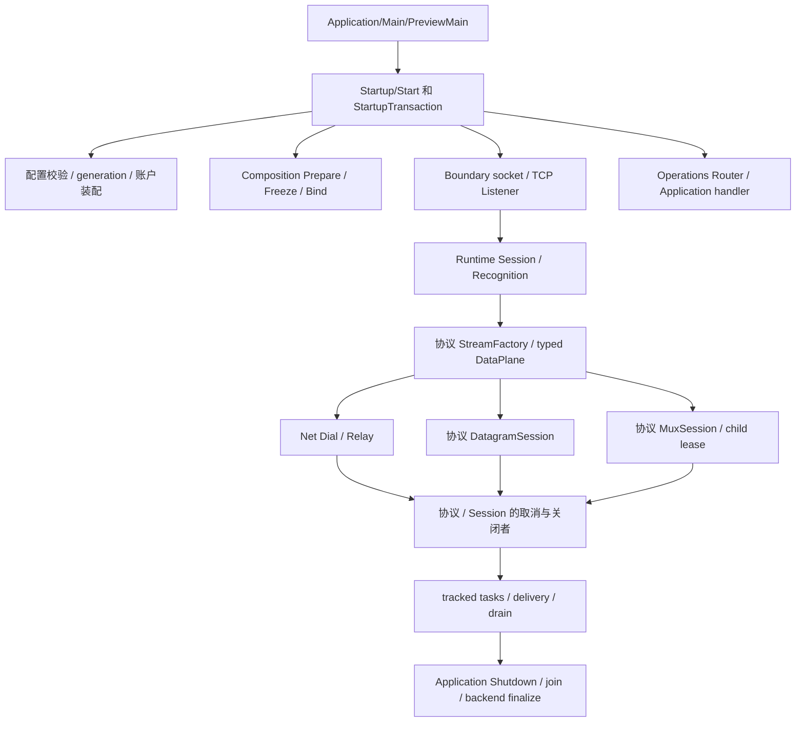

# Preview 全量架构、质量、风格与资源管理分析

审查日期：2026-10-09，Asia/Shanghai。对象：`I:/code/Prism/Preview` 当前未提交工作树。参考聊天：[模块差异化分析](thread://01a116b3-d9f1-7fd3-bc6f-a4b3ba003a1c?hostId=local)，已读取全部三轮；旧审查文档只提供复查线索，本文的问题必须有当前源码依据。HEAD 为 `3c5b678f2e06227b2a5da5b1ac406b5f79ea9828`，分支为 `codex/preview-refactor-20260928`；HEAD 不代表脏文件内容。

本轮由主会话加两个子代理分工完成分析。生产源码、测试、CMake、配置均不因本轮分析而修改；不构建、不运行测试、不启动 PrismPreview，不提交或推送。交付物集中在本文，临时分片和扫描文件整合后清理。测试组织和测试结果不属于本轮分析对象。

## 1. 审查结论与证据边界

Diagnose 仍适合作为正向架构标准：业务只需了解稳定 facade、类型化字段、值派生上下文和提交回执；异步队列前形成拥有型快照，backend 有唯一进程 owner，最终关闭具有专门合同。它自然跨越进程、worker、session，这本身不是坏耦合。其他模块应比较维护不变量的位置、异步数据所有权、最终关闭者以及失败是否污染业务，不能用依赖数量或者文件行数代替设计审查。

当前 Preview 已有明显进步：header-only owner、唯一 typed data-plane、协议 binding、账户/stream lease、executor reclaimer、tracked tasks、不可变配置 generation 均有正式实现；旧报告里的部分引用环、SOCKS5 UDP 和宽参数/长函数结论已经过时。但这些改善没有消除所有底层异常缺口、writer completion、管理命令实际范围、DNS 与协议预算问题。本文保留好的封装，并明确哪些调用者还没有采用它们。

证据等级：**源码确认**指当前控制流、字段和持有关系能够直接支持；**规则缺口**指违背本次明确风格/架构要求；**合同/设计风险**指接口缺少必要约束，运行触发尚未证明；**能力待办**指尚未实现或未接入实际入口。P1 优先处理正确性、生命周期或操作范围；P2 收敛资源边界和职责；P3 为可读性、注释与命名。P1 不等于实测线上故障。

全文件结构扫描与按 owner 的源码审查相结合。附录逐文件列出责任、结构信号、问题关联与 SHA-256，没有从“未列新问题”推导“已经无缺陷”。性能部分说明分配、复制、锁、调度、查找复杂度及队列/容量边界；本轮没有吞吐、延迟或内存实测，也不复用旧 benchmark 作为当前证明。

## 2. Diagnose 标准应如何用于其他模块

| 维度 | Diagnose 的正向标准 | 其他模块应达到的合同 |
|---|---|---|
| 公共入口 | Facade、ContextState、FieldKey/FieldCatalog、SubmissionReceipt 各有确定职责 | 每模块有少量稳定 facade/typed contract；业务 caller 不访问私有 state、帧循环或第三方句柄 |
| 类型和不变量 | 字段类型、借用/拥有文本、inline 容量和回执分别表达 | 已认证与未认证、流/数据报/mux、准备/冻结/绑定、取消/排空/最终关闭不能靠字符串和松散 bool 猜测 |
| 所有权 | 提交期借用，异步前捕获为拥有值；Application 拥有 backend | 在跨协程、队列、executor 边界之前移交或保活真正 owner；observer 不成为第二关闭者 |
| 生命周期 | Install/BeginShutdown/Drain/Finalize 各有边界 | Cancel 只是请求；Close 不能冒充 Drain；完成回执必须对应真实任务退栈和资源归还 |
| 失败 | 业务失败与观察失败分离；Dropped/Stopped/Failed 可辨 | parser 错误、I/O 原生错误、取消、超时、准入拒绝、启动失败须准确区分 |
| 注释 | 中文 Doxygen 说明字段、借用期限、快照、executor 和关闭行为 | 至少说明输入所有权、成功/错误输出、取消、半关闭、最终关闭者、executor；不能只写“运行”“发送” |
| 性能 | 过滤早于格式化；固定前缀与类型化字段；队列有丢弃合同 | 冷路径编译配置，热路径消费冻结绑定；避免重复配置解析、账户全扫描、可消除分配和串行 UDP 往返 |
| 私有细节 | Detail 封装 backend、capture、render、sink | 协议 wire/auth/session/driver 私有实现归该协议 Detail 的职责子目录；完整 owner 拆分，禁止文本拼接 |

本次的新硬约束也适用于 Diagnose 自身：禁止三目；热路径禁止 throw 和 catch。不能因为它是参照模块而豁免。保留其设计优点，同时在现有每条日志多层 catch、同步格式化/脱敏、共享工具依赖和 shutdown 时间合同上继续收敛。**不能简单删掉 catch 或追加 noexcept**：必须先使预期失败成为 typed result，形成不分配或有界分配的提交路径，再把冷路径初始化/致命异常交给进程边界。否则会把可观察失败改成 terminate。

## 3. 实际启动、请求与关闭路径

启动异常集中在 Application 冷路径捕获并转换为 StartupError 是合理边界；普通认证失败、无效帧、DNS/socket 错误、对端 EOF、取消、超时属于预期请求结果，不应通过 throw/catch 正常控制流传递。停机可以把严重资源收口失败报告为进程失败，但日志格式化、flush 观察失败与业务关闭失败应分别记账。

## 4. 主会话负责模块：逐项问题

### R001 — noexcept 的日志和关闭辅助函数仍在保护区外分配

**P1 / 源码确认 / Runtime/Session。** [RecognitionLogging.hpp:118](I:/code/Prism/Preview/Runtime/Session/RecognitionLogging.hpp:118) 在 `try` 前构造 PascalStage、Protocol、PascalFaultCode；`PascalCaseToken` 返回拥有字符串。[ClosePolicy.hpp:92](I:/code/Prism/Preview/Runtime/Session/ClosePolicy.hpp:92) 的 `CloseAndLog` 为 noexcept，却在 98 行 `make_shared<atomic<bool>>`，还构造捕获 owner 的 `std::function` 并调用关闭路径。分配失败可以直接 terminate，不能被函数后面的 catch 或 listener 捕获隔离。

触发是日志准备或最终关闭阶段的分配失败，不是已实测常态崩溃。应将 CloseDelivered 状态预先归入真实 session owner；日志用固定字段/`TryWith` 和有界输出，把预期失败返回为观察回执。关闭不应为“一次性标记”再分配共享控制块。相关 caller 为 `Session::Run`、取消 hook、listener 的最终 delivery。

### R002 — listener 取得连接额度后，admission owner 尚未成立

**P1 / 源码确认 / Runtime/Listener。** [Listener.hpp:499](I:/code/Prism/Preview/Runtime/Listener.hpp:499) 增加 ActiveConnections 后，在 peer 字符串构造、MakeReliable、Info 拷贝、`make_shared<AdmissionRequest>` 之间仍可能失败，直到 559 行才形成负责 Reject 的 owner。当前异常分支没有覆盖前述额度，accept loop 又以 detached 启动；[ListenerCompletion.hpp:73](I:/code/Prism/Preview/Runtime/ListenerCompletion.hpp:73) 的 guard 只完成循环信号，不归还连接额度，也不更新 Failed/Ready。

所以在这段准入准备失败时，存在额度未归还且 listener Ready 仍为旧值的机制。应在 TryAcquire 成功时立即持有不分配的容量 reservation，随后转交 AdmissionRequest；accept loop 的 completion 必须携带 typed 成功/失败并更新入口健康。借鉴现有 `DrainReservation` 的所有权模式，不要继续堆 catch。

### R003 — 关闭投递失败被静默忽略，没有兑现底层 reclaimer 合同

**P1 / 合同与源码缺口 / Runtime/Session。** [ClosePolicy.hpp:144](I:/code/Prism/Preview/Runtime/Session/ClosePolicy.hpp:144) 的 `PostCancellation` 在 post 失败后空 catch；159 行 `CloseTransport` 也吞掉 executor 获取/dispatch 失败。外部逻辑看到 CloseOnce、LogClose，却不能从此 helper 得知实际 socket 关闭命令是否交付。dispatch 的 lambda 内 Cancel/Close 若稍后失败，也不在外层同步 catch 范围。

项目已有 `ExecutorReclaimer`、`ClosingStorage`、SessionControl delivery 和 ClosingFailure observer，应使用它们保留失败关闭动作、标记 drain blocked，并交给最终 owner 重试/隔离。这里的改造是让底层已设计的关闭合同在调用方生效，不是另建通用万能 context。不能把 swallowed failure 说成 drain 成功。

### R004 — 请求路径仍通过多层异常展开报告普通失败

**P1 / 规则缺口 / Runtime + Contract + Composition。** [Session.hpp:153](I:/code/Prism/Preview/Runtime/Session.hpp:153) catch 后 rethrow；[Listener.hpp:338](I:/code/Prism/Preview/Runtime/Listener.hpp:338) 再 catch；[Middleware/Builtin/Relay.hpp:37](I:/code/Prism/Preview/Runtime/Middleware/Builtin/Relay.hpp:37) 在 relay catch 后再 throw；[FacadeCarrier.hpp:384](I:/code/Prism/Preview/Contract/Carrier/FacadeCarrier.hpp:384)、[TlsRecognitionHelpers.hpp:202](I:/code/Prism/Preview/Composition/Recognition/TlsRecognitionHelpers.hpp:202) 在握手请求路径捕获；RecognitionConfig 的 race/cleanup 也通过 exception_ptr 和 rethrow 组合结果。这违背本次“热路径禁止抛和捕获”。

应保留真实 cleanup/drain 顺序，把预期 I/O/协议/认证/取消结果迁移到唯一 typed 结果；异步 completion 记录错误与最终资源状态。真正不可恢复异常在控制线程/进程入口处收口。取消不是通用 IoError，EOF 也不等于协议破损。全量 throw/catch 定位见附录，冷启动、最终 join 等不能机械算作热路径违规。

### R005 — 相同账户的运行状态按协议重复创建，管理面只操作主目录

**P1 / 源码确认 / Application/Assembly + Operations。** [AccountAssembly.hpp:143](I:/code/Prism/Preview/Application/Assembly/AccountAssembly.hpp:143) 每次新建 Directory，并为相同配置账户新建 AccountRecord；[GenerationPhase.hpp:125](I:/code/Prism/Preview/Application/Startup/GenerationPhase.hpp:125) 为各协议调用该方法，Phase.Accounts 只指向 primary。实际认证由各自 ProtocolAccounts/Authenticators 或 QUIC 材料目录持有；[OperationsStartup.hpp:305](I:/code/Prism/Preview/Application/OperationsStartup.hpp:305) Revoke 只访问 State.Accounts，165 行账户查询也只查这一目录。

触发是同一 generation 内同一 AccountId 用于多个协议：撤销、ActiveSessions、配额事实可能在不同 AccountRuntime 上分叉；管理面不代表全部协议。应使中立 Account owner 拥有同一身份的运行状态，协议仅拥有不同 credential index/视图；或者正式把身份定义为协议范围并调整管理查询与命令。前者更符合当前统一 AccountId/lease 设计，不能用同步两套字段维持兼容事实。

### R006 — Revoke 的 CloseSessions 参数仍不执行

**P1 / 源码确认 / Application/Operations。** [RouteDispatch.hpp:355](I:/code/Prism/Preview/Operations/Routes/RouteDispatch.hpp:355) 接受 `close_sessions`，默认 true；[OperationsStartup.hpp:305](I:/code/Prism/Preview/Application/OperationsStartup.hpp:305) 只置 revoked，没有筛选 registry 中账户会话、请求取消、等待清理或创建 pending operation，却返回 Completed。这个问题独立于 R005；即便唯一账户 owner 修好，也不自动关闭存量 session。

应由 Application 管理命令 owner 执行账户范围的 lifecycle 操作，使用值快照定位实际 session，返回 Accepted/OperationId，真实 drain 后才能 Completed；明确 false 仅拒绝新准入的语义。协议的 child 续建是否允许必须与账户撤销合同统一。

### R007 — Worker Drain 扩大到全应用，参数和终态均不准确

**P1 / 源码确认 / Application/Operations。** [OperationsStartup.hpp:331](I:/code/Prism/Preview/Application/OperationsStartup.hpp:331) 仅回显 Value.Worker，然后设置全局 StopRequested 并 ScheduleShutdown；不使用 Worker、StopAccepting、Force。对应 [RouteDispatch.hpp:325](I:/code/Prism/Preview/Operations/Routes/RouteDispatch.hpp:325) 已允许这些范围。Result 默认 Completed，实际 Shutdown 尚未完成，Router 也只有 Accepted 才保存 OperationId。

指定 worker 的请求不应触发全应用停机。应先分开进程 drain 与 worker drain 的正式命令类型，由目标 owner 停接入、取消/等待自身任务，输出真实 pending/terminal 状态。保留 worker/account/session 的类型身份，避免 optional fields 表达所有作用域。

### R008 — typed 管理模型、HTTP 路由和真实 handler 的能力并不一致

**P2 / 能力待办与合同缺口 / Operations。** [Models.hpp:61](I:/code/Prism/Preview/Operations/Models.hpp:61) 声明 Generation/Stream/Task 查询；[OperationsStartup.hpp:266](I:/code/Prism/Preview/Application/OperationsStartup.hpp:266) 实际只接 Health/Workers/Accounts/Sessions/Events，其余 Invalid；GET 路由也没有后三种查询。Reload POST 解析存在但真实 handler 恒返回 `reload_unavailable`。Stream Reset 只带 StreamId，执行层明确拒绝 `target_unsupported`；StreamId 的父 session 身份仍未表达。

当前 Stream/Task Cancel **已经明确拒绝**，旧 Q39 的“静默扩大为全 session”已修正；不能把能力尚未实现写成仍误取消。后续应由唯一能力目录提供路由和 UI 可用性，Stream 查询/Reset 使用父 session + stream 的完整身份，Reload 连接真正 generation prepare/ack/publish/rollback owner。

### R009 — HTTP 管理连接的数量与写入阶段预算没有完整封装

**P2 / 资源合同缺口 / Operations/HttpServer。** [HttpConnection.hpp:323](I:/code/Prism/Preview/Operations/HttpConnection.hpp:323) 把每个 accepted connection 加入 ActiveConnections 后启动任务，没有 MaxConnections 准入；219 行 ServeRequest 有请求字节/read deadline，270 行取消 read timer 后，299 行 response write 没有独立写期限。loopback 约束是有效的，但不能替代连接并发/响应等待预算。

应由 HttpServer owner 统一连接额度、请求/写入 deadline、cancel/drain、拒绝码，Response 由异步帧持有直到写完成。避免把全局 StateOperationFailed 因单个可恢复请求失败永久污染。当前只报告预算缺口，不声称已发生远程攻击；生产 Start 已限制 loopback。

### R010 — HttpConnection 的模板拆文件仍依赖隐式完整 State 布局

**P2 / 设计耦合 / Operations。** [HttpServer.hpp:148](I:/code/Prism/Preview/Operations/HttpServer.hpp:148) 公开内部 State 资源布局；[HttpConnection.hpp:64](I:/code/Prism/Preview/Operations/HttpConnection.hpp:64)、117、323、410 通过模板访问 StateStrand、Connections、计数、timer、router 和全部状态位。文件拆分虽符合行数，责任合同仍由字段约定维持，修改 State 会扩散到多个 helper。

建议形成内部 server admission/drain owner 和 connection owner，公开窄操作/值结果；parser、JSON writer、route builder 保持纯值功能。局部 `StateValue` 模板不是天然错误，但不应成为绕过正式接口的万能布局依赖。

### R011 — Operations 保留重复路由入口与无职责聚合片

**P2/P3 / 规则与可读性缺口 / Operations。** [RouteDispatch.hpp:232](I:/code/Prism/Preview/Operations/Routes/RouteDispatch.hpp:232) 同一 OperationStatus 接受 Status、Operation、Operations 三个路径名；[Commands.hpp:1](I:/code/Prism/Preview/Operations/Commands.hpp:1) 和 [Queries.hpp:1](I:/code/Prism/Preview/Operations/Queries.hpp:1) 各只有三行、转 include Models。Models 同时含 query/command/result/snapshot 的多组值。

用户要求无兼容接口，后续应选择唯一正式路由并同步实际消费者；这些多入口是否有外部正式依赖须核对后删除，不应据名称猜测兼容来源。值类型按真实消费闭包拆到 Query、Command、Result、Snapshot，而不是给三个空文件套 facade 标签。HttpJson 的正确 framing/response byte budget 应保留。

### R012 — 中间件宽 Context 同时暴露身份、认证事实、租约和传输修改权

**P2 / 设计耦合 / Runtime/Middleware。** [Context.hpp:43](I:/code/Prism/Preview/Runtime/Middleware/Context.hpp:43) 及其引用返回 accessor 让每个 middleware 都能改 Target、AccountId、AccountLease、ProtocolAuthenticated、PostDial、Root；[Pipeline.hpp:94](I:/code/Prism/Preview/Runtime/Middleware/Pipeline.hpp:94) 又单独把 ctx.Inbound 的别名传给 Handle。工厂已拥有认证，但后续阶段仍能改写认证事实，权限依赖调用约定。

拆分不可变已认证 request metadata、dial input/result、decoration operation、relay ownership；每阶段仅得到必要输入。共享封装应围绕领域 owner，不增加万能 Context 隐藏参数。保持唯一 ProtocolDataPlane，不新增兼容 result。

### R013 — 固定的 Pad/Dial 阶段为每个 session 建动态单项 Pipeline

**P2 / 静态性能与设计问题 / Runtime/Session。** [DataPlaneRelay.hpp:103](I:/code/Prism/Preview/Runtime/Session/DataPlaneRelay.hpp:103) 创建 Pad middleware/shared_ptr/vector chain；133 行为 Dial 再创建相同结构，然后 relay 又直接调用。实际顺序固定，配置冻结未编译这一段。Pad [Pad.hpp:58](I:/code/Prism/Preview/Runtime/Middleware/Builtin/Pad.hpp:58) 每 session 还把数字转成范围字符串，交给 PadTransport 解析。

应用冷路径可编译 typed decoration 配置，Runtime 直接消费正式阶段函数；确有可变 pipeline 时，启动前建立不可变执行计划。这里只能确认多余对象构造/间接调用/文本往返，不能量化吞吐下降。共享 Byte/Target/Pad 输入应该用类型值，而非配置字符串进入热路径。

### R014 — Ban/Throttle 的拥有权与容器预算不完整，风格仍有旧命名

**P2/P3 / 合同和资源风险 / Runtime/Middleware/Builtin。** [Throttle.hpp:46](I:/code/Prism/Preview/Runtime/Middleware/Builtin/Throttle.hpp:46) 持有裸 TokenBucket 指针，未在接口说明 owner 必须存活到哪些挂起点；147 行 Failures/Banned 按每个 SourceIp 插入，过期只是 IsBanned 返回 false，不移除或限制键数量；每次查询构造 string。ctx、key、first 等项目标识符也未统一 PascalCase。

应复用 Account/Rate 或专门 admission owner 的生命周期、容量和清理策略；限制请求频率与字节限速须分开说明。当前主请求管线并未自动安装这些类，不应把它们当作已生效的生产风控。

### R015 — SessionRegistry 的全表值快照成本与 hooks 仍需明确

**P2 / 静态性能与公共合同 / Runtime/Registry。** [SessionRegistryStorage.hpp:74](I:/code/Prism/Preview/Runtime/SessionRegistryStorage.hpp:74) CopyActive 拷贝活动 map；注册、信息更新与 compaction 发布新表。拥有型快照保证读者稳定，是正向模式，但每次 session 变动复制字符串/节点，成本随活动 N 增长；hook dispatch 自己再 post 和 catch，生命周期/费用应由同一 owner 表达。

不要为了快而取消稳定快照。可以把 identity/immutable record 与 mutable lifecycle handle 分离，批量发布观察快照；取消、retirement、delivery 继续使用已有 token。SessionRegistry 当前 MapT 是有序 std::map，本文**不把它误报为乱序分页**。测量留待后续同输入的改造验收。

### R016 — worker 命令投递为类型擦除闭包，失败缺少领域结果

**P2 / 设计与错误合同 / Runtime/Worker + Mailbox。** [Mailbox.hpp:113](I:/code/Prism/Preview/Runtime/Mailbox.hpp:113) 采用有界 MPSC 是优点；[Worker.hpp:268](I:/code/Prism/Preview/Runtime/Worker.hpp:268) 执行 CommandValue 的 catch 只增加 RecordFailed，没有命令身份和领域拒绝/完成回执。Notify post 失败则 Stop；worker Run 直接 io_context.run，由 Application 的线程 lambda 调用，线程顶层未显示额外失败合同。

准入、drain、配置 generation 操作应有 typed command/receipt，不必把每个数据包都变成 variant visitor；保留有界队列。交付失败与业务执行失败分别返回，使用 tracked completion/FailureBoundary；最终线程异常处理放在进程/线程入口，不能靠每条业务命令热路径 catch 补救。

### R017 — Boundary 的中立 QUIC 租约仍暴露具体 Native Server

**P2 / 源码分层与设计耦合 / Contract + Boundary。** [QuicConnection.hpp:45](I:/code/Prism/Preview/Contract/Ingress/QuicConnection.hpp:45) Native 返回 Quic::Server；[QuicConnectionRegistry.hpp:5](I:/code/Prism/Preview/Boundary/Quic/QuicConnectionRegistry.hpp:5) include Protocols/Quic/Native.hpp，Entry 缓存 Server，再直接读取 Health、Start、ReceivePacket。正式 owner 确已通过 Lease 关闭，是进步；但协议实现类型和 admission 状态仍穿过中立接口进入 Boundary。

中立 connection handle 应直接提供 packet admission、可路由/closed 的值状态和唯一 close/drain 能力；协议 owner 内部组合 Native Server。QUIC wire/CID 通用解析可留 Boundary，中立契约不应要求调用者了解 Native 布局。必须同时同步 include 和 CMake，而非 INTERFACE target 改名。

### R018 — QUIC 表无准入容量，热路径有字符串键与全表查找

**P2 / 源码确认的预算缺口 / Boundary/Quic。** [QuicConnectionRegistry.hpp:36](I:/code/Prism/Preview/Boundary/Quic/QuicConnectionRegistry.hpp:36) Options 没有未认证/已认证容量；Handle 新 peer Factory→emplace。129 行每包 CID 转 string；FindPeer/HasNative/EraseNative 等多次线性遍历，alias 和 native 身份事实都存在 Entries 中。QuicPacketGateway 的 4096 容量不能自动约束另一张 registry 表。

应以实际 connection owner/peer/CID alias 建三个明确索引，固定/透明 CID key，冷准入预留容量，并定义拒绝、过期、关闭清理。多个索引共同由一个 owner 更新不属于坏耦合，重点是唯一事实和总预算；性能只是静态成本，未实测。

### R019 — UDP dispatcher 每包复制拥有型载荷，接受计数漏分支

**P2 / 源码确认 / Boundary + Application。** [BoundaryDispatcher.hpp:104](I:/code/Prism/Preview/Boundary/Contract/BoundaryDispatcher.hpp:104) 把 Packet lvalue 传给 `std::function<bool(BoundaryPacket)>`，会复制 vector；[DatagramServices.hpp:21](I:/code/Prism/Preview/Application/Startup/DatagramServices.hpp:21) Registry 只需借用 Packet。raw UnknownCid 分支 93–100 和 QuicAdmission 成功分支 107–108 未增加 QuicPackets/DatagramPackets，而 gateway fallback 分支增加，Snapshot 的统计语义依路径变化。

需同步借用型 admission 接口，真正消费 owner 时再 move；所有接受/拒绝分支通过具名最终记录函数统一计数。不要为观察再保存第二份 payload。附录所有三目包含这部分路由表达式，改造须用清晰 if/switch。

### R020 — DatagramListener 的公共关闭/观察与 coroutine completion 合同不一致

**P2 / 生命周期与 executor 风险 / Boundary/Datagram。** [DatagramListener.hpp:119](I:/code/Prism/Preview/Boundary/Datagram/DatagramListener.hpp:119) Start/Drain/SendTo dispatch 至 Executor，但 Stop 直接操作 socket，Health 直接读取非原子的 LastError；公共注释没有限定跨线程调用。Start 在设置 Ready/ReceiveLoopStarted 后 co_spawn，提交失败没有回滚这些字段。ReceiveLoop 末尾手工发送 Completion，缺少覆盖挂起准备异常的 RAII completion guard。

应复用 listener/task 的已拥有 completion/reservation 和 ExecutorReclaimer，明确哪些同步方法只限 executor，或者提供调度后的值快照。共享 UDP Stop 必须最终由 Boundary owner，不能因协议错误关闭全监听。此项不是当前跨线程竞态的实测结论。

### R021 — 公共 socket 的拥有型指针仍向协议暴露最终关闭能力

**P2 / 设计风险 / Boundary + Contract/Services。** [DatagramListener.hpp:203](I:/code/Prism/Preview/Boundary/Datagram/DatagramListener.hpp:203) 返回 aliasing shared_ptr 保活 State，这是正确保活；[Quic.hpp:9](I:/code/Prism/Preview/Contract/Services/Quic.hpp:9) 注释说 provider 只有收发权，但类型仍是可变 udp::socket shared_ptr，caller 可 cancel/close。DatagramSender 已提供窄 Send 能力，可作为改造参照。

真正需要底层 native socket 的 QUIC engine 适配应被局限在一个中立资源 owner，协议 admission 只拿端口能力。不能靠“不要调用 Close”的注释当作类型权限。共享权与最终关闭权须分别说明，原有 aliasing 保活不应随手删除。

### R022 — 单 QUIC engine 的限制需要成为装配接口的显式不变量

**P2 / 设计合同缺口，当前配置有保护 / Application/Startup。** [QuicServices.hpp:12](I:/code/Prism/Preview/Application/Startup/QuicServices.hpp:12) 遍历 BoundCatalog，找到每个 Entry.Quic 后覆盖同一 Factory，没有重复拒绝。复查 [ConfigurationValidation.hpp:127](I:/code/Prism/Preview/Application/Configuration/Validation/ConfigurationValidation.hpp:127) 确认当前配置拒绝重复 QUIC builtin，也拒绝同一 listener 同时配置 Hysteria2 和 TUIC。因此不能把“多个合法 engine 在生产中被覆盖”列为当前可达缺陷。此处的问题是绑定接口没有表达其依赖的单 engine 不变量，完全依赖外层预检。

应由 Composition 冻结唯一 engine 的 typed handle，并在构造时明确拒绝重复；未来若扩展多引擎，先设计 listener 到协议/ALPN 的选择合同，Boundary 只消费 compiled selector，不 trial 多个引擎、不按协议名查找认证。当前单 engine 限制也应在配置文档和后台能力展示中说明。

### R023 — Application 与 Composition 仍承担协议私有准备/认证规则

**P2 / 设计耦合与 Detail 归属缺口。** [ProtocolAcceptors.hpp:60](I:/code/Prism/Preview/Application/ProtocolAcceptors.hpp:60) 分协议创建 credential/options/IngressFactory；[CandidateFactoryHelpers.hpp:234](I:/code/Prism/Preview/Composition/Recognition/CandidateFactoryHelpers.hpp:234) 直接解析 VLESS 请求、检查 UUID，266 行重算 Trojan credential，370 行遍历 VMess 凭据；[TlsCarrierHelpers.hpp:316](I:/code/Prism/Preview/Composition/Recognition/TlsCarrierHelpers.hpp:316) 直接读取 Reality ClientHello 并调用认证准备。[TrustTunnelCredentials.hpp:1](I:/code/Prism/Preview/Application/TrustTunnelCredentials.hpp:1) 则把协议凭据语法放在应用目录。

这些不是纯冷路径接线，部分函数实际每请求执行。协议应公开稳定 Prepare/Inspect/Accept 能力，wire/auth/认证 material 的细节放回本协议 Detail；Composition 仅编译候选与carrier绑定，Application 只提供进程服务和配置。不要强迫所有协议进入可选回调万能接口。

### R024 — provider 与 candidate 存在两组正式装配体系

**P2 / 架构收敛问题 / Application + Composition。** [ProviderCatalog.hpp:311](I:/code/Prism/Preview/Composition/Provider/ProviderCatalog.hpp:311) Handles 目前覆盖 SOCKS5/SS2022/Hysteria2/TUIC；[ProtocolAcceptors.hpp:252](I:/code/Prism/Preview/Application/ProtocolAcceptors.hpp:252) 其余协议走应用 switch + CandidateRegistry 多组 RegisterConfigured*。同一协议的参数、账户和 mux 注入要同时改多套装配节点。

目标应是按协议类别建立真正类型化的 prepare/bind/start 槽位，保持 TCP proxy、TLS carrier、QUIC、mux、ECH 的不同契约；注册元数据集中，协议 owner 不反依赖 Composition。当前 BindingId 已为正式字段，MuxMode 在冷构造按 BindingId 查表，旧 Q10 “候选名称后缀恢复 mux”不再沿用。

### R025 — 内层识别重新实现候选试探循环，prepare 结果未复用

**P2 / 设计与静态性能风险 / Composition/Recognition。** [LayeredCandidateFactory.hpp:46](I:/code/Prism/Preview/Composition/Recognition/LayeredCandidateFactory.hpp:46) 实现独立 ProbeBuffer/Inspect/Prepare/priority 胜者循环；每轮建立 Accepted vector，准备成功后仅保存 Candidate 指针，最后重新调用协议 Accept。外层 Runtime 已有 PreparedCandidate 的一次性拥有模型，两者预算、错误和 prepared state 的使用方式不一致。

应把通用候选协调与纯契约下沉到中立识别 owner，内层只消费已编译表和 owned prepared result；协议私有认证仍留协议。确认是否重复解析/凭据哈希的具体成本由相同输入验证，不要未经测量称“双倍 CPU”。

### R026 — carrier 错误被过度归并，原生失败与取消信息丢失

**P2 / 源码确认 / Composition + Application。** [TlsRecognitionHelpers.hpp:206](I:/code/Prism/Preview/Composition/Recognition/TlsRecognitionHelpers.hpp:206) 将任意异常映成 TlsHsfail/NoMatch，未保留原生 cause；[ShadowtlsCarrier.hpp:64](I:/code/Prism/Preview/Composition/Recognition/ShadowtlsCarrier.hpp:64) Dial 错误变 nullptr；[NetworkAssembly.hpp:172](I:/code/Prism/Preview/Application/Assembly/NetworkAssembly.hpp:172) DNS 原生错误和空结果全部变 BadAddress。非法目标、解析超时、caller cancel、网络失败难以区分。

统一 typed result 应保存 Fault::Code 与可选原生 error_code、stage、非敏感 detail；协议私有 parser Error 只在正式边界映射一次。配置错误可有拥有字符串，热路径无需动态错误文本。不要给每层补别名/旧结果字段。

### R027 — 进程级 carrier Dial helper 主动跳过 IPv6，与 worker/Net 封装分叉

**P2 / 源码确认 / Application/Assembly。** [NetworkAssembly.hpp:139](I:/code/Prism/Preview/Application/Assembly/NetworkAssembly.hpp:139) 遍历解析地址时直接 continue 所有 IPv6。[ProtocolServices.hpp:43](I:/code/Prism/Preview/Application/Startup/ProtocolServices.hpp:43) 把这个函数捕获到 Services.Dial，再传 ProtocolFactoryContext，Restls/ShadowTLS 的目标拨号消费它。普通 listener session 会在 [BoundaryStartup.hpp:305](I:/code/Prism/Preview/Application/BoundaryStartup.hpp:305) 改用 WorkerDialService，因此不能把本项扩展成“全部 TCP 不支持 IPv6”。

当 carrier decoy/目标仅有 IPv6 或优先返回 IPv6 时，该 helper 无法按同一能力合同工作。应复用 Net 的统一 StreamEgress/WorkerDialService/typed dial operation，并明确 total deadline/地址族策略；避免 Application 保留第二套热路径拨号实现。

### R028 — 配置文件读入没有总字节上限，expected 与异常合同未说明

**P2 / 资源与公共合同 / Application/Configuration。** [ConfigurationParser.hpp:151](I:/code/Prism/Preview/Application/Configuration/ConfigurationParser.hpp:151)、168 以 istream iterator 无上限读完配置，再 glaze 解析。它是启动冷路径，允许进程边界处理异常，但对公共 expected 接口而言，文件读取错误、过大配置、内存失败与 SecretResolver 抛异常如何区分未完整说明。SecretValidation/Resolution 会把解析器异常变成空 secret，与确实缺失混淆。

保留 SensitiveStringWiper/PreparedConfiguration 的安全交接，给读取与集合定义预算、返回独立错误。配置格式、语义、能力和 secret 获取分别拥有验证责任，外部 resolver 的冷路径失败保留非敏感 cause，不泄漏凭据。

### R029 — Reload 的 worker acknowledgement 没有正式两阶段操作与回滚者

**P2 / 设计风险 / Application/Configuration。** [ReloadCoordinator.hpp:81](I:/code/Prism/Preview/Application/Configuration/ReloadCoordinator.hpp:81) 顺序调用 bool Worker callback，随后 Store.Publish。若 callback 真正改 worker，后续 worker 拒绝或 PublishConflict 时没有 rollback；若只预检，正式装配/切换又未表达。接口没有说明 callback 只能无副作用验证、executor 和 barrier。

当前管理面 Reload 尚未接此路径，不能声称已造成运行分裂。后续应有 prepare token/ack、唯一 commit/rollback owner、旧 generation pin 与存量 session 继续使用合同；直接把 bool 改成万能上下文不会解决事务问题。

### R030 — 公共校验与协议专属语法混放，重复纯逻辑没有正确归属

**P2/P3 / 设计与维护性 / Application/Configuration。** [ProtocolIndependentValidation.hpp:398](I:/code/Prism/Preview/Application/Configuration/Validation/ProtocolIndependentValidation.hpp:398) 的 RestlsRuleCursor/IsValidRestlsScript 是特定协议语法，却放在名为 ProtocolIndependent 的文件；同文件还有 XHTTP mode、TrustTunnel network 和 mux 判断。ParseTargetPort 在 ConfigurationAssembly/NetworkAssembly，ClampCandidatePriority 在 ProtocolProfile/ReferenceValidation，各有重复；host/port/ASCII 比较也在多个 carrier helper 和验证层实现。

复用应按语义：中立 Net::Target/HostPort 负责解析值，协议验证 facade 负责 Restls/XHTTP/TrustTunnel 专属约束，Configuration 负责字段路径和引用图。不要把所有 string helper 丢进万能 Utility；相同文本且不同容错/所有权的函数不能直接强合并。

### R031 — 单一源依赖与 CMake target 依赖仍不一致

**P2 / 源码分层缺口 / Application/Configuration + Foundation。** [ConfigurationGeneration.hpp:11](I:/code/Prism/Preview/Application/Configuration/ConfigurationGeneration.hpp:11)、ValidationTypes、Configuration.hpp 直接包含 Composition/Builtin；[PreviewBoundary.cmake:86](I:/code/Prism/Preview/CMake/PreviewBoundary.cmake:86) 对 PreviewConfiguration target 的允许集不含 Composition。Foundation/Diagnose 直接依赖 Statistics 的反向方向由基础层审查详述。共同根 include directory 使编译可能仍能找到头，不能把这等同模块边界正确。

只读 CMake/source 分析不能宣称当前 configure/gate 成功。应把不可变 builtin snapshot/capability 契约的公共值下沉到中立层，由 Composition 构造；target 连接与真实 include 使用同一 owner 图。不能通过改 INTERFACE target 名制造“已隔离”。

### R032 — 定时日志失败仍能触发业务停机，最终 flush 也改写退出状态

**P2 / 策略偏差 / Application/Shutdown。** [Shutdown.hpp:145](I:/code/Prism/Preview/Application/Shutdown.hpp:145) OnDiagnoseFlush 在 Arm 失败后 MarkShutdownFailed + ScheduleShutdown；相比 Statistics 定时 flush 只计观察失败/停重试，策略不一致。240 行 FinalizeShutdown Failed 也直接把应用 Phase/ExitCode 改为失败。

业务 drain、日志持久化承诺与普通观察失败应分开结果。若 audit 持久化确为产品退出成功条件，必须用独立明确选项/合同，而不能与普通调试日志共用隐含策略。MarkShutdownFailed 本身 noexcept 构造 Event.Detail string，也需无分配的失败记录入口。

### R033 — Header 的依赖保护、入口与文件名称尚未形成一致合同

**P3 / 文档合同改进，审查期间两项已修 / Application。** 发现快照中 Startup/Start.hpp 没有 #pragma once，PreviewMain.hpp 的 @file 写成 PreviewMain.cpp。交付前发现其他工作已为这两个文件添加 #pragma once，并改正Main的@file，本文撤回这两项当前缺口。复查 [Application/CMakeLists.txt:1](I:/code/Prism/Preview/Application/CMakeLists.txt:1) 确认Start作为PreviewApplication的CXX source单次编译，Main也作为独立CXX source，实际只include Application.hpp。因此非inline Start是有效编译owner选择，不能报成已出现ODR/link错误，也不能虚构Main文本include Start。需要继续明确source-header与可被include的普通公共头之间的使用合同。

后续把普通生产 header 的唯一保护、聚合入口、实现 owner 及多 TU 链接合同写清；Start/Shutdown/RuntimeState 可以按真实 owner 组织在 Application 内。不得新建生产 cpp，也不得作用域 include 拼装正文。Startup 多个文件 @brief 均为“独立资源装配责任”，无法表达各自职责，应具体写 Process/Protocol/Boundary/Publish 的责任。

### R034 — Runtime 的命名、注释与文件边界没有达到 Diagnose 标准

**P3 / 规则缺口 / Runtime。** [CandidateSelection.hpp:3](I:/code/Prism/Preview/Runtime/Recognition/CandidateSelection.hpp:3)、ConfiguredMode/ConfiguredAcceptor/MixedTrialMode/RecognitionConfig 的 @brief 为英文；Middleware ctx/mw/pad/timeout、SessionInfo peer，以及 `detail`/`configured_detail` 等内部 namespace 不符合项目 PascalCase。Tls.hpp 同时含记录扫描、ClientHello extension codec 和 I/O owner，598 行虽合规，仍值得按完整 parser/reader 职责拆分。

应先统一 owner/对外词汇（Runtime 的 Recognition、Protocols/Tls 的 wire 各自明确），在所属作用域缩短 namespace/type 书写，采用类 private using 或函数局部 using，避免全局 using namespace 和泛化 Error/Context 别名污染其他消费者。中文 Doxygen 不只是 file @brief，应描述借用 view/返回 pointer 的期限、executor、取消、关闭。

### R035 — 两层 UDP 接受表和观察 readiness 尚需唯一事实

**P2 / 架构与合同风险 / Application/Boundary。** [DatagramServices.hpp:31](I:/code/Prism/Preview/Application/Startup/DatagramServices.hpp:31) 同时创建 QuicPacketGateway 与 QuicConnectionRegistry；前者也拥有 CID handler table/readiness，后者拥有实际 lease/server table。绑定只将真实 factory 接到 registry，gateway 更多承担 readiness/fallback。存在两套“连接数/已就绪”的事实接口，4096 的 gateway 上限容易被误当实际 connection budget。

需要明确 packet classification、connection admission、readiness observer 的分别所有者；删除已退役的重复生产入口，观察数据直接从真正 owner 的值快照派生。不要为了统一而让一个对象同时负责协议认证和 socket 生命周期。

### R036 — Errors 指标仍没有生产写入，不能当作准确业务错误计数

**P2 / 能力合同缺口 / Runtime/Statistics。** [Statistics.hpp:94](I:/code/Prism/Preview/Runtime/Statistics.hpp:94) Value/StreamValue 返回 Metric::Errors，但157行 Accumulate 只准备和更新 UpBytes、DownBytes、Events；Foundation::TrafficEvent 的 Completed 语义也没有业务错误原因。当前有界数值队列和控制 executor 聚合是正确方向，不能因此推导 Errors 字段已接入。

应把业务终态/错误的独立数值事件与观察入队失败分开，统一按真实 scope key 聚合；前端显示“未提供”或明确支持状态，不能把默认0理解成无错误。保留现有 Completed 计数不扩大含义，不把 PacketRejected、AggregationFailure 与协议错误混成一个数。

### R037 — 小模块的结构职责已改善，但公共合同与冷/热边界还未贯通

**P2/P3 / 模块整体判断 / Application、Composition、Contract、Runtime。** ReferenceGraph、PreparedConfiguration、StartupTransaction、CandidateHandle、PreparedCandidate、DataPlane variant、ListenerCompletion、Session registration token、Mailbox 的各自 owner 已有合理边界，应保留。Configuration.hpp、Builtin.hpp 等聚合头的职责要写清；RequestMetadata/AuthenticationServices/GenerationPin 的共同 owner 是必要约束，不应为“依赖少”而移除。

剩余差距是这些封装并非所有 caller 都遵守：旧 application dial/credential helpers、重复 candidate preparation、裸 socket 能力、关闭 helper 空 catch、无 reservation 的 listener 增量、primary account 目录事实分叉。后续改造应围绕完整调用/生命周期闭环收敛，不能只把每个文件改到600行以内或把跨层 include 改成间接 include。

### R038 — 交付前新增 typed Registry Shutdown 结果尚未被 listener 消费

**P1 / 当前源码确认 / Runtime/SessionRegistry → Listener → Application/Shutdown。** 审查期间其他工作将 [SessionRegistry.hpp:379](I:/code/Prism/Preview/Runtime/SessionRegistry.hpp:379) 的Shutdown改为awaitable<Fault::Code>，active且drain blocked时返回Blocked，正常归还返回Success；这是使错误显式化的正向修改。但是[Listener.hpp:309](I:/code/Prism/Preview/Runtime/Listener.hpp:309) 仍只co_await并忽略返回值，自身返回void。[Shutdown.hpp:286](I:/code/Prism/Preview/Application/Shutdown.hpp:286) 的DrainListener和AwaitShutdownOperation因此只检测异常，没有得到typed Blocked。

触发是registry返回Blocked；影响是listener/Application本段排空结果仍被当作无异常完成，错误信息在接口迁移时丢失。最终ClosingStorage检查可能另行阻止资源签收，不能据此声称整个应用一定成功停机；本项只确认该返回值未沿调用链传递。后续必须同步实际消费者，把错误作为typed关闭结果贯通，同时保持超时后真实owner保活。不要再以throw普通drain结果恢复第二条正式事实。

## 5. 管理后台：明确保留的 React 待办

**B001 / 能力待办，尚未设计或实现。** 当前 Preview 只有 C++ 管理模型、HTTP parser、router 和部分 Application handler；没有 React 页面。不能把“API 类型已声明”“路由能解析”写成网站已完成或全部后台能力可用。

后续要求采用 React 构建现代化管理后台，页面代码独立于 C++ wire/session owner。优先组织为 AppShell、Overview、Workers、Accounts、Sessions、Events、Configuration、Operations 页面/领域模块；局部 ApiClient/DTO 映射/请求取消与状态管理只服务前端，不建立万能页面上下文。使用清晰侧边导航、宽松信息层次、状态标签、响应式表格、可读的数值图表，统一浅/深主题和空/加载/错误/断线状态。性能视图须标注时间窗口/单位，不能把未更新的 Errors=0 展示成运行无错误。

| 当前源码确认的 API | 当前执行状态 | 后台约束/待办 |
|---|---|---|
| GET /Operations/Health | 有真实 Application handler | 展示 TCP/UDP/QUIC socket/handshake/protocol 的独立 readiness，不能只看端口 |
| GET /Operations/Workers | 有 handler 与分页模型 | worker 状态、active tasks、流量及观察丢弃；先修 worker drain 范围 |
| GET /Operations/Accounts | 有主目录 handler，存在 R005 | 统一账户事实后展示 active session/revoked，撤销遵循 R006 |
| GET /Operations/Sessions | 有 handler 与稳定快照 | 父 session/worker/account/target，明确取消结果与 drain 状态 |
| GET /Operations/Events | 有 handler | 脱敏与容量/游标语义先修；前端按真实事件保留策略展示 |
| POST /Operations/Drain | 能解析但存在 R007 | 实施目标作用域和 pending operation 后才启用操作按钮 |
| POST /Operations/Accounts/{id}/Revoke | 能执行主目录撤销，参数不完整 | CloseSessions 行为修复前不得暗示存量连接已清理 |
| POST /Operations/Sessions/{id}/Cancel | session 可执行；child 被明确拒绝 | child 能力未实现时禁用并解释，不隐藏为成功 |
| POST /Operations/Streams/{id}/Reset | 缺父身份且当前不支持 | 改完整作用域与 owner 后开放 |
| POST /Operations/Reload | 当前 reload_unavailable | 完成 generation 事务后开放配置预检、发布、结果跟踪 |
| GET /Operations/Status/{id} | router 支持 pending operation 状态 | drain/reload 需真实产出 Accepted，不能由前端模拟 Completed |
| Generation/Streams/Tasks 查询 | typed 值存在，真实 HTTP/handler 未接 | 列为后端能力待办，与页面待办分别追踪 |

当前 HTTP listener 仅支持 loopback。React 的访问方式、同源静态资源/代理、部署目录、身份认证与操作权限须在后续产品设计中明确，不能直接改成公网监听当作 UI 接入方案。本轮只记录约束和待办，不制作页面、不下载前端依赖。

## 6. 命名、Detail、注释与底层复用的全仓判断准则

禁止三目适用于所有项目生产实现，包括 const/constexpr、默认值、日志标签和返回表达式。替换时使用具名函数、早返回或 switch；不要用通用 Select(bool,A,B) 隐藏三目语义，也不要只把文字挪到另一个 header。附录 AST 定位已排除字符串里的问号。

协议建议公共层只保留协议 facade、稳定 Options/Result、正式 Binding/IngressFactory/Session 能力入口；私有部分位于 `Detail/Codec`、`Detail/Auth`、`Detail/Session`、`Detail/Datagram`、`Detail/Stream`、`Detail/Transport` 等实际存在的职责目录。小协议只建需要的子目录，不机械创建空目录。Common 只放跨协议同一语义的逻辑，不承载协议私有认证、装配或万能 context。CMake 与实际引用链必须一起迁移，内部符号不得反向泄漏到正式消费者。

名称要说明责任且减少冗余：目录已有协议名时，内部 `Http2...`/`QuicConnectionRegistry...` 长串可以在所属 Detail/owner 里用简洁类型名；公开 Contract 则保留能区分作用域的正式名称。`Tls.hpp`、`Types.hpp`、`Model.hpp`、`Helpers.hpp` 不是一律坏名字，需要由实际承载内容和引用链决定。Header 中优先函数局部/类 private using，namespace alias 置于本模块范围，不能建立全仓兼容别名或 using namespace。

复用表必须落到真实调用者：executor reclaimer 处理跨 executor 关闭和交付失败；drain reservation 保护准入计数；Account/StreamLease 保护配额与身份；Net dial/relay/typed datagram ports 处理目标解析与转发；Memory domain/arena 与 pool 处理热路径分配；Fault Handling 处理 I/O 到领域错误的正式映射；Diagnose 用过滤、类型字段与快照，Statistics 用统一脱敏和有界数值事件。不是所有 std::vector 都必须改成 PMR：先证明 resource 的 owner、线程和释放顺序，不允许异步帧借用短命 arena。

每个公共接口的中文 Doxygen 至少回答：输入取得所有权还是借用到返回/协程退栈；输出的 pointer/view 能存多久；成功与每类失败怎样表达；取消如何传播；是否半关闭；谁最后 Close/Drain；在哪个 executor/线程调用。文件注释、代码里零散“owner”文本或者函数名不能替代这一合同。附录的注释信号是复查线索，不作为“缺失了多少注释”的精确结论。

### 6.1 错误码、异常与重要路径应怎样分工

| 路径 | 应消费的底层封装 | 应向调用方表达的结果 |
|---|---|---|
| codec/parser/认证、每帧/每包 | 协议私有 codec 结果、Fault Handling 的正式转换 | Invalid/NeedMore/AuthRejected 等可辨结果；无热路径 throw/catch，无失败全零伪成功 |
| socket、DNS、stream/datagram transfer | error_code 异步接口、typed egress/relay、owner-held缓冲 | 保留原生错误与Fault::Code；EOF、取消、超时、refused与格式错分开 |
| quota/rate/revocation准入 | Account/StreamLease、rate policy、reservation | 准入拒绝不携带部分lease；已成功取得的额度在失败/取消路径 exactly once 归还 |
| 跨executor取消/最终关闭 | ExecutorReclaimer、ClosingStorage、tracked delivery/drain | 成功交付、dispatch失败、blocked、retained待清理；不把已请求Close当作已完成 |
| 配置读取、密钥/证书、库和线程创建 | StartupTransaction、配置expected结果、项目Exception层的类型错误 | 可恢复配置问题返回StartupError；确需异常的资源创建/构造不变量按Network/Protocol/Security/Deviant分类，在冷路径统一转换并回滚 |
| 进程/线程顶层不可恢复失败 | Application控制边界、FailureBoundary与最终失败记录 | 独立致命原因与退出结果；不能跨C ABI抛出，也不能从detached driver静默丢失 |
| 日志/统计观察 | Diagnose facade、回执、有界数值事件 | Dropped/Stopped/Failed与观察丢弃计数；不伪造业务失败，不污染正常认证/传输终态 |

现有 Exception 层自身存在兼容构造/泛化分类和文档缺口，由基础层审查继续记录；不能因为“有封装就要用”而把其旧接口直接传播到新的热路径。复用的目标是统一清晰合同，不是统一所有错误类型为同一个枚举。Startup的重要错误可以抛，日常流量的重要性不构成热路径抛异常的理由。

### 6.2 与旧聊天/旧报告的主会话复核对照

|旧编号|当前判断|本报告对应|
|---|---|---|
|Q07/Q08|宽Context和固定动态单项Pipeline仍存在|R012/R013|
|Q09|provider/candidate双装配尚未完全收敛|R023/R024|
|Q10|已用正式BindingId冷查表，不能沿用名称后缀恢复mux的旧结论|R024的当前状态说明|
|Q11/Q12|Resolver执行器/关闭/原始回调有效期要结合当前查询owner审查|基础层Net/Dns章节|
|Q13|Errors仍未接生产更新|R036|
|Q14|HttpConnection完整State模板耦合仍存在|R010|
|Q15|SessionBase仍在Mux真实路径，不能只因注释DEPRECATED当作已删除|基础层Foundation/Mux章节|
|Q16|Foundation反向Statistics依赖仍存在|F002/R031|
|Q17/Q18|日志准备noexcept保护区外分配、flush影响业务状态仍存在|R001/R032|
|Q19|FallbackWritten已移除；ContextCapacityExceeded仍在SubmissionStatus，与ContextError边界需统一|基础层Diagnose公共结果章节|
|Q20|旧测试合同问题不属本轮范围|遵循用户“先不管测试”，不重报旧测试状态|
|Q21/Q22/Q23|文本历史保留、提交同步成本与drain期限仍需收敛|F004/F006及Diagnose执行模型分析|
|Q34|共享脱敏转义缺口仍存在|F005|
|Q35|真正QuicConnectionRegistry的容量与CID查询问题仍存在|R018|
|Q38|CloseSessions尚未执行，另新增跨协议账户状态分叉|R005/R006|
|Q39|child Cancel已明确Rejected，旧扩大取消缺陷撤回；能力仍待办|R008|
|Q40/Q45|Worker范围和异步Completed合同仍不准确|R007|
|Q41/Q42/Q43/Q44|查询/Reload/Reset与完整stream身份仍待接通|R008/B001|
|Q46|EventRing保留/丢弃合同仍需准确呈现|基础层Statistics章节|

协议相关Q01–Q06、Q24–Q33、Q36/Q37、Q47–Q50的逐项当前状态见协议章节的对照表。旧结论撤回仅表示所指出源码机制已改变，不构成本轮运行或性能验收。

## 7. Foundation、Account、Lifecycle、Net、Resource、Statistics、Transport 与 Mux

当前范围 186 个 HPP、31,886 行，全部逐文件读取接口、实现、owner 与叶子职责。文件 SHA-256 与本次 inventory 逐项复核一致；未运行构建、测试、真实请求、互操作或 benchmark。所有风险仅来自当前源码与可定位执行分支，未将旧报告或旧测试结果作为当前验收。

Foundation/Utility/Diagnose 仍是积极比较标准：业务只走稳定 facade；FieldKey/FieldCatalog 编译期冻结；PrefixCache 固定存储；长期 Context 不可变、per-call inline 明确借用、异步前 SubmissionRecord 拥有文本；Application 持有唯一 backend/pool，BeginShutdown、控制线程 Drain 与最终 join 分工明确；SubmissionReceipt 明确 Accepted 仅入队，观察失败不改变业务结果。全进程唯一 facade/backend owner 的作用范围合理，不能仅因为覆盖 process/worker/session 就判定耦合。新要求冲突集中在每条日志的动态工作、catch、三目和 Foundation→Statistics 依赖。

## 叶子架构、调用方复用与关闭契约

| 叶子职责 | 正式入口/调用关系 | 输入输出所有权、executor 与最终关闭 | 复用结论 |
| --- | --- | --- | --- |
| Foundation/Identifier、Error、Fault、Cancellation、Executor、Memory、Generation|typed ID/error/affinity/domain → Lifecycle/协议/Runtime；ContextOwner/ExecutorReclaimer → carrier closing|纯值不拥有I/O；resource_pointer不pin allocator；ContextOwner持真正context与pool；ClosingStorage保留无法原executor回收的实物|复用strong ID、Fault::Describe、真实ContextOwner与move-only预约；第三方error_category ADL属于必要标准接口，不因Compatible命名删除。 |
| Foundation/Utility/Crypto、Rate、TrafficSink|wire/auth → crypto span/expected；账户rate → packed CAS；真实relay字节 → numeric TrafficObservation|crypto输出array/span/expected；token bucket时间由调用者注入；TrafficSink只持L1sink+numeric身份，不保活业务Session|同输入输出复用基础封装，不能各协议重写random/HKDF/error fold；配额和观察分别承担业务与旁路失败。 |
| Foundation/Utility/Diagnose、Detail|业务facade → BackendBridge拥有捕获 → AsyncSubmission → 独占spdlog queue/sinks|借用Context只到同步capture，队列拥有记录；控制线程负责最终flush/join；普通调用不等待落盘|继续作为owner/typed descriptor/immutable snapshot范式；逐条request catch和文本处理须满足本次要求。 |
| Account|Authenticator纯Inspect / Authenticate → Directory材料+policy → AccountLease → StreamAdmission/StreamLease|CredentialView借用；SecureBytes独占；AccountRecord不可变；Runtime原子账本；lease唯一释放，不持socket或executor|同账户跨协议必须共享唯一Runtime；root持根lease直到所有child实际退栈；取消I/O由协议owner负责。 |
| Lifecycle|TaskRegistry::SpawnTracked → 命令strand登记 → 原业务executor协程 → TaskState完成 → CompleteTask/Leave|State shared/weak完成关系，不引用registry裸指针；取消标记和signal分开；DrainBarrier真实active；Blocked需上层检查|移入DrainReservation使构造/调度异常不会漏预约；child registry文档仅自scope drain，父统计不等于父barrier预约。 |
| Net/Dns 与 Detail|WorkerDialService/StreamEgress/DatagramEgress → Resolver串行cache/rules/flight → Upstream → QueryExecutor/Pool/Transport|Resolver复制Host跨executor，串行Mutable状态；flight拥有key/result；pool lease拥有transport；cache只有值|统一DNS解析与有界HTTP1 parser；分配/历史队列、timer迟到和完整应答关联需closure审查。 |
| Net/Dialer、Services、Relay、Datagram|owning service → DNS/dial → 同一 Net::Relay::Run；协议不复制通用可靠pump|两端按值接管，双向独立buffer，同一strand；成功partial写才观察bytes，EOF半关destination，最终两端唯一Close|StreamRelay是正向复用入口；StreamEgress与WorkerDialService重复connect策略需统一；UDP正式port必须保留source/family/packet。 |
| Transport|Transmission/Stream → Reliable/Encrypted/Preview/Replay/Snapshot/Pad；Connector给Asio composed operation使用|span借用至completion；wrapper拥有下层；Timeout/Cancellation/关联executor/半关闭必须逐层兑现|以唯一typedstream/data-plane契约收口，callback官方名称保留；避免兼容UDP stream入口和两套异步完成规则。 |
| Resource 与 Statistics|Application真实owner → WorkerResources/ContextOwner → 数值Session/Stream句柄；TrafficSink → counters/events/value snapshots|Process/Session/StreamResources仅值身份+非拥有MR；WorkerownsContext/DNS/tasks；Statistics只numeric/value，无业务owner|Stop不能替代Drain；SparseCounters准备完整key事务是好范式，EventRing满后drop行为必须写清楚。 |
| Mux/Root 与 Session|typed RootBinding → RootSession::Serve → Smux/Yamux Session / nativeHTTP2 → ownedChild → sharedNetRelay|root唯一lease；child streamlease；loop/child scopes；writer单队列；FIN/close有Termination barrier|owner模型值得保留；所有window-update/FIN/异常必须归drain树；私有细节整理到Detail职责子目录，保持header-only。 |
| Mux/Smux、Yamux、H2Mux、SingMux|各wire codec编译期实例化共用Session；SingMux target解析和首次响应；nativeH2桥接Http2|纯wire codec不拥有socket；session/stream owners负责预算/状态/关闭；nativeH2关联weak callback|Yamux payload+FIN必须统一事件；H2只选唯一正式wire；Sing纯codec和异步reader合为一个事实来源。 |

Foundation 的固定数组/视图/编译期键、Account 的 move-only lease、Lifecycle 的真实 drain 计数、Net::Relay 的成功字节观察和单一最终关闭者是可复用正例。相反，裸 resource pointer、数值 memory domain、一个端口 HTTP 200 或仅注册表零计数都不能证明 allocator/context、业务子任务和 socket 已真正释放。本次只给源码结论，不给运行验收签收。

## 当前发现

### F001 逐条日志经过三层 catch，观察边界需要满足本次热路径禁令

等级：高；优先级：P1；证据类别：当前源码与用户要求冲突。

源码：[Facade.hpp:207](I:/code/Prism/Preview/Foundation/Utility/Diagnose/Facade.hpp:207)，[BackendBridge.hpp:51](I:/code/Prism/Preview/Foundation/Utility/Diagnose/Detail/BackendBridge.hpp:51)，[AsyncSubmission.hpp:174](I:/code/Prism/Preview/Foundation/Utility/Diagnose/Detail/AsyncSubmission.hpp:174)。

机制：SubmitFormatted 先 std::format 并 catch；BackendBridge 再脱敏/捕获并 catch；AsyncSubmission 又渲染字符串并 catch。任何正常逐条日志都走这些执行边界。 触发：Runtime、协议 frame/stream、relay 在请求路径调用 Diagnose facade。 影响：既违背热路径不得 catch 的明确要求，也把多次字符串创建/复制、目录遍历和 backend 队列检查带进请求 executor；当前没有分配、吞吐或延迟实测结论。

实际调用者：Mux/SessionFrames.hpp 的逐帧失败日志、Transport/Encrypted.hpp::SslHandshake、Runtime/Session 的观察调用；最终安装/拆除仍由 Application owner。

建议：保留稳定 facade、typed field 与观察结果隔离，冷路径构造 backend 和长期上下文；热路径提交有界拥有型记录及值错误，格式化/脱敏失败由非请求 backend 收口。禁止仅删除 catch 后保留可抛分配并声明 noexcept。

### F002 Foundation Diagnose 反向拥有 Statistics 的通用脱敏和 trace 契约

等级：中；优先级：P2；证据类别：模块依赖缺口。

源码：[ContextState.hpp:417](I:/code/Prism/Preview/Foundation/Utility/Diagnose/ContextState.hpp:417)，[AsyncBackendState.hpp:11](I:/code/Prism/Preview/Foundation/Utility/Diagnose/Detail/AsyncBackendState.hpp:11)，[FieldCodec.hpp:161](I:/code/Prism/Preview/Foundation/Utility/Diagnose/FieldCodec.hpp:161)。

机制：Foundation 的 facade/backend 值类型与文本编码依赖 Preview::Statistics::TraceSelection 和 RedactSensitiveText；Statistics 自身又依赖 Foundation IDs。 触发：任何包含 ContextState/FieldCodec/backend 的底层或协议调用者。 影响：底层封装不能独立复用，Statistics 的配置/观察职责进入基础模块依赖闭包。进程级 facade 唯一 owner 注册本身是合理作用范围，并非本项问题。

实际调用者：Diagnose ContextState、ContextDecoder、BackendBridge、AsyncSubmission，以及 Statistics/EventRing 的 Detail 脱敏。

建议：将 trace 选择和值脱敏移到 Foundation 内独立的纯文本/观察契约 owner；Statistics 与 Diagnose 各自消费唯一契约，不增加 forwarding 兼容头或第二套字段事实。

### F003 多个 noexcept 入口仍执行会分配或会抛的操作

等级：高；优先级：P1；证据类别：错误边界源码缺陷。

源码：[Redaction.hpp:21](I:/code/Prism/Preview/Statistics/Redaction.hpp:21)，[Compatible.hpp:34](I:/code/Prism/Preview/Foundation/Fault/Compatible.hpp:34)，[Codec.hpp:156](I:/code/Prism/Preview/Protocols/Mux/Yamux/Codec.hpp:156)，[Replay.hpp:159](I:/code/Prism/Preview/Transport/Replay.hpp:159)。

机制：IsSensitiveField noexcept 中创建 string/reserve/push_back；CachedMessage noexcept 首次构造 array<string>；Yamux BuildData/BuildSyn noexcept 经 Build 分配 vector。上述确定可抛入口的失败会跨 noexcept 导致 terminate，外层 catch 无法恢复。Replay Commit/ClearCache 先clear再shrink_to_fit，size=0；当前libstdc++的[收缩实现](C:/msys64/ucrt64/include/c++/16.1.0/bits/alloc_traits.h:1038)自身noexcept并捕获分配异常，不能据此证明OOM terminate，仅列为热路径容量管理与可移植合同复查。Replay::CloseUnderlying noexcept 调用未承诺noexcept的virtual Close则仍需正式关闭结果。 触发：观察脱敏、首次错误消息、Yamux 每个 DATA 构帧、识别 replay 的关闭操作失败。 影响：上述确定可抛的noexcept入口可能将应成为观察失败/值错误或局部请求失败的情况扩大为进程终止；不把Replay容量收缩归入已确认的terminate机制。

实际调用者：Diagnose::BackendBridge、EventRing::Append、Exception::Deviant 的错误描述；Mux::Session::PushData → Yamux::Codec::BuildData；识别器 replay commit。

建议：敏感字段比较用无分配 ASCII 视图；错误描述复用 Fault::Describe；DATA 使用预分配 writer-owned 存储和 typed 构帧错误；Replay 清空保留容量，冷路径显式收缩。同步审查 RootState::Stop noexcept 中直接 dispatch 和 Replay::CloseUnderlying 调用可抛 Close 的边界。

### F004 Diagnose Drain 的截止时间不能约束满队列 barrier 入队

等级：高；优先级：P1；证据类别：控制路径超时契约缺陷。

源码：[SinkSet.hpp:226](I:/code/Prism/Preview/Foundation/Utility/Diagnose/Detail/SinkSet.hpp:226)，[SinkSet.hpp:250](I:/code/Prism/Preview/Foundation/Utility/Diagnose/Detail/SinkSet.hpp:250)，[BackendLifecycle.hpp:155](I:/code/Prism/Preview/Foundation/Utility/Diagnose/Detail/BackendLifecycle.hpp:155)。

机制：Drain 创建 overflow_policy::block 的 barrier logger，调用 info 入队后才执行 future.wait_until(Deadline)。队列满或 sink worker 阻塞时，info 自身可能同步等待，无法到达截止时间判断。 触发：控制线程 drain 时异步队列满，或实际 sink 写入/flush 停滞。 影响：DrainOnControlThread(Timeout) 可超出调用者给定时间，拖住关停；这是源码时序风险，未运行阻塞复现。

实际调用者：Application 的 Diagnose drain/最终 shutdown 控制路径；普通 facade 提交不应调用此同步接口。

建议：为 barrier 建立受截止时间约束的入队操作或独立有界控制通道，入队与等待统一使用同一 deadline；保留只在控制线程等待的中文契约。

### F005 文本脱敏未处理引号转义，可能保留秘密后缀

等级：高；优先级：P1；证据类别：静态可构造的观察数据泄露缺陷。

源码：[Redaction.hpp:210](I:/code/Prism/Preview/Statistics/Redaction.hpp:210)，[Redaction.hpp:215](I:/code/Prism/Preview/Statistics/Redaction.hpp:215)。

机制：quoted value 扫描在遇到下一同类引号时直接停止，不识别反斜杠转义。JSON password 含 escaped quote 时，它把转义引号当作值结束，其后秘密后缀重新作为普通文本复制。 触发：Detail 或日志正文出现包含转义双引号的敏感 JSON 字段；当前字符串扫描还接受多种 key/value 语法，不能靠只改一个固定消息规避。 影响：已声明脱敏的日志/详细事件可能仍输出秘密后缀；本次没有执行注入测试。

实际调用者：Statistics::EventRing::Append、Diagnose::FieldCodec/ContextDecoder/BackendBridge、Transport::Encrypted 失败观察。

建议：复用具备明确转义语法的文本解析器，或者源头提交 typed 敏感字段并完全禁止原始材料进入正文；为各支持语法明确输入/输出边界，不扩散多个自行猜测的脱敏实现。

### F006 长期 Diagnose Context 重复替换文本会保留不再引用的旧文本

等级：中；优先级：P2；证据类别：性能与资源静态风险。

源码：[ContextState.hpp:119](I:/code/Prism/Preview/Foundation/Utility/Diagnose/ContextState.hpp:119)，[ContextState.hpp:145](I:/code/Prism/Preview/Foundation/Utility/Diagnose/ContextState.hpp:145)，[ContextState.hpp:332](I:/code/Prism/Preview/Foundation/Utility/Diagnose/ContextState.hpp:332)。

机制：With 克隆 Auxiliary，其中 OwnedText 向量复制全部 shared_ptr，然后追加新字符串；SetPersistentBinding 替换已有字段时没有移除原 OwnedText。字段数可以保持一个，但当前 Context 的字符串 owner 数随替换次数增长。 触发：持有长期 ContextState，反复 With 同一个文本 key 并保存最新结果。 影响：不再可达的字段内容仍被最新 Context 保活，COW 成本随历史操作数增长。

实际调用者：持久 worker/session Context 的 With；Trace/Info 等 facade 只应同步消费 per-call 借用。

建议：长期字段存储直接持有对应文本 owner，或替换时重建仅含当前绑定的 owned 集合；per-call 继续使用 TryWith inline 借用，并在真正异步边界前捕获拥有值。

### F007 账户目录与策略分阶段发布造成认证忙等

等级：高；优先级：P1；证据类别：并发进展与协程纯度缺陷。

源码：[Directory.hpp:117](I:/code/Prism/Preview/Account/Directory.hpp:117)，[Directory.hpp:208](I:/code/Prism/Preview/Account/Directory.hpp:208)，[Directory.hpp:219](I:/code/Prism/Preview/Account/Directory.hpp:219)。

机制：Upsert 先 CAS 发布新 Records，随后 PublishPolicy；TryAcquire 在观察到 record generation 与 runtime generation 不一致时 while(true) 立即重读并 continue，没有等待/重试预算。 触发：更新线程在两次发布之间被抢占，认证线程看到新材料而 runtime 仍是旧策略。 影响：I/O 请求线程同步忙等，能否继续依赖另一个发布线程；违背协程路径禁止忙等待的约束。

实际调用者：DirectoryAuthenticator::Authenticate → AccountDirectory::TryAcquire；Operations 或配置换代 Upsert。

建议：原子发布能够一致读取的 record+policy 绑定，或者返回明确的策略换代状态让拥有 executor 异步重试；保持原 Runtime 配额账本 owner，不通过兼容双字段同步修补。

### F008 撤销位尚未成为连接与子流 admission 的一致门禁

等级：高；优先级：P1；证据类别：撤销业务契约缺口。

源码：[Lease.hpp:91](I:/code/Prism/Preview/Account/Lease.hpp:91)，[Directory.hpp:228](I:/code/Prism/Preview/Account/Directory.hpp:228)，[Runtime.hpp:298](I:/code/Prism/Preview/Account/Runtime.hpp:298)。

机制：StreamAdmission::Acquire 和 AccountLease::TryAcquireStream 只调用计数配额 TryAcquireStream，不检查 Revoked；连接路径先检查 IsRevoked，再独立 CAS 计数，撤销可在两步之间发生。 触发：已经取得 root admission 的会话被 Revoke 后继续开 child，或者撤销与连接获取并发。 影响：若 Revoke 的业务契约是拒绝后续 admission，当前 owner 未完整兑现；仅设置原子位不能证明撤销生效。已有会话是否立即关闭应由独立契约决定。

实际调用者：Mux::StartChild → Root Admission::Acquire，DirectoryAuthenticator::Authenticate；跨协议目录不共享的问题由主会话 Application 审查单列。

建议：明确撤销时点与既有 lease 行为，在唯一 AccountRuntime admission 操作中同时处理撤销和计数并回滚竞态取得的 lease；Application 必须为跨协议同一账户共享唯一运行状态。

### F009 多处 drain Enter 后的调度或构造异常漏归还预约

等级：高；优先级：P1；证据类别：确定的异常路径计数泄漏。

源码：[TaskRegistry.hpp:322](I:/code/Prism/Preview/Lifecycle/TaskRegistry.hpp:322)，[TaskRegistry.hpp:327](I:/code/Prism/Preview/Lifecycle/TaskRegistry.hpp:327)，[Stream.hpp:221](I:/code/Prism/Preview/Protocols/Mux/Stream.hpp:221)，[RootSession.hpp:21](I:/code/Prism/Preview/Protocols/Mux/RootSession.hpp:21)，[Http2Stream.hpp:186](I:/code/Prism/Preview/Protocols/Mux/H2Mux/Http2Stream.hpp:186)。

机制：SpawnTracked 成功 Enter 后，在 try 之外 CreateChild；子域分配/快照复制失败未 Leave。Mux Stream/Http2Stream 也是 Enter 后调用可能抛的 SpawnTracked，仅处理 false；Root Run 的 Enter 到 Leave 之间还有未保护的 reset_cancellation_state 和 Drain。 触发：子域/协程/任务创建失败或收口 awaitable 抛出。 影响：活动计数失去真实 owner，后续 Drain 可以永久等待；源码异常路径已经成立，未做运行复现。

实际调用者：所有 protocol/root SpawnTracked；StreamTransmission::Close/Shutdown/Reset、H2Mux FIN 提交、RootSession::Run。

建议：立即复用已有 move-only DrainReservation，并使每个 Enter 后的所有分支由唯一预约 owner 归还；调度成功才 Transfer 给真正的协程 owner。最终任务创建改成 typed 错误，避免请求路径 throw/catch。

### F010 Task ID 预约按累计任务数保留，释放函数 noexcept 内仍分配

等级：高；优先级：P1；证据类别：资源预算与最终关闭缺陷。

源码：[TaskRegistry.hpp:47](I:/code/Prism/Preview/Lifecycle/TaskRegistry.hpp:47)，[TaskRegistry.hpp:128](I:/code/Prism/Preview/Lifecycle/TaskRegistry.hpp:128)，[TaskRegistry.hpp:154](I:/code/Prism/Preview/Lifecycle/TaskRegistry.hpp:154)，[TaskRegistryCommands.hpp:61](I:/code/Prism/Preview/Lifecycle/TaskRegistryCommands.hpp:61)。

机制：正常 CompleteTask 删除 Active，但 registry Reservations/进程 GlobalTaskIds 的 Used 节点直到 registry 析构才释放；每个任务至少登记两套持久 AVL 路径。ReleaseGlobalTaskId noexcept 又 make_shared 并执行会分配的 AVL Erase。 触发：长期 worker/连接 registry 连续完成大量任务；最终释放时资源不足。 影响：内存随累计任务而非活动任务增长，无任务预算；释放阶段分配失败可 terminate。

实际调用者：TaskRegistry::SpawnTracked、CompleteTask、registry 析构；Mux 根循环/writer/FIN 和 Runtime worker Tasks。

建议：由任务 ID 预约 owner 在任务真正退栈后归还，保留单调 ID 与活动唯一性即可；分配与释放必须分别具有不会遗留预约的事务。进程级唯一身份作用范围可保留，不需要否定全进程注册本身。

### F011 Cancellation 子树维护在请求创建/销毁路径复制整个兄弟快照

等级：中；优先级：P2；证据类别：性能静态风险与热路径 catch 冲突。

源码：[CancellationDomain.hpp:56](I:/code/Prism/Preview/Lifecycle/CancellationDomain.hpp:56)，[CancellationDomain.hpp:87](I:/code/Prism/Preview/Lifecycle/CancellationDomain.hpp:87)。

机制：每次 AddChild 复制 ChildSnapshot vector，RemoveChild 分配 vector 并遍历兄弟；CAS 竞争重做。RemoveChild 析构路径用 catch(...) 空收口，失败保留 expired weak 项。 触发：大量同父 stream/task 创建与销毁或并发 child admission。 影响：每次操作成本随兄弟数量增长；分配失败与历史弱节点缺少显式指标/预算。不能从源码声称具体吞吐下降。

实际调用者：TaskRegistry::SpawnTracked/CreateChild、TaskState 完成后的取消域释放；Mux 每条 child/FIN/writer 任务。

建议：在绑定 executor 维护拥有型 intrusive child 节点或有界槽位，使添加/删除与取消快照成本明确；析构只做无分配摘除，异常/预算错误在正式 admission 前返回。

### F012 DNS LRU 历史队列不受 MaxCacheEntries 约束

等级：高；优先级：P1；证据类别：可构造的资源增长缺陷。

源码：[Cache.hpp:268](I:/code/Prism/Preview/Net/Dns/Cache.hpp:268)，[Cache.hpp:330](I:/code/Prism/Preview/Net/Dns/Cache.hpp:330)，[Cache.hpp:373](I:/code/Prism/Preview/Net/Dns/Cache.hpp:373)。

机制：Store 每次覆盖/新建条目都追加 Order；压缩门槛只存在于 Get→Promote。反复 Put 同一键或过期 Drop 后重建、且没有 Promote 时，LiveCount 很小但 Order 可持续增长。 触发：重复更新一个缓存键，或缓存条目周期过期重查。 影响：配置的条目上限不能限制历史 deque，常驻 DNS owner 的内存预算不完整。

实际调用者：Resolver::StorePositive/StoreNegative、MaintenanceLoop::EvictExpired；WorkerDialService 与 Stream/DatagramEgress 共用此 owner。

建议：每个能改变 Order 的操作统一执行历史预算/压缩，或者使用每条活跃记录唯一 LRU 节点；更新需要事务安全，不能先丢旧值再因分配失败留下不一致记录。

### F013 DNS 规则超过 16 标签后丢失前部标签

等级：高；优先级：P1；证据类别：确定的规则匹配源码缺陷。

源码：[Rules.hpp:155](I:/code/Prism/Preview/Net/Dns/Rules.hpp:155)，[Rules.hpp:175](I:/code/Prism/Preview/Net/Dns/Rules.hpp:175)。

机制：前 16 标签存 Buffer，后续只追加 Overflow；一旦 Overflow 非空，Labels 完全指向 Overflow，未合入 Buffer 的前 16 标签。 触发：合法长度内但标签数超过 16 的域名。 影响：匹配路径与实际域名不同，可能把后缀节点的精确规则当成完整域名精确命中，改变阻断/改写/CNAME 结果。

实际调用者：Resolver::ResolveOnSerial → RulesEngine::Match → DomainTrie::Search。

建议：首次溢出时移入已有 Buffer 标签，再连续处理全部标签；更优是按原域名逆序遍历 span，避免请求路径分配。

### F014 DNS 应答关联只核对 ID，未验证完整 query 与响应语义

等级：高；优先级：P1；证据类别：协议契约缺口。

源码：[QueryExecutor.hpp:409](I:/code/Prism/Preview/Net/Dns/Detail/QueryExecutor.hpp:409)，[Answer.hpp:265](I:/code/Prism/Preview/Net/Dns/Answer.hpp:265)，[Answer.hpp:135](I:/code/Prism/Preview/Net/Dns/Answer.hpp:135)，[Upstream.hpp:123](I:/code/Prism/Preview/Net/Dns/Upstream.hpp:123)。

机制：CheckScan 仅比对 ID；ScanAnswers 跳过问题名称/类型/类并未验证 QR/opcode；ScanSection 读 RClass 但不要求 IN，也不验证地址记录 owner/CNAME 关系。上游 ID 使用时钟 seed XOR 顺序计数。 触发：来自已选 DNS 上游/对应 UDP 源的同 ID、错误问题或异常记录应答。 影响：解析成功不能证明应答属于当前域名和查询；此项是源码关联条件不足，未证明可利用的缓存投毒。

实际调用者：QueryUdp/QueryTcp/QueryTls/QueryHttps → CheckScan → BuildCheckedResult → Resolver cache。

建议：请求 owner 持有规范化问题，校验标志、question、class、记录关联与 ID；UDP 继续保留连接/source 过滤，ID 使用统一 CSPRNG 或清晰的事务分配预算。

### F015 DNS 显式零 TTL 被当成缺失 TTL 并缓存

等级：高；优先级：P1；证据类别：缓存语义源码缺陷。

源码：[Resolver.hpp:286](I:/code/Prism/Preview/Net/Dns/Resolver.hpp:286)，[Resolver.hpp:424](I:/code/Prism/Preview/Net/Dns/Resolver.hpp:424)，[Answer.hpp:147](I:/code/Prism/Preview/Net/Dns/Answer.hpp:147)。

机制：AnswerScan 内部 HasTtl 能区分无记录与实际 TTL=0，但 AnswerSet 只保留 MinTtl；ResultTtl 对 MinTtl==0 一律返回默认 CacheTtl（配置默认 120 秒）。 触发：成功地址应答明确带 TTL=0，或者 A/AAAA 合并包含零 TTL 记录。 影响：零 TTL 结果被延长缓存，失去上游要求立即过期的行为。

实际调用者：Resolver::FinalizeResult/QueryBothFamilies → StorePositive → Cache。

建议：结果保留 TTL 的存在性，真实零 TTL 不入可复用缓存；跨 family 合并用包含零值的完整最小值，只有确无 TTL 才使用配置兜底。

### F016 DNS transport deadline 回调借用 raw this 的迟到完成风险

等级：高；优先级：P1；证据类别：生命周期时序风险，未运行复现。

源码：[Transport.hpp:166](I:/code/Prism/Preview/Net/Dns/Transport.hpp:166)，[Transport.hpp:303](I:/code/Prism/Preview/Net/Dns/Transport.hpp:303)，[Transport.hpp:393](I:/code/Prism/Preview/Net/Dns/Transport.hpp:393)。

机制：UDP/TCP/TLS Arm 的 Timer handler 捕获 this。取消会保护尚未完成的 timer，但已经完成且成功回调已排队时，随后析构/池淘汰不能使该已排队结果改为 operation_aborted。 触发：deadline 完成入队与查询结束/对象销毁交错，成功 timeout handler 在对象释放后执行。 影响：回调可能读取已释放的 Sock_/Stream_ 成员；当前为静态可达时序风险，没有 crash 证据。

实际调用者：QueryExecutor 的 UDP 局部 transport、ExchangePooled 的 TCP/TLS/DoH lease。

建议：timeout race 用共享 operation state 持有真正 socket owner，或 weak owner 加终态 CAS，并等待双方 handler 退栈后归还池 lease；不能只增加 timer.cancel。

### F017 DNS DoH 再造 HTTP 解析器并收窄可接受响应形状

等级：中；优先级：P2；证据类别：互操作与复用契约缺口。

源码：[Doh.hpp:132](I:/code/Prism/Preview/Net/Dns/Doh.hpp:132)，[Doh.hpp:141](I:/code/Prism/Preview/Net/Dns/Doh.hpp:141)，[Doh.hpp:182](I:/code/Prism/Preview/Net/Dns/Doh.hpp:182)。

机制：手工 substring 检查状态行与仅两种 Content-Length 大小写，长度在非数字处提前停止；未复用 Http1 parser，也未处理分块、重复长度/Transfer-Encoding、Content-Type。读到超过正文的字节被截断丢弃。 触发：上游返回不同 header spelling、chunked 形状、异常长度或当前读取含残余数据。 影响：现有成功路径不能代表完整 DoH 互操作；重复的底层解析与残余管理增加维护成本。

实际调用者：QueryExecutor::QueryHttps → ExchangePooled<DohTransport>。

建议：把可共用的HTTP响应定界/字段规则提取为中立的有界增量封装，由Net/Dns与Http1分别消费，保留响应拥有与连接池owner；禁止让Net反向include完整Protocols/Http1实现。DNS-message校验仍归DNS，不复制整个HTTP业务状态机。

### F018 UDP 交换和旧流式 UDP relay 的来源/空包契约不一致

等级：高；优先级：P1；证据类别：datagram 正式边界缺口。

源码：[Egress.hpp:38](I:/code/Prism/Preview/Net/Datagram/Egress.hpp:38)，[Egress.hpp:48](I:/code/Prism/Preview/Net/Datagram/Egress.hpp:48)，[UdpRelay.hpp:356](I:/code/Prism/Preview/Net/UdpRelay.hpp:356)，[Unreliable.hpp:285](I:/code/Prism/Preview/Transport/Unreliable.hpp:285)。

机制：DatagramEgress 私有 UDP socket send_to 后 receive_from 首包未核对 Target/Source；UdpRelay 把 N==0 当结束条件；Unreliable 仍暴露 stream async_read_some，并可由第一来源锁定 shared remote，调用者丢失 packet/source 语义。 触发：目标交换期间收到其他来源包，或者收到合法零长度 UDP；生产调用若仍消费流式 Unreliable 会失去 typed datagram 信息。 影响：当前不同入口的来源过滤、空包和边界语义无法从统一 typed 契约推导。来源攻击是否可实际到达未验证。

实际调用者：Contract::DatagramEgress 实现、协议绑定的 UDP exchange；UdpRelay 若仅实验/测试消费则按该实际范围处理，不冒称已进入 Main。

建议：正式 DatagamExchange/receive result 必须保存 packet/source/family，目标交换使用 connect 或比较源；零 UDP 明确作为有效包处理；迁移所有调用者后删除 Preview 的流式 UDP fallback。

### F019 禁用 idle 实际仍在 24 小时结束，部分 Timeout 未覆盖完整操作

等级：中；优先级：P2；证据类别：超时契约缺口。

源码：[Pump.hpp:84](I:/code/Prism/Preview/Net/Relay/Pump.hpp:84)，[UdpRelay.hpp:384](I:/code/Prism/Preview/Net/UdpRelay.hpp:384)，[NativeTls.hpp:75](I:/code/Prism/Preview/Transport/NativeTls.hpp:75)，[Dialer.hpp:115](I:/code/Prism/Preview/Net/Dialer/Dialer.hpp:115)。

机制：idle=0 用 24h timer 模拟无限等待，届时 relay/RecycleLoop 返回并经 OR 关闭；NativeTls Timeout 在前缀读取后才启动 TLS deadline；Dialer 域名解析无同一 deadline，且各地址重置完整超时。 触发：超过 24 小时的长连接、迟迟不交 TLS 两字节前缀、慢 DNS 或多地址拨号。 影响：参数字面行为与完整操作期限不一致；外层 owner 是否另有截止时间须沿真实调用链单独核对。

实际调用者：Net::Relay::Run、UdpRelay::Run、UpgradeNativeTls、WorkerDialService/StreamEgress。

建议：禁用 idle 使用只响应取消/完成的等待信号；TLS 前缀/handshake、DNS/连接尝试消费同一个绝对截止时间，并保留具体错误值。

### F020 Transmission 与 Connector 桥丢失 Asio cancellation 和 executor 关联

等级：高；优先级：P1；证据类别：异步接口契约缺口。

源码：[Transmission.hpp:182](I:/code/Prism/Preview/Transport/Transmission.hpp:182)，[Transmission.hpp:417](I:/code/Prism/Preview/Transport/Transmission.hpp:417)，[Connector.hpp:376](I:/code/Prism/Preview/Transport/Connector.hpp:376)，[Connector.hpp:487](I:/code/Prism/Preview/Transport/Connector.hpp:487)，[Preview.hpp:290](I:/code/Prism/Preview/Transport/Preview.hpp:290)。

机制：base callback bridge co_spawn detached 未绑定 Handler 的 cancellation slot，完成直接调用 Handler；Connector 将原 handler 包成未绑定 association 的 lambda 传入下层；PreviewTransport 预读 callback 直接同步完成。 触发：TLS/HTTP Asio composed operation 用 cancellation_slot 或不同关联 executor 消费这些封装。 影响：取消无法保证唤醒下层 I/O，callback 可能不在要求的 executor 完成，预读分支与真实 I/O 的重入规则不同；仍存在逐操作 catch 热路径违规。

实际调用者：Encrypted::ssl::stream<Connector>、所有 callback Asio 消费者；Reliable 的 timeout callback 已有 slot/executor 显式绑定，是可复用的局部正例。

建议：统一 Asio initiating operation 的 slot/executor/allocator 传播和非内联完成约定，拥有 operation state 保活输入 buffer 至 completion；请求/packet 内不新增类型擦除 dispatch 或第二套兼容 bridge。

### F021 TLS 包装半关闭直接下发 TCP FIN

等级：高；优先级：P1；证据类别：TLS 半关闭契约缺口。

源码：[Transmission.hpp:297](I:/code/Prism/Preview/Transport/Transmission.hpp:297)，[Encrypted.hpp:170](I:/code/Prism/Preview/Transport/Encrypted.hpp:170)，[Reliable.hpp:308](I:/code/Prism/Preview/Transport/Reliable.hpp:308)。

机制：Encrypted 未 override Shutdown；默认实现沿 NextLayer 执行 Reliable::ShutdownWrite，绕过 TLS close_notify。Encrypted::Close 另用 quiet shutdown。 触发：可靠 Relay 的一侧 EOF，Destination 是 Encrypted，调用 Shutdown 保留反向数据。 影响：对端收到裸 TCP 半关可观察到 TLS stream_truncated，而不是 TLS 层完整关闭语义；本次未做 TLS 请求复现。

实际调用者：Net::Relay::Pump 的 EOF → Destination::Shutdown；协议/TLS carrier 的 Encrypted 包装。

建议：TLS owner 明确拥有 send-close-notify、继续接收及最终关闭的状态机，与唯一 writer 串行化；保留 Relay 的通用半关闭职责，避免 Relay 识别具体 TLS 类型。

### F022 Mux 接收 PMR 单调竞技场累计占用未受队列预算约束

等级：高；优先级：P1；证据类别：性能与资源静态风险。

源码：[StreamState.hpp:357](I:/code/Prism/Preview/Protocols/Mux/StreamState.hpp:357)，[StreamState.hpp:170](I:/code/Prism/Preview/Protocols/Mux/StreamState.hpp:170)，[Pointer.hpp:76](I:/code/Prism/Preview/Foundation/Memory/Pointer.hpp:76)，[Pointer.hpp:128](I:/code/Prism/Preview/Foundation/Memory/Pointer.hpp:128)。

机制：默认 StreamHandle 把每个 Rx vector 分配到 SessionResource 的 monotonic FrameArena，消费 pop_front/clear 只析构 vector，不能回收竞技场块。RxBytes/SessionRxBytes 只统计待消费字节。 触发：单个 stream 长时间持续收包并被正常消费。 影响：即使队列持续很小，实际保留内存仍可随累计流量增长。源码不足以推断具体增长速率或吞吐损失。

实际调用者：Smux/Yamux/私有 H2Mux 泛型 Session::DeliverRx → StreamHandle::PushRx/ReadSome。

建议：接收队列使用 worker pool 的可回收 chunk owner、固定环或明确复用的 buffer；arena 只保留真正同生命周期的短期帧数据。实际峰值预算必须包含 allocator retained bytes。

### F023 Mux WINDOW_UPDATE 协程逃出正式 drain 树

等级：高；优先级：P1；证据类别：生命周期覆盖缺口。

源码：[SessionFlowControl.hpp:245](I:/code/Prism/Preview/Protocols/Mux/SessionFlowControl.hpp:245)，[SessionFlowControl.hpp:254](I:/code/Prism/Preview/Protocols/Mux/SessionFlowControl.hpp:254)，[SessionContract.hpp:215](I:/code/Prism/Preview/Protocols/Mux/SessionContract.hpp:215)。

机制：OnStreamRxConsumed 每次消费直接 co_spawn detached，持 Self 并 RawWrite WINDOW_UPDATE，没有登记 Tasks，也没有独立预约；当前 Tasks 契约只覆盖 frame/writer/FIN。 触发：Yamux（或其他实现 BuildWindowUpdate 的 codec）接收消费后窗口归还。 影响：Root/Session drain 树的完成不能证明这些协程全部退栈；每次消费另建任务/帧还形成分配与调度成本，catch 空收口可丢窗口更新。

实际调用者：StreamHandle::ReleaseRx/DropRx → Session::OnStreamRxConsumed；RootSession 的 Loops/Children drain。

建议：窗口归还进入同一 writer-owned 有界合并队列，并由已有 writer drain 证明完成；必须携带原 owner/executor，禁止裸 detached 启动第二套正式发送生命周期。

### F024 Yamux DATA+FIN 的最终载荷被分派丢弃

等级：高；优先级：P1；证据类别：确定的分派源码缺陷。

源码：[Codec.hpp:343](I:/code/Prism/Preview/Protocols/Mux/Yamux/Codec.hpp:343)，[SessionFrames.hpp:229](I:/code/Prism/Preview/Protocols/Mux/SessionFrames.hpp:229)。

机制：Yamux ParseHeader 接受 Data 类型、Fin flag 和非零 length，FrameLoop 正常读取该 payload；FrameEvent 却仅返回 Fin，Dispatch Fin 分支只 SetPeerEof，不 DeliverRx。 触发：Data+Fin 且 payload 非空的已知 stream 帧。 影响：最后一段数据被读取后丢弃，对调用者只表现 EOF。此结论来自当前源码分支，不是本次互操作测试结果。

实际调用者：RootSession::ServeEngine<Yamux::Server> → Session::FrameLoop → Yamux::Codec::FrameEvent → Dispatch。

建议：frame 事件明确同时表达 payload 与半关闭，先交付合法数据再发布 peer EOF；同一 typed 事件模型同时用于解析和 owner 分派，不能让 codec flag 退化成互斥事件。主会话核对[HashiCorp Yamux官方规范](https://github.com/hashicorp/yamux/blob/master/spec.md)：FIN可随DATA/WindowUpdate，DATA长度定义为后续payload字节，支持本项协议判断。

### F025 H2Mux 公开 helper 与生产 root 使用不同 wire，生产预算未完整装配

等级：高；优先级：P1；证据类别：能力与模块契约缺口。

源码：[Codec.hpp:32](I:/code/Prism/Preview/Protocols/Mux/H2Mux/Codec.hpp:32)，[Client.hpp:23](I:/code/Prism/Preview/Protocols/Mux/H2Mux/Client.hpp:23)，[RootSession.hpp:74](I:/code/Prism/Preview/Protocols/Mux/RootSession.hpp:74)，[Http2Dispatch.hpp:15](I:/code/Prism/Preview/Protocols/Mux/H2Mux/Http2Dispatch.hpp:15)，[Http2Stream.hpp:153](I:/code/Prism/Preview/Protocols/Mux/H2Mux/Http2Stream.hpp:153)。

机制：公开 H2Mux Client/Server/Session 绑定私有 9 字节 codec；正式 Root Selected H2Mux 使用 Http2Server/nghttp2。RootOptions.MaxStreams 只传入 ServeEngine，Http2 分支未传；native Incoming/Rx 没有 Mux per-stream/session 字节预算。 触发：公开 helper 连接当前生产 H2Mux root，或 H2 root 配置 MaxStreams/接收预算。 影响：两个名为 H2Mux 的接口不能据源码推导 wire 一致；Root 配置预算在此分支未兑现。nghttp2 自身窗口/stream 限制不等于 Root 预算已装配。

实际调用者：RootSession::Serve → ServeHttp2；H2Mux aggregate Connect/Accept 的泛型 helper；用户请求路径采用前者，不能用后者单测替代。

建议：选择唯一正式 H2Mux wire owner，迁移实际 helper 与测试后删退役入口；native H2 state 通过类型化 options 接收 stream、Incoming、接收字节预算，超限在 admission/flow-control owner 返回 typed 错误。

### F026 Mux 将任意业务异常统归 Canceled，控制帧语义亦不完整

等级：中；优先级：P2；证据类别：错误与业务状态契约缺口。

源码：[RootChild.hpp:62](I:/code/Prism/Preview/Protocols/Mux/RootChild.hpp:62)，[RootSession.hpp:27](I:/code/Prism/Preview/Protocols/Mux/RootSession.hpp:27)，[SessionFrames.hpp:220](I:/code/Prism/Preview/Protocols/Mux/SessionFrames.hpp:220)，[Codec.hpp:379](I:/code/Prism/Preview/Protocols/Mux/Yamux/Codec.hpp:379)。

机制：RootChild/RootSession catch(...) 不区分取消、协议、I/O、资源失败；Yamux Ping/GoAway 和私有 H2Mux WindowUpdate/Ping 被 IsControl 后直接忽略。Stream ReadSome timeout/cancel 也只有 0，外包装据此返回 EOF 类错误。 触发：真实请求失败、peer 控制帧、stream 超时或取消。 影响：业务 fault 被错误分类，观察结果失真；codec 能解析/构造控制帧不代表生产状态机实现其行为。

实际调用者：RunChild 的 ChildReport、RootSession::Run 返回 Fault；Mux FrameLoop，StreamTransmission::async_read_some。

建议：热路径统一 typed error 并保留协议状态；必要控制帧由所属协议 owner 处理，无法支持的能力在 prepare/bind 阶段明确拒绝。timeout/cancel/EOF 不用同一个零值结果表达。

### F027 SingMux 纯解析和异步解析维护两套输入事实

等级：中；优先级：P2；证据类别：正式解析边界重复与差异。

源码：[Codec.hpp:37](I:/code/Prism/Preview/Protocols/Mux/SingMux/Codec.hpp:37)，[Handshake.hpp:60](I:/code/Prism/Preview/Protocols/Mux/SingMux/Handshake.hpp:60)，[Codec.hpp:150](I:/code/Prism/Preview/Protocols/Mux/SingMux/Codec.hpp:150)，[Handshake.hpp:158](I:/code/Prism/Preview/Protocols/Mux/SingMux/Handshake.hpp:158)。

机制：ParseBootstrap 不校验 version/protocol，ReadSessionRequest 校验；ParseStreamRequest 拒绝 AF0/port0 并设置 Positive=true，ReadStreamRequest 接受 AF0/port0 且不设置 Positive。两者分别拥有解析规则和结果结构。 触发：同样 wire 经 recognition 纯 codec 与正式 Root/Child 异步入口。 影响：初步识别成功与正式 admission 规则不一致，重复修改易漂移；Root 对 UDP/PacketAddress 虽明确拒绝，但此处支持矩阵仍需唯一事实。

实际调用者：Runtime protocol admission 的纯 ParseBootstrap/ParseStreamRequest；RootSession::Serve 和 RelayChild 的 ReadSessionRequest/ReadStreamRequest。

建议：异步 reader 只拥有有界读取与输入缓冲，最终解析复用唯一 codec typed 结果；同步迁移所有调用者和 tests 后删除重复结构，不加兼容 fallback。

### F028 密码学基础封装用全零输出掩盖运算失败

等级：高；优先级：P1；证据类别：错误结果契约缺口。

源码：[Hkdf.hpp:154](I:/code/Prism/Preview/Foundation/Utility/Crypto/Hkdf.hpp:154)，[Hkdf.hpp:235](I:/code/Prism/Preview/Foundation/Utility/Crypto/Hkdf.hpp:235)，[Hkdf.hpp:246](I:/code/Prism/Preview/Foundation/Utility/Crypto/Hkdf.hpp:246)，[X25519.hpp:113](I:/code/Prism/Preview/Foundation/Utility/Crypto/X25519.hpp:113)。

机制：HMAC 失败返回全零 array，HkdfExtract 没有错误通道，HkdfExpand 消费该值后仍返回 Success；两/三段 Sha256 分配/init/update 失败也返回全零，final 返回未检查。GenerateKeypair 的 RAND 失败返回默认全零 keypair。 触发：底层运算/资源失败；通常不是正常成功请求，但位于真实握手业务路径。 影响：调用方无法区分合法字节输出和运算失败，可能继续建立派生状态；目前未证明实际请求进入错误分支。

实际调用者：Reality::Tls13::DeriveTls13Keys/HashTranscript（CodeGraph 当前调用链）；其他 keypair 调用者必须按固定命名空间核对，不能混用 ECH 同名方法。

建议：统一 expected<owned key/hash, typed crypto error>，或由调用方提供输出 span 并返回唯一错误值；随机生成复用已存在 FillRandom；迁移 Reality/TLS 调用者后删除全零 fallback。HkdfExpand 对长度>=32 的 PRK 只取 first(32)也需收紧输入契约或保留完整输入。

### F029 采样/直方图输出包含未观测值或秩偏差

等级：中；优先级：P2；证据类别：观察值源码缺陷。

源码：[Observability.hpp:89](I:/code/Prism/Preview/Foundation/Utility/Diagnose/Observability.hpp:89)，[Observability.hpp:339](I:/code/Prism/Preview/Foundation/Utility/Diagnose/Observability.hpp:339)。

机制：SampleTracer::Drain 没有把条数限制到 Written，零样本也返回 min(8,RingSize) 个初始化零；Percentile 用 floor(Total*P/100) 后 Cumulative>Target，整数秩向后偏一，P100 走最后返回配置 MaxValue。 触发：采样不足 8 个，或 percentile 秩刚好是整数（尤其 P100）。 影响：输出的 count/percentile 不能可靠表示实际观测，不能用它们形成性能验收结论。HdrHistogram 当前是对数桶近似，还需写明桶值的上下界语义。

实际调用者：Observability 的统计查询/性能测量消费方；没有当前实际 benchmark 成绩。

建议：返回真实已写槽数量和序号快照；百分位定义明确秩和近似桶边界，避免用配置上限冒充实际最大观测。非阻塞 atomic 观察设计可保留。

### F030 公共接口文档、PascalCase 和领域参数仍需按实际 owner 收口

等级：中；优先级：P2；证据类别：源码规范与可复用接口缺口。

源码：[Code.hpp:8](I:/code/Prism/Preview/Foundation/Error/Code.hpp:8)，[Deviant.hpp:60](I:/code/Prism/Preview/Foundation/Exception/Deviant.hpp:60)，[Container.hpp:49](I:/code/Prism/Preview/Foundation/Memory/Container.hpp:49)，[SessionContract.hpp:53](I:/code/Prism/Preview/Protocols/Mux/SessionContract.hpp:53)，[Types.hpp:90](I:/code/Prism/Preview/Protocols/Mux/Yamux/Types.hpp:90)，[RootState.hpp:36](I:/code/Prism/Preview/Protocols/Mux/RootState.hpp:36)。

机制：仍有 Task编号说明、向后兼容字符串构造、多个同义 Error/Mode aliases、mr/opts/domain/version/cmd/length/timeout 等项目自有小写标识；新增 Root/H2/SingMux 多个公共方法缺完整中文 Doxygen。多数接口<=2参数，3参需语义审查，不能用无关大Options藏耦合。 触发：底层接口被复用或模块 owner 迁移。 影响：输入借用期、错误、取消、半关闭、最终关闭者和 executor 契约难以在接口处独立推导；同义别名/字符串错误会维持多套正式事实。

实际调用者：所有基础/协议 header 消费者；具体 method documentation 与参数依据逐文件 coverage 记录，不把 AST immediate-Doxygen 启发式当最终缺失数量。

建议：仅保留一个正式类型/API事实并迁移真实调用者；ErrorCategory/Asio get_executor/lowest_layer/async_*、GoogleTest/第三方 ABI 精确例外保留官方拼写。协议私有 Session/Root/Http2 状态放 Detail 下按 Session/Stream/Writer/Root 子职责整理，保持公开 owner 小而完整，禁止 scope include/文本拼接或引入生产 cpp。

## 逐文件覆盖与当前源码指纹

基础层临时覆盖记录的每项含path、sha256、lines、owner、具体conclusion与审查层级，已合并到下表和本文附录B；整合后不再单独保留临时JSON。全部生产HPP均未由本轮改写，未创建生产CPP、compat adapter或scope include。

| 文件 | 行数 | 叶子 owner | 逐文件结论 | SHA-256 |
| --- | ---: | --- | --- | --- |
| [Preview/Account/Account.hpp](I:/code/Prism/Preview/Account/Account.hpp) | 14 | Account | 聚合认证、材料、目录、配额与 move-only lease；依赖职责清晰，接口文档仍需精确到公开操作。 | `7986d67eb12b0931928de902a3296797eda63b59de68df8c5310a5f8d53b72d2` |
| [Preview/Account/Authenticator.hpp](I:/code/Prism/Preview/Account/Authenticator.hpp) | 210 | Account | CredentialView 纯查询与获取运行 lease 分离；认证成功同时持 AccountId、lease 和身份字符串，需收敛可分配输出与撤销门禁。 | `a38d5f0b4f6b688478db6acdcc794271e90c8d58fe61040c3f2a885b38e29b3c` |
| [Preview/Account/Credential.hpp](I:/code/Prism/Preview/Account/Credential.hpp) | 210 | Account | 借用 view 与 SecureBytes owning 材料分离，比较覆盖类型与全部字节；构造冷路径抛出，需注明 view 的借用期与临时值限制。 | `ed864bee881fe96620a6ed0bd0004774b7faa559a2937d7dca168cb250f0f612` |
| [Preview/Account/Directory.hpp](I:/code/Prism/Preview/Account/Directory.hpp) | 287 | Account | 不可变材料快照关联唯一 Runtime，策略更新保留账本；两次发布引出认证忙等，Find 仍线性扫描全账户。 | `ffe155a74c9a43f4a14b93dc1529bc5e2f920e88bce5b5d340cec81294b49415` |
| [Preview/Account/Lease.hpp](I:/code/Prism/Preview/Account/Lease.hpp) | 231 | Account | 连接/流租约 move-only 一次释放，Streams 派生能力不复制根连接 lease；撤销需成为子流 admission 门禁。 | `30c9d726a05da8fdd86d64409ff8e6b433c89f953d89125ca9a141c196ac9b39` |
| [Preview/Account/Rate.hpp](I:/code/Prism/Preview/Account/Rate.hpp) | 384 | Account | 固定窗口 packed CAS 与 worker 分片策略分离，声明 overshoot；rate 快照重配保留同尺度账本，需文档化时间与 worker ID 输入。 | `13e19eb3c0df742de5c5cecc5bb28f02e350a23c7af20dcfd7863932139806ac` |
| [Preview/Account/Record.hpp](I:/code/Prism/Preview/Account/Record.hpp) | 149 | Account | 材料不可变，Runtime 独立保活并跨同账户 Upsert 复用；冷路径验证与公开查询清楚，凭据复制和异常边界需准确注明。 | `dab98a1dbe119d4da3a9278da23e988c42a692e9a4c4883bed400307685638f9` |
| [Preview/Account/Runtime.hpp](I:/code/Prism/Preview/Account/Runtime.hpp) | 335 | Account | 配额、撤销、策略代次独立原子；lease pin 原 Policy；撤销位与计数获取尚未成为一致 admission 操作。 | `dee87be6e15395813ab33fb2c18cb3e27205587c12d284688a326c11bb1e11d6` |
| [Preview/Account/SecureBytes.hpp](I:/code/Prism/Preview/Account/SecureBytes.hpp) | 86 | Account | 独占材料、move 前清理旧内容、析构用 volatile 字节清零；原始输入和 View 仍由调用者保证存续。 | `5c2d02d71995f8e932d8d49158d30aef9f48367029aa8c54a7d7e619c39261a4` |
| [Preview/Foundation/ByteSpan.hpp](I:/code/Prism/Preview/Foundation/ByteSpan.hpp) | 286 | Foundation | 零复制 span 转换，const 与 mutable 源分别约束；借用生命周期由调用者负责，多个便捷同义名可收窄但不是运行时分配。 | `9e1d5a9b8d149c64b860c0f3c25467316b2fa1c8527fb5f9a950554cf7892fdd` |
| [Preview/Foundation/Cancellation/Mode.hpp](I:/code/Prism/Preview/Foundation/Cancellation/Mode.hpp) | 27 | Foundation/Cancellation | 取消策略纯枚举；Policy/Value/CancellationMode 多个同义导出维持重复命名事实，应核对真实消费后收敛。 | `a4a733cd6970afbda98954193083c18ff12fb066f1852366e8d03aa154c8d1da` |
| [Preview/Foundation/Cancellation/Types.hpp](I:/code/Prism/Preview/Foundation/Cancellation/Types.hpp) | 3 | Foundation/Cancellation | 已读取完整声明/聚合：；纯值或普通顶层include不具有异步owning/drain行为，空brief和同义导出应按实际消费者收敛。 | `5cb3faefa6fc9ca0515291c52ac13c86ea4f26c1e87ef73a379bc83c37649950` |
| [Preview/Foundation/CodecTraits.hpp](I:/code/Prism/Preview/Foundation/CodecTraits.hpp) | 135 | Foundation | FrameEvent payload 明确为输入借用视图；轻量解析结果与 codec concept 合理，Build vector 属于分配边界，CanParse 对有状态 parser 的副作用需契约明确。 | `c743c184a8c64c2495d202c40ef83086711340b7ca1d205b0b2bc2fe60d486ae` |
| [Preview/Foundation/Error.hpp](I:/code/Prism/Preview/Foundation/Error.hpp) | 210 | Foundation | 已读取完整声明/聚合：协议库统一错误码体系；纯值或普通顶层include不具有异步owning/drain行为，空brief和同义导出应按实际消费者收敛。 | `7f113944ea8f3980620d2794d1b909090eaf35d95bbbc4537b556a6902760fc2` |
| [Preview/Foundation/Error/Code.hpp](I:/code/Prism/Preview/Foundation/Error/Code.hpp) | 33 | Foundation/Error | 已核对该叶子纯错误枚举/描述；值错误与系统错误边界需唯一事实，多个同义枚举名和任务编号说明应移除。 | `a93072faa3ec3b8bbd0c345c6bd0c2ada617f1f19ce3037bec390b7cc15306d9` |
| [Preview/Foundation/Error/Error.hpp](I:/code/Prism/Preview/Foundation/Error/Error.hpp) | 3 | Foundation/Error | 已读取完整声明/聚合：；纯值或普通顶层include不具有异步owning/drain行为，空brief和同义导出应按实际消费者收敛。 | `316cb80cfe1af9c08a64337a8cecd5299288ef08fd8d8f95fc4d7af3b237945e` |
| [Preview/Foundation/Error/Expected.hpp](I:/code/Prism/Preview/Foundation/Error/Expected.hpp) | 30 | Foundation/Error | 已读取完整声明/聚合：；纯值或普通顶层include不具有异步owning/drain行为，空brief和同义导出应按实际消费者收敛。 | `a5a4707140cfcc53fb81eda61292b01d01924c5f94816730cf8cd8e85a6ce53e` |
| [Preview/Foundation/Exception/Deviant.hpp](I:/code/Prism/Preview/Foundation/Exception/Deviant.hpp) | 158 | Foundation/Exception | 启动异常拥有 error_code、source_location 和格式化消息；旧字符串构造保留 generic_error，应迁移正式调用者后移除。 | `225ce14a4b582b887b3ebba5e168410c9cd1d5a30106e4fb775eb467ac5c1249` |
| [Preview/Foundation/Exception/Network.hpp](I:/code/Prism/Preview/Foundation/Exception/Network.hpp) | 111 | Foundation/Exception | 网络启动/致命异常继承 Deviant，仍保留字符串/format 兼容构造；运行时请求应使用值错误。 | `e33069473c064cb28bdfa27f4d39e95c97ab86f38f35eb32cc511e08c91dd2b0` |
| [Preview/Foundation/Exception/Protocol.hpp](I:/code/Prism/Preview/Foundation/Exception/Protocol.hpp) | 116 | Foundation/Exception | 协议启动异常与 wire 运行错误概念应分离，现有字符串/format 构造丢结构分类；不可作为热路径机制。 | `079c8b2b1d346a310dbb6a6a87dd1bc5f7d1525b55a7b4b8eb5a42df3e2cd4f3` |
| [Preview/Foundation/Exception/Security.hpp](I:/code/Prism/Preview/Foundation/Exception/Security.hpp) | 111 | Foundation/Exception | 安全启动异常独立类型标签，认证/授权失败契约要求错误码；向后兼容字符串入口应删除。 | `986acb1968da0b52ca4274e1762bb672ff27e99d6248de6b3beca030f23ae57f` |
| [Preview/Foundation/Executor/Affinity.hpp](I:/code/Prism/Preview/Foundation/Executor/Affinity.hpp) | 29 | Foundation/Executor | executor 亲和性为纯值描述，不实际迁移 executor；规范约束必须由执行 owner 兑现。 | `87b7109ccbe40ef843237f47635a4c6d91d72f307fb22c5e403909277b4eaf38` |
| [Preview/Foundation/Executor/ClosingStorage.hpp](I:/code/Prism/Preview/Foundation/Executor/ClosingStorage.hpp) | 102 | Foundation/Executor | 保留无法原 executor 回收的实物并用 weak observer 封止 admission；不转移到任意线程析构，故意进程终态保留应与正常成功清理区分。 | `3895b1d05f8626632cffb31e09d2d60556704d050ecd4a86ae7adf29bcdd9ff5` |
| [Preview/Foundation/Executor/ContextOwner.hpp](I:/code/Prism/Preview/Foundation/Executor/ContextOwner.hpp) | 64 | Foundation/Executor | 独立 io_context 与 PMR owner，execution_context service 仅 weak 反向关联；ContextOwner pin 是回收路径可复用正例。 | `a63e5630943bab919aceabd0eda500efec181f1e693405422de11ee835c1b7af` |
| [Preview/Foundation/Executor/ExecutorReclaimer.hpp](I:/code/Prism/Preview/Foundation/Executor/ExecutorReclaimer.hpp) | 155 | Foundation/Executor | pending/quarantine/action failure 分开计数，队列不强持 context；std::function/post 分配与 catch 是请求收口规范待改边界。 | `a928e9879e43d1f242a23570ed0f532810221f85477e584349dae2090a362742` |
| [Preview/Foundation/Executor/Types.hpp](I:/code/Prism/Preview/Foundation/Executor/Types.hpp) | 3 | Foundation/Executor | 已读取完整声明/聚合：；纯值或普通顶层include不具有异步owning/drain行为，空brief和同义导出应按实际消费者收敛。 | `4787799ff203da89ff2437bc774e66b8723e85f05665cb7c3bdb800114ec9878` |
| [Preview/Foundation/Fault/Code.hpp](I:/code/Prism/Preview/Foundation/Fault/Code.hpp) | 275 | Foundation/Fault | 已核对该叶子纯错误枚举/描述；值错误与系统错误边界需唯一事实，多个同义枚举名和任务编号说明应移除。 | `c2367635ffd2ad00321cd1a662b0d475c79d4e82c265e81ddcdf30af1f261bc7` |
| [Preview/Foundation/Fault/Compatible.hpp](I:/code/Prism/Preview/Foundation/Fault/Compatible.hpp) | 218 | Foundation/Fault | 这是 std/Boost error_category 正式 ABI 适配，文件名本身不等同旧接口兼容；CachedMessage 首次分配在 noexcept 中，声明零开销需收紧。 | `3f296ec65000dc3beabc667654a2c1d3192f8c3a061968589aeb4a8d5f3ca4c9` |
| [Preview/Foundation/Fault/Handling.hpp](I:/code/Prism/Preview/Foundation/Fault/Handling.hpp) | 236 | Foundation/Fault | Fault 与 Asio 常见错误按类别映射，协议 category 通过名称/数值转换；映射保留失败类别，硬编码编号易随枚举漂移。 | `6b24d6e761e53881bea379ff46b982fa6c1de1dec5001dcdf23c3c05b0288f60` |
| [Preview/Foundation/FlatBuffer.hpp](I:/code/Prism/Preview/Foundation/FlatBuffer.hpp) | 245 | Foundation | 倍增连续 vector 和 memmove 消费，设整数防溢出；Grow 用 catch 返回 false，热路径零堆分配注释与实现不一致，调用者须记录增长预算。 | `e85fe7e610a4a77cc6ea1111780030b1c35c695bcccdc33bf5fe3cf576ec5f15` |
| [Preview/Foundation/Foundation.hpp](I:/code/Prism/Preview/Foundation/Foundation.hpp) | 45 | Foundation | 仅普通顶层 includes 的基础聚合，未使用 scope include 或文本片段；Core 旧说明和重复类型入口应清理。 | `ce9dfbd4cbd14d485cd2c8d0f84324d98d999fc7e0d79c4b347c0f499a14cbdc` |
| [Preview/Foundation/Generation/Lifetime.hpp](I:/code/Prism/Preview/Foundation/Generation/Lifetime.hpp) | 15 | Foundation/Generation | 配置代次 ID 与共享 pin 独立，最终释放由最后一个 owner；调用方不能把别的控制块 alias 成原材料生命期。 | `43d0479237057903105ea732e0e701b07538ec3e6b3539563478798aac07749c` |
| [Preview/Foundation/Identifier/Id.hpp](I:/code/Prism/Preview/Foundation/Identifier/Id.hpp) | 146 | Foundation/Identifier | 数值 strong ID 与拥有文本注册键分离，无跨领域隐式数值转换；value_type 官方概念例外与多层导出应明确必要性。 | `413bc0ac49baf5967f0960b2abc63fa6a5521a7fecb468ed6bbc2e695170bfa8` |
| [Preview/Foundation/Identifier/Identifier.hpp](I:/code/Prism/Preview/Foundation/Identifier/Identifier.hpp) | 3 | Foundation/Identifier | 已读取完整声明/聚合：；纯值或普通顶层include不具有异步owning/drain行为，空brief和同义导出应按实际消费者收敛。 | `1bc27647c91ca0b8b573fa9197dc01854d5363744169bdad728914e4129d8ccb` |
| [Preview/Foundation/Identifier/Types.hpp](I:/code/Prism/Preview/Foundation/Identifier/Types.hpp) | 3 | Foundation/Identifier | 已读取完整声明/聚合：；纯值或普通顶层include不具有异步owning/drain行为，空brief和同义导出应按实际消费者收敛。 | `948ace1227a8294e802051282dd91b7b4f1cefa2e94344b91a443ef86175a442` |
| [Preview/Foundation/Memory/Container.hpp](I:/code/Prism/Preview/Foundation/Memory/Container.hpp) | 88 | Foundation/Memory | PMR 类型别名与有效 resource 选择，资源指针不拥有上游；unsynchronized pool 只可由同 executor/线程使用，mr 名称仍小写。 | `8a26323b20f1a8062d2c74d0d76bf33d648896ac6a07c3718b3915770aa4f2a4` |
| [Preview/Foundation/Memory/CowMap.hpp](I:/code/Prism/Preview/Foundation/Memory/CowMap.hpp) | 135 | Foundation/Memory | 不可变 map 快照原子发布，读 owner 保活；Update 可重复调用输入函数并每次复制全 map，须限制在冷更新且禁止带不可重试副作用。 | `e442cf8db7c9d9a6b506bc1f0f519f359902fb9a989fe3c3960f1752dd3a4cd7` |
| [Preview/Foundation/Memory/Domain.hpp](I:/code/Prism/Preview/Foundation/Memory/Domain.hpp) | 29 | Foundation/Memory | 内存域为纯值不拥有 memory_resource；Global/Process 同义值需核对必要性，不能当生命期 pin。 | `61d828fb7056f0791ae8d544944979a49d6170e4e5b29fd6319cb7925ef021b2` |
| [Preview/Foundation/Memory/Pointer.hpp](I:/code/Prism/Preview/Foundation/Memory/Pointer.hpp) | 256 | Foundation/Memory | FrameArena 单调资源与 SessionResource 便捷分配拥有关系清楚；不能拿队列当前字节量代表 monotonic retained bytes，Reset 需先销毁容器。 | `78f02783b1f4fd50b099d89c821bb9787bcdf8c04bb200c2a24131674417a275` |
| [Preview/Foundation/Memory/Pool.hpp](I:/code/Prism/Preview/Foundation/Memory/Pool.hpp) | 219 | Foundation/Memory | 全局同步池和线程局部无锁池明确分工；PooledObject 默认 Local 的 new/delete 在当前线程选池，跨线程释放或 over-aligned 派生需禁止或记录实际 allocator。 | `6e8930d1e7a4c274d2aa59cc8dea2479e890ab98ccac5faa4c02faf5a7c8e598` |
| [Preview/Foundation/Memory/Types.hpp](I:/code/Prism/Preview/Foundation/Memory/Types.hpp) | 3 | Foundation/Memory | 已读取完整声明/聚合：；纯值或普通顶层include不具有异步owning/drain行为，空brief和同义导出应按实际消费者收敛。 | `3ab2198f47bccc8eac56780a9a9615312b8a58c2bb1e26abb159ceafcd9c10d5` |
| [Preview/Foundation/Parser.hpp](I:/code/Prism/Preview/Foundation/Parser.hpp) | 318 | Foundation | Header/Payload/Done/Failed 四态与长度校验独立；OOM 被映成 NeedMore，Reset 清除 residual；接口须明确下一帧残余转移和 Frame view 生命周期。 | `bcb36d69163891efc8b189c941752d6918c29a8d930d38dbd5eb19fc2f1021d9` |
| [Preview/Foundation/Role.hpp](I:/code/Prism/Preview/Foundation/Role.hpp) | 23 | Foundation | 只声明客户端/服务端角色，纯值无 I/O、取消或最终关闭责任。 | `cc53ba0d9e303d79acb11782ce4163e43a7215a08d338ba2f2997780ef71a272` |
| [Preview/Foundation/SessionBase.hpp](I:/code/Prism/Preview/Foundation/SessionBase.hpp) | 84 | Foundation | 异步 Read/Write、Shutdown/Close 和 executor 抽象；ReadSome 只有 size_t，取消/timeout/EOF 通道需改成唯一 typed 结果。 | `f834aed131a5e44b66f19ce0b42cee5444b16b1fcc5d5985a70e99c1f198dbd6` |
| [Preview/Foundation/Utility/Crypto/Aead.hpp](I:/code/Prism/Preview/Foundation/Utility/Crypto/Aead.hpp) | 454 | Foundation/Utility/Crypto | AEAD context RAII，nonce 仅成功后递增并检查耗尽；输出 span 不分配，初始化失败需显式可查询，三参数 AD 与输入输出有真实操作语义。 | `145e4a08f034cf2abaaeeb21c77380e12be85e6d9e60541d14b6008957d4dd81` |
| [Preview/Foundation/Utility/Crypto/Base64.hpp](I:/code/Prism/Preview/Foundation/Utility/Crypto/Base64.hpp) | 237 | Foundation/Utility/Crypto | 查询表与 padding 末位比特检查完整，输出拥有 string；同时接受 URL 字母并忽略空白须写明具体 profile，空输入/失败同空串不够 typed。 | `3eab9a4fee7df15e429fe30ae181ef3ae778ca02cfe52c1638706fa240f7cfad` |
| [Preview/Foundation/Utility/Crypto/Blake3.hpp](I:/code/Prism/Preview/Foundation/Utility/Crypto/Blake3.hpp) | 142 | Foundation/Utility/Crypto | 有调用者输出 span 的派生入口可复用，key 长度返回 expected；vector convenience 属分配路径，key/context 输出借用约束应完整。 | `7fb899c6da72823562a8d9a78e095e55007cb87fbe9390b30fc7434431c920f7` |
| [Preview/Foundation/Utility/Crypto/Block.hpp](I:/code/Prism/Preview/Foundation/Utility/Crypto/Block.hpp) | 155 | Foundation/Utility/Crypto | AES单块检查密钥长度/初始化/更新/终结并回收 EVP_CTX；每次分配 ctx 适合冷计算，需避免误用为无分配每packet owner。 | `0ee0cf440afaa469c4bbd049ed9ce55ebdb2e87b5f8d1b1e98c2b05371f44730` |
| [Preview/Foundation/Utility/Crypto/Crypto.hpp](I:/code/Prism/Preview/Foundation/Utility/Crypto/Crypto.hpp) | 16 | Foundation/Utility/Crypto | 普通顶层聚合 crypto 独立纯操作，不引入具体协议反向依赖；Random 仍需纳入准确公共入口策略。 | `5555183a89fecf4e9dbd72abc2d180630f21044ceed24579aed406953cdd7dbc` |
| [Preview/Foundation/Utility/Crypto/Hkdf.hpp](I:/code/Prism/Preview/Foundation/Utility/Crypto/Hkdf.hpp) | 363 | Foundation/Utility/Crypto | 标签/输出长度有界，但 HMAC/SHA 失败全零仍被派生作为成功消费；需 typed 结果、完整 PRK 契约与调用者迁移。 | `45a67dd02ad1456a040ca88d814fa4ac442f0ca9cf17e1795cdca4f31b47c20b` |
| [Preview/Foundation/Utility/Crypto/Random.hpp](I:/code/Prism/Preview/Foundation/Utility/Crypto/Random.hpp) | 67 | Foundation/Utility/Crypto | 空输入、int上限、RAND返回值统一处理并允许注入源；是 keypair/随机 padding 的复用正例，注入回调不得逃逸。 | `edf8ec3f364c755d6c71994dd36d1d64a241076701f8d2e847c4c94165b680d0` |
| [Preview/Foundation/Utility/Crypto/Sha224.hpp](I:/code/Prism/Preview/Foundation/Utility/Crypto/Sha224.hpp) | 75 | Foundation/Utility/Crypto | Trojan摘要与文本normalize由基础层输出拥有 string；56字节hex直接接受须明确大小写/密码与digest输入类型，避免隐式猜测事实。 | `0bf34ede84dfdee3b3037baab254afcb082d4b0d54bf8651e68c43834f760157` |
| [Preview/Foundation/Utility/Crypto/X25519.hpp](I:/code/Prism/Preview/Foundation/Utility/Crypto/X25519.hpp) | 179 | Foundation/Utility/Crypto | 共享密钥长度/低阶零值返回typed fault；keypair随机失败仍为全零默认输出、密钥材料未有SecureBytes等受控析构契约。 | `c9dd2429d8183e1f7b0630d03df6e528f5cccd695a1422c1efbd2478b7d09f1c` |
| [Preview/Foundation/Utility/Diagnose/ContextState.hpp](I:/code/Prism/Preview/Foundation/Utility/Diagnose/ContextState.hpp) | 430 | Foundation/Utility/Diagnose | 长期不可变auxiliary和per-call inline借用分工清楚，rvalue文本 TryWith受限；重复With保留旧text owner，异步前必须捕获拥有值。 | `d664b653f0cdf1af2bdf7bf656d4e8810ec30d487b54742d2a6213b06f554694` |
| [Preview/Foundation/Utility/Diagnose/Detail/AsyncBackendState.hpp](I:/code/Prism/Preview/Foundation/Utility/Diagnose/Detail/AsyncBackendState.hpp) | 180 | Foundation/Utility/Diagnose/Detail | 不可变配置与独占spdlog资源集合，pool原子shared快照保护并发shutdown；指标区分capture/queue/sink失败但底层仍依赖Statistics。 | `d409c0ac5bacd9b8a7eddbeb740b75ab9b2d3d2a8bd5f9e5e20d4b481ca60297` |
| [Preview/Foundation/Utility/Diagnose/Detail/AsyncSubmission.hpp](I:/code/Prism/Preview/Foundation/Utility/Diagnose/Detail/AsyncSubmission.hpp) | 287 | Foundation/Utility/Diagnose/Detail | discard_new与enqueue atomic_gate不阻塞请求并保留丢弃指标；重复render/catch仍请求成本，EmergencyWriter的同步stdio不得转入业务flow。 | `3633780bb715fc09c306ec78df5b5ecb8cd09732b7a884e787d6c304f8244a11` |
| [Preview/Foundation/Utility/Diagnose/Detail/BackendBridge.hpp](I:/code/Prism/Preview/Foundation/Utility/Diagnose/Detail/BackendBridge.hpp) | 75 | Foundation/Utility/Diagnose/Detail | 借用请求到拥有记录的唯一转换边界，Accepting/过滤先检查；capture catch失败隔离观察却违反本次热路径禁令。 | `2bb11938c8cdaddb9854bc88bfd57faef9f896155e7ed31fb649329dfa9476c3` |
| [Preview/Foundation/Utility/Diagnose/Detail/BackendLifecycle.hpp](I:/code/Prism/Preview/Foundation/Utility/Diagnose/Detail/BackendLifecycle.hpp) | 365 | Foundation/Utility/Diagnose/Detail | Application持有backend且BeginShutdown/控制线程Drain/Shutdown分开；冷Install捕获第三方异常合理，Drain返回三目和getter三目要移除。 | `3b6c233e8620b0903b776a25150589a6e9c869aa5a6e1bd07f000114120a58dc` |
| [Preview/Foundation/Utility/Diagnose/Detail/ContextDecoder.hpp](I:/code/Prism/Preview/Foundation/Utility/Diagnose/Detail/ContextDecoder.hpp) | 553 | Foundation/Utility/Diagnose/Detail | Compact只复制固定prefix，扩展模式按冻结目录拥有捕获并验证UTF8输出；Statistics依赖、三目、动态渲染应从请求热路径移走。 | `40fbb7c6eddf2c7e38a04fafe0e15b5a63476d55b9c13f46fde9f930e7e2ec3e` |
| [Preview/Foundation/Utility/Diagnose/Detail/SinkSet.hpp](I:/code/Prism/Preview/Foundation/Utility/Diagnose/Detail/SinkSet.hpp) | 372 | Foundation/Utility/Diagnose/Detail | 应用文件sink、独占pool、barrier完成和worker join闭环完整；block入队不受deadline控制，冷路径归档旧日志是数据格式处理而非旧API兼容。 | `1dc33fdad508aa6e393218d48114762d94a4d9536ca0ae26b5ef28c3ced63b20` |
| [Preview/Foundation/Utility/Diagnose/Detail/SubmissionRecord.hpp](I:/code/Prism/Preview/Foundation/Utility/Diagnose/Detail/SubmissionRecord.hpp) | 59 | Foundation/Utility/Diagnose/Detail | CapturedContext/Field拥有所有跨异步文本，数值身份不反向保活Session；先capture再入队是复用标准。 | `326c92c200f16ae8430097f083669532a19454205afa286a743166bfca3cc2ae` |
| [Preview/Foundation/Utility/Diagnose/Detail/SubmissionRequest.hpp](I:/code/Prism/Preview/Foundation/Utility/Diagnose/Detail/SubmissionRequest.hpp) | 26 | Foundation/Utility/Diagnose/Detail | 仅同步借用Context并拥有Message的窄内部值请求；不得以该Context裸指针跨backend异步队列。 | `d0b8f4f546fc192d2502263e7e3d42ebb185709cc2f1cead5c723c493b6df37c` |
| [Preview/Foundation/Utility/Diagnose/Facade.hpp](I:/code/Prism/Preview/Foundation/Utility/Diagnose/Facade.hpp) | 495 | Foundation/Utility/Diagnose | 唯一业务入口和active call保护backend卸载，过滤早于format；三层热路径异常及std::format分配必须按新要求迁移。 | `362df8262ab77ce5c7df7eeb7847316cf90ba73a9a063fd0e8d1f6ca67bcb4ad` |
| [Preview/Foundation/Utility/Diagnose/FieldCatalog.hpp](I:/code/Prism/Preview/Foundation/Utility/Diagnose/FieldCatalog.hpp) | 123 | Foundation/Utility/Diagnose | 只读constexpr描述数组，不做动态注册，Find线性扫描有限19项；没有每packet字符串lookup，仍需关注日志扩展模式遍历。 | `66e0458a40b1cfe56da33709787371f549b2fc0bf202f1e0bb164cea86ed0eee` |
| [Preview/Foundation/Utility/Diagnose/FieldCodec.hpp](I:/code/Prism/Preview/Foundation/Utility/Diagnose/FieldCodec.hpp) | 178 | Foundation/Utility/Diagnose | 数值/文本强约束与UTF8边界截断统一，输出拥有编码值；先完整复制再限长的峰值分配和Statistics反向依赖待收口。 | `cc43afec44de410f347247824cd34d029f58a41a3ddfbfaf4009cf03ea94950a` |
| [Preview/Foundation/Utility/Diagnose/FieldKey.hpp](I:/code/Prism/Preview/Foundation/Utility/Diagnose/FieldKey.hpp) | 235 | Foundation/Utility/Diagnose | typed key目录、值类型、最大文本和敏感策略均编译期冻结；身份强ID作为正向范式，参数包属于真正字段schema而非万能context。 | `b49ead828e18bfa527bbd7c8cbe52120d03fd7e4371d052d560680ba3795f594` |
| [Preview/Foundation/Utility/Diagnose/Observability.hpp](I:/code/Prism/Preview/Foundation/Utility/Diagnose/Observability.hpp) | 377 | Foundation/Utility/Diagnose | 无锁计数与有界采样正例，histogram为对数近似；Drain未限真实写入量、Percentile秩和P100输出需修正。 | `a97e6978be9ae30ee503b3e12a6d4488273d1fe5c6ba75eb62ad8370903b5074` |
| [Preview/Foundation/Utility/Diagnose/PrefixCache.hpp](I:/code/Prism/Preview/Foundation/Utility/Diagnose/PrefixCache.hpp) | 124 | Foundation/Utility/Diagnose | 48字节固定W/S前缀和to_chars，身份变更时重建，不在逐日志路径format；借用View由对象存续保证。 | `c7275d6d751fc4ae6725b4923428b4d6bea519b08150045e40fdb445268de052` |
| [Preview/Foundation/Utility/Diagnose/RenderMode.hpp](I:/code/Prism/Preview/Foundation/Utility/Diagnose/RenderMode.hpp) | 22 | Foundation/Utility/Diagnose | 渲染选择纯枚举，实际捕获/输出策略由ContextDecoder和backend owner消费。 | `7af91c024ba48e91152f3a9ad3df0eff016d93d04422dd73d6996dddcf14b0ce` |
| [Preview/Foundation/Utility/Diagnose/RuntimeOptions.hpp](I:/code/Prism/Preview/Foundation/Utility/Diagnose/RuntimeOptions.hpp) | 132 | Foundation/Utility/Diagnose | 日志级别、队列、文件轮转为cold配置，Access/Off过滤规则明确；PascalCaseToken输出动态string应留cold。 | `75d1b7dc6bd0191b54d74223a75ddb6042fcebda4f56e0fd5eddf5ea69c3afa0` |
| [Preview/Foundation/Utility/Diagnose/SubmissionReceipt.hpp](I:/code/Prism/Preview/Foundation/Utility/Diagnose/SubmissionReceipt.hpp) | 55 | Foundation/Utility/Diagnose | Accepted明确只表示交给backend，Audit也可丢弃且不保证持久化；避免把提交Receipt当落盘或drain成功。 | `b40cdf76f94ec9afa3599e9ad7782a26dd829b863e9481d9d2d17cbcdd2a37fc` |
| [Preview/Foundation/Utility/Rate/TokenBucket.hpp](I:/code/Prism/Preview/Foundation/Utility/Rate/TokenBucket.hpp) | 251 | Foundation/Utility/Rate | 128位 cmpxchg16b 状态含初始化位，补发/扣减同 CAS 且乘加饱和；三参数领域构造合理但含三目，并显式限定 x86_64 GCC/Clang 能力。 | `3eed2026d4e3624c400fdb7f066aae4e2c4d6734701946bda1da2c2442f27afc` |
| [Preview/Foundation/Utility/TrafficSink.hpp](I:/code/Prism/Preview/Foundation/Utility/TrafficSink.hpp) | 92 | Foundation/Utility | numeric 增量与终结观察分开，sink shared owner 不 pin 业务 Session；Report noexcept、不等待且不改变业务 fault，是可推广的数据面观察契约。 | `f1f8c2497955432611dadadbbcda3c4ae5b4244cccdcc940bad4afbb1c1f7a68` |
| [Preview/Lifecycle/CancellationDomain.hpp](I:/code/Prism/Preview/Lifecycle/CancellationDomain.hpp) | 269 | Lifecycle | 原子取消状态与executor信号分离，父弱反向/子weak快照避免循环；COW兄弟扫描与析构catch热路径需改变数据结构。 | `4a14a7e745dbc72a2d97d83a0a16730107654075939134d3bb992015d0cd52c0` |
| [Preview/Lifecycle/CloseFailure.hpp](I:/code/Prism/Preview/Lifecycle/CloseFailure.hpp) | 17 | Lifecycle | 关闭失败typed kind仍以runtime_error传播且三目构造；公开Drain结果应迁移值错误，不把资源未回收算成功。 | `c2d1deeece784a94033b763bab75c18ebe57edfba2562d2a1c73a014fc620cd7` |
| [Preview/Lifecycle/DrainBarrier.hpp](I:/code/Prism/Preview/Lifecycle/DrainBarrier.hpp) | 212 | Lifecycle | 真实Active归零无grace延时，Signal baton可唤醒多个waiter；Blocked必须由上层检查，不得把void返回当成功完成。 | `b98f8eda195523178530b0131b144a2c50415ebba2421ad9ce7e5bcd35d3e64f` |
| [Preview/Lifecycle/DrainReservation.hpp](I:/code/Prism/Preview/Lifecycle/DrainReservation.hpp) | 21 | Lifecycle | move-only借用Barrier预约，move后源为空、Transfer明确责任移交；是所有Enter后构造/调度失败收口应直接复用的owner。 | `b434e4aa3b551890be571795ea86d27343bc27fb2ebb2da521f57c4823d4853f` |
| [Preview/Lifecycle/FailureBoundary.hpp](I:/code/Prism/Preview/Lifecycle/FailureBoundary.hpp) | 64 | Lifecycle | 异常和failure handler二次异常都隔离，但无handler时会吞失败；新要求需用typed业务错误，必要第三方终态边界留在cold/control。 | `82b5bb4e870dbed93053f903366ec430fdd2bfcb0e8ea9c7e6331315faba9647` |
| [Preview/Lifecycle/Lifecycle.hpp](I:/code/Prism/Preview/Lifecycle/Lifecycle.hpp) | 12 | Lifecycle | 普通顶层聚合，不伪造文本拆分；CloseFailure/DrainReservation公开聚合策略需保持owner接口准确。 | `dfb26c39b59a5471452af49d339c59b3a2ba451c99726818bcc98d660581658c` |
| [Preview/Lifecycle/TaskIdSet.hpp](I:/code/Prism/Preview/Lifecycle/TaskIdSet.hpp) | 181 | Lifecycle | AVL路径复制快照，查询借用根且访问保持存活；插入/擦除会分配，不能从noexcept释放路径直接消费。 | `7043ec2b41af9ca61ddee49aee64a88dff79fddb2005f80791c01f35af222ab1` |
| [Preview/Lifecycle/TaskRegistry.hpp](I:/code/Prism/Preview/Lifecycle/TaskRegistry.hpp) | 453 | Lifecycle | 命令strand与业务executor分开，真正完成后Active释放；drain预约异常缺口、累计ID节点和hot throw/catch需先修。 | `f369035286685d92ffe4214b89f5c91dfa80d5d503cb4f71a47259fd90325bb1` |
| [Preview/Lifecycle/TaskRegistryCommands.hpp](I:/code/Prism/Preview/Lifecycle/TaskRegistryCommands.hpp) | 200 | Lifecycle | Active登记/取消/完成在唯一命令executor，完成仅一次Leave；ID预约仍未释放，failure observer catch不得改变业务结果但hot禁令仍适用。 | `3024fddb131ebe0e7d9e446e4fd465e3a2026064ed0776b311141c1e7af8ac3f` |
| [Preview/Lifecycle/TaskRegistryState.hpp](I:/code/Prism/Preview/Lifecycle/TaskRegistryState.hpp) | 258 | Lifecycle | 父状态与descendant统计明确，child drain仅自身契约；统计总Active不等于父Barrier实际预约，调用者须显式等待其所拥有子scope。 | `fffae0f7d8bb288b3edbdce92c66429a2be3f7456f4fb9145ee8d213d1ebbe35` |
| [Preview/Lifecycle/TaskState.hpp](I:/code/Prism/Preview/Lifecycle/TaskState.hpp) | 365 | Lifecycle | CAS单一完成phase、取消hook最多一次，Failure发布于终态之前；取消优先会丢异常分类，hook/completion静默catch缺指标与完整typed结果。 | `6c1957adfd5a1e43b8cc2fc244b9f13aba41c8ab715bf20f2d924ac043d9972b` |
| [Preview/Net/Datagram/Egress.hpp](I:/code/Prism/Preview/Net/Datagram/Egress.hpp) | 56 | Net/Datagram | 私有UDP socket单请求owner+统一exchange timer，结果保留Source/Uploaded；首返回包不核目标源，65KiB默认payload分配需显式预算。 | `9c430a2bd95d1ece867eef6a61ba8a0d301a749b9003125bc3c964dc120dbc85` |
| [Preview/Net/Dialer/Dialer.hpp](I:/code/Prism/Preview/Net/Dialer/Dialer.hpp) | 154 | Net/Dialer | 字面地址与域名分支使用异步connect，真实错误被折叠refused，域名resolve未同deadline且分地址重置；成功输出ec须明确清零。 | `1492bffc4e79b54a0bd2b8f77ea8c1d5053a7c500ab62e0db80fcac6911815c7` |
| [Preview/Net/Dns/Answer.hpp](I:/code/Prism/Preview/Net/Dns/Answer.hpp) | 303 | Net/Dns | 热扫描small_vector结果与压缩跳转预算，无完整DNS问题/类/owner关联验证；MinTtl值丢失真实零与无记录的区别。 | `50841e2462c3a94bfeaafbd7a687f4320307083f0a5debc467860232b6242b3b` |
| [Preview/Net/Dns/Cache.hpp](I:/code/Prism/Preview/Net/Dns/Cache.hpp) | 390 | Net/Dns | 槽位+透明索引减少命中分配并设live上限；历史Order增长/事务失败及TTL0语义需统一预算。 | `2664ba4cea4792f6b68b9fa413982b9bae0708ea81e3d8ec5612a5df4760e979` |
| [Preview/Net/Dns/Coalescer.hpp](I:/code/Prism/Preview/Net/Dns/Coalescer.hpp) | 283 | Net/Dns | flight拥有key、结果、timer，索引string_view由flight保活；waiter取消和结果发布分配需RAII，公开flight数量仍无并发上限。 | `59143d5ef7bb9c8aa4f0eb4c0f32a188914aef20633df4332c2c4186c8c96ca7` |
| [Preview/Net/Dns/Config.hpp](I:/code/Prism/Preview/Net/Dns/Config.hpp) | 308 | Net/Dns | DNS传输/规则/cache/timeout独立冷配置，authority解析有IPv6括号与端口检查；异常形式默认fallback要typed拒绝而非默默改端口。 | `5bdf06ff57e7b2ca186aee2871101568e2f4ec103bc987e02771def374b6d22d` |
| [Preview/Net/Dns/ConnPool.hpp](I:/code/Prism/Preview/Net/Dns/ConnPool.hpp) | 161 | Net/Dns | 借出独占shared连接、归还只健康open且每server闲置有界；上限不限制active connect数量，断链重试必须保持同deadline。 | `1731339b8a29722bdd3e78f264c623d4951209a8ce5e091db19af9fe3d502b05` |
| [Preview/Net/Dns/Detail/ConfigOptions.hpp](I:/code/Prism/Preview/Net/Dns/Detail/ConfigOptions.hpp) | 64 | Net/Dns/Detail | Config到cache/rules/upstream有明确纯冷转换，无热packet字符串注册；SharedState是否应用唯一选项需在factory装配验收。 | `35c9b2d3dbc850833e72578a01ad84b55000f46cf5530095721699824d8f33a6` |
| [Preview/Net/Dns/Detail/EndpointResolver.hpp](I:/code/Prism/Preview/Net/Dns/Detail/EndpointResolver.hpp) | 71 | Net/Dns/Detail | 异步bootstrap解析与endpoint缓存owner；只取首地址且永久无TTL，mutable map须由上游strand唯一访问。 | `217c08b92bab72323cd46001b646dd431a265e201b5504ff6747bcfba3dfd2e2` |
| [Preview/Net/Dns/Detail/Exchange.hpp](I:/code/Prism/Preview/Net/Dns/Detail/Exchange.hpp) | 95 | Net/Dns/Detail | borrowedPool/Server/Wire驻coroutine输入且池lease保活；失败丢旧连接重建，归还以transport收发成功而非DNS语义校验为准。 | `b65daa6a9094514af240b3c8bb31e726da1415263585451ec24e5de0da1bfe7b` |
| [Preview/Net/Dns/Detail/Fallback.hpp](I:/code/Prism/Preview/Net/Dns/Detail/Fallback.hpp) | 142 | Net/Dns/Detail | 每上游请求输入拥有Servers/Query，正常/错误result分开；成功NXDOMAIN终止fallback，SelectBest对NODATA/error语义需精确定义。 | `da5fb42a40a90ecf04e66e7acc87d87b4f2bee0a9aaed95f422638a7413bdf7b` |
| [Preview/Net/Dns/Detail/Maintenance.hpp](I:/code/Prism/Preview/Net/Dns/Detail/Maintenance.hpp) | 95 | Net/Dns/Detail | State shared保活后台timer并检查alive，统一cache/flight/pool维护；detached维护只有cancel flag没有tracked join，外owner仍须完整证明退栈。 | `6a7b2693a83a9a2a093e19a1821b6a46c854c27f2b8c554320a2f187784f206e` |
| [Preview/Net/Dns/Detail/QueryExecutor.hpp](I:/code/Prism/Preview/Net/Dns/Detail/QueryExecutor.hpp) | 457 | Net/Dns/Detail | 每protocol typed transport/conn pool与SSLContext配置独立，outertimeout覆盖query；应答仅ID、永久endpointcache和借用timer风险待改。 | `ed74d1b03b8c0f4dd048e5a4efb0fca7c3a91fb6e8e06ca01a225af6c4a164b0` |
| [Preview/Net/Dns/Doh.hpp](I:/code/Prism/Preview/Net/Dns/Doh.hpp) | 235 | Net/Dns | TLS载HTTP收发本来可复用Http1 parser，当前手写只接受两种CL且需残余管理；Header/Body单次65KiB预算明确。 | `de9c7b070d9508f2cbb38d307419de8186792003f7bc31dfd151906a76bd4326` |
| [Preview/Net/Dns/Format.hpp](I:/code/Prism/Preview/Net/Dns/Format.hpp) | 557 | Net/Dns | DNS pack/unpack拥有值，压缩name跳转有128次上限；错误label silently截断、类型计数/长度窄化和项目小写标识应清理。 | `a164506d1116d333617087453cbcd2025af38eedf9c436db8035f2c1ad73cca4` |
| [Preview/Net/Dns/Resolver.hpp](I:/code/Prism/Preview/Net/Dns/Resolver.hpp) | 586 | Net/Dns | 正则/缓存/flight/upstream单strand正例，AsyncResolve复制Host再跨executor；TTL0、public同步查询/clear的executor契约与this跨await保活需完整。 | `58cdca5da09d55788194af471e132ca8a335034f8c916f902ffcd03d47d7baff` |
| [Preview/Net/Dns/Rules.hpp](I:/code/Prism/Preview/Net/Dns/Rules.hpp) | 490 | Net/Dns | 冷构造trie和地址规则，查询借用domain；>16标签丢Buffer是确切错误，IPv4非canonical网段输入须在配置侧验证或查询mask两端。 | `c63c854487f060dbf8149d636c34f8911f0024718bdfe0a52513b89e5ed36125` |
| [Preview/Net/Dns/Transport.hpp](I:/code/Prism/Preview/Net/Dns/Transport.hpp) | 421 | Net/Dns | 该DNS叶子三种传输+长度帧CRTP复用，output expected；rawthis deadline和throwing timer cancel仍需operation owner收口。 | `159af63da9eb96526eea85ece3a367dbd0449caca575789fd1750405a033d90b` |
| [Preview/Net/Dns/Types.hpp](I:/code/Prism/Preview/Net/Dns/Types.hpp) | 55 | Net/Dns | 已读取完整声明/聚合：DNS 编排层共享结果与配置类型；纯值或普通顶层include不具有异步owning/drain行为，空brief和同义导出应按实际消费者收敛。 | `a794b88043ca015dba4b47fe28af4e3088167d671b692cf77c7749d51991c70b` |
| [Preview/Net/Dns/Upstream.hpp](I:/code/Prism/Preview/Net/Dns/Upstream.hpp) | 469 | Net/Dns | 多上游拥有batch snapshot并等待已启动worker完成；First取消并join、Fastest等待全部再选RTT，名称不能当早返回性能承诺，hotthrow/catch仍多。 | `74a42321b967f831103d424feec2958dfc55658b33a680272d191e4c7bebe588` |
| [Preview/Net/Relay/Pump.hpp](I:/code/Prism/Preview/Net/Relay/Pump.hpp) | 102 | Net/Relay | 两方向partial读写实际字节观察正确，EOF半关保留reverse；hotcatch和禁idle24h行为待改，BufferSize上限只依赖调用配置。 | `fd8d6d4773654d101c2b2762e5af8d7d2be3d10471ef74a9e21c1bfb5925e5ad` |
| [Preview/Net/Relay/Relay.hpp](I:/code/Prism/Preview/Net/Relay/Relay.hpp) | 49 | Net/Relay | 唯一owning tunnel按strand等待upload/download/idle退出，return独立实际fault/byte；可供Runtime/协议统一消费，别扩散协议类型判断。 | `7e6c06aabb128c7e843084090959e8536cb959999ffa56d59f8d9ca24c4d38eb` |
| [Preview/Net/Relay/State.hpp](I:/code/Prism/Preview/Net/Relay/State.hpp) | 123 | Net/Relay | 该叶子已审：拥有两端/独立缓冲/idle/error，或Mux shared state（按路径owner区分）；构造分配和close异常边界需要精准记录。 | `b608bf015a82fa2d74e2d3335cb49550e211e66f0e2d4018e498e98f59c871d0` |
| [Preview/Net/Services/StreamEgress.hpp](I:/code/Prism/Preview/Net/Services/StreamEgress.hpp) | 42 | Net/Services | 真实StreamEgress端口拥有resolver/executor，校验target端口；多地址顺序connect且具体timeout/refused被丢为Unreachable，与WorkerDialService重复拨号策略。 | `8ebed4a873c9c4bdce50e3f65c30b2af3a273527cf3933c42ba5908d6f9fdfed` |
| [Preview/Net/Services/StreamRelay.hpp](I:/code/Prism/Preview/Net/Services/StreamRelay.hpp) | 57 | Net/Services | 按值接管两端和lease并复用Net唯一relay，观察终結不重复字节；catch+rethrow仅为Complete清理，应改无异常预约owner。 | `e34764212847708dd7f7cddf9ce10fdd4813764a8634dc006dc65448948e5cc7` |
| [Preview/Net/Services/WorkerDialService.hpp](I:/code/Prism/Preview/Net/Services/WorkerDialService.hpp) | 130 | Net/Services | Worker-owned Resolver与实际TCP拨号复用，强校验port/family；逐地址完整timeout、重复host字符串与宽错误折叠需统一Connect typed结果。 | `aa606c6c676bc8dd16dab0eb4cdcf7fb88aad037cd6b5999a06ecdfd9540a3ff` |
| [Preview/Net/Target.hpp](I:/code/Prism/Preview/Net/Target.hpp) | 37 | Net | PMR拥有host/port与Positive领域信息，输入构造默认port80；实际调用应明确目标来源与allocator存续而不是反复字符串拷贝。 | `00e35bad6a6efbf3f3cdae407ef19dd42e7a71201a23f52ef745b8c7db185111` |
| [Preview/Net/UdpRelay.hpp](I:/code/Prism/Preview/Net/UdpRelay.hpp) | 413 | Net | 双向关联表与扫描回收owner清楚，但按相对源学习配对且rawsocket；空包结束和禁idle24h使公开契约不完整，真实入口仍须核对。 | `79e2ba3590eb90f37d112048cfd6e45df704dd34801fe6da861e57829cd1d845` |
| [Preview/Protocols/Mux/Client.hpp](I:/code/Prism/Preview/Protocols/Mux/Client.hpp) | 152 | Protocols/Mux | 客户端容器接管raw并创建genericSession；替换旧session只RequestClose未await旧drain，公开Connect结果需完整生命周期合同。 | `7ebe868e477a1d11e71fa151b7c0f4945245bed47aac7e7a1a6a4d1f36fe8327` |
| [Preview/Protocols/Mux/Codec.hpp](I:/code/Prism/Preview/Protocols/Mux/Codec.hpp) | 69 | Protocols/Mux | 共用FrameCodec为编译期concept，原始wire与stream事件映射需表达payload+FIN组合；各protocol codec已逐函数核对。 | `367c73c860b9d9c512a1cd7eb4f7389e308b2598070be93a038f9d350ce7a863` |
| [Preview/Protocols/Mux/H2Mux/Client.hpp](I:/code/Prism/Preview/Protocols/Mux/H2Mux/Client.hpp) | 25 | Protocols/Mux/H2Mux | 该协议的typedCodec模板实例化/角色入口，不是多态或字符串热查找；generic Session owner统一承担drain/writer。H2Mux私有codec入口与native生产wire须收敛。 | `1e0e64e492e57ec40a44604e15ec879905de96c957339dab5a051239148385f9` |
| [Preview/Protocols/Mux/H2Mux/Codec.hpp](I:/code/Prism/Preview/Protocols/Mux/H2Mux/Codec.hpp) | 347 | Protocols/Mux/H2Mux | 已逐函数审codec的wire长度、端序、错误与事件/控制flag。Smux和私有H2无reset独立语义；YamuxData+Fin分派丢payload且BuildData noexcept会分配。 | `ff50ce3694212f8b7a3f956e7f340c1b70b843f489ad24cfed33d4e19a35cd54` |
| [Preview/Protocols/Mux/H2Mux/H2Mux.hpp](I:/code/Prism/Preview/Protocols/Mux/H2Mux/H2Mux.hpp) | 62 | Protocols/Mux/H2Mux | 该协议普通聚合和typed Connect/Accept前门，未scope include；front door应只暴露唯一正式wire，而非保留不同事实的helper。 | `862ef7788aa2f5ac35ac43231040743072554f903a977f65e317bc70b12ed6e1` |
| [Preview/Protocols/Mux/H2Mux/Http2Dispatch.hpp](I:/code/Prism/Preview/Protocols/Mux/H2Mux/Http2Dispatch.hpp) | 139 | Protocols/Mux/H2Mux | 弱callback→ownedstream值队列，FlushGate序列化Collect写wire；Headers内容忽略、Incoming/Rx无root预算，stream close error被丢弃。 | `32dbde9c07819cfb31ab96955b54215cda5f8975dbf4f5bbe40bd62d772fc0e7` |
| [Preview/Protocols/Mux/H2Mux/Http2Server.hpp](I:/code/Prism/Preview/Protocols/Mux/H2Mux/Http2Server.hpp) | 130 | Protocols/Mux/H2Mux | nativeHTTP2 frame loop驱动nghttp2并最终drain终结任务；hotcatch吞fail、root MaxStreams未传，InputCount缺容量防御。 | `c2b578b35721099c9a0fa7968733d5c77b10b028c790bd78668e527348319c9b` |
| [Preview/Protocols/Mux/H2Mux/Http2State.hpp](I:/code/Prism/Preview/Protocols/Mux/H2Mux/Http2State.hpp) | 71 | Protocols/Mux/H2Mux | nativeHTTP2拥有weakstream目录、Incoming、FlushGate和Tasks，single writer gate是正例；预算/配置来源未装配。 | `bebc2aec3a05716f80aeeed15f28a7352f4b48d31875593237ccb8f3f057d378` |
| [Preview/Protocols/Mux/H2Mux/Http2Stream.hpp](I:/code/Prism/Preview/Protocols/Mux/H2Mux/Http2Stream.hpp) | 215 | Protocols/Mux/H2Mux | nativeHTTP2 stream读取、半关闭和trackedEND_STREAM owner；Rx无预算、SubmitData可排队但report整Buffer写完、End预约throw漏Leave。 | `9e547c4ed97ff976f16971ecf0758c6c917329c50f93b5a7f77c8515635ca703` |
| [Preview/Protocols/Mux/H2Mux/Server.hpp](I:/code/Prism/Preview/Protocols/Mux/H2Mux/Server.hpp) | 25 | Protocols/Mux/H2Mux | 该协议的typedCodec模板实例化/角色入口，不是多态或字符串热查找；generic Session owner统一承担drain/writer。H2Mux私有codec入口与native生产wire须收敛。 | `e67809a3ff0eab9704124a2c0f107e1545f49f1f2644d22fc639dc96b4dc5ba0` |
| [Preview/Protocols/Mux/H2Mux/Session.hpp](I:/code/Prism/Preview/Protocols/Mux/H2Mux/Session.hpp) | 43 | Protocols/Mux/H2Mux | 该协议的typedCodec模板实例化/角色入口，不是多态或字符串热查找；generic Session owner统一承担drain/writer。H2Mux私有codec入口与native生产wire须收敛。 | `d238e013187cf045547dcbd1a879446e6d291c0bdb81c63473bc3e02bb8d43db` |
| [Preview/Protocols/Mux/H2Mux/Types.hpp](I:/code/Prism/Preview/Protocols/Mux/H2Mux/Types.hpp) | 50 | Protocols/Mux/H2Mux | 协议wire纯值与enum，拥有者无I/O；当前version/cmd/flag/length是项目C++字段仍应PascalCase。H2Mux9字节frame与nativeHTTP2须只有一个正式入口。 | `332e4dd0169503713ef347293604c9706054a6dbec957b2611b6f179e04d5775` |
| [Preview/Protocols/Mux/RootBinding.hpp](I:/code/Prism/Preview/Protocols/Mux/RootBinding.hpp) | 63 | Protocols/Mux | coldOptions冻结与RootRegistry弱目录，生产Create不做字符串热查找；Close/Drain后清options，input admission/flow预算仍需落实。 | `dd1fc7b930c7aa17ab6de22380413afd4de52a4ae9cd6c3e7b770e6e641be3eb` |
| [Preview/Protocols/Mux/RootChild.hpp](I:/code/Prism/Preview/Protocols/Mux/RootChild.hpp) | 114 | Protocols/Mux | child owns stream quota、target、两端和取消信号，实际reuseNetRelay与一次观察；catch统Canceled、closure多个异常与拒绝消息短写需typed收口。 | `4e8b838e24a0231612f277d06556eb110f9c7f3515ce40a459d7fc99a6e73aed` |
| [Preview/Protocols/Mux/RootRegistry.hpp](I:/code/Prism/Preview/Protocols/Mux/RootRegistry.hpp) | 43 | Protocols/Mux | 跨worker COW弱root目录避免循环，Register双检查closed；关闭与真实Run完成分开，snapshot registry drift与未启动rootDrain语义需明确。 | `76899f7b24d2ac050e5a23836d8251bc0e42b65fc7ffa004b4edae673f289292` |
| [Preview/Protocols/Mux/RootSession.hpp](I:/code/Prism/Preview/Protocols/Mux/RootSession.hpp) | 114 | Protocols/Mux | sing envelope选择typedwire、唯一root lease持到child/loop drain；异常路径Lifetime预约漏Leave，H2预算与Padding字段消费不完整。 | `9e5cf7bb6cf8da8e8ec509c2f3bc577e36d6268531bbc94fa2be280ebd8aec3f` |
| [Preview/Protocols/Mux/RootState.hpp](I:/code/Prism/Preview/Protocols/Mux/RootState.hpp) | 108 | Protocols/Mux | Root/Child状态与service引用按值owning，任务scope独立；Stop noexcept直接dispatch失败可terminate，enum/公开状态结构与methods Doxygen不足。 | `7f7d3ca26189d4ccf51cf18f01c602422e17d7e35083a782e8ffb02277c33b54` |
| [Preview/Protocols/Mux/Server.hpp](I:/code/Prism/Preview/Protocols/Mux/Server.hpp) | 152 | Protocols/Mux | 服务端容器与客户端对称复用genericSession；AcceptStream包装typedHandle，真实Root额外负责root lease与child drain。 | `812ee09c16191302397f6c773953e2fc49ca680a08911a3b2238cdf0ff7c25bf` |
| [Preview/Protocols/Mux/Session.hpp](I:/code/Prism/Preview/Protocols/Mux/Session.hpp) | 15 | Protocols/Mux | 仅普通顶层聚合公开Contract+状态机文件，非scope include；可以移私有文件到Detail/Session职责而非按行拼片段。 | `585efd432c39d5030e61a7c1481b68ee9de3f53fa4f9f2ce01905d4b9640219c` |
| [Preview/Protocols/Mux/SessionContract.hpp](I:/code/Prism/Preview/Protocols/Mux/SessionContract.hpp) | 231 | Protocols/Mux | typedCodec、单writer预算、rx/flow状态明确，但公开类暴露完整private布局，timeout命名与executor/错误/半关contract仍需收口。 | `0740d7ac4e66e03a8305b75cf38fcb2b0a0534bd120d1022f43c0cb33512b5e2` |
| [Preview/Protocols/Mux/SessionFlowControl.hpp](I:/code/Prism/Preview/Protocols/Mux/SessionFlowControl.hpp) | 298 | Protocols/Mux | 每stream收发window与sessionRx预算独立；窗口归還detached未进入drain树、先扩window再发送失败会丢credit。 | `e80e77ac1ee747b948703eba09c32554965ae93fbda96507da3808ae15abb6a5` |
| [Preview/Protocols/Mux/SessionFrames.hpp](I:/code/Prism/Preview/Protocols/Mux/SessionFrames.hpp) | 299 | Protocols/Mux | header/payload分开读取且长度有界，parity/duplicateOpen检查；FIN忽略载荷、控制帧忽略、headerLen有效性依赖codec。 | `19f311b93e826a9b9c30128accdb22ce0b6056b88c9f6b289537278adba2b605` |
| [Preview/Protocols/Mux/SessionReadLoop.hpp](I:/code/Prism/Preview/Protocols/Mux/SessionReadLoop.hpp) | 51 | Protocols/Mux | ownedraw+borrowedspan精读与异常返回长度校验；只返回bool丢cancel/timeout/EOF分类，可复用Transport exact typed操作。 | `d083fd08fcb89a7ec375caca8e937963a5d776bad2ae5ccb3c8f21f9740e1948` |
| [Preview/Protocols/Mux/SessionState.hpp](I:/code/Prism/Preview/Protocols/Mux/SessionState.hpp) | 191 | Protocols/Mux | open/accept/push/FIN/RST统一executor与单writer，窗口等待跨await重新查map；同步Remove/IsOpen/Count须写executor限制。 | `112fa0f068666582d97fae3de2d78ff89b092b0d51b78e0e4320f423af38e8ba` |
| [Preview/Protocols/Mux/SessionTeardown.hpp](I:/code/Prism/Preview/Protocols/Mux/SessionTeardown.hpp) | 195 | Protocols/Mux | Start/frame跟踪、Cancel/Close拆分且drain真正Tasks；直接dispatch/noexcept边界、未trackedWindowUpdate和Task选项owner需改。 | `3d3dce005faa3b4a13c251bcbbcb5a63d1cb5a04812c27dd15e0379dac65958e` |
| [Preview/Protocols/Mux/SessionWriteLoop.hpp](I:/code/Prism/Preview/Protocols/Mux/SessionWriteLoop.hpp) | 62 | Protocols/Mux | partial写到全帧才完成，异常长度拒绝；将除BrokenPipe外错误全折IoError，typedfault与Transport exact writer可统一。 | `34e4f37a47da57c0135ade5a6a615104d7309c2c4e93e0f0fea585b264832275` |
| [Preview/Protocols/Mux/SessionWriter.hpp](I:/code/Prism/Preview/Protocols/Mux/SessionWriter.hpp) | 192 | Protocols/Mux | 唯一writer队列、pendingByte预算、completion一次和cancel帧skip；RawWrite与WriteLoop仍try/catch，每帧动态vector/Task创建需测量基线。 | `a65665e089cff5ea022adac960ced20192c3c9536098e98d6f661b7b0f29780e` |
| [Preview/Protocols/Mux/SingMux/Codec.hpp](I:/code/Prism/Preview/Protocols/Mux/SingMux/Codec.hpp) | 162 | Protocols/Mux/SingMux | 纯borrowed wire到owning target的expected解析入口，port0拒绝且Positive=true；Bootstrap缺版本/协议校验，与异步Handshake维护重复正式事实。 | `7ba881fe99846c7e068ae1df6ff8921d7c40a88ac3058f0590633746787e6436` |
| [Preview/Protocols/Mux/SingMux/Handshake.hpp](I:/code/Prism/Preview/Protocols/Mux/SingMux/Handshake.hpp) | 165 | Protocols/Mux/SingMux | owningraw精确读sing envelope/streamTarget，不借上层临时视图；与纯codec校验差异、独立deadline/预算及中文doc缺失须收口。 | `d4d67c74deec84fd52556aa02d3ff776848caa97d50b0fe019bff2aa3a9ff56c` |
| [Preview/Protocols/Mux/SingMux/Stream.hpp](I:/code/Prism/Preview/Protocols/Mux/SingMux/Stream.hpp) | 143 | Protocols/Mux/SingMux | 可靠child首次响应状态和target的owning装饰器，close/半关闭委托child；按全量写报告，失败partial bytes不保留，lazy成功响应需明确协议契约。 | `1227216442d8ec61ed55be1b910e46dd8c6ab152dca334dac38344c669e56fc7` |
| [Preview/Protocols/Mux/Smux/Client.hpp](I:/code/Prism/Preview/Protocols/Mux/Smux/Client.hpp) | 25 | Protocols/Mux/Smux | 该协议的typedCodec模板实例化/角色入口，不是多态或字符串热查找；generic Session owner统一承担drain/writer。H2Mux私有codec入口与native生产wire须收敛。 | `aeeb5d420f5c43238bca574516edfae594509ac5a5c24a35a0b0d9205506fff1` |
| [Preview/Protocols/Mux/Smux/Codec.hpp](I:/code/Prism/Preview/Protocols/Mux/Smux/Codec.hpp) | 311 | Protocols/Mux/Smux | 已逐函数审codec的wire长度、端序、错误与事件/控制flag。Smux和私有H2无reset独立语义；YamuxData+Fin分派丢payload且BuildData noexcept会分配。 | `62fc288dfb04f1d410f121f6b874c09453fe0f9bd9fc548c640ac5af6162242b` |
| [Preview/Protocols/Mux/Smux/Server.hpp](I:/code/Prism/Preview/Protocols/Mux/Smux/Server.hpp) | 25 | Protocols/Mux/Smux | 该协议的typedCodec模板实例化/角色入口，不是多态或字符串热查找；generic Session owner统一承担drain/writer。H2Mux私有codec入口与native生产wire须收敛。 | `419655ef7b86c59672ccd93ed84ec5a504de4c80dc06455b54bdbeefc88a1ac2` |
| [Preview/Protocols/Mux/Smux/Session.hpp](I:/code/Prism/Preview/Protocols/Mux/Smux/Session.hpp) | 43 | Protocols/Mux/Smux | 该协议的typedCodec模板实例化/角色入口，不是多态或字符串热查找；generic Session owner统一承担drain/writer。H2Mux私有codec入口与native生产wire须收敛。 | `0441551015338750cc5c0bb1e1919b0f2bcab8c2638bf59b17394f152536fd8d` |
| [Preview/Protocols/Mux/Smux/Smux.hpp](I:/code/Prism/Preview/Protocols/Mux/Smux/Smux.hpp) | 62 | Protocols/Mux/Smux | 该协议普通聚合和typed Connect/Accept前门，未scope include；front door应只暴露唯一正式wire，而非保留不同事实的helper。 | `eb0bdc8b0fdc2158a3f34ce75572c0b335ad066ffffa46a1dcc3130205078121` |
| [Preview/Protocols/Mux/Smux/Types.hpp](I:/code/Prism/Preview/Protocols/Mux/Smux/Types.hpp) | 53 | Protocols/Mux/Smux | 协议wire纯值与enum，拥有者无I/O；当前version/cmd/flag/length是项目C++字段仍应PascalCase。H2Mux9字节frame与nativeHTTP2须只有一个正式入口。 | `7d6f24147664a85cd93e0169039b7a7299408882c6e006e290ed5987c48abc69` |
| [Preview/Protocols/Mux/Stream.hpp](I:/code/Prism/Preview/Protocols/Mux/Stream.hpp) | 235 | Protocols/Mux | Handle到Transmission正式责任转换，FIN/Close/Reset用tracked任务+Terminations；Enter后Spawnthrow漏预约，读返回0错误区分不足。 | `82718a908a656b9667de3dbc51af7ee8a19dbf4d81270f74d9fc422a1e4ef82a` |
| [Preview/Protocols/Mux/StreamState.hpp](I:/code/Prism/Preview/Protocols/Mux/StreamState.hpp) | 434 | Protocols/Mux | read/write/FIN/RST独立状态，Close解除Session共享关系且等待queue唤醒；monotonicRx累计占用及timeout/cancel无typed结果是核心缺口。 | `4eb62b28824faab42361ca36305287e9acdb08a13fb16b28bec4382eb251e6c1` |
| [Preview/Protocols/Mux/Types.hpp](I:/code/Prism/Preview/Protocols/Mux/Types.hpp) | 30 | Protocols/Mux | 纯stream事件值，不涉及executor/allocator；当前互斥enum不能完整表达Data+Fin组合，须与codec实际责任统一。 | `31174e61684d3386ae55e80d4d1f3d9e5c064febffb640e12e64b62ee2594f99` |
| [Preview/Protocols/Mux/Yamux/Client.hpp](I:/code/Prism/Preview/Protocols/Mux/Yamux/Client.hpp) | 25 | Protocols/Mux/Yamux | 该协议的typedCodec模板实例化/角色入口，不是多态或字符串热查找；generic Session owner统一承担drain/writer。H2Mux私有codec入口与native生产wire须收敛。 | `f49572cf4bfb661b9954911f9cdeb109cf20f4db2b9070d5c8e45874e1cb88cd` |
| [Preview/Protocols/Mux/Yamux/Codec.hpp](I:/code/Prism/Preview/Protocols/Mux/Yamux/Codec.hpp) | 521 | Protocols/Mux/Yamux | 已逐函数审codec的wire长度、端序、错误与事件/控制flag。Smux和私有H2无reset独立语义；YamuxData+Fin分派丢payload且BuildData noexcept会分配。 | `0dbacae218f90746481602c251fd4ca250bcfb41a5130023efaed8fa78a22ba4` |
| [Preview/Protocols/Mux/Yamux/Server.hpp](I:/code/Prism/Preview/Protocols/Mux/Yamux/Server.hpp) | 25 | Protocols/Mux/Yamux | 该协议的typedCodec模板实例化/角色入口，不是多态或字符串热查找；generic Session owner统一承担drain/writer。H2Mux私有codec入口与native生产wire须收敛。 | `69b4f5c077d47bdd6f56e6f2bb04b2923afada3db74cf9b3ec003851b97eaebe` |
| [Preview/Protocols/Mux/Yamux/Session.hpp](I:/code/Prism/Preview/Protocols/Mux/Yamux/Session.hpp) | 43 | Protocols/Mux/Yamux | 该协议的typedCodec模板实例化/角色入口，不是多态或字符串热查找；generic Session owner统一承担drain/writer。H2Mux私有codec入口与native生产wire须收敛。 | `768dce25cca48c957cf47052827e1227c06693c592d3ad6e0853fd13c1692f49` |
| [Preview/Protocols/Mux/Yamux/Types.hpp](I:/code/Prism/Preview/Protocols/Mux/Yamux/Types.hpp) | 110 | Protocols/Mux/Yamux | 协议wire纯值与enum，拥有者无I/O；当前version/cmd/flag/length是项目C++字段仍应PascalCase。H2Mux9字节frame与nativeHTTP2须只有一个正式入口。 | `568cee98f3a36233cf50deec80c01fe3564cd7b0e1dc8afa1eb46d612720a522` |
| [Preview/Protocols/Mux/Yamux/Yamux.hpp](I:/code/Prism/Preview/Protocols/Mux/Yamux/Yamux.hpp) | 62 | Protocols/Mux/Yamux | 该协议普通聚合和typed Connect/Accept前门，未scope include；front door应只暴露唯一正式wire，而非保留不同事实的helper。 | `6d59ea0cee2995c8db59d5b7d4a333e587cd43137a88c13b14310fdf5e6e389d` |
| [Preview/Resource/ProcessResources.hpp](I:/code/Prism/Preview/Resource/ProcessResources.hpp) | 61 | Resource | process ID/generation/stop位与非拥有MR，Application持真实owner；三目选择资源且不代表配置material pin。 | `69512671f36ae0729fb15871a57720d56513d7900fb4c1eb59aec827582673cb` |
| [Preview/Resource/Resource.hpp](I:/code/Prism/Preview/Resource/Resource.hpp) | 8 | Resource | 当前聚合仅ExecutorReclaimer，未按名字聚合各Resources；需选择唯一正式入口并删不再需要的名义门面。 | `471b23ec0cbc0a93880d52cb63da4162f035050cb4ec0792ba6fc4d360eb8770` |
| [Preview/Resource/SessionResources.hpp](I:/code/Prism/Preview/Resource/SessionResources.hpp) | 54 | Resource | typed身份+非拥有allocator/executor快照，不强持worker；跨挂起存续须由Generation/Context真正pin，三目需替换。 | `a8ced418f91c6badfdcac153817051f3ec0d6cdb13e27a022f07d73483bccaa3` |
| [Preview/Resource/StreamResources.hpp](I:/code/Prism/Preview/Resource/StreamResources.hpp) | 60 | Resource | stream/session/generation身份与借用MR为值句柄；最终allocator释放不由该struct负责，不能用大Options掩盖缺失pin。 | `c384d47fdbd09c9dfe191c8e4e01ae59bfb210a9c437a7c7a38aafea77215673` |
| [Preview/Resource/WorkerResources.hpp](I:/code/Prism/Preview/Resource/WorkerResources.hpp) | 175 | Resource | 独立ContextOwner+worker strand拥有DNS/tasks/PMR，真实关闭owner明确；Stop直接IoContext.stop是强制停止原语，不能替代先Drain验收。 | `40120827a13d34b1a9ace776437aa36dbcabdf2d39a9692d4ee98fffb5cf8b57` |
| [Preview/Statistics/Counters.hpp](I:/code/Prism/Preview/Statistics/Counters.hpp) | 4 | Statistics | 已读取完整声明/聚合：；纯值或普通顶层include不具有异步owning/drain行为，空brief和同义导出应按实际消费者收敛。 | `8c5719fc7c3690a5c8982f90948a6ce1d6bf0640a1f279fa4faeff7f6447a9fd` |
| [Preview/Statistics/EventRing.hpp](I:/code/Prism/Preview/Statistics/EventRing.hpp) | 180 | Statistics | 容量和终态保留队列有界，事件拥有值；没有消费/轮换移除，满后持续丢弃至Clear，不能把名字Ring当滚动保留策略。 | `75769408e026b482417988f82607059ef64e1bd2d17ecb74af6c009065680bf9` |
| [Preview/Statistics/Events.hpp](I:/code/Prism/Preview/Statistics/Events.hpp) | 3 | Statistics | 已读取完整声明/聚合：；纯值或普通顶层include不具有异步owning/drain行为，空brief和同义导出应按实际消费者收敛。 | `bcc7ff268fc5229f2f2fb6e4c5c969263caa7177523a10716889535335210ef7` |
| [Preview/Statistics/Redaction.hpp](I:/code/Prism/Preview/Statistics/Redaction.hpp) | 238 | Statistics | 值文本脱敏有明确输入语法但quoted escape缺口与noexcept分配需修；脱敏是通用基础契约，不应被Foundation反向依赖。 | `933bdccb176616c8c9d83580bca5906640f2e05772f1e3212dd46e6251cea00e` |
| [Preview/Statistics/Snapshots.hpp](I:/code/Prism/Preview/Statistics/Snapshots.hpp) | 135 | Statistics | process/worker/account/session/stream/task只含值快照，不保留业务owner；多健康ready层级和字符串成本需由发布owner验证。 | `1b37ca7ea8ca9c1a2d0491abba35262e42f4c45b5ac4db5bf01c936edf47fff8` |
| [Preview/Statistics/SparseCounters.hpp](I:/code/Prism/Preview/Statistics/SparseCounters.hpp) | 145 | Statistics | numeric scope/id/parent-session键正确区分stream身份，Prepare先分配临时节点再merge保障无部分计数；MaxEntries=0无界、无生命周期退役。 | `8f1131b40444f1ce9c185536320e76d916b9fde688e38d312f3f9c9181b53a90` |
| [Preview/Statistics/Statistics.hpp](I:/code/Prism/Preview/Statistics/Statistics.hpp) | 13 | Statistics | 仅聚合观察值/计数/事件，不拥有网络与业务调度；任务编号旧说明应替换为稳定模块职责。 | `1e390970838a70db86eb6f85c1f410a6ffbbca623782fbf39044aa9161d66430` |
| [Preview/Statistics/Trace.hpp](I:/code/Prism/Preview/Statistics/Trace.hpp) | 20 | Statistics | 纯trace选择应下沉通用观察契约，“兼容trace”说明与唯一事实要求冲突。 | `1d79a4bbc62601732813d088e7da1d6e842b3d642d6bc68a01b2ded253b01b22` |
| [Preview/Statistics/TrafficDelta.hpp](I:/code/Prism/Preview/Statistics/TrafficDelta.hpp) | 103 | Statistics | 一次batch先标Flushed、完整Prepare后记字节，失败不重试；Add仍可在flush后调用，stream键缺ParentSession输入，活跃生产消费须核对。 | `eec79ba1857eba2da52ab5d672f7fa8ae04954d14d1e109aff8b5dd52b14c295` |
| [Preview/Statistics/Types.hpp](I:/code/Prism/Preview/Statistics/Types.hpp) | 129 | Statistics | 已读取完整声明/聚合：Preview 统计 API 的数值键、指标和详细事件值类型。；纯值或普通顶层include不具有异步owning/drain行为，空brief和同义导出应按实际消费者收敛。 | `e03fd1a2cde8cab843ddc013f3d35e55d50ab8427c15b565b90b272dab9f8069` |
| [Preview/Transport/Algorithm.hpp](I:/code/Prism/Preview/Transport/Algorithm.hpp) | 170 | Transport | exact I/O校验异常返回长度且映射值错误，buffer仅借用至await完成；timeout重载修改持久Stream timeout未恢复，需明确操作范围。 | `e522a27de6793fd6a718cf8cce708540809f2a7af8bfdeb4065c0d0e88e694ef` |
| [Preview/Transport/Connector.hpp](I:/code/Prism/Preview/Transport/Connector.hpp) | 498 | Transport | owning transmission+Asio buffer sequence操作state，scatter读有scratch且写序列保留偏移；association传播不足、多个每操作heap/post需性能基线。 | `6effcb412057483d32aa992c6d7a26e4390cef07042b95f11b5086122d7c2d3b` |
| [Preview/Transport/Encrypted.hpp](I:/code/Prism/Preview/Transport/Encrypted.hpp) | 352 | Transport | TLS握手接管stream并显式Recovered错误载体；Ctx借用须被外owner保活，shutdown继承rawFIN、hot错误message字符串判类和catch需统一typed边界。 | `bf91e091196968b06156945f2fe1cacc9ef08c2b7b829ba798acd1a8d6e2f4fb` |
| [Preview/Transport/MemoryStream.hpp](I:/code/Prism/Preview/Transport/MemoryStream.hpp) | 297 | Transport | 明确测试用成对管道，EOF/半关原语分开但RxQueue无预算、cancel读取归0；不得把它的fixture结果当真实socket/协议验收。 | `ac2cd1f57ccf6b6c9cc19a5b113471c994c2d1ac261ed618acc6498bd1272cd9` |
| [Preview/Transport/NativeTls.hpp](I:/code/Prism/Preview/Transport/NativeTls.hpp) | 149 | Transport | 原位探测前缀并owning replay升级，失败关闭回收载体；完整Timeout尚不覆盖前缀read。 | `04bd4866bf411e91f32913ba42099743809eee7132c89ca6147f264c07ff2283` |
| [Preview/Transport/Pad.hpp](I:/code/Prism/Preview/Transport/Pad.hpp) | 425 | Transport | 随机种子失败返回值且固定pad buffer，padding有限初次writes；忽略from_chars错误、partial写失败返回0、memberbuffer需单writer契约。 | `12c92eb672549f2cfdbc0a502d6783015006ed11242690aa7a68158d86b5c80e` |
| [Preview/Transport/Preview.hpp](I:/code/Prism/Preview/Transport/Preview.hpp) | 321 | Transport | owned preread replay后委托真实载体，Close清捕获；callback预读同步调用与Asio其他分支完成规则不同，观察失败也落请求路径。 | `af2c96b9af7adaa21dd18fddb57e62c6f25e9cac5e61bf808a4e6912c77c1ae7` |
| [Preview/Transport/Reliable.hpp](I:/code/Prism/Preview/Transport/Reliable.hpp) | 445 | Transport | TCP partial I/O值错误，ShutdownSend保留反向；timeout callback有owning race与关联slot/strand，原Socket借用必须延续到双方handler退栈。 | `409384b01bb00e9ee80ec0db9df9b23061ad93d3db82fda29baf7c715b018681` |
| [Preview/Transport/Replay.hpp](I:/code/Prism/Preview/Transport/Replay.hpp) | 202 | Transport | 最大64KiB候选cache，未Commit不关闭真实载体，Commit后唯一委托；ClearCache noexcept shrink、释放缓存与残余转移契约需改。 | `d911d1e1e65d641411eceefb2f214a665930820f855760ab5e92443052a1e0d4` |
| [Preview/Transport/Snapshot.hpp](I:/code/Prism/Preview/Transport/Snapshot.hpp) | 248 | Transport | owned可rewind capture、写后禁rewind、64KiB捕获budget；Executor null直接throw，正式成功后应解除capture限制且转交残余。 | `538eb02b2418d29456176dd0445943c15cca6675c15ea543929b36c5659093e2` |
| [Preview/Transport/Stream.hpp](I:/code/Prism/Preview/Transport/Stream.hpp) | 53 | Transport | 与Transmission async读写匹配的concept；ClosableStream是同义别名且未提供额外约束，半关闭不在该concept内。 | `9f7e746bb1bfafbd3ec8f69244dd4fced3feca78056ac7b01b1305f3e46b5916` |
| [Preview/Transport/Transmission.hpp](I:/code/Prism/Preview/Transport/Transmission.hpp) | 468 | Transport | 双async入口、值错误与最底层访问形成基础抽象；callback桥丢association和hotcatch，模板lowest_layer dynamic_cast不可替代typed正式binding。 | `ee98f4f19c2e9d5d725a32932862ef96b609bf4a531569e90f8b16ca4ed3f7f7` |
| [Preview/Transport/Unreliable.hpp](I:/code/Prism/Preview/Transport/Unreliable.hpp) | 515 | Transport | 显式source/filter与域名懒resolve，UDP halfclose空操作；同时沿Transmission提供兼容式流读取丢边界，IPv4 Bind固定family需正式datagramowner消费。 | `963fab67dad09614c603b91db0edf0b7ab239edec0ec8ec9e9b7de66e302dbc7` |
| [Preview/Transport/UnreliableEndpoint.hpp](I:/code/Prism/Preview/Transport/UnreliableEndpoint.hpp) | 146 | Transport | 端口from_chars和括号IPv6/domain语法纯解析，输出拥有；允许port0、域名标签/总长度未限，配置与wire端口契约应统一。 | `ac784f8ab11e8446977ab086c4470106c898e1091874fcf4d30b940b2ed0227f` |

静态性能建议仅列结构成本：每packet/frame vector/ctx分配、monotonic retained bytes、COW快照与CAS重试、线程安全pool潜在同步、writer/window-update队列和post次数。后续若实施，需要同输入、同配置、同可执行版本建立分配/吞吐/延迟和实际peak memory基线；本报告没有性能分数，未把静态“零分配”注释当实测事实。

清理记录：本子会话没有启动 Prism、server/client、bench、stress、构建或测试进程；仅写入主会话指定临时报告目录，最终由主会话串行合并并清理。未修改生产、测试、CMake、用户配置或 Git 记录。

## 8. Protocols：Mux 以外全部协议与子模块

本分报告覆盖当前 `Preview/Protocols/` 中 Mux 以外的 **276 个 HPP、22 个模块、59,121 行**。每个文件都按实际类型、函数、成员、include、错误路径和生命周期纳入审查；逐文件 SHA、owner 与具体结论已合并到本文附录B；临时coverage分片已完成使命。CodeGraph 用于先定位当前函数与关联路径，未展开的源码由本地原文、全量 AST 函数体和字段读取补齐。报告只陈述静态证据；没有配置、构建、测试、请求、互操作、吞吐或分配测量。旧 Q 记录仅作定位线索，以下全部以当次当前源码重新核对。

参照来自 `Preview/Foundation/Utility/Diagnose/README.md`：稳定 facade、正式 typed contract、入异步队列前取得拥有型快照、应用独占 backend owner、停止接收与最终 drain/close 分离、观察失败不修改业务结果。这里不要求协议都长成日志模块；协议必须自己拥有 wire/auth/stream/datagram 状态机，必须把 socket carrier、编译装配和业务资源的边界说清楚。

## 覆盖、owner 与目录建议

下表里的 Detail 路径都是推荐目标，不代表已经实施。协议公共入口、用户真正消费的配置/结果契约、typed factory/binding 门面可保留在协议根；具体算法和状态 owner 放入本协议 `Detail/<职责>/`，完整类定义和正常 namespace 级实现不能变成作用域 include 文本片段。

| 模块 | HPP / 行 | 当前实际入口、owner 和关闭链 | 质量结论及 Detail 建议 |
| --- | ---: | --- | --- |
| Anytls | 12 / 1217 | IngressFactory → 密码 wire 验证/账户 lease → Session → State 的 Loops/Children/Writes；StreamState 持实际 StreamLease，FrameWriter 持完整 wire/completion，Run drain 后释放 lease。 | tracked task/owning completion 是正向设计；错误状态、noexcept dispatch、热路径 catch 和无预算写队列仍需修。根目录 Frame/Target/State/Writer/Stream/Relay/codec 迁到 Detail/Wire、Session、Stream、Io。 |
| Common | 12 / 1405 | Address/Framing/Read 是共享 wire 工具；DatagramRelay 拥有 egress socket；BindingLifetime、QuicBindingState 拥有实际 close/drain reservation 和失败保活。 | 实物保活与 generation pin 可保留；UDP 仍串行一问一答且无回复来源校验，Address 有文本/raw16 双形状。纯共享契约保留；内部 relay/retirement owner 放 Common/Detail/Datagram、Lifetime、Wire。 |
| Ech | 4 / 413 | Ech 聚合 → Scan 检测完整 ClientHello → Keygen 的 BoringSSL HPKE/ECH key RAII，初始化返回 Fault::Code。 | 本模块未确认单独运行缺陷；密钥 owner 封装明确，Scan 不是跨记录增量解析器。Keygen/Scan 放 Detail/Key、Hello；保留正式 Keypair/配置入口。 |
| Gun | 10 / 1579 | Gun/Conn 私有 framing facade；Grpc 聚合 → StreamTransport 的 HTTP2 读/写 driver、MessageDecoder/RxQueue；Grpc Client/ServerSession 拥有请求状态。 | 单消息上限不能约束累计队列/响应；detached driver 无异常 completion/drain，grpc-status 接受尾部垃圾。Detail/Grpc/{Wire,Metadata,Stream,Session} 与 Detail/Wire、Io。 |
| Http1 | 12 / 3975 | IngressFactory → ServerConn/Parser → 首请求 ForwardRequestTransport + UpgradeGate；ForwardResponseFraming/Transport 定界源站响应。 | 明确 Content-Length、chunk/trailer、Upgrade 门控和半关闭是正向设计；内部实现平铺、大小写/contract 注释仍不一致。FramingDetail 是完整 namespace 实现而非文本拼装；迁 Detail/Request、Response、Header、Upgrade。 |
| Http2 | 10 / 2476 | Impl facade → Detail/SessionImpl → ConnectionState/CodecState/StreamController/FrameProcessor；StreamHandle 是 H2Session 的非 owning 借用。 | owner 拆分方向正确，但帧/header budget、GOAWAY、未知帧、initial window、流控背压存在具体问题。已有 Detail 继续按 Connection、Stream、Wire、Hpack 分层；Frame/Session 为正式契约，Codec 的算法细节入 Detail/Hpack。 |
| Http3 | 18 / 3656 | ServerFactory/Server/Session → nghttp3 SessionLifecycle/Input/Output/Callbacks；NativeServerSession 持真实 QUIC provider；HeaderBlock 自持 arena，Arena 先于 Fields 析构。 | HeaderBlock 的拥有顺序值得保留；native 回调未继承独立 Decoder 的预算，C 回调分配错误未形成码结果，NativeClient 生命周期仍需清楚说明。Detail/Session 已有基础，native client/server 放 Detail/Native，Qpack算法放 Detail/Qpack；公开 SessionContract 不宜长期藏于 Detail。 |
| Hysteria2 | 14 / 4123 | Prepared/Binding → NativeSession → HTTP3Auth + ConnectionAdmission → StreamSession/DatagramSession → 正式 StreamRelay/DatagramEgress；QuicConnectionLifecycle 最终 drain。 | native owner/weak callbacks、实际账户 lease 和 drain 边界较明确；datagram 仍依赖 exchange 模型，bridge 有 payload 两次容器转换、回调/异常规则不一致。Detail/{Authentication,Admission,Stream,Datagram,Wire,Io}。 |
| Native | 3 / 174 | Native::Accept/Connect → Transport::Encrypted TLS；失败回收 underlying carrier，Connect 有 30 秒 timer。 | 入口较小而直接；TLS Context 引用需活到握手/stream，不可把裸借用等同拥有。细节移 Detail/Tls，保留 Native 与 Options/正式结果。 |
| Quic | 13 / 3962 | Native Client/Server/Gateway facade → NativeConnection → ngtcp2/BoringSSL callback → Stream/Datagram provider → adapter；ContextOwner/ClosingStorage/Reclaimer/DrainBarrier 管关闭。 | datagram inbox 有条数和字节预算、读消费延长窗口是正向设计；STREAM tx 保活至 ACK 未实现、stream credit 未恢复、关闭状态保留、FIN 重试合同不完整。NativeConnection*.hpp 放 Detail/{Connection,Stream,Datagram,Transport,Tls,Callback}，公共 provider/facade 留根。 |
| Reality | 13 / 3040 | Carrier/Prepared → ClientHello/auth/server flight/Finished → TlsRecordStream；Reality::Connect/Accept 先 SnapshotHandshake 拥有跨挂起输入。 | 异步参数快照是正向设计；Carrier 与 Prepared 的握手职责存在重复，crypto/helper 平铺，逐 record 临时 vector 未有零分配证据。Detail/{Hello,Authentication,Tls,Record,Key}，统一实际服务端握手 owner。 |
| Restls | 6 / 1940 | Carrier/ServerSession → 客户端/后端 TLS record 转发 → Conn record/mask/control 状态；Stop 关闭两侧。 | 状态路径较集中，但 Server 与 Carrier 的适配责任应明确，存在热路径 catch 和 ternary。Detail/{Handshake,Record,Control,Io}。 |
| Shadowsocks2022 | 20 / 4580 | Prepared/Binding/TcpAdmission → 多账户 wire-proof 冷候选 → ConnSession/Handshake/Record；raw UDP Ss2022Gateway → GatewayState Peers/Active/Barrier。 | 冷 candidate 不拿 lease、原 generation 校验和 Active 实物 drain 正向；raw16 IPv6 typed 转换缺失、MaxPeers 不约束每包 Active、逐包 Reap 扫全部 peers。Detail/{Authentication,Wire,Tcp,Datagram,Gateway,Key}。 |
| Shadowtls | 10 / 2302 | Carrier/ServerSession → 真实上游 TLS relay → RecordProtector → Conn；RecordProtector 清理 key，标准 handshake 与私有 wire 分开。 | 真实 relay owner 与 protection RAII 可保留；ClientHello/ServerHello 的语义边界须明确，read/write helper 与协议内实现平铺。Detail/{Hello,Handshake,Record,Io}。 |
| Socks5 | 18 / 3563 | Prepared/Binding → ConnAuth/Handshake/Transport → Connect deferred reply / mux / UdpAssoc；binding lifetime 将 carrier 关闭与排空挂到原 executor。 | 当前 UDP 已按 TCP 本地地址 bind、按目标重开 family、校验 TCP peer 的 IP；旧 Q47-Q49 不再成立。回复来源与串行模型仍有缺口；Detail/{Wire,Authentication,Handshake,Stream,Association,Io}。 |
| Trojan | 12 / 1976 | IngressFactory → Conn parser/auth → AccountLease 与唯一 ProtocolDataPlane；DatagramSession 的 DatagramWire 借 Common relay，mux 只消费已绑定 factory。 | raw16 IPv6 转到文本 Target 前漏规范化；codec/Conn/Dgram 单独错误返回基础较完整，但重复精确读写和 bool 错误形状需统一。Detail/{Credential,Wire,Handshake,Stream,Datagram,Io}。 |
| Trusttunnel | 11 / 2773 | IngressFactory wire-proof → AuthenticatedTransport/CarrierOwner；HTTP2 Client/Server driver → Http2Transport → Http2WireWriter → TLS carrier。 | weak writer/finisher 已解除旧强环；成功移交置空仍被 driver 使用、两个 writer 失败留 pending、客户端最终 carrier close 未接通是当前关键问题。Detail/{Authentication,Http2,Stream,Datagram,Io}。 |
| Tuic | 16 / 3576 | Prepared/Binding → NativeSession exporter/token/UUID → ConnectionAdmission → ConnAuth/Io/Session/Stream/Datagram；Retirement 与 OnFinalized 控实际 drain。 | 原 generation 材料、exporter 和 native/admission 分工明确；网络故障 bridge 被合成 IoError，datagram exchange 模型和 payload 转换仍有代价。Detail/{Authentication,Admission,Stream,Datagram,Wire,Io}。 |
| Vless | 17 / 3068 | IngressFactory → Conn 真实认证 → Stream、普通 UdpTunnel、Xudp RootSession、SingMux 已绑定 owner；XUDP 每 id 单独 socket/scope/StreamLease，根 reader 不等待单 id 网络。 | XUDP 的并发与 socket epoch、completion、身份比较 erase 是正向设计；普通 UDP 仍有 family/错误折叠/一问一答问题，TCP raw16 typed 转換缺失。Xudp 是私有算法应移 Detail/Xudp；其他 Detail/{Wire,Handshake,Stream,Datagram,Io}。 |
| Vmess | 21 / 4138 | Credentials 冷候选 + IngressFactory → ConnSession/Handshake/Io/Chunk → wire AEAD/key mask；DatagramWire → Common relay。 | 认证、chunk 和会话 owner 已拆清；TCP raw16 typed 转换缺失，AuthCrypto/Kdf 可审慎复用 Utility 密码学原语，保留 VMess wire schedule。Detail/{Credential,Authentication,Wire,Chunk,Stream,Datagram,Io}。 |
| Ws | 10 / 1954 | Conn facade → ConnSession/Handshake/Transport/Frame/Stream/Close；Frame 验证 mask、长度、fragment、UTF8、control。 | frame/fragment 累计上限与 UTF8 校验正向；PING/应用写共享 partial write 通路但无唯一 writer，有合法并发下帧交错风险。现有小写 detail namespace 不等于 Detail 目录；迁 Detail/{Handshake,Frame,Stream,Io,Lifetime}。 |
| Xhttp | 14 / 3231 | Entry → StreamClient/Server 或 SplitClient/Server → logical transport + WireWriter；当前 State 的 session/writer/close callback 为 weak。 | StreamOne 与 Split 的旧强环均已解除；上传累计预算、writer 队列/active completion 与 drain 合同、异常规则仍需处理。Detail/{StreamOne,StreamUp,PacketUp,Path,Wire,Tls}，模式为冷配置 typed enum。 |

## 当前问题记录

证据等级：**S1** 为当前源码与已核对调用链/本地依赖契约直接确认；**S2** 为当前源码确认的设计/资源边界缺口，其运行表现需验证；**S3** 为有明确触发条件的运行假设。P1 优先修复，P2 紧随，P3 为整洁度/文档问题。本表中的热路径、协议正确性和资源合同记录不因文件行数/style gate 通过而消失。

### P001 · P1 · S1：原生 QUIC STREAM 数据未保活到 ACK

证据：[NativeConnectionProviders.hpp:119](I:/code/Prism/Preview/Protocols/Quic/NativeConnectionProviders.hpp:119)、[NativeConnectionStreams.hpp:159](I:/code/Prism/Preview/Protocols/Quic/NativeConnectionStreams.hpp:159)、[NativeConnectionTransport.hpp:357](I:/code/Prism/Preview/Protocols/Quic/NativeConnectionTransport.hpp:357)、[NativeConnectionCallbacks.hpp:14](I:/code/Prism/Preview/Protocols/Quic/NativeConnectionCallbacks.hpp:14)。NativeStream::Write 复制 input 到局部 vector，再按值移交 WriteStream；ngtcp2_vec 指向这个 vector。WriteStream 只等 UDP Sending_/Outbound_ 排空便返回，局部数据随后释放；MakeCallbacks 未安装 acked_stream_data_offset，StreamState 也未持有待确认发送片段。本地 [ngtcp2.h:5244](I:/code/Prism/build/_deps/ngtcp2-src/lib/includes/ngtcp2/ngtcp2.h:5244) 明确要求数据保活到 ACK callback 确认或流关闭。触发：UDP 发出但 ACK 尚未收到，尤其丢包重传。影响：第三方保存的 STREAM 数据指针可指向已释放存储，存在重传损坏/失效引用风险，未声称实测崩溃。建议：本连接/stream owning 发送片段、offset、ACK retirement 和关闭收口形成完整 owner；UDP 发出回执不能充当 STREAM ACK。牵涉 TUIC、Hysteria2、HTTP3 的所有 native stream callers。主会话同时核对了[ngtcp2官方writev_stream合同](https://nghttp2.org/ngtcp2/ngtcp2_conn_writev_stream.html)，与当前本地依赖头的ACK/stream-close保活要求一致；网页为开发版文档，项目版本依据仍是本地已固定依赖。

### P002 · P1 · S1：TrustTunnel 成功移交后 driver 使用已置空 Transport

证据：[Http2Client.hpp:372](I:/code/Prism/Preview/Protocols/Trusttunnel/Http2Client.hpp:372)、[Http2Client.hpp:305](I:/code/Prism/Preview/Protocols/Trusttunnel/Http2Client.hpp:305)。ConnectHttp2 已先启动持共享 State 的 driver，成功 co_return 将 State->Transport move 到结果；driver 在 peer EOF、解析或 flush 失败后的末尾仍无条件调用 State->Transport->NotifyEof。触发：成功 Connect 后 driver 退出。影响：空 shared_ptr 被解引用；源码直接成立，本次未运行复现。建议：移交正式 transport 与 driver 观察句柄各有明确所有权，driver 用安全弱观察/owner-held snapshot，最终 carrier owner 单一关闭。弱 writer/finisher 修复了旧强环，但不覆盖此处错误。

### P003 · P1 · S1：四个 TCP 协议的 raw16 IPv6 未转换为正式文本目标

证据：[Vless/AddressCodec.hpp:139](I:/code/Prism/Preview/Protocols/Vless/AddressCodec.hpp:139) → [Vless/IngressFactory.hpp:33](I:/code/Prism/Preview/Protocols/Vless/IngressFactory.hpp:33)；[Trojan/AddressCodec.hpp:88](I:/code/Prism/Preview/Protocols/Trojan/AddressCodec.hpp:88) → [Trojan/IngressFactory.hpp:30](I:/code/Prism/Preview/Protocols/Trojan/IngressFactory.hpp:30)；[Vmess/RequestCodec.hpp:226](I:/code/Prism/Preview/Protocols/Vmess/RequestCodec.hpp:226) → [Vmess/IngressFactory.hpp:107](I:/code/Prism/Preview/Protocols/Vmess/IngressFactory.hpp:107)；[Shadowsocks2022/RequestWire.hpp:265](I:/code/Prism/Preview/Protocols/Shadowsocks2022/RequestWire.hpp:265) → [TcpAdmission.hpp:74](I:/code/Prism/Preview/Protocols/Shadowsocks2022/TcpAdmission.hpp:74)。各 Conn/parser 保留 wire 的 16 个二进制字节为 Host，typed producer 直接复制；[WorkerDialService.hpp:69](I:/code/Prism/Preview/Net/Services/WorkerDialService.hpp:69) 却以 make_address(文本) 或 DNS 解析消费 Host。触发：真实 IPv6 TCP wire request。影响：正式拨号目标包含 binary 字符而非 IPv6 literal，解析/路由/记录契约不成立，未声称互操作实测失败。建议：唯一 typed 地址表示，wire 私有结果在本协议正式边界一次规范化；不能继续依赖 Host 字符串文本/raw 双形状。XUDP [Codec.hpp:151](I:/code/Prism/Preview/Protocols/Vless/Xudp/Codec.hpp:151) 的 address_v6.to_string 可作正向对照。普通 VLESS UDP 使用相同 AddressCodec，也需同步审查；TUIC/Hysteria2 standalone codec 同形状不等于其 native 生产路径已确认同样失败。

### P004 · P1 · S2：WebSocket 自动 PONG 与应用 DATA 无唯一帧 writer

证据：[ConnFrame.hpp:96](I:/code/Prism/Preview/Protocols/Ws/ConnFrame.hpp:96)、[ConnFrame.hpp:256](I:/code/Prism/Preview/Protocols/Ws/ConnFrame.hpp:256)、[ConnStream.hpp:127](I:/code/Prism/Preview/Protocols/Ws/ConnStream.hpp:127)、[ConnTransport.hpp:89](I:/code/Prism/Preview/Protocols/Ws/ConnTransport.hpp:89)、[Relay.hpp:17](I:/code/Prism/Preview/Net/Relay/Relay.hpp:17)。正式 Relay 并发启动上传/下载两条协程；read loop 收 PING 后直接 SendFrame(PONG)，应用写也 SendFrame(DATA)；两条路径各自进入同一底层的 partial write 循环，无 serial writer/permit。触发：双向 relay 中应用数据发送尚未完成时收到 PING，底层写发生 partial I/O 或挂起。影响：即使同一线程，协程也可在 frame 分段之间交错写字节；“实例非线程安全”注释不能替代真实一读一写通路的帧原子性合同。建议：本协议拥有整帧 buffer、串行发送、control/data 排队与完成结果，带 byte/count budget 和 drain。未运行复现。

### P005 · P1 · S1：TrustTunnel 两层 writer 失败后不完成其余排队请求

证据：[Http2Wire.hpp:142](I:/code/Prism/Preview/Protocols/Trusttunnel/Http2Wire.hpp:142)、[Http2Stream.hpp:385](I:/code/Prism/Preview/Protocols/Trusttunnel/Http2Stream.hpp:385)。当前项失败只置 Closed_ 并 break，Queue_/WriteQueue_ 中其余请求没有 completion；Close 能处理 pending，但失败分支没有调用这个处理。触发：多个 producer 排队时底层 sink/SubmitData 失败。影响：await completion 的 caller 可以永久挂起，持有 buffer/channel/owner，阻断上层 drain。建议：统一失败终态函数，完成 active 与 pending exactly once，停止接收，并显式报告 writer 已排空。牵涉客户端、服务端、FinishShutdown。

### P006 · P2 · S1：HTTP2 普通未知帧被当作连接错误

证据：[FrameProcessor.hpp:123](I:/code/Prism/Preview/Protocols/Http2/Detail/FrameProcessor.hpp:123)。无 PendingHeaders_ 的普通未知帧走 default ProtocolError；扩展帧应在这个正常状态忽略，待 CONTINUATION 时的强制顺序规则可单独保留。规范依据为[RFC 9113 §5.5](https://www.rfc-editor.org/rfc/rfc9113.html#section-5.5)，主会话已重新浏览核对。触发：标准兼容对端发送扩展 frame type。影响：不必要断开 TrustTunnel、Gun、XHTTP、H2Mux carrier。建议：忽略未知类型，继续核对真实 frame-specific 校验；不能用旧测试错误预期作为规范。

### P007 · P2 · S1：HTTP2 GOAWAY 错误码位置与位宽错误

证据：[FrameProcessor.hpp:86](I:/code/Prism/Preview/Protocols/Http2/Detail/FrameProcessor.hpp:86)。错误码读取 Payload.last<4>() 且用 DecodeU31；存在 debug data 时 last4 已不在 offset4，错误码本身应为32位。触发：GOAWAY 带 debug data 或错误码高位。影响：观察到错误码错乱；本次没有断言某生产 caller 已依赖此事件。建议：按 offset0 的31位 stream ID、offset4 的32位 code、offset8 起 debug data 分别解析，并校验 connection stream ID。

### P008 · P1 · S1：HTTP2 frame 长度预算在等收齐后才检查

证据：[ConnectionState.hpp:83](I:/code/Prism/Preview/Protocols/Http2/Detail/ConnectionState.hpp:83)、[ConnectionState.hpp:117](I:/code/Prism/Preview/Protocols/Http2/Detail/ConnectionState.hpp:117)。9字节帧头已经可解析，但代码先等待 RxBuffer_ 收齐 9+length，再检查 length>LocalMaxFrameSize_。触发：声明最大24位长度、持续上传 payload。影响：本地 frame 上限未阻止先缓存超限帧，内存与等待成本先发生。建议：头解析后立即拒绝，Rx 总字节预算独立于单帧预算；接收 buffer 用消费游标避免每帧 vector.erase 的搬移。

### P009 · P1 · S1：HTTP2 CONTINUATION/解码头字段无累计预算

证据：[FrameProcessor.hpp:254](I:/code/Prism/Preview/Protocols/Http2/Detail/FrameProcessor.hpp:254)、[Codec.hpp:349](I:/code/Prism/Preview/Protocols/Http2/Codec.hpp:349)。连续 frame 每个都合法仍可不断追加 HeaderContinuation::Block；HPACK decode Headers.push_back 没有字段数、单字段解码字节和总 decoded bytes 限制。触发：延迟 END_HEADERS、重复 indexed field 或大 Huffman/literal 字段。影响：压缩输入上限不能充当解码内存上限；所有基于此 H2Session 的 carrier 受影响。建议：raw header block、字段数、单字段与总解码字节四个正式预算，在追加/分配前检查。

### P010 · P2 · S1：HTTP2 新流没有继承最新 INITIAL_WINDOW_SIZE

证据：[StreamController.hpp:232](I:/code/Prism/Preview/Protocols/Http2/Detail/StreamController.hpp:232)、[StreamController.hpp:402](I:/code/Prism/Preview/Protocols/Http2/Detail/StreamController.hpp:402)、[StreamController.hpp:223](I:/code/Prism/Preview/Protocols/Http2/Detail/StreamController.hpp:223)。SETTINGS 更新 PeerInitialWindow_ 并修改现有 Streams；新流却通过默认 StreamState{} 初始化 SendWindow 为固定默认窗口。触发：peer 改 INITIAL_WINDOW_SIZE 后建立新流，尤其窗口0。影响：新流允许发送未获 peer 授权的数据。建议：唯一 CreateStreamState 从当前 peer settings 初始化，维护 SETTINGS 带来的有符号窗口和溢出合同。

### P011 · P2 · S1：HTTP2 可恢复流控背压在正式 writer 中变成致命 I/O

证据：[StreamController.hpp:81](I:/code/Prism/Preview/Protocols/Http2/Detail/StreamController.hpp:81)、[Http2Client.hpp:97](I:/code/Prism/Preview/Protocols/Trusttunnel/Http2Client.hpp:97)、[StreamClient.hpp:155](I:/code/Prism/Preview/Protocols/Xhttp/StreamClient.hpp:155)。SubmitData 将窗口不足、关闭、参数错误都返回 -1；caller 直接 throw broken_pipe/关闭。触发：合法 peer 临时耗尽 connection/stream window。影响：正常背压成为 connection failure，无法等待 WINDOW_UPDATE；无吞吐实测。建议：正式区分 Blocked/Closed/Invalid，协议 owner 等待可取消的窗口通知并保活待发送字节，禁止按同一失败码做热路径 exception dispatch。

### P012 · P1 · S1：XHTTP PendingUpload 与 PacketBodies 缺累计字节预算

证据：[SplitServer.hpp:209](I:/code/Prism/Preview/Protocols/Xhttp/SplitServer.hpp:209)、[SplitServer.hpp:338](I:/code/Prism/Preview/Protocols/Xhttp/SplitServer.hpp:338)、[SplitServer.hpp:363](I:/code/Prism/Preview/Protocols/Xhttp/SplitServer.hpp:363)。下载流未建立前，每段 stream-up 都进入 PendingUpload；packet-up 的多 stream body 也持续追加到 map 中。触发：保持有效 session/upload，推迟 download 或上传 body 的 EndStream。影响：header/frame 单次大小与 Ready timeout 没有提供明确总存储预算。建议：每 session pending bytes、每 body bytes、活动 body 数及总 body bytes 上限，拒绝前不分配，flow credit 与实际消费关联。

### P013 · P1 · S1：gRPC 单消息上限不能约束队列/累计响应

证据：[GrpcFraming.hpp:104](I:/code/Prism/Preview/Protocols/Gun/GrpcFraming.hpp:104)、[GrpcStream.hpp:235](I:/code/Prism/Preview/Protocols/Gun/GrpcStream.hpp:235)、[GrpcSession.hpp:249](I:/code/Prism/Preview/Protocols/Gun/GrpcSession.hpp:249)。MaxMessageBytes 限一个 message，但 RxQueue_ 和 Client Payload_ 累计不受限。[FrameProcessor.hpp:180](I:/code/Prism/Preview/Protocols/Http2/Detail/FrameProcessor.hpp:180) 在业务 OnData 仅将数据放入队列后立即恢复接收窗口，不能依靠 H2 流控给应用队列背压。触发：合法小 message 流持续进入、上层读取慢，或服务器发送多 message。影响：拥有型数据正确，但拥有数量/字节未约束；不是已测内存峰值。建议：消费确认返回 H2 credit，累计 Rx 与完整 response budget，提供流式 response contract。

### P014 · P1 · S1：HTTP3 native 接收头未应用独立 Decoder 的限制

证据：[SessionCallbacks.hpp:34](I:/code/Prism/Preview/Protocols/Http3/Detail/SessionCallbacks.hpp:34)、[NativeClient.hpp:465](I:/code/Prism/Preview/Protocols/Http3/NativeClient.hpp:465)、[SessionLifecycle.hpp:31](I:/code/Prism/Preview/Protocols/Http3/Detail/SessionLifecycle.hpp:31)。独立 QPACK Decoder 的 MaxHeaderBlockBytes/MaxHeaderFields/MaxFieldBytes 不在 nghttp3 callback 接收链；Field 字符串无本地限制复制，Fields 无限 push。Settings 使用默认，本地 [nghttp3.h:2473](I:/code/Prism/build/_deps/nghttp3-src/lib/includes/nghttp3/nghttp3.h:2473) 明示默认 max_field_section_size=(1<<62)-1。触发：native Hysteria2 auth 或 HTTP3 client 收到大量/超大字段。影响：正式 request owner 的 arena 不提供容量预算。建议：配置 nghttp3 field section 限制并在 callback 前预核字段总字节/数量，统一所有接收入口预算。

### P015 · P1 · S2：ngtcp2/nghttp3 C callback 内可抛分配而未转换为失败码

证据：[NativeConnectionCallbacks.hpp:158](I:/code/Prism/Preview/Protocols/Quic/NativeConnectionCallbacks.hpp:158) → [NativeConnectionStreams.hpp:374](I:/code/Prism/Preview/Protocols/Quic/NativeConnectionStreams.hpp:374) 的 vector/deque；[SessionCallbacks.hpp:13](I:/code/Prism/Preview/Protocols/Http3/Detail/SessionCallbacks.hpp:13)、[SessionCallbacks.hpp:34](I:/code/Prism/Preview/Protocols/Http3/Detail/SessionCallbacks.hpp:34)、[SessionCallbacks.hpp:91](I:/code/Prism/Preview/Protocols/Http3/Detail/SessionCallbacks.hpp:91) 的 arena/map/string/event 分配。触发：分配失败或回调业务抛出。影响：C API 规定的 CALLBACK_FAILURE 返回通路无法覆盖这些异常，当前 driver 可能中止；没有说“必然进程崩溃”。建议：预算与有明确失败码的 nonthrow storage/预分配策略，把数据面异常源移出 ABI callback；简单新增 hot catch 不符合用户本次禁止规则。第三方固定 callback 参数数不算违规。

### P016 · P1 · S1：SS2022 MaxPeers 不限制每包 Active 与投递队列

证据：[Ss2022Gateway.hpp:50](I:/code/Prism/Preview/Protocols/Shadowsocks2022/Ss2022Gateway.hpp:50)、[Ss2022Gateway.hpp:178](I:/code/Prism/Preview/Protocols/Shadowsocks2022/Ss2022Gateway.hpp:178)、[Ss2022Gateway.hpp:159](I:/code/Prism/Preview/Protocols/Shadowsocks2022/Ss2022Gateway.hpp:159)。每个 packet 先 Enter barrier、post、分配 Operation 并 co_spawn；MaxPeers 只限制 Admit 的 peer map。触发：同一有效 peer 大量包，egress 慢或无回复。影响：posts/Active/owning packet 无并发与总字节上限；close/drain 可以追踪实物，却无法限制入场规模。建议：入口即做 per-binding/per-account in-flight packet 和 bytes admission、拒绝计数与可取消 timeout，按源码冻结后的同输入测成本。另外 Reap 每包扫描全部 peers，是 O(peer count) 静态成本，不是实测性能结论。

### P017 · P2 · S1：UDP 数据面仍有串行一问一答合同

证据：[Common/DatagramRelay.hpp:135](I:/code/Prism/Preview/Protocols/Common/DatagramRelay.hpp:135)、[Socks5/UdpAssoc.hpp:407](I:/code/Prism/Preview/Protocols/Socks5/UdpAssoc.hpp:407)、[Vless/UdpTunnel.hpp:198](I:/code/Prism/Preview/Protocols/Vless/UdpTunnel.hpp:198)、[Tuic/AdmissionRuntime.hpp:390](I:/code/Prism/Preview/Protocols/Tuic/AdmissionRuntime.hpp:390)、[Hysteria2/DatagramSession.hpp:129](I:/code/Prism/Preview/Protocols/Hysteria2/DatagramSession.hpp:129)。receive→resolve/send→等单个 reply→再读入站；正式 Exchange abstraction 也只有一个 response。触发：目标不回包、多回复、异步 server push 或持续单向 UDP。影响：HOL blocking、不能表现一般 UDP association 语义。XUDP 每 id 分开 Send/Receive/Idle 是正向局部对照，不能替其他 owner 通过。建议：分离 receive/send、目标/来源策略、期限和关闭，使用有预算的关联资源；保留协议 wire 差异。

### P018 · P1 · S1：多个私有 UDP egress 未核对回复来源

证据：[Common/DatagramRelay.hpp:198](I:/code/Prism/Preview/Protocols/Common/DatagramRelay.hpp:198)、[Socks5/UdpAssoc.hpp:449](I:/code/Prism/Preview/Protocols/Socks5/UdpAssoc.hpp:449)、[Vless/UdpTunnel.hpp:223](I:/code/Prism/Preview/Protocols/Vless/UdpTunnel.hpp:223)、[Vless/Xudp/Association.hpp:95](I:/code/Prism/Preview/Protocols/Vless/Xudp/Association.hpp:95)。未 connect 的 UDP socket 收到任意 Source 即返回/编码给客户端，没有校验曾向该 Source 发送、已授权目标集合或关联寿命。触发：第三方向 socket 送包、迟到旧目标回复、跨目标切换。影响：包归属/响应来源边界缺失；不把端口猜测攻击概率当成已测事实。建议：明确允许回复源策略并维护有界 recent endpoint set 或 connected per-target resources；这与 SOCKS5 入站 TCP peer 地址校验是不同边界。

### P019 · P2 · S1：普通 VLESS UDP 的 egress 仍不能切换地址族

证据：[UdpTunnel.hpp:214](I:/code/Prism/Preview/Protocols/Vless/UdpTunnel.hpp:214)。只有首次 !is_open 时按 target.protocol() 打开；后续 v4/v6 变化直接 send_to。触发：当前 UdpTunnel 接受的 addressed frame 在同一 stream 从 v4 目标改到 v6 或反向。影响：旧 socket family 与目标不匹配。建议：先以 P033 统一标准 VLESS UDP 的固定目标 wire 与正式 owner，再复评本项；标准固定目标模式本身不需要跨目标地址族切换，不能把当前错误的 addressed 模式当作标准客户端语义。Common/Socks5 已有 close+open 实现；P003 的文本目标转换仍需同步处理。

### P020 · P2 · S1：framed reader 折叠失败，AnyTLS 甚至返回根 Success

证据：[Vless/UdpTunnel.hpp:312](I:/code/Prism/Preview/Protocols/Vless/UdpTunnel.hpp:312)、[Vless/UdpTunnel.hpp:188](I:/code/Prism/Preview/Protocols/Vless/UdpTunnel.hpp:188) 将 EOF/timeout/I/O/长度错误化为 false，RunCore break 后 Success；[Anytls/Frame.hpp:43](I:/code/Prism/Preview/Protocols/Anytls/Frame.hpp:43) 将非法 command 返回 BadMessage，[Anytls/Session.hpp:83](I:/code/Prism/Preview/Protocols/Anytls/Session.hpp:83) 却只 break，Status 初始 Success，最后 Run 返回它。XUDP ReadFrame 的 optional 也应同步审查。触发：截断 frame、超时、非法 command。影响：外部看到正常结束，metrics/错误策略丢失原因。建议：统一拥有型 typed ReadOutcome，区分正常 EOF、取消、超时、坏 wire 和 I/O，业务结果不用观察异常更改。

### P021 · P2 · S1：QUIC 已关闭流不回收 native state，也不补远端 stream credit

证据：[NativeConnectionTransport.hpp:99](I:/code/Prism/Preview/Protocols/Quic/NativeConnectionTransport.hpp:99)、[NativeConnectionStreams.hpp:400](I:/code/Prism/Preview/Protocols/Quic/NativeConnectionStreams.hpp:400)、[NativeConnectionCallbacks.hpp:31](I:/code/Prism/Preview/Protocols/Quic/NativeConnectionCallbacks.hpp:31)。初始 bidi/uni 都设1024；OnStreamClose 仅设置 PeerFin/唤醒，没有 erase Streams_，无 extend_max_streams_bidi/uni。本地 [ngtcp2.h:5590](I:/code/Prism/build/_deps/ngtcp2-src/lib/includes/ngtcp2/ngtcp2.h:5590) 明确 library 不自动增加 credit，本项目安装 stream_open 因而不属于所列特殊例外。触发：长连接累计开关流超过初始额度。影响：资源 retained 到 connection close，累计 credit 用尽后不能继续开流；不是已运行1024压力结论。TUIC callback 通路同时把 State 入 IncomingStreams_，正常走 OnStream 而不使用 AcceptBidirectionalStream 时该队列也不消费。建议：单一交付模式、最终关闭时正确退役 State、按已完成远端 stream 补信用并保持业务并发配额。

### P022 · P2 · S2：QUIC 半关闭 FIN 只有单次发送尝试

证据：[NativeConnectionProviders.hpp:24](I:/code/Prism/Preview/Protocols/Quic/NativeConnectionProviders.hpp:24)、[NativeConnectionStreams.hpp:275](I:/code/Prism/Preview/Protocols/Quic/NativeConnectionStreams.hpp:275)。先置 LocalWriteClosed 后仅调一次 writev_stream FIN；PacketLength==0 或未接受 FIN 的负结果没有 pending FIN/retry/completion。触发：合法 congestion/flow/packet capacity 暂时不能编码FIN。影响：上层已认为写半关闭，但对端可能不收到FIN；此项运行行为需注入验证。建议：半关闭也是本 stream 的可追踪状态机，处理 accepted/blocked/error，driver 重试并给 drain 完成证据。

### P023 · P2 · S1：QUIC stream reset 的错误被转成普通 EOF

证据：[NativeConnectionCallbacks.hpp:202](I:/code/Prism/Preview/Protocols/Quic/NativeConnectionCallbacks.hpp:202)、[NativeConnectionStreams.hpp:400](I:/code/Prism/Preview/Protocols/Quic/NativeConnectionStreams.hpp:400)、[NativeConnectionProviders.hpp:75](I:/code/Prism/Preview/Protocols/Quic/NativeConnectionProviders.hpp:75)。StreamClose 丢弃 Flags/AppErrorCode，只通知 PeerFin，provider Read 返回0且错误清空。触发：对端应用 reset/close with error。影响：业务无法区分正常 FIN 和错误关闭，违反 stream 错误合同。建议：State 保留明确 terminal error、读EOF/失败和写关闭分别表达；不同协议只在正式边界一次转换。

### P024 · P2 · S1：多处热路径仍依赖 throw/catch

非 Mux 范围 AST 当前共 **41 个 throw_statement、123 个 catch_clause、119 个 try_statement**，其中包含 cold prepare/close/drain 与观察边界，不能把总数说成全部热路径。已确认的数据面例子：[Trusttunnel/Http2Wire.hpp:60](I:/code/Prism/Preview/Protocols/Trusttunnel/Http2Wire.hpp:60)、[Http2Wire.hpp:132](I:/code/Prism/Preview/Protocols/Trusttunnel/Http2Wire.hpp:132)、[Xhttp/Wire.hpp:63](I:/code/Prism/Preview/Protocols/Xhttp/Wire.hpp:63)、[Xhttp/StreamTransport.hpp:400](I:/code/Prism/Preview/Protocols/Xhttp/StreamTransport.hpp:400)、[Common/DatagramRelay.hpp:83](I:/code/Prism/Preview/Protocols/Common/DatagramRelay.hpp:83)、[Anytls/Session.hpp:87](I:/code/Prism/Preview/Protocols/Anytls/Session.hpp:87)、[Vless/Xudp/Association.hpp:109](I:/code/Prism/Preview/Protocols/Vless/Xudp/Association.hpp:109)。触发：writer、frame driver、datagram relay 的常规失效/取消。影响：违反用户“热路径禁止 throw/catch”，且 catch-all 合成 IoError/Canceled 丢失类别。建议：从底层异步操作到正式结果统一 nonthrow error-code/outcome，保留关闭失败实物，不能机械删除 catch 后让异常逃逸。详尽精确 sites 可从逐文件 coverage 引用。

### P025 · P2 · S1：禁三目规则仍有162个 AST 精确命中

当前非 Mux 范围 162 个 conditional_expression，不是用 '?' grep 对注释/模板的猜测。代表：[Http1/Parser.hpp:203](I:/code/Prism/Preview/Protocols/Http1/Parser.hpp:203)、[Http2/Detail/StreamController.hpp:214](I:/code/Prism/Preview/Protocols/Http2/Detail/StreamController.hpp:214)、[Http3/NativeServer.hpp:456](I:/code/Prism/Preview/Protocols/Http3/NativeServer.hpp:456)、[Tuic/Prepared.hpp:29](I:/code/Prism/Preview/Protocols/Tuic/Prepared.hpp:29)、[Xhttp/SplitPath.hpp:32](I:/code/Prism/Preview/Protocols/Xhttp/SplitPath.hpp:32)。影响：明确规范未落实，不把这些算162个运行 bug。建议：用简单 if 或语义具名 helper；嵌套三目需先显露状态/优先顺序，不要凭格式替换引入另一层万能参数包。

### P026 · P2 · S1：协议私有实现未归本协议 Detail，公共入口与算法边界不统一

证据：[Ws/ConnFrame.hpp:32](I:/code/Prism/Preview/Protocols/Ws/ConnFrame.hpp:32)、[Shadowsocks2022/ConnRecord.hpp:27](I:/code/Prism/Preview/Protocols/Shadowsocks2022/ConnRecord.hpp:27) 虽在小写 detail namespace，却仍平铺；[Xhttp/Conn.hpp:8](I:/code/Prism/Preview/Protocols/Xhttp/Conn.hpp:8) 聚合整个内核；[Http3/Detail/SessionContract.hpp:53](I:/code/Prism/Preview/Protocols/Http3/Detail/SessionContract.hpp:53) 反过来把正式 Session 公共类型藏于 Detail。影响：调用者容易直接耦合 state/wire，include 边界难以表达 public/internal，不符合本次用户目录要求。建议：逐模块按上表完整 owner 和状态机迁到 Detail，公共 typed facade/contract 留根；同步全部实际调用者、tests 与 CMake，不新增旧路径转发头或 Compat adapter。协议内部 Detail 不能成为跨协议共享实现仓库。

### P027 · P3 · S1：命名、中文注释与性能/所有权注释有具体偏差

证据：[Common/Read.hpp:77](I:/code/Prism/Preview/Protocols/Common/Read.hpp:77) 的 transport/current，[Common/Address.hpp:80](I:/code/Prism/Preview/Protocols/Common/Address.hpp:80) 的 length/value，[Ws/ConnSession.hpp:19](I:/code/Prism/Preview/Protocols/Ws/ConnSession.hpp:19) 的小写 detail namespace；[Http3/NativeClient.hpp:3](I:/code/Prism/Preview/Protocols/Http3/NativeClient.hpp:3)、[Hysteria2/Admission.hpp:3](I:/code/Prism/Preview/Protocols/Hysteria2/Admission.hpp:3) 有英文 brief；[Anytls/Conn.hpp:279](I:/code/Prism/Preview/Protocols/Anytls/Conn.hpp:279) 把 shared_ptr 写成“独占所有权”；[Hysteria2/Dgram.hpp:565](I:/code/Prism/Preview/Protocols/Hysteria2/Dgram.hpp:565) 的“热路径零分配”仅描述一个 Arena buffer，不能涵盖地址字符串、codec/vector、provider copy 或 arena首次增长。建议：项目自有名字统一 PascalCase、注释中文，写清 shared ownership 与最终关闭权；性能注释改成能由当前机制证明的范围，再用同输入测分配/吞吐/延迟。第三方 nghttp3/ngtcp2 API 名、wire/config规定字段不机械改名。

### P028 · P2 · S2：可复用底层能力仍有重复协议私有实现

证据：[Native/Conn.hpp:100](I:/code/Prism/Preview/Protocols/Native/Conn.hpp:100)、[Xhttp/ClientTls.hpp:30](I:/code/Prism/Preview/Protocols/Xhttp/ClientTls.hpp:30)、[Trusttunnel/Http2Client.hpp:200](I:/code/Prism/Preview/Protocols/Trusttunnel/Http2Client.hpp:200) 各自 TLS/SNI/30秒回收流程；[Reality/Carrier.hpp:86](I:/code/Prism/Preview/Protocols/Reality/Carrier.hpp:86) 与 [Reality/Prepared.hpp:85](I:/code/Prism/Preview/Protocols/Reality/Prepared.hpp:85) 重复 auth/serverflight/Finished 职责；多 Conn/Dgram 自己重复精确partial读写。影响：错误、取消、恢复资源时序容易漂移。建议：TLS组合操作留 Transport::Encrypted 单一 owner，通用精确读写按正式 Fault outcome 复用；协议 wire/MAC/schedule 保留本协议。Reality/VMess 的原语可复用 Utility/Crypto，不能为了复用把wire业务放Foundation。Anytls/Target.hpp:4 依赖 SingMux完整请求codec也应缩成中立地址/目标契约，避免把一个协议私有 wire 当共同标准。

### P029 · P2 · S2：AnyTLS/XUDP noexcept Stop 直接执行可能抛出的 dispatch

证据：[Anytls/State.hpp:62](I:/code/Prism/Preview/Protocols/Anytls/State.hpp:62)、[Vless/Xudp/State.hpp:51](I:/code/Prism/Preview/Protocols/Vless/Xudp/State.hpp:51)。Stop() noexcept 内 shared_from_this 与 Net::dispatch 没有 nonthrow admission/result；其他 owner 已用 ExecutorReclaimer/ClosingStorage 保留 dispatch失败实物。触发：调度分配失败、owner/执行器合同失效。影响：失败无法用当前错误码/CloseFailure记录，noexcept 可终止进程；未声称该异常实际发生。建议：统一原 executor 的 nonthrow retirement gate，失败保活与typed close receipt，不能只新增 hot catch 或把noexcept删除。

### P030 · P2 · S1：TUIC bridge 丢失正式网络故障类别

证据：[Tuic/ServiceBinding.hpp:20](I:/code/Prism/Preview/Protocols/Tuic/ServiceBinding.hpp:20)、[Tuic/ServiceBinding.hpp:61](I:/code/Prism/Preview/Protocols/Tuic/ServiceBinding.hpp:61)。正式 Fault::Code 除 Success 全映射到 Error::IoError，DNS/Timeout/Canceled/Refused/Unsupported失去区分。触发：真实 Dial/DatagramEgress 失败。影响：上层调度、统计、取消语义无法可靠解释。建议：协议正式语义边界明确逐类映射，协议私有结果不保留第二套fallback事实；Hysteria2 bridge保留Status可作对照。

### P031 · P2 · S1：gRPC grpc-status 数字只解析前缀

证据：[GrpcSession.hpp:295](I:/code/Prism/Preview/Protocols/Gun/GrpcSession.hpp:295)。from_chars 只检查 ec，未检查 ptr 到文本末尾；例如 `0junk` 会设置 GrpcStatus=0。触发：非法 trailers 值。影响：错误wire被接受成成功状态，Result.Code本身与GrpcStatus的业务关系也需明示。建议：完整字符串、规范数值范围和重复字段一致性检查，统一 typed trailers outcome。

### P032 · P2 · S2：Gun detached driver 的异常 completion 与最终排空缺失

证据：[GrpcStream.hpp:57](I:/code/Prism/Preview/Protocols/Gun/GrpcStream.hpp:57)、[GrpcStream.hpp:281](I:/code/Prism/Preview/Protocols/Gun/GrpcStream.hpp:281)、[GrpcStream.hpp:304](I:/code/Prism/Preview/Protocols/Gun/GrpcStream.hpp:304)。两个 detached coroutine 持Self；普通 error-code路径可Close，但 allocation/callback异常无completion handler通知 Ready/RxNotify/WriteNotify或统一owner，Close也不提供最终driver drain。触发：分配/回调抛出或close时仍有driver活动。影响：Asio detached 捕获异常后可静默结束，等待者未必被唤醒；不是必然进程终止。建议：协议拥有真实driver任务登记、非throw结果、终态通知和显式drain，不能仅认为shared_ptr保活就等于生命周期完成。

### P033 · P1 · S1：普通 VLESS UDP 正式 listener 与本协议客户端使用不同 payload wire

证据：[Vless.hpp:149](I:/code/Prism/Preview/Protocols/Vless/Vless.hpp:149)、[Vless.hpp:216](I:/code/Prism/Preview/Protocols/Vless/Vless.hpp:216)、[Dgram.hpp:106](I:/code/Prism/Preview/Protocols/Vless/Dgram.hpp:106)、[Dgram.hpp:169](I:/code/Prism/Preview/Protocols/Vless/Dgram.hpp:169)、[IngressFactory.hpp:47](I:/code/Prism/Preview/Protocols/Vless/IngressFactory.hpp:47)、[AssociationFactory.hpp:30](I:/code/Prism/Preview/Protocols/Vless/AssociationFactory.hpp:30)、[UdpTunnel.hpp:188](I:/code/Prism/Preview/Protocols/Vless/UdpTunnel.hpp:188)、[UdpTunnel.hpp:226](I:/code/Prism/Preview/Protocols/Vless/UdpTunnel.hpp:226)。ConnectPacket/AcceptPacket 创建 StandardWire=true 的 Dgram，标准 send/read 为 `[length2][payload]`、使用握手固定目标；真实 IngressFactory 对 Command::Udp 却选择 UdpTunnel，读 length 后把 payload 当 `[ATYP][ADDR][PORT][payload]`，回包也额外插地址再包 length。触发：本仓库公开 ConnectPacket 或标准 VLESS UDP 客户端连接正式 listener。影响：合法任意 payload 被错误当地址解释或丢弃，回包中多出地址字节；两个生产入口保留了不同 payload 事实。这里用当前客户端/服务端源码直接证明差异，没有声称外部互操作已跑。建议：协议唯一标准 datagram wire owner，正式 listener 使用握手目标并复用其标准 length framing，删除无正式用途的另一种 addressed fallback/overload，同步实际 callers 和测试。XUDP 多目标模式保留独立正式 owner，不混到普通UDP。

## 公共合同、内存和审美的统一处理边界

多数 Conn/Codec 的注释已有中文 Doxygen，也正确检查长度、partial I/O、认证/AEAD失败；不能因采用模板或低层wire helper就判差。需要补的是每个公共入口的输入own/borrow、输出/失败形状、取消、半关闭、最终关闭者和executor，而不仅 @brief。一个 File/HPP 的 600 行内上限通过，也不能证明这些合同完整。Native引用TLS context、Http2 StreamHandle裸H2Session*、PMR输出使用调用方resource都应明确有效期。两参数为默认；有真实复杂边界语义的三参数逐项保留理由，官方ABI的4-8参数callback是精确例外，不豁免其函数体/分配/错误处理。

Protocol root应便于从一两个正式入口理解配置、typed服务与owner；Detail 以生命周期/状态机 closure分层，文件名有职责，避免仅为行数把Conn拆成七个互相借引用但对外仍公开的helper。`Codec.hpp`/`Qpack.hpp` 注释中的“兼容聚合”不能单凭字样认定生产Compat adapter；真正的唯一事实与raw16 fallback应按P003和当前调用链清理。

当前容器并非统一PMR：header/string/vector、writer Entry/shared_ptr、QUIC provider Copy、gRPC message、XHTTP PendingUpload/PacketBodies、SS2022 Operation均有真实构造/复制成本。拥有buffer比悬挂span更重要，但拥有不等于无限保留；应同时明确byte/count budget、失败回执和drain。`std::vector::erase(begin,...)` 在HTTP2接收、gRPC解码、NativeStream partial消费也有静态搬移成本，可换游标/segmented queue，不能在没有相同输入测量时声称加速比例。

Hysteria2/TUIC ServiceBinding目前uint8→byte→uint8 两次容器转换是明确静态成本。值得统一的是正式拥有型payload表示与typed bridge，不能用无关万能Context或动态service locator包住所有协议。Protocol不反向include Composition/Application的方向在本范围当前include集合中未发现违反；大量跨协议依赖在Http2/3/Quic carrier与Mux typed装配用途是有理由的，应逐项保留完整职责。

## 旧 Q 记录当前状态（仅本范围相关）

| 旧ID | 当前结论 | 对应记录/依据 |
| --- | --- | --- |
| Q01 | 旧Session↔Transport强环已解除 | Http2Client writer/finisher weak；P002新增move后空owner问题独立存在。 |
| Q02 | 仍成立且两层writer同型 | P005 Wire + Http2Transport pending completion。 |
| Q03 | 仍成立 | P006未知frame default错误。 |
| Q04 | 仍成立 | P007 GOAWAY读取last4/u31。 |
| Q05 | 仍成立 | P008超限声明先收齐。 |
| Q06 | 仍成立，扩展为decoded预算 | P009 continuation/HPACK字段。 |
| Q24 | 旧StreamOne强环已解除 | StreamClient/Server callback弱引用、driver当前整段有失败通知/ownerclose；不构成运行签收。 |
| Q25 | 旧Split强环已解除 | SplitClient/Server writer、close、H2 callback弱引用；保留driver持State是正常在途owner，不能再报自拥有环。 |
| Q26 | 仍成立，扩展PacketBodies | P012累计上传/packet body预算。 |
| Q27 | 仍成立 | P013单message不约束队列/总response；P031另外补trailers完整解析。 |
| Q28 | 仍成立 | P014 native callback绕过独立Decoder预算。 |
| Q29 | 仍成立，含QUIC callback | P015 nonthrow失败码与存储边界。 |
| Q30 | 普通VLESS仍成立 | P020 ReadExactWithTimeout/ReadFrame boolfold。 |
| Q31 | 多数关联仍成立；XUDP独立改进 | P017；XUDP每id独立Send/Receive不能替Socks/Common/Hysteria/TUIC签收。 |
| Q32 | 仍成立，多个owner | P018 egress回复来源。 |
| Q33 | 普通VLESS仍成立；Common/Socks已修family | P019；明确分别核对，不把局部修复推广全模块。 |
| Q36 | 仍成立 | P016 rawUDP MaxPeers不限制Active/posted bytes。 |
| Q37 | 合同仍未完整 | Trust/XHTTP active writer持self，无统一公开drain/active完成确认；P005/P032；XHTTP当前失败通知已增强，不能沿用全部旧细节。 |
| Q47 | 原缺陷不再成立 | Socks BindAndReply使用TCP实际local地址而非固定loopback。 |
| Q48 | 原缺陷不再成立 | Socks Exchange按target.protocol()重开egress；独立P019普通VLESS仍未改。 |
| Q49 | 原“没有来源校验”不再成立 | Socks FrameLoop比较TCP peer IP；UDP端口/客户端REQUEST端点策略应文档明确，不称完全无校验。 |
| Q50 | XHTTP旧driver问题已加总异常通知/close；Gun有独立缺口 | P032；不把detached异常说成必然进程终止。 |

## 静态数量和后续验证边界

276 HPP 中 ternary162、throw41、try119、catch123，参数>3的当前函数均是 ngtcp2/nghttp3 固定ABI callback，不能直接算为项目API违规。上述数字来自当前AST，功能问题按P记录独立归类，不能合计成“多少个运行bug”。本范围没有运行新的style脚本、构建、focused tests、CTest、Main listener、互操作、性能或Linux；所有建议必须后续以真正来源/对端/请求/关闭/ACK行为和当前hash验证。报告生成后逐文件再次SHA核对，再由主会话串行整合；源文件和用户进程未修改。

## 附录 A：快照、全范围覆盖与机械扫描结果

扫描UTC时间：2026-10-09T14:15:22.599Z；整合UTC时间：2026-10-09T14:17:26.398Z。639 HPP 覆盖集合由主会话177、基础层/Mux186、其余协议276组成；另覆盖7个非HPP文件。审查期间其他工作修改了4个HPP，主会话已重新解析和复核，再次更新其结论、caller、行号与hash；整合时未复核的剩余源码漂移0。

|已复核的漂移文件|发现时SHA-256|交付快照SHA-256|
|---|---|---|
|[Preview/Runtime/SessionRegistry.hpp](I:/code/Prism/Preview/Runtime/SessionRegistry.hpp:1)|5d7dc39f6f45c2b45ff1efd3d449382d04b7f0618a95f743a289b3050e7bddf2|8f1ddbb64639954d21cc01bb93fb42591ff1c2f83fd5b20e60e9bfe751e55b4b|
|[Preview/Runtime/SessionControl.hpp](I:/code/Prism/Preview/Runtime/SessionControl.hpp:1)|ae9aaea7b6d8f0a64aacaf26bdaa3d3dbde220c019f6c00106c55ab9c0597b56|9d1f7329d9faad6768ed91c2109b85751635fef21294634b9e8dcf9eb4de553c|
|[Preview/Application/Startup/Start.hpp](I:/code/Prism/Preview/Application/Startup/Start.hpp:1)|e8d7672cd5e9837c519d8b68ac08d66c5fea5dc734c5c4af660cf0d675e4b046|3d03f6661da7ca90ecf3cc40e87f7d3f42676c83ab64a2ec09c239aab6b46e90|
|[Preview/Application/Main/PreviewMain.hpp](I:/code/Prism/Preview/Application/Main/PreviewMain.hpp:1)|0e8696be323422fd65f19b43fcdb549b98d2ca9afaae91662b997d48c1ee4577|d6a84733f33ace31dce6865b4de0bd6e08a4e93946572051b3fc8919a1d219c8|

Start/Main的pragma/@file缺口已在其他工作中修正，见R033；SessionControl函数体未变，SessionRegistry新增typed Shutdown结果和调用方未同步消费见R038。

| 项目 | 当前快照 | 解释 |
|---|---:|---|
|HPP|639|完整Preview生产头路径集合|
|CPP|0|源码inventory，未构建|
|头文件总行数|123888|原文件含空行/注释|
|函数定义|5234|AST定义，不含声明|
|lambda|408|AST lambda|
|结构告警|0|现有style脚本600/120/10/最多3参数，非全部质量结论|
|固定第三方ABI签名|41|精确路径/符号/参数的例外|
|未分类parse错误|0|语法树解析，不是C++编译验证|
|默认参数语法恢复|103|识别并保留的parser恢复，不隐瞒|
|三目表达式|390|全部违反本次禁三目要求，见附录D|
|throw|62|需按冷/热真实路径判断|
|try|259|scope统计，非独立bug数量|
|catch|271|需按冷/热真实路径判断|
|3参数函数定义|418|一般2参数，复杂边界3参数；逐职责判断|
|可解析本仓include边|2073|Preview绝对和可解析相对include；不含第三方|
|分析记录|101|不同证据等级；不能统称运行复现bug|

注释扫描提示：简单AST前置注释启发式不能识别所有类级合同、宏、继承接口、constructor列表和分隔注释，因此不把它的计数作为“确定缺失注释总数”。真实缺口由正文逐接口说明。

### A.1 每一个含生产头的目录

|目录|头数|行数|三目|throw|catch|
|---|---:|---:|---:|---:|---:|
|Preview/Account|9|1906|11|3|0|
|Preview/Application|14|3577|16|3|7|
|Preview/Application/Assembly|7|834|0|0|2|
|Preview/Application/Configuration|16|2222|6|0|2|
|Preview/Application/Configuration/Validation|9|2278|3|0|2|
|Preview/Application/Main|1|75|1|0|0|
|Preview/Application/Startup|11|865|11|0|4|
|Preview/Boundary/Contract|1|185|0|0|1|
|Preview/Boundary/Datagram|4|986|6|0|4|
|Preview/Boundary/Quic|2|410|3|0|3|
|Preview/Composition/Builtin|7|801|3|0|1|
|Preview/Composition/Protocol|1|175|0|0|0|
|Preview/Composition/Provider|2|420|0|0|1|
|Preview/Composition/Recognition|15|3893|17|0|1|
|Preview/Contract/Carrier|1|486|3|0|2|
|Preview/Contract/Ingress|11|537|1|0|3|
|Preview/Contract/Services|5|162|0|0|0|
|Preview/Foundation|8|1346|0|0|1|
|Preview/Foundation/Cancellation|2|30|0|0|0|
|Preview/Foundation/Error|3|66|0|0|0|
|Preview/Foundation/Exception|4|496|0|0|0|
|Preview/Foundation/Executor|5|353|0|0|2|
|Preview/Foundation/Fault|3|729|0|0|0|
|Preview/Foundation/Generation|1|15|0|0|0|
|Preview/Foundation/Identifier|3|152|0|0|0|
|Preview/Foundation/Memory|6|730|0|0|0|
|Preview/Foundation/Utility|1|92|2|0|0|
|Preview/Foundation/Utility/Crypto|9|1688|0|0|0|
|Preview/Foundation/Utility/Diagnose|10|2171|0|0|1|
|Preview/Foundation/Utility/Diagnose/Detail|8|1917|5|0|10|
|Preview/Foundation/Utility/Rate|1|251|1|0|0|
|Preview/Lifecycle|11|2052|14|2|11|
|Preview/Net|2|450|0|0|0|
|Preview/Net/Datagram|1|56|1|0|0|
|Preview/Net/Dialer|1|154|0|0|0|
|Preview/Net/Dns|12|4258|2|1|9|
|Preview/Net/Dns/Detail|6|924|3|0|0|
|Preview/Net/Relay|3|274|4|0|6|
|Preview/Net/Services|3|229|1|1|1|
|Preview/Operations|8|1683|1|0|13|
|Preview/Operations/Routes|3|1325|11|0|0|
|Preview/Protocols/Anytls|12|1217|8|0|17|
|Preview/Protocols/Common|12|1405|4|7|11|
|Preview/Protocols/Ech|4|413|0|0|0|
|Preview/Protocols/Gun|10|1579|6|0|0|
|Preview/Protocols/Http1|12|3975|18|0|0|
|Preview/Protocols/Http2|5|1347|0|0|0|
|Preview/Protocols/Http2/Detail|5|1129|8|0|0|
|Preview/Protocols/Http3|12|2829|9|1|1|
|Preview/Protocols/Http3/Detail|6|827|5|0|0|
|Preview/Protocols/Hysteria2|14|4123|9|1|11|
|Preview/Protocols/Mux|20|3048|5|4|13|
|Preview/Protocols/Mux/H2Mux|10|1107|2|0|1|
|Preview/Protocols/Mux/SingMux|3|470|1|0|0|
|Preview/Protocols/Mux/Smux|6|519|0|0|0|
|Preview/Protocols/Mux/Yamux|6|786|0|0|0|
|Preview/Protocols/Native|3|174|0|0|0|
|Preview/Protocols/Quic|13|3962|11|2|15|
|Preview/Protocols/Reality|13|3040|5|0|0|
|Preview/Protocols/Restls|6|1940|8|0|1|
|Preview/Protocols/Shadowsocks2022|20|4580|10|2|5|
|Preview/Protocols/Shadowtls|10|2302|2|0|1|
|Preview/Protocols/Socks5|18|3563|8|1|7|
|Preview/Protocols/Trojan|12|1976|5|0|0|
|Preview/Protocols/Trusttunnel|11|2773|0|9|10|
|Preview/Protocols/Tuic|16|3576|9|0|7|
|Preview/Protocols/Vless|12|2390|6|0|5|
|Preview/Protocols/Vless/Xudp|5|678|4|0|5|
|Preview/Protocols/Vmess|21|4138|4|0|0|
|Preview/Protocols/Ws|10|1954|2|0|0|
|Preview/Protocols/Xhttp|14|3231|21|18|27|
|Preview/Resource|5|358|3|0|0|
|Preview/Runtime|17|3640|24|4|19|
|Preview/Runtime/Middleware|2|232|0|0|0|
|Preview/Runtime/Middleware/Builtin|4|421|2|1|1|
|Preview/Runtime/Recognition|28|5804|29|1|9|
|Preview/Runtime/Session|8|1870|31|0|12|
|Preview/Statistics|10|970|1|0|1|
|Preview/Transport|14|4289|4|1|5|

### A.2 源码include跨顶层方向

|caller模块|依赖模块|直接include数|
|---|---|---:|
|Account|Foundation|2|
|Application|Account|5|
|Application|Boundary|11|
|Application|Composition|22|
|Application|Contract|5|
|Application|Foundation|15|
|Application|Lifecycle|1|
|Application|Net|11|
|Application|Operations|3|
|Application|Protocols|19|
|Application|Runtime|10|
|Application|Statistics|4|
|Application|Transport|2|
|Boundary|Contract|3|
|Boundary|Protocols|1|
|Composition|Account|1|
|Composition|Contract|5|
|Composition|Foundation|13|
|Composition|Net|2|
|Composition|Protocols|35|
|Composition|Runtime|9|
|Composition|Transport|2|
|Contract|Account|4|
|Contract|Foundation|14|
|Contract|Lifecycle|1|
|Contract|Net|2|
|Contract|Transport|5|
|Foundation|Statistics|6|
|Foundation|Transport|1|
|Lifecycle|Foundation|4|
|Net|Contract|3|
|Net|Foundation|11|
|Net|Transport|5|
|Operations|Statistics|2|
|Protocols|Account|38|
|Protocols|Contract|42|
|Protocols|Foundation|271|
|Protocols|Lifecycle|21|
|Protocols|Net|5|
|Protocols|Transport|97|
|Resource|Foundation|10|
|Resource|Lifecycle|1|
|Resource|Net|2|
|Runtime|Account|3|
|Runtime|Contract|8|
|Runtime|Foundation|50|
|Runtime|Lifecycle|4|
|Runtime|Net|5|
|Runtime|Resource|2|
|Runtime|Statistics|1|
|Runtime|Transport|25|
|Statistics|Foundation|2|
|Transport|Foundation|19|
|Transport|Statistics|1|

模块计数仅展示引用方向，不能单凭边数/模块名循环判高耦合。协议专属行为、Foundation反向依赖、CMake/source不一致由正文结合实际文件判断。

## 附录 B：全部文件覆盖台账与 SHA-256

每行说明责任与审查关联。无独立条目表示没有单列该文件的新行为缺陷，仍受所属owner的生命周期、风格、Detail和公共合同要求约束。公共头重导出和正式CXX source header要按实际CMake合同区别。

|文件|行数|责任/复查结论|三目/throw/catch|SHA-256|
|---|---:|---|---|---|
|[Preview/Account/Account.hpp](I:/code/Prism/Preview/Account/Account.hpp:1)|14|Account；聚合认证、材料、目录、配额与 move-only lease；依赖职责清晰，接口文档仍需精确到公开操作。|0/0/0|7986d67eb12b0931928de902a3296797eda63b59de68df8c5310a5f8d53b72d2|
|[Preview/Account/Authenticator.hpp](I:/code/Prism/Preview/Account/Authenticator.hpp:1)|210|Account；CredentialView 纯查询与获取运行 lease 分离；认证成功同时持 AccountId、lease 和身份字符串，需收敛可分配输出与撤销门禁。|2/0/0|a38d5f0b4f6b688478db6acdcc794271e90c8d58fe61040c3f2a885b38e29b3c|
|[Preview/Account/Credential.hpp](I:/code/Prism/Preview/Account/Credential.hpp:1)|210|Account；借用 view 与 SecureBytes owning 材料分离，比较覆盖类型与全部字节；构造冷路径抛出，需注明 view 的借用期与临时值限制。|2/1/0|ed864bee881fe96620a6ed0bd0004774b7faa559a2937d7dca168cb250f0f612|
|[Preview/Account/Directory.hpp](I:/code/Prism/Preview/Account/Directory.hpp:1)|287|Account；不可变材料快照关联唯一 Runtime，策略更新保留账本；两次发布引出认证忙等，Find 仍线性扫描全账户。|1/0/0|ffe155a74c9a43f4a14b93dc1529bc5e2f920e88bce5b5d340cec81294b49415|
|[Preview/Account/Lease.hpp](I:/code/Prism/Preview/Account/Lease.hpp:1)|231|Account；连接/流租约 move-only 一次释放，Streams 派生能力不复制根连接 lease；撤销需成为子流 admission 门禁。|2/0/0|30c9d726a05da8fdd86d64409ff8e6b433c89f953d89125ca9a141c196ac9b39|
|[Preview/Account/Rate.hpp](I:/code/Prism/Preview/Account/Rate.hpp:1)|384|Account；固定窗口 packed CAS 与 worker 分片策略分离，声明 overshoot；rate 快照重配保留同尺度账本，需文档化时间与 worker ID 输入。|3/0/0|13e19eb3c0df742de5c5cecc5bb28f02e350a23c7af20dcfd7863932139806ac|
|[Preview/Account/Record.hpp](I:/code/Prism/Preview/Account/Record.hpp:1)|149|Account；材料不可变，Runtime 独立保活并跨同账户 Upsert 复用；冷路径验证与公开查询清楚，凭据复制和异常边界需准确注明。|0/2/0|dab98a1dbe119d4da3a9278da23e988c42a692e9a4c4883bed400307685638f9|
|[Preview/Account/Runtime.hpp](I:/code/Prism/Preview/Account/Runtime.hpp:1)|335|Account；配额、撤销、策略代次独立原子；lease pin 原 Policy；撤销位与计数获取尚未成为一致 admission 操作。|1/0/0|dee87be6e15395813ab33fb2c18cb3e27205587c12d284688a326c11bb1e11d6|
|[Preview/Account/SecureBytes.hpp](I:/code/Prism/Preview/Account/SecureBytes.hpp:1)|86|Account；独占材料、move 前清理旧内容、析构用 volatile 字节清零；原始输入和 View 仍由调用者保证存续。|0/0/0|5c2d02d71995f8e932d8d49158d30aef9f48367029aa8c54a7d7e619c39261a4|
|[Preview/Application/Application.hpp](I:/code/Prism/Preview/Application/Application.hpp:1)|113|应用控制线程的启动、运行、停机及查询行为。；并入所属owner审查；未单列独立行为缺陷|1/0/0|355f6f1e416f256688a1f91cdae8447b30c163f4437172a4e773dca24e9be784|
|[Preview/Application/Assembly/AccountAssembly.hpp](I:/code/Prism/Preview/Application/Assembly/AccountAssembly.hpp:1)|362|Preview 账户凭据和协议账户目录的冷路径装配。；R005|0/0/2|306bc0f69dcee4d1d41b90266a9ce1ba826039529e9b6f72c3cc720f9f094281|
|[Preview/Application/Assembly/CapabilityAssembly.hpp](I:/code/Prism/Preview/Application/Assembly/CapabilityAssembly.hpp:1)|47|Preview 应用能力声明与配置要求装配。；并入所属owner审查；未单列独立行为缺陷|0/0/0|8b5467056a23d0344fa1dd3c4200ee9868bebc83cbffb179a295c559d66510af|
|[Preview/Application/Assembly/ConfigurationAssembly.hpp](I:/code/Prism/Preview/Application/Assembly/ConfigurationAssembly.hpp:1)|70|配置到运行时基础值的纯装配 helper。；并入所属owner审查；未单列独立行为缺陷|0/0/0|3ff72a9c791bada11048cb039653abcd225bdf3a9e47102771fe2bf3077cd10d|
|[Preview/Application/Assembly/DnsAssembly.hpp](I:/code/Prism/Preview/Application/Assembly/DnsAssembly.hpp:1)|28|Preview 应用 DNS 配置装配。；并入所属owner审查；未单列独立行为缺陷|0/0/0|fd41623ce8d617c73dd897951b9e792a6ec9e1d9e0dfb2da690bb07a3c76fef5|
|[Preview/Application/Assembly/NetworkAssembly.hpp](I:/code/Prism/Preview/Application/Assembly/NetworkAssembly.hpp:1)|191|Application 冷路径拨号、解析和 UDP 目标装配。；R026, R027|0/0/0|2595524799800fb57418fabbef1e116226a5b526d025f8ec3632c628add57cb7|
|[Preview/Application/Assembly/ProtocolAssembly.hpp](I:/code/Prism/Preview/Application/Assembly/ProtocolAssembly.hpp:1)|113|Preview 静态协议枚举及协议目录映射。；并入所属owner审查；未单列独立行为缺陷|0/0/0|3e59cbf9ca8a46c444266f7c35eea8895f556ef06e739432c46fa2a551bc8f66|
|[Preview/Application/Assembly/ProviderAssembly.hpp](I:/code/Prism/Preview/Application/Assembly/ProviderAssembly.hpp:1)|23|Application 向 Composition 编译入口交付 generation 和实际进程服务。；并入所属owner审查；未单列独立行为缺陷|0/0/0|6a61100499a19206ca785f4af2693fbdadc67aff0145b2ba53e912dfaf173cf6|
|[Preview/Application/BoundaryStartup.hpp](I:/code/Prism/Preview/Application/BoundaryStartup.hpp:1)|426|Preview TCP/UDP/QUIC 入口、TLS 和边界服务的冷路径装配。；R027|3/0/1|a728da0d44621b5d5b44d4754fe3bc5f4f50a6fc20b14430e731a62c30fb2716|
|[Preview/Application/ClosingFailure.hpp](I:/code/Prism/Preview/Application/ClosingFailure.hpp:1)|38|进程关闭失败观察者，weak 联系 RuntimeState 并沿控制 executor 停机。；并入所属owner审查；未单列独立行为缺陷|0/0/0|b8fd9d8f8407e6e31b17963d27fdd18e75571c22203375168da94e55fd07c23d|
|[Preview/Application/Configuration/Configuration.hpp](I:/code/Prism/Preview/Application/Configuration/Configuration.hpp:1)|18|PrismPreview 配置与代际公共入口。；并入所属owner审查；未单列独立行为缺陷|0/0/0|0e721b9ea178dd9ca8d133f4165881dc825ad1a2e65e6ecdd27cbd8deaab8ac4|
|[Preview/Application/Configuration/ConfigurationError.hpp](I:/code/Prism/Preview/Application/Configuration/ConfigurationError.hpp:1)|57|Preview 配置错误类型。；并入所属owner审查；未单列独立行为缺陷|0/0/0|4a1ec4afae3d929fc8b37eb20a34b8a142e7703cc9ae980a5a5707cf3f2b64c5|
|[Preview/Application/Configuration/ConfigurationGeneration.hpp](I:/code/Prism/Preview/Application/Configuration/ConfigurationGeneration.hpp:1)|107|不可变 Preview 配置 generation。；R031|1/0/0|c98604c5759a3a8bb8e34401ebb97838a2ce410a3facb22197d42997eb5db612|
|[Preview/Application/Configuration/ConfigurationParser.hpp](I:/code/Prism/Preview/Application/Configuration/ConfigurationParser.hpp:1)|206|Preview 配置的严格 glaze 解析入口。；R028|0/0/0|dd8ff9e07ce220e1fb1beb505a29eb32194459a230797868ffa2c0c27d1b1608|
|[Preview/Application/Configuration/ConfigurationStore.hpp](I:/code/Prism/Preview/Application/Configuration/ConfigurationStore.hpp:1)|72|当前配置 generation 的原子快照存储。；并入所属owner审查；未单列独立行为缺陷|0/0/0|492934c59b2be0817c38ebe0f3918f16529452b311f32c4f9620b98b90ac366c|
|[Preview/Application/Configuration/ConfigurationValidator.hpp](I:/code/Prism/Preview/Application/Configuration/ConfigurationValidator.hpp:1)|41|Preview 配置校验的稳定公共 facade。；并入所属owner审查；未单列独立行为缺陷|0/0/0|471851dd439659ae3f567a86ab2bf95ca82b02931a49068518e8d71ab742d646|
|[Preview/Application/Configuration/GenerationBuilder.hpp](I:/code/Prism/Preview/Application/Configuration/GenerationBuilder.hpp:1)|142|Preview 配置 generation 构造器接口。；并入所属owner审查；未单列独立行为缺陷|0/0/0|4f05f6cbb7544535ebda74218e6e0ee9b7b40b74e99fbc49aecf9150b7da36cf|
|[Preview/Application/Configuration/PreparedConfiguration.hpp](I:/code/Prism/Preview/Application/Configuration/PreparedConfiguration.hpp:1)|360|配置校验阶段到 generation 构造阶段的安全密钥交接。；并入所属owner审查；未单列独立行为缺陷|2/0/1|af1ac93bb2924441a3964d89a8b53e31483ed5924ad6528b8fae570ede8722e3|
|[Preview/Application/Configuration/PreviewConfiguration.hpp](I:/code/Prism/Preview/Application/Configuration/PreviewConfiguration.hpp:1)|252|PrismPreview 的严格 PascalCase 配置模型。；并入所属owner审查；未单列独立行为缺陷|0/0/0|2bd8b63ccfd4ae436f607fa153cbfd8e66a385f07d2574c9263117c5fa4ddfdf|
|[Preview/Application/Configuration/PreviewConfigurationJson.hpp](I:/code/Prism/Preview/Application/Configuration/PreviewConfigurationJson.hpp:1)|371|PreviewConfiguration 的 glaze 映射。；并入所属owner审查；未单列独立行为缺陷|0/0/0|c4c5658156f2097dd0abf5d6b245c50629d8a481394df203cafdc8eab3ee68cc|
|[Preview/Application/Configuration/PreviewConfigurationSchema.hpp](I:/code/Prism/Preview/Application/Configuration/PreviewConfigurationSchema.hpp:1)|80|Preview 配置的 v1 根字段预检合同。；并入所属owner审查；未单列独立行为缺陷|0/0/0|43b63f238e31318b03d839b045156fb9b97c1455a2e77e2edb1abd897ef4f148|
|[Preview/Application/Configuration/PublicSettingsValidator.hpp](I:/code/Prism/Preview/Application/Configuration/PublicSettingsValidator.hpp:1)|184|Preview 公共设置的纯配置错误校验合同。；并入所属owner审查；未单列独立行为缺陷|0/0/0|67a01cb6b4c1f75c45e29e40f9c13ca35c24d9680a3ad787bf06bb8af8afad81|
|[Preview/Application/Configuration/ReferenceGraph.hpp](I:/code/Prism/Preview/Application/Configuration/ReferenceGraph.hpp:1)|64|Preview 配置一次校验生命周期内的协议和承载引用索引。；并入所属owner审查；未单列独立行为缺陷|2/0/0|474cfb949ac606d6aa51c82cd365b523ac8fa32febd1e3e591e90d9169f482d6|
|[Preview/Application/Configuration/ReloadCoordinator.hpp](I:/code/Prism/Preview/Application/Configuration/ReloadCoordinator.hpp:1)|120|Preview 配置 generation 的确认和原子发布协调器。；R029|1/0/1|025819fd26af15f30ac98e8b2fc6d1043e5e7bff84f7df1faadcf9b16e35ca4f|
|[Preview/Application/Configuration/ResolvedSecrets.hpp](I:/code/Prism/Preview/Application/Configuration/ResolvedSecrets.hpp:1)|61|Preview 配置 generation 的安全 SecretRef 存储。；并入所属owner审查；未单列独立行为缺陷|0/0/0|bec3c8297b9f401e37a5705a26a5a1711c9996a5c028c5adaa379e2b25713295|
|[Preview/Application/Configuration/SecretRefResolver.hpp](I:/code/Prism/Preview/Application/Configuration/SecretRefResolver.hpp:1)|87|SecretRef 的显式解析边界。；并入所属owner审查；未单列独立行为缺陷|0/0/0|233faa0b0d785e5316ba354127e6d2d7871467f015e2be037dcef8118cf79c1b|
|[Preview/Application/Configuration/Validation/CapabilityValidation.hpp](I:/code/Prism/Preview/Application/Configuration/Validation/CapabilityValidation.hpp:1)|127|配置声明能力与 frozen builtin 能力的校验。；并入所属owner审查；未单列独立行为缺陷|0/0/0|0699ec1718fadf9f015bb187a620059189d6d64f41af7e0fdd3c1ed19978ac44|
|[Preview/Application/Configuration/Validation/CarrierValidation.hpp](I:/code/Prism/Preview/Application/Configuration/Validation/CarrierValidation.hpp:1)|490|TLS/carrier typed options and carrier match 规则。；并入所属owner审查；未单列独立行为缺陷|0/0/0|0e865a84cc407aafca124db0565c8d5b2c0c3aea23532a2e79b50ff1d7baf21e|
|[Preview/Application/Configuration/Validation/CommonValidation.hpp](I:/code/Prism/Preview/Application/Configuration/Validation/CommonValidation.hpp:1)|76|配置校验共享的错误、标识符和文本规则。；并入所属owner审查；未单列独立行为缺陷|0/0/0|c34e72465c88532fde034180ff01a2393741a7485451d548f8eb43ebb2e03cf2|
|[Preview/Application/Configuration/Validation/ConfigurationValidation.hpp](I:/code/Prism/Preview/Application/Configuration/Validation/ConfigurationValidation.hpp:1)|373|Preview 配置校验的顺序编排入口。；R022|0/0/0|f371efd99757a1b86b15c1ad9a298e72bf29911e24336687d16d4c8fa9deb5a9|
|[Preview/Application/Configuration/Validation/ProtocolIndependentValidation.hpp](I:/code/Prism/Preview/Application/Configuration/Validation/ProtocolIndependentValidation.hpp:1)|505|与具体 builtin 无关的协议字段和网络文本规则。；R030|2/0/0|a3435326f3a1e9aa572789f9fe1734fce52c1df7174b16f8f17ccf9118ba6899|
|[Preview/Application/Configuration/Validation/ReferenceValidation.hpp](I:/code/Prism/Preview/Application/Configuration/Validation/ReferenceValidation.hpp:1)|313|builtin、协议、绑定引用和识别路由的校验。；并入所属owner审查；未单列独立行为缺陷|1/0/0|aa688665c088f3842bc84af48c95e3ccc994fa62477b2af647c7c166287a0c84|
|[Preview/Application/Configuration/Validation/SchemaValidation.hpp](I:/code/Prism/Preview/Application/Configuration/Validation/SchemaValidation.hpp:1)|277|配置 schema、监听器和 protocol-independent public settings 校验。；并入所属owner审查；未单列独立行为缺陷|0/0/0|3c54682eb35c13171698eeaecfea613deef6bec78e2bcd01942707281dcbd362|
|[Preview/Application/Configuration/Validation/SecretValidation.hpp](I:/code/Prism/Preview/Application/Configuration/Validation/SecretValidation.hpp:1)|75|SecretRef 字段和解析结果校验。；并入所属owner审查；未单列独立行为缺陷|0/0/2|b7e29846054ad0420c1c66d9d30da793cb51ae5a9edf7566713e559a6644fa7d|
|[Preview/Application/Configuration/Validation/ValidationTypes.hpp](I:/code/Prism/Preview/Application/Configuration/Validation/ValidationTypes.hpp:1)|42|配置校验请求的公共值类型。；并入所属owner审查；未单列独立行为缺陷|0/0/0|4b1bce6179aa702c17a2f24e736fab279451ff9948c9227e55485e972a46c48a|
|[Preview/Application/ConfigurationStartup.hpp](I:/code/Prism/Preview/Application/ConfigurationStartup.hpp:1)|341|Preview 配置校验和启动期配置值解析。；并入所属owner审查；未单列独立行为缺陷|1/0/0|351fb061357cfca18123b4bad21e8d37be77a5a40afed8a661f25f0ff0123c8a|
|[Preview/Application/Definition.hpp](I:/code/Prism/Preview/Application/Definition.hpp:1)|115|Application 唯一完整声明及启动 DTO，不包含运行行为或 RuntimeState 定义。；并入所属owner审查；未单列独立行为缺陷|0/0/0|498e81b5ba5926fe4f586572440d4b6365be66fb28466eee3075616e1bca404a|
|[Preview/Application/DiagnoseRuntime.hpp](I:/code/Prism/Preview/Application/DiagnoseRuntime.hpp:1)|261|PreviewApplication 唯一 Diagnose backend owner 的私有启动桥。；并入所属owner审查；未单列独立行为缺陷|0/0/0|24b0bb678456785523c0e9ddfbc91c411516caefb77a06eeab4a2d2129f6d5ac|
|[Preview/Application/Main/PreviewMain.hpp](I:/code/Prism/Preview/Application/Main/PreviewMain.hpp:1)|75|PrismPreview 独立启动入口。；并入所属owner审查；未单列独立行为缺陷|1/0/0|d6a84733f33ace31dce6865b4de0bd6e08a4e93946572051b3fc8919a1d219c8|
|[Preview/Application/OperationsStartup.hpp](I:/code/Prism/Preview/Application/OperationsStartup.hpp:1)|427|Preview operations HTTP 启动、查询、命令和信号入口。；R005, R006, R007, R008|3/0/0|3f995736d9eff4c6151d5f49a3e666a44b3c8705e49b1608c1c1667735b23eac|
|[Preview/Application/ProtocolAcceptors.hpp](I:/code/Prism/Preview/Application/ProtocolAcceptors.hpp:1)|360|Preview candidate registry、协议 acceptor 和最终 profile 构造。；R023, R024|2/0/0|e21cf496a6e4ec5f92f1ae3eeccac8c5048af04bcf747d67cbb6ec0a00a1dbde|
|[Preview/Application/ProtocolCarrierRegistration.hpp](I:/code/Prism/Preview/Application/ProtocolCarrierRegistration.hpp:1)|295|Preview TCP carrier 的冷路径注册 owner。；并入所属owner审查；未单列独立行为缺陷|2/0/0|d6009bc6682672652ececd3529efb98c213da8b4f1a8474488ec2aca86e04d1d|
|[Preview/Application/ProtocolProfile.hpp](I:/code/Prism/Preview/Application/ProtocolProfile.hpp:1)|422|Preview TCP protocol candidate、认证 acceptor 和 recognition profile 装配。；并入所属owner审查；未单列独立行为缺陷|2/0/0|d1ecb5a66291fc6130c091464cb0774735a86e3eb5f48ee00933b41851f54384|
|[Preview/Application/RealityCarrierRegistration.hpp](I:/code/Prism/Preview/Application/RealityCarrierRegistration.hpp:1)|85|将配置中的 Reality carrier 转换为 Preview prepared 接入回调。；并入所属owner审查；未单列独立行为缺陷|0/0/0|badfd406c1346b8f12c639e3c335a829547e26cc72e851a700962a7965950b17|
|[Preview/Application/RuntimeState.hpp](I:/code/Prism/Preview/Application/RuntimeState.hpp:1)|155|Preview 应用进程级运行时状态及 worker owner。；并入所属owner审查；未单列独立行为缺陷|0/1/0|b3955af3c163e0385d5c9bbd411d29192800cd8473d03d7427ebd7611a535ec5|
|[Preview/Application/Shutdown.hpp](I:/code/Prism/Preview/Application/Shutdown.hpp:1)|502|Preview 应用优雅停机、回滚和最终资源释放。；R032, R038|2/2/6|4fa91eb41781d68e4078a5ec057dd15f681a826059e6a1ca2f0f0267e5f3c4f9|
|[Preview/Application/Startup/BoundaryPhase.hpp](I:/code/Prism/Preview/Application/Startup/BoundaryPhase.hpp:1)|60|Preview 启动阶段的独立资源装配责任。；并入所属owner审查；未单列独立行为缺陷|0/0/0|5f4b8918f51791f82486e79c728bbb26bb169a96946f549d42441967095539a0|
|[Preview/Application/Startup/DatagramServices.hpp](I:/code/Prism/Preview/Application/Startup/DatagramServices.hpp:1)|51|通用数据报入口和已编译 raw factory 的接线；无协议 key/业务。；R019, R035|0/0/0|d82abc69e1c6f416dadd2c2822457bb9af0da2e8c53d1ff54beaf26144846cc5|
|[Preview/Application/Startup/GenerationPhase.hpp](I:/code/Prism/Preview/Application/Startup/GenerationPhase.hpp:1)|272|Preview generation、账户、入口和日志配置的启动阶段。；R005|1/0/0|d048f48f0eee987ba2e5e0c7efba22dab8f5ac43dcd02d0107785820a0b1a691|
|[Preview/Application/Startup/OperationsPhase.hpp](I:/code/Prism/Preview/Application/Startup/OperationsPhase.hpp:1)|33|Preview 启动阶段的独立资源装配责任。；并入所属owner审查；未单列独立行为缺陷|0/0/0|2937c9c59aa68a16c5f1f4a3190846d6eb2496313cbafa5c53739f9f2cdaecfc|
|[Preview/Application/Startup/ProcessServices.hpp](I:/code/Prism/Preview/Application/Startup/ProcessServices.hpp:1)|75|Preview 启动阶段的独立资源装配责任。；并入所属owner审查；未单列独立行为缺陷|0/0/0|f809ae9561a418d20f8dd309943f82144f9b8c7dec040766b76aeda1e8e9a65b|
|[Preview/Application/Startup/ProtocolServices.hpp](I:/code/Prism/Preview/Application/Startup/ProtocolServices.hpp:1)|120|Preview 启动阶段的独立资源装配责任。；R027|0/0/0|27d21cf94204050b5b0d3c6772450fd1d8ba0009c1ff1e397cbaac0da23a4680|
|[Preview/Application/Startup/PublishPhase.hpp](I:/code/Prism/Preview/Application/Startup/PublishPhase.hpp:1)|55|Preview 启动阶段的独立资源装配责任。；并入所属owner审查；未单列独立行为缺陷|9/0/0|ff687f1b7f4792bc83537115020d03e5bf8a440d478fa75589025a819efa7e82|
|[Preview/Application/Startup/QuicServices.hpp](I:/code/Prism/Preview/Application/Startup/QuicServices.hpp:1)|20|已绑定 QUIC 工厂到 Boundary CID 表的冷路径接线，无协议选择或业务。；R022|0/0/0|e66d495193c1f98ca537992c2747d6ea085d72bb761d2699fe4daeb9b3677b52|
|[Preview/Application/Startup/Start.hpp](I:/code/Prism/Preview/Application/Startup/Start.hpp:1)|96|Preview 应用启动事务的阶段编排。；并入所属owner审查；未单列独立行为缺陷|1/0/2|3d03f6661da7ca90ecf3cc40e87f7d3f42676c83ab64a2ec09c239aab6b46e90|
|[Preview/Application/Startup/StartupErrors.hpp](I:/code/Prism/Preview/Application/Startup/StartupErrors.hpp:1)|45|Preview 应用启动错误构造与异常文本转换。；并入所属owner审查；未单列独立行为缺陷|0/0/2|3ba08f04fdf5063f3c25937768986a614afd5af63a3c6941d20f69fe1d6069b7|
|[Preview/Application/Startup/StartupTransaction.hpp](I:/code/Prism/Preview/Application/Startup/StartupTransaction.hpp:1)|38|启动期间资源的唯一回滚合同。；并入所属owner审查；未单列独立行为缺陷|0/0/0|15608ce7892ca0cbb31dd0db38f137f077e9cf8a64b6c9642c67378abff0dce6|
|[Preview/Application/TrustTunnelCredentials.hpp](I:/code/Prism/Preview/Application/TrustTunnelCredentials.hpp:1)|37|TrustTunnel 账户凭据解析。；R023|0/0/0|2385e4c91b83ef877aae6a543b178321f9c0463a25a2fbb11db5e495ecc36d92|
|[Preview/Boundary/Contract/BoundaryDispatcher.hpp](I:/code/Prism/Preview/Boundary/Contract/BoundaryDispatcher.hpp:1)|185|UDP demux 后的 QUIC/普通 datagram 分发边界。；R019|0/0/1|2c607fd8dfaaba31f8adc23d5f1dd7586cf3185b1894eccea6d815be3986073a|
|[Preview/Boundary/Datagram/DatagramAssociation.hpp](I:/code/Prism/Preview/Boundary/Datagram/DatagramAssociation.hpp:1)|276|独立 UDP socket 的 endpoint/association/worker 关联边界。；并入所属owner审查；未单列独立行为缺陷|1/0/1|cf3fd4e51266c1bfd38e11a883049dabdc8fd2c11ae1068e1e4ebb58f0fc5d3d|
|[Preview/Boundary/Datagram/DatagramClassifier.hpp](I:/code/Prism/Preview/Boundary/Datagram/DatagramClassifier.hpp:1)|330|Preview UDP 数据报分类与 QUIC connection id 提取。；并入所属owner审查；未单列独立行为缺陷|5/0/0|b2a5da332208427ccff0f8fabe27e0fb22b5e3df3a672af831b4a9e2468a51c5|
|[Preview/Boundary/Datagram/DatagramListener.hpp](I:/code/Prism/Preview/Boundary/Datagram/DatagramListener.hpp:1)|348|Preview 唯一 UDP socket 的接收、停止和排空生命周期。；R020, R021|0/0/3|7f155b0a21b3e50f283ca0ed17c4900cc316f6ead046c3b2370a30b66e695691|
|[Preview/Boundary/Datagram/DatagramSender.hpp](I:/code/Prism/Preview/Boundary/Datagram/DatagramSender.hpp:1)|32|公共 Boundary socket 的中立回包服务；不授予协议关闭权。；并入所属owner审查；未单列独立行为缺陷|0/0/0|dc6ca8cb658724bb88482b181e0be0e7560b12918962e6448d745831dacd85f2|
|[Preview/Boundary/Quic/QuicConnectionRegistry.hpp](I:/code/Prism/Preview/Boundary/Quic/QuicConnectionRegistry.hpp:1)|135|Boundary 拥有 CID/peer 表，关闭只通过协议正式连接租约。；R017, R018|3/0/1|ffa4d3e2129f8f46e67fdf1a6ddd557cc2ff31c5b99cb5553dcf98591da55ab9|
|[Preview/Boundary/Quic/QuicPacketGateway.hpp](I:/code/Prism/Preview/Boundary/Quic/QuicPacketGateway.hpp:1)|275|Preview UDP 入口中的 QUIC CID 生命周期与包接收边界。；并入所属owner审查；未单列独立行为缺陷|0/0/2|4155e081b54e7fbfcd05ca0659bba70ad8f64c15a7919a3ceb59c7ff178164c5|
|[Preview/Composition/Builtin/Builtin.hpp](I:/code/Prism/Preview/Composition/Builtin/Builtin.hpp:1)|8|聚合/接口入口；并入所属owner审查；未单列独立行为缺陷|0/0/0|f4bc6db1662e7c0028cc7598b2e5d9ba266d1788e8f12a71deb52cdd42c40d37|
|[Preview/Composition/Builtin/Capability.hpp](I:/code/Prism/Preview/Composition/Builtin/Capability.hpp:1)|218|Builtin 可以声明或要求的能力位。；并入所属owner审查；未单列独立行为缺陷|0/0/0|f563f2335622f3cf92a7670274fe8beb8622e1bd0c80aadaa6c4a5ba9dc785d9|
|[Preview/Composition/Builtin/Descriptor.hpp](I:/code/Prism/Preview/Composition/Builtin/Descriptor.hpp:1)|59|单次 builtin 回调接收的值请求。；并入所属owner审查；未单列独立行为缺陷|0/0/0|28c309b01bfd33ed13cb0f602f561d95611dfeefa01bea479379df6c0aa82468|
|[Preview/Composition/Builtin/Freeze.hpp](I:/code/Prism/Preview/Composition/Builtin/Freeze.hpp:1)|19|将注册表转换为不可变快照时使用的值请求。；并入所属owner审查；未单列独立行为缺陷|0/0/0|6e6122011c56200f6ca48b52223faddab86c4e189c1bb8bb226045d43987fde9|
|[Preview/Composition/Builtin/ProtocolBuiltins.hpp](I:/code/Prism/Preview/Composition/Builtin/ProtocolBuiltins.hpp:1)|205|Preview 协议与 carrier 的静态 builtin 描述。；并入所属owner审查；未单列独立行为缺陷|3/0/0|b3ba49d89e46a848d1a737f0d4088f5e2df28b3a8f33148590f7cdd72fcba3b5|
|[Preview/Composition/Builtin/Registry.hpp](I:/code/Prism/Preview/Composition/Builtin/Registry.hpp:1)|108|注册表构造时可提供的外部能力。；并入所属owner审查；未单列独立行为缺陷|0/0/0|1b6ddc0c80dbfbd5c1811466db0f827fd08b0f7dc3506ab3e16f8a38c85c496e|
|[Preview/Composition/Builtin/Snapshot.hpp](I:/code/Prism/Preview/Composition/Builtin/Snapshot.hpp:1)|184|注册完成后只读的 builtin 快照。；并入所属owner审查；未单列独立行为缺陷|0/0/1|c1205306fcd1605bd3932b4565868f790dafc833b9108e56293057713e787892|
|[Preview/Composition/Protocol/ProtocolCatalog.hpp](I:/code/Prism/Preview/Composition/Protocol/ProtocolCatalog.hpp:1)|175|Preview 内建协议/carrier 的静态能力目录。；并入所属owner审查；未单列独立行为缺陷|0/0/0|0d4da4cfb36f35ec30bab2f5e18cd386cab0b6a75945a66f7c32a9ebf89dccdb|
|[Preview/Composition/Provider/ConfigurationCompiler.hpp](I:/code/Prism/Preview/Composition/Provider/ConfigurationCompiler.hpp:1)|36|冷路径把协议配置实例编译成真实 provider 槽位。；并入所属owner审查；未单列独立行为缺陷|0/0/0|82249b7874cc8226075507ba131bbb772f750df52bd843d1b78bb9ca17df1f17|
|[Preview/Composition/Provider/ProviderCatalog.hpp](I:/code/Prism/Preview/Composition/Provider/ProviderCatalog.hpp:1)|384|配置实例的唯一 Prepared/Frozen/Bound 事务；真实 owner 拥有资源。；R024|0/0/1|3ec921cdfb249b6e7f31f261487d1839b69983a58639d216e99fe7ebc09dca4d|
|[Preview/Composition/Recognition/AnytlsCarrier.hpp](I:/code/Prism/Preview/Composition/Recognition/AnytlsCarrier.hpp:1)|129|Native TLS 外层到 AnyTLS 内层候选的 Composition 接入。；并入所属owner审查；未单列独立行为缺陷|0/0/0|e7a5b3bec788792a6c8250775627015a4ea42ac878fd0a9ff176e70b7a899fce|
|[Preview/Composition/Recognition/CandidateFactory.hpp](I:/code/Prism/Preview/Composition/Recognition/CandidateFactory.hpp:1)|395|Composition 层协议候选与 handler resolver 工厂；并入所属owner审查；未单列独立行为缺陷|2/0/0|847bf3e804b0d55b59b82590eabb7a9db4de0768bf2f39a6a5658f6d391f9e2a|
|[Preview/Composition/Recognition/CandidateFactoryHelpers.hpp](I:/code/Prism/Preview/Composition/Recognition/CandidateFactoryHelpers.hpp:1)|477|cleartext/opaque 候选的 probe、认证准备和 replay 提交辅助函数。；R023|1/0/0|af1e6dd9e90128f42135328398ad4eaf028de6fc2ba7dcea08acfb99c59159bc|
|[Preview/Composition/Recognition/CandidateModel.hpp](I:/code/Prism/Preview/Composition/Recognition/CandidateModel.hpp:1)|115|Composition 候选的稳定数据模型。；并入所属owner审查；未单列独立行为缺陷|0/0/0|22afcaf891c2aa1235cc15ea796aa02d92b39a47711a9fc5b768ff990aa397dd|
|[Preview/Composition/Recognition/CandidateRegistry.hpp](I:/code/Prism/Preview/Composition/Recognition/CandidateRegistry.hpp:1)|521|Preview 配置协议候选构造器注册表；并入所属owner审查；未单列独立行为缺陷|1/0/0|b9702e7ef44b4b047c49a623ac5d41abf1d4028db1757881934c58a92a8e0342|
|[Preview/Composition/Recognition/LayeredCandidateFactory.hpp](I:/code/Prism/Preview/Composition/Recognition/LayeredCandidateFactory.hpp:1)|200|TLS carrier 与内层协议候选的 Composition 组合器；R025|0/0/0|a24c010f64d4dc22fbdd8d0129bd2fc7459be0533feda6a64c26dd13a1fac432|
|[Preview/Composition/Recognition/ProfileBuilder.hpp](I:/code/Prism/Preview/Composition/Recognition/ProfileBuilder.hpp:1)|395|Composition 层识别 Profile 与候选 resolver 构建器；并入所属owner审查；未单列独立行为缺陷|2/0/0|9726df76e755117f30e4b664df8a96c1e9dc83451290d45f32c74c98aa02a043|
|[Preview/Composition/Recognition/ProtocolMatrix.hpp](I:/code/Prism/Preview/Composition/Recognition/ProtocolMatrix.hpp:1)|181|TCP 识别、UDP 关联和 QUIC ALPN 绑定的纯元数据矩阵。；并入所属owner审查；未单列独立行为缺陷|0/0/0|bffcbabdb3cfe935a0cda7732c7b23cf59e0f0a93e6e10659e3de332b866253f|
|[Preview/Composition/Recognition/RestlsCarrier.hpp](I:/code/Prism/Preview/Composition/Recognition/RestlsCarrier.hpp:1)|214|配置驱动的 Restls 中间人 carrier 构造。；并入所属owner审查；未单列独立行为缺陷|4/0/0|176f54045961fb42300edee7ecba01683e5dd8669865627ad798f1a3eb8c24b3|
|[Preview/Composition/Recognition/ShadowtlsCarrier.hpp](I:/code/Prism/Preview/Composition/Recognition/ShadowtlsCarrier.hpp:1)|165|配置驱动的 ShadowTLS carrier 构造。；R026|0/0/0|d152f8c5d396417c3e2fe190bd1fad6eb1056c761277c63b8c9478cb72b7225a|
|[Preview/Composition/Recognition/TlsCandidateFactory.hpp](I:/code/Prism/Preview/Composition/Recognition/TlsCandidateFactory.hpp:1)|144|TLS carrier Runtime 候选工厂。；并入所属owner审查；未单列独立行为缺陷|1/0/0|26923b5354c83e94c05fd10d0514110faa61a924537713fd70ac64bd37c0a755|
|[Preview/Composition/Recognition/TlsCandidateModel.hpp](I:/code/Prism/Preview/Composition/Recognition/TlsCandidateModel.hpp:1)|195|TLS carrier 候选的稳定类型与接入回调契约。；并入所属owner审查；未单列独立行为缺陷|0/0/0|efed641f03bc3e88f7d0a940ed8e241e7e5b2d5740dbcf81e5ef3ae6d1d90453|
|[Preview/Composition/Recognition/TlsCarrierHelpers.hpp](I:/code/Prism/Preview/Composition/Recognition/TlsCarrierHelpers.hpp:1)|420|具体 TLS carrier 的服务端接入回调构造辅助函数。；R023|4/0/0|3d16ea525f7bfe8ad44f4b5b6bc78f8a6118c4eafec37895951658906e75c741|
|[Preview/Composition/Recognition/TlsRecognitionHelpers.hpp](I:/code/Prism/Preview/Composition/Recognition/TlsRecognitionHelpers.hpp:1)|247|TLS ClientHello 解析、prepare 与 carrier commit 辅助函数。；R004, R026|2/0/1|e307e07de09694f070e5a0b8c759249f34c104adc9ffd57d8ee2d3525ab16421|
|[Preview/Composition/Recognition/TrusttunnelCandidate.hpp](I:/code/Prism/Preview/Composition/Recognition/TrusttunnelCandidate.hpp:1)|95|Native TLS + TrustTunnel HTTP/2 分层候选。；并入所属owner审查；未单列独立行为缺陷|0/0/0|4bce2b62b7a35067ed8f20c31e5550cd0a9a22e5fcd335dd08b35369bcf66406|
|[Preview/Contract/Carrier/FacadeCarrier.hpp](I:/code/Prism/Preview/Contract/Carrier/FacadeCarrier.hpp:1)|486|中立 carrier 门面、握手状态与预读回放合同。；R004|3/0/2|d4972358dde18d449739f8aacb5b6dd7add10fca8de17f60eefcf1a7ea53131e|
|[Preview/Contract/Ingress/DatagramSession.hpp](I:/code/Prism/Preview/Contract/Ingress/DatagramSession.hpp:1)|26|协议拥有的数据报会话生命周期。；并入所属owner审查；未单列独立行为缺陷|0/0/0|e0f918855cc0427a47e6dc790a9d30a0532e62ddf13152aa1139b8e2a4c49e52|
|[Preview/Contract/Ingress/DataPlane.hpp](I:/code/Prism/Preview/Contract/Ingress/DataPlane.hpp:1)|209|会话根数据面契约；并入所属owner审查；未单列独立行为缺陷|0/0/0|be7eb1af60f7a3daaf173e450fb8fe9fd0e577c0f94ff3c912ceaa2226c23e95|
|[Preview/Contract/Ingress/InboundAdmission.hpp](I:/code/Prism/Preview/Contract/Ingress/InboundAdmission.hpp:1)|31|工厂接入失败时的入站所有权守卫。；并入所属owner审查；未单列独立行为缺陷|0/0/3|733eb849a26bde910588dea601ace47c2a2effb24b47bcd6034a2c163c58cd06|
|[Preview/Contract/Ingress/MuxSession.hpp](I:/code/Prism/Preview/Contract/Ingress/MuxSession.hpp:1)|31|唯一多路复用根的协议执行和最终关闭契约。；并入所属owner审查；未单列独立行为缺陷|0/0/0|307f5cf9650e6e4cb7bbab0f7d93e9ea0372a159284252e48c04e8ed6840e5d5|
|[Preview/Contract/Ingress/Protocol.hpp](I:/code/Prism/Preview/Contract/Ingress/Protocol.hpp:1)|52|稳定协议身份及诊断名称。；并入所属owner审查；未单列独立行为缺陷|0/0/0|5fe6cf03402f0aeefaf19dad134291e420f23f3be9e367e8a23d23b28859ed58|
|[Preview/Contract/Ingress/ProtocolConfiguration.hpp](I:/code/Prism/Preview/Contract/Ingress/ProtocolConfiguration.hpp:1)|35|编译前协议实例与承载绑定的唯一配置值。；并入所属owner审查；未单列独立行为缺陷|0/0/0|6f8988121dad80601874c685b4b13e445a92521f91545b01ef5c7d1ea9ab08e8|
|[Preview/Contract/Ingress/ProviderFailure.hpp](I:/code/Prism/Preview/Contract/Ingress/ProviderFailure.hpp:1)|16|实例准备和绑定失败；错误路径不得包含凭据。；并入所属owner审查；未单列独立行为缺陷|0/0/0|93053f6d6e4307fe4450dbe6d63fcc142a04ed3ae82ccdea736ff15b52da3da1|
|[Preview/Contract/Ingress/QuicConnection.hpp](I:/code/Prism/Preview/Contract/Ingress/QuicConnection.hpp:1)|61|Boundary 到协议 owner 的唯一 QUIC 连接接入与关闭租约。；R017|1/0/0|f5e4a094cc1bb338c67684345ecdc98d03a318afabaa4280775852eaa145fc02|
|[Preview/Contract/Ingress/RawDatagramIngress.hpp](I:/code/Prism/Preview/Contract/Ingress/RawDatagramIngress.hpp:1)|36|原始数据报所有权交接；不依赖 Boundary 分类。；并入所属owner审查；未单列独立行为缺陷|0/0/0|26e31a510fe0c6906ddb603065df2581d74accc2311c01d43d05fe281490aeba|
|[Preview/Contract/Ingress/RequestMetadata.hpp](I:/code/Prism/Preview/Contract/Ingress/RequestMetadata.hpp:1)|16|接入与正式根运行共用的唯一请求观察快照。；并入所属owner审查；未单列独立行为缺陷|0/0/0|b7bca05b84aa7b116a987147a1b7a1877c45b2e9c6003b8bb69061d2aab09291|
|[Preview/Contract/Ingress/StreamFactory.hpp](I:/code/Prism/Preview/Contract/Ingress/StreamFactory.hpp:1)|24|唯一协议接入工厂与请求元数据。；并入所属owner审查；未单列独立行为缺陷|0/0/0|a76c3eb02f3dab658c19cbf1ae7b24ed80bfb218ade57196edde14aca85eeab3|
|[Preview/Contract/Services/Authentication.hpp](I:/code/Prism/Preview/Contract/Services/Authentication.hpp:1)|19|已解析 owning 账户服务与原 generation 的一致性合同。；并入所属owner审查；未单列独立行为缺陷|0/0/0|46f14957e94e895612157792a4d4d61dbbc6fbbe1705d8cfb5402cba16e2193b|
|[Preview/Contract/Services/Datagram.hpp](I:/code/Prism/Preview/Contract/Services/Datagram.hpp:1)|31|协议数据报解析、观察与超时服务。；并入所属owner审查；未单列独立行为缺陷|0/0/0|e7ff36f975708fe5f213226699b26988ebdbda7a00a34b2c469c1f17e8dc7860|
|[Preview/Contract/Services/DatagramEgress.hpp](I:/code/Prism/Preview/Contract/Services/DatagramEgress.hpp:1)|38|解析/交换和回包的独立数据报服务端口。；并入所属owner审查；未单列独立行为缺陷|0/0/0|60329b9078ff14660360bb9d58b1d58b693801ef611434734c1aede57181bfb7|
|[Preview/Contract/Services/Quic.hpp](I:/code/Prism/Preview/Contract/Services/Quic.hpp:1)|26|一个 QUIC listener 的实际 TLS/socket 资源与协议共用网络服务。；R021|0/0/0|1547e58fafa91dcb2f7008bc08704f86b3bfe6d16f3e49ab694d896d7d784a6d|
|[Preview/Contract/Services/Stream.hpp](I:/code/Prism/Preview/Contract/Services/Stream.hpp:1)|48|通用拨号与双向流转发的独立 owning 能力端口。；并入所属owner审查；未单列独立行为缺陷|0/0/0|26a22e4be9c592bf1f4acda72f8ba3c80c1d6f240ae93a7436d3edcd05a18a45|
|[Preview/Foundation/ByteSpan.hpp](I:/code/Prism/Preview/Foundation/ByteSpan.hpp:1)|286|Foundation；零复制 span 转换，const 与 mutable 源分别约束；借用生命周期由调用者负责，多个便捷同义名可收窄但不是运行时分配。|0/0/0|9e1d5a9b8d149c64b860c0f3c25467316b2fa1c8527fb5f9a950554cf7892fdd|
|[Preview/Foundation/Cancellation/Mode.hpp](I:/code/Prism/Preview/Foundation/Cancellation/Mode.hpp:1)|27|Foundation/Cancellation；取消策略纯枚举；Policy/Value/CancellationMode 多个同义导出维持重复命名事实，应核对真实消费后收敛。|0/0/0|a4a733cd6970afbda98954193083c18ff12fb066f1852366e8d03aa154c8d1da|
|[Preview/Foundation/Cancellation/Types.hpp](I:/code/Prism/Preview/Foundation/Cancellation/Types.hpp:1)|3|Foundation/Cancellation；已读取完整声明/聚合：；纯值或普通顶层include不具有异步owning/drain行为，空brief和同义导出应按实际消费者收敛。|0/0/0|5cb3faefa6fc9ca0515291c52ac13c86ea4f26c1e87ef73a379bc83c37649950|
|[Preview/Foundation/CodecTraits.hpp](I:/code/Prism/Preview/Foundation/CodecTraits.hpp:1)|135|Foundation；FrameEvent payload 明确为输入借用视图；轻量解析结果与 codec concept 合理，Build vector 属于分配边界，CanParse 对有状态 parser 的副作用需契约明确。|0/0/0|c743c184a8c64c2495d202c40ef83086711340b7ca1d205b0b2bc2fe60d486ae|
|[Preview/Foundation/Error.hpp](I:/code/Prism/Preview/Foundation/Error.hpp:1)|210|Foundation；已读取完整声明/聚合：协议库统一错误码体系；纯值或普通顶层include不具有异步owning/drain行为，空brief和同义导出应按实际消费者收敛。|0/0/0|7f113944ea8f3980620d2794d1b909090eaf35d95bbbc4537b556a6902760fc2|
|[Preview/Foundation/Error/Code.hpp](I:/code/Prism/Preview/Foundation/Error/Code.hpp:1)|33|Foundation/Error；已核对该叶子纯错误枚举/描述；值错误与系统错误边界需唯一事实，多个同义枚举名和任务编号说明应移除。|0/0/0|a93072faa3ec3b8bbd0c345c6bd0c2ada617f1f19ce3037bec390b7cc15306d9|
|[Preview/Foundation/Error/Error.hpp](I:/code/Prism/Preview/Foundation/Error/Error.hpp:1)|3|Foundation/Error；已读取完整声明/聚合：；纯值或普通顶层include不具有异步owning/drain行为，空brief和同义导出应按实际消费者收敛。|0/0/0|316cb80cfe1af9c08a64337a8cecd5299288ef08fd8d8f95fc4d7af3b237945e|
|[Preview/Foundation/Error/Expected.hpp](I:/code/Prism/Preview/Foundation/Error/Expected.hpp:1)|30|Foundation/Error；已读取完整声明/聚合：；纯值或普通顶层include不具有异步owning/drain行为，空brief和同义导出应按实际消费者收敛。|0/0/0|a5a4707140cfcc53fb81eda61292b01d01924c5f94816730cf8cd8e85a6ce53e|
|[Preview/Foundation/Exception/Deviant.hpp](I:/code/Prism/Preview/Foundation/Exception/Deviant.hpp:1)|158|Foundation/Exception；启动异常拥有 error_code、source_location 和格式化消息；旧字符串构造保留 generic_error，应迁移正式调用者后移除。|0/0/0|225ce14a4b582b887b3ebba5e168410c9cd1d5a30106e4fb775eb467ac5c1249|
|[Preview/Foundation/Exception/Network.hpp](I:/code/Prism/Preview/Foundation/Exception/Network.hpp:1)|111|Foundation/Exception；网络启动/致命异常继承 Deviant，仍保留字符串/format 兼容构造；运行时请求应使用值错误。|0/0/0|e33069473c064cb28bdfa27f4d39e95c97ab86f38f35eb32cc511e08c91dd2b0|
|[Preview/Foundation/Exception/Protocol.hpp](I:/code/Prism/Preview/Foundation/Exception/Protocol.hpp:1)|116|Foundation/Exception；协议启动异常与 wire 运行错误概念应分离，现有字符串/format 构造丢结构分类；不可作为热路径机制。|0/0/0|079c8b2b1d346a310dbb6a6a87dd1bc5f7d1525b55a7b4b8eb5a42df3e2cd4f3|
|[Preview/Foundation/Exception/Security.hpp](I:/code/Prism/Preview/Foundation/Exception/Security.hpp:1)|111|Foundation/Exception；安全启动异常独立类型标签，认证/授权失败契约要求错误码；向后兼容字符串入口应删除。|0/0/0|986acb1968da0b52ca4274e1762bb672ff27e99d6248de6b3beca030f23ae57f|
|[Preview/Foundation/Executor/Affinity.hpp](I:/code/Prism/Preview/Foundation/Executor/Affinity.hpp:1)|29|Foundation/Executor；executor 亲和性为纯值描述，不实际迁移 executor；规范约束必须由执行 owner 兑现。|0/0/0|87b7109ccbe40ef843237f47635a4c6d91d72f307fb22c5e403909277b4eaf38|
|[Preview/Foundation/Executor/ClosingStorage.hpp](I:/code/Prism/Preview/Foundation/Executor/ClosingStorage.hpp:1)|102|Foundation/Executor；保留无法原 executor 回收的实物并用 weak observer 封止 admission；不转移到任意线程析构，故意进程终态保留应与正常成功清理区分。|0/0/0|3895b1d05f8626632cffb31e09d2d60556704d050ecd4a86ae7adf29bcdd9ff5|
|[Preview/Foundation/Executor/ContextOwner.hpp](I:/code/Prism/Preview/Foundation/Executor/ContextOwner.hpp:1)|64|Foundation/Executor；独立 io_context 与 PMR owner，execution_context service 仅 weak 反向关联；ContextOwner pin 是回收路径可复用正例。|0/0/0|a63e5630943bab919aceabd0eda500efec181f1e693405422de11ee835c1b7af|
|[Preview/Foundation/Executor/ExecutorReclaimer.hpp](I:/code/Prism/Preview/Foundation/Executor/ExecutorReclaimer.hpp:1)|155|Foundation/Executor；pending/quarantine/action failure 分开计数，队列不强持 context；std::function/post 分配与 catch 是请求收口规范待改边界。|0/0/2|a928e9879e43d1f242a23570ed0f532810221f85477e584349dae2090a362742|
|[Preview/Foundation/Executor/Types.hpp](I:/code/Prism/Preview/Foundation/Executor/Types.hpp:1)|3|Foundation/Executor；已读取完整声明/聚合：；纯值或普通顶层include不具有异步owning/drain行为，空brief和同义导出应按实际消费者收敛。|0/0/0|4787799ff203da89ff2437bc774e66b8723e85f05665cb7c3bdb800114ec9878|
|[Preview/Foundation/Fault/Code.hpp](I:/code/Prism/Preview/Foundation/Fault/Code.hpp:1)|275|Foundation/Fault；已核对该叶子纯错误枚举/描述；值错误与系统错误边界需唯一事实，多个同义枚举名和任务编号说明应移除。|0/0/0|c2367635ffd2ad00321cd1a662b0d475c79d4e82c265e81ddcdf30af1f261bc7|
|[Preview/Foundation/Fault/Compatible.hpp](I:/code/Prism/Preview/Foundation/Fault/Compatible.hpp:1)|218|Foundation/Fault；这是 std/Boost error_category 正式 ABI 适配，文件名本身不等同旧接口兼容；CachedMessage 首次分配在 noexcept 中，声明零开销需收紧。|0/0/0|3f296ec65000dc3beabc667654a2c1d3192f8c3a061968589aeb4a8d5f3ca4c9|
|[Preview/Foundation/Fault/Handling.hpp](I:/code/Prism/Preview/Foundation/Fault/Handling.hpp:1)|236|Foundation/Fault；Fault 与 Asio 常见错误按类别映射，协议 category 通过名称/数值转换；映射保留失败类别，硬编码编号易随枚举漂移。|0/0/0|6b24d6e761e53881bea379ff46b982fa6c1de1dec5001dcdf23c3c05b0288f60|
|[Preview/Foundation/FlatBuffer.hpp](I:/code/Prism/Preview/Foundation/FlatBuffer.hpp:1)|245|Foundation；倍增连续 vector 和 memmove 消费，设整数防溢出；Grow 用 catch 返回 false，热路径零堆分配注释与实现不一致，调用者须记录增长预算。|0/0/1|e85fe7e610a4a77cc6ea1111780030b1c35c695bcccdc33bf5fe3cf576ec5f15|
|[Preview/Foundation/Foundation.hpp](I:/code/Prism/Preview/Foundation/Foundation.hpp:1)|45|Foundation；仅普通顶层 includes 的基础聚合，未使用 scope include 或文本片段；Core 旧说明和重复类型入口应清理。|0/0/0|ce9dfbd4cbd14d485cd2c8d0f84324d98d999fc7e0d79c4b347c0f499a14cbdc|
|[Preview/Foundation/Generation/Lifetime.hpp](I:/code/Prism/Preview/Foundation/Generation/Lifetime.hpp:1)|15|Foundation/Generation；配置代次 ID 与共享 pin 独立，最终释放由最后一个 owner；调用方不能把别的控制块 alias 成原材料生命期。|0/0/0|43d0479237057903105ea732e0e701b07538ec3e6b3539563478798aac07749c|
|[Preview/Foundation/Identifier/Id.hpp](I:/code/Prism/Preview/Foundation/Identifier/Id.hpp:1)|146|Foundation/Identifier；数值 strong ID 与拥有文本注册键分离，无跨领域隐式数值转换；value_type 官方概念例外与多层导出应明确必要性。|0/0/0|413bc0ac49baf5967f0960b2abc63fa6a5521a7fecb468ed6bbc2e695170bfa8|
|[Preview/Foundation/Identifier/Identifier.hpp](I:/code/Prism/Preview/Foundation/Identifier/Identifier.hpp:1)|3|Foundation/Identifier；已读取完整声明/聚合：；纯值或普通顶层include不具有异步owning/drain行为，空brief和同义导出应按实际消费者收敛。|0/0/0|1bc27647c91ca0b8b573fa9197dc01854d5363744169bdad728914e4129d8ccb|
|[Preview/Foundation/Identifier/Types.hpp](I:/code/Prism/Preview/Foundation/Identifier/Types.hpp:1)|3|Foundation/Identifier；已读取完整声明/聚合：；纯值或普通顶层include不具有异步owning/drain行为，空brief和同义导出应按实际消费者收敛。|0/0/0|948ace1227a8294e802051282dd91b7b4f1cefa2e94344b91a443ef86175a442|
|[Preview/Foundation/Memory/Container.hpp](I:/code/Prism/Preview/Foundation/Memory/Container.hpp:1)|88|Foundation/Memory；PMR 类型别名与有效 resource 选择，资源指针不拥有上游；unsynchronized pool 只可由同 executor/线程使用，mr 名称仍小写。|0/0/0|8a26323b20f1a8062d2c74d0d76bf33d648896ac6a07c3718b3915770aa4f2a4|
|[Preview/Foundation/Memory/CowMap.hpp](I:/code/Prism/Preview/Foundation/Memory/CowMap.hpp:1)|135|Foundation/Memory；不可变 map 快照原子发布，读 owner 保活；Update 可重复调用输入函数并每次复制全 map，须限制在冷更新且禁止带不可重试副作用。|0/0/0|e442cf8db7c9d9a6b506bc1f0f519f359902fb9a989fe3c3960f1752dd3a4cd7|
|[Preview/Foundation/Memory/Domain.hpp](I:/code/Prism/Preview/Foundation/Memory/Domain.hpp:1)|29|Foundation/Memory；内存域为纯值不拥有 memory_resource；Global/Process 同义值需核对必要性，不能当生命期 pin。|0/0/0|61d828fb7056f0791ae8d544944979a49d6170e4e5b29fd6319cb7925ef021b2|
|[Preview/Foundation/Memory/Pointer.hpp](I:/code/Prism/Preview/Foundation/Memory/Pointer.hpp:1)|256|Foundation/Memory；FrameArena 单调资源与 SessionResource 便捷分配拥有关系清楚；不能拿队列当前字节量代表 monotonic retained bytes，Reset 需先销毁容器。|0/0/0|78f02783b1f4fd50b099d89c821bb9787bcdf8c04bb200c2a24131674417a275|
|[Preview/Foundation/Memory/Pool.hpp](I:/code/Prism/Preview/Foundation/Memory/Pool.hpp:1)|219|Foundation/Memory；全局同步池和线程局部无锁池明确分工；PooledObject 默认 Local 的 new/delete 在当前线程选池，跨线程释放或 over-aligned 派生需禁止或记录实际 allocator。|0/0/0|6e8930d1e7a4c274d2aa59cc8dea2479e890ab98ccac5faa4c02faf5a7c8e598|
|[Preview/Foundation/Memory/Types.hpp](I:/code/Prism/Preview/Foundation/Memory/Types.hpp:1)|3|Foundation/Memory；已读取完整声明/聚合：；纯值或普通顶层include不具有异步owning/drain行为，空brief和同义导出应按实际消费者收敛。|0/0/0|3ab2198f47bccc8eac56780a9a9615312b8a58c2bb1e26abb159ceafcd9c10d5|
|[Preview/Foundation/Parser.hpp](I:/code/Prism/Preview/Foundation/Parser.hpp:1)|318|Foundation；Header/Payload/Done/Failed 四态与长度校验独立；OOM 被映成 NeedMore，Reset 清除 residual；接口须明确下一帧残余转移和 Frame view 生命周期。|0/0/0|bcb36d69163891efc8b189c941752d6918c29a8d930d38dbd5eb19fc2f1021d9|
|[Preview/Foundation/Role.hpp](I:/code/Prism/Preview/Foundation/Role.hpp:1)|23|Foundation；只声明客户端/服务端角色，纯值无 I/O、取消或最终关闭责任。|0/0/0|cc53ba0d9e303d79acb11782ce4163e43a7215a08d338ba2f2997780ef71a272|
|[Preview/Foundation/SessionBase.hpp](I:/code/Prism/Preview/Foundation/SessionBase.hpp:1)|84|Foundation；异步 Read/Write、Shutdown/Close 和 executor 抽象；ReadSome 只有 size_t，取消/timeout/EOF 通道需改成唯一 typed 结果。|0/0/0|f834aed131a5e44b66f19ce0b42cee5444b16b1fcc5d5985a70e99c1f198dbd6|
|[Preview/Foundation/Utility/Crypto/Aead.hpp](I:/code/Prism/Preview/Foundation/Utility/Crypto/Aead.hpp:1)|454|Foundation/Utility/Crypto；AEAD context RAII，nonce 仅成功后递增并检查耗尽；输出 span 不分配，初始化失败需显式可查询，三参数 AD 与输入输出有真实操作语义。|0/0/0|145e4a08f034cf2abaaeeb21c77380e12be85e6d9e60541d14b6008957d4dd81|
|[Preview/Foundation/Utility/Crypto/Base64.hpp](I:/code/Prism/Preview/Foundation/Utility/Crypto/Base64.hpp:1)|237|Foundation/Utility/Crypto；查询表与 padding 末位比特检查完整，输出拥有 string；同时接受 URL 字母并忽略空白须写明具体 profile，空输入/失败同空串不够 typed。|0/0/0|3eab9a4fee7df15e429fe30ae181ef3ae778ca02cfe52c1638706fa240f7cfad|
|[Preview/Foundation/Utility/Crypto/Blake3.hpp](I:/code/Prism/Preview/Foundation/Utility/Crypto/Blake3.hpp:1)|142|Foundation/Utility/Crypto；有调用者输出 span 的派生入口可复用，key 长度返回 expected；vector convenience 属分配路径，key/context 输出借用约束应完整。|0/0/0|7fb899c6da72823562a8d9a78e095e55007cb87fbe9390b30fc7434431c920f7|
|[Preview/Foundation/Utility/Crypto/Block.hpp](I:/code/Prism/Preview/Foundation/Utility/Crypto/Block.hpp:1)|155|Foundation/Utility/Crypto；AES单块检查密钥长度/初始化/更新/终结并回收 EVP_CTX；每次分配 ctx 适合冷计算，需避免误用为无分配每packet owner。|0/0/0|0ee0cf440afaa469c4bbd049ed9ce55ebdb2e87b5f8d1b1e98c2b05371f44730|
|[Preview/Foundation/Utility/Crypto/Crypto.hpp](I:/code/Prism/Preview/Foundation/Utility/Crypto/Crypto.hpp:1)|16|Foundation/Utility/Crypto；普通顶层聚合 crypto 独立纯操作，不引入具体协议反向依赖；Random 仍需纳入准确公共入口策略。|0/0/0|5555183a89fecf4e9dbd72abc2d180630f21044ceed24579aed406953cdd7dbc|
|[Preview/Foundation/Utility/Crypto/Hkdf.hpp](I:/code/Prism/Preview/Foundation/Utility/Crypto/Hkdf.hpp:1)|363|Foundation/Utility/Crypto；标签/输出长度有界，但 HMAC/SHA 失败全零仍被派生作为成功消费；需 typed 结果、完整 PRK 契约与调用者迁移。|0/0/0|45a67dd02ad1456a040ca88d814fa4ac442f0ca9cf17e1795cdca4f31b47c20b|
|[Preview/Foundation/Utility/Crypto/Random.hpp](I:/code/Prism/Preview/Foundation/Utility/Crypto/Random.hpp:1)|67|Foundation/Utility/Crypto；空输入、int上限、RAND返回值统一处理并允许注入源；是 keypair/随机 padding 的复用正例，注入回调不得逃逸。|0/0/0|edf8ec3f364c755d6c71994dd36d1d64a241076701f8d2e847c4c94165b680d0|
|[Preview/Foundation/Utility/Crypto/Sha224.hpp](I:/code/Prism/Preview/Foundation/Utility/Crypto/Sha224.hpp:1)|75|Foundation/Utility/Crypto；Trojan摘要与文本normalize由基础层输出拥有 string；56字节hex直接接受须明确大小写/密码与digest输入类型，避免隐式猜测事实。|0/0/0|0bf34ede84dfdee3b3037baab254afcb082d4b0d54bf8651e68c43834f760157|
|[Preview/Foundation/Utility/Crypto/X25519.hpp](I:/code/Prism/Preview/Foundation/Utility/Crypto/X25519.hpp:1)|179|Foundation/Utility/Crypto；共享密钥长度/低阶零值返回typed fault；keypair随机失败仍为全零默认输出、密钥材料未有SecureBytes等受控析构契约。|0/0/0|c9dd2429d8183e1f7b0630d03df6e528f5cccd695a1422c1efbd2478b7d09f1c|
|[Preview/Foundation/Utility/Diagnose/ContextState.hpp](I:/code/Prism/Preview/Foundation/Utility/Diagnose/ContextState.hpp:1)|430|Foundation/Utility/Diagnose；长期不可变auxiliary和per-call inline借用分工清楚，rvalue文本 TryWith受限；重复With保留旧text owner，异步前必须捕获拥有值。|0/0/0|d664b653f0cdf1af2bdf7bf656d4e8810ec30d487b54742d2a6213b06f554694|
|[Preview/Foundation/Utility/Diagnose/Detail/AsyncBackendState.hpp](I:/code/Prism/Preview/Foundation/Utility/Diagnose/Detail/AsyncBackendState.hpp:1)|180|Foundation/Utility/Diagnose/Detail；不可变配置与独占spdlog资源集合，pool原子shared快照保护并发shutdown；指标区分capture/queue/sink失败但底层仍依赖Statistics。|0/0/0|d409c0ac5bacd9b8a7eddbeb740b75ab9b2d3d2a8bd5f9e5e20d4b481ca60297|
|[Preview/Foundation/Utility/Diagnose/Detail/AsyncSubmission.hpp](I:/code/Prism/Preview/Foundation/Utility/Diagnose/Detail/AsyncSubmission.hpp:1)|287|Foundation/Utility/Diagnose/Detail；discard_new与enqueue atomic_gate不阻塞请求并保留丢弃指标；重复render/catch仍请求成本，EmergencyWriter的同步stdio不得转入业务flow。|0/0/2|3633780bb715fc09c306ec78df5b5ecb8cd09732b7a884e787d6c304f8244a11|
|[Preview/Foundation/Utility/Diagnose/Detail/BackendBridge.hpp](I:/code/Prism/Preview/Foundation/Utility/Diagnose/Detail/BackendBridge.hpp:1)|75|Foundation/Utility/Diagnose/Detail；借用请求到拥有记录的唯一转换边界，Accepting/过滤先检查；capture catch失败隔离观察却违反本次热路径禁令。|0/0/1|2bb11938c8cdaddb9854bc88bfd57faef9f896155e7ed31fb649329dfa9476c3|
|[Preview/Foundation/Utility/Diagnose/Detail/BackendLifecycle.hpp](I:/code/Prism/Preview/Foundation/Utility/Diagnose/Detail/BackendLifecycle.hpp:1)|365|Foundation/Utility/Diagnose/Detail；Application持有backend且BeginShutdown/控制线程Drain/Shutdown分开；冷Install捕获第三方异常合理，Drain返回三目和getter三目要移除。|4/0/2|3b6c233e8620b0903b776a25150589a6e9c869aa5a6e1bd07f000114120a58dc|
|[Preview/Foundation/Utility/Diagnose/Detail/ContextDecoder.hpp](I:/code/Prism/Preview/Foundation/Utility/Diagnose/Detail/ContextDecoder.hpp:1)|553|Foundation/Utility/Diagnose/Detail；Compact只复制固定prefix，扩展模式按冻结目录拥有捕获并验证UTF8输出；Statistics依赖、三目、动态渲染应从请求热路径移走。|1/0/0|40fbb7c6eddf2c7e38a04fafe0e15b5a63476d55b9c13f46fde9f930e7e2ec3e|
|[Preview/Foundation/Utility/Diagnose/Detail/SinkSet.hpp](I:/code/Prism/Preview/Foundation/Utility/Diagnose/Detail/SinkSet.hpp:1)|372|Foundation/Utility/Diagnose/Detail；应用文件sink、独占pool、barrier完成和worker join闭环完整；block入队不受deadline控制，冷路径归档旧日志是数据格式处理而非旧API兼容。|0/0/5|1dc33fdad508aa6e393218d48114762d94a4d9536ca0ae26b5ef28c3ced63b20|
|[Preview/Foundation/Utility/Diagnose/Detail/SubmissionRecord.hpp](I:/code/Prism/Preview/Foundation/Utility/Diagnose/Detail/SubmissionRecord.hpp:1)|59|Foundation/Utility/Diagnose/Detail；CapturedContext/Field拥有所有跨异步文本，数值身份不反向保活Session；先capture再入队是复用标准。|0/0/0|326c92c200f16ae8430097f083669532a19454205afa286a743166bfca3cc2ae|
|[Preview/Foundation/Utility/Diagnose/Detail/SubmissionRequest.hpp](I:/code/Prism/Preview/Foundation/Utility/Diagnose/Detail/SubmissionRequest.hpp:1)|26|Foundation/Utility/Diagnose/Detail；仅同步借用Context并拥有Message的窄内部值请求；不得以该Context裸指针跨backend异步队列。|0/0/0|d0b8f4f546fc192d2502263e7e3d42ebb185709cc2f1cead5c723c493b6df37c|
|[Preview/Foundation/Utility/Diagnose/Facade.hpp](I:/code/Prism/Preview/Foundation/Utility/Diagnose/Facade.hpp:1)|495|Foundation/Utility/Diagnose；唯一业务入口和active call保护backend卸载，过滤早于format；三层热路径异常及std::format分配必须按新要求迁移。|0/0/1|362df8262ab77ce5c7df7eeb7847316cf90ba73a9a063fd0e8d1f6ca67bcb4ad|
|[Preview/Foundation/Utility/Diagnose/FieldCatalog.hpp](I:/code/Prism/Preview/Foundation/Utility/Diagnose/FieldCatalog.hpp:1)|123|Foundation/Utility/Diagnose；只读constexpr描述数组，不做动态注册，Find线性扫描有限19项；没有每packet字符串lookup，仍需关注日志扩展模式遍历。|0/0/0|66e0458a40b1cfe56da33709787371f549b2fc0bf202f1e0bb164cea86ed0eee|
|[Preview/Foundation/Utility/Diagnose/FieldCodec.hpp](I:/code/Prism/Preview/Foundation/Utility/Diagnose/FieldCodec.hpp:1)|178|Foundation/Utility/Diagnose；数值/文本强约束与UTF8边界截断统一，输出拥有编码值；先完整复制再限长的峰值分配和Statistics反向依赖待收口。|0/0/0|cc43afec44de410f347247824cd34d029f58a41a3ddfbfaf4009cf03ea94950a|
|[Preview/Foundation/Utility/Diagnose/FieldKey.hpp](I:/code/Prism/Preview/Foundation/Utility/Diagnose/FieldKey.hpp:1)|235|Foundation/Utility/Diagnose；typed key目录、值类型、最大文本和敏感策略均编译期冻结；身份强ID作为正向范式，参数包属于真正字段schema而非万能context。|0/0/0|b49ead828e18bfa527bbd7c8cbe52120d03fd7e4371d052d560680ba3795f594|
|[Preview/Foundation/Utility/Diagnose/Observability.hpp](I:/code/Prism/Preview/Foundation/Utility/Diagnose/Observability.hpp:1)|377|Foundation/Utility/Diagnose；无锁计数与有界采样正例，histogram为对数近似；Drain未限真实写入量、Percentile秩和P100输出需修正。|0/0/0|a97e6978be9ae30ee503b3e12a6d4488273d1fe5c6ba75eb62ad8370903b5074|
|[Preview/Foundation/Utility/Diagnose/PrefixCache.hpp](I:/code/Prism/Preview/Foundation/Utility/Diagnose/PrefixCache.hpp:1)|124|Foundation/Utility/Diagnose；48字节固定W/S前缀和to_chars，身份变更时重建，不在逐日志路径format；借用View由对象存续保证。|0/0/0|c7275d6d751fc4ae6725b4923428b4d6bea519b08150045e40fdb445268de052|
|[Preview/Foundation/Utility/Diagnose/RenderMode.hpp](I:/code/Prism/Preview/Foundation/Utility/Diagnose/RenderMode.hpp:1)|22|Foundation/Utility/Diagnose；渲染选择纯枚举，实际捕获/输出策略由ContextDecoder和backend owner消费。|0/0/0|7af91c024ba48e91152f3a9ad3df0eff016d93d04422dd73d6996dddcf14b0ce|
|[Preview/Foundation/Utility/Diagnose/RuntimeOptions.hpp](I:/code/Prism/Preview/Foundation/Utility/Diagnose/RuntimeOptions.hpp:1)|132|Foundation/Utility/Diagnose；日志级别、队列、文件轮转为cold配置，Access/Off过滤规则明确；PascalCaseToken输出动态string应留cold。|0/0/0|75d1b7dc6bd0191b54d74223a75ddb6042fcebda4f56e0fd5eddf5ea69c3afa0|
|[Preview/Foundation/Utility/Diagnose/SubmissionReceipt.hpp](I:/code/Prism/Preview/Foundation/Utility/Diagnose/SubmissionReceipt.hpp:1)|55|Foundation/Utility/Diagnose；Accepted明确只表示交给backend，Audit也可丢弃且不保证持久化；避免把提交Receipt当落盘或drain成功。|0/0/0|b40cdf76f94ec9afa3599e9ad7782a26dd829b863e9481d9d2d17cbcdd2a37fc|
|[Preview/Foundation/Utility/Rate/TokenBucket.hpp](I:/code/Prism/Preview/Foundation/Utility/Rate/TokenBucket.hpp:1)|251|Foundation/Utility/Rate；128位 cmpxchg16b 状态含初始化位，补发/扣减同 CAS 且乘加饱和；三参数领域构造合理但含三目，并显式限定 x86_64 GCC/Clang 能力。|1/0/0|3eed2026d4e3624c400fdb7f066aae4e2c4d6734701946bda1da2c2442f27afc|
|[Preview/Foundation/Utility/TrafficSink.hpp](I:/code/Prism/Preview/Foundation/Utility/TrafficSink.hpp:1)|92|Foundation/Utility；numeric 增量与终结观察分开，sink shared owner 不 pin 业务 Session；Report noexcept、不等待且不改变业务 fault，是可推广的数据面观察契约。|2/0/0|f1f8c2497955432611dadadbbcda3c4ae5b4244cccdcc940bad4afbb1c1f7a68|
|[Preview/Lifecycle/CancellationDomain.hpp](I:/code/Prism/Preview/Lifecycle/CancellationDomain.hpp:1)|269|Lifecycle；原子取消状态与executor信号分离，父弱反向/子weak快照避免循环；COW兄弟扫描与析构catch热路径需改变数据结构。|1/0/1|4a14a7e745dbc72a2d97d83a0a16730107654075939134d3bb992015d0cd52c0|
|[Preview/Lifecycle/CloseFailure.hpp](I:/code/Prism/Preview/Lifecycle/CloseFailure.hpp:1)|17|Lifecycle；关闭失败typed kind仍以runtime_error传播且三目构造；公开Drain结果应迁移值错误，不把资源未回收算成功。|1/0/0|c2d1deeece784a94033b763bab75c18ebe57edfba2562d2a1c73a014fc620cd7|
|[Preview/Lifecycle/DrainBarrier.hpp](I:/code/Prism/Preview/Lifecycle/DrainBarrier.hpp:1)|212|Lifecycle；真实Active归零无grace延时，Signal baton可唤醒多个waiter；Blocked必须由上层检查，不得把void返回当成功完成。|0/0/0|b98f8eda195523178530b0131b144a2c50415ebba2421ad9ce7e5bcd35d3e64f|
|[Preview/Lifecycle/DrainReservation.hpp](I:/code/Prism/Preview/Lifecycle/DrainReservation.hpp:1)|21|Lifecycle；move-only借用Barrier预约，move后源为空、Transfer明确责任移交；是所有Enter后构造/调度失败收口应直接复用的owner。|0/0/0|b434e4aa3b551890be571795ea86d27343bc27fb2ebb2da521f57c4823d4853f|
|[Preview/Lifecycle/FailureBoundary.hpp](I:/code/Prism/Preview/Lifecycle/FailureBoundary.hpp:1)|64|Lifecycle；异常和failure handler二次异常都隔离，但无handler时会吞失败；新要求需用typed业务错误，必要第三方终态边界留在cold/control。|0/0/2|82b5bb4e870dbed93053f903366ec430fdd2bfcb0e8ea9c7e6331315faba9647|
|[Preview/Lifecycle/Lifecycle.hpp](I:/code/Prism/Preview/Lifecycle/Lifecycle.hpp:1)|12|Lifecycle；普通顶层聚合，不伪造文本拆分；CloseFailure/DrainReservation公开聚合策略需保持owner接口准确。|0/0/0|dfb26c39b59a5471452af49d339c59b3a2ba451c99726818bcc98d660581658c|
|[Preview/Lifecycle/TaskIdSet.hpp](I:/code/Prism/Preview/Lifecycle/TaskIdSet.hpp:1)|181|Lifecycle；AVL路径复制快照，查询借用根且访问保持存活；插入/擦除会分配，不能从noexcept释放路径直接消费。|3/0/0|7043ec2b41af9ca61ddee49aee64a88dff79fddb2005f80791c01f35af222ab1|
|[Preview/Lifecycle/TaskRegistry.hpp](I:/code/Prism/Preview/Lifecycle/TaskRegistry.hpp:1)|453|Lifecycle；命令strand与业务executor分开，真正完成后Active释放；drain预约异常缺口、累计ID节点和hot throw/catch需先修。|2/2/2|f369035286685d92ffe4214b89f5c91dfa80d5d503cb4f71a47259fd90325bb1|
|[Preview/Lifecycle/TaskRegistryCommands.hpp](I:/code/Prism/Preview/Lifecycle/TaskRegistryCommands.hpp:1)|200|Lifecycle；Active登记/取消/完成在唯一命令executor，完成仅一次Leave；ID预约仍未释放，failure observer catch不得改变业务结果但hot禁令仍适用。|0/0/4|3024fddb131ebe0e7d9e446e4fd465e3a2026064ed0776b311141c1e7af8ac3f|
|[Preview/Lifecycle/TaskRegistryState.hpp](I:/code/Prism/Preview/Lifecycle/TaskRegistryState.hpp:1)|258|Lifecycle；父状态与descendant统计明确，child drain仅自身契约；统计总Active不等于父Barrier实际预约，调用者须显式等待其所拥有子scope。|3/0/0|fffae0f7d8bb288b3edbdce92c66429a2be3f7456f4fb9145ee8d213d1ebbe35|
|[Preview/Lifecycle/TaskState.hpp](I:/code/Prism/Preview/Lifecycle/TaskState.hpp:1)|365|Lifecycle；CAS单一完成phase、取消hook最多一次，Failure发布于终态之前；取消优先会丢异常分类，hook/completion静默catch缺指标与完整typed结果。|4/0/2|6c1957adfd5a1e43b8cc2fc244b9f13aba41c8ab715bf20f2d924ac043d9972b|
|[Preview/Net/Datagram/Egress.hpp](I:/code/Prism/Preview/Net/Datagram/Egress.hpp:1)|56|Net/Datagram；私有UDP socket单请求owner+统一exchange timer，结果保留Source/Uploaded；首返回包不核目标源，65KiB默认payload分配需显式预算。|1/0/0|9c430a2bd95d1ece867eef6a61ba8a0d301a749b9003125bc3c964dc120dbc85|
|[Preview/Net/Dialer/Dialer.hpp](I:/code/Prism/Preview/Net/Dialer/Dialer.hpp:1)|154|Net/Dialer；字面地址与域名分支使用异步connect，真实错误被折叠refused，域名resolve未同deadline且分地址重置；成功输出ec须明确清零。|0/0/0|1492bffc4e79b54a0bd2b8f77ea8c1d5053a7c500ab62e0db80fcac6911815c7|
|[Preview/Net/Dns/Answer.hpp](I:/code/Prism/Preview/Net/Dns/Answer.hpp:1)|303|Net/Dns；热扫描small_vector结果与压缩跳转预算，无完整DNS问题/类/owner关联验证；MinTtl值丢失真实零与无记录的区别。|0/0/0|50841e2462c3a94bfeaafbd7a687f4320307083f0a5debc467860232b6242b3b|
|[Preview/Net/Dns/Cache.hpp](I:/code/Prism/Preview/Net/Dns/Cache.hpp:1)|390|Net/Dns；槽位+透明索引减少命中分配并设live上限；历史Order增长/事务失败及TTL0语义需统一预算。|0/0/0|2664ba4cea4792f6b68b9fa413982b9bae0708ea81e3d8ec5612a5df4760e979|
|[Preview/Net/Dns/Coalescer.hpp](I:/code/Prism/Preview/Net/Dns/Coalescer.hpp:1)|283|Net/Dns；flight拥有key、结果、timer，索引string_view由flight保活；waiter取消和结果发布分配需RAII，公开flight数量仍无并发上限。|0/0/0|59143d5ef7bb9c8aa4f0eb4c0f32a188914aef20633df4332c2c4186c8c96ca7|
|[Preview/Net/Dns/Config.hpp](I:/code/Prism/Preview/Net/Dns/Config.hpp:1)|308|Net/Dns；DNS传输/规则/cache/timeout独立冷配置，authority解析有IPv6括号与端口检查；异常形式默认fallback要typed拒绝而非默默改端口。|0/0/0|5bdf06ff57e7b2ca186aee2871101568e2f4ec103bc987e02771def374b6d22d|
|[Preview/Net/Dns/ConnPool.hpp](I:/code/Prism/Preview/Net/Dns/ConnPool.hpp:1)|161|Net/Dns；借出独占shared连接、归还只健康open且每server闲置有界；上限不限制active connect数量，断链重试必须保持同deadline。|0/0/0|1731339b8a29722bdd3e78f264c623d4951209a8ce5e091db19af9fe3d502b05|
|[Preview/Net/Dns/Detail/ConfigOptions.hpp](I:/code/Prism/Preview/Net/Dns/Detail/ConfigOptions.hpp:1)|64|Net/Dns/Detail；Config到cache/rules/upstream有明确纯冷转换，无热packet字符串注册；SharedState是否应用唯一选项需在factory装配验收。|0/0/0|35c9b2d3dbc850833e72578a01ad84b55000f46cf5530095721699824d8f33a6|
|[Preview/Net/Dns/Detail/EndpointResolver.hpp](I:/code/Prism/Preview/Net/Dns/Detail/EndpointResolver.hpp:1)|71|Net/Dns/Detail；异步bootstrap解析与endpoint缓存owner；只取首地址且永久无TTL，mutable map须由上游strand唯一访问。|0/0/0|217c08b92bab72323cd46001b646dd431a265e201b5504ff6747bcfba3dfd2e2|
|[Preview/Net/Dns/Detail/Exchange.hpp](I:/code/Prism/Preview/Net/Dns/Detail/Exchange.hpp:1)|95|Net/Dns/Detail；borrowedPool/Server/Wire驻coroutine输入且池lease保活；失败丢旧连接重建，归还以transport收发成功而非DNS语义校验为准。|0/0/0|b65daa6a9094514af240b3c8bb31e726da1415263585451ec24e5de0da1bfe7b|
|[Preview/Net/Dns/Detail/Fallback.hpp](I:/code/Prism/Preview/Net/Dns/Detail/Fallback.hpp:1)|142|Net/Dns/Detail；每上游请求输入拥有Servers/Query，正常/错误result分开；成功NXDOMAIN终止fallback，SelectBest对NODATA/error语义需精确定义。|0/0/0|da5fb42a40a90ecf04e66e7acc87d87b4f2bee0a9aaed95f422638a7413bdf7b|
|[Preview/Net/Dns/Detail/Maintenance.hpp](I:/code/Prism/Preview/Net/Dns/Detail/Maintenance.hpp:1)|95|Net/Dns/Detail；State shared保活后台timer并检查alive，统一cache/flight/pool维护；detached维护只有cancel flag没有tracked join，外owner仍须完整证明退栈。|0/0/0|6a7b2693a83a9a2a093e19a1821b6a46c854c27f2b8c554320a2f187784f206e|
|[Preview/Net/Dns/Detail/QueryExecutor.hpp](I:/code/Prism/Preview/Net/Dns/Detail/QueryExecutor.hpp:1)|457|Net/Dns/Detail；每protocol typed transport/conn pool与SSLContext配置独立，outertimeout覆盖query；应答仅ID、永久endpointcache和借用timer风险待改。|3/0/0|ed74d1b03b8c0f4dd048e5a4efb0fca7c3a91fb6e8e06ca01a225af6c4a164b0|
|[Preview/Net/Dns/Doh.hpp](I:/code/Prism/Preview/Net/Dns/Doh.hpp:1)|235|Net/Dns；TLS载HTTP收发本来可复用Http1 parser，当前手写只接受两种CL且需残余管理；Header/Body单次65KiB预算明确。|0/0/0|de9c7b070d9508f2cbb38d307419de8186792003f7bc31dfd151906a76bd4326|
|[Preview/Net/Dns/Format.hpp](I:/code/Prism/Preview/Net/Dns/Format.hpp:1)|557|Net/Dns；DNS pack/unpack拥有值，压缩name跳转有128次上限；错误label silently截断、类型计数/长度窄化和项目小写标识应清理。|0/0/0|a164506d1116d333617087453cbcd2025af38eedf9c436db8035f2c1ad73cca4|
|[Preview/Net/Dns/Resolver.hpp](I:/code/Prism/Preview/Net/Dns/Resolver.hpp:1)|586|Net/Dns；正则/缓存/flight/upstream单strand正例，AsyncResolve复制Host再跨executor；TTL0、public同步查询/clear的executor契约与this跨await保活需完整。|2/0/3|58cdca5da09d55788194af471e132ca8a335034f8c916f902ffcd03d47d7baff|
|[Preview/Net/Dns/Rules.hpp](I:/code/Prism/Preview/Net/Dns/Rules.hpp:1)|490|Net/Dns；冷构造trie和地址规则，查询借用domain；>16标签丢Buffer是确切错误，IPv4非canonical网段输入须在配置侧验证或查询mask两端。|0/0/0|c63c854487f060dbf8149d636c34f8911f0024718bdfe0a52513b89e5ed36125|
|[Preview/Net/Dns/Transport.hpp](I:/code/Prism/Preview/Net/Dns/Transport.hpp:1)|421|Net/Dns；该DNS叶子三种传输+长度帧CRTP复用，output expected；rawthis deadline和throwing timer cancel仍需operation owner收口。|0/0/0|159af63da9eb96526eea85ece3a367dbd0449caca575789fd1750405a033d90b|
|[Preview/Net/Dns/Types.hpp](I:/code/Prism/Preview/Net/Dns/Types.hpp:1)|55|Net/Dns；已读取完整声明/聚合：DNS 编排层共享结果与配置类型；纯值或普通顶层include不具有异步owning/drain行为，空brief和同义导出应按实际消费者收敛。|0/0/0|a794b88043ca015dba4b47fe28af4e3088167d671b692cf77c7749d51991c70b|
|[Preview/Net/Dns/Upstream.hpp](I:/code/Prism/Preview/Net/Dns/Upstream.hpp:1)|469|Net/Dns；多上游拥有batch snapshot并等待已启动worker完成；First取消并join、Fastest等待全部再选RTT，名称不能当早返回性能承诺，hotthrow/catch仍多。|0/1/6|74a42321b967f831103d424feec2958dfc55658b33a680272d191e4c7bebe588|
|[Preview/Net/Relay/Pump.hpp](I:/code/Prism/Preview/Net/Relay/Pump.hpp:1)|102|Net/Relay；两方向partial读写实际字节观察正确，EOF半关保留reverse；hotcatch和禁idle24h行为待改，BufferSize上限只依赖调用配置。|2/0/3|fd8d6d4773654d101c2b2762e5af8d7d2be3d10471ef74a9e21c1bfb5925e5ad|
|[Preview/Net/Relay/Relay.hpp](I:/code/Prism/Preview/Net/Relay/Relay.hpp:1)|49|Net/Relay；唯一owning tunnel按strand等待upload/download/idle退出，return独立实际fault/byte；可供Runtime/协议统一消费，别扩散协议类型判断。|0/0/0|7e6c06aabb128c7e843084090959e8536cb959999ffa56d59f8d9ca24c4d38eb|
|[Preview/Net/Relay/State.hpp](I:/code/Prism/Preview/Net/Relay/State.hpp:1)|123|Net/Relay；该叶子已审：拥有两端/独立缓冲/idle/error，或Mux shared state（按路径owner区分）；构造分配和close异常边界需要精准记录。|2/0/3|b608bf015a82fa2d74e2d3335cb49550e211e66f0e2d4018e498e98f59c871d0|
|[Preview/Net/Services/StreamEgress.hpp](I:/code/Prism/Preview/Net/Services/StreamEgress.hpp:1)|42|Net/Services；真实StreamEgress端口拥有resolver/executor，校验target端口；多地址顺序connect且具体timeout/refused被丢为Unreachable，与WorkerDialService重复拨号策略。|0/0/0|8ebed4a873c9c4bdce50e3f65c30b2af3a273527cf3933c42ba5908d6f9fdfed|
|[Preview/Net/Services/StreamRelay.hpp](I:/code/Prism/Preview/Net/Services/StreamRelay.hpp:1)|57|Net/Services；按值接管两端和lease并复用Net唯一relay，观察终結不重复字节；catch+rethrow仅为Complete清理，应改无异常预约owner。|0/1/1|e34764212847708dd7f7cddf9ce10fdd4813764a8634dc006dc65448948e5cc7|
|[Preview/Net/Services/WorkerDialService.hpp](I:/code/Prism/Preview/Net/Services/WorkerDialService.hpp:1)|130|Net/Services；Worker-owned Resolver与实际TCP拨号复用，强校验port/family；逐地址完整timeout、重复host字符串与宽错误折叠需统一Connect typed结果。|1/0/0|aa606c6c676bc8dd16dab0eb4cdcf7fb88aad037cd6b5999a06ecdfd9540a3ff|
|[Preview/Net/Target.hpp](I:/code/Prism/Preview/Net/Target.hpp:1)|37|Net；PMR拥有host/port与Positive领域信息，输入构造默认port80；实际调用应明确目标来源与allocator存续而不是反复字符串拷贝。|0/0/0|00e35bad6a6efbf3f3cdae407ef19dd42e7a71201a23f52ef745b8c7db185111|
|[Preview/Net/UdpRelay.hpp](I:/code/Prism/Preview/Net/UdpRelay.hpp:1)|413|Net；双向关联表与扫描回收owner清楚，但按相对源学习配对且rawsocket；空包结束和禁idle24h使公开契约不完整，真实入口仍须核对。|0/0/0|79e2ba3590eb90f37d112048cfd6e45df704dd34801fe6da861e57829cd1d845|
|[Preview/Operations/Commands.hpp](I:/code/Prism/Preview/Operations/Commands.hpp:1)|3|聚合/接口入口；R011|0/0/0|19d35a2f2107c7f93dabf4168231f83f1062989f6cc1f32a67649a4425afb4ae|
|[Preview/Operations/HttpConnection.hpp](I:/code/Prism/Preview/Operations/HttpConnection.hpp:1)|471|Operations HTTP accepted connection、read deadline 和 accept loop owner。；R009, R010|0/0/10|4dc04d97fb6d2613a478506a417899fb9c5bfa510a0830614a99c47479fb8462|
|[Preview/Operations/HttpServer.hpp](I:/code/Prism/Preview/Operations/HttpServer.hpp:1)|307|Preview Operations loopback HTTP/1.1 管理监听器。；R010|0/0/1|c45573e73c820219101e40d979ad174b647bf6a0f6e013eb5a795e20909a9ba3|
|[Preview/Operations/Models.hpp](I:/code/Prism/Preview/Operations/Models.hpp:1)|351|Preview 管理面查询、命令和结果值模型。；R008|1/0/0|2fb9ac303adef0e7c5a5da661f127ceabe1c7b2075f091f712e95b0e2849c540|
|[Preview/Operations/Operations.hpp](I:/code/Prism/Preview/Operations/Operations.hpp:1)|10|Preview Task 10 Operations 聚合头文件。；并入所属owner审查；未单列独立行为缺陷|0/0/0|6f8f5ee24d439cfbbdfdfb2c2765faa2b2e6c86dde8c25973c96ed97971aa03b|
|[Preview/Operations/Queries.hpp](I:/code/Prism/Preview/Operations/Queries.hpp:1)|3|聚合/接口入口；R011|0/0/0|19d35a2f2107c7f93dabf4168231f83f1062989f6cc1f32a67649a4425afb4ae|
|[Preview/Operations/Redaction.hpp](I:/code/Prism/Preview/Operations/Redaction.hpp:1)|111|Operations API 的值快照脱敏。；并入所属owner审查；未单列独立行为缺陷|0/0/0|e1db8d7cb405d57acc54c889d23440d37fcdd28268298b28b790c2da8473ba4d|
|[Preview/Operations/Router.hpp](I:/code/Prism/Preview/Operations/Router.hpp:1)|427|Preview 管理面 typed 查询、命令和异步 Operation 路由。；并入所属owner审查；未单列独立行为缺陷|0/0/2|bd0ed02cc7fd441172e9da1a6d107a131576b2ec08faa4ffc525493d49e2089b|
|[Preview/Operations/Routes/HttpJson.hpp](I:/code/Prism/Preview/Operations/Routes/HttpJson.hpp:1)|590|Operations HTTP JSON writer 和响应 framing。；并入所属owner审查；未单列独立行为缺陷|2/0/0|81825601ffc1a1bb3bf70338fc6b9cec8fc6d0083567274150c310326a44d3ab|
|[Preview/Operations/Routes/RequestParser.hpp](I:/code/Prism/Preview/Operations/Routes/RequestParser.hpp:1)|255|Operations HTTP/1.1 请求头解析 owner。；并入所属owner审查；未单列独立行为缺陷|4/0/0|cb98fce3ac4c7fd56a27079b188d84c2e3bd42722d2884f5b94667fcc8f1df4d|
|[Preview/Operations/Routes/RouteDispatch.hpp](I:/code/Prism/Preview/Operations/Routes/RouteDispatch.hpp:1)|480|Operations HTTP target registration、typed route construction 和异步 dispatch。；R006, R007, R011|5/0/0|b5a843cafb93af2df38b3d27afe0f100c03f4904c20d7ca55e164fdaf1d90506|
|[Preview/Protocols/Anytls/Anytls.hpp](I:/code/Prism/Preview/Protocols/Anytls/Anytls.hpp:1)|109|AnyTLS 协议入口（聚合头 + 工厂函数）；AnyTLS 协议入口（聚合头 + 工厂函数）；认证/根及流lease、tracked Loops/Children/Writes；FrameWriter拥有wire/completion；读取失败状态与noexcept退休需完善；私有实现入Detail。 不拥有动态payload容器。|0/0/0|5cdfa36cc4aac3194bdfa05d022f84824b8063ec535b5b85b806b11ed1aa3687|
|[Preview/Protocols/Anytls/Codec.hpp](I:/code/Prism/Preview/Protocols/Anytls/Codec.hpp:1)|108|AnyTLS 认证帧编解码（纯函数）；AnyTLS 认证帧编解码（纯函数）；认证/根及流lease、tracked Loops/Children/Writes；FrameWriter拥有wire/completion；读取失败状态与noexcept退休需完善；私有实现入Detail。 不拥有动态payload容器。|0/0/0|71904e3837479948e0d179da3a0b06b70f30b45a6160424f62bf0768018c1466|
|[Preview/Protocols/Anytls/Conn.hpp](I:/code/Prism/Preview/Protocols/Anytls/Conn.hpp:1)|289|AnyTLS 会话连接对象（Transmission 装饰器）；AnyTLS 会话连接对象（Transmission 装饰器）；认证/根及流lease、tracked Loops/Children/Writes；FrameWriter拥有wire/completion；读取失败状态与noexcept退休需完善；私有实现入Detail。 已核对动态/PMR容器及生命周期；容量边界按模块问题评估。涉及记录：P027。|0/0/0|e7fac0f176da0bbb71da5b116901587a139ddddfa46a8fe7f42a957b4fdc138d|
|[Preview/Protocols/Anytls/Frame.hpp](I:/code/Prism/Preview/Protocols/Anytls/Frame.hpp:1)|65|AnyTLS 独立 SETTINGS/SYN/PSH/FIN wire 与精确读取。；AnyTLS 独立 SETTINGS/SYN/PSH/FIN wire 与精确读取。；认证/根及流lease、tracked Loops/Children/Writes；FrameWriter拥有wire/completion；读取失败状态与noexcept退休需完善；私有实现入Detail。 已核对动态/PMR容器及生命周期；容量边界按模块问题评估。涉及记录：P020。|0/0/0|d46747d868b58ff3f38b0adbdae4f3bcefc75426298546f0c7f6f145da05e964|
|[Preview/Protocols/Anytls/IngressFactory.hpp](I:/code/Prism/Preview/Protocols/Anytls/IngressFactory.hpp:1)|48|AnyTLS 密码验证、真实账户 lease 与正式 Session 的唯一 producer。；AnyTLS 密码验证、真实账户 lease 与正式 Session 的唯一 producer。；认证/根及流lease、tracked Loops/Children/Writes；FrameWriter拥有wire/completion；读取失败状态与noexcept退休需完善；私有实现入Detail。 不拥有动态payload容器。涉及记录：P025。|1/0/0|761c9cd78b30829cacba15340e861ffa19af465be5cb177f786911a6373dada3|
|[Preview/Protocols/Anytls/Relay.hpp](I:/code/Prism/Preview/Protocols/Anytls/Relay.hpp:1)|157|AnyTLS 实际 child 的增量目标、独立 nested scope、统一 Net relay 与完成报告。；AnyTLS 实际 child 的增量目标、独立 nested scope、统一 Net relay 与完成报告。；认证/根及流lease、tracked Loops/Children/Writes；FrameWriter拥有wire/completion；读取失败状态与noexcept退休需完善；私有实现入Detail。 已核对动态/PMR容器及生命周期；容量边界按模块问题评估。涉及记录：P024、P025。|3/0/7|6f90b4c059cff1034ac4ac2156ed9f190738bd09f51d5ead7783af1d0f275b1c|
|[Preview/Protocols/Anytls/Session.hpp](I:/code/Prism/Preview/Protocols/Anytls/Session.hpp:1)|121|AnyTLS 正式根：认证 lease 一次 Run 移交和全部真实 task drain。；AnyTLS 正式根：认证 lease 一次 Run 移交和全部真实 task drain。；认证/根及流lease、tracked Loops/Children/Writes；FrameWriter拥有wire/completion；读取失败状态与noexcept退休需完善；私有实现入Detail。 已核对动态/PMR容器及生命周期；容量边界按模块问题评估。涉及记录：P020、P024、P025。|1/0/1|9004a763c564851d40021ec233c6ac93fea9940051134fc4230a42c4680b0ca7|
|[Preview/Protocols/Anytls/State.hpp](I:/code/Prism/Preview/Protocols/Anytls/State.hpp:1)|90|AnyTLS 唯一根与每条实际 StreamLease 的 protocol-owned 状态。；AnyTLS 唯一根与每条实际 StreamLease 的 protocol-owned 状态。；认证/根及流lease、tracked Loops/Children/Writes；FrameWriter拥有wire/completion；读取失败状态与noexcept退休需完善；私有实现入Detail。 已核对动态/PMR容器及生命周期；容量边界按模块问题评估。涉及记录：P024、P029。|0/0/7|e5239b669b5cb1cd9c79f078f6049a574598d91720517cf919748f5325b18b61|
|[Preview/Protocols/Anytls/Stream.hpp](I:/code/Prism/Preview/Protocols/Anytls/Stream.hpp:1)|74|AnyTLS 虚拟流的 owning 数据队列、整帧输出和 tracked FIN。；AnyTLS 虚拟流的 owning 数据队列、整帧输出和 tracked FIN。；认证/根及流lease、tracked Loops/Children/Writes；FrameWriter拥有wire/completion；读取失败状态与noexcept退休需完善；私有实现入Detail。 已核对动态/PMR容器及生命周期；容量边界按模块问题评估。涉及记录：P025。|1/0/0|b17ac1a00c3a97813023cc38cfc80577ace4f94dc3a550eff4c15768678f8763|
|[Preview/Protocols/Anytls/Target.hpp](I:/code/Prism/Preview/Protocols/Anytls/Target.hpp:1)|23|首 PSH 的增量 SOCKS 目标解析，Consumed 保留同帧尾 payload。；首 PSH 的增量 SOCKS 目标解析，Consumed 保留同帧尾 payload。；认证/根及流lease、tracked Loops/Children/Writes；FrameWriter拥有wire/completion；读取失败状态与noexcept退休需完善；私有实现入Detail。 已核对动态/PMR容器及生命周期；容量边界按模块问题评估。涉及记录：P028。|0/0/0|215873a74489b8a1f4fbff86d26be62fc95eccf491cd02228eeda507b6c0aa97|
|[Preview/Protocols/Anytls/Types.hpp](I:/code/Prism/Preview/Protocols/Anytls/Types.hpp:1)|31|AnyTLS 协议基础类型；AnyTLS 协议基础类型；认证/根及流lease、tracked Loops/Children/Writes；FrameWriter拥有wire/completion；读取失败状态与noexcept退休需完善；私有实现入Detail。 不拥有动态payload容器。|0/0/0|c5d7003982490167fb61b3e5c2f3b7ba029644a7c69990db8e46cb7b92875ebd|
|[Preview/Protocols/Anytls/Writer.hpp](I:/code/Prism/Preview/Protocols/Anytls/Writer.hpp:1)|102|AnyTLS 唯一完整帧 writer，拥有 encoded buffer 和每个 producer completion。；AnyTLS 唯一完整帧 writer，拥有 encoded buffer 和每个 producer completion。；认证/根及流lease、tracked Loops/Children/Writes；FrameWriter拥有wire/completion；读取失败状态与noexcept退休需完善；私有实现入Detail。 已核对动态/PMR容器及生命周期；容量边界按模块问题评估。涉及记录：P024、P025。|2/0/2|d899c04dc65e9d331122b7b65639af1e66a04096601d720ca477ca4ce101dc85|
|[Preview/Protocols/Common/Address.hpp](I:/code/Prism/Preview/Protocols/Common/Address.hpp:1)|346|共享地址类型与编解码实现；共享地址类型与编解码实现；共享地址/精确IO及binding lifetime；DatagramRelay拥有socket但串行单reply且不核对来源；地址Host双形状需统一。 已核对动态/PMR容器及生命周期；容量边界按模块问题评估。涉及记录：P003、P027。|0/0/0|7abd710341faa88edaff8a258abb0029aa000087e1dfe06b3ccd89ad4311830f|
|[Preview/Protocols/Common/BindingLifetime.hpp](I:/code/Prism/Preview/Protocols/Common/BindingLifetime.hpp:1)|267|协议绑定的实际退栈屏障、原 executor 退休及失败实物所有权。；协议绑定的实际退栈屏障、原 executor 退休及失败实物所有权。；共享地址/精确IO及binding lifetime；DatagramRelay拥有socket但串行单reply且不核对来源；地址Host双形状需统一。 已核对动态/PMR容器及生命周期；容量边界按模块问题评估。涉及记录：P024。|0/4/5|57646b40cf6db112450a20a31417d02e422b63fb922b35925d64bf2d1978fe78|
|[Preview/Protocols/Common/DatagramBinding.hpp](I:/code/Prism/Preview/Protocols/Common/DatagramBinding.hpp:1)|25|工厂向协议会话移交数据报服务和观察快照。；工厂向协议会话移交数据报服务和观察快照。；共享地址/精确IO及binding lifetime；DatagramRelay拥有socket但串行单reply且不核对来源；地址Host双形状需统一。 不拥有动态payload容器。|0/0/0|1d14f3e1f12c01045f478fdcd9b5757751217e0b95c92138c0e645b8310d142f|
|[Preview/Protocols/Common/DatagramDeadline.hpp](I:/code/Prism/Preview/Protocols/Common/DatagramDeadline.hpp:1)|36|单个已接收数据报的解析、交换与应答期限。；单个已接收数据报的解析、交换与应答期限。；共享地址/精确IO及binding lifetime；DatagramRelay拥有socket但串行单reply且不核对来源；地址Host双形状需统一。 不拥有动态payload容器。|0/0/0|cd43445fa1eda8ead938c4da2fa00eb2a8ace429ccb10ecebe9d994d2c3886d6|
|[Preview/Protocols/Common/DatagramObservation.hpp](I:/code/Prism/Preview/Protocols/Common/DatagramObservation.hpp:1)|54|数据报请求与结束的非阻塞观察。；数据报请求与结束的非阻塞观察。；共享地址/精确IO及binding lifetime；DatagramRelay拥有socket但串行单reply且不核对来源；地址Host双形状需统一。 不拥有动态payload容器。涉及记录：P024、P025。|3/0/2|61b252abedbb68eb2167520cc724b8ba8c3bc746204a9fa84ceb3c6a70e4a40e|
|[Preview/Protocols/Common/DatagramRelay.hpp](I:/code/Prism/Preview/Protocols/Common/DatagramRelay.hpp:1)|227|协议帧到 UDP 的单会话异步交换与取消 owner。；协议帧到 UDP 的单会话异步交换与取消 owner。；共享地址/精确IO及binding lifetime；DatagramRelay拥有socket但串行单reply且不核对来源；地址Host双形状需统一。 已核对动态/PMR容器及生命周期；容量边界按模块问题评估。涉及记录：P017、P018、P024、P025。|1/0/3|15ff06b6aaf02807fd0bef15f6badce9fd698173aef45c5d80316e2571cafa93|
|[Preview/Protocols/Common/Form.hpp](I:/code/Prism/Preview/Protocols/Common/Form.hpp:1)|38|传输形态枚举定义；传输形态枚举定义；共享地址/精确IO及binding lifetime；DatagramRelay拥有socket但串行单reply且不核对来源；地址Host双形状需统一。 不拥有动态payload容器。|0/0/0|ea43e6ba318cc91a035c502d94fa15a21c74ab5e2353a15ffe89000a95235e16|
|[Preview/Protocols/Common/Framing.hpp](I:/code/Prism/Preview/Protocols/Common/Framing.hpp:1)|101|共享协议帧解析函数；共享协议帧解析函数；共享地址/精确IO及binding lifetime；DatagramRelay拥有socket但串行单reply且不核对来源；地址Host双形状需统一。 不拥有动态payload容器。|0/0/0|e33ad1d8a08f34336a1e458c7f2572f4559c3b5a33b3689a103b1b953999c64d|
|[Preview/Protocols/Common/Mux.hpp](I:/code/Prism/Preview/Protocols/Common/Mux.hpp:1)|50|多路复用目标检测；多路复用目标检测；共享地址/精确IO及binding lifetime；DatagramRelay拥有socket但串行单reply且不核对来源；地址Host双形状需统一。 不拥有动态payload容器。|0/0/0|315bb7882f1304434db2ed085e4c83c706cd947ad1a0bca0915ebf86c995fb18|
|[Preview/Protocols/Common/QuicBindingState.hpp](I:/code/Prism/Preview/Protocols/Common/QuicBindingState.hpp:1)|80|实际 QUIC 连接集合、原 executor 回收与 typed 排空失败。；实际 QUIC 连接集合、原 executor 回收与 typed 排空失败。；共享地址/精确IO及binding lifetime；DatagramRelay拥有socket但串行单reply且不核对来源；地址Host双形状需统一。 已核对动态/PMR容器及生命周期；容量边界按模块问题评估。涉及记录：P024。|0/3/1|8016a4cc5e2b5d2ee37fb7ce557ed8ed73219db35a892a3008aa05aeee47d5c5|
|[Preview/Protocols/Common/QuicPreparation.hpp](I:/code/Prism/Preview/Protocols/Common/QuicPreparation.hpp:1)|62|共享的实际 QUIC listener 与 owning token 材料校验。；共享的实际 QUIC listener 与 owning token 材料校验。；共享地址/精确IO及binding lifetime；DatagramRelay拥有socket但串行单reply且不核对来源；地址Host双形状需统一。 不拥有动态payload容器。|0/0/0|97c04f4b76a85fbc12296df59380d2bfce1ce3eb5c68caacb6a47935ea0a346c|
|[Preview/Protocols/Common/Read.hpp](I:/code/Prism/Preview/Protocols/Common/Read.hpp:1)|119|共享 I/O 读取工具函数；共享 I/O 读取工具函数；共享地址/精确IO及binding lifetime；DatagramRelay拥有socket但串行单reply且不核对来源；地址Host双形状需统一。 不拥有动态payload容器。涉及记录：P027。|0/0/0|0bb2a3214656fbda5fdb6c3a210c86d76a8a2e12dee9213e2469116703fc39d7|
|[Preview/Protocols/Ech/Ech.hpp](I:/code/Prism/Preview/Protocols/Ech/Ech.hpp:1)|13|ECH 伪装方案聚合头；ECH 伪装方案聚合头；初始化密钥RAII与完整ClientHello扫描；无独立运行缺陷确认；内部算法归Detail/Key、Hello。 不拥有动态payload容器。|0/0/0|ff7a02c033ac6fb8ddc1f76df85084cc1fe04316b00bf91afd0f42b45a81bd09|
|[Preview/Protocols/Ech/Keygen.hpp](I:/code/Prism/Preview/Protocols/Ech/Keygen.hpp:1)|243|ECH 密钥生成与 SSL_ECH_KEYS 构造（移植自主项目 handshake/ech/util/keygen）；ECH 密钥生成与 SSL_ECH_KEYS 构造（移植自主项目 handshake/ech/util/keygen）；初始化密钥RAII与完整ClientHello扫描；无独立运行缺陷确认；内部算法归Detail/Key、Hello。 已核对动态/PMR容器及生命周期；容量边界按模块问题评估。|0/0/0|c76402f4cf113d9490c492172bb2b2fc12e69e602a0458e4ecec2ee0e3e340ac|
|[Preview/Protocols/Ech/Scan.hpp](I:/code/Prism/Preview/Protocols/Ech/Scan.hpp:1)|130|ClientHello ECH 扩展检测；ClientHello ECH 扩展检测；初始化密钥RAII与完整ClientHello扫描；无独立运行缺陷确认；内部算法归Detail/Key、Hello。 不拥有动态payload容器。|0/0/0|b4928ca9e8b6e242620a08499a738f362beacc26759ffcc769c5af326a5de67c|
|[Preview/Protocols/Ech/Types.hpp](I:/code/Prism/Preview/Protocols/Ech/Types.hpp:1)|27|ECH 伪装方案类型定义；ECH 伪装方案类型定义；初始化密钥RAII与完整ClientHello扫描；无独立运行缺陷确认；内部算法归Detail/Key、Hello。 不拥有动态payload容器。|0/0/0|74dcca6ae74d2ca4ff886166a5af83ab83c01f415187e8db4c5ec623df2ada96|
|[Preview/Protocols/Gun/Codec.hpp](I:/code/Prism/Preview/Protocols/Gun/Codec.hpp:1)|180|gRPC (gun) 帧编解码（纯函数）；gRPC (gun) 帧编解码（纯函数）；HTTP2与gRPC消息owner；message上限不限制累计queue/response；driver最终完成/错误通知需补；wire与metadata入Detail。 已核对动态/PMR容器及生命周期；容量边界按模块问题评估。|0/0/0|5c3e907d38dffc80f5d679648e48a8c24ba4f23f699789a2440f95b0839b3293|
|[Preview/Protocols/Gun/Conn.hpp](I:/code/Prism/Preview/Protocols/Gun/Conn.hpp:1)|327|gRPC (gun) 会话连接对象（Transmission 装饰器）；gRPC (gun) 会话连接对象（Transmission 装饰器）；HTTP2与gRPC消息owner；message上限不限制累计queue/response；driver最终完成/错误通知需补；wire与metadata入Detail。 已核对动态/PMR容器及生命周期；容量边界按模块问题评估。涉及记录：P027。|0/0/0|63874409832c0f675a759ecb0299698aca11168c5b83d290bc7d4ca8afb3e881|
|[Preview/Protocols/Gun/Grpc.hpp](I:/code/Prism/Preview/Protocols/Gun/Grpc.hpp:1)|13|Gun 标准 gRPC/HTTP2 endpoint 聚合入口。；Gun 标准 gRPC/HTTP2 endpoint 聚合入口。；HTTP2与gRPC消息owner；message上限不限制累计queue/response；driver最终完成/错误通知需补；wire与metadata入Detail。 不拥有动态payload容器。|0/0/0|ac5a6bacbab199dbff009bc6bbd3a60c2a3db7c5bac28a47c4db88f8818b757c|
|[Preview/Protocols/Gun/GrpcFraming.hpp](I:/code/Prism/Preview/Protocols/Gun/GrpcFraming.hpp:1)|130|gRPC message envelope、gun tunnel envelope 和增量解码器。；gRPC message envelope、gun tunnel envelope 和增量解码器。；HTTP2与gRPC消息owner；message上限不限制累计queue/response；driver最终完成/错误通知需补；wire与metadata入Detail。 已核对动态/PMR容器及生命周期；容量边界按模块问题评估。涉及记录：P013。|0/0/0|69d549af4d18e75f177227365efd289293c599827e6fa4fed862d2c052dcac82|
|[Preview/Protocols/Gun/GrpcMetadata.hpp](I:/code/Prism/Preview/Protocols/Gun/GrpcMetadata.hpp:1)|76|gRPC 请求 metadata、响应 headers 和 trailers。；gRPC 请求 metadata、响应 headers 和 trailers。；HTTP2与gRPC消息owner；message上限不限制累计queue/response；driver最终完成/错误通知需补；wire与metadata入Detail。 不拥有动态payload容器。|0/0/0|7cfeafe520dbfc9eabd7bb9fbbccad9c32719d69f4b17da1ff2af6d17e287378|
|[Preview/Protocols/Gun/GrpcSession.hpp](I:/code/Prism/Preview/Protocols/Gun/GrpcSession.hpp:1)|341|gRPC HTTP/2 客户端和服务端会话 owner。；gRPC HTTP/2 客户端和服务端会话 owner。；HTTP2与gRPC消息owner；message上限不限制累计queue/response；driver最终完成/错误通知需补；wire与metadata入Detail。 已核对动态/PMR容器及生命周期；容量边界按模块问题评估。涉及记录：P013、P025、P031。|5/0/0|5a9cf2235a10b711116b4e7be280c00cf146aa62f88aaaed9648300c6248d710|
|[Preview/Protocols/Gun/GrpcStream.hpp](I:/code/Prism/Preview/Protocols/Gun/GrpcStream.hpp:1)|338|标准 gRPC message stream 到 Preview Transmission 的 owner。；标准 gRPC message stream 到 Preview Transmission 的 owner。；HTTP2与gRPC消息owner；message上限不限制累计queue/response；driver最终完成/错误通知需补；wire与metadata入Detail。 已核对动态/PMR容器及生命周期；容量边界按模块问题评估。涉及记录：P011、P013、P025、P032。|1/0/0|285c433f8f26264b472128233fd1bfc3a275d8a21225391f947cb13f93c84ce9|
|[Preview/Protocols/Gun/GrpcTypes.hpp](I:/code/Prism/Preview/Protocols/Gun/GrpcTypes.hpp:1)|53|gRPC endpoint 的配置、请求结果和回调类型。；gRPC endpoint 的配置、请求结果和回调类型。；HTTP2与gRPC消息owner；message上限不限制累计queue/response；driver最终完成/错误通知需补；wire与metadata入Detail。 已核对动态/PMR容器及生命周期；容量边界按模块问题评估。|0/0/0|a8986b9b027261532aba7ce774c1441d4ba03b6d1e0668979fd7fb68f86114f0|
|[Preview/Protocols/Gun/Gun.hpp](I:/code/Prism/Preview/Protocols/Gun/Gun.hpp:1)|83|gRPC (gun) 协议入口（聚合头 + 工厂函数）；gRPC (gun) 协议入口（聚合头 + 工厂函数）；HTTP2与gRPC消息owner；message上限不限制累计queue/response；driver最终完成/错误通知需补；wire与metadata入Detail。 不拥有动态payload容器。|0/0/0|b480477b916259cfb248eb40d8b6edd61b179111691bfb8409598395bf849ada|
|[Preview/Protocols/Gun/Types.hpp](I:/code/Prism/Preview/Protocols/Gun/Types.hpp:1)|38|gRPC (gun) 协议基础类型；gRPC (gun) 协议基础类型；HTTP2与gRPC消息owner；message上限不限制累计queue/response；driver最终完成/错误通知需补；wire与metadata入Detail。 不拥有动态payload容器。|0/0/0|f575efbc868b540f22f602d4d61d2d377175971ef92eb5a1352fa6fae0dace41|
|[Preview/Protocols/Http1/Conn.hpp](I:/code/Prism/Preview/Protocols/Http1/Conn.hpp:1)|319|HTTP/1.1 入站代理握手连接；HTTP/1.1 入站代理握手连接；请求/响应framing和UpgradeGate明确；header/trailer/chunk预算已读；内部算法仍平铺且contract注释不完整。 已核对动态/PMR容器及生命周期；容量边界按模块问题评估。|0/0/0|2affc362ec599b035cd950b26e420ccf0d5417107666feba12c7d5c14c27bf52|
|[Preview/Protocols/Http1/ForwardRequest.hpp](I:/code/Prism/Preview/Protocols/Http1/ForwardRequest.hpp:1)|224|HTTP/1.1 普通正向代理请求序列化接口；HTTP/1.1 普通正向代理请求序列化接口；请求/响应framing和UpgradeGate明确；header/trailer/chunk预算已读；内部算法仍平铺且contract注释不完整。 已核对动态/PMR容器及生命周期；容量边界按模块问题评估。涉及记录：P025。|1/0/0|dff619096e32750e86283dc28d5b057ffaead67b859c99fa284c585f3a61987f|
|[Preview/Protocols/Http1/ForwardRequestFraming.hpp](I:/code/Prism/Preview/Protocols/Http1/ForwardRequestFraming.hpp:1)|201|HTTP/1.1 首请求 framing 的无状态校验工具。；HTTP/1.1 首请求 framing 的无状态校验工具。；请求/响应framing和UpgradeGate明确；header/trailer/chunk预算已读；内部算法仍平铺且contract注释不完整。 不拥有动态payload容器。|0/0/0|25f3ce099cdda82177942607a059dbaa7bced1937c4a40ce90dac03a0419366a|
|[Preview/Protocols/Http1/ForwardRequestTransport.hpp](I:/code/Prism/Preview/Protocols/Http1/ForwardRequestTransport.hpp:1)|556|HTTP/1.1 首请求 framing、Upgrade 门控与半关闭传输。；HTTP/1.1 首请求 framing、Upgrade 门控与半关闭传输。；请求/响应framing和UpgradeGate明确；header/trailer/chunk预算已读；内部算法仍平铺且contract注释不完整。 已核对动态/PMR容器及生命周期；容量边界按模块问题评估。涉及记录：P025。|1/0/0|8613480bdae8edb817ccd0ec14c91090b210089a09fed4985fe1c8e461c3ba33|
|[Preview/Protocols/Http1/ForwardRequestUpgrade.hpp](I:/code/Prism/Preview/Protocols/Http1/ForwardRequestUpgrade.hpp:1)|180|HTTP/1.1 Upgrade 响应门控。；HTTP/1.1 Upgrade 响应门控。；请求/响应framing和UpgradeGate明确；header/trailer/chunk预算已读；内部算法仍平铺且contract注释不完整。 不拥有动态payload容器。|0/0/0|00d6a34791a2891ed9b71cb998ba8620518f27904779674d5e8cd43c39203403|
|[Preview/Protocols/Http1/ForwardResponseFields.hpp](I:/code/Prism/Preview/Protocols/Http1/ForwardResponseFields.hpp:1)|406|HTTP/1.1 响应头字段与 trailer 语法；HTTP/1.1 响应头字段与 trailer 语法；请求/响应framing和UpgradeGate明确；header/trailer/chunk预算已读；内部算法仍平铺且contract注释不完整。 不拥有动态payload容器。涉及记录：P025。|3/0/0|66366095757898071856b887a6e3a6479fef45d49f5c05db4727a21684f106a2|
|[Preview/Protocols/Http1/ForwardResponseFraming.hpp](I:/code/Prism/Preview/Protocols/Http1/ForwardResponseFraming.hpp:1)|127|HTTP/1.1 源站响应消息定界状态机；HTTP/1.1 源站响应消息定界状态机；请求/响应framing和UpgradeGate明确；header/trailer/chunk预算已读；内部算法仍平铺且contract注释不完整。 不拥有动态payload容器。|0/0/0|1174fd58e285d289c36c1077774e5e6126847bcc1f84a505d7f37ad12b6dd331|
|[Preview/Protocols/Http1/ForwardResponseFramingDetail.hpp](I:/code/Prism/Preview/Protocols/Http1/ForwardResponseFramingDetail.hpp:1)|578|HTTP/1.1 响应 framing 状态机实现 owner。；HTTP/1.1 响应 framing 状态机实现 owner。；请求/响应framing和UpgradeGate明确；header/trailer/chunk预算已读；内部算法仍平铺且contract注释不完整。 不拥有动态payload容器。涉及记录：P025。|3/0/0|9b4f543cfdb8c646e51f2ffcfa49f7efbf5b7ea105e8a2cdfa26ce7b284c6201|
|[Preview/Protocols/Http1/ForwardResponseTransport.hpp](I:/code/Prism/Preview/Protocols/Http1/ForwardResponseTransport.hpp:1)|250|HTTP/1.1 源站响应定界传输；HTTP/1.1 源站响应定界传输；请求/响应framing和UpgradeGate明确；header/trailer/chunk预算已读；内部算法仍平铺且contract注释不完整。 不拥有动态payload容器。涉及记录：P025。|1/0/0|360cfb9296d8f0cdcae3ba59ecc70e1d30c80055207392809dd1fefeb49cfcb3|
|[Preview/Protocols/Http1/HeaderFields.hpp](I:/code/Prism/Preview/Protocols/Http1/HeaderFields.hpp:1)|436|HTTP/1.1 请求头字段视图与 framing 元数据；HTTP/1.1 请求头字段视图与 framing 元数据；请求/响应framing和UpgradeGate明确；header/trailer/chunk预算已读；内部算法仍平铺且contract注释不完整。 已核对动态/PMR容器及生命周期；容量边界按模块问题评估。涉及记录：P025。|2/0/0|e3c2d725c638447c563ca6716e52a9dec4635f4f02ee5afebbcc210721e000c5|
|[Preview/Protocols/Http1/IngressFactory.hpp](I:/code/Prism/Preview/Protocols/Http1/IngressFactory.hpp:1)|246|HTTP/1.1 入站代理协议的唯一 typed Accept owner。；HTTP/1.1 入站代理协议的唯一 typed Accept owner。；请求/响应framing和UpgradeGate明确；header/trailer/chunk预算已读；内部算法仍平铺且contract注释不完整。 不拥有动态payload容器。涉及记录：P025。|3/0/0|7b73f682bb20eb9f35fac63af4dbd3a6991e93d1e4222a3c7e629f7890564f82|
|[Preview/Protocols/Http1/Parser.hpp](I:/code/Prism/Preview/Protocols/Http1/Parser.hpp:1)|452|HTTP/1.1 入站代理请求解析与目标提取；HTTP/1.1 入站代理请求解析与目标提取；请求/响应framing和UpgradeGate明确；header/trailer/chunk预算已读；内部算法仍平铺且contract注释不完整。 不拥有动态payload容器。涉及记录：P025。|4/0/0|f99b279ca5c556d49f8c1693dd3f42cf5251c49fdb07dbf079aa05d3c17d482d|
|[Preview/Protocols/Http2/Codec.hpp](I:/code/Prism/Preview/Protocols/Http2/Codec.hpp:1)|577|HPACK 头压缩编解码（自包含，RFC 7541）；HPACK 头压缩编解码（自包含，RFC 7541）；已拆Connection/Codec/Stream/Frame owner；未知frame、GOAWAY、header预算、初始窗口与背压有确认缺口。 已核对动态/PMR容器及生命周期；容量边界按模块问题评估。涉及记录：P009。|0/0/0|d71bdc655321205f438acda864366f629255216ab048d3127f74c4208108ac35|
|[Preview/Protocols/Http2/Detail/CodecState.hpp](I:/code/Prism/Preview/Protocols/Http2/Detail/CodecState.hpp:1)|42|HTTP/2 会话 HPACK 状态 owner。；HTTP/2 会话 HPACK 状态 owner。；已拆Connection/Codec/Stream/Frame owner；未知frame、GOAWAY、header预算、初始窗口与背压有确认缺口。 已核对动态/PMR容器及生命周期；容量边界按模块问题评估。|0/0/0|6fa027895d53a8beb1955a13966387acb1c74898e240456ab232a97b1afc913f|
|[Preview/Protocols/Http2/Detail/ConnectionState.hpp](I:/code/Prism/Preview/Protocols/Http2/Detail/ConnectionState.hpp:1)|178|HTTP/2 连接级输入、输出和流控状态 owner。；HTTP/2 连接级输入、输出和流控状态 owner。；已拆Connection/Codec/Stream/Frame owner；未知frame、GOAWAY、header预算、初始窗口与背压有确认缺口。 已核对动态/PMR容器及生命周期；容量边界按模块问题评估。涉及记录：P008。|0/0/0|ae8e6eeb709a929df75475eb19fb5d7756600bf968514244a68a9b32663ba969|
|[Preview/Protocols/Http2/Detail/FrameProcessor.hpp](I:/code/Prism/Preview/Protocols/Http2/Detail/FrameProcessor.hpp:1)|375|HTTP/2 输入帧分发和协议校验 owner。；HTTP/2 输入帧分发和协议校验 owner。；已拆Connection/Codec/Stream/Frame owner；未知frame、GOAWAY、header预算、初始窗口与背压有确认缺口。 已核对动态/PMR容器及生命周期；容量边界按模块问题评估。涉及记录：P006、P007、P009、P013。|0/0/0|1203be0cd4c3b0607cb079aa421d8d73d4a559a6d2d9eaf47989121ccba0b229|
|[Preview/Protocols/Http2/Detail/SessionImpl.hpp](I:/code/Prism/Preview/Protocols/Http2/Detail/SessionImpl.hpp:1)|110|HTTP/2 H2Session 公共实现 owner。；HTTP/2 H2Session 公共实现 owner。；已拆Connection/Codec/Stream/Frame owner；未知frame、GOAWAY、header预算、初始窗口与背压有确认缺口。 已核对动态/PMR容器及生命周期；容量边界按模块问题评估。|0/0/0|e5339d73d82fd4d4afef8011d36f9e45990a0cfb92288f999a5846ede04ed435|
|[Preview/Protocols/Http2/Detail/StreamController.hpp](I:/code/Prism/Preview/Protocols/Http2/Detail/StreamController.hpp:1)|424|HTTP/2 流状态、流控和输出操作 owner。；HTTP/2 流状态、流控和输出操作 owner。；已拆Connection/Codec/Stream/Frame owner；未知frame、GOAWAY、header预算、初始窗口与背压有确认缺口。 已核对动态/PMR容器及生命周期；容量边界按模块问题评估。涉及记录：P010、P011、P025。|8/0/0|477bbc117eed749905a1d8711277307a1a9454762e1a1aa716936c6597d21f13|
|[Preview/Protocols/Http2/Frame.hpp](I:/code/Prism/Preview/Protocols/Http2/Frame.hpp:1)|363|HTTP/2 帧编解码（自包含实现，不依赖 nghttp2）；HTTP/2 帧编解码（自包含实现，不依赖 nghttp2）；已拆Connection/Codec/Stream/Frame owner；未知frame、GOAWAY、header预算、初始窗口与背压有确认缺口。 已核对动态/PMR容器及生命周期；容量边界按模块问题评估。|0/0/0|25006676c26e3e06a0f5bd3b0d02445a02c194ec057dae41625011c765262273|
|[Preview/Protocols/Http2/Impl.hpp](I:/code/Prism/Preview/Protocols/Http2/Impl.hpp:1)|13|HTTP/2 实现公共聚合入口。；HTTP/2 实现公共聚合入口。；已拆Connection/Codec/Stream/Frame owner；未知frame、GOAWAY、header预算、初始窗口与背压有确认缺口。 不拥有动态payload容器。|0/0/0|e05282389d9e3d404f2b31dae1a7ea04e9fdde75d8be4cb0d744ff5e3d1d3c1f|
|[Preview/Protocols/Http2/Session.hpp](I:/code/Prism/Preview/Protocols/Http2/Session.hpp:1)|156|HTTP/2 会话抽象（接口骨架）；HTTP/2 会话抽象（接口骨架）；已拆Connection/Codec/Stream/Frame owner；未知frame、GOAWAY、header预算、初始窗口与背压有确认缺口。 已核对动态/PMR容器及生命周期；容量边界按模块问题评估。|0/0/0|a17cba05799d6b6fb6e1623864d60ff8cfc4ab95d3613b5355b7c4cc1d1c4070|
|[Preview/Protocols/Http2/Stream.hpp](I:/code/Prism/Preview/Protocols/Http2/Stream.hpp:1)|238|HTTP/2 流句柄（StreamHandle + StreamOpenResult）；HTTP/2 流句柄（StreamHandle + StreamOpenResult）；已拆Connection/Codec/Stream/Frame owner；未知frame、GOAWAY、header预算、初始窗口与背压有确认缺口。 不拥有动态payload容器。|0/0/0|9ef7503d1c193d6d2bd17f905b505340b2bc57467f42be3f8896e44a34adf3c8|
|[Preview/Protocols/Http3/Auth.hpp](I:/code/Prism/Preview/Protocols/Http3/Auth.hpp:1)|197|HTTP/3 帧引擎与协议适配器共享的传输值合同。；HTTP/3 帧引擎与协议适配器共享的传输值合同。；HeaderBlock自持arena保证Fields寿命；nghttp3 native头字段预算与callback失败码未完整；正式Contract应与内部owner清晰分层。 已核对动态/PMR容器及生命周期；容量边界按模块问题评估。涉及记录：P024。|0/1/0|a459e70651f68eca2b42bac7da94b75d5e634c6be901761c4942f420b985844d|
|[Preview/Protocols/Http3/Decoder.hpp](I:/code/Prism/Preview/Protocols/Http3/Decoder.hpp:1)|329|QPACK 头块解码器；QPACK 头块解码器；HeaderBlock自持arena保证Fields寿命；nghttp3 native头字段预算与callback失败码未完整；正式Contract应与内部owner清晰分层。 已核对动态/PMR容器及生命周期；容量边界按模块问题评估。涉及记录：P014。|0/0/0|133e22eade1e2adba8717c14ac3d05a1ac9a26411b4bb1230ee7aa56e725de1a|
|[Preview/Protocols/Http3/Detail/SessionCallbacks.hpp](I:/code/Prism/Preview/Protocols/Http3/Detail/SessionCallbacks.hpp:1)|167|HTTP/3 nghttp3 回调到通用事件的转换职责。；HTTP/3 nghttp3 回调到通用事件的转换职责。；HeaderBlock自持arena保证Fields寿命；nghttp3 native头字段预算与callback失败码未完整；正式Contract应与内部owner清晰分层。 已核对动态/PMR容器及生命周期；容量边界按模块问题评估。涉及记录：P014、P015。|0/0/0|4c77ab2bbc882e8be35887bc670ae1bf99d3f1abe6cda97baabb9c38e8f61750|
|[Preview/Protocols/Http3/Detail/SessionContract.hpp](I:/code/Prism/Preview/Protocols/Http3/Detail/SessionContract.hpp:1)|220|HTTP/3 frame会话的公开数据和生命周期契约。；HTTP/3 frame会话的公开数据和生命周期契约。；HeaderBlock自持arena保证Fields寿命；nghttp3 native头字段预算与callback失败码未完整；正式Contract应与内部owner清晰分层。 已核对动态/PMR容器及生命周期；容量边界按模块问题评估。|0/0/0|0f3ee3a1d5dbff0a5ad7308673e554d699576f15f2434890d634def857b85f04|
|[Preview/Protocols/Http3/Detail/SessionInput.hpp](I:/code/Prism/Preview/Protocols/Http3/Detail/SessionInput.hpp:1)|43|HTTP/3 输入流喂入和 payload 所有权职责。；HTTP/3 输入流喂入和 payload 所有权职责。；HeaderBlock自持arena保证Fields寿命；nghttp3 native头字段预算与callback失败码未完整；正式Contract应与内部owner清晰分层。 已核对动态/PMR容器及生命周期；容量边界按模块问题评估。涉及记录：P025。|3/0/0|4daac993c8145d64a1a93d9eff5c4396a893d5197b75220167e590843705a0b3|
|[Preview/Protocols/Http3/Detail/SessionLifecycle.hpp](I:/code/Prism/Preview/Protocols/Http3/Detail/SessionLifecycle.hpp:1)|72|HTTP/3 nghttp3 会话的建立和关闭职责。；HTTP/3 nghttp3 会话的建立和关闭职责。；HeaderBlock自持arena保证Fields寿命；nghttp3 native头字段预算与callback失败码未完整；正式Contract应与内部owner清晰分层。 不拥有动态payload容器。涉及记录：P014。|0/0/0|5131439130052e8236f72f12ec4da8eef7b512d4f31084f1b1983a121954ad3e|
|[Preview/Protocols/Http3/Detail/SessionOutput.hpp](I:/code/Prism/Preview/Protocols/Http3/Detail/SessionOutput.hpp:1)|188|HTTP/3 输出抽取、写偏移确认和响应提交职责。；HTTP/3 输出抽取、写偏移确认和响应提交职责。；HeaderBlock自持arena保证Fields寿命；nghttp3 native头字段预算与callback失败码未完整；正式Contract应与内部owner清晰分层。 已核对动态/PMR容器及生命周期；容量边界按模块问题评估。涉及记录：P025。|2/0/0|74570048f5fb5865a5b2785a3546d589ebf65bbef1c95d91de887a378087e64f|
|[Preview/Protocols/Http3/Detail/Varint.hpp](I:/code/Prism/Preview/Protocols/Http3/Detail/Varint.hpp:1)|137|QPACK/HPACK 前缀整数编解码辅助；QPACK/HPACK 前缀整数编解码辅助；HeaderBlock自持arena保证Fields寿命；nghttp3 native头字段预算与callback失败码未完整；正式Contract应与内部owner清晰分层。 不拥有动态payload容器。|0/0/0|1a2b3c1c95362707e5879b2d0ec08a1812f6142d2d89363666ffdc258c32142f|
|[Preview/Protocols/Http3/DynamicTable.hpp](I:/code/Prism/Preview/Protocols/Http3/DynamicTable.hpp:1)|44|QPACK 动态表能力声明；QPACK 动态表能力声明；HeaderBlock自持arena保证Fields寿命；nghttp3 native头字段预算与callback失败码未完整；正式Contract应与内部owner清晰分层。 不拥有动态payload容器。|0/0/0|fa00dfdc2422c97277a7f2cdcccb8ad691b4c0ef4ef2d8007b1bc4ff57a7d8dd|
|[Preview/Protocols/Http3/Encoder.hpp](I:/code/Prism/Preview/Protocols/Http3/Encoder.hpp:1)|172|QPACK 头块编码器；QPACK 头块编码器；HeaderBlock自持arena保证Fields寿命；nghttp3 native头字段预算与callback失败码未完整；正式Contract应与内部owner清晰分层。 已核对动态/PMR容器及生命周期；容量边界按模块问题评估。|0/0/0|ef643230ad53e8fa5124950ff65c70ca5859e07ca512b1b4e91e09eb7e30a60f|
|[Preview/Protocols/Http3/Huffman.hpp](I:/code/Prism/Preview/Protocols/Http3/Huffman.hpp:1)|419|HTTP/3 QPACK 的 RFC 7541 Huffman 编解码辅助；HTTP/3 QPACK 的 RFC 7541 Huffman 编解码辅助；HeaderBlock自持arena保证Fields寿命；nghttp3 native头字段预算与callback失败码未完整；正式Contract应与内部owner清晰分层。 已核对动态/PMR容器及生命周期；容量边界按模块问题评估。|0/0/0|bc0503f439ac004deb51bf8cb101dcb5a31fbe0dbaa4aebe1cac55457920f2ba|
|[Preview/Protocols/Http3/NativeClient.hpp](I:/code/Prism/Preview/Protocols/Http3/NativeClient.hpp:1)|589|Generic HTTP/3 client adapter for a native QUIC connection.；Generic HTTP/3 client adapter for a native QUIC connection.；HeaderBlock自持arena保证Fields寿命；nghttp3 native头字段预算与callback失败码未完整；正式Contract应与内部owner清晰分层。 已核对动态/PMR容器及生命周期；容量边界按模块问题评估。涉及记录：P014、P015、P025、P027。|5/0/0|3f39f1125eec03949fbb5988532f49a0886c1c2c86b1f0d7ce124577b2636462|
|[Preview/Protocols/Http3/NativeServer.hpp](I:/code/Prism/Preview/Protocols/Http3/NativeServer.hpp:1)|544|Generic HTTP/3 session adapter for QUIC stream providers.；Generic HTTP/3 session adapter for QUIC stream providers.；HeaderBlock自持arena保证Fields寿命；nghttp3 native头字段预算与callback失败码未完整；正式Contract应与内部owner清晰分层。 已核对动态/PMR容器及生命周期；容量边界按模块问题评估。涉及记录：P024、P025。|4/0/1|e0a3392a76513fa55520771c80d5477d6f6566c759cc5ba171f0f941e300b4c9|
|[Preview/Protocols/Http3/Qpack.hpp](I:/code/Prism/Preview/Protocols/Http3/Qpack.hpp:1)|49|QPACK 编解码兼容聚合入口；QPACK 编解码兼容聚合入口；HeaderBlock自持arena保证Fields寿命；nghttp3 native头字段预算与callback失败码未完整；正式Contract应与内部owner清晰分层。 已核对动态/PMR容器及生命周期；容量边界按模块问题评估。|0/0/0|8d2b2345b11eb063cb6c1605734067547bc7f018824b35cd549367d603fc5553|
|[Preview/Protocols/Http3/Server.hpp](I:/code/Prism/Preview/Protocols/Http3/Server.hpp:1)|112|Generic HTTP/3 server facade.；Generic HTTP/3 server facade.；HeaderBlock自持arena保证Fields寿命；nghttp3 native头字段预算与callback失败码未完整；正式Contract应与内部owner清晰分层。 已核对动态/PMR容器及生命周期；容量边界按模块问题评估。|0/0/0|78576568546ea43db50cdea27197430bf8eb520a6ca9d0bee57eacdc52448f93|
|[Preview/Protocols/Http3/ServerFactory.hpp](I:/code/Prism/Preview/Protocols/Http3/ServerFactory.hpp:1)|13|实际 HTTP3 frame session 创建能力，Hysteria2 独立校验并消费。；实际 HTTP3 frame session 创建能力，Hysteria2 独立校验并消费。；HeaderBlock自持arena保证Fields寿命；nghttp3 native头字段预算与callback失败码未完整；正式Contract应与内部owner清晰分层。 不拥有动态payload容器。|0/0/0|a53c29c2cfbd35fcba56d334e116ca5e52d37a33f3b611c3bb2f69d0a24d3372|
|[Preview/Protocols/Http3/Session.hpp](I:/code/Prism/Preview/Protocols/Http3/Session.hpp:1)|21|Generic HTTP/3 nghttp3 frame session public owner.；Generic HTTP/3 nghttp3 frame session public owner.；HeaderBlock自持arena保证Fields寿命；nghttp3 native头字段预算与callback失败码未完整；正式Contract应与内部owner清晰分层。 不拥有动态payload容器。|0/0/0|9d058fc358982ea06ba404402537a250cb63baf7b1a763f4b268e33112769809|
|[Preview/Protocols/Http3/StaticTable.hpp](I:/code/Prism/Preview/Protocols/Http3/StaticTable.hpp:1)|340|QPACK RFC 9204 静态表和编码查找表；QPACK RFC 9204 静态表和编码查找表；HeaderBlock自持arena保证Fields寿命；nghttp3 native头字段预算与callback失败码未完整；正式Contract应与内部owner清晰分层。 不拥有动态payload容器。|0/0/0|c61c7cd22b07ee48d9459dc34e0972631885b287f4fc767af4001179d766947a|
|[Preview/Protocols/Hysteria2/Admission.hpp](I:/code/Prism/Preview/Protocols/Hysteria2/Admission.hpp:1)|588|Hysteria2 admission contracts and connection owner declaration.；Hysteria2 admission contracts and connection owner declaration.；Prepared/native/auth/admission/stream/datagram分工明确；lease与drain持实际实物；bridge payload复制和exchange语义需单独验收。 已核对动态/PMR容器及生命周期；容量边界按模块问题评估。涉及记录：P024、P027。|0/0/3|932e468215305730e0921fb788c2f0df8eaabbea7388c60f24aeeff452ceb0bf|
|[Preview/Protocols/Hysteria2/Binding.hpp](I:/code/Prism/Preview/Protocols/Hysteria2/Binding.hpp:1)|47|Hysteria2 真实 Prepared 到 Native connection lease 的唯一 provider。；Hysteria2 真实 Prepared 到 Native connection lease 的唯一 provider。；Prepared/native/auth/admission/stream/datagram分工明确；lease与drain持实际实物；bridge payload复制和exchange语义需单独验收。 不拥有动态payload容器。涉及记录：P025。|1/0/0|323efd62cd310d9fad9dc7ed2c3ab278b27100665b1336548ccf5f63b1a19ffe|
|[Preview/Protocols/Hysteria2/Codec.hpp](I:/code/Prism/Preview/Protocols/Hysteria2/Codec.hpp:1)|524|Hysteria2 帧编解码（纯函数 + Serializer/Parser 类）；Hysteria2 帧编解码（纯函数 + Serializer/Parser 类）；Prepared/native/auth/admission/stream/datagram分工明确；lease与drain持实际实物；bridge payload复制和exchange语义需单独验收。 已核对动态/PMR容器及生命周期；容量边界按模块问题评估。|0/0/0|3e2d446b6f5c7dabd1973567cca623f1a7d69b45f32558a47c70fd3f90ac8b39|
|[Preview/Protocols/Hysteria2/Conn.hpp](I:/code/Prism/Preview/Protocols/Hysteria2/Conn.hpp:1)|584|Hysteria2 会话连接对象（Transmission 装饰器）；Hysteria2 会话连接对象（Transmission 装饰器）；Prepared/native/auth/admission/stream/datagram分工明确；lease与drain持实际实物；bridge payload复制和exchange语义需单独验收。 已核对动态/PMR容器及生命周期；容量边界按模块问题评估。|0/0/0|97684c7ad98cfea9dc1c39cd74af701d64e868c7024a48a2c839987d645aa902|
|[Preview/Protocols/Hysteria2/DatagramSession.hpp](I:/code/Prism/Preview/Protocols/Hysteria2/DatagramSession.hpp:1)|236|One Hysteria2 UDP association child owner.；One Hysteria2 UDP association child owner.；Prepared/native/auth/admission/stream/datagram分工明确；lease与drain持实际实物；bridge payload复制和exchange语义需单独验收。 已核对动态/PMR容器及生命周期；容量边界按模块问题评估。涉及记录：P017、P024。|0/1/4|5189c34cd232a1d43157c38c3dbac50178966362d248d7de2a5ae4840e0417ca|
|[Preview/Protocols/Hysteria2/Dgram.hpp](I:/code/Prism/Preview/Protocols/Hysteria2/Dgram.hpp:1)|573|Hysteria2 UDP 包连接对象（Transmission 装饰器）；Hysteria2 UDP 包连接对象（Transmission 装饰器）；Prepared/native/auth/admission/stream/datagram分工明确；lease与drain持实际实物；bridge payload复制和exchange语义需单独验收。 已核对动态/PMR容器及生命周期；容量边界按模块问题评估。涉及记录：P027。|0/0/0|af23af62818b4e8f87ada1b47a78994f1821dacebfe8cd380d899d9236a56d18|
|[Preview/Protocols/Hysteria2/Http3Auth.hpp](I:/code/Prism/Preview/Protocols/Hysteria2/Http3Auth.hpp:1)|577|Hysteria2-owned HTTP/3 authentication wire and session contract.；Hysteria2-owned HTTP/3 authentication wire and session contract.；Prepared/native/auth/admission/stream/datagram分工明确；lease与drain持实际实物；bridge payload复制和exchange语义需单独验收。 不拥有动态payload容器。涉及记录：P026。|0/0/0|e21f558b5ea66fd8b5b0263c24db5018b230f796b42870716b4bacd24c77e4ac|
|[Preview/Protocols/Hysteria2/Hysteria2.hpp](I:/code/Prism/Preview/Protocols/Hysteria2/Hysteria2.hpp:1)|247|Hysteria2 协议入口（聚合头 + 工厂函数）；Hysteria2 协议入口（聚合头 + 工厂函数）；Prepared/native/auth/admission/stream/datagram分工明确；lease与drain持实际实物；bridge payload复制和exchange语义需单独验收。 不拥有动态payload容器。涉及记录：P026。|0/0/0|97958c05335621adc29d30ef7fdae2bc4799c90d440f34e517c1ef7efa4e94ae|
|[Preview/Protocols/Hysteria2/Io.hpp](I:/code/Prism/Preview/Protocols/Hysteria2/Io.hpp:1)|86|Hysteria2 连接的精确读写辅助。；Hysteria2 连接的精确读写辅助。；Prepared/native/auth/admission/stream/datagram分工明确；lease与drain持实际实物；bridge payload复制和exchange语义需单独验收。 不拥有动态payload容器。|0/0/0|e1d84a97194910ddf9216f490f26254c6c59b8e462ff17d6543a4452ae21fd8d|
|[Preview/Protocols/Hysteria2/NativeSession.hpp](I:/code/Prism/Preview/Protocols/Hysteria2/NativeSession.hpp:1)|71|Hysteria2 的实际 Native/HTTP3/auth/admission owner，无 server 强环。；Hysteria2 的实际 Native/HTTP3/auth/admission owner，无 server 强环。；Prepared/native/auth/admission/stream/datagram分工明确；lease与drain持实际实物；bridge payload复制和exchange语义需单独验收。 不拥有动态payload容器。涉及记录：P025。|4/0/0|45b55fc328b2ba121a9e6d771156f647a19922ae98290835e4c8962a97ae1e2d|
|[Preview/Protocols/Hysteria2/Prepared.hpp](I:/code/Prism/Preview/Protocols/Hysteria2/Prepared.hpp:1)|35|Hysteria2 原 generation token、HTTP3 与 TLS 的 move-only 准备结果。；Hysteria2 原 generation token、HTTP3 与 TLS 的 move-only 准备结果。；Prepared/native/auth/admission/stream/datagram分工明确；lease与drain持实际实物；bridge payload复制和exchange语义需单独验收。 不拥有动态payload容器。|0/0/0|e972a747368ce7447286ad9bcee269a9fa89978e1b305d9908fc2c55bc50b1b1|
|[Preview/Protocols/Hysteria2/ServiceBinding.hpp](I:/code/Prism/Preview/Protocols/Hysteria2/ServiceBinding.hpp:1)|109|Hysteria2 wire 请求到正式网络服务的一次语义转换。；Hysteria2 wire 请求到正式网络服务的一次语义转换。；Prepared/native/auth/admission/stream/datagram分工明确；lease与drain持实际实物；bridge payload复制和exchange语义需单独验收。 已核对动态/PMR容器及生命周期；容量边界按模块问题评估。涉及记录：P017、P024、P025。|1/0/1|fa74ec72291b21ad25a3d99c9bb862b3eee56ee75862cccb9ca27e2a0703478a|
|[Preview/Protocols/Hysteria2/StreamSession.hpp](I:/code/Prism/Preview/Protocols/Hysteria2/StreamSession.hpp:1)|377|One Hysteria2 raw stream child owner.；One Hysteria2 raw stream child owner.；Prepared/native/auth/admission/stream/datagram分工明确；lease与drain持实际实物；bridge payload复制和exchange语义需单独验收。 已核对动态/PMR容器及生命周期；容量边界按模块问题评估。涉及记录：P024、P025。|3/0/3|7c1a866db83e51676a3a5024d6c09808d12ccc7a232f04358834b783213ce0db|
|[Preview/Protocols/Hysteria2/Types.hpp](I:/code/Prism/Preview/Protocols/Hysteria2/Types.hpp:1)|69|Hysteria2 协议基础类型；Hysteria2 协议基础类型；Prepared/native/auth/admission/stream/datagram分工明确；lease与drain持实际实物；bridge payload复制和exchange语义需单独验收。 不拥有动态payload容器。|0/0/0|004927eb51aa77dc60f7d29d64ec13b99edeb0f87080aaeb9e51e878593822b2|
|[Preview/Protocols/Mux/Client.hpp](I:/code/Prism/Preview/Protocols/Mux/Client.hpp:1)|152|Protocols/Mux；客户端容器接管raw并创建genericSession；替换旧session只RequestClose未await旧drain，公开Connect结果需完整生命周期合同。|0/0/0|7ebe868e477a1d11e71fa151b7c0f4945245bed47aac7e7a1a6a4d1f36fe8327|
|[Preview/Protocols/Mux/Codec.hpp](I:/code/Prism/Preview/Protocols/Mux/Codec.hpp:1)|69|Protocols/Mux；共用FrameCodec为编译期concept，原始wire与stream事件映射需表达payload+FIN组合；各protocol codec已逐函数核对。|0/0/0|367c73c860b9d9c512a1cd7eb4f7389e308b2598070be93a038f9d350ce7a863|
|[Preview/Protocols/Mux/H2Mux/Client.hpp](I:/code/Prism/Preview/Protocols/Mux/H2Mux/Client.hpp:1)|25|Protocols/Mux/H2Mux；该协议的typedCodec模板实例化/角色入口，不是多态或字符串热查找；generic Session owner统一承担drain/writer。H2Mux私有codec入口与native生产wire须收敛。|0/0/0|1e0e64e492e57ec40a44604e15ec879905de96c957339dab5a051239148385f9|
|[Preview/Protocols/Mux/H2Mux/Codec.hpp](I:/code/Prism/Preview/Protocols/Mux/H2Mux/Codec.hpp:1)|347|Protocols/Mux/H2Mux；已逐函数审codec的wire长度、端序、错误与事件/控制flag。Smux和私有H2无reset独立语义；YamuxData+Fin分派丢payload且BuildData noexcept会分配。|0/0/0|ff50ce3694212f8b7a3f956e7f340c1b70b843f489ad24cfed33d4e19a35cd54|
|[Preview/Protocols/Mux/H2Mux/H2Mux.hpp](I:/code/Prism/Preview/Protocols/Mux/H2Mux/H2Mux.hpp:1)|62|Protocols/Mux/H2Mux；该协议普通聚合和typed Connect/Accept前门，未scope include；front door应只暴露唯一正式wire，而非保留不同事实的helper。|0/0/0|862ef7788aa2f5ac35ac43231040743072554f903a977f65e317bc70b12ed6e1|
|[Preview/Protocols/Mux/H2Mux/Http2Dispatch.hpp](I:/code/Prism/Preview/Protocols/Mux/H2Mux/Http2Dispatch.hpp:1)|139|Protocols/Mux/H2Mux；弱callback→ownedstream值队列，FlushGate序列化Collect写wire；Headers内容忽略、Incoming/Rx无root预算，stream close error被丢弃。|0/0/0|32dbde9c07819cfb31ab96955b54215cda5f8975dbf4f5bbe40bd62d772fc0e7|
|[Preview/Protocols/Mux/H2Mux/Http2Server.hpp](I:/code/Prism/Preview/Protocols/Mux/H2Mux/Http2Server.hpp:1)|130|Protocols/Mux/H2Mux；nativeHTTP2 frame loop驱动nghttp2并最终drain终结任务；hotcatch吞fail、root MaxStreams未传，InputCount缺容量防御。|0/0/1|c2b578b35721099c9a0fa7968733d5c77b10b028c790bd78668e527348319c9b|
|[Preview/Protocols/Mux/H2Mux/Http2State.hpp](I:/code/Prism/Preview/Protocols/Mux/H2Mux/Http2State.hpp:1)|71|Protocols/Mux/H2Mux；nativeHTTP2拥有weakstream目录、Incoming、FlushGate和Tasks，single writer gate是正例；预算/配置来源未装配。|0/0/0|bebc2aec3a05716f80aeeed15f28a7352f4b48d31875593237ccb8f3f057d378|
|[Preview/Protocols/Mux/H2Mux/Http2Stream.hpp](I:/code/Prism/Preview/Protocols/Mux/H2Mux/Http2Stream.hpp:1)|215|Protocols/Mux/H2Mux；nativeHTTP2 stream读取、半关闭和trackedEND_STREAM owner；Rx无预算、SubmitData可排队但report整Buffer写完、End预约throw漏Leave。|2/0/0|9e547c4ed97ff976f16971ecf0758c6c917329c50f93b5a7f77c8515635ca703|
|[Preview/Protocols/Mux/H2Mux/Server.hpp](I:/code/Prism/Preview/Protocols/Mux/H2Mux/Server.hpp:1)|25|Protocols/Mux/H2Mux；该协议的typedCodec模板实例化/角色入口，不是多态或字符串热查找；generic Session owner统一承担drain/writer。H2Mux私有codec入口与native生产wire须收敛。|0/0/0|e67809a3ff0eab9704124a2c0f107e1545f49f1f2644d22fc639dc96b4dc5ba0|
|[Preview/Protocols/Mux/H2Mux/Session.hpp](I:/code/Prism/Preview/Protocols/Mux/H2Mux/Session.hpp:1)|43|Protocols/Mux/H2Mux；该协议的typedCodec模板实例化/角色入口，不是多态或字符串热查找；generic Session owner统一承担drain/writer。H2Mux私有codec入口与native生产wire须收敛。|0/0/0|d238e013187cf045547dcbd1a879446e6d291c0bdb81c63473bc3e02bb8d43db|
|[Preview/Protocols/Mux/H2Mux/Types.hpp](I:/code/Prism/Preview/Protocols/Mux/H2Mux/Types.hpp:1)|50|Protocols/Mux/H2Mux；协议wire纯值与enum，拥有者无I/O；当前version/cmd/flag/length是项目C++字段仍应PascalCase。H2Mux9字节frame与nativeHTTP2须只有一个正式入口。|0/0/0|332e4dd0169503713ef347293604c9706054a6dbec957b2611b6f179e04d5775|
|[Preview/Protocols/Mux/RootBinding.hpp](I:/code/Prism/Preview/Protocols/Mux/RootBinding.hpp:1)|63|Protocols/Mux；coldOptions冻结与RootRegistry弱目录，生产Create不做字符串热查找；Close/Drain后清options，input admission/flow预算仍需落实。|0/0/0|dd1fc7b930c7aa17ab6de22380413afd4de52a4ae9cd6c3e7b770e6e641be3eb|
|[Preview/Protocols/Mux/RootChild.hpp](I:/code/Prism/Preview/Protocols/Mux/RootChild.hpp:1)|114|Protocols/Mux；child owns stream quota、target、两端和取消信号，实际reuseNetRelay与一次观察；catch统Canceled、closure多个异常与拒绝消息短写需typed收口。|1/0/6|4e8b838e24a0231612f277d06556eb110f9c7f3515ce40a459d7fc99a6e73aed|
|[Preview/Protocols/Mux/RootRegistry.hpp](I:/code/Prism/Preview/Protocols/Mux/RootRegistry.hpp:1)|43|Protocols/Mux；跨worker COW弱root目录避免循环，Register双检查closed；关闭与真实Run完成分开，snapshot registry drift与未启动rootDrain语义需明确。|0/0/0|76899f7b24d2ac050e5a23836d8251bc0e42b65fc7ffa004b4edae673f289292|
|[Preview/Protocols/Mux/RootSession.hpp](I:/code/Prism/Preview/Protocols/Mux/RootSession.hpp:1)|114|Protocols/Mux；sing envelope选择typedwire、唯一root lease持到child/loop drain；异常路径Lifetime预约漏Leave，H2预算与Padding字段消费不完整。|1/0/1|9e5cf7bb6cf8da8e8ec509c2f3bc577e36d6268531bbc94fa2be280ebd8aec3f|
|[Preview/Protocols/Mux/RootState.hpp](I:/code/Prism/Preview/Protocols/Mux/RootState.hpp:1)|108|Protocols/Mux；Root/Child状态与service引用按值owning，任务scope独立；Stop noexcept直接dispatch失败可terminate，enum/公开状态结构与methods Doxygen不足。|0/0/2|7f7d3ca26189d4ccf51cf18f01c602422e17d7e35083a782e8ffb02277c33b54|
|[Preview/Protocols/Mux/Server.hpp](I:/code/Prism/Preview/Protocols/Mux/Server.hpp:1)|152|Protocols/Mux；服务端容器与客户端对称复用genericSession；AcceptStream包装typedHandle，真实Root额外负责root lease与child drain。|0/0/0|812ee09c16191302397f6c773953e2fc49ca680a08911a3b2238cdf0ff7c25bf|
|[Preview/Protocols/Mux/Session.hpp](I:/code/Prism/Preview/Protocols/Mux/Session.hpp:1)|15|Protocols/Mux；仅普通顶层聚合公开Contract+状态机文件，非scope include；可以移私有文件到Detail/Session职责而非按行拼片段。|0/0/0|585efd432c39d5030e61a7c1481b68ee9de3f53fa4f9f2ce01905d4b9640219c|
|[Preview/Protocols/Mux/SessionContract.hpp](I:/code/Prism/Preview/Protocols/Mux/SessionContract.hpp:1)|231|Protocols/Mux；typedCodec、单writer预算、rx/flow状态明确，但公开类暴露完整private布局，timeout命名与executor/错误/半关contract仍需收口。|0/0/0|0740d7ac4e66e03a8305b75cf38fcb2b0a0534bd120d1022f43c0cb33512b5e2|
|[Preview/Protocols/Mux/SessionFlowControl.hpp](I:/code/Prism/Preview/Protocols/Mux/SessionFlowControl.hpp:1)|298|Protocols/Mux；每stream收发window与sessionRx预算独立；窗口归還detached未进入drain树、先扩window再发送失败会丢credit。|0/0/1|e80e77ac1ee747b948703eba09c32554965ae93fbda96507da3808ae15abb6a5|
|[Preview/Protocols/Mux/SessionFrames.hpp](I:/code/Prism/Preview/Protocols/Mux/SessionFrames.hpp:1)|299|Protocols/Mux；header/payload分开读取且长度有界，parity/duplicateOpen检查；FIN忽略载荷、控制帧忽略、headerLen有效性依赖codec。|0/0/0|19f311b93e826a9b9c30128accdb22ce0b6056b88c9f6b289537278adba2b605|
|[Preview/Protocols/Mux/SessionReadLoop.hpp](I:/code/Prism/Preview/Protocols/Mux/SessionReadLoop.hpp:1)|51|Protocols/Mux；ownedraw+borrowedspan精读与异常返回长度校验；只返回bool丢cancel/timeout/EOF分类，可复用Transport exact typed操作。|0/0/0|d083fd08fcb89a7ec375caca8e937963a5d776bad2ae5ccb3c8f21f9740e1948|
|[Preview/Protocols/Mux/SessionState.hpp](I:/code/Prism/Preview/Protocols/Mux/SessionState.hpp:1)|191|Protocols/Mux；open/accept/push/FIN/RST统一executor与单writer，窗口等待跨await重新查map；同步Remove/IsOpen/Count须写executor限制。|0/0/0|112fa0f068666582d97fae3de2d78ff89b092b0d51b78e0e4320f423af38e8ba|
|[Preview/Protocols/Mux/SessionTeardown.hpp](I:/code/Prism/Preview/Protocols/Mux/SessionTeardown.hpp:1)|195|Protocols/Mux；Start/frame跟踪、Cancel/Close拆分且drain真正Tasks；直接dispatch/noexcept边界、未trackedWindowUpdate和Task选项owner需改。|2/0/1|3d3dce005faa3b4a13c251bcbbcb5a63d1cb5a04812c27dd15e0379dac65958e|
|[Preview/Protocols/Mux/SessionWriteLoop.hpp](I:/code/Prism/Preview/Protocols/Mux/SessionWriteLoop.hpp:1)|62|Protocols/Mux；partial写到全帧才完成，异常长度拒绝；将除BrokenPipe外错误全折IoError，typedfault与Transport exact writer可统一。|0/0/0|34e4f37a47da57c0135ade5a6a615104d7309c2c4e93e0f0fea585b264832275|
|[Preview/Protocols/Mux/SessionWriter.hpp](I:/code/Prism/Preview/Protocols/Mux/SessionWriter.hpp:1)|192|Protocols/Mux；唯一writer队列、pendingByte预算、completion一次和cancel帧skip；RawWrite与WriteLoop仍try/catch，每帧动态vector/Task创建需测量基线。|0/1/2|a65665e089cff5ea022adac960ced20192c3c9536098e98d6f661b7b0f29780e|
|[Preview/Protocols/Mux/SingMux/Codec.hpp](I:/code/Prism/Preview/Protocols/Mux/SingMux/Codec.hpp:1)|162|Protocols/Mux/SingMux；纯borrowed wire到owning target的expected解析入口，port0拒绝且Positive=true；Bootstrap缺版本/协议校验，与异步Handshake维护重复正式事实。|0/0/0|7ba881fe99846c7e068ae1df6ff8921d7c40a88ac3058f0590633746787e6436|
|[Preview/Protocols/Mux/SingMux/Handshake.hpp](I:/code/Prism/Preview/Protocols/Mux/SingMux/Handshake.hpp:1)|165|Protocols/Mux/SingMux；owningraw精确读sing envelope/streamTarget，不借上层临时视图；与纯codec校验差异、独立deadline/预算及中文doc缺失须收口。|0/0/0|d4d67c74deec84fd52556aa02d3ff776848caa97d50b0fe019bff2aa3a9ff56c|
|[Preview/Protocols/Mux/SingMux/Stream.hpp](I:/code/Prism/Preview/Protocols/Mux/SingMux/Stream.hpp:1)|143|Protocols/Mux/SingMux；可靠child首次响应状态和target的owning装饰器，close/半关闭委托child；按全量写报告，失败partial bytes不保留，lazy成功响应需明确协议契约。|1/0/0|1227216442d8ec61ed55be1b910e46dd8c6ab152dca334dac38344c669e56fc7|
|[Preview/Protocols/Mux/Smux/Client.hpp](I:/code/Prism/Preview/Protocols/Mux/Smux/Client.hpp:1)|25|Protocols/Mux/Smux；该协议的typedCodec模板实例化/角色入口，不是多态或字符串热查找；generic Session owner统一承担drain/writer。H2Mux私有codec入口与native生产wire须收敛。|0/0/0|aeeb5d420f5c43238bca574516edfae594509ac5a5c24a35a0b0d9205506fff1|
|[Preview/Protocols/Mux/Smux/Codec.hpp](I:/code/Prism/Preview/Protocols/Mux/Smux/Codec.hpp:1)|311|Protocols/Mux/Smux；已逐函数审codec的wire长度、端序、错误与事件/控制flag。Smux和私有H2无reset独立语义；YamuxData+Fin分派丢payload且BuildData noexcept会分配。|0/0/0|62fc288dfb04f1d410f121f6b874c09453fe0f9bd9fc548c640ac5af6162242b|
|[Preview/Protocols/Mux/Smux/Server.hpp](I:/code/Prism/Preview/Protocols/Mux/Smux/Server.hpp:1)|25|Protocols/Mux/Smux；该协议的typedCodec模板实例化/角色入口，不是多态或字符串热查找；generic Session owner统一承担drain/writer。H2Mux私有codec入口与native生产wire须收敛。|0/0/0|419655ef7b86c59672ccd93ed84ec5a504de4c80dc06455b54bdbeefc88a1ac2|
|[Preview/Protocols/Mux/Smux/Session.hpp](I:/code/Prism/Preview/Protocols/Mux/Smux/Session.hpp:1)|43|Protocols/Mux/Smux；该协议的typedCodec模板实例化/角色入口，不是多态或字符串热查找；generic Session owner统一承担drain/writer。H2Mux私有codec入口与native生产wire须收敛。|0/0/0|0441551015338750cc5c0bb1e1919b0f2bcab8c2638bf59b17394f152536fd8d|
|[Preview/Protocols/Mux/Smux/Smux.hpp](I:/code/Prism/Preview/Protocols/Mux/Smux/Smux.hpp:1)|62|Protocols/Mux/Smux；该协议普通聚合和typed Connect/Accept前门，未scope include；front door应只暴露唯一正式wire，而非保留不同事实的helper。|0/0/0|eb0bdc8b0fdc2158a3f34ce75572c0b335ad066ffffa46a1dcc3130205078121|
|[Preview/Protocols/Mux/Smux/Types.hpp](I:/code/Prism/Preview/Protocols/Mux/Smux/Types.hpp:1)|53|Protocols/Mux/Smux；协议wire纯值与enum，拥有者无I/O；当前version/cmd/flag/length是项目C++字段仍应PascalCase。H2Mux9字节frame与nativeHTTP2须只有一个正式入口。|0/0/0|7d6f24147664a85cd93e0169039b7a7299408882c6e006e290ed5987c48abc69|
|[Preview/Protocols/Mux/Stream.hpp](I:/code/Prism/Preview/Protocols/Mux/Stream.hpp:1)|235|Protocols/Mux；Handle到Transmission正式责任转换，FIN/Close/Reset用tracked任务+Terminations；Enter后Spawnthrow漏预约，读返回0错误区分不足。|0/3/0|82718a908a656b9667de3dbc51af7ee8a19dbf4d81270f74d9fc422a1e4ef82a|
|[Preview/Protocols/Mux/StreamState.hpp](I:/code/Prism/Preview/Protocols/Mux/StreamState.hpp:1)|434|Protocols/Mux；read/write/FIN/RST独立状态，Close解除Session共享关系且等待queue唤醒；monotonicRx累计占用及timeout/cancel无typed结果是核心缺口。|1/0/0|4eb62b28824faab42361ca36305287e9acdb08a13fb16b28bec4382eb251e6c1|
|[Preview/Protocols/Mux/Types.hpp](I:/code/Prism/Preview/Protocols/Mux/Types.hpp:1)|30|Protocols/Mux；纯stream事件值，不涉及executor/allocator；当前互斥enum不能完整表达Data+Fin组合，须与codec实际责任统一。|0/0/0|31174e61684d3386ae55e80d4d1f3d9e5c064febffb640e12e64b62ee2594f99|
|[Preview/Protocols/Mux/Yamux/Client.hpp](I:/code/Prism/Preview/Protocols/Mux/Yamux/Client.hpp:1)|25|Protocols/Mux/Yamux；该协议的typedCodec模板实例化/角色入口，不是多态或字符串热查找；generic Session owner统一承担drain/writer。H2Mux私有codec入口与native生产wire须收敛。|0/0/0|f49572cf4bfb661b9954911f9cdeb109cf20f4db2b9070d5c8e45874e1cb88cd|
|[Preview/Protocols/Mux/Yamux/Codec.hpp](I:/code/Prism/Preview/Protocols/Mux/Yamux/Codec.hpp:1)|521|Protocols/Mux/Yamux；已逐函数审codec的wire长度、端序、错误与事件/控制flag。Smux和私有H2无reset独立语义；YamuxData+Fin分派丢payload且BuildData noexcept会分配。|0/0/0|0dbacae218f90746481602c251fd4ca250bcfb41a5130023efaed8fa78a22ba4|
|[Preview/Protocols/Mux/Yamux/Server.hpp](I:/code/Prism/Preview/Protocols/Mux/Yamux/Server.hpp:1)|25|Protocols/Mux/Yamux；该协议的typedCodec模板实例化/角色入口，不是多态或字符串热查找；generic Session owner统一承担drain/writer。H2Mux私有codec入口与native生产wire须收敛。|0/0/0|69b4f5c077d47bdd6f56e6f2bb04b2923afada3db74cf9b3ec003851b97eaebe|
|[Preview/Protocols/Mux/Yamux/Session.hpp](I:/code/Prism/Preview/Protocols/Mux/Yamux/Session.hpp:1)|43|Protocols/Mux/Yamux；该协议的typedCodec模板实例化/角色入口，不是多态或字符串热查找；generic Session owner统一承担drain/writer。H2Mux私有codec入口与native生产wire须收敛。|0/0/0|768dce25cca48c957cf47052827e1227c06693c592d3ad6e0853fd13c1692f49|
|[Preview/Protocols/Mux/Yamux/Types.hpp](I:/code/Prism/Preview/Protocols/Mux/Yamux/Types.hpp:1)|110|Protocols/Mux/Yamux；协议wire纯值与enum，拥有者无I/O；当前version/cmd/flag/length是项目C++字段仍应PascalCase。H2Mux9字节frame与nativeHTTP2须只有一个正式入口。|0/0/0|568cee98f3a36233cf50deec80c01fe3564cd7b0e1dc8afa1eb46d612720a522|
|[Preview/Protocols/Mux/Yamux/Yamux.hpp](I:/code/Prism/Preview/Protocols/Mux/Yamux/Yamux.hpp:1)|62|Protocols/Mux/Yamux；该协议普通聚合和typed Connect/Accept前门，未scope include；front door应只暴露唯一正式wire，而非保留不同事实的helper。|0/0/0|6d59ea0cee2995c8db59d5b7d4a333e587cd43137a88c13b14310fdf5e6e389d|
|[Preview/Protocols/Native/Conn.hpp](I:/code/Prism/Preview/Protocols/Native/Conn.hpp:1)|134|Native 方案连接装饰器（TLS 握手 + 直通）；Native 方案连接装饰器（TLS 握手 + 直通）；小型TLSfacade复用Encrypted，失败回收carrier；TLS context借用寿命应明确；client握手有期限。 不拥有动态payload容器。涉及记录：P028。|0/0/0|b8cc74c548780b8a11d725c7e7a4faeca33f4e0643af3b858b696ed9c7e09b1a|
|[Preview/Protocols/Native/Native.hpp](I:/code/Prism/Preview/Protocols/Native/Native.hpp:1)|11|Native 伪装方案聚合头；Native 伪装方案聚合头；小型TLSfacade复用Encrypted，失败回收carrier；TLS context借用寿命应明确；client握手有期限。 不拥有动态payload容器。|0/0/0|a3c383a95d5a317b0225e5b365454fc7c7fb1a6db3bfdb0a67b7e22b73dbea61|
|[Preview/Protocols/Native/Types.hpp](I:/code/Prism/Preview/Protocols/Native/Types.hpp:1)|29|Native 伪装方案类型定义；Native 伪装方案类型定义；小型TLSfacade复用Encrypted，失败回收carrier；TLS context借用寿命应明确；client握手有期限。 不拥有动态payload容器。|0/0/0|3a80fd12caf8a686302ef94e91404d88d959f3472888d6c820d983b31064ffa4|
|[Preview/Protocols/Quic/ConnectionLifecycle.hpp](I:/code/Prism/Preview/Protocols/Quic/ConnectionLifecycle.hpp:1)|132|单连接实际 native/finalizer 的统一关闭门与实物保活。；单连接实际 native/finalizer 的统一关闭门与实物保活。；native provider与connection关闭owner；datagram inbox有双预算；STREAM tx缺ACK保活、stream关闭credit/状态和FIN重试需修。 不拥有动态payload容器。涉及记录：P024、P025。|1/2/6|febf76005f12aebd782eb7d84b4700571536826ea691b2ef9d000e749bed650d|
|[Preview/Protocols/Quic/DatagramAdapter.hpp](I:/code/Prism/Preview/Protocols/Quic/DatagramAdapter.hpp:1)|182|QUIC 数据报提供者与 Preview 传输适配器；QUIC 数据报提供者与 Preview 传输适配器；native provider与connection关闭owner；datagram inbox有双预算；STREAM tx缺ACK保活、stream关闭credit/状态和FIN重试需修。 不拥有动态payload容器。|0/0/0|87771323a1dbcdc4396e925bb5e9071a89451076bb5e0e393e3ba3c7a6026eb7|
|[Preview/Protocols/Quic/DatagramInbox.hpp](I:/code/Prism/Preview/Protocols/Quic/DatagramInbox.hpp:1)|114|Native QUIC 的有界数据报接收队列；Native QUIC 的有界数据报接收队列；native provider与connection关闭owner；datagram inbox有双预算；STREAM tx缺ACK保活、stream关闭credit/状态和FIN重试需修。 已核对动态/PMR容器及生命周期；容量边界按模块问题评估。涉及记录：P024。|0/0/1|66295273bbc7ee4c8d7ddbc55b8a2552b21dc4d03325fef9c0dab44eb07516d9|
|[Preview/Protocols/Quic/Native.hpp](I:/code/Prism/Preview/Protocols/Quic/Native.hpp:1)|355|Preview 原生 ngtcp2 QUIC 客户端、服务端与网关入口；Preview 原生 ngtcp2 QUIC 客户端、服务端与网关入口；native provider与connection关闭owner；datagram inbox有双预算；STREAM tx缺ACK保活、stream关闭credit/状态和FIN重试需修。 不拥有动态payload容器。|0/0/0|a4fddbf4935028250ad7e5ecf2db32934d0d13eef0f06d4af688a718b55b85d2|
|[Preview/Protocols/Quic/NativeConnection.hpp](I:/code/Prism/Preview/Protocols/Quic/NativeConnection.hpp:1)|582|Preview 原生 ngtcp2 QUIC 连接状态、提供者和传输契约。；Preview 原生 ngtcp2 QUIC 连接状态、提供者和传输契约。；native provider与connection关闭owner；datagram inbox有双预算；STREAM tx缺ACK保活、stream关闭credit/状态和FIN重试需修。 已核对动态/PMR容器及生命周期；容量边界按模块问题评估。涉及记录：P001、P021、P024、P025。|4/0/1|fc4c476f1d878384287ea6d5b3637d461f56bebb45748adf7cbee1d7a310d225|
|[Preview/Protocols/Quic/NativeConnectionCallbacks.hpp](I:/code/Prism/Preview/Protocols/Quic/NativeConnectionCallbacks.hpp:1)|359|ngtcp2 与 BoringSSL 的 QUIC callback owner。；ngtcp2 与 BoringSSL 的 QUIC callback owner。；native provider与connection关闭owner；datagram inbox有双预算；STREAM tx缺ACK保活、stream关闭credit/状态和FIN重试需修。 不拥有动态payload容器。涉及记录：P001、P015、P021、P023。|0/0/0|fd58f2f184c13e2ec878830ffac7845582980f89597b52577fbd94c6604d1b72|
|[Preview/Protocols/Quic/NativeConnectionDatagrams.hpp](I:/code/Prism/Preview/Protocols/Quic/NativeConnectionDatagrams.hpp:1)|142|原生 QUIC DATAGRAM session owner。；原生 QUIC DATAGRAM session owner。；native provider与connection关闭owner；datagram inbox有双预算；STREAM tx缺ACK保活、stream关闭credit/状态和FIN重试需修。 已核对动态/PMR容器及生命周期；容量边界按模块问题评估。|0/0/0|4c259946cbb66640f9910d38eacf1856dee88a8a52ed3b44c6344722a8fc248e|
|[Preview/Protocols/Quic/NativeConnectionLifecycle.hpp](I:/code/Prism/Preview/Protocols/Quic/NativeConnectionLifecycle.hpp:1)|361|原生 QUIC connection lifecycle owner。；原生 QUIC connection lifecycle owner。；native provider与connection关闭owner；datagram inbox有双预算；STREAM tx缺ACK保活、stream关闭credit/状态和FIN重试需修。 不拥有动态payload容器。涉及记录：P024、P025。|1/0/4|aa23a3cfc8c3b9e204f77d400002063c2d0a9d91db5025e8664d8374e33735ec|
|[Preview/Protocols/Quic/NativeConnectionProviders.hpp](I:/code/Prism/Preview/Protocols/Quic/NativeConnectionProviders.hpp:1)|252|原生 QUIC stream/datagram provider owner。；原生 QUIC stream/datagram provider owner。；native provider与connection关闭owner；datagram inbox有双预算；STREAM tx缺ACK保活、stream关闭credit/状态和FIN重试需修。 已核对动态/PMR容器及生命周期；容量边界按模块问题评估。涉及记录：P001、P022、P023。|0/0/0|8fa6e82c91a0166093447521ef9e1f2d3ec7975d0631726dbdf6a8407c2a3db8|
|[Preview/Protocols/Quic/NativeConnectionStreams.hpp](I:/code/Prism/Preview/Protocols/Quic/NativeConnectionStreams.hpp:1)|412|原生 QUIC stream session owner。；原生 QUIC stream session owner。；native provider与connection关闭owner；datagram inbox有双预算；STREAM tx缺ACK保活、stream关闭credit/状态和FIN重试需修。 已核对动态/PMR容器及生命周期；容量边界按模块问题评估。涉及记录：P001、P015、P021、P022、P023、P024、P025。|1/0/2|63a5d06b7ed0b81a7082db55441f115f0f7b3ebaa04fff705cef888c9187d35b|
|[Preview/Protocols/Quic/NativeConnectionTransport.hpp](I:/code/Prism/Preview/Protocols/Quic/NativeConnectionTransport.hpp:1)|492|原生 QUIC transport/pump owner。；原生 QUIC transport/pump owner。；native provider与connection关闭owner；datagram inbox有双预算；STREAM tx缺ACK保活、stream关闭credit/状态和FIN重试需修。 已核对动态/PMR容器及生命周期；容量边界按模块问题评估。涉及记录：P001、P021。|0/0/0|6b7a173e9c893f14230da40f6f0a92b4549c1962ba7c440a765cfd4fcd9e94e6|
|[Preview/Protocols/Quic/NativeFacades.hpp](I:/code/Prism/Preview/Protocols/Quic/NativeFacades.hpp:1)|336|原生 QUIC Client、Server、Gateway 门面 owner。；原生 QUIC Client、Server、Gateway 门面 owner。；native provider与connection关闭owner；datagram inbox有双预算；STREAM tx缺ACK保活、stream关闭credit/状态和FIN重试需修。 不拥有动态payload容器。涉及记录：P024、P025。|3/0/1|9a2a2f8924faaf5dba882faddb355ee26a82e061525fb52ec571f6ba5709d884|
|[Preview/Protocols/Quic/StreamAdapter.hpp](I:/code/Prism/Preview/Protocols/Quic/StreamAdapter.hpp:1)|243|QUIC 流传输适配器（接口骨架）；QUIC 流传输适配器（接口骨架）；native provider与connection关闭owner；datagram inbox有双预算；STREAM tx缺ACK保活、stream关闭credit/状态和FIN重试需修。 不拥有动态payload容器。涉及记录：P025。|1/0/0|d2262ea5d4e25d6bd40107dd36498a3894fbb9cbb777db4ab65a2ae62b7ec4b1|
|[Preview/Protocols/Reality/Carrier.hpp](I:/code/Prism/Preview/Protocols/Reality/Carrier.hpp:1)|294|Reality 的 Preview carrier 边界。；Reality 的 Preview carrier 边界。；异步Handshake快照先取得拥有值；TLS13 record/认证关闭链已核；Carrier/Prepared重复职责与crypto/read helper可收敛。 已核对动态/PMR容器及生命周期；容量边界按模块问题评估。涉及记录：P028。|0/0/0|cfa587f837d7c3bc1df9bcb63ced7edfa80799d52ae37eb94c09104664f04896|
|[Preview/Protocols/Reality/CarrierHandshake.hpp](I:/code/Prism/Preview/Protocols/Reality/CarrierHandshake.hpp:1)|302|Reality carrier 的 ClientHello/ServerHello wire helper。；Reality carrier 的 ClientHello/ServerHello wire helper。；异步Handshake快照先取得拥有值；TLS13 record/认证关闭链已核；Carrier/Prepared重复职责与crypto/read helper可收敛。 不拥有动态payload容器。|0/0/0|d47b659f106c12276f37fa4de513f05cdce9b9f2967207d0f7176835cdd430eb|
|[Preview/Protocols/Reality/CarrierRecord.hpp](I:/code/Prism/Preview/Protocols/Reality/CarrierRecord.hpp:1)|138|Reality carrier 的 TLS record 读写。；Reality carrier 的 TLS record 读写。；异步Handshake快照先取得拥有值；TLS13 record/认证关闭链已核；Carrier/Prepared重复职责与crypto/read helper可收敛。 已核对动态/PMR容器及生命周期；容量边界按模块问题评估。|0/0/0|439c9c6c9ddc1e41034afa2ebb55d8cdc481b74f4255e6f492f10170482483dd|
|[Preview/Protocols/Reality/CarrierStream.hpp](I:/code/Prism/Preview/Protocols/Reality/CarrierStream.hpp:1)|179|Reality carrier 的 TLS 1.3 record Transmission wrapper。；Reality carrier 的 TLS 1.3 record Transmission wrapper。；异步Handshake快照先取得拥有值；TLS13 record/认证关闭链已核；Carrier/Prepared重复职责与crypto/read helper可收敛。 不拥有动态payload容器。涉及记录：P025。|4/0/0|1929fba5265bb04197b415d3adfc40a0fcd4790fd6257da9719be1a8b09c6c27|
|[Preview/Protocols/Reality/Codec.hpp](I:/code/Prism/Preview/Protocols/Reality/Codec.hpp:1)|13|Reality 编解码聚合入口。；Reality 编解码聚合入口。；异步Handshake快照先取得拥有值；TLS13 record/认证关闭链已核；Carrier/Prepared重复职责与crypto/read helper可收敛。 不拥有动态payload容器。|0/0/0|27773600805dbfb3aad20aacfc0a7f0e3052f2f8c321c82e0b6c66bc9f79a24f|
|[Preview/Protocols/Reality/Conn.hpp](I:/code/Prism/Preview/Protocols/Reality/Conn.hpp:1)|354|Reality 会话连接对象（Transmission 装饰器）；Reality 会话连接对象（Transmission 装饰器）；异步Handshake快照先取得拥有值；TLS13 record/认证关闭链已核；Carrier/Prepared重复职责与crypto/read helper可收敛。 不拥有动态payload容器。|0/0/0|a736c9e217dba5cdd5380e49a04f269a54b884b500ecde1f94437a57add64433|
|[Preview/Protocols/Reality/KeyMaterial.hpp](I:/code/Prism/Preview/Protocols/Reality/KeyMaterial.hpp:1)|296|Reality base64、X25519 与 AuthKey 密钥材料编解码。；Reality base64、X25519 与 AuthKey 密钥材料编解码。；异步Handshake快照先取得拥有值；TLS13 record/认证关闭链已核；Carrier/Prepared重复职责与crypto/read helper可收敛。 已核对动态/PMR容器及生命周期；容量边界按模块问题评估。涉及记录：P028。|0/0/0|f710f92fed40bdf7e390462925f804c87c29673bd54433d80914b67e290428af|
|[Preview/Protocols/Reality/Prepared.hpp](I:/code/Prism/Preview/Protocols/Reality/Prepared.hpp:1)|291|Reality 已完成 ClientHello 预读后的协议握手 owner。；Reality 已完成 ClientHello 预读后的协议握手 owner。；异步Handshake快照先取得拥有值；TLS13 record/认证关闭链已核；Carrier/Prepared重复职责与crypto/read helper可收敛。 已核对动态/PMR容器及生命周期；容量边界按模块问题评估。涉及记录：P025、P028。|1/0/0|67d9523999cf0f13a5a73856476bb5bb003433ad20fe609d86230aa56da2f554|
|[Preview/Protocols/Reality/Reality.hpp](I:/code/Prism/Preview/Protocols/Reality/Reality.hpp:1)|228|Reality 协议入口（聚合头 + 工厂函数）；Reality 协议入口（聚合头 + 工厂函数）；异步Handshake快照先取得拥有值；TLS13 record/认证关闭链已核；Carrier/Prepared重复职责与crypto/read helper可收敛。 已核对动态/PMR容器及生命周期；容量边界按模块问题评估。|0/0/0|306faf396044e698abe1645b9ae3c37aba6f6152837953719f56a3fd33b82c6f|
|[Preview/Protocols/Reality/Response.hpp](I:/code/Prism/Preview/Protocols/Reality/Response.hpp:1)|244|Reality TLS 1.3 服务端握手响应构造。；Reality TLS 1.3 服务端握手响应构造。；异步Handshake快照先取得拥有值；TLS13 record/认证关闭链已核；Carrier/Prepared重复职责与crypto/read helper可收敛。 已核对动态/PMR容器及生命周期；容量边界按模块问题评估。|0/0/0|f8b52bb2746086c5d1d59cfd7b1987cec5e72a25413dc1c72a729e370fd55a92|
|[Preview/Protocols/Reality/SessionId.hpp](I:/code/Prism/Preview/Protocols/Reality/SessionId.hpp:1)|220|Reality SessionId 认证密封、解析与 ShortId 编解码。；Reality SessionId 认证密封、解析与 ShortId 编解码。；异步Handshake快照先取得拥有值；TLS13 record/认证关闭链已核；Carrier/Prepared重复职责与crypto/read helper可收敛。 已核对动态/PMR容器及生命周期；容量边界按模块问题评估。|0/0/0|a141771885b914b1550a567130b3f016ec69237d77479d7919afa7209809713f|
|[Preview/Protocols/Reality/Tls13.hpp](I:/code/Prism/Preview/Protocols/Reality/Tls13.hpp:1)|446|Reality TLS 1.3 密钥调度与记录层加解密。；Reality TLS 1.3 密钥调度与记录层加解密。；异步Handshake快照先取得拥有值；TLS13 record/认证关闭链已核；Carrier/Prepared重复职责与crypto/read helper可收敛。 已核对动态/PMR容器及生命周期；容量边界按模块问题评估。涉及记录：P026。|0/0/0|dae8a2776d2f5eebc4d030ca40f27d67185d152dc6c93d3c4c08dc274b7acc27|
|[Preview/Protocols/Reality/Types.hpp](I:/code/Prism/Preview/Protocols/Reality/Types.hpp:1)|35|Reality 协议基础类型；Reality 协议基础类型；异步Handshake快照先取得拥有值；TLS13 record/认证关闭链已核；Carrier/Prepared重复职责与crypto/read helper可收敛。 不拥有动态payload容器。|0/0/0|843a05f44ac9b9c712f5698e61b828e34c6e25e07707daa1076229c00fb76def|
|[Preview/Protocols/Restls/Carrier.hpp](I:/code/Prism/Preview/Protocols/Restls/Carrier.hpp:1)|167|Restls 的 Preview carrier 边界。；Restls 的 Preview carrier 边界。；握手/后端relay/record控制分工；partial IO及上限已核；内部owner平铺、错误类别与生命周期合同需明确。 不拥有动态payload容器。|0/0/0|363ca39035fa1db719b9aa6b3d2749c68b1d6848e3cff7c0111dc19049365875|
|[Preview/Protocols/Restls/Codec.hpp](I:/code/Prism/Preview/Protocols/Restls/Codec.hpp:1)|539|Restls 认证编解码（纯函数，BLAKE3）；Restls 认证编解码（纯函数，BLAKE3）；握手/后端relay/record控制分工；partial IO及上限已核；内部owner平铺、错误类别与生命周期合同需明确。 已核对动态/PMR容器及生命周期；容量边界按模块问题评估。|0/0/0|83e840d5014391df65ddd7b3a98f54775099a9e08c9ce8dc77b1caae3e7f1daa|
|[Preview/Protocols/Restls/Conn.hpp](I:/code/Prism/Preview/Protocols/Restls/Conn.hpp:1)|592|Restls 会话连接对象（Transmission 装饰器）；Restls 会话连接对象（Transmission 装饰器）；握手/后端relay/record控制分工；partial IO及上限已核；内部owner平铺、错误类别与生命周期合同需明确。 已核对动态/PMR容器及生命周期；容量边界按模块问题评估。涉及记录：P025。|4/0/0|7c330ed0ab4049381e4d91c0cf0bf4330886f06d15158b101d47e8d7c7accae3|
|[Preview/Protocols/Restls/Restls.hpp](I:/code/Prism/Preview/Protocols/Restls/Restls.hpp:1)|107|Restls 协议入口（聚合头 + 工厂函数）；Restls 协议入口（聚合头 + 工厂函数）；握手/后端relay/record控制分工；partial IO及上限已核；内部owner平铺、错误类别与生命周期合同需明确。 不拥有动态payload容器。|0/0/0|fe97230398a87d49b4e099ecc496def1183e2f7ba3a50b9f4059e387eb7ff47f|
|[Preview/Protocols/Restls/Server.hpp](I:/code/Prism/Preview/Protocols/Restls/Server.hpp:1)|449|Restls 服务端中间人握手与首帧接管。；Restls 服务端中间人握手与首帧接管。；握手/后端relay/record控制分工；partial IO及上限已核；内部owner平铺、错误类别与生命周期合同需明确。 已核对动态/PMR容器及生命周期；容量边界按模块问题评估。涉及记录：P024、P025。|4/0/1|5d62250e737263c12d25516f8c8bc68e6f0bc9912a0aa6f72c27fdd4260f6f8a|
|[Preview/Protocols/Restls/Types.hpp](I:/code/Prism/Preview/Protocols/Restls/Types.hpp:1)|86|Restls 协议基础类型；Restls 协议基础类型；握手/后端relay/record控制分工；partial IO及上限已核；内部owner平铺、错误类别与生命周期合同需明确。 已核对动态/PMR容器及生命周期；容量边界按模块问题评估。|0/0/0|90ffe91b2e8979bf2d72d13f9566a002956051f7dbaa2074eaecb6d46d9162d2|
|[Preview/Protocols/Shadowsocks2022/Binding.hpp](I:/code/Prism/Preview/Protocols/Shadowsocks2022/Binding.hpp:1)|177|SS2022 prepared 凭据集合的真实 TCP/raw UDP 工厂及最终关闭 owner。；SS2022 prepared 凭据集合的真实 TCP/raw UDP 工厂及最终关闭 owner。；准备材料冻结与cold credential trial不拿lease；TCP raw16转typed目标缺规范化；rawUDP Active无并发/字节预算。 已核对动态/PMR容器及生命周期；容量边界按模块问题评估。涉及记录：P025。|1/0/0|73e62fea1c15bac321cfb112e37a63ed0140dfef79708d30ce0f01a9b2d08085|
|[Preview/Protocols/Shadowsocks2022/ChunkCodec.hpp](I:/code/Prism/Preview/Protocols/Shadowsocks2022/ChunkCodec.hpp:1)|519|Shadowsocks 2022 分块 AEAD 编解码状态机；Shadowsocks 2022 分块 AEAD 编解码状态机；准备材料冻结与cold credential trial不拿lease；TCP raw16转typed目标缺规范化；rawUDP Active无并发/字节预算。 已核对动态/PMR容器及生命周期；容量边界按模块问题评估。|0/0/0|77e09a1a51d0bcfb9c5ed50b4a830c4e6a250f5e510b41198e5cb1ab1f1a6442|
|[Preview/Protocols/Shadowsocks2022/Codec.hpp](I:/code/Prism/Preview/Protocols/Shadowsocks2022/Codec.hpp:1)|16|Shadowsocks 2022 编解码兼容聚合入口；Shadowsocks 2022 编解码兼容聚合入口；准备材料冻结与cold credential trial不拿lease；TCP raw16转typed目标缺规范化；rawUDP Active无并发/字节预算。 不拥有动态payload容器。|0/0/0|65123ab81bbe92e18b434a983f29b48e2438f5b50ee636ef8eeaddc2a3ef17b0|
|[Preview/Protocols/Shadowsocks2022/Conn.hpp](I:/code/Prism/Preview/Protocols/Shadowsocks2022/Conn.hpp:1)|187|Shadowsocks 2022 客户端/服务端流连接公共聚合入口。；Shadowsocks 2022 客户端/服务端流连接公共聚合入口。；准备材料冻结与cold credential trial不拿lease；TCP raw16转typed目标缺规范化；rawUDP Active无并发/字节预算。 已核对动态/PMR容器及生命周期；容量边界按模块问题评估。|0/0/0|5a6c3769ce15fdb912747cd07484bc8df79f6a0662db647b2f2b7fc0ff631e84|
|[Preview/Protocols/Shadowsocks2022/ConnDatagram.hpp](I:/code/Prism/Preview/Protocols/Shadowsocks2022/ConnDatagram.hpp:1)|227|Shadowsocks 2022 流连接上的 UDP 数据报 record owner。；Shadowsocks 2022 流连接上的 UDP 数据报 record owner。；准备材料冻结与cold credential trial不拿lease；TCP raw16转typed目标缺规范化；rawUDP Active无并发/字节预算。 已核对动态/PMR容器及生命周期；容量边界按模块问题评估。|0/0/0|dce50b02e0b85659e48934ddb7f4d8a9a5fb9c71ce4292d8357cac314ea6403a|
|[Preview/Protocols/Shadowsocks2022/ConnHandshake.hpp](I:/code/Prism/Preview/Protocols/Shadowsocks2022/ConnHandshake.hpp:1)|312|Shadowsocks 2022 客户端/服务端连接握手 owner。；Shadowsocks 2022 客户端/服务端连接握手 owner。；准备材料冻结与cold credential trial不拿lease；TCP raw16转typed目标缺规范化；rawUDP Active无并发/字节预算。 已核对动态/PMR容器及生命周期；容量边界按模块问题评估。涉及记录：P003、P025。|1/0/0|d462bc238981c282dba2a86efa1e6d7a42bed6e6e9c8a3cfa6c38b6edf04b9d8|
|[Preview/Protocols/Shadowsocks2022/ConnRecord.hpp](I:/code/Prism/Preview/Protocols/Shadowsocks2022/ConnRecord.hpp:1)|268|Shadowsocks 2022 流 record 编解码与 partial I/O owner。；Shadowsocks 2022 流 record 编解码与 partial I/O owner。；准备材料冻结与cold credential trial不拿lease；TCP raw16转typed目标缺规范化；rawUDP Active无并发/字节预算。 不拥有动态payload容器。|0/0/0|cd67871b6127cbf40cb92f620685a44ec12a2852730aa9452ef5f37a26b4e7f1|
|[Preview/Protocols/Shadowsocks2022/ConnSession.hpp](I:/code/Prism/Preview/Protocols/Shadowsocks2022/ConnSession.hpp:1)|104|Shadowsocks 2022 连接会话状态与资源所有者。；Shadowsocks 2022 连接会话状态与资源所有者。；准备材料冻结与cold credential trial不拿lease；TCP raw16转typed目标缺规范化；rawUDP Active无并发/字节预算。 已核对动态/PMR容器及生命周期；容量边界按模块问题评估。涉及记录：P025。|1/0/0|76eb6ae90fac8268e2d7baacc22b6ba8ae2eff5bdcdfa3330a66dc837e847c6b|
|[Preview/Protocols/Shadowsocks2022/Dgram.hpp](I:/code/Prism/Preview/Protocols/Shadowsocks2022/Dgram.hpp:1)|473|SS2022 UDP 包连接对象（Transmission 装饰器）；SS2022 UDP 包连接对象（Transmission 装饰器）；准备材料冻结与cold credential trial不拿lease；TCP raw16转typed目标缺规范化；rawUDP Active无并发/字节预算。 已核对动态/PMR容器及生命周期；容量边界按模块问题评估。|0/0/0|183a4ae46e84d7123f737ce66277285ef10e2af41d38a228ff90188bf5e84668|
|[Preview/Protocols/Shadowsocks2022/GatewayState.hpp](I:/code/Prism/Preview/Protocols/Shadowsocks2022/GatewayState.hpp:1)|166|raw UDP 实物、实际 I/O 屏障及原 executor 关闭所有者。；raw UDP 实物、实际 I/O 屏障及原 executor 关闭所有者。；准备材料冻结与cold credential trial不拿lease；TCP raw16转typed目标缺规范化；rawUDP Active无并发/字节预算。 已核对动态/PMR容器及生命周期；容量边界按模块问题评估。涉及记录：P016、P024。|0/0/2|2ab1d29574288e98bb4fecee52d68bcb75577693a34df06e72b2c5260b75c7c1|
|[Preview/Protocols/Shadowsocks2022/KeyDerivation.hpp](I:/code/Prism/Preview/Protocols/Shadowsocks2022/KeyDerivation.hpp:1)|67|Shadowsocks 2022 BLAKE3 会话密钥派生；Shadowsocks 2022 BLAKE3 会话密钥派生；准备材料冻结与cold credential trial不拿lease；TCP raw16转typed目标缺规范化；rawUDP Active无并发/字节预算。 已核对动态/PMR容器及生命周期；容量边界按模块问题评估。|0/0/0|aa273f09b78192ae1c497bdbf3605e23b98aca181465c3087007c9a9736e55fe|
|[Preview/Protocols/Shadowsocks2022/Prepared.hpp](I:/code/Prism/Preview/Protocols/Shadowsocks2022/Prepared.hpp:1)|81|SS2022 实例材料准备；全部 PSK 必须属于原 generation 的账户记录。；SS2022 实例材料准备；全部 PSK 必须属于原 generation 的账户记录。；准备材料冻结与cold credential trial不拿lease；TCP raw16转typed目标缺规范化；rawUDP Active无并发/字节预算。 已核对动态/PMR容器及生命周期；容量边界按模块问题评估。|0/0/0|d4f2c030b4c8b6a73117a226983cfd754a0560a0dc00255c03ece4689d196f38|
|[Preview/Protocols/Shadowsocks2022/RequestCodec.hpp](I:/code/Prism/Preview/Protocols/Shadowsocks2022/RequestCodec.hpp:1)|12|Shadowsocks 2022 请求编解码兼容聚合入口。；Shadowsocks 2022 请求编解码兼容聚合入口。；准备材料冻结与cold credential trial不拿lease；TCP raw16转typed目标缺规范化；rawUDP Active无并发/字节预算。 不拥有动态payload容器。|0/0/0|77391d838649709cee86647d94750d64a3f5ea93a4510fca3dafe830c0c17760|
|[Preview/Protocols/Shadowsocks2022/RequestState.hpp](I:/code/Prism/Preview/Protocols/Shadowsocks2022/RequestState.hpp:1)|349|Shadowsocks 2022 请求增量 Serializer/Parser 状态机。；Shadowsocks 2022 请求增量 Serializer/Parser 状态机。；准备材料冻结与cold credential trial不拿lease；TCP raw16转typed目标缺规范化；rawUDP Active无并发/字节预算。 已核对动态/PMR容器及生命周期；容量边界按模块问题评估。|0/0/0|c4622be9cdfd49c27a01893cc28f9abaf8da30d2a2ab01ab540b4163e0644dc7|
|[Preview/Protocols/Shadowsocks2022/RequestWire.hpp](I:/code/Prism/Preview/Protocols/Shadowsocks2022/RequestWire.hpp:1)|310|Shadowsocks 2022 请求固定头和变长头 wire helper。；Shadowsocks 2022 请求固定头和变长头 wire helper。；准备材料冻结与cold credential trial不拿lease；TCP raw16转typed目标缺规范化；rawUDP Active无并发/字节预算。 已核对动态/PMR容器及生命周期；容量边界按模块问题评估。涉及记录：P003。|0/0/0|f48569c16e87579ad8949f16ad26aec8addfa0d6a06d011e65aba734409db907|
|[Preview/Protocols/Shadowsocks2022/ResponseCodec.hpp](I:/code/Prism/Preview/Protocols/Shadowsocks2022/ResponseCodec.hpp:1)|594|Shadowsocks 2022 响应/数据报编解码；Shadowsocks 2022 响应/数据报编解码；准备材料冻结与cold credential trial不拿lease；TCP raw16转typed目标缺规范化；rawUDP Active无并发/字节预算。 已核对动态/PMR容器及生命周期；容量边界按模块问题评估。涉及记录：P025。|2/0/0|f3639136be669fd985d68e988a13e5b8e0c05d39b7e916c685415e271749b11d|
|[Preview/Protocols/Shadowsocks2022/Shadowsocks2022.hpp](I:/code/Prism/Preview/Protocols/Shadowsocks2022/Shadowsocks2022.hpp:1)|239|Shadowsocks 2022 协议入口（聚合头 + 工厂函数）；Shadowsocks 2022 协议入口（聚合头 + 工厂函数）；准备材料冻结与cold credential trial不拿lease；TCP raw16转typed目标缺规范化；rawUDP Active无并发/字节预算。 不拥有动态payload容器。涉及记录：P026。|0/0/0|97d9af9dbcf8574f7dd842f0191d8befe3d565ca830c4c9e975cd229b446934c|
|[Preview/Protocols/Shadowsocks2022/Ss2022Gateway.hpp](I:/code/Prism/Preview/Protocols/Shadowsocks2022/Ss2022Gateway.hpp:1)|278|SS2022 raw UDP peer、账户租约、在途 I/O 及真实 drain owner。；SS2022 raw UDP peer、账户租约、在途 I/O 及真实 drain owner。；准备材料冻结与cold credential trial不拿lease；TCP raw16转typed目标缺规范化；rawUDP Active无并发/字节预算。 已核对动态/PMR容器及生命周期；容量边界按模块问题评估。涉及记录：P016、P024、P025、P026。|4/2/3|66dc74a5068564865cc8be64a8f51e8b19c698629ca166ee7e3726c5a81c52ab|
|[Preview/Protocols/Shadowsocks2022/TcpAdmission.hpp](I:/code/Prism/Preview/Protocols/Shadowsocks2022/TcpAdmission.hpp:1)|94|SS2022 多账户 wire 认证；候选检查不取得 quota/rate lease。；SS2022 多账户 wire 认证；候选检查不取得 quota/rate lease。；准备材料冻结与cold credential trial不拿lease；TCP raw16转typed目标缺规范化；rawUDP Active无并发/字节预算。 不拥有动态payload容器。涉及记录：P003、P025。|1/0/0|26ea097f82fa8c05853f6405b68ef7bc8ba471eb7d11aeef0fd5777d988c75c2|
|[Preview/Protocols/Shadowsocks2022/Types.hpp](I:/code/Prism/Preview/Protocols/Shadowsocks2022/Types.hpp:1)|107|Shadowsocks 2022 协议基础类型（SIP022 规范）；Shadowsocks 2022 协议基础类型（SIP022 规范）；准备材料冻结与cold credential trial不拿lease；TCP raw16转typed目标缺规范化；rawUDP Active无并发/字节预算。 不拥有动态payload容器。|0/0/0|3002c3790c51d10df7be45e8cd7227557331ea6f53bcf3794e5e1460e88033ce|
|[Preview/Protocols/Shadowtls/Carrier.hpp](I:/code/Prism/Preview/Protocols/Shadowtls/Carrier.hpp:1)|105|ShadowTLS 的 Preview carrier 边界。；ShadowTLS 的 Preview carrier 边界。；实际TLS relay及RecordProtector key RAII；record上限与partial IO已核；握手与internal helper按Detail职责收口。 不拥有动态payload容器。涉及记录：P025。|1/0/0|0416cdeca3661e8ea65578524069fbff059bb388727966a97ee0ce1d13f74399|
|[Preview/Protocols/Shadowtls/ClientHello.hpp](I:/code/Prism/Preview/Protocols/Shadowtls/ClientHello.hpp:1)|374|ShadowTLS ClientHello/ServerHello 解析与 SessionId 认证；ShadowTLS ClientHello/ServerHello 解析与 SessionId 认证；实际TLS relay及RecordProtector key RAII；record上限与partial IO已核；握手与internal helper按Detail职责收口。 已核对动态/PMR容器及生命周期；容量边界按模块问题评估。|0/0/0|b350e3f1e0e8ca529f3e2240707ac7f85d77ee20a215b89f914759589d4f4dc0|
|[Preview/Protocols/Shadowtls/Codec.hpp](I:/code/Prism/Preview/Protocols/Shadowtls/Codec.hpp:1)|13|ShadowTLS v3 codec 公共聚合入口；ShadowTLS v3 codec 公共聚合入口；实际TLS relay及RecordProtector key RAII；record上限与partial IO已核；握手与internal helper按Detail职责收口。 不拥有动态payload容器。|0/0/0|104e05a7750b57befcc049013e4c60572fb83c1a8557284f84722c5bc918410c|
|[Preview/Protocols/Shadowtls/Conn.hpp](I:/code/Prism/Preview/Protocols/Shadowtls/Conn.hpp:1)|520|ShadowTLS v3 会话连接对象（Transmission 装饰器）；ShadowTLS v3 会话连接对象（Transmission 装饰器）；实际TLS relay及RecordProtector key RAII；record上限与partial IO已核；握手与internal helper按Detail职责收口。 已核对动态/PMR容器及生命周期；容量边界按模块问题评估。|0/0/0|4fd7cad2067529f1815b28d6dff9fae25aca7dae5ce62bf063a8664736e50974|
|[Preview/Protocols/Shadowtls/Io.hpp](I:/code/Prism/Preview/Protocols/Shadowtls/Io.hpp:1)|142|ShadowTLS 传输精确读写组合操作；ShadowTLS 传输精确读写组合操作；实际TLS relay及RecordProtector key RAII；record上限与partial IO已核；握手与internal helper按Detail职责收口。 不拥有动态payload容器。|0/0/0|df9bf2d2bd1a4aea267b46238eb159c5ce5a7649f539b9c5d182c3b56b1bc106|
|[Preview/Protocols/Shadowtls/RecordProtector.hpp](I:/code/Prism/Preview/Protocols/Shadowtls/RecordProtector.hpp:1)|396|ShadowTLS application-data 记录 HMAC 链与流保护；ShadowTLS application-data 记录 HMAC 链与流保护；实际TLS relay及RecordProtector key RAII；record上限与partial IO已核；握手与internal helper按Detail职责收口。 已核对动态/PMR容器及生命周期；容量边界按模块问题评估。|0/0/0|95a39c75557746661a944431a4c676124fd7af35cc8a7fb84f0acaa5742eb760|
|[Preview/Protocols/Shadowtls/Server.hpp](I:/code/Prism/Preview/Protocols/Shadowtls/Server.hpp:1)|476|ShadowTLS v3 服务端标准 TLS relay；ShadowTLS v3 服务端标准 TLS relay；实际TLS relay及RecordProtector key RAII；record上限与partial IO已核；握手与internal helper按Detail职责收口。 已核对动态/PMR容器及生命周期；容量边界按模块问题评估。涉及记录：P024、P025。|1/0/1|4882a0be8ec09bcd557c87320bbb03ec39b167fc338e5de79481f5b7b3beb7c5|
|[Preview/Protocols/Shadowtls/Shadowtls.hpp](I:/code/Prism/Preview/Protocols/Shadowtls/Shadowtls.hpp:1)|158|ShadowTLS v3 协议入口（聚合头 + 工厂函数）；ShadowTLS v3 协议入口（聚合头 + 工厂函数）；实际TLS relay及RecordProtector key RAII；record上限与partial IO已核；握手与internal helper按Detail职责收口。 已核对动态/PMR容器及生命周期；容量边界按模块问题评估。|0/0/0|5d51a28a1314b1a328dac5e844a05fee3bf913ae5a9fcf950d0cf194910faa62|
|[Preview/Protocols/Shadowtls/Types.hpp](I:/code/Prism/Preview/Protocols/Shadowtls/Types.hpp:1)|76|ShadowTLS v3 协议基础类型；ShadowTLS v3 协议基础类型；实际TLS relay及RecordProtector key RAII；record上限与partial IO已核；握手与internal helper按Detail职责收口。 不拥有动态payload容器。|0/0/0|e9a1a1af08f08524b843b89fa9b3541794f362d9245ae5806816dc5fb11d9664|
|[Preview/Protocols/Shadowtls/Wire.hpp](I:/code/Prism/Preview/Protocols/Shadowtls/Wire.hpp:1)|42|ShadowTLS ClientHello wire 构造；ShadowTLS ClientHello wire 构造；实际TLS relay及RecordProtector key RAII；record上限与partial IO已核；握手与internal helper按Detail职责收口。 已核对动态/PMR容器及生命周期；容量边界按模块问题评估。|0/0/0|6345012364a82f7a2e004ee615d89e253eca252a1a3654118931574eecbe62a5|
|[Preview/Protocols/Socks5/AddressCodec.hpp](I:/code/Prism/Preview/Protocols/Socks5/AddressCodec.hpp:1)|157|SOCKS5 地址字段的 wire 编解码；SOCKS5 地址字段的 wire 编解码；实际账户lease、deferred reply、BindingLifetime；UDP现bind实际local、校验peer IP并重开family；串行reply/来源仍需修。 已核对动态/PMR容器及生命周期；容量边界按模块问题评估。|0/0/0|5e426a9b991f7234be253eb559a7b63466a003e8a604686458e957df03a93b81|
|[Preview/Protocols/Socks5/AssociationFactory.hpp](I:/code/Prism/Preview/Protocols/Socks5/AssociationFactory.hpp:1)|31|Socks5 数据报会话的服务注入边界。；Socks5 数据报会话的服务注入边界。；实际账户lease、deferred reply、BindingLifetime；UDP现bind实际local、校验peer IP并重开family；串行reply/来源仍需修。 不拥有动态payload容器。|0/0/0|bde35a5f3b13d454deb37a22c7cae40769ea12fbed0a10f568371a4bab68d2a7|
|[Preview/Protocols/Socks5/AuthCodec.hpp](I:/code/Prism/Preview/Protocols/Socks5/AuthCodec.hpp:1)|80|SOCKS5 RFC 1929 用户名/密码 wire 编解码；SOCKS5 RFC 1929 用户名/密码 wire 编解码；实际账户lease、deferred reply、BindingLifetime；UDP现bind实际local、校验peer IP并重开family；串行reply/来源仍需修。 已核对动态/PMR容器及生命周期；容量边界按模块问题评估。|0/0/0|115180577d9db859108dbd6a45bb865414b1f84c58ff3e57a8018bbafbdd7e8c|
|[Preview/Protocols/Socks5/BeastCodec.hpp](I:/code/Prism/Preview/Protocols/Socks5/BeastCodec.hpp:1)|347|SOCKS5 增量消息状态机；SOCKS5 增量消息状态机；实际账户lease、deferred reply、BindingLifetime；UDP现bind实际local、校验peer IP并重开family；串行reply/来源仍需修。 已核对动态/PMR容器及生命周期；容量边界按模块问题评估。|0/0/0|002841285d6af95f891992b2be0f4cb83cb0420525ed0f44591b37b359c1b4bb|
|[Preview/Protocols/Socks5/Binding.hpp](I:/code/Prism/Preview/Protocols/Socks5/Binding.hpp:1)|235|SOCKS5 唯一工厂与活动 association owner。；SOCKS5 唯一工厂与活动 association owner。；实际账户lease、deferred reply、BindingLifetime；UDP现bind实际local、校验peer IP并重开family；串行reply/来源仍需修。 已核对动态/PMR容器及生命周期；容量边界按模块问题评估。涉及记录：P024、P025。|1/1/1|97da76917e4441e5d9dc26e9bd3d6eecdde52dcd53a17350936bf7750ac2db79|
|[Preview/Protocols/Socks5/Codec.hpp](I:/code/Prism/Preview/Protocols/Socks5/Codec.hpp:1)|15|SOCKS5 编解码兼容聚合头；SOCKS5 编解码兼容聚合头；实际账户lease、deferred reply、BindingLifetime；UDP现bind实际local、校验peer IP并重开family；串行reply/来源仍需修。 不拥有动态payload容器。|0/0/0|4ea1a6234ad3d0cb035d40e606e91c11966146eb8c7c660e37126c229b4b1236|
|[Preview/Protocols/Socks5/Conn.hpp](I:/code/Prism/Preview/Protocols/Socks5/Conn.hpp:1)|194|SOCKS5 流连接的公共聚合入口；SOCKS5 流连接的公共聚合入口；实际账户lease、deferred reply、BindingLifetime；UDP现bind实际local、校验peer IP并重开family；串行reply/来源仍需修。 不拥有动态payload容器。|0/0/0|c3fffaba2103e7dda6997da58d8063c8a0de18982a3c79ef22b31d789987bbe7|
|[Preview/Protocols/Socks5/ConnAuth.hpp](I:/code/Prism/Preview/Protocols/Socks5/ConnAuth.hpp:1)|138|SOCKS5 RFC1929 认证 owner；SOCKS5 RFC1929 认证 owner；实际账户lease、deferred reply、BindingLifetime；UDP现bind实际local、校验peer IP并重开family；串行reply/来源仍需修。 已核对动态/PMR容器及生命周期；容量边界按模块问题评估。涉及记录：P025。|1/0/0|05f14fda62b1115fb044dd1811eaee3630ed6f169d512d976e761ad27ce73d57|
|[Preview/Protocols/Socks5/ConnHandshake.hpp](I:/code/Prism/Preview/Protocols/Socks5/ConnHandshake.hpp:1)|384|SOCKS5 握手、请求和响应状态机 owner；SOCKS5 握手、请求和响应状态机 owner；实际账户lease、deferred reply、BindingLifetime；UDP现bind实际local、校验peer IP并重开family；串行reply/来源仍需修。 已核对动态/PMR容器及生命周期；容量边界按模块问题评估。涉及记录：P025。|3/0/0|819756b67aca0b968ac97573cf3e64903a99781181a5e3c4f85a2dd4a5615355|
|[Preview/Protocols/Socks5/ConnTransport.hpp](I:/code/Prism/Preview/Protocols/Socks5/ConnTransport.hpp:1)|223|SOCKS5 流连接的底层传输 owner；SOCKS5 流连接的底层传输 owner；实际账户lease、deferred reply、BindingLifetime；UDP现bind实际local、校验peer IP并重开family；串行reply/来源仍需修。 已核对动态/PMR容器及生命周期；容量边界按模块问题评估。|0/0/0|11399fc8092571d572098e3097413c6c4f6220912b62cfbc3edc1a4ad3bf4be8|
|[Preview/Protocols/Socks5/Dgram.hpp](I:/code/Prism/Preview/Protocols/Socks5/Dgram.hpp:1)|289|SOCKS5 UDP 包连接对象（Transmission 装饰器）；SOCKS5 UDP 包连接对象（Transmission 装饰器）；实际账户lease、deferred reply、BindingLifetime；UDP现bind实际local、校验peer IP并重开family；串行reply/来源仍需修。 已核对动态/PMR容器及生命周期；容量边界按模块问题评估。|0/0/0|a1fde38c6bf7df115a93a8e750fa7c96cc57d61e2368b2bab31f4c27d0cde186|
|[Preview/Protocols/Socks5/MessageCodec.hpp](I:/code/Prism/Preview/Protocols/Socks5/MessageCodec.hpp:1)|310|SOCKS5 Greeting、请求、响应和 UDP 数据报的 wire 编解码；SOCKS5 Greeting、请求、响应和 UDP 数据报的 wire 编解码；实际账户lease、deferred reply、BindingLifetime；UDP现bind实际local、校验peer IP并重开family；串行reply/来源仍需修。 已核对动态/PMR容器及生命周期；容量边界按模块问题评估。|0/0/0|cd8e396e050c7cc73d484beaa0d4bf1435cc9e29355da89438b40be693b8866b|
|[Preview/Protocols/Socks5/Prepared.hpp](I:/code/Prism/Preview/Protocols/Socks5/Prepared.hpp:1)|55|SOCKS5 配置实例的实际材料及关联服务准备。；SOCKS5 配置实例的实际材料及关联服务准备。；实际账户lease、deferred reply、BindingLifetime；UDP现bind实际local、校验peer IP并重开family；串行reply/来源仍需修。 不拥有动态payload容器。|0/0/0|72fcf66da46a3c08bf3076adc0f806ef173a82dc60f4d2c28711c5936f59fef4|
|[Preview/Protocols/Socks5/Reply.hpp](I:/code/Prism/Preview/Protocols/Socks5/Reply.hpp:1)|80|SOCKS5 延迟 CONNECT 应答的协议拥有者；SOCKS5 延迟 CONNECT 应答的协议拥有者；实际账户lease、deferred reply、BindingLifetime；UDP现bind实际local、校验peer IP并重开family；串行reply/来源仍需修。 不拥有动态payload容器。|0/0/0|1b6b77bda1391ce668ecc1ebdfd27bfa0a38c86da279cbf2713d3ea6daf2b1cf|
|[Preview/Protocols/Socks5/Socks5.hpp](I:/code/Prism/Preview/Protocols/Socks5/Socks5.hpp:1)|165|SOCKS5 协议入口（聚合头 + 工厂函数）；SOCKS5 协议入口（聚合头 + 工厂函数）；实际账户lease、deferred reply、BindingLifetime；UDP现bind实际local、校验peer IP并重开family；串行reply/来源仍需修。 不拥有动态payload容器。涉及记录：P026。|0/0/0|b761b8902b117df9e4315296ac5fd8f0446db70ed5277c91cff11078ef3dbdce|
|[Preview/Protocols/Socks5/TransportCodec.hpp](I:/code/Prism/Preview/Protocols/Socks5/TransportCodec.hpp:1)|112|SOCKS5 消息与 Transmission 的异步组合操作；SOCKS5 消息与 Transmission 的异步组合操作；实际账户lease、deferred reply、BindingLifetime；UDP现bind实际local、校验peer IP并重开family；串行reply/来源仍需修。 不拥有动态payload容器。|0/0/0|59ec6e6f41d0e875be448f44fa9265d866808b9d547ba4fd3da1a8d7a3f0e1d6|
|[Preview/Protocols/Socks5/Types.hpp](I:/code/Prism/Preview/Protocols/Socks5/Types.hpp:1)|172|SOCKS5 协议基础类型（RFC 1928）；SOCKS5 协议基础类型（RFC 1928）；实际账户lease、deferred reply、BindingLifetime；UDP现bind实际local、校验peer IP并重开family；串行reply/来源仍需修。 已核对动态/PMR容器及生命周期；容量边界按模块问题评估。|0/0/0|06acd5232abf6936561c70db442421ff442dfe169eaf3ba8ad9b7863fa8559bf|
|[Preview/Protocols/Socks5/UdpAssoc.hpp](I:/code/Prism/Preview/Protocols/Socks5/UdpAssoc.hpp:1)|576|SOCKS5 UDP ASSOCIATE 服务端数据面（RFC 1928 真实 UDP 语义）；SOCKS5 UDP ASSOCIATE 服务端数据面（RFC 1928 真实 UDP 语义）；实际账户lease、deferred reply、BindingLifetime；UDP现bind实际local、校验peer IP并重开family；串行reply/来源仍需修。 已核对动态/PMR容器及生命周期；容量边界按模块问题评估。涉及记录：P017、P018、P024、P025。|3/0/6|036bd31738766c93f371ac6d25ea5c3431d8342d5b7db8ae9ff6e68153da2199|
|[Preview/Protocols/Trojan/AddressCodec.hpp](I:/code/Prism/Preview/Protocols/Trojan/AddressCodec.hpp:1)|119|Trojan 地址字段的 wire 编解码；Trojan 地址字段的 wire 编解码；正式IngressFactory移交账户lease及唯一路径；wire IPv6 raw16到typed目标缺规范化；datagram复用Common relay的风险。 已核对动态/PMR容器及生命周期；容量边界按模块问题评估。涉及记录：P003。|0/0/0|bc4a709c31d58f6bbad5d26b9eb5b2ec1755ab6de387fae62a02e917f2cb988b|
|[Preview/Protocols/Trojan/BeastCodec.hpp](I:/code/Prism/Preview/Protocols/Trojan/BeastCodec.hpp:1)|245|Trojan 增量消息状态机；Trojan 增量消息状态机；正式IngressFactory移交账户lease及唯一路径；wire IPv6 raw16到typed目标缺规范化；datagram复用Common relay的风险。 已核对动态/PMR容器及生命周期；容量边界按模块问题评估。涉及记录：P025。|1/0/0|1aff332f152df1b0f5b99baf5b729f5bdf766f95277b4b905ce77e6bb558c937|
|[Preview/Protocols/Trojan/Codec.hpp](I:/code/Prism/Preview/Protocols/Trojan/Codec.hpp:1)|16|Trojan 编解码公开聚合头；Trojan 编解码公开聚合头；正式IngressFactory移交账户lease及唯一路径；wire IPv6 raw16到typed目标缺规范化；datagram复用Common relay的风险。 不拥有动态payload容器。|0/0/0|3aca2f524dc274e733b99c71cb7a4bbb14e4005b1a9f03c88db2b7964b002563|
|[Preview/Protocols/Trojan/Conn.hpp](I:/code/Prism/Preview/Protocols/Trojan/Conn.hpp:1)|550|Trojan 流连接对象（装饰器模式：内存策略模板化）；Trojan 流连接对象（装饰器模式：内存策略模板化）；正式IngressFactory移交账户lease及唯一路径；wire IPv6 raw16到typed目标缺规范化；datagram复用Common relay的风险。 已核对动态/PMR容器及生命周期；容量边界按模块问题评估。涉及记录：P003、P025。|1/0/0|a816e2bd17b39a1201d1b2fa3a5a39acc7a14d3eb998cbfb449720a32c0b7d18|
|[Preview/Protocols/Trojan/CredentialCodec.hpp](I:/code/Prism/Preview/Protocols/Trojan/CredentialCodec.hpp:1)|67|Trojan 密码凭据派生；Trojan 密码凭据派生；正式IngressFactory移交账户lease及唯一路径；wire IPv6 raw16到typed目标缺规范化；datagram复用Common relay的风险。 不拥有动态payload容器。|0/0/0|d1596c7ce3b60804dd575a5e312910fcca0dd36291943ddcd884bf4a6774f823|
|[Preview/Protocols/Trojan/DatagramSession.hpp](I:/code/Prism/Preview/Protocols/Trojan/DatagramSession.hpp:1)|60|Trojan 协议拥有的数据报帧与 UDP 交换。；Trojan 协议拥有的数据报帧与 UDP 交换。；正式IngressFactory移交账户lease及唯一路径；wire IPv6 raw16到typed目标缺规范化；datagram复用Common relay的风险。 不拥有动态payload容器。涉及记录：P025。|1/0/0|3d290e56b2c981c46302913767989425d1249515e5eb5a8b4b3ba98fa07e54a6|
|[Preview/Protocols/Trojan/Dgram.hpp](I:/code/Prism/Preview/Protocols/Trojan/Dgram.hpp:1)|341|Trojan UDP 包连接对象（Transmission 装饰器）；Trojan UDP 包连接对象（Transmission 装饰器）；正式IngressFactory移交账户lease及唯一路径；wire IPv6 raw16到typed目标缺规范化；datagram复用Common relay的风险。 已核对动态/PMR容器及生命周期；容量边界按模块问题评估。|0/0/0|adfa6009b78955bfba59d7b3a214b32d5ce1dbc575046fb1a3873ca356e5ed9a|
|[Preview/Protocols/Trojan/IngressFactory.hpp](I:/code/Prism/Preview/Protocols/Trojan/IngressFactory.hpp:1)|50|Trojan 握手、认证 lease 与正式运行 owner 的单次接入边界。；Trojan 握手、认证 lease 与正式运行 owner 的单次接入边界。；正式IngressFactory移交账户lease及唯一路径；wire IPv6 raw16到typed目标缺规范化；datagram复用Common relay的风险。 不拥有动态payload容器。涉及记录：P003、P025。|2/0/0|213f4f2bcec3d20506340eb6c4da5e8aabb30f96c54967110bf6f36ba06d8653|
|[Preview/Protocols/Trojan/RequestCodec.hpp](I:/code/Prism/Preview/Protocols/Trojan/RequestCodec.hpp:1)|138|Trojan 握手 request wire 编解码；Trojan 握手 request wire 编解码；正式IngressFactory移交账户lease及唯一路径；wire IPv6 raw16到typed目标缺规范化；datagram复用Common relay的风险。 已核对动态/PMR容器及生命周期；容量边界按模块问题评估。|0/0/0|50b3287dc7c218e8eb1ba6888496bc729ee9726edf8ee982bdaa568568f9a771|
|[Preview/Protocols/Trojan/Trojan.hpp](I:/code/Prism/Preview/Protocols/Trojan/Trojan.hpp:1)|220|Trojan 协议入口（聚合头 + 工厂函数）；Trojan 协议入口（聚合头 + 工厂函数）；正式IngressFactory移交账户lease及唯一路径；wire IPv6 raw16到typed目标缺规范化；datagram复用Common relay的风险。 不拥有动态payload容器。|0/0/0|e85dfcec6f0863f2180085bdc3d81b96d410b0ca1e52bc50c7c785bfb8549514|
|[Preview/Protocols/Trojan/Types.hpp](I:/code/Prism/Preview/Protocols/Trojan/Types.hpp:1)|66|Trojan 协议基础类型（兼容 trojan-gfw）；Trojan 协议基础类型（兼容 trojan-gfw）；正式IngressFactory移交账户lease及唯一路径；wire IPv6 raw16到typed目标缺规范化；datagram复用Common relay的风险。 不拥有动态payload容器。|0/0/0|f41f59f7cb3552ab3376726927e965d76eaed25080f48c07e7affa11b5ff5dc9|
|[Preview/Protocols/Trojan/UdpCodec.hpp](I:/code/Prism/Preview/Protocols/Trojan/UdpCodec.hpp:1)|104|Trojan UDP datagram framing；Trojan UDP datagram framing；正式IngressFactory移交账户lease及唯一路径；wire IPv6 raw16到typed目标缺规范化；datagram复用Common relay的风险。 已核对动态/PMR容器及生命周期；容量边界按模块问题评估。|0/0/0|8f41dbd329abf9fc250a74858e2d9dd2c60d2133c8abeec309d9967a2314a02e|
|[Preview/Protocols/Trusttunnel/Codec.hpp](I:/code/Prism/Preview/Protocols/Trusttunnel/Codec.hpp:1)|144|TrustTunnel 认证编解码（纯函数）；TrustTunnel 认证编解码（纯函数）；weak writer/finisher已解除旧强环；client成功move置空后driver使用及两层pending completion缺陷确认。 不拥有动态payload容器。|0/0/0|476e717e1faa8b8e2c6b723bd5ce077626cd0a84ceb215bb7bc4c8cf4149563f|
|[Preview/Protocols/Trusttunnel/Conn.hpp](I:/code/Prism/Preview/Protocols/Trusttunnel/Conn.hpp:1)|382|TrustTunnel 会话连接对象（Transmission 装饰器）；TrustTunnel 会话连接对象（Transmission 装饰器）；weak writer/finisher已解除旧强环；client成功move置空后driver使用及两层pending completion缺陷确认。 已核对动态/PMR容器及生命周期；容量边界按模块问题评估。|0/0/0|50438f4c50f958ffbee0c1a038b6cf8681b477b27c1ff7bccb9df1beb7090176|
|[Preview/Protocols/Trusttunnel/Dgram.hpp](I:/code/Prism/Preview/Protocols/Trusttunnel/Dgram.hpp:1)|292|TrustTunnel UDP 包连接对象（Transmission 装饰器）；TrustTunnel UDP 包连接对象（Transmission 装饰器）；weak writer/finisher已解除旧强环；client成功move置空后driver使用及两层pending completion缺陷确认。 已核对动态/PMR容器及生命周期；容量边界按模块问题评估。|0/0/0|6b28bf00095bad53d21ea256fa597c380d22c8ee88dcec58dfc289a1f4b1b2f3|
|[Preview/Protocols/Trusttunnel/Http2.hpp](I:/code/Prism/Preview/Protocols/Trusttunnel/Http2.hpp:1)|14|TrustTunnel 标准 TLS + HTTP/2 CONNECT 传输聚合入口。；TrustTunnel 标准 TLS + HTTP/2 CONNECT 传输聚合入口。；weak writer/finisher已解除旧强环；client成功move置空后driver使用及两层pending completion缺陷确认。 不拥有动态payload容器。涉及记录：P026。|0/0/0|117007a1b8870edc6eb483d9e5b20e287088854d84bddb2c3dec11578332d33e|
|[Preview/Protocols/Trusttunnel/Http2Client.hpp](I:/code/Prism/Preview/Protocols/Trusttunnel/Http2Client.hpp:1)|375|TrustTunnel HTTP/2 client carrier、CONNECT request 和响应 owner。；TrustTunnel HTTP/2 client carrier、CONNECT request 和响应 owner。；weak writer/finisher已解除旧强环；client成功move置空后driver使用及两层pending completion缺陷确认。 不拥有动态payload容器。涉及记录：P002、P011、P024、P026、P028。|0/2/2|d853053e83b03495a0603c1c042578fde2e36e3fec5a7aa89cc421db97bbd852|
|[Preview/Protocols/Trusttunnel/Http2Server.hpp](I:/code/Prism/Preview/Protocols/Trusttunnel/Http2Server.hpp:1)|369|TrustTunnel HTTP/2 server carrier、CONNECT request 和认证 owner。；TrustTunnel HTTP/2 server carrier、CONNECT request 和认证 owner。；weak writer/finisher已解除旧强环；client成功move置空后driver使用及两层pending completion缺陷确认。 不拥有动态payload容器。涉及记录：P011、P024、P026。|0/2/4|a00eaf4941fe5b689a0874ebfd65817dcedc9c60d60126802110c507b3dec0b1|
|[Preview/Protocols/Trusttunnel/Http2Stream.hpp](I:/code/Prism/Preview/Protocols/Trusttunnel/Http2Stream.hpp:1)|411|TrustTunnel HTTP/2 CONNECT 流的 Transmission owner。；TrustTunnel HTTP/2 CONNECT 流的 Transmission owner。；weak writer/finisher已解除旧强环；client成功move置空后driver使用及两层pending completion缺陷确认。 已核对动态/PMR容器及生命周期；容量边界按模块问题评估。涉及记录：P005、P024、P026。|0/2/3|a19d2aab24d2d8c50f64010fdd709fcac868c448fb916399502ed8cbe7fed27d|
|[Preview/Protocols/Trusttunnel/Http2Wire.hpp](I:/code/Prism/Preview/Protocols/Trusttunnel/Http2Wire.hpp:1)|189|TrustTunnel HTTP/2 carrier wire 写入与帧刷新基础设施。；TrustTunnel HTTP/2 carrier wire 写入与帧刷新基础设施。；weak writer/finisher已解除旧强环；client成功move置空后driver使用及两层pending completion缺陷确认。 已核对动态/PMR容器及生命周期；容量边界按模块问题评估。涉及记录：P005、P024、P026。|0/3/1|34491807c496648811072a2eec327c0cf967006e94c56077e3e894c3ec9f2304|
|[Preview/Protocols/Trusttunnel/IngressFactory.hpp](I:/code/Prism/Preview/Protocols/Trusttunnel/IngressFactory.hpp:1)|407|TrustTunnel wire-proof 与 typed protocol Accept owner。；TrustTunnel wire-proof 与 typed protocol Accept owner。；weak writer/finisher已解除旧强环；client成功move置空后driver使用及两层pending completion缺陷确认。 不拥有动态payload容器。|0/0/0|3240fd0aae37911039a84741c478e18ded7c8065d9ccafa4428cdf84f5823720|
|[Preview/Protocols/Trusttunnel/Trusttunnel.hpp](I:/code/Prism/Preview/Protocols/Trusttunnel/Trusttunnel.hpp:1)|144|TrustTunnel 协议入口（聚合头 + 工厂函数）；TrustTunnel 协议入口（聚合头 + 工厂函数）；weak writer/finisher已解除旧强环；client成功move置空后driver使用及两层pending completion缺陷确认。 不拥有动态payload容器。|0/0/0|b29e8c0db1b5df86c382e58ad692ab1401a60021e616496b10b84a35f5d0038d|
|[Preview/Protocols/Trusttunnel/Types.hpp](I:/code/Prism/Preview/Protocols/Trusttunnel/Types.hpp:1)|46|TrustTunnel 协议基础类型；TrustTunnel 协议基础类型；weak writer/finisher已解除旧强环；client成功move置空后driver使用及两层pending completion缺陷确认。 不拥有动态payload容器。|0/0/0|66cf60577d659b7701f4d7c03dcba791663ab15be766149de066449724d8a6a1|
|[Preview/Protocols/Tuic/Admission.hpp](I:/code/Prism/Preview/Protocols/Tuic/Admission.hpp:1)|234|TUIC 单连接认证与流/数据报 admission 状态机；TUIC 单连接认证与流/数据报 admission 状态机；native exporter/token/auth与admission及Retirement真实关闭；服务桥丢失非Success类别；datagram仍Exchange单回复。 已核对动态/PMR容器及生命周期；容量边界按模块问题评估。|0/0/0|c0dc20baac196831810db88fc7f83900df5918eab88c9619f00ded92e59a0933|
|[Preview/Protocols/Tuic/AdmissionRuntime.hpp](I:/code/Prism/Preview/Protocols/Tuic/AdmissionRuntime.hpp:1)|565|TUIC admission 的异步状态机实现 owner。；TUIC admission 的异步状态机实现 owner。；native exporter/token/auth与admission及Retirement真实关闭；服务桥丢失非Success类别；datagram仍Exchange单回复。 已核对动态/PMR容器及生命周期；容量边界按模块问题评估。涉及记录：P017、P024。|0/0/6|bbb4361da7ce10bd202e98c6f82aaa87c2bbe0474c09641686248bbcc8076eaa|
|[Preview/Protocols/Tuic/Binding.hpp](I:/code/Prism/Preview/Protocols/Tuic/Binding.hpp:1)|47|TUIC 真实 Prepared/exporter/admission Native 工厂与关闭 owner。；TUIC 真实 Prepared/exporter/admission Native 工厂与关闭 owner。；native exporter/token/auth与admission及Retirement真实关闭；服务桥丢失非Success类别；datagram仍Exchange单回复。 不拥有动态payload容器。涉及记录：P025。|1/0/0|df6ce6da21638db108246debbe2ce7e3d9a1c091e1d555996e872423fe6b9b30|
|[Preview/Protocols/Tuic/Codec.hpp](I:/code/Prism/Preview/Protocols/Tuic/Codec.hpp:1)|493|TUIC 帧编解码（纯函数，零状态 + Serializer/Parser 类）；TUIC 帧编解码（纯函数，零状态 + Serializer/Parser 类）；native exporter/token/auth与admission及Retirement真实关闭；服务桥丢失非Success类别；datagram仍Exchange单回复。 已核对动态/PMR容器及生命周期；容量边界按模块问题评估。|0/0/0|79e6e807dc12116a981e1d73586f44da95451735963423450c3234b742500e63|
|[Preview/Protocols/Tuic/Conn.hpp](I:/code/Prism/Preview/Protocols/Tuic/Conn.hpp:1)|232|TUIC 会话连接公共聚合入口。；TUIC 会话连接公共聚合入口。；native exporter/token/auth与admission及Retirement真实关闭；服务桥丢失非Success类别；datagram仍Exchange单回复。 已核对动态/PMR容器及生命周期；容量边界按模块问题评估。|0/0/0|4036fabf2369fa36df8a70a7706e4d46d11ca8e6f9c2dd8087da38a8201ad306|
|[Preview/Protocols/Tuic/ConnAuth.hpp](I:/code/Prism/Preview/Protocols/Tuic/ConnAuth.hpp:1)|212|TUIC exporter、credential 和 authenticator 认证 owner。；TUIC exporter、credential 和 authenticator 认证 owner。；native exporter/token/auth与admission及Retirement真实关闭；服务桥丢失非Success类别；datagram仍Exchange单回复。 不拥有动态payload容器。|0/0/0|6de6b98b0398c56f24f425fa84bdeca2d48cd67b85aa00f14b287886f4a8ee7d|
|[Preview/Protocols/Tuic/ConnDatagram.hpp](I:/code/Prism/Preview/Protocols/Tuic/ConnDatagram.hpp:1)|108|TUIC packet 命令和 UDP-only 数据面 owner。；TUIC packet 命令和 UDP-only 数据面 owner。；native exporter/token/auth与admission及Retirement真实关闭；服务桥丢失非Success类别；datagram仍Exchange单回复。 已核对动态/PMR容器及生命周期；容量边界按模块问题评估。|0/0/0|06aef67631dd0b8ce26f192942a0bb15643a01da7776cf94c1b009571a254350|
|[Preview/Protocols/Tuic/ConnIo.hpp](I:/code/Prism/Preview/Protocols/Tuic/ConnIo.hpp:1)|307|TUIC 连接的 executor、精确读写和 wire frame IO owner。；TUIC 连接的 executor、精确读写和 wire frame IO owner。；native exporter/token/auth与admission及Retirement真实关闭；服务桥丢失非Success类别；datagram仍Exchange单回复。 已核对动态/PMR容器及生命周期；容量边界按模块问题评估。|0/0/0|b3c9346402acf102124225ba10e0dc85327535f7044d5fc7e0f16b29c793c28a|
|[Preview/Protocols/Tuic/ConnSession.hpp](I:/code/Prism/Preview/Protocols/Tuic/ConnSession.hpp:1)|239|TUIC 连接级资源与状态 owner。；TUIC 连接级资源与状态 owner。；native exporter/token/auth与admission及Retirement真实关闭；服务桥丢失非Success类别；datagram仍Exchange单回复。 不拥有动态payload容器。涉及记录：P025。|1/0/0|7b83cc7d65ca176695cc35a760c29a63b44a56907637046d74c9f9cfc69f0504|
|[Preview/Protocols/Tuic/ConnStream.hpp](I:/code/Prism/Preview/Protocols/Tuic/ConnStream.hpp:1)|144|TUIC Connect 握手和握手后可靠流 owner。；TUIC Connect 握手和握手后可靠流 owner。；native exporter/token/auth与admission及Retirement真实关闭；服务桥丢失非Success类别；datagram仍Exchange单回复。 不拥有动态payload容器。|0/0/0|f46d6d3f4dd80c3827989a768f3267f3f36b7fbc9797a43bd37d774fb8d9b603|
|[Preview/Protocols/Tuic/Dgram.hpp](I:/code/Prism/Preview/Protocols/Tuic/Dgram.hpp:1)|409|Tuic UDP 包连接对象（Transmission 装饰器）；Tuic UDP 包连接对象（Transmission 装饰器）；native exporter/token/auth与admission及Retirement真实关闭；服务桥丢失非Success类别；datagram仍Exchange单回复。 已核对动态/PMR容器及生命周期；容量边界按模块问题评估。|0/0/0|8120c13c698a13dce608267696f584f5a984e50a9effde94cee96cffb38bfbd1|
|[Preview/Protocols/Tuic/NativeSession.hpp](I:/code/Prism/Preview/Protocols/Tuic/NativeSession.hpp:1)|58|TUIC 的 Native/exporter/auth/stream/datagram owner 与统一关闭门。；TUIC 的 Native/exporter/auth/stream/datagram owner 与统一关闭门。；native exporter/token/auth与admission及Retirement真实关闭；服务桥丢失非Success类别；datagram仍Exchange单回复。 不拥有动态payload容器。涉及记录：P025。|1/0/0|dd2ad586ce0ebe9f87c55704919035f2849377cb61aad2c861a4f580f8a7e114|
|[Preview/Protocols/Tuic/Prepared.hpp](I:/code/Prism/Preview/Protocols/Tuic/Prepared.hpp:1)|55|TUIC owning token、UUID、TLS exporter 的 move-only 准备结果。；TUIC owning token、UUID、TLS exporter 的 move-only 准备结果。；native exporter/token/auth与admission及Retirement真实关闭；服务桥丢失非Success类别；datagram仍Exchange单回复。 不拥有动态payload容器。涉及记录：P025。|3/0/0|702d529b6b3e1747ad316aa8e9fc3a72093a305d5ddb0f638467922d430cf269|
|[Preview/Protocols/Tuic/ServiceBinding.hpp](I:/code/Prism/Preview/Protocols/Tuic/ServiceBinding.hpp:1)|86|TUIC 地址、租约与 payload 到正式网络服务的单次转换。；TUIC 地址、租约与 payload 到正式网络服务的单次转换。；native exporter/token/auth与admission及Retirement真实关闭；服务桥丢失非Success类别；datagram仍Exchange单回复。 已核对动态/PMR容器及生命周期；容量边界按模块问题评估。涉及记录：P017、P024、P025、P030。|3/0/1|f7b0d35423fc18abcc6196763d4cad0ad570ea587f0ac2d7a97bf4292b12caed|
|[Preview/Protocols/Tuic/Tuic.hpp](I:/code/Prism/Preview/Protocols/Tuic/Tuic.hpp:1)|280|TUIC 协议入口（聚合头 + 工厂函数）；TUIC 协议入口（聚合头 + 工厂函数）；native exporter/token/auth与admission及Retirement真实关闭；服务桥丢失非Success类别；datagram仍Exchange单回复。 不拥有动态payload容器。|0/0/0|230d7de01fc8ec303bd4f80247c992f3cd450e672ff4f81fde0bff5e2a1e0572|
|[Preview/Protocols/Tuic/Types.hpp](I:/code/Prism/Preview/Protocols/Tuic/Types.hpp:1)|107|TUIC 协议基础类型；TUIC 协议基础类型；native exporter/token/auth与admission及Retirement真实关闭；服务桥丢失非Success类别；datagram仍Exchange单回复。 不拥有动态payload容器。|0/0/0|dc5e1a26061ffc3147d258964a075c8f344c3971d407dd445726d6d4a6e0fa91|
|[Preview/Protocols/Vless/AddressCodec.hpp](I:/code/Prism/Preview/Protocols/Vless/AddressCodec.hpp:1)|221|VLESS 地址字段的 wire 编解码；VLESS 地址字段的 wire 编解码；普通UDP及XUDP职责分开；XUDP独立每id资源/期限/task/lease是改进；普通UDP family与错误fold及TCP raw16仍缺。 已核对动态/PMR容器及生命周期；容量边界按模块问题评估。涉及记录：P003。|0/0/0|2d6a2a3c79097809a8d087fd2e4c4ad907e247b78c1411f0acca7855caffe04a|
|[Preview/Protocols/Vless/AssociationFactory.hpp](I:/code/Prism/Preview/Protocols/Vless/AssociationFactory.hpp:1)|31|Vless 数据报会话的服务注入边界。；Vless 数据报会话的服务注入边界。；普通UDP及XUDP职责分开；XUDP独立每id资源/期限/task/lease是改进；普通UDP family与错误fold及TCP raw16仍缺。 不拥有动态payload容器。当前标准Dgram length-only wire与正式UdpTunnel addressed payload不一致，见P033。|0/0/0|b2bc3c38ea65db7ec7cb1bd402a41bde90b6411b651e778a21d1db985d69b7fa|
|[Preview/Protocols/Vless/BeastCodec.hpp](I:/code/Prism/Preview/Protocols/Vless/BeastCodec.hpp:1)|219|VLESS 增量消息状态机；VLESS 增量消息状态机；普通UDP及XUDP职责分开；XUDP独立每id资源/期限/task/lease是改进；普通UDP family与错误fold及TCP raw16仍缺。 已核对动态/PMR容器及生命周期；容量边界按模块问题评估。|0/0/0|c3dbb15fd38b00ce6a2eb5013ffef05ff1b6be5d579e5eb8a06184ed40641627|
|[Preview/Protocols/Vless/Codec.hpp](I:/code/Prism/Preview/Protocols/Vless/Codec.hpp:1)|15|VLESS 编解码公开聚合头；VLESS 编解码公开聚合头；普通UDP及XUDP职责分开；XUDP独立每id资源/期限/task/lease是改进；普通UDP family与错误fold及TCP raw16仍缺。 不拥有动态payload容器。|0/0/0|a22666fb13ee50f58e76dead0aa29960b62d9af4cda25f57c55159a10d0c051d|
|[Preview/Protocols/Vless/Conn.hpp](I:/code/Prism/Preview/Protocols/Vless/Conn.hpp:1)|490|VLESS 流连接对象（TCP，实现 Transmission）；VLESS 流连接对象（TCP，实现 Transmission）；普通UDP及XUDP职责分开；XUDP独立每id资源/期限/task/lease是改进；普通UDP family与错误fold及TCP raw16仍缺。 已核对动态/PMR容器及生命周期；容量边界按模块问题评估。涉及记录：P003、P025。|1/0/0|e6e051e9855b3376845c97e57060592316d54accf314bf2508ad4c8b39377403|
|[Preview/Protocols/Vless/Dgram.hpp](I:/code/Prism/Preview/Protocols/Vless/Dgram.hpp:1)|385|VLESS UDP 包连接对象（Transmission 装饰器）；VLESS UDP 包连接对象（Transmission 装饰器）；普通UDP及XUDP职责分开；XUDP独立每id资源/期限/task/lease是改进；普通UDP family与错误fold及TCP raw16仍缺。 已核对动态/PMR容器及生命周期；容量边界按模块问题评估。当前标准Dgram length-only wire与正式UdpTunnel addressed payload不一致，见P033。|0/0/0|20246c53591895417e131d55f913279652f990e7487b71516f567ed21e7b3daa|
|[Preview/Protocols/Vless/IngressFactory.hpp](I:/code/Prism/Preview/Protocols/Vless/IngressFactory.hpp:1)|56|VLESS 真实认证与 stream/普通UDP/XUDP/generic mux 的唯一 producer。；VLESS 真实认证与 stream/普通UDP/XUDP/generic mux 的唯一 producer。；普通UDP及XUDP职责分开；XUDP独立每id资源/期限/task/lease是改进；普通UDP family与错误fold及TCP raw16仍缺。 不拥有动态payload容器。涉及记录：P003、P025。当前标准Dgram length-only wire与正式UdpTunnel addressed payload不一致，见P033。|1/0/0|aff4a794c90e2b1b23ff8659c5251d4bb37b0a24a0113d292da857fe3ec41d61|
|[Preview/Protocols/Vless/RequestCodec.hpp](I:/code/Prism/Preview/Protocols/Vless/RequestCodec.hpp:1)|147|VLESS 握手请求与响应 wire 编解码；VLESS 握手请求与响应 wire 编解码；普通UDP及XUDP职责分开；XUDP独立每id资源/期限/task/lease是改进；普通UDP family与错误fold及TCP raw16仍缺。 已核对动态/PMR容器及生命周期；容量边界按模块问题评估。涉及记录：P025。|2/0/0|b7c2dd57e26a2a35be82a5050871ae367677abda9cdc562a41dc038ff16e26b3|
|[Preview/Protocols/Vless/Types.hpp](I:/code/Prism/Preview/Protocols/Vless/Types.hpp:1)|82|VLESS 协议基础类型（兼容 Xray/mihomo/sing-box）；VLESS 协议基础类型（兼容 Xray/mihomo/sing-box）；普通UDP及XUDP职责分开；XUDP独立每id资源/期限/task/lease是改进；普通UDP family与错误fold及TCP raw16仍缺。 已核对动态/PMR容器及生命周期；容量边界按模块问题评估。|0/0/0|68059f068d7d9cbe476a485ea0d101c27939d2e995f1d7f6d7b017f10b2def39|
|[Preview/Protocols/Vless/UdpCodec.hpp](I:/code/Prism/Preview/Protocols/Vless/UdpCodec.hpp:1)|89|VLESS UDP datagram framing；VLESS UDP datagram framing；普通UDP及XUDP职责分开；XUDP独立每id资源/期限/task/lease是改进；普通UDP family与错误fold及TCP raw16仍缺。 已核对动态/PMR容器及生命周期；容量边界按模块问题评估。当前标准Dgram length-only wire与正式UdpTunnel addressed payload不一致，见P033。|0/0/0|1a8d0ac53b5e50617c3511f2f4557ec0acdcecf540b3016b6701f42ea4b377c5|
|[Preview/Protocols/Vless/UdpTunnel.hpp](I:/code/Prism/Preview/Protocols/Vless/UdpTunnel.hpp:1)|436|VLESS UDP 命令服务端数据面（UDP over 流，对齐生产 FrameLoop 模型）；VLESS UDP 命令服务端数据面（UDP over 流，对齐生产 FrameLoop 模型）；普通UDP及XUDP职责分开；XUDP独立每id资源/期限/task/lease是改进；普通UDP family与错误fold及TCP raw16仍缺。 已核对动态/PMR容器及生命周期；容量边界按模块问题评估。涉及记录：P017、P018、P019、P020、P024、P025。当前标准Dgram length-only wire与正式UdpTunnel addressed payload不一致，见P033。|2/0/5|85a9cc62af32b9d6e54e16cd24e83be79dedf32c6ed963f821ac526106967071|
|[Preview/Protocols/Vless/Vless.hpp](I:/code/Prism/Preview/Protocols/Vless/Vless.hpp:1)|219|VLESS 协议入口（聚合头 + 工厂函数）；VLESS 协议入口（聚合头 + 工厂函数）；普通UDP及XUDP职责分开；XUDP独立每id资源/期限/task/lease是改进；普通UDP family与错误fold及TCP raw16仍缺。 不拥有动态payload容器。当前标准Dgram length-only wire与正式UdpTunnel addressed payload不一致，见P033。|0/0/0|f2d3ed0b5927d5fe7bf7583d9d5b8c79cbb32989d2b4ce33a439a67458f44811|
|[Preview/Protocols/Vless/Xudp/Association.hpp](I:/code/Prism/Preview/Protocols/Vless/Xudp/Association.hpp:1)|171|每 id 独立的 DNS/send/receive 全阶段期限和真实 drain。；每 id 独立的 DNS/send/receive 全阶段期限和真实 drain。；普通UDP及XUDP职责分开；XUDP独立每id资源/期限/task/lease是改进；普通UDP family与错误fold及TCP raw16仍缺。 已核对动态/PMR容器及生命周期；容量边界按模块问题评估。涉及记录：P018、P024、P025。|1/0/2|6d85d12b3aea4f0296b189adbddf7cf8213d27663cf220b5a5ac4d9ea328c6dd|
|[Preview/Protocols/Vless/Xudp/Codec.hpp](I:/code/Prism/Preview/Protocols/Vless/Xudp/Codec.hpp:1)|267|VLESS XUDP（CommandMux）数据面解析与 UDP relay；VLESS XUDP（CommandMux）数据面解析与 UDP relay；普通UDP及XUDP职责分开；XUDP独立每id资源/期限/task/lease是改进；普通UDP family与错误fold及TCP raw16仍缺。 已核对动态/PMR容器及生命周期；容量边界按模块问题评估。涉及记录：P020、P025。|2/0/0|692f0bc18b029d62fd1898cf4a8b44f3caeb3404e9d8dbbe7157c39d98cb3621|
|[Preview/Protocols/Vless/Xudp/RootSession.hpp](I:/code/Prism/Preview/Protocols/Vless/Xudp/RootSession.hpp:1)|71|XUDP 正式根只读/派帧，各 association 并发独立并最终真实 drain。；XUDP 正式根只读/派帧，各 association 并发独立并最终真实 drain。；普通UDP及XUDP职责分开；XUDP独立每id资源/期限/task/lease是改进；普通UDP family与错误fold及TCP raw16仍缺。 不拥有动态payload容器。涉及记录：P020、P024。|0/0/1|4bf1bc2c976bd1f35a340da8e5063d908cfe193479164531e389e0851a79683a|
|[Preview/Protocols/Vless/Xudp/State.hpp](I:/code/Prism/Preview/Protocols/Vless/Xudp/State.hpp:1)|76|XUDP 根与每 id 私有 socket、目标、期限和真实 StreamLease。；XUDP 根与每 id 私有 socket、目标、期限和真实 StreamLease。；普通UDP及XUDP职责分开；XUDP独立每id资源/期限/task/lease是改进；普通UDP family与错误fold及TCP raw16仍缺。 已核对动态/PMR容器及生命周期；容量边界按模块问题评估。涉及记录：P029。|0/0/0|baf1caf65e9008e4c649101edce5bb3a20de65da7876153ce2d55c63365dfb96|
|[Preview/Protocols/Vless/Xudp/Writer.hpp](I:/code/Prism/Preview/Protocols/Vless/Xudp/Writer.hpp:1)|93|XUDP 唯一完整回包 writer 与拥有值 completion。；XUDP 唯一完整回包 writer 与拥有值 completion。；普通UDP及XUDP职责分开；XUDP独立每id资源/期限/task/lease是改进；普通UDP family与错误fold及TCP raw16仍缺。 已核对动态/PMR容器及生命周期；容量边界按模块问题评估。涉及记录：P024、P025。|1/0/2|205192e770e09d89bb451745f0c75dddd47d589743a56796640d402f20bd2542|
|[Preview/Protocols/Vmess/Auth.hpp](I:/code/Prism/Preview/Protocols/Vmess/Auth.hpp:1)|13|VMess 认证 API 聚合入口；VMess 认证 API 聚合入口；credential/auth/chunk/IO owner拆分；wire IPv6 raw16正式移交未规范化；复用Crypto原语须保留VMess wire schedule。 不拥有动态payload容器。|0/0/0|20020ffdcce93bb480486343330d5f6dbeb18f75e29980d9271d32ea41ab9abd|
|[Preview/Protocols/Vmess/AuthCrypto.hpp](I:/code/Prism/Preview/Protocols/Vmess/AuthCrypto.hpp:1)|371|VMess 认证使用的密码学原语；VMess 认证使用的密码学原语；credential/auth/chunk/IO owner拆分；wire IPv6 raw16正式移交未规范化；复用Crypto原语须保留VMess wire schedule。 已核对动态/PMR容器及生命周期；容量边界按模块问题评估。涉及记录：P028。|0/0/0|e31a7cb2567ba715ef39d2e4158e848c2ed6e8ae8a0e54fcfdbbcc2187608189|
|[Preview/Protocols/Vmess/AuthHeader.hpp](I:/code/Prism/Preview/Protocols/Vmess/AuthHeader.hpp:1)|206|VMess AEAD 认证头密封与打开；VMess AEAD 认证头密封与打开；credential/auth/chunk/IO owner拆分；wire IPv6 raw16正式移交未规范化；复用Crypto原语须保留VMess wire schedule。 已核对动态/PMR容器及生命周期；容量边界按模块问题评估。|0/0/0|e271912c9d360dd9cc61e9ea729db5fc3bc0227d4e759c37cb555fe21f40c14b|
|[Preview/Protocols/Vmess/AuthId.hpp](I:/code/Prism/Preview/Protocols/Vmess/AuthId.hpp:1)|170|VMess UUID、cmdKey 与 AuthID；VMess UUID、cmdKey 与 AuthID；credential/auth/chunk/IO owner拆分；wire IPv6 raw16正式移交未规范化；复用Crypto原语须保留VMess wire schedule。 不拥有动态payload容器。|0/0/0|c12a38cdabeebf80783da4248314a20677a807927121c5732ac4b88ee5668960|
|[Preview/Protocols/Vmess/AuthKdf.hpp](I:/code/Prism/Preview/Protocols/Vmess/AuthKdf.hpp:1)|82|VMess AEAD 链式密钥派生；VMess AEAD 链式密钥派生；credential/auth/chunk/IO owner拆分；wire IPv6 raw16正式移交未规范化；复用Crypto原语须保留VMess wire schedule。 已核对动态/PMR容器及生命周期；容量边界按模块问题评估。|0/0/0|c3b0d9f587505a5aebe2eeb92cf4f1387c7be0d9118f22cf8e44c4854bc2a165|
|[Preview/Protocols/Vmess/ChunkCodec.hpp](I:/code/Prism/Preview/Protocols/Vmess/ChunkCodec.hpp:1)|493|VMess 分块 AEAD 编解码与流状态机；VMess 分块 AEAD 编解码与流状态机；credential/auth/chunk/IO owner拆分；wire IPv6 raw16正式移交未规范化；复用Crypto原语须保留VMess wire schedule。 已核对动态/PMR容器及生命周期；容量边界按模块问题评估。|0/0/0|acff2a88cf5079537b921d58d490e13bace72b2a45888d0ce25928d15e515bf2|
|[Preview/Protocols/Vmess/ChunkMask.hpp](I:/code/Prism/Preview/Protocols/Vmess/ChunkMask.hpp:1)|169|VMess 分块协议的 Nonce、选项与 SHAKE 掩码原语。；VMess 分块协议的 Nonce、选项与 SHAKE 掩码原语。；credential/auth/chunk/IO owner拆分；wire IPv6 raw16正式移交未规范化；复用Crypto原语须保留VMess wire schedule。 不拥有动态payload容器。|0/0/0|c8851899b274eaacf4d23e1faf7e319275d2a162c62c60eea81b7e3c81f76c17|
|[Preview/Protocols/Vmess/Codec.hpp](I:/code/Prism/Preview/Protocols/Vmess/Codec.hpp:1)|16|VMess 编解码兼容聚合入口；VMess 编解码兼容聚合入口；credential/auth/chunk/IO owner拆分；wire IPv6 raw16正式移交未规范化；复用Crypto原语须保留VMess wire schedule。 不拥有动态payload容器。|0/0/0|b76913b97c95a6293500b84a347b2197220c134170c6ada36fe368e4ffb2a10c|
|[Preview/Protocols/Vmess/Conn.hpp](I:/code/Prism/Preview/Protocols/Vmess/Conn.hpp:1)|171|VMess 流连接的公共聚合入口。；VMess 流连接的公共聚合入口。；credential/auth/chunk/IO owner拆分；wire IPv6 raw16正式移交未规范化；复用Crypto原语须保留VMess wire schedule。 已核对动态/PMR容器及生命周期；容量边界按模块问题评估。|0/0/0|dc2b40da56d162f8e4724dad91621df0e0a9f1cddb7ba39bb1c87013d21ed939|
|[Preview/Protocols/Vmess/ConnChunk.hpp](I:/code/Prism/Preview/Protocols/Vmess/ConnChunk.hpp:1)|286|VMess 连接 chunk 数据面和 UDP 包边界 owner。；VMess 连接 chunk 数据面和 UDP 包边界 owner。；credential/auth/chunk/IO owner拆分；wire IPv6 raw16正式移交未规范化；复用Crypto原语须保留VMess wire schedule。 已核对动态/PMR容器及生命周期；容量边界按模块问题评估。涉及记录：P025。|1/0/0|6c90e76e6ea91ab6f1d23952a198cf75a78adbbf59cb6e4ccb5d9f17b566cb01|
|[Preview/Protocols/Vmess/ConnHandshake.hpp](I:/code/Prism/Preview/Protocols/Vmess/ConnHandshake.hpp:1)|404|VMess 客户端/服务端认证握手 owner。；VMess 客户端/服务端认证握手 owner。；credential/auth/chunk/IO owner拆分；wire IPv6 raw16正式移交未规范化；复用Crypto原语须保留VMess wire schedule。 已核对动态/PMR容器及生命周期；容量边界按模块问题评估。涉及记录：P003。|0/0/0|41e576475a73d84c0620d09ecc0fb8583f439edd9975f88d7659768ca5422428|
|[Preview/Protocols/Vmess/ConnIo.hpp](I:/code/Prism/Preview/Protocols/Vmess/ConnIo.hpp:1)|163|VMess 连接的底层 partial I/O owner。；VMess 连接的底层 partial I/O owner。；credential/auth/chunk/IO owner拆分；wire IPv6 raw16正式移交未规范化；复用Crypto原语须保留VMess wire schedule。 不拥有动态payload容器。|0/0/0|190b928206bc8fc887a15d915a4444832e77957a763eff3edd9f0d3658fe59d5|
|[Preview/Protocols/Vmess/ConnSession.hpp](I:/code/Prism/Preview/Protocols/Vmess/ConnSession.hpp:1)|123|VMess 连接会话状态与资源 owner。；VMess 连接会话状态与资源 owner。；credential/auth/chunk/IO owner拆分；wire IPv6 raw16正式移交未规范化；复用Crypto原语须保留VMess wire schedule。 不拥有动态payload容器。|0/0/0|c39b75e9fdd690274104249b05f55b74283753abda8f0482ec94c66e8c3d227f|
|[Preview/Protocols/Vmess/Credentials.hpp](I:/code/Prism/Preview/Protocols/Vmess/Credentials.hpp:1)|46|VMess 冷 credential trial 的 owning UUID 候选材料。；VMess 冷 credential trial 的 owning UUID 候选材料。；credential/auth/chunk/IO owner拆分；wire IPv6 raw16正式移交未规范化；复用Crypto原语须保留VMess wire schedule。 已核对动态/PMR容器及生命周期；容量边界按模块问题评估。|0/0/0|1e21d75ae3e03fabcae162cecedceca96c81323a37d24d60df6d848372d41bc5|
|[Preview/Protocols/Vmess/DatagramSession.hpp](I:/code/Prism/Preview/Protocols/Vmess/DatagramSession.hpp:1)|56|Vmess 协议拥有的数据报帧与 UDP 交换。；Vmess 协议拥有的数据报帧与 UDP 交换。；credential/auth/chunk/IO owner拆分；wire IPv6 raw16正式移交未规范化；复用Crypto原语须保留VMess wire schedule。 不拥有动态payload容器。涉及记录：P025。|1/0/0|3f42872dbd604df6d37a7b30f5615e665f6a386dc3ec0c4e0f01cfe659d58853|
|[Preview/Protocols/Vmess/Dgram.hpp](I:/code/Prism/Preview/Protocols/Vmess/Dgram.hpp:1)|221|VMess UDP 包连接对象（Transmission 装饰器）；VMess UDP 包连接对象（Transmission 装饰器）；credential/auth/chunk/IO owner拆分；wire IPv6 raw16正式移交未规范化；复用Crypto原语须保留VMess wire schedule。 已核对动态/PMR容器及生命周期；容量边界按模块问题评估。|0/0/0|e580703a8cd0f02c214e1a80c1853ddac2f7e6b0e94d5f9d0bc739274861794a|
|[Preview/Protocols/Vmess/IngressFactory.hpp](I:/code/Prism/Preview/Protocols/Vmess/IngressFactory.hpp:1)|139|VMess 协议处理器；VMess 协议处理器；credential/auth/chunk/IO owner拆分；wire IPv6 raw16正式移交未规范化；复用Crypto原语须保留VMess wire schedule。 不拥有动态payload容器。涉及记录：P003、P025。|2/0/0|e46c3c8402bf734607c131d1280cdf69f4aa903a630d0d372dbfe71f36facebd|
|[Preview/Protocols/Vmess/RequestCodec.hpp](I:/code/Prism/Preview/Protocols/Vmess/RequestCodec.hpp:1)|514|VMess 请求头和请求握手状态机；VMess 请求头和请求握手状态机；credential/auth/chunk/IO owner拆分；wire IPv6 raw16正式移交未规范化；复用Crypto原语须保留VMess wire schedule。 已核对动态/PMR容器及生命周期；容量边界按模块问题评估。涉及记录：P003。|0/0/0|029de7608bea007300e1fa967dd56c454d9920a76656ba5a0b29769e0a7d7fff|
|[Preview/Protocols/Vmess/ResponseCodec.hpp](I:/code/Prism/Preview/Protocols/Vmess/ResponseCodec.hpp:1)|145|VMess 响应头编解码；VMess 响应头编解码；credential/auth/chunk/IO owner拆分；wire IPv6 raw16正式移交未规范化；复用Crypto原语须保留VMess wire schedule。 已核对动态/PMR容器及生命周期；容量边界按模块问题评估。|0/0/0|476a6bd7defe5cfcfa60278ce8d1ddb076b8228cfd2718b8a4cacca8b2794779|
|[Preview/Protocols/Vmess/Types.hpp](I:/code/Prism/Preview/Protocols/Vmess/Types.hpp:1)|164|VMess 协议基础类型（兼容 Xray/mihomo/sing-vmess AEAD）；VMess 协议基础类型（兼容 Xray/mihomo/sing-vmess AEAD）；credential/auth/chunk/IO owner拆分；wire IPv6 raw16正式移交未规范化；复用Crypto原语须保留VMess wire schedule。 已核对动态/PMR容器及生命周期；容量边界按模块问题评估。|0/0/0|fb22f9ad6493a950a45fc49ed5e737a6a0a309c54216717785558e420b13b288|
|[Preview/Protocols/Vmess/Vmess.hpp](I:/code/Prism/Preview/Protocols/Vmess/Vmess.hpp:1)|186|VMess 协议入口（聚合头 + 工厂函数）；VMess 协议入口（聚合头 + 工厂函数）；credential/auth/chunk/IO owner拆分；wire IPv6 raw16正式移交未规范化；复用Crypto原语须保留VMess wire schedule。 不拥有动态payload容器。|0/0/0|52057b1e164f9eee9ee146138a747df30e63e97dd6748fd102a03f09d645d88c|
|[Preview/Protocols/Ws/Codec.hpp](I:/code/Prism/Preview/Protocols/Ws/Codec.hpp:1)|244|WebSocket 帧编解码（纯函数，RFC 6455）；WebSocket 帧编解码（纯函数，RFC 6455）；Handshake/frame/fragment/UTF8/close已核；Pong与Data共享partial write无serialwriter；内部helper应入Detail。 不拥有动态payload容器。|0/0/0|d5d491fe4fe0f4fa6361cff97d85ab7f688f38df1da51cd69956eb7f840002d6|
|[Preview/Protocols/Ws/Conn.hpp](I:/code/Prism/Preview/Protocols/Ws/Conn.hpp:1)|190|WebSocket 会话连接公共聚合入口。；WebSocket 会话连接公共聚合入口。；Handshake/frame/fragment/UTF8/close已核；Pong与Data共享partial write无serialwriter；内部helper应入Detail。 不拥有动态payload容器。涉及记录：P004。|0/0/0|54a11c8101fb80456c41602e832430d358e01244585cf5a7a708278cca08e518|
|[Preview/Protocols/Ws/ConnClose.hpp](I:/code/Prism/Preview/Protocols/Ws/ConnClose.hpp:1)|114|WebSocket 连接关闭、取消和底层所有权 owner。；WebSocket 连接关闭、取消和底层所有权 owner。；Handshake/frame/fragment/UTF8/close已核；Pong与Data共享partial write无serialwriter；内部helper应入Detail。 不拥有动态payload容器。|0/0/0|1d10f036fac2580023e6ee41cb477cb7ce9997b28b74ae459c102b2d61c15fc1|
|[Preview/Protocols/Ws/ConnFrame.hpp](I:/code/Prism/Preview/Protocols/Ws/ConnFrame.hpp:1)|462|WebSocket RFC 6455 帧、分片和控制帧 owner。；WebSocket RFC 6455 帧、分片和控制帧 owner。；Handshake/frame/fragment/UTF8/close已核；Pong与Data共享partial write无serialwriter；内部helper应入Detail。 已核对动态/PMR容器及生命周期；容量边界按模块问题评估。涉及记录：P004、P025。|1/0/0|b213e48277b43ac69cfbee417a4ae02f5fcdd2c33e39aae8c95316de7b994b4c|
|[Preview/Protocols/Ws/ConnHandshake.hpp](I:/code/Prism/Preview/Protocols/Ws/ConnHandshake.hpp:1)|346|WebSocket HTTP Upgrade 握手 owner。；WebSocket HTTP Upgrade 握手 owner。；Handshake/frame/fragment/UTF8/close已核；Pong与Data共享partial write无serialwriter；内部helper应入Detail。 不拥有动态payload容器。涉及记录：P025。|1/0/0|d7401974daf6f48bc4eed83e456ff93d3283630e3586426f7abdabba3698d2ac|
|[Preview/Protocols/Ws/ConnSession.hpp](I:/code/Prism/Preview/Protocols/Ws/ConnSession.hpp:1)|128|WebSocket 连接级状态与底层传输所有权。；WebSocket 连接级状态与底层传输所有权。；Handshake/frame/fragment/UTF8/close已核；Pong与Data共享partial write无serialwriter；内部helper应入Detail。 不拥有动态payload容器。涉及记录：P027。|0/0/0|27a1b9806cc43ce239cdba15b48d88def6896e4dd0c34f44a322e44055a56d5c|
|[Preview/Protocols/Ws/ConnStream.hpp](I:/code/Prism/Preview/Protocols/Ws/ConnStream.hpp:1)|144|WebSocket 裸流读写与 partial I/O owner。；WebSocket 裸流读写与 partial I/O owner。；Handshake/frame/fragment/UTF8/close已核；Pong与Data共享partial write无serialwriter；内部helper应入Detail。 已核对动态/PMR容器及生命周期；容量边界按模块问题评估。涉及记录：P004。|0/0/0|a9b451b56e113e3c80d5d074d10cc8a17e23fd2f28ef371513ab4ace567692e4|
|[Preview/Protocols/Ws/ConnTransport.hpp](I:/code/Prism/Preview/Protocols/Ws/ConnTransport.hpp:1)|172|WebSocket 底层 partial I/O 与握手回注 owner。；WebSocket 底层 partial I/O 与握手回注 owner。；Handshake/frame/fragment/UTF8/close已核；Pong与Data共享partial write无serialwriter；内部helper应入Detail。 已核对动态/PMR容器及生命周期；容量边界按模块问题评估。涉及记录：P004。|0/0/0|27d4aedbae1833f1719e6d4b1826cf4c0846a2b3020fbd1fc752b86ec85a0a64|
|[Preview/Protocols/Ws/Types.hpp](I:/code/Prism/Preview/Protocols/Ws/Types.hpp:1)|43|WebSocket 协议基础类型（RFC 6455）；WebSocket 协议基础类型（RFC 6455）；Handshake/frame/fragment/UTF8/close已核；Pong与Data共享partial write无serialwriter；内部helper应入Detail。 不拥有动态payload容器。|0/0/0|bd366ba55ae9f6d2220ba9decdc80ce1ea62fd3beb64b95632b3b4dc19795b11|
|[Preview/Protocols/Ws/Ws.hpp](I:/code/Prism/Preview/Protocols/Ws/Ws.hpp:1)|111|WebSocket 协议入口（聚合头 + 工厂函数）；WebSocket 协议入口（聚合头 + 工厂函数）；Handshake/frame/fragment/UTF8/close已核；Pong与Data共享partial write无serialwriter；内部helper应入Detail。 不拥有动态payload容器。|0/0/0|84dc27b620930d7dd62b5609a61bd3e58f58db10d9f7e5830972908629f1a046|
|[Preview/Protocols/Xhttp/ClientTls.hpp](I:/code/Prism/Preview/Protocols/Xhttp/ClientTls.hpp:1)|92|XHTTP 客户端 TLS 建立和失败回收策略；XHTTP 客户端 TLS 建立和失败回收策略；StreamOne/Split当前回调weak且driver失败通知增强；PendingUpload/PacketBodies预算和writer完成/drain仍不完整。 不拥有动态payload容器。涉及记录：P028。|0/0/0|38097868818937cc984ac50d51ec917e931b047efa12fb7763fb967a52c608c8|
|[Preview/Protocols/Xhttp/Common.hpp](I:/code/Prism/Preview/Protocols/Xhttp/Common.hpp:1)|35|XHTTP 子模块共享类型和执行器别名；XHTTP 子模块共享类型和执行器别名；StreamOne/Split当前回调weak且driver失败通知增强；PendingUpload/PacketBodies预算和writer完成/drain仍不完整。 不拥有动态payload容器。|0/0/0|75a8f319c4df8b27501cea6f28a488c1d6fae2e75277803f7b70adb5f21c7f8b|
|[Preview/Protocols/Xhttp/Conn.hpp](I:/code/Prism/Preview/Protocols/Xhttp/Conn.hpp:1)|20|XHTTP 连接、传输和握手职责聚合入口；XHTTP 连接、传输和握手职责聚合入口；StreamOne/Split当前回调weak且driver失败通知增强；PendingUpload/PacketBodies预算和writer完成/drain仍不完整。 不拥有动态payload容器。|0/0/0|dc27f0f0fc80917f562ee16aedbc7dd466530e56fb90025b9d6c4fe8a167dbed|
|[Preview/Protocols/Xhttp/Entry.hpp](I:/code/Prism/Preview/Protocols/Xhttp/Entry.hpp:1)|54|XHTTP 客户端和服务端统一入口；XHTTP 客户端和服务端统一入口；StreamOne/Split当前回调weak且driver失败通知增强；PendingUpload/PacketBodies预算和writer完成/drain仍不完整。 不拥有动态payload容器。|0/0/0|4ee6d0f9315af15aa4c3020ee7de46f33dfa216a232b75f49adc988d7c4e9686|
|[Preview/Protocols/Xhttp/SplitClient.hpp](I:/code/Prism/Preview/Protocols/Xhttp/SplitClient.hpp:1)|443|XHTTP Stream-up/Packet-up 客户端状态机；XHTTP Stream-up/Packet-up 客户端状态机；StreamOne/Split当前回调weak且driver失败通知增强；PendingUpload/PacketBodies预算和writer完成/drain仍不完整。 已核对动态/PMR容器及生命周期；容量边界按模块问题评估。涉及记录：P024、P025。|2/5/5|24bb9a3d909f29486ee7d8b85a9bdb78ed4fdab094f9d200f91fcb00cc4a117b|
|[Preview/Protocols/Xhttp/SplitPath.hpp](I:/code/Prism/Preview/Protocols/Xhttp/SplitPath.hpp:1)|110|XHTTP Stream-up/Packet-up 路径编码和解析；XHTTP Stream-up/Packet-up 路径编码和解析；StreamOne/Split当前回调weak且driver失败通知增强；PendingUpload/PacketBodies预算和writer完成/drain仍不完整。 不拥有动态payload容器。涉及记录：P025。|1/0/0|4de6fc9437e7c2b33581ccffbc526a52fc3d5c25b9f593f257a3b04c045f199e|
|[Preview/Protocols/Xhttp/SplitServer.hpp](I:/code/Prism/Preview/Protocols/Xhttp/SplitServer.hpp:1)|575|XHTTP Stream-up/Packet-up 服务端状态机；XHTTP Stream-up/Packet-up 服务端状态机；StreamOne/Split当前回调weak且driver失败通知增强；PendingUpload/PacketBodies预算和writer完成/drain仍不完整。 已核对动态/PMR容器及生命周期；容量边界按模块问题评估。涉及记录：P012、P024、P025。|2/3/5|ffa7e3e2222e2f10ccec3b792fd80476d177f14eb68af9518592b282ae8b89b0|
|[Preview/Protocols/Xhttp/SplitTransport.hpp](I:/code/Prism/Preview/Protocols/Xhttp/SplitTransport.hpp:1)|344|XHTTP Stream-up/Packet-up 的逻辑双向传输；XHTTP Stream-up/Packet-up 的逻辑双向传输；StreamOne/Split当前回调weak且driver失败通知增强；PendingUpload/PacketBodies预算和writer完成/drain仍不完整。 已核对动态/PMR容器及生命周期；容量边界按模块问题评估。涉及记录：P024、P025。|4/0/2|61036457ce71095f8d2ee4422a1d290acfa5f1e1acfe047d05186162705969f2|
|[Preview/Protocols/Xhttp/StreamClient.hpp](I:/code/Prism/Preview/Protocols/Xhttp/StreamClient.hpp:1)|454|XHTTP Stream-one 客户端状态机；XHTTP Stream-one 客户端状态机；StreamOne/Split当前回调weak且driver失败通知增强；PendingUpload/PacketBodies预算和writer完成/drain仍不完整。 已核对动态/PMR容器及生命周期；容量边界按模块问题评估。涉及记录：P011、P024、P025。|5/3/5|706e2b5f974b3c74bab8b995771fe2508219e293f914a0a65fc4557c5316fe02|
|[Preview/Protocols/Xhttp/StreamServer.hpp](I:/code/Prism/Preview/Protocols/Xhttp/StreamServer.hpp:1)|379|XHTTP Stream-one 服务端握手和 h2 driver；XHTTP Stream-one 服务端握手和 h2 driver；StreamOne/Split当前回调weak且driver失败通知增强；PendingUpload/PacketBodies预算和writer完成/drain仍不完整。 已核对动态/PMR容器及生命周期；容量边界按模块问题评估。涉及记录：P011、P024、P025。|6/2/4|45b3a15f3328f134e719ddcec95f4d1b5f5f67063783e034fdbb88116fc84926|
|[Preview/Protocols/Xhttp/StreamTransport.hpp](I:/code/Prism/Preview/Protocols/Xhttp/StreamTransport.hpp:1)|468|XHTTP Stream-one 双向传输；XHTTP Stream-one 双向传输；StreamOne/Split当前回调weak且driver失败通知增强；PendingUpload/PacketBodies预算和writer完成/drain仍不完整。 已核对动态/PMR容器及生命周期；容量边界按模块问题评估。涉及记录：P024、P025。|1/3/4|454bff543dade95136bb0c69e70d525be74580da7a8fb1ad0aff285d92e79771|
|[Preview/Protocols/Xhttp/Types.hpp](I:/code/Prism/Preview/Protocols/Xhttp/Types.hpp:1)|43|XHTTP 伪装方案类型定义；XHTTP 伪装方案类型定义；StreamOne/Split当前回调weak且driver失败通知增强；PendingUpload/PacketBodies预算和writer完成/drain仍不完整。 不拥有动态payload容器。|0/0/0|70c8e663e58604d0bb248a865d55ac2a862807e30b187d7f529688ca87c48d64|
|[Preview/Protocols/Xhttp/Wire.hpp](I:/code/Prism/Preview/Protocols/Xhttp/Wire.hpp:1)|203|XHTTP 物理字节串行写入器；XHTTP 物理字节串行写入器；StreamOne/Split当前回调weak且driver失败通知增强；PendingUpload/PacketBodies预算和writer完成/drain仍不完整。 已核对动态/PMR容器及生命周期；容量边界按模块问题评估。涉及记录：P024。|0/2/2|09b84a134b639d02fc7de2947f69a2bbc63aaa22b35ec187b8b16604ff283702|
|[Preview/Protocols/Xhttp/Xhttp.hpp](I:/code/Prism/Preview/Protocols/Xhttp/Xhttp.hpp:1)|11|XHTTP 伪装方案聚合头；XHTTP 伪装方案聚合头；StreamOne/Split当前回调weak且driver失败通知增强；PendingUpload/PacketBodies预算和writer完成/drain仍不完整。 不拥有动态payload容器。|0/0/0|4c1560b8d60d3b4c6a823f2cf40dd65a7f61d98e7c3df893fe1f37b058241ef7|
|[Preview/Resource/ProcessResources.hpp](I:/code/Prism/Preview/Resource/ProcessResources.hpp:1)|61|Resource；process ID/generation/stop位与非拥有MR，Application持真实owner；三目选择资源且不代表配置material pin。|1/0/0|69512671f36ae0729fb15871a57720d56513d7900fb4c1eb59aec827582673cb|
|[Preview/Resource/Resource.hpp](I:/code/Prism/Preview/Resource/Resource.hpp:1)|8|Resource；当前聚合仅ExecutorReclaimer，未按名字聚合各Resources；需选择唯一正式入口并删不再需要的名义门面。|0/0/0|471b23ec0cbc0a93880d52cb63da4162f035050cb4ec0792ba6fc4d360eb8770|
|[Preview/Resource/SessionResources.hpp](I:/code/Prism/Preview/Resource/SessionResources.hpp:1)|54|Resource；typed身份+非拥有allocator/executor快照，不强持worker；跨挂起存续须由Generation/Context真正pin，三目需替换。|1/0/0|a8ced418f91c6badfdcac153817051f3ec0d6cdb13e27a022f07d73483bccaa3|
|[Preview/Resource/StreamResources.hpp](I:/code/Prism/Preview/Resource/StreamResources.hpp:1)|60|Resource；stream/session/generation身份与借用MR为值句柄；最终allocator释放不由该struct负责，不能用大Options掩盖缺失pin。|1/0/0|c384d47fdbd09c9dfe191c8e4e01ae59bfb210a9c437a7c7a38aafea77215673|
|[Preview/Resource/WorkerResources.hpp](I:/code/Prism/Preview/Resource/WorkerResources.hpp:1)|175|Resource；独立ContextOwner+worker strand拥有DNS/tasks/PMR，真实关闭owner明确；Stop直接IoContext.stop是强制停止原语，不能替代先Drain验收。|0/0/0|40120827a13d34b1a9ace776437aa36dbcabdf2d39a9692d4ee98fffb5cf8b57|
|[Preview/Runtime/ActiveTransports.hpp](I:/code/Prism/Preview/Runtime/ActiveTransports.hpp:1)|74|会话当前传输的跨 executor 所有权快照。；并入所属owner审查；未单列独立行为缺陷|0/0/0|b42eb44e851426797f3959163f52009fabc5b62256f8474b440583e937cef557|
|[Preview/Runtime/AffinityBalancer.hpp](I:/code/Prism/Preview/Runtime/AffinityBalancer.hpp:1)|52|Runtime 远端标识到 worker 的稳定亲和性选择。；并入所属owner审查；未单列独立行为缺陷|0/0/0|0382792ce8cd02493ced4b9b419f4a4828f4cd3a260726f4785eac0404a969a0|
|[Preview/Runtime/Listener.hpp](I:/code/Prism/Preview/Runtime/Listener.hpp:1)|587|TCP 监听、亲和性分发和会话 admission owner。；R002, R004, R038|7/0/5|ab4dc5ebe5110cfb823449a3f53eb694a602c0ebba316972f9d005993e2410f8|
|[Preview/Runtime/ListenerCompletion.hpp](I:/code/Prism/Preview/Runtime/ListenerCompletion.hpp:1)|89|detached listener 协程的 completion signal owner。；R002|0/0/0|42c62ed81f2c2690082aee1a735743cc86aff31ecf1b265104874a22fc8e474c|
|[Preview/Runtime/ListenerConnectionGate.hpp](I:/code/Prism/Preview/Runtime/ListenerConnectionGate.hpp:1)|58|TCP listener 的连接容量和拒绝路径 owner。；并入所属owner审查；未单列独立行为缺陷|0/0/0|25b43039cd3354d5c5bd27657afd03e1008c054fd4e4e7caae0e5d8c064e70e7|
|[Preview/Runtime/Mailbox.hpp](I:/code/Prism/Preview/Runtime/Mailbox.hpp:1)|192|Preview worker 的固定容量 MPSC mailbox；R016|2/0/0|397d542f9b708ab9e0ea4b11182408989b0e0d5d2d6788b02c975262c4a6d64d|
|[Preview/Runtime/Middleware/Builtin/Dial.hpp](I:/code/Prism/Preview/Runtime/Middleware/Builtin/Dial.hpp:1)|93|拨号中间件；并入所属owner审查；未单列独立行为缺陷|0/0/0|1b64eb1237c70ac19ff07e7001c06592ae0dcba3698a125349b9e88a57b9b998|
|[Preview/Runtime/Middleware/Builtin/Pad.hpp](I:/code/Prism/Preview/Runtime/Middleware/Builtin/Pad.hpp:1)|75|填充中间件；R013|0/0/0|0d2a786b180e6103d53568ed018dc5dfadf2a57715ea431faffe22a83a3d1b3a|
|[Preview/Runtime/Middleware/Builtin/Relay.hpp](I:/code/Prism/Preview/Runtime/Middleware/Builtin/Relay.hpp:1)|55|Runtime 管线只消费唯一 Net 可靠 relay owner。；R004|2/1/1|fd86a8640e2f3619414ad7dcaa1a3aaa75f4a8aedb183bcb5b76e5e01b0401d5|
|[Preview/Runtime/Middleware/Builtin/Throttle.hpp](I:/code/Prism/Preview/Runtime/Middleware/Builtin/Throttle.hpp:1)|198|限速与封禁中间件（T5-4 O4）；R014|0/0/0|3e9c6a682e4d667419eb42f7bfa2d69a8dd83861678a50de58e4400e53b63f46|
|[Preview/Runtime/Middleware/Context.hpp](I:/code/Prism/Preview/Runtime/Middleware/Context.hpp:1)|125|中间件管线上下文；R012|0/0/0|d1f3194704273f7149e5719c42d869fc3e52289b7ea7510e6dda5f417624afe2|
|[Preview/Runtime/Middleware/Pipeline.hpp](I:/code/Prism/Preview/Runtime/Middleware/Pipeline.hpp:1)|107|中间件管线编排；R012|0/0/0|48a972a21b38600bd906732c7aab8df652e2f8c144b4f548eb22e7843176aa6f|
|[Preview/Runtime/Process.hpp](I:/code/Prism/Preview/Runtime/Process.hpp:1)|114|Preview 进程级唯一 owner；并入所属owner审查；未单列独立行为缺陷|1/0/0|568997aafe71f409103e8917ff1b7abf8506379126ffa71583de26c5fb59fc9d|
|[Preview/Runtime/Recognition/Candidate.hpp](I:/code/Prism/Preview/Runtime/Recognition/Candidate.hpp:1)|181|Preview 识别候选的数据模型与回调上下文；并入所属owner审查；未单列独立行为缺陷|0/0/0|61b05594d31e88bc33e2e8937a3b5d39b4f275d5db3e93abff632b4d1f0edc9c|
|[Preview/Runtime/Recognition/CandidateHandle.hpp](I:/code/Prism/Preview/Runtime/Recognition/CandidateHandle.hpp:1)|171|持有不可变候选 owner 的识别句柄；并入所属owner审查；未单列独立行为缺陷|10/0/0|0988f21c5018e8a11e1e6649c8a43f00bd94ef1e338cd67ab416f1063220fa0c|
|[Preview/Runtime/Recognition/CandidateSelection.hpp](I:/code/Prism/Preview/Runtime/Recognition/CandidateSelection.hpp:1)|125|Configured recognition candidate matching and route selection.；R034|0/0/0|32986fc5e9166424f9d67c41524b7e872512ecdb856434262f97798b3a8af2b0|
|[Preview/Runtime/Recognition/ConfiguredAcceptor.hpp](I:/code/Prism/Preview/Runtime/Recognition/ConfiguredAcceptor.hpp:1)|99|One-shot prepared candidate acceptance state.；并入所属owner审查；未单列独立行为缺陷|0/0/0|7b8190fe7a6482c16ec79da855a3dc46b060a256fbf0f024d47f0c36001cff84|
|[Preview/Runtime/Recognition/ConfiguredMode.hpp](I:/code/Prism/Preview/Runtime/Recognition/ConfiguredMode.hpp:1)|533|Configured recognition coordinator and decision state owner.；并入所属owner审查；未单列独立行为缺陷|1/0/0|a7cbcbb30426cfd078074459d2b7bd9b6db4b7a8bd7746dd2816a9086ebeeea4|
|[Preview/Runtime/Recognition/DecisionTable.hpp](I:/code/Prism/Preview/Runtime/Recognition/DecisionTable.hpp:1)|285|固定首字节候选索引；并入所属owner审查；未单列独立行为缺陷|0/0/0|5f7ff11118b2858b02d2c1a99ea5e2b121a706f1dafa0ad2d1df307a6ff51587|
|[Preview/Runtime/Recognition/DeterministicMode.hpp](I:/code/Prism/Preview/Runtime/Recognition/DeterministicMode.hpp:1)|50|确定性多候选识别协调器入口；并入所属owner审查；未单列独立行为缺陷|0/0/0|8db613a0a42651286dfd5c9eed9e7ca71330a599e1fcee0ee6c91b1ecf0008c7|
|[Preview/Runtime/Recognition/MixedTrialAttempt.hpp](I:/code/Prism/Preview/Runtime/Recognition/MixedTrialAttempt.hpp:1)|180|MixedTrial 候选认证试探和控制 race owner。；并入所属owner审查；未单列独立行为缺陷|2/0/0|b2dfea754635d1ff109b252ad0b464acfa6193c7bf3f1f124200b024567ee4e2|
|[Preview/Runtime/Recognition/MixedTrialCleanup.hpp](I:/code/Prism/Preview/Runtime/Recognition/MixedTrialCleanup.hpp:1)|153|MixedTrial 的 deadline、cancel 和 transport cleanup owner。；并入所属owner审查；未单列独立行为缺陷|1/0/0|2d9aea9d359ed1f55fd50e59aa7447f9b3d928d30d64cc18ed6977ec0c46d75c|
|[Preview/Runtime/Recognition/MixedTrialDecision.hpp](I:/code/Prism/Preview/Runtime/Recognition/MixedTrialDecision.hpp:1)|119|MixedTrial 路由收敛、候选胜者和结果元数据 owner。；并入所属owner审查；未单列独立行为缺陷|0/0/0|2af268e2927a46e3b32bb8c9cf8d5d2471c7449b28ec173a878b7b0ba73d9436|
|[Preview/Runtime/Recognition/MixedTrialMode.hpp](I:/code/Prism/Preview/Runtime/Recognition/MixedTrialMode.hpp:1)|374|MixedTrial recognition coordinator.；并入所属owner审查；未单列独立行为缺陷|0/0/0|d6a63aff9d9f456b6824bfa669fafe3659439b8b17e6946aca4d9d759205cbc6|
|[Preview/Runtime/Recognition/MixedTrialModel.hpp](I:/code/Prism/Preview/Runtime/Recognition/MixedTrialModel.hpp:1)|82|MixedTrial 试探阶段共享的纯请求、结果和状态模型。；并入所属owner审查；未单列独立行为缺陷|0/0/0|6fbbc6f5751871083f35a41f9f156ba6ae335b3bea6520f54d17a830076c7756|
|[Preview/Runtime/Recognition/MixedTrialPlan.hpp](I:/code/Prism/Preview/Runtime/Recognition/MixedTrialPlan.hpp:1)|120|MixedTrial 候选计划和结构检查 owner。；并入所属owner审查；未单列独立行为缺陷|1/0/0|5fc98b331b4af36efddeb21a1696dd52b3b67f78d56857db893f43b090697625|
|[Preview/Runtime/Recognition/Probe.hpp](I:/code/Prism/Preview/Runtime/Recognition/Probe.hpp:1)|172|首包探测（预读 + 协议类型检测）；并入所属owner审查；未单列独立行为缺陷|0/0/0|51c3edcfc50da5e9ba6626038936450155109af1763ea638f431d33759fa82ff|
|[Preview/Runtime/Recognition/ProbeBuffer.hpp](I:/code/Prism/Preview/Runtime/Recognition/ProbeBuffer.hpp:1)|250|增量预读缓冲；并入所属owner审查；未单列独立行为缺陷|0/0/0|67af21f5051e5141c15c14ebb73017c6244d0972a90cdf370a0b7e96f51c2436|
|[Preview/Runtime/Recognition/Profile.hpp](I:/code/Prism/Preview/Runtime/Recognition/Profile.hpp:1)|256|Preview 识别 Profile 的编译编排与只读查询。；并入所属owner审查；未单列独立行为缺陷|4/0/0|bcbb44cbdda2920f336d387c45aec7e6c9211d9f0be2b252d7658ee718e8d001|
|[Preview/Runtime/Recognition/ProfileDecision.hpp](I:/code/Prism/Preview/Runtime/Recognition/ProfileDecision.hpp:1)|51|Profile 首字节决策表构建；并入所属owner审查；未单列独立行为缺陷|0/0/0|c3f6a8b95c0daa6834c03b3349b5ccab56bd0d84eef3d44c63d847832371da46|
|[Preview/Runtime/Recognition/ProfileModel.hpp](I:/code/Prism/Preview/Runtime/Recognition/ProfileModel.hpp:1)|38|Preview 识别 Profile 的已编译值模型。；并入所属owner审查；未单列独立行为缺陷|0/0/0|e2a8d7fd773c16efec7483a389a7302db7e06f97fefb7cebe01442f0511fde90|
|[Preview/Runtime/Recognition/ProfileRoutes.hpp](I:/code/Prism/Preview/Runtime/Recognition/ProfileRoutes.hpp:1)|232|Profile 编译路由索引与 SNI 选择；并入所属owner审查；未单列独立行为缺陷|0/0/0|51156141c3907fb2e707b20984044b3ef10b3e6b7df21b02e65016d560cbf9a5|
|[Preview/Runtime/Recognition/ProfileTypes.hpp](I:/code/Prism/Preview/Runtime/Recognition/ProfileTypes.hpp:1)|169|Preview 识别 Profile 的编译输入与错误模型；并入所属owner审查；未单列独立行为缺陷|0/0/0|d7df2fb442ba7aefeb496efe04e229cf0d6c0fcec592a4575bb23aece2d6f461|
|[Preview/Runtime/Recognition/ProfileValidation.hpp](I:/code/Prism/Preview/Runtime/Recognition/ProfileValidation.hpp:1)|322|Profile 启动阶段的模式、预算和候选校验；并入所属owner审查；未单列独立行为缺陷|0/0/0|e4b99e8a193e404480c01766c41852a6cd33c5987c8e26ba1a58b0dd490c4f53|
|[Preview/Runtime/Recognition/Protocol.hpp](I:/code/Prism/Preview/Runtime/Recognition/Protocol.hpp:1)|97|协议类型枚举与首字节识别；并入所属owner审查；未单列独立行为缺陷|0/0/0|dfcca555cf1647653b235383df1bbcad775be59c00c0a26dc8066f1cf5e28254|
|[Preview/Runtime/Recognition/RawIngressProbe.hpp](I:/code/Prism/Preview/Runtime/Recognition/RawIngressProbe.hpp:1)|160|单端口入口的明文/TLS ClientHello 探测结果。；并入所属owner审查；未单列独立行为缺陷|1/0/0|27741ec331fa423f76b94302f25b5e3584bf278a32679ed12419851c018b000e|
|[Preview/Runtime/Recognition/Recognition.hpp](I:/code/Prism/Preview/Runtime/Recognition/Recognition.hpp:1)|60|基于已编译 Profile 的正式协议识别流水线。；并入所属owner审查；未单列独立行为缺陷|0/0/0|182fb3e28f709ca21616b37226c7e6e77f349060bd0c4bc413222e3e3b5dbe4d|
|[Preview/Runtime/Recognition/RecognitionConfig.hpp](I:/code/Prism/Preview/Runtime/Recognition/RecognitionConfig.hpp:1)|549|Recognition control, result, and transport cleanup contracts.；并入所属owner审查；未单列独立行为缺陷|9/1/9|da66dae9eaa319de17a2d7a12aacf15474d62c6953a4307e1b33ac24b0ebb3d5|
|[Preview/Runtime/Recognition/Tls.hpp](I:/code/Prism/Preview/Runtime/Recognition/Tls.hpp:1)|598|TLS ClientHello 记录解析；并入所属owner审查；未单列独立行为缺陷|0/0/0|5ecd66825bc7f1ffb79e24d7eeb8dc11bd12f694094248cbdf38f11110f11f56|
|[Preview/Runtime/Recognition/TlsRecordReader.hpp](I:/code/Prism/Preview/Runtime/Recognition/TlsRecordReader.hpp:1)|118|TLS record 边界读取 owner。；并入所属owner审查；未单列独立行为缺陷|0/0/0|f45d878faa2b18c901bcf01c73a742396e1156ed906cfbe29114396bcebf84a6|
|[Preview/Runtime/Recognition/Types.hpp](I:/code/Prism/Preview/Runtime/Recognition/Types.hpp:1)|260|Preview 识别基础类型；并入所属owner审查；未单列独立行为缺陷|0/0/0|bf13afc16789601f3f88fdf464ab1045eb0fd8e54f6c0a45630a24c0d41488eb|
|[Preview/Runtime/Session.hpp](I:/code/Prism/Preview/Runtime/Session.hpp:1)|266|会话编排（T4-2）；R004|4/1/2|3b26796316e067f3cfc6f512e57bc6854df7dbe76f7c91bc701738c15bc90cc4|
|[Preview/Runtime/Session/ClosePolicy.hpp](I:/code/Prism/Preview/Runtime/Session/ClosePolicy.hpp:1)|182|Session 取消、传输关闭与最终审计策略；R001, R003|0/0/2|b3f882baf8867706d61666406ecb21dcfbbd4adab9fa0b320abd1fc92c1a10a6|
|[Preview/Runtime/Session/DataPlaneRelay.hpp](I:/code/Prism/Preview/Runtime/Session/DataPlaneRelay.hpp:1)|239|typed data-plane、认证、拨号与双向中继 owner；R013|0/0/1|f46f59959b378ed27b38299ff8503bd77db0f40d8a92b77263576229b9cd7e3c|
|[Preview/Runtime/Session/Delivery.hpp](I:/code/Prism/Preview/Runtime/Session/Delivery.hpp:1)|157|SessionControl command delivery 的一次性确认 owner。；并入所属owner审查；未单列独立行为缺陷|0/0/0|632c0a36f02df19fbf3ccdeb341fd9f66aabc2fc0edce5a1301acea1a3eba61c|
|[Preview/Runtime/Session/Logging.hpp](I:/code/Prism/Preview/Runtime/Session/Logging.hpp:1)|284|会话阶段状态与诊断日志 owner；并入所属owner审查；未单列独立行为缺陷|1/0/3|74782b96ec088ccc2182ef4a662901eb0e194cf6fcaf3de630e898e4728a07fd|
|[Preview/Runtime/Session/LogState.hpp](I:/code/Prism/Preview/Runtime/Session/LogState.hpp:1)|166|Session 阶段状态与 close audit owner；并入所属owner审查；未单列独立行为缺陷|0/0/1|a1ec9a9b771a3e05f17cb6f3877e7466604c8ce43f650795f4f739e0da52164b|
|[Preview/Runtime/Session/RecognitionAdmission.hpp](I:/code/Prism/Preview/Runtime/Session/RecognitionAdmission.hpp:1)|395|Session 载体探测、协议识别、接入和上下文装配；并入所属owner审查；未单列独立行为缺陷|10/0/1|c7e74c1e9c5483f0185698d167488f3e9a4b82086a578ffd36b254e824df30aa|
|[Preview/Runtime/Session/RecognitionLogging.hpp](I:/code/Prism/Preview/Runtime/Session/RecognitionLogging.hpp:1)|376|recognition、认证与请求日志 writer；R001|20/0/4|ce26aaa72bbae751e468db960f400f7d91a712f6b659aec552502b4d9c1033d6|
|[Preview/Runtime/Session/RunContext.hpp](I:/code/Prism/Preview/Runtime/Session/RunContext.hpp:1)|71|Session 运行阶段的 owner-held 输入、服务和中间结果；并入所属owner审查；未单列独立行为缺陷|0/0/0|4b037c8f6df55276f085020668133aa3564524ceba8d12670e9ffc396b904284|
|[Preview/Runtime/SessionControl.hpp](I:/code/Prism/Preview/Runtime/SessionControl.hpp:1)|584|会话级取消、关闭、异常与 tracked 操作排空控制。；并入所属owner审查；未单列独立行为缺陷|4/0/5|9d1f7329d9faad6768ed91c2109b85751635fef21294634b9e8dcf9eb4de553c|
|[Preview/Runtime/SessionIdAllocator.hpp](I:/code/Prism/Preview/Runtime/SessionIdAllocator.hpp:1)|37|Runtime session ID 的进程内无锁分配。；并入所属owner审查；未单列独立行为缺陷|1/0/0|1a1391661fd3b84da4f08ab438c7c8992597eac5f01c9c3d9cca363fdcde19ef|
|[Preview/Runtime/SessionRegistry.hpp](I:/code/Prism/Preview/Runtime/SessionRegistry.hpp:1)|471|会话注册、取消与异步排空注册表；R038|0/1/1|8f1ddbb64639954d21cc01bb93fb42591ff1c2f83fd5b20e60e9bfe751e55b4b|
|[Preview/Runtime/SessionRegistryModel.hpp](I:/code/Prism/Preview/Runtime/SessionRegistryModel.hpp:1)|34|SessionRegistry 的公开值模型。；并入所属owner审查；未单列独立行为缺陷|0/0/0|0e86914eb304a8e1e1f3d8a85960259016aabf6b9058671d137ba8630137c65c|
|[Preview/Runtime/SessionRegistryStorage.hpp](I:/code/Prism/Preview/Runtime/SessionRegistryStorage.hpp:1)|326|SessionRegistry 的快照存储、逻辑删除和 hook 投递 owner。；R015|0/2/3|47311446285f66719a3f8f10767676bca16ee2d5dfd9908970f166125103ae95|
|[Preview/Runtime/SessionServices.hpp](I:/code/Prism/Preview/Runtime/SessionServices.hpp:1)|82|会话运行时服务的共享所有权上下文；并入所属owner审查；未单列独立行为缺陷|0/0/0|353a8ff70f6f4e24acfb29519ae17fe9853fd320efcc651c34cf7409f769190d|
|[Preview/Runtime/Statistics.hpp](I:/code/Prism/Preview/Runtime/Statistics.hpp:1)|196|数据面有界数值观察队列与应用控制 executor 的唯一流量计数 owner。；R036|4/0/1|b850aa5f8afd4098e5796e9a5fe68e19d7ee3633d59b29ddc8bbbe92bd82d9b8|
|[Preview/Runtime/Worker.hpp](I:/code/Prism/Preview/Runtime/Worker.hpp:1)|314|Preview worker executor、mailbox 和本地资源边界；R016|0/0/2|4a9cd64c136b9c391b8d94abedeb526eeaa40bec550b0857af3d3b101e381c68|
|[Preview/Runtime/WorkerGroup.hpp](I:/code/Prism/Preview/Runtime/WorkerGroup.hpp:1)|164|Preview worker 集合及其唯一 worker owner；并入所属owner审查；未单列独立行为缺陷|1/0/0|786d259533a9ba62a2a3b644a278afcf807c21e804b3245fa256031bbf052c1d|
|[Preview/Statistics/Counters.hpp](I:/code/Prism/Preview/Statistics/Counters.hpp:1)|4|Statistics；已读取完整声明/聚合：；纯值或普通顶层include不具有异步owning/drain行为，空brief和同义导出应按实际消费者收敛。|0/0/0|8c5719fc7c3690a5c8982f90948a6ce1d6bf0640a1f279fa4faeff7f6447a9fd|
|[Preview/Statistics/EventRing.hpp](I:/code/Prism/Preview/Statistics/EventRing.hpp:1)|180|Statistics；容量和终态保留队列有界，事件拥有值；没有消费/轮换移除，满后持续丢弃至Clear，不能把名字Ring当滚动保留策略。|0/0/0|75769408e026b482417988f82607059ef64e1bd2d17ecb74af6c009065680bf9|
|[Preview/Statistics/Events.hpp](I:/code/Prism/Preview/Statistics/Events.hpp:1)|3|Statistics；已读取完整声明/聚合：；纯值或普通顶层include不具有异步owning/drain行为，空brief和同义导出应按实际消费者收敛。|0/0/0|bcc7ff268fc5229f2f2fb6e4c5c969263caa7177523a10716889535335210ef7|
|[Preview/Statistics/Redaction.hpp](I:/code/Prism/Preview/Statistics/Redaction.hpp:1)|238|Statistics；值文本脱敏有明确输入语法但quoted escape缺口与noexcept分配需修；脱敏是通用基础契约，不应被Foundation反向依赖。|0/0/0|933bdccb176616c8c9d83580bca5906640f2e05772f1e3212dd46e6251cea00e|
|[Preview/Statistics/Snapshots.hpp](I:/code/Prism/Preview/Statistics/Snapshots.hpp:1)|135|Statistics；process/worker/account/session/stream/task只含值快照，不保留业务owner；多健康ready层级和字符串成本需由发布owner验证。|0/0/0|1b37ca7ea8ca9c1a2d0491abba35262e42f4c45b5ac4db5bf01c936edf47fff8|
|[Preview/Statistics/SparseCounters.hpp](I:/code/Prism/Preview/Statistics/SparseCounters.hpp:1)|145|Statistics；numeric scope/id/parent-session键正确区分stream身份，Prepare先分配临时节点再merge保障无部分计数；MaxEntries=0无界、无生命周期退役。|1/0/0|8f1131b40444f1ce9c185536320e76d916b9fde688e38d312f3f9c9181b53a90|
|[Preview/Statistics/Statistics.hpp](I:/code/Prism/Preview/Statistics/Statistics.hpp:1)|13|Statistics；仅聚合观察值/计数/事件，不拥有网络与业务调度；任务编号旧说明应替换为稳定模块职责。|0/0/0|1e390970838a70db86eb6f85c1f410a6ffbbca623782fbf39044aa9161d66430|
|[Preview/Statistics/Trace.hpp](I:/code/Prism/Preview/Statistics/Trace.hpp:1)|20|Statistics；纯trace选择应下沉通用观察契约，“兼容trace”说明与唯一事实要求冲突。|0/0/0|1d79a4bbc62601732813d088e7da1d6e842b3d642d6bc68a01b2ded253b01b22|
|[Preview/Statistics/TrafficDelta.hpp](I:/code/Prism/Preview/Statistics/TrafficDelta.hpp:1)|103|Statistics；一次batch先标Flushed、完整Prepare后记字节，失败不重试；Add仍可在flush后调用，stream键缺ParentSession输入，活跃生产消费须核对。|0/0/1|eec79ba1857eba2da52ab5d672f7fa8ae04954d14d1e109aff8b5dd52b14c295|
|[Preview/Statistics/Types.hpp](I:/code/Prism/Preview/Statistics/Types.hpp:1)|129|Statistics；已读取完整声明/聚合：Preview 统计 API 的数值键、指标和详细事件值类型。；纯值或普通顶层include不具有异步owning/drain行为，空brief和同义导出应按实际消费者收敛。|0/0/0|e03fd1a2cde8cab843ddc013f3d35e55d50ab8427c15b565b90b272dab9f8069|
|[Preview/Transport/Algorithm.hpp](I:/code/Prism/Preview/Transport/Algorithm.hpp:1)|170|Transport；exact I/O校验异常返回长度且映射值错误，buffer仅借用至await完成；timeout重载修改持久Stream timeout未恢复，需明确操作范围。|0/0/0|e522a27de6793fd6a718cf8cce708540809f2a7af8bfdeb4065c0d0e88e694ef|
|[Preview/Transport/Connector.hpp](I:/code/Prism/Preview/Transport/Connector.hpp:1)|498|Transport；owning transmission+Asio buffer sequence操作state，scatter读有scratch且写序列保留偏移；association传播不足、多个每操作heap/post需性能基线。|0/0/0|6effcb412057483d32aa992c6d7a26e4390cef07042b95f11b5086122d7c2d3b|
|[Preview/Transport/Encrypted.hpp](I:/code/Prism/Preview/Transport/Encrypted.hpp:1)|352|Transport；TLS握手接管stream并显式Recovered错误载体；Ctx借用须被外owner保活，shutdown继承rawFIN、hot错误message字符串判类和catch需统一typed边界。|2/0/1|bf91e091196968b06156945f2fe1cacc9ef08c2b7b829ba798acd1a8d6e2f4fb|
|[Preview/Transport/MemoryStream.hpp](I:/code/Prism/Preview/Transport/MemoryStream.hpp:1)|297|Transport；明确测试用成对管道，EOF/半关原语分开但RxQueue无预算、cancel读取归0；不得把它的fixture结果当真实socket/协议验收。|0/0/0|ac2cd1f57ccf6b6c9cc19a5b113471c994c2d1ac261ed618acc6498bd1272cd9|
|[Preview/Transport/NativeTls.hpp](I:/code/Prism/Preview/Transport/NativeTls.hpp:1)|149|Transport；原位探测前缀并owning replay升级，失败关闭回收载体；完整Timeout尚不覆盖前缀read。|0/0/0|04bd4866bf411e91f32913ba42099743809eee7132c89ca6147f264c07ff2283|
|[Preview/Transport/Pad.hpp](I:/code/Prism/Preview/Transport/Pad.hpp:1)|425|Transport；随机种子失败返回值且固定pad buffer，padding有限初次writes；忽略from_chars错误、partial写失败返回0、memberbuffer需单writer契约。|0/0/0|12c92eb672549f2cfdbc0a502d6783015006ed11242690aa7a68158d86b5c80e|
|[Preview/Transport/Preview.hpp](I:/code/Prism/Preview/Transport/Preview.hpp:1)|321|Transport；owned preread replay后委托真实载体，Close清捕获；callback预读同步调用与Asio其他分支完成规则不同，观察失败也落请求路径。|0/0/0|af2c96b9af7adaa21dd18fddb57e62c6f25e9cac5e61bf808a4e6912c77c1ae7|
|[Preview/Transport/Reliable.hpp](I:/code/Prism/Preview/Transport/Reliable.hpp:1)|445|Transport；TCP partial I/O值错误，ShutdownSend保留反向；timeout callback有owning race与关联slot/strand，原Socket借用必须延续到双方handler退栈。|0/0/0|409384b01bb00e9ee80ec0db9df9b23061ad93d3db82fda29baf7c715b018681|
|[Preview/Transport/Replay.hpp](I:/code/Prism/Preview/Transport/Replay.hpp:1)|202|Transport；最大64KiB候选cache，未Commit不关闭真实载体，Commit后唯一委托；ClearCache noexcept shrink、释放缓存与残余转移契约需改。|2/0/0|d911d1e1e65d641411eceefb2f214a665930820f855760ab5e92443052a1e0d4|
|[Preview/Transport/Snapshot.hpp](I:/code/Prism/Preview/Transport/Snapshot.hpp:1)|248|Transport；owned可rewind capture、写后禁rewind、64KiB捕获budget；Executor null直接throw，正式成功后应解除capture限制且转交残余。|0/1/0|538eb02b2418d29456176dd0445943c15cca6675c15ea543929b36c5659093e2|
|[Preview/Transport/Stream.hpp](I:/code/Prism/Preview/Transport/Stream.hpp:1)|53|Transport；与Transmission async读写匹配的concept；ClosableStream是同义别名且未提供额外约束，半关闭不在该concept内。|0/0/0|9f7e746bb1bfafbd3ec8f69244dd4fced3feca78056ac7b01b1305f3e46b5916|
|[Preview/Transport/Transmission.hpp](I:/code/Prism/Preview/Transport/Transmission.hpp:1)|468|Transport；双async入口、值错误与最底层访问形成基础抽象；callback桥丢association和hotcatch，模板lowest_layer dynamic_cast不可替代typed正式binding。|0/0/4|ee98f4f19c2e9d5d725a32932862ef96b609bf4a531569e90f8b16ca4ed3f7f7|
|[Preview/Transport/Unreliable.hpp](I:/code/Prism/Preview/Transport/Unreliable.hpp:1)|515|Transport；显式source/filter与域名懒resolve，UDP halfclose空操作；同时沿Transmission提供兼容式流读取丢边界，IPv4 Bind固定family需正式datagramowner消费。|0/0/0|963fab67dad09614c603b91db0edf0b7ab239edec0ec8ec9e9b7de66e302dbc7|
|[Preview/Transport/UnreliableEndpoint.hpp](I:/code/Prism/Preview/Transport/UnreliableEndpoint.hpp:1)|146|Transport；端口from_chars和括号IPv6/domain语法纯解析，输出拥有；允许port0、域名标签/总长度未限，配置与wire端口契约应统一。|0/0/0|ac784f8ab11e8446977ab086c4470106c898e1091874fcf4d30b940b2ed0227f|
|[Preview/CMakeLists.txt](I:/code/Prism/Preview/CMakeLists.txt:1)|1129|CMake/配置/维护文档；作为当前结构与合同资料核对，不采用其旧binary或测试结果为本轮证明|不适用|4e868c3cc8b40c85adb870b3bfb8be1d235306dd1b7f90f8034de9fe7b7fe27e|
|[Preview/CMake/PreviewBoundary.cmake](I:/code/Prism/Preview/CMake/PreviewBoundary.cmake:1)|689|CMake/配置/维护文档；作为当前结构与合同资料核对，不采用其旧binary或测试结果为本轮证明|不适用|bba8bf5cb0ef7ec383d4ae1e5b198ab9f5ddfcc086163273c133a80201258eb4|
|[Preview/Application/CMakeLists.txt](I:/code/Prism/Preview/Application/CMakeLists.txt:1)|121|CMake/配置/维护文档；作为当前结构与合同资料核对，不采用其旧binary或测试结果为本轮证明|不适用|c78bc3179d23c32c0239d410f2ef15a0f86020018a4b675e2d99376eab4db97e|
|[Preview/README.md](I:/code/Prism/Preview/README.md:1)|172|CMake/配置/维护文档；作为当前结构与合同资料核对，不采用其旧binary或测试结果为本轮证明|不适用|dcfbf37f39b1b57465c90342c97e0813151e806e98eba37601fa4107316402d5|
|[Preview/Account/README.md](I:/code/Prism/Preview/Account/README.md:1)|107|CMake/配置/维护文档；作为当前结构与合同资料核对，不采用其旧binary或测试结果为本轮证明|不适用|5b5c2ddf8e18179c6539d6633f55f289a22e0e18ad592453fc1fff3c06c6e2a3|
|[Preview/Foundation/Utility/Diagnose/README.md](I:/code/Prism/Preview/Foundation/Utility/Diagnose/README.md:1)|590|CMake/配置/维护文档；作为当前结构与合同资料核对，不采用其旧binary或测试结果为本轮证明|不适用|87322c5cc073d819cabe3a14a69130f2033cb5749cd7c7adde3eedee978855b4|
|[Preview/Application/Configuration/PreviewConfiguration.json](I:/code/Prism/Preview/Application/Configuration/PreviewConfiguration.json:1)|98|CMake/配置/维护文档；作为当前结构与合同资料核对，不采用其旧binary或测试结果为本轮证明|不适用|c245c56845acc08f415f14cb372f1fabe54f541241e914880a0be536d80e3501|

## 附录 C：问题定位索引

|编号|问题|本文行号|
|---|---|---:|
|R001|R001 — noexcept 的日志和关闭辅助函数仍在保护区外分配|57|
|R002|R002 — listener 取得连接额度后，admission owner 尚未成立|63|
|R003|R003 — 关闭投递失败被静默忽略，没有兑现底层 reclaimer 合同|69|
|R004|R004 — 请求路径仍通过多层异常展开报告普通失败|75|
|R005|R005 — 相同账户的运行状态按协议重复创建，管理面只操作主目录|81|
|R006|R006 — Revoke 的 CloseSessions 参数仍不执行|87|
|R007|R007 — Worker Drain 扩大到全应用，参数和终态均不准确|93|
|R008|R008 — typed 管理模型、HTTP 路由和真实 handler 的能力并不一致|99|
|R009|R009 — HTTP 管理连接的数量与写入阶段预算没有完整封装|105|
|R010|R010 — HttpConnection 的模板拆文件仍依赖隐式完整 State 布局|111|
|R011|R011 — Operations 保留重复路由入口与无职责聚合片|117|
|R012|R012 — 中间件宽 Context 同时暴露身份、认证事实、租约和传输修改权|123|
|R013|R013 — 固定的 Pad/Dial 阶段为每个 session 建动态单项 Pipeline|129|
|R014|R014 — Ban/Throttle 的拥有权与容器预算不完整，风格仍有旧命名|135|
|R015|R015 — SessionRegistry 的全表值快照成本与 hooks 仍需明确|141|
|R016|R016 — worker 命令投递为类型擦除闭包，失败缺少领域结果|147|
|R017|R017 — Boundary 的中立 QUIC 租约仍暴露具体 Native Server|153|
|R018|R018 — QUIC 表无准入容量，热路径有字符串键与全表查找|159|
|R019|R019 — UDP dispatcher 每包复制拥有型载荷，接受计数漏分支|165|
|R020|R020 — DatagramListener 的公共关闭/观察与 coroutine completion 合同不一致|171|
|R021|R021 — 公共 socket 的拥有型指针仍向协议暴露最终关闭能力|177|
|R022|R022 — 单 QUIC engine 的限制需要成为装配接口的显式不变量|183|
|R023|R023 — Application 与 Composition 仍承担协议私有准备/认证规则|189|
|R024|R024 — provider 与 candidate 存在两组正式装配体系|195|
|R025|R025 — 内层识别重新实现候选试探循环，prepare 结果未复用|201|
|R026|R026 — carrier 错误被过度归并，原生失败与取消信息丢失|207|
|R027|R027 — 进程级 carrier Dial helper 主动跳过 IPv6，与 worker/Net 封装分叉|213|
|R028|R028 — 配置文件读入没有总字节上限，expected 与异常合同未说明|219|
|R029|R029 — Reload 的 worker acknowledgement 没有正式两阶段操作与回滚者|225|
|R030|R030 — 公共校验与协议专属语法混放，重复纯逻辑没有正确归属|231|
|R031|R031 — 单一源依赖与 CMake target 依赖仍不一致|237|
|R032|R032 — 定时日志失败仍能触发业务停机，最终 flush 也改写退出状态|243|
|R033|R033 — Header 的依赖保护、入口与文件名称尚未形成一致合同|249|
|R034|R034 — Runtime 的命名、注释与文件边界没有达到 Diagnose 标准|255|
|R035|R035 — 两层 UDP 接受表和观察 readiness 尚需唯一事实|261|
|R036|R036 — Errors 指标仍没有生产写入，不能当作准确业务错误计数|267|
|R037|R037 — 小模块的结构职责已改善，但公共合同与冷/热边界还未贯通|273|
|R038|R038 — 交付前新增 typed Registry Shutdown 结果尚未被 listener 消费|279|
|F001|F001 逐条日志经过三层 catch，观察边界需要满足本次热路径禁令|386|
|F002|F002 Foundation Diagnose 反向拥有 Statistics 的通用脱敏和 trace 契约|398|
|F003|F003 多个 noexcept 入口仍执行会分配或会抛的操作|410|
|F004|F004 Diagnose Drain 的截止时间不能约束满队列 barrier 入队|422|
|F005|F005 文本脱敏未处理引号转义，可能保留秘密后缀|434|
|F006|F006 长期 Diagnose Context 重复替换文本会保留不再引用的旧文本|446|
|F007|F007 账户目录与策略分阶段发布造成认证忙等|458|
|F008|F008 撤销位尚未成为连接与子流 admission 的一致门禁|470|
|F009|F009 多处 drain Enter 后的调度或构造异常漏归还预约|482|
|F010|F010 Task ID 预约按累计任务数保留，释放函数 noexcept 内仍分配|494|
|F011|F011 Cancellation 子树维护在请求创建/销毁路径复制整个兄弟快照|506|
|F012|F012 DNS LRU 历史队列不受 MaxCacheEntries 约束|518|
|F013|F013 DNS 规则超过 16 标签后丢失前部标签|530|
|F014|F014 DNS 应答关联只核对 ID，未验证完整 query 与响应语义|542|
|F015|F015 DNS 显式零 TTL 被当成缺失 TTL 并缓存|554|
|F016|F016 DNS transport deadline 回调借用 raw this 的迟到完成风险|566|
|F017|F017 DNS DoH 再造 HTTP 解析器并收窄可接受响应形状|578|
|F018|F018 UDP 交换和旧流式 UDP relay 的来源/空包契约不一致|590|
|F019|F019 禁用 idle 实际仍在 24 小时结束，部分 Timeout 未覆盖完整操作|602|
|F020|F020 Transmission 与 Connector 桥丢失 Asio cancellation 和 executor 关联|614|
|F021|F021 TLS 包装半关闭直接下发 TCP FIN|626|
|F022|F022 Mux 接收 PMR 单调竞技场累计占用未受队列预算约束|638|
|F023|F023 Mux WINDOW_UPDATE 协程逃出正式 drain 树|650|
|F024|F024 Yamux DATA+FIN 的最终载荷被分派丢弃|662|
|F025|F025 H2Mux 公开 helper 与生产 root 使用不同 wire，生产预算未完整装配|674|
|F026|F026 Mux 将任意业务异常统归 Canceled，控制帧语义亦不完整|686|
|F027|F027 SingMux 纯解析和异步解析维护两套输入事实|698|
|F028|F028 密码学基础封装用全零输出掩盖运算失败|710|
|F029|F029 采样/直方图输出包含未观测值或秩偏差|722|
|F030|F030 公共接口文档、PascalCase 和领域参数仍需按实际 owner 收口|734|
|P001|P001 · P1 · S1：原生 QUIC STREAM 数据未保活到 ACK|983|
|P002|P002 · P1 · S1：TrustTunnel 成功移交后 driver 使用已置空 Transport|987|
|P003|P003 · P1 · S1：四个 TCP 协议的 raw16 IPv6 未转换为正式文本目标|991|
|P004|P004 · P1 · S2：WebSocket 自动 PONG 与应用 DATA 无唯一帧 writer|995|
|P005|P005 · P1 · S1：TrustTunnel 两层 writer 失败后不完成其余排队请求|999|
|P006|P006 · P2 · S1：HTTP2 普通未知帧被当作连接错误|1003|
|P007|P007 · P2 · S1：HTTP2 GOAWAY 错误码位置与位宽错误|1007|
|P008|P008 · P1 · S1：HTTP2 frame 长度预算在等收齐后才检查|1011|
|P009|P009 · P1 · S1：HTTP2 CONTINUATION/解码头字段无累计预算|1015|
|P010|P010 · P2 · S1：HTTP2 新流没有继承最新 INITIAL_WINDOW_SIZE|1019|
|P011|P011 · P2 · S1：HTTP2 可恢复流控背压在正式 writer 中变成致命 I/O|1023|
|P012|P012 · P1 · S1：XHTTP PendingUpload 与 PacketBodies 缺累计字节预算|1027|
|P013|P013 · P1 · S1：gRPC 单消息上限不能约束队列/累计响应|1031|
|P014|P014 · P1 · S1：HTTP3 native 接收头未应用独立 Decoder 的限制|1035|
|P015|P015 · P1 · S2：ngtcp2/nghttp3 C callback 内可抛分配而未转换为失败码|1039|
|P016|P016 · P1 · S1：SS2022 MaxPeers 不限制每包 Active 与投递队列|1043|
|P017|P017 · P2 · S1：UDP 数据面仍有串行一问一答合同|1047|
|P018|P018 · P1 · S1：多个私有 UDP egress 未核对回复来源|1051|
|P019|P019 · P2 · S1：普通 VLESS UDP 的 egress 仍不能切换地址族|1055|
|P020|P020 · P2 · S1：framed reader 折叠失败，AnyTLS 甚至返回根 Success|1059|
|P021|P021 · P2 · S1：QUIC 已关闭流不回收 native state，也不补远端 stream credit|1063|
|P022|P022 · P2 · S2：QUIC 半关闭 FIN 只有单次发送尝试|1067|
|P023|P023 · P2 · S1：QUIC stream reset 的错误被转成普通 EOF|1071|
|P024|P024 · P2 · S1：多处热路径仍依赖 throw/catch|1075|
|P025|P025 · P2 · S1：禁三目规则仍有162个 AST 精确命中|1079|
|P026|P026 · P2 · S1：协议私有实现未归本协议 Detail，公共入口与算法边界不统一|1083|
|P027|P027 · P3 · S1：命名、中文注释与性能/所有权注释有具体偏差|1087|
|P028|P028 · P2 · S2：可复用底层能力仍有重复协议私有实现|1091|
|P029|P029 · P2 · S2：AnyTLS/XUDP noexcept Stop 直接执行可能抛出的 dispatch|1095|
|P030|P030 · P2 · S1：TUIC bridge 丢失正式网络故障类别|1099|
|P031|P031 · P2 · S1：gRPC grpc-status 数字只解析前缀|1103|
|P032|P032 · P2 · S2：Gun detached driver 的异常 completion 与最终排空缺失|1107|
|P033|P033 · P1 · S1：普通 VLESS UDP 正式 listener 与本协议客户端使用不同 payload wire|1111|

## 附录 D：全部三目表达式定位

AST节点为条件表达式，字符串中的问号不计入。每处都需按职责改为if/早返回/switch或明确函数；条目可在后续修改计划中按owner闭环合并。

|文件和行|表达式片段|
|---|---|
|[Preview/Account/Authenticator.hpp](I:/code/Prism/Preview/Account/Authenticator.hpp:59)|Index < Left.size()                 ? static_cast<std::uint8_t>(static_cast<unsigned char>(Left[Index]))                 : std::uint8_t{0}|
|[Preview/Account/Authenticator.hpp](I:/code/Prism/Preview/Account/Authenticator.hpp:62)|Index < Right.size()                 ? static_cast<std::uint8_t>(static_cast<unsigned char>(Right[Index]))                 : std::uint8_t{0}|
|[Preview/Account/Credential.hpp](I:/code/Prism/Preview/Account/Credential.hpp:194)|Index < Left.Size()                                           ? std::to_integer<std::uint8_t>(Left.Bytes()[Index])                                           : std::uint8_t{0}|
|[Preview/Account/Credential.hpp](I:/code/Prism/Preview/Account/Credential.hpp:197)|Index < Right.Size()                                            ? std::to_integer<std::uint8_t>(Right.Bytes()[Index])                                            : std::uint8_t{0}|
|[Preview/Account/Directory.hpp](I:/code/Prism/Preview/Account/Directory.hpp:235)|Runtime->IsRevoked() ? AcquireFailure::Revoked                                                            : AcquireFailure::ConnectionQuota|
|[Preview/Account/Lease.hpp](I:/code/Prism/Preview/Account/Lease.hpp:178)|Policy_ ? Policy_->Generation() : Preview::GenerationId{}|
|[Preview/Account/Lease.hpp](I:/code/Prism/Preview/Account/Lease.hpp:193)|*this ? StreamAdmission(Record_, Runtime_) : StreamAdmission{}|
|[Preview/Account/Rate.hpp](I:/code/Prism/Preview/Account/Rate.hpp:183)|Options.WindowMilliseconds == 0 ? 1 : Options.WindowMilliseconds|
|[Preview/Account/Rate.hpp](I:/code/Prism/Preview/Account/Rate.hpp:328)|PreviousShard->WindowMilliseconds_ == Strict->WindowMilliseconds                                       ? PreviousShard->State_                                       : RateShard::Re|
|[Preview/Account/Rate.hpp](I:/code/Prism/Preview/Account/Rate.hpp:368)|PreviousShard->WindowMilliseconds_ == Worker.WindowMilliseconds                                       ? PreviousShard->State_                                       : RateShard::Reb|
|[Preview/Account/Runtime.hpp](I:/code/Prism/Preview/Account/Runtime.hpp:75)|Amount >= Current ? 0 : Current - Amount|
|[Preview/Application/Application.hpp](I:/code/Prism/Preview/Application/Application.hpp:60)|State_ ? State_->ExitCode : 0|
|[Preview/Application/BoundaryStartup.hpp](I:/code/Prism/Preview/Application/BoundaryStartup.hpp:70)|Protocol == H3 ? sizeof(H3)                 : Protocol == H2               ? sizeof(H2)                                                : sizeof(Http11)|
|[Preview/Application/BoundaryStartup.hpp](I:/code/Prism/Preview/Application/BoundaryStartup.hpp:71)|Protocol == H2               ? sizeof(H2)                                                : sizeof(Http11)|
|[Preview/Application/BoundaryStartup.hpp](I:/code/Prism/Preview/Application/BoundaryStartup.hpp:418)|Result.Result.Error ? Result.Result.Error.message()                                                      : std::string("UDP listener bind/listen failed")|
|[Preview/Application/Configuration/ConfigurationGeneration.hpp](I:/code/Prism/Preview/Application/Configuration/ConfigurationGeneration.hpp:82)|SecretStore_ ? SecretStore_->Lookup(Reference) : ResolvedSecrets::View{}|
|[Preview/Application/Configuration/PreparedConfiguration.hpp](I:/code/Prism/Preview/Application/Configuration/PreparedConfiguration.hpp:219)|It->second ? It->second->View() : ResolvedSecrets::View{}|
|[Preview/Application/Configuration/PreparedConfiguration.hpp](I:/code/Prism/Preview/Application/Configuration/PreparedConfiguration.hpp:265)|It != Resolved_.end() && It->second ? It->second->View()                                                    : ResolvedSecrets::View{}|
|[Preview/Application/Configuration/ReferenceGraph.hpp](I:/code/Prism/Preview/Application/Configuration/ReferenceGraph.hpp:43)|Iterator == ProtocolIndices_.end()                        ? std::nullopt                        : std::optional<std::size_t>{Iterator->second}|
|[Preview/Application/Configuration/ReferenceGraph.hpp](I:/code/Prism/Preview/Application/Configuration/ReferenceGraph.hpp:52)|Iterator == CarrierIndices_.end()                        ? std::nullopt                        : std::optional<std::size_t>{Iterator->second}|
|[Preview/Application/Configuration/ReloadCoordinator.hpp](I:/code/Prism/Preview/Application/Configuration/ReloadCoordinator.hpp:52)|Current ? Current->Id().Value() : std::uint64_t{0}|
|[Preview/Application/Configuration/Validation/ProtocolIndependentValidation.hpp](I:/code/Prism/Preview/Application/Configuration/Validation/ProtocolIndependentValidation.hpp:141)|Dot == std::string_view::npos ? Name.size() : Dot|
|[Preview/Application/Configuration/Validation/ProtocolIndependentValidation.hpp](I:/code/Prism/Preview/Application/Configuration/Validation/ProtocolIndependentValidation.hpp:452)|Comma == std::string_view::npos ? Script.size() - RuleStart                                                            : Comma - RuleStart|
|[Preview/Application/Configuration/Validation/ReferenceValidation.hpp](I:/code/Prism/Preview/Application/Configuration/Validation/ReferenceValidation.hpp:169)|Entry == Entries.end() ? nullptr : &*Entry|
|[Preview/Application/ConfigurationStartup.hpp](I:/code/Prism/Preview/Application/ConfigurationStartup.hpp:162)|Protocol.Builtin == "hysteria2" ? 0U : 1U|
|[Preview/Application/Main/PreviewMain.hpp](I:/code/Prism/Preview/Application/Main/PreviewMain.hpp:60)|Argc > 0 && Argv[0] != nullptr ? std::filesystem::path(Argv[0]) :                                                 std::filesystem::path("PrismPreview.exe")|
|[Preview/Application/OperationsStartup.hpp](I:/code/Prism/Preview/Application/OperationsStartup.hpp:69)|Result.Result ? Result.Result->error().message()                                                : std::string("operations listener did not return a result")|
|[Preview/Application/OperationsStartup.hpp](I:/code/Prism/Preview/Application/OperationsStartup.hpp:109)|State->Listener ? State->Listener->Registry().Size() : 0U|
|[Preview/Application/OperationsStartup.hpp](I:/code/Prism/Preview/Application/OperationsStartup.hpp:142)|Source.Running ? Preview::Operations::HealthStatus::Healthy                                                     : Preview::Operations::HealthStatus::Draining|
|[Preview/Application/ProtocolAcceptors.hpp](I:/code/Prism/Preview/Application/ProtocolAcceptors.hpp:49)|Context.ProviderBindings?Context.ProviderBindings->Find(Configured.Id):nullptr|
|[Preview/Application/ProtocolAcceptors.hpp](I:/code/Prism/Preview/Application/ProtocolAcceptors.hpp:326)|Error == Core::ProfileError::QuicCandidateRequiresGateway             ? StartupErrorCode::UnsupportedService             : StartupErrorCode::Generation|
|[Preview/Application/ProtocolCarrierRegistration.hpp](I:/code/Prism/Preview/Application/ProtocolCarrierRegistration.hpp:75)|Registered.error() ==                         Recognition::ShadowtlsCarrierBuildError::InvalidDestination                     ? StartupErrorCode::InvalidConfiguration : StartupErro|
|[Preview/Application/ProtocolCarrierRegistration.hpp](I:/code/Prism/Preview/Application/ProtocolCarrierRegistration.hpp:118)|Registered.error() ==                         Recognition::RestlsCarrierBuildError::InvalidDestination                     ? StartupErrorCode::InvalidConfiguration : StartupErrorCo|
|[Preview/Application/ProtocolProfile.hpp](I:/code/Prism/Preview/Application/ProtocolProfile.hpp:196)|It == ConfigurationValue.Carriers.end() ? nullptr : &*It|
|[Preview/Application/ProtocolProfile.hpp](I:/code/Prism/Preview/Application/ProtocolProfile.hpp:346)|ConfigurationValue.ProtocolBindings.empty()                 ? ConfigurationValue.Protocols.size()                 : ConfigurationValue.ProtocolBindings.size()|
|[Preview/Application/Shutdown.hpp](I:/code/Prism/Preview/Application/Shutdown.hpp:105)|State->Generation ? State->Generation->Id() : Preview::GenerationId{}|
|[Preview/Application/Shutdown.hpp](I:/code/Prism/Preview/Application/Shutdown.hpp:106)|State->Process ? State->Process->Id() : Preview::ProcessId{}|
|[Preview/Application/Startup/GenerationPhase.hpp](I:/code/Prism/Preview/Application/Startup/GenerationPhase.hpp:78)|Prepared.error().Code == Configuration::ConfigurationErrorCode::FileOpen                 ? StartupErrorCode::MissingConfiguration                 : StartupErrorCode::InvalidConfigu|
|[Preview/Application/Startup/PublishPhase.hpp](I:/code/Prism/Preview/Application/Startup/PublishPhase.hpp:16)|Runtime->DatagramListener ? Runtime->DatagramListener->Health()                                                          : Preview::Boundary::DatagramListenerHealth{}|
|[Preview/Application/Startup/PublishPhase.hpp](I:/code/Prism/Preview/Application/Startup/PublishPhase.hpp:18)|Runtime->QuicPacketGateway ? Runtime->QuicPacketGateway->Health()                                                            : Preview::Boundary::QuicPacketGatewayHealth{}|
|[Preview/Application/Startup/PublishPhase.hpp](I:/code/Prism/Preview/Application/Startup/PublishPhase.hpp:21)|Runtime->OperationsServer                 ? static_cast<std::uint16_t>(Runtime->OperationsServer->LocalEndpoint().port())                 : static_cast<std::uint16_t>(0)|
|[Preview/Application/Startup/PublishPhase.hpp](I:/code/Prism/Preview/Application/Startup/PublishPhase.hpp:26)|UdpHealth.Bound ? Runtime->DatagramListener->LocalEndpoint().port() : 0|
|[Preview/Application/Startup/PublishPhase.hpp](I:/code/Prism/Preview/Application/Startup/PublishPhase.hpp:46)|Runtime->Ready.UdpReady ? "true" : "false"|
|[Preview/Application/Startup/PublishPhase.hpp](I:/code/Prism/Preview/Application/Startup/PublishPhase.hpp:47)|Runtime->Ready.QuicReady ? "true" : "false"|
|[Preview/Application/Startup/PublishPhase.hpp](I:/code/Prism/Preview/Application/Startup/PublishPhase.hpp:49)|Runtime->Ready.QuicSocketReady ? "true" : "false"|
|[Preview/Application/Startup/PublishPhase.hpp](I:/code/Prism/Preview/Application/Startup/PublishPhase.hpp:50)|Runtime->Ready.QuicHandshakeReady ? "true" : "false"|
|[Preview/Application/Startup/PublishPhase.hpp](I:/code/Prism/Preview/Application/Startup/PublishPhase.hpp:51)|Runtime->Ready.QuicProtocolReady ? "true" : "false"|
|[Preview/Application/Startup/Start.hpp](I:/code/Prism/Preview/Application/Startup/Start.hpp:78)|Options_.Output ? *Options_.Output : std::cout|
|[Preview/Boundary/Datagram/DatagramAssociation.hpp](I:/code/Prism/Preview/Boundary/Datagram/DatagramAssociation.hpp:213)|It == Associations_.end() ? nullptr : It->second|
|[Preview/Boundary/Datagram/DatagramClassifier.hpp](I:/code/Prism/Preview/Boundary/Datagram/DatagramClassifier.hpp:159)|Error == QuicHeaderError::None ? DatagramRoute::Ordinary                                                                           : DatagramRoute::Malformed|
|[Preview/Boundary/Datagram/DatagramClassifier.hpp](I:/code/Prism/Preview/Boundary/Datagram/DatagramClassifier.hpp:268)|Payload.size() < 8U ? Payload.size() : 8U|
|[Preview/Boundary/Datagram/DatagramClassifier.hpp](I:/code/Prism/Preview/Boundary/Datagram/DatagramClassifier.hpp:274)|Hash == 0U ? 1U : Hash|
|[Preview/Boundary/Datagram/DatagramClassifier.hpp](I:/code/Prism/Preview/Boundary/Datagram/DatagramClassifier.hpp:312)|Registered ? DatagramRoute::RegisteredCid : DatagramRoute::UnknownCid|
|[Preview/Boundary/Datagram/DatagramClassifier.hpp](I:/code/Prism/Preview/Boundary/Datagram/DatagramClassifier.hpp:315)|ConnectionId.empty() ? 0U : HashPrefix(ConnectionId)|
|[Preview/Boundary/Quic/QuicConnectionRegistry.hpp](I:/code/Prism/Preview/Boundary/Quic/QuicConnectionRegistry.hpp:45)|Input.Lease?Input.Lease->Native():nullptr|
|[Preview/Boundary/Quic/QuicConnectionRegistry.hpp](I:/code/Prism/Preview/Boundary/Quic/QuicConnectionRegistry.hpp:71)|Created?Created->Native():nullptr|
|[Preview/Boundary/Quic/QuicConnectionRegistry.hpp](I:/code/Prism/Preview/Boundary/Quic/QuicConnectionRegistry.hpp:121)|Accepted?QuicConnectionRegistryStage::ReceiveAccepted:QuicConnectionRegistryStage::ReceiveRejected|
|[Preview/Composition/Builtin/ProtocolBuiltins.hpp](I:/code/Prism/Preview/Composition/Builtin/ProtocolBuiltins.hpp:106)|IsProtocol                     ? CapabilitySet{Capability::Core, Capability::Request, Capability::Transport}                     : CapabilitySet{Capability::Core, Capability::Trans|
|[Preview/Composition/Builtin/ProtocolBuiltins.hpp](I:/code/Prism/Preview/Composition/Builtin/ProtocolBuiltins.hpp:109)|Descriptor.Kind == Preview::Composition::Protocol::DescriptorKind::Protocol                         ? "protocol"                         : "carrier"|
|[Preview/Composition/Builtin/ProtocolBuiltins.hpp](I:/code/Prism/Preview/Composition/Builtin/ProtocolBuiltins.hpp:113)|IsProtocol ? CapabilitySet{} : CapabilitySet{Capability::Tls}|
|[Preview/Composition/Recognition/CandidateFactory.hpp](I:/code/Prism/Preview/Composition/Recognition/CandidateFactory.hpp:138)|Mux ? Owner->WithMux(Mux) : Owner|
|[Preview/Composition/Recognition/CandidateFactory.hpp](I:/code/Prism/Preview/Composition/Recognition/CandidateFactory.hpp:325)|Mode ? Preview::Vless::MuxWire::SingMux : Preview::Vless::MuxWire::Xudp|
|[Preview/Composition/Recognition/CandidateFactoryHelpers.hpp](I:/code/Prism/Preview/Composition/Recognition/CandidateFactoryHelpers.hpp:386)|State == Core::MatchState::NeedMore                 ? NeedMore(RequestData.Id) : NoMatch(RequestData.Id)|
|[Preview/Composition/Recognition/CandidateRegistry.hpp](I:/code/Prism/Preview/Composition/Recognition/CandidateRegistry.hpp:396)|Candidate.ProtocolId.empty()?Canonicalize(Candidate.Protocol):"instance/"+Candidate.ProtocolId|
|[Preview/Composition/Recognition/ProfileBuilder.hpp](I:/code/Prism/Preview/Composition/Recognition/ProfileBuilder.hpp:50)|Byte >= 'A' && Byte <= 'Z'                     ? static_cast<unsigned char>(Byte + ('a' - 'A')) : Byte|
|[Preview/Composition/Recognition/ProfileBuilder.hpp](I:/code/Prism/Preview/Composition/Recognition/ProfileBuilder.hpp:74)|Byte >= 'A' && Byte <= 'Z'                     ? static_cast<unsigned char>(Byte + ('a' - 'A')) : Byte|
|[Preview/Composition/Recognition/RestlsCarrier.hpp](I:/code/Prism/Preview/Composition/Recognition/RestlsCarrier.hpp:101)|ServerResult.FaultCode != Preview::Fault::Code::Success                                       ? ServerResult.FaultCode                                       : ServerResult.Status =|
|[Preview/Composition/Recognition/RestlsCarrier.hpp](I:/code/Prism/Preview/Composition/Recognition/RestlsCarrier.hpp:103)|ServerResult.Status == Preview::Error::None                                             ? Preview::Fault::Code::ProtocolError                                             : Preview:|
|[Preview/Composition/Recognition/RestlsCarrier.hpp](I:/code/Prism/Preview/Composition/Recognition/RestlsCarrier.hpp:158)|Host.empty() \|\| !Port                            ? std::nullopt                            : std::optional<RestlsHostPort>{RestlsHostPort{std::string(Host), *Port}}|
|[Preview/Composition/Recognition/RestlsCarrier.hpp](I:/code/Prism/Preview/Composition/Recognition/RestlsCarrier.hpp:173)|!Port                        ? std::nullopt                        : std::optional<RestlsHostPort>{                              RestlsHostPort{std::string(Value.substr(0, Colon)),|
|[Preview/Composition/Recognition/TlsCandidateFactory.hpp](I:/code/Prism/Preview/Composition/Recognition/TlsCandidateFactory.hpp:35)|Parsed == Core::MatchState::Structural                            ? InspectFeatures(Features, *Policy)                            : Parsed|
|[Preview/Composition/Recognition/TlsCarrierHelpers.hpp](I:/code/Prism/Preview/Composition/Recognition/TlsCarrierHelpers.hpp:80)|ServerResult.Status == Preview::Error::None                               ? Preview::Fault::Code::ProtocolError                               : Preview::Fault::ToCode(Preview::make|
|[Preview/Composition/Recognition/TlsCarrierHelpers.hpp](I:/code/Prism/Preview/Composition/Recognition/TlsCarrierHelpers.hpp:136)|ErrorCode == Preview::Error::None                               ? Preview::Fault::Code::ProtocolError                               : Preview::Fault::ToCode(Preview::make_error_cod|
|[Preview/Composition/Recognition/TlsCarrierHelpers.hpp](I:/code/Prism/Preview/Composition/Recognition/TlsCarrierHelpers.hpp:274)|ErrorCode == Preview::Error::None                               ? Preview::Fault::Code::ProtocolError                               : Preview::Fault::ToCode(Preview::make_error_cod|
|[Preview/Composition/Recognition/TlsCarrierHelpers.hpp](I:/code/Prism/Preview/Composition/Recognition/TlsCarrierHelpers.hpp:305)|ErrorCode == Preview::Error::None                               ? Preview::Error::ProtocolError                               : ErrorCode|
|[Preview/Composition/Recognition/TlsRecognitionHelpers.hpp](I:/code/Prism/Preview/Composition/Recognition/TlsRecognitionHelpers.hpp:177)|RequestData.Context.Polluted                                        ? Preview::Fault::Code::ProtocolError                                        : Preview::Fault::Code::IoError|
|[Preview/Composition/Recognition/TlsRecognitionHelpers.hpp](I:/code/Prism/Preview/Composition/Recognition/TlsRecognitionHelpers.hpp:237)|Accepted.Transport ? std::move(Accepted.Transport) : Original|
|[Preview/Contract/Carrier/FacadeCarrier.hpp](I:/code/Prism/Preview/Contract/Carrier/FacadeCarrier.hpp:211)|ErrorCode == CarrierError::Cancelled ? HandshakeStage::Cancelled                                                                : HandshakeStage::Rejected|
|[Preview/Contract/Carrier/FacadeCarrier.hpp](I:/code/Prism/Preview/Contract/Carrier/FacadeCarrier.hpp:241)|Storage_ ? std::span<const std::byte>(*Storage_) : std::span<const std::byte>{}|
|[Preview/Contract/Carrier/FacadeCarrier.hpp](I:/code/Prism/Preview/Contract/Carrier/FacadeCarrier.hpp:246)|Storage_ ? Storage_->size() : 0|
|[Preview/Contract/Ingress/QuicConnection.hpp](I:/code/Prism/Preview/Contract/Ingress/QuicConnection.hpp:46)|Owner_?Owner_->Native():nullptr|
|[Preview/Foundation/Utility/Diagnose/Detail/BackendLifecycle.hpp](I:/code/Prism/Preview/Foundation/Utility/Diagnose/Detail/BackendLifecycle.hpp:169)|*Drained ? SubmissionStatus::Accepted : SubmissionStatus::Failed|
|[Preview/Foundation/Utility/Diagnose/Detail/BackendLifecycle.hpp](I:/code/Prism/Preview/Foundation/Utility/Diagnose/Detail/BackendLifecycle.hpp:260)|State ? State->TerminalFailures_.load(std::memory_order_relaxed) : 0U|
|[Preview/Foundation/Utility/Diagnose/Detail/BackendLifecycle.hpp](I:/code/Prism/Preview/Foundation/Utility/Diagnose/Detail/BackendLifecycle.hpp:267)|State ? State->CaptureFailures_.load(std::memory_order_relaxed) : 0U|
|[Preview/Foundation/Utility/Diagnose/Detail/BackendLifecycle.hpp](I:/code/Prism/Preview/Foundation/Utility/Diagnose/Detail/BackendLifecycle.hpp:274)|State && State->Sinks_ ? State->Sinks_->ErrorCount() : 0U|
|[Preview/Foundation/Utility/Diagnose/Detail/ContextDecoder.hpp](I:/code/Prism/Preview/Foundation/Utility/Diagnose/Detail/ContextDecoder.hpp:137)|Record.Kind == SubmissionKind::Audit ? "Audit" : "Ordinary"|
|[Preview/Foundation/Utility/Rate/TokenBucket.hpp](I:/code/Prism/Preview/Foundation/Utility/Rate/TokenBucket.hpp:201)|Initialized ? KInitializedBit : Detail::TokenBucketStateWord{0}|
|[Preview/Foundation/Utility/TrafficSink.hpp](I:/code/Prism/Preview/Foundation/Utility/TrafficSink.hpp:75)|Way == Direction::Upload ? Count : 0U|
|[Preview/Foundation/Utility/TrafficSink.hpp](I:/code/Prism/Preview/Foundation/Utility/TrafficSink.hpp:76)|Way == Direction::Download ? Count : 0U|
|[Preview/Lifecycle/CancellationDomain.hpp](I:/code/Prism/Preview/Lifecycle/CancellationDomain.hpp:173)|Reclaimer ? std::move(Reclaimer)                             : std::make_shared<Preview::Executor::ExecutorReclaimer>(Executor)|
|[Preview/Lifecycle/CloseFailure.hpp](I:/code/Prism/Preview/Lifecycle/CloseFailure.hpp:11)|Kind == CloseFailureKind::DispatchUnavailable                 ? "original executor cannot retire closing resources" : "carrier closure failed"|
|[Preview/Lifecycle/TaskIdSet.hpp](I:/code/Prism/Preview/Lifecycle/TaskIdSet.hpp:41)|Value ? Value->Height : 0U|
|[Preview/Lifecycle/TaskIdSet.hpp](I:/code/Prism/Preview/Lifecycle/TaskIdSet.hpp:46)|Value ? Value->Count : 0U|
|[Preview/Lifecycle/TaskIdSet.hpp](I:/code/Prism/Preview/Lifecycle/TaskIdSet.hpp:140)|Value < Current->Value ? Current->Left.get() : Current->Right.get()|
|[Preview/Lifecycle/TaskRegistry.hpp](I:/code/Prism/Preview/Lifecycle/TaskRegistry.hpp:56)|Requested ? Requested.Value() : Current->Next|
|[Preview/Lifecycle/TaskRegistry.hpp](I:/code/Prism/Preview/Lifecycle/TaskRegistry.hpp:114)|Candidate == std::numeric_limits<std::uint64_t>::max()                                  ? 0                                  : Candidate + 1|
|[Preview/Lifecycle/TaskRegistryState.hpp](I:/code/Prism/Preview/Lifecycle/TaskRegistryState.hpp:91)|ParentState ? ParentState->Domain->CreateChild()                                       : std::make_shared<CancellationDomain>(CommandExecutor, Reclaimer)|
|[Preview/Lifecycle/TaskRegistryState.hpp](I:/code/Prism/Preview/Lifecycle/TaskRegistryState.hpp:152)|StateValue ? StateValue->Parent : nullptr|
|[Preview/Lifecycle/TaskRegistryState.hpp](I:/code/Prism/Preview/Lifecycle/TaskRegistryState.hpp:171)|StateValue ? StateValue->Parent : nullptr|
|[Preview/Lifecycle/TaskState.hpp](I:/code/Prism/Preview/Lifecycle/TaskState.hpp:172)|Expected == Phase::Pending ? Phase::CancelPending : Phase::CancelRequested|
|[Preview/Lifecycle/TaskState.hpp](I:/code/Prism/Preview/Lifecycle/TaskState.hpp:221)|Failure && !Cancelled                                      ? TaskOutcome::Failed                                      : (Cancelled ? TaskOutcome::Cancelled : TaskOutcome::Succeeded|
|[Preview/Lifecycle/TaskState.hpp](I:/code/Prism/Preview/Lifecycle/TaskState.hpp:223)|Cancelled ? TaskOutcome::Cancelled : TaskOutcome::Succeeded|
|[Preview/Lifecycle/TaskState.hpp](I:/code/Prism/Preview/Lifecycle/TaskState.hpp:224)|Cancelled ? std::exception_ptr{} : std::move(Failure)|
|[Preview/Net/Datagram/Egress.hpp](I:/code/Prism/Preview/Net/Datagram/Egress.hpp:51)|ErrorValue ? 0 : Size|
|[Preview/Net/Dns/Detail/QueryExecutor.hpp](I:/code/Prism/Preview/Net/Dns/Detail/QueryExecutor.hpp:158)|ServerConfig.SkipCertCheck ? '1' : '0'|
|[Preview/Net/Dns/Detail/QueryExecutor.hpp](I:/code/Prism/Preview/Net/Dns/Detail/QueryExecutor.hpp:214)|ServerConfig.Hostname.empty() ? ServerConfig.Address                                                                 : ServerConfig.Hostname|
|[Preview/Net/Dns/Detail/QueryExecutor.hpp](I:/code/Prism/Preview/Net/Dns/Detail/QueryExecutor.hpp:429)|ServerConfig.SkipCertCheck ? '0' : '1'|
|[Preview/Net/Dns/Resolver.hpp](I:/code/Prism/Preview/Net/Dns/Resolver.hpp:390)|IsCancellationError(Error.code())                     ? Error.code() : make_error_code(Error::IoError)|
|[Preview/Net/Dns/Resolver.hpp](I:/code/Prism/Preview/Net/Dns/Resolver.hpp:395)|Error.code() == std::make_error_code(                                     std::errc::operation_canceled)                     ? boost::system::errc::make_error_code(|
|[Preview/Net/Relay/Pump.hpp](I:/code/Prism/Preview/Net/Relay/Pump.hpp:27)|Direction == 0U ? Preview::Foundation::TrafficObservation::Direction::Upload                                     : Preview::Foundation::TrafficObservation::Direction::Download|
|[Preview/Net/Relay/Pump.hpp](I:/code/Prism/Preview/Net/Relay/Pump.hpp:34)|Error ? Error : Preview::Fault::make_error_code(Preview::Fault::Code::IoError)|
|[Preview/Net/Relay/State.hpp](I:/code/Prism/Preview/Net/Relay/State.hpp:111)|Direction == 0 ? Input.Inbound : Input.Outbound|
|[Preview/Net/Relay/State.hpp](I:/code/Prism/Preview/Net/Relay/State.hpp:113)|Direction == 0 ? Input.Outbound : Input.Inbound|
|[Preview/Net/Services/WorkerDialService.hpp](I:/code/Prism/Preview/Net/Services/WorkerDialService.hpp:81)|ResolveError ? Preview::Fault::Code::DnsFailed                                                  : Preview::Fault::Code::DnsFailed|
|[Preview/Operations/Models.hpp](I:/code/Prism/Preview/Operations/Models.hpp:44)|Limit > MaxLimit ? MaxLimit : Limit|
|[Preview/Operations/Routes/HttpJson.hpp](I:/code/Prism/Preview/Operations/Routes/HttpJson.hpp:142)|Value ? "true" : "false"|
|[Preview/Operations/Routes/HttpJson.hpp](I:/code/Prism/Preview/Operations/Routes/HttpJson.hpp:588)|Body ? std::move(*Body) : "{\"error\":\"internal\"}"|
|[Preview/Operations/Routes/RequestParser.hpp](I:/code/Prism/Preview/Operations/Routes/RequestParser.hpp:99)|FirstSpace == std::string_view::npos                                      ? std::string_view::npos                                      : RequestLine.find(' ', FirstSpace + 1U)|
|[Preview/Operations/Routes/RequestParser.hpp](I:/code/Prism/Preview/Operations/Routes/RequestParser.hpp:141)|End == std::string_view::npos ? HeaderBlock.size() - Offset : End - Offset|
|[Preview/Operations/Routes/RequestParser.hpp](I:/code/Prism/Preview/Operations/Routes/RequestParser.hpp:144)|Line.size() > MaxRequestLineBytes ? ParseStatus::Oversized                                                           : ParseStatus::Malformed|
|[Preview/Operations/Routes/RequestParser.hpp](I:/code/Prism/Preview/Operations/Routes/RequestParser.hpp:230)|Raw.size() >= MaxRequestBytes ? ParseStatus::Oversized : ParseStatus::Incomplete|
|[Preview/Operations/Routes/RouteDispatch.hpp](I:/code/Prism/Preview/Operations/Routes/RouteDispatch.hpp:85)|SegmentEnd == std::string_view::npos ? Path.size() : SegmentEnd|
|[Preview/Operations/Routes/RouteDispatch.hpp](I:/code/Prism/Preview/Operations/Routes/RouteDispatch.hpp:111)|ParameterEnd == std::string_view::npos ? Query.size() : ParameterEnd|
|[Preview/Operations/Routes/RouteDispatch.hpp](I:/code/Prism/Preview/Operations/Routes/RouteDispatch.hpp:197)|QueryCorrelation ? *QueryCorrelation : std::string_view{}|
|[Preview/Operations/Routes/RouteDispatch.hpp](I:/code/Prism/Preview/Operations/Routes/RouteDispatch.hpp:202)|Next == 0U ? NextCorrelation.fetch_add(1U) : Next|
|[Preview/Operations/Routes/RouteDispatch.hpp](I:/code/Prism/Preview/Operations/Routes/RouteDispatch.hpp:203)|Result ? std::optional{Result} : std::nullopt|
|[Preview/Protocols/Anytls/IngressFactory.hpp](I:/code/Prism/Preview/Protocols/Anytls/IngressFactory.hpp:27)|ErrorCode == Error::None ? Error::NotSupported : ErrorCode|
|[Preview/Protocols/Anytls/Relay.hpp](I:/code/Prism/Preview/Protocols/Anytls/Relay.hpp:15)|Root->PeerVersion >= 2 ? Command::SynAck : Command::Fin|
|[Preview/Protocols/Anytls/Relay.hpp](I:/code/Prism/Preview/Protocols/Anytls/Relay.hpp:92)|Record ? Record->AccountId() : Preview::AccountId{}|
|[Preview/Protocols/Anytls/Relay.hpp](I:/code/Prism/Preview/Protocols/Anytls/Relay.hpp:143)|Root->Admission ? Root->Admission.Acquire() : Preview::Account::StreamLease{}|
|[Preview/Protocols/Anytls/Session.hpp](I:/code/Prism/Preview/Protocols/Anytls/Session.hpp:15)|End == std::string_view::npos ? End : End - Offset|
|[Preview/Protocols/Anytls/Stream.hpp](I:/code/Prism/Preview/Protocols/Anytls/Stream.hpp:45)|Result.Written ? std::error_code{} : Preview::Fault::make_error_code(Preview::Fault::Code::IoError)|
|[Preview/Protocols/Anytls/Writer.hpp](I:/code/Prism/Preview/Protocols/Anytls/Writer.hpp:48)|Error ? WriteResult{} : Result|
|[Preview/Protocols/Anytls/Writer.hpp](I:/code/Prism/Preview/Protocols/Anytls/Writer.hpp:82)|Offset > 7 ? Offset - 7 : 0|
|[Preview/Protocols/Common/DatagramObservation.hpp](I:/code/Prism/Preview/Protocols/Common/DatagramObservation.hpp:28)|!DisplayIdentity.empty() ? DisplayIdentity                     : AccountId ? std::to_string(AccountId.Value()) : std::string{}|
|[Preview/Protocols/Common/DatagramObservation.hpp](I:/code/Prism/Preview/Protocols/Common/DatagramObservation.hpp:29)|AccountId ? std::to_string(AccountId.Value()) : std::string{}|
|[Preview/Protocols/Common/DatagramObservation.hpp](I:/code/Prism/Preview/Protocols/Common/DatagramObservation.hpp:30)|Request.SourceIp.empty() ? std::string_view{"Unknown"}                     : std::string_view{Request.SourceIp}|
|[Preview/Protocols/Common/DatagramRelay.hpp](I:/code/Prism/Preview/Protocols/Common/DatagramRelay.hpp:94)|Cancelled_ ? Preview::Fault::Code::Canceled : Result|
|[Preview/Protocols/Gun/GrpcSession.hpp](I:/code/Prism/Preview/Protocols/Gun/GrpcSession.hpp:60)|Completed_ ? Preview::Fault::Code::Success : Preview::Fault::Code::IoError|
|[Preview/Protocols/Gun/GrpcSession.hpp](I:/code/Prism/Preview/Protocols/Gun/GrpcSession.hpp:68)|Completed_ ? Preview::Fault::Code::Success                                          : Preview::Fault::Code::ProtocolError|
|[Preview/Protocols/Gun/GrpcSession.hpp](I:/code/Prism/Preview/Protocols/Gun/GrpcSession.hpp:151)|Handler_ ? Handler_(std::span<const std::byte>(Message))                                                : std::vector<std::byte>(Message.begin(), Message.end())|
|[Preview/Protocols/Gun/GrpcSession.hpp](I:/code/Prism/Preview/Protocols/Gun/GrpcSession.hpp:288)|Failed_ ? Preview::Fault::Code::ProtocolError                                   : (Done_ ? Preview::Fault::Code::Success : Preview::Fault::Code::IoError)|
|[Preview/Protocols/Gun/GrpcSession.hpp](I:/code/Prism/Preview/Protocols/Gun/GrpcSession.hpp:289)|Done_ ? Preview::Fault::Code::Success : Preview::Fault::Code::IoError|
|[Preview/Protocols/Gun/GrpcStream.hpp](I:/code/Prism/Preview/Protocols/Gun/GrpcStream.hpp:118)|TunEnvelope_ ? EncodeTunMessage(Buffer)                                               : std::vector<std::byte>(Buffer.begin(), Buffer.end())|
|[Preview/Protocols/Http1/ForwardRequest.hpp](I:/code/Prism/Preview/Protocols/Http1/ForwardRequest.hpp:190)|IsAbsolute ? Authority : Request.Headers.Host|
|[Preview/Protocols/Http1/ForwardRequestTransport.hpp](I:/code/Prism/Preview/Protocols/Http1/ForwardRequestTransport.hpp:449)|ChunkRemaining_ == 0U ? Detail::ChunkState::Trailer                                                             : Detail::ChunkState::Data|
|[Preview/Protocols/Http1/ForwardResponseFields.hpp](I:/code/Prism/Preview/Protocols/Http1/ForwardResponseFields.hpp:377)|Next == std::string_view::npos ? Block : Block.substr(0, Next)|
|[Preview/Protocols/Http1/ForwardResponseFields.hpp](I:/code/Prism/Preview/Protocols/Http1/ForwardResponseFields.hpp:378)|Next == std::string_view::npos ? std::string_view{} : Block.substr(Next + 2U)|
|[Preview/Protocols/Http1/ForwardResponseFields.hpp](I:/code/Prism/Preview/Protocols/Http1/ForwardResponseFields.hpp:404)|Result ? Error::None : Result.error()|
|[Preview/Protocols/Http1/ForwardResponseFramingDetail.hpp](I:/code/Prism/Preview/Protocols/Http1/ForwardResponseFramingDetail.hpp:283)|ChunkCrlfProgress_ == 0U ? '\r' : '\n'|
|[Preview/Protocols/Http1/ForwardResponseFramingDetail.hpp](I:/code/Prism/Preview/Protocols/Http1/ForwardResponseFramingDetail.hpp:389)|Remaining_ == 0U ? State::Complete : State::ContentLength|
|[Preview/Protocols/Http1/ForwardResponseFramingDetail.hpp](I:/code/Prism/Preview/Protocols/Http1/ForwardResponseFramingDetail.hpp:567)|ErrorCode == Error::None ? Error::ProtocolError : ErrorCode|
|[Preview/Protocols/Http1/ForwardResponseTransport.hpp](I:/code/Prism/Preview/Protocols/Http1/ForwardResponseTransport.hpp:64)|Inner_ ? Inner_->Executor() : Net::system_executor()|
|[Preview/Protocols/Http1/HeaderFields.hpp](I:/code/Prism/Preview/Protocols/Http1/HeaderFields.hpp:363)|Next == std::string_view::npos ? HeaderBlock : HeaderBlock.substr(0, Next)|
|[Preview/Protocols/Http1/HeaderFields.hpp](I:/code/Prism/Preview/Protocols/Http1/HeaderFields.hpp:364)|Next == std::string_view::npos ? std::string_view{} : HeaderBlock.substr(Next + 2U)|
|[Preview/Protocols/Http1/IngressFactory.hpp](I:/code/Prism/Preview/Protocols/Http1/IngressFactory.hpp:168)|IsConnect                 ? Server.Release()                 : Server.ReleaseForward()|
|[Preview/Protocols/Http1/IngressFactory.hpp](I:/code/Prism/Preview/Protocols/Http1/IngressFactory.hpp:224)|Preview::Fault::Failed(Code)                 ? Preview::Http11::Status::BadGateway                 : Preview::Http11::Status::Ok|
|[Preview/Protocols/Http1/IngressFactory.hpp](I:/code/Prism/Preview/Protocols/Http1/IngressFactory.hpp:236)|Plan.Head                 ? Preview::Http11::ForwardResponseMethod::Head                 : Preview::Http11::ForwardResponseMethod::Other|
|[Preview/Protocols/Http1/Parser.hpp](I:/code/Prism/Preview/Protocols/Http1/Parser.hpp:203)|PortText.empty() ? std::optional<std::uint16_t>{DefaultPort}                                                : ParsePort(PortText)|
|[Preview/Protocols/Http1/Parser.hpp](I:/code/Prism/Preview/Protocols/Http1/Parser.hpp:234)|End == std::string_view::npos ? Remainder : Remainder.substr(0, End)|
|[Preview/Protocols/Http1/Parser.hpp](I:/code/Prism/Preview/Protocols/Http1/Parser.hpp:251)|AuthorityEnd == std::string_view::npos                                         ? Target.size()                                         : AuthorityEnd|
|[Preview/Protocols/Http1/Parser.hpp](I:/code/Prism/Preview/Protocols/Http1/Parser.hpp:329)|HeadersEnd >= HeaderBlockStart                                          ? HeadersEnd - HeaderBlockStart                                          : std::size_t{0}|
|[Preview/Protocols/Http2/Detail/StreamController.hpp](I:/code/Prism/Preview/Protocols/Http2/Detail/StreamController.hpp:70)|SubmitHeadersFrame(StreamId, Headers, EndStream) ? 0 : -1|
|[Preview/Protocols/Http2/Detail/StreamController.hpp](I:/code/Prism/Preview/Protocols/Http2/Detail/StreamController.hpp:96)|EndStream ? FlagEndStream : FlagNone|
|[Preview/Protocols/Http2/Detail/StreamController.hpp](I:/code/Prism/Preview/Protocols/Http2/Detail/StreamController.hpp:116)|Last && EndStream ? FlagEndStream : FlagNone|
|[Preview/Protocols/Http2/Detail/StreamController.hpp](I:/code/Prism/Preview/Protocols/Http2/Detail/StreamController.hpp:186)|Iterator == Streams_.end() ? nullptr : &Iterator->second|
|[Preview/Protocols/Http2/Detail/StreamController.hpp](I:/code/Prism/Preview/Protocols/Http2/Detail/StreamController.hpp:193)|Iterator == Streams_.end() ? nullptr : &Iterator->second|
|[Preview/Protocols/Http2/Detail/StreamController.hpp](I:/code/Prism/Preview/Protocols/Http2/Detail/StreamController.hpp:214)|Connection_.IsServer() ? StreamId % 2U == 0 : StreamId % 2U != 0|
|[Preview/Protocols/Http2/Detail/StreamController.hpp](I:/code/Prism/Preview/Protocols/Http2/Detail/StreamController.hpp:382)|EndStream ? FlagEndStream : FlagNone|
|[Preview/Protocols/Http2/Detail/StreamController.hpp](I:/code/Prism/Preview/Protocols/Http2/Detail/StreamController.hpp:388)|Last ? FlagEndHeaders : FlagNone|
|[Preview/Protocols/Http3/Detail/SessionInput.hpp](I:/code/Prism/Preview/Protocols/Http3/Detail/SessionInput.hpp:23)|Fin ? 1 : 0|
|[Preview/Protocols/Http3/Detail/SessionInput.hpp](I:/code/Prism/Preview/Protocols/Http3/Detail/SessionInput.hpp:24)|Result < 0 ? Fault::Code::ProtocolError : Fault::Code::Success|
|[Preview/Protocols/Http3/Detail/SessionInput.hpp](I:/code/Prism/Preview/Protocols/Http3/Detail/SessionInput.hpp:33)|ActiveData_.empty() ? nullptr : ActiveData_.data()|
|[Preview/Protocols/Http3/Detail/SessionOutput.hpp](I:/code/Prism/Preview/Protocols/Http3/Detail/SessionOutput.hpp:168)|Response.Fin ? nullptr : &Reader|
|[Preview/Protocols/Http3/Detail/SessionOutput.hpp](I:/code/Prism/Preview/Protocols/Http3/Detail/SessionOutput.hpp:169)|Result == 0 ? Fault::Code::Success : Fault::Code::ProtocolError|
|[Preview/Protocols/Http3/NativeClient.hpp](I:/code/Prism/Preview/Protocols/Http3/NativeClient.hpp:259)|RequestFin_ ? nullptr : &Reader|
|[Preview/Protocols/Http3/NativeClient.hpp](I:/code/Prism/Preview/Protocols/Http3/NativeClient.hpp:337)|Event.Data.empty()                     ? nullptr                     : reinterpret_cast<const std::uint8_t *>(Event.Data.data())|
|[Preview/Protocols/Http3/NativeClient.hpp](I:/code/Prism/Preview/Protocols/Http3/NativeClient.hpp:340)|Event.Fin ? 1 : 0|
|[Preview/Protocols/Http3/NativeClient.hpp](I:/code/Prism/Preview/Protocols/Http3/NativeClient.hpp:369)|StreamId < 0 ? Fault::Code::Success : Fault::Code::ProtocolError|
|[Preview/Protocols/Http3/NativeClient.hpp](I:/code/Prism/Preview/Protocols/Http3/NativeClient.hpp:541)|Owner && Owner->Options_.Random                                     ? Owner->Options_.Random(Destination, static_cast<int>(Length))                                     : RAND_bytes|
|[Preview/Protocols/Http3/NativeServer.hpp](I:/code/Prism/Preview/Protocols/Http3/NativeServer.hpp:116)|Options_.Factory?Options_.Factory->Create(Options_.Http):nullptr|
|[Preview/Protocols/Http3/NativeServer.hpp](I:/code/Prism/Preview/Protocols/Http3/NativeServer.hpp:293)|Unidirectional                                      ? &Options_.AcceptUnidirectional                                      : &Options_.AcceptBidirectional|
|[Preview/Protocols/Http3/NativeServer.hpp](I:/code/Prism/Preview/Protocols/Http3/NativeServer.hpp:455)|std::holds_alternative<RequestEvent>(Event)                                    ? NativeServerSessionStage::RequestEvent                                : std::holds_alternative<Data|
|[Preview/Protocols/Http3/NativeServer.hpp](I:/code/Prism/Preview/Protocols/Http3/NativeServer.hpp:457)|std::holds_alternative<DataEvent>(Event)                                    ? NativeServerSessionStage::DataEvent                                    : NativeServerSessionStage::New|
|[Preview/Protocols/Hysteria2/Binding.hpp](I:/code/Prism/Preview/Protocols/Hysteria2/Binding.hpp:19)|Value?Value->Input.Instance:std::string{}|
|[Preview/Protocols/Hysteria2/NativeSession.hpp](I:/code/Prism/Preview/Protocols/Hysteria2/NativeSession.hpp:46)|Server?co_await Server->OpenUnidirectionalStream():nullptr|
|[Preview/Protocols/Hysteria2/NativeSession.hpp](I:/code/Prism/Preview/Protocols/Hysteria2/NativeSession.hpp:48)|Server?co_await Server->AcceptUnidirectionalStream():nullptr|
|[Preview/Protocols/Hysteria2/NativeSession.hpp](I:/code/Prism/Preview/Protocols/Hysteria2/NativeSession.hpp:50)|Server?co_await Server->AcceptBidirectionalStream():nullptr|
|[Preview/Protocols/Hysteria2/NativeSession.hpp](I:/code/Prism/Preview/Protocols/Hysteria2/NativeSession.hpp:53)|Admission?co_await Admission->HandleEvent(std::move(Event)):Preview::Http3::SessionAction{}|
|[Preview/Protocols/Hysteria2/ServiceBinding.hpp](I:/code/Prism/Preview/Protocols/Hysteria2/ServiceBinding.hpp:59)|Result.Source.address().is_v4()?AddressType::Ipv4:AddressType::Ipv6|
|[Preview/Protocols/Hysteria2/StreamSession.hpp](I:/code/Prism/Preview/Protocols/Hysteria2/StreamSession.hpp:140)|Value > MaxAddress ? ParseResult::Invalid : ParseResult::NeedMore|
|[Preview/Protocols/Hysteria2/StreamSession.hpp](I:/code/Prism/Preview/Protocols/Hysteria2/StreamSession.hpp:257)|Error?Preview::Fault::Code::GenericError:Self->Result_|
|[Preview/Protocols/Hysteria2/StreamSession.hpp](I:/code/Prism/Preview/Protocols/Hysteria2/StreamSession.hpp:321)|Dialed.Status == Preview::Fault::Code::Success ? Preview::Fault::Code::BadGateway                                                                         : Dialed.Status|
|[Preview/Protocols/Mux/H2Mux/Http2Stream.hpp](I:/code/Prism/Preview/Protocols/Mux/H2Mux/Http2Stream.hpp:139)|State_ && State_->Raw ? State_->Raw.get() : nullptr|
|[Preview/Protocols/Mux/H2Mux/Http2Stream.hpp](I:/code/Prism/Preview/Protocols/Mux/H2Mux/Http2Stream.hpp:144)|State_ && State_->Raw ? State_->Raw.get() : nullptr|
|[Preview/Protocols/Mux/RootChild.hpp](I:/code/Prism/Preview/Protocols/Mux/RootChild.hpp:56)|Record ? Record->AccountId() : Preview::AccountId{}|
|[Preview/Protocols/Mux/RootSession.hpp](I:/code/Prism/Preview/Protocols/Mux/RootSession.hpp:23)|State->Lease ? State->Lease.Streams() : State->Options.Admission|
|[Preview/Protocols/Mux/SessionTeardown.hpp](I:/code/Prism/Preview/Protocols/Mux/SessionTeardown.hpp:30)|Opt_.Registry ? Opt_.Registry->Executor() : Net::make_strand(Raw_->Executor())|
|[Preview/Protocols/Mux/SessionTeardown.hpp](I:/code/Prism/Preview/Protocols/Mux/SessionTeardown.hpp:31)|Opt_.Registry ? Opt_.Registry : std::make_shared<Preview::Lifecycle::TaskRegistry>(Ex_)|
|[Preview/Protocols/Mux/SingMux/Stream.hpp](I:/code/Prism/Preview/Protocols/Mux/SingMux/Stream.hpp:16)|Next_ ? Next_->Executor() : Net::any_io_executor{}|
|[Preview/Protocols/Mux/StreamState.hpp](I:/code/Prism/Preview/Protocols/Mux/StreamState.hpp:256)|Session_ ? Session_->Tasks() : nullptr|
|[Preview/Protocols/Quic/ConnectionLifecycle.hpp](I:/code/Prism/Preview/Protocols/Quic/ConnectionLifecycle.hpp:74)|First ? Kind : *Expected|
|[Preview/Protocols/Quic/NativeConnection.hpp](I:/code/Prism/Preview/Protocols/Quic/NativeConnection.hpp:212)|StateValue?Preview::Executor::ContextOwner::Find(StateValue->Executor):nullptr|
|[Preview/Protocols/Quic/NativeConnection.hpp](I:/code/Prism/Preview/Protocols/Quic/NativeConnection.hpp:262)|StateValue?Preview::Executor::ContextOwner::Find(StateValue->Executor):nullptr|
|[Preview/Protocols/Quic/NativeConnection.hpp](I:/code/Prism/Preview/Protocols/Quic/NativeConnection.hpp:316)|std::is_same_v<EndpointOptions,Preview::Quic::ServerOptions>?Role::Server:Role::Client|
|[Preview/Protocols/Quic/NativeConnection.hpp](I:/code/Prism/Preview/Protocols/Quic/NativeConnection.hpp:327)|Options.TlsContext?Options.TlsContext->native_handle():nullptr|
|[Preview/Protocols/Quic/NativeConnectionLifecycle.hpp](I:/code/Prism/Preview/Protocols/Quic/NativeConnectionLifecycle.hpp:307)|Ssl_ ? SSL_get_servername(                                                 Ssl_, TLSEXT_NAMETYPE_host_name)                                           : nullptr|
|[Preview/Protocols/Quic/NativeConnectionStreams.hpp](I:/code/Prism/Preview/Protocols/Quic/NativeConnectionStreams.hpp:316)|Unidirectional?static_cast<bool>(OnUnidirectional_):static_cast<bool>(OnStream_)|
|[Preview/Protocols/Quic/NativeFacades.hpp](I:/code/Prism/Preview/Protocols/Quic/NativeFacades.hpp:113)|Connection_ ? Connection_->Health() : NativeConnectionHealth{.Closed = true}|
|[Preview/Protocols/Quic/NativeFacades.hpp](I:/code/Prism/Preview/Protocols/Quic/NativeFacades.hpp:240)|Connection_ ? Connection_->Health() : NativeConnectionHealth{.Closed = true}|
|[Preview/Protocols/Quic/NativeFacades.hpp](I:/code/Prism/Preview/Protocols/Quic/NativeFacades.hpp:332)|Server_ ? Server_->Health() : NativeConnectionHealth{.Closed = true}|
|[Preview/Protocols/Quic/StreamAdapter.hpp](I:/code/Prism/Preview/Protocols/Quic/StreamAdapter.hpp:120)|Provider && Provider->Executor() ? Provider->Executor() : std::move(Executor)|
|[Preview/Protocols/Reality/CarrierStream.hpp](I:/code/Prism/Preview/Protocols/Reality/CarrierStream.hpp:45)|NextLayer_ ? NextLayer_->Executor() : Net::any_io_executor{}|
|[Preview/Protocols/Reality/CarrierStream.hpp](I:/code/Prism/Preview/Protocols/Reality/CarrierStream.hpp:59)|CleanEof                                     ? Preview::Fault::make_error_code(Preview::Fault::Code::Eof)                                     : std::make_error_code(std::errc::conn|
|[Preview/Protocols/Reality/CarrierStream.hpp](I:/code/Prism/Preview/Protocols/Reality/CarrierStream.hpp:75)|Plaintext.ContentType == 0x15                                           ? Preview::Fault::Code::Eof                                           : Plaintext.ContentType == 0x16|
|[Preview/Protocols/Reality/CarrierStream.hpp](I:/code/Prism/Preview/Protocols/Reality/CarrierStream.hpp:77)|Plaintext.ContentType == 0x16                                                 ? Preview::Fault::Code::TlsHsfail                                                 : Preview::Fault::Co|
|[Preview/Protocols/Reality/Prepared.hpp](I:/code/Prism/Preview/Protocols/Reality/Prepared.hpp:81)|ErrorCode == Preview::Error::None ? Preview::Error::ProtocolError : ErrorCode|
|[Preview/Protocols/Restls/Conn.hpp](I:/code/Prism/Preview/Protocols/Restls/Conn.hpp:208)|WriteDirection_ == FlowDirection::ToServer                     ? std::span<const std::uint8_t>(ClientFinished_)                     : std::span<const std::uint8_t>{}|
|[Preview/Protocols/Restls/Conn.hpp](I:/code/Prism/Preview/Protocols/Restls/Conn.hpp:349)|ReadDirection_ == FlowDirection::ToServer                     ? std::span<const std::uint8_t>(ClientFinished_)                     : std::span<const std::uint8_t>{}|
|[Preview/Protocols/Restls/Conn.hpp](I:/code/Prism/Preview/Protocols/Restls/Conn.hpp:371)|Delta < 0                                                       ? ReadCounter_ - static_cast<std::uint64_t>(-Delta)                                                       : ReadCoun|
|[Preview/Protocols/Restls/Conn.hpp](I:/code/Prism/Preview/Protocols/Restls/Conn.hpp:474)|WriteDirection == FlowDirection::ToServer                                  ? FlowDirection::ToClient                                  : FlowDirection::ToServer|
|[Preview/Protocols/Restls/Server.hpp](I:/code/Prism/Preview/Protocols/Restls/Server.hpp:214)|!Inbound ? Error::NotOpen : Error::NotSupported|
|[Preview/Protocols/Restls/Server.hpp](I:/code/Prism/Preview/Protocols/Restls/Server.hpp:224)|ClientHelloError == Error::None                                     ? Error::BadMessage                                     : ClientHelloError|
|[Preview/Protocols/Restls/Server.hpp](I:/code/Prism/Preview/Protocols/Restls/Server.hpp:279)|ServerHelloError == Error::None                                     ? Error::BadMessage                                     : ServerHelloError|
|[Preview/Protocols/Restls/Server.hpp](I:/code/Prism/Preview/Protocols/Restls/Server.hpp:301)|StateValue->Failure == Error::None                                     ? Error::BadAuth                                     : StateValue->Failure|
|[Preview/Protocols/Shadowsocks2022/Binding.hpp](I:/code/Prism/Preview/Protocols/Shadowsocks2022/Binding.hpp:101)|State_->Lifetime->Closed() \|\| !Value?Preview::Error::NotOpen:InspectTcp(*Value,Bytes)|
|[Preview/Protocols/Shadowsocks2022/ConnHandshake.hpp](I:/code/Prism/Preview/Protocols/Shadowsocks2022/ConnHandshake.hpp:294)|Now >= Timestamp ? Now - Timestamp : Timestamp - Now|
|[Preview/Protocols/Shadowsocks2022/ConnSession.hpp](I:/code/Prism/Preview/Protocols/Shadowsocks2022/ConnSession.hpp:58)|NextLayer_ ? NextLayer_->Executor() : Net::any_io_executor{}|
|[Preview/Protocols/Shadowsocks2022/ResponseCodec.hpp](I:/code/Prism/Preview/Protocols/Shadowsocks2022/ResponseCodec.hpp:510)|Input.Now != 0                                  ? Input.Now                                  : static_cast<std::uint64_t>(                                        std::chrono::durat|
|[Preview/Protocols/Shadowsocks2022/ResponseCodec.hpp](I:/code/Prism/Preview/Protocols/Shadowsocks2022/ResponseCodec.hpp:516)|Now >= State.Timestamp                                         ? Now - State.Timestamp                                         : State.Timestamp - Now|
|[Preview/Protocols/Shadowsocks2022/Ss2022Gateway.hpp](I:/code/Prism/Preview/Protocols/Shadowsocks2022/Ss2022Gateway.hpp:138)|Shift >= 64 ? 1 : (Peer.ReplayBits << Shift) \| 1|
|[Preview/Protocols/Shadowsocks2022/Ss2022Gateway.hpp](I:/code/Prism/Preview/Protocols/Shadowsocks2022/Ss2022Gateway.hpp:218)|Response.Source.address().is_v4() ? AddressType::Ipv4 : AddressType::Ipv6|
|[Preview/Protocols/Shadowsocks2022/Ss2022Gateway.hpp](I:/code/Prism/Preview/Protocols/Shadowsocks2022/Ss2022Gateway.hpp:240)|Value->Input.Generation ? Value->Input.Generation->Id() : Preview::GenerationId{}|
|[Preview/Protocols/Shadowsocks2022/Ss2022Gateway.hpp](I:/code/Prism/Preview/Protocols/Shadowsocks2022/Ss2022Gateway.hpp:270)|Value->Input.Generation ? Value->Input.Generation->Id() : Preview::GenerationId{}|
|[Preview/Protocols/Shadowsocks2022/TcpAdmission.hpp](I:/code/Prism/Preview/Protocols/Shadowsocks2022/TcpAdmission.hpp:30)|More ? Preview::Error::NeedMore : Preview::Error::BadAuth|
|[Preview/Protocols/Shadowtls/Carrier.hpp](I:/code/Prism/Preview/Protocols/Shadowtls/Carrier.hpp:46)|ServerResult.Status == Preview::Error::None                                             ? std::string{"ShadowTLS relay returned no connection"}|
|[Preview/Protocols/Shadowtls/Server.hpp](I:/code/Prism/Preview/Protocols/Shadowtls/Server.hpp:330)|ReadError == Error::None ? Error::BadMessage : ReadError|
|[Preview/Protocols/Socks5/Binding.hpp](I:/code/Prism/Preview/Protocols/Socks5/Binding.hpp:138)|Error == Preview::Error::None ? Preview::Error::IoError : Error|
|[Preview/Protocols/Socks5/ConnAuth.hpp](I:/code/Prism/Preview/Protocols/Socks5/ConnAuth.hpp:99)|Authenticated ? std::uint8_t{0x00} : std::uint8_t{0x01}|
|[Preview/Protocols/Socks5/ConnHandshake.hpp](I:/code/Prism/Preview/Protocols/Socks5/ConnHandshake.hpp:83)|Input.Config.EnableAuth                                         ? std::vector<std::uint8_t>{                                               static_cast<std::uint8_t>(AuthMethod::Use|
|[Preview/Protocols/Socks5/ConnHandshake.hpp](I:/code/Prism/Preview/Protocols/Socks5/ConnHandshake.hpp:107)|Input.Config.EnableAuth                                             ? static_cast<std::uint8_t>(AuthMethod::UserPass)                                             : static_cast<std:|
|[Preview/Protocols/Socks5/ConnHandshake.hpp](I:/code/Prism/Preview/Protocols/Socks5/ConnHandshake.hpp:182)|Config.EnableAuth                                             ? static_cast<std::uint8_t>(AuthMethod::UserPass)                                             : static_cast<std::uint8|
|[Preview/Protocols/Socks5/UdpAssoc.hpp](I:/code/Prism/Preview/Protocols/Socks5/UdpAssoc.hpp:128)|Control->Local.address().is_v4()                                           ? Net::ip::udp::v4()                                           : Net::ip::udp::v6()|
|[Preview/Protocols/Socks5/UdpAssoc.hpp](I:/code/Prism/Preview/Protocols/Socks5/UdpAssoc.hpp:228)|Cancelled_ ? Preview::Fault::Code::Canceled : Result|
|[Preview/Protocols/Socks5/UdpAssoc.hpp](I:/code/Prism/Preview/Protocols/Socks5/UdpAssoc.hpp:264)|Result.index() == 0 ? std::get<0>(Result) : Preview::Fault::Code::Success|
|[Preview/Protocols/Trojan/BeastCodec.hpp](I:/code/Prism/Preview/Protocols/Trojan/BeastCodec.hpp:67)|MessageValue.udp                                           ? Command::UdpAssociate                                           : MessageValue.cmd|
|[Preview/Protocols/Trojan/Conn.hpp](I:/code/Prism/Preview/Protocols/Trojan/Conn.hpp:338)|ParserError == Error::AuthFailed ? Error::BadAuth : ParserError|
|[Preview/Protocols/Trojan/DatagramSession.hpp](I:/code/Prism/Preview/Protocols/Trojan/DatagramSession.hpp:40)|Source.address().is_v4()                                   ? Preview::Trojan::AddressType::Ipv4                                   : Preview::Trojan::AddressType::Ipv6|
|[Preview/Protocols/Trojan/IngressFactory.hpp](I:/code/Prism/Preview/Protocols/Trojan/IngressFactory.hpp:27)|ErrorCode == Error::None ? Error::IoError : ErrorCode|
|[Preview/Protocols/Trojan/IngressFactory.hpp](I:/code/Prism/Preview/Protocols/Trojan/IngressFactory.hpp:34)|Options_.Mux ? Options_.Mux->Create(Connection) : nullptr|
|[Preview/Protocols/Tuic/Binding.hpp](I:/code/Prism/Preview/Protocols/Tuic/Binding.hpp:19)|Value?Value->Input.Instance:std::string{}|
|[Preview/Protocols/Tuic/ConnSession.hpp](I:/code/Prism/Preview/Protocols/Tuic/ConnSession.hpp:55)|NextLayer_ ? NextLayer_->Executor() : Net::any_io_executor{}|
|[Preview/Protocols/Tuic/NativeSession.hpp](I:/code/Prism/Preview/Protocols/Tuic/NativeSession.hpp:50)|Provider?std::make_shared<Preview::Quic::StreamAdapter>(Provider->Executor(),Provider):nullptr|
|[Preview/Protocols/Tuic/Prepared.hpp](I:/code/Prism/Preview/Protocols/Tuic/Prepared.hpp:29)|C>='0' && C<='9'?C-'0':C>='a' && C<='f'?C-'a'+10:C>='A' && C<='F'?C-'A'+10:-1|
|[Preview/Protocols/Tuic/Prepared.hpp](I:/code/Prism/Preview/Protocols/Tuic/Prepared.hpp:29)|C>='a' && C<='f'?C-'a'+10:C>='A' && C<='F'?C-'A'+10:-1|
|[Preview/Protocols/Tuic/Prepared.hpp](I:/code/Prism/Preview/Protocols/Tuic/Prepared.hpp:29)|C>='A' && C<='F'?C-'A'+10:-1|
|[Preview/Protocols/Tuic/ServiceBinding.hpp](I:/code/Prism/Preview/Protocols/Tuic/ServiceBinding.hpp:20)|Result.Status==Preview::Fault::Code::Success?Preview::Error::None:Preview::Error::IoError|
|[Preview/Protocols/Tuic/ServiceBinding.hpp](I:/code/Prism/Preview/Protocols/Tuic/ServiceBinding.hpp:21)|Result.Source.address().is_v4()?AddressType::Ipv4:AddressType::Ipv6|
|[Preview/Protocols/Tuic/ServiceBinding.hpp](I:/code/Prism/Preview/Protocols/Tuic/ServiceBinding.hpp:61)|Status==Preview::Fault::Code::Success?Preview::Error::None:Preview::Error::IoError|
|[Preview/Protocols/Vless/Conn.hpp](I:/code/Prism/Preview/Protocols/Vless/Conn.hpp:284)|ParserError == Error::AuthFailed ? Error::BadAuth : ParserError|
|[Preview/Protocols/Vless/IngressFactory.hpp](I:/code/Prism/Preview/Protocols/Vless/IngressFactory.hpp:30)|ErrorCode == Error::None ? Error::IoError : ErrorCode|
|[Preview/Protocols/Vless/RequestCodec.hpp](I:/code/Prism/Preview/Protocols/Vless/RequestCodec.hpp:44)|IsMux ? 19U : 22U|
|[Preview/Protocols/Vless/RequestCodec.hpp](I:/code/Prism/Preview/Protocols/Vless/RequestCodec.hpp:45)|IsMux ? 0U : RequestValue.Target.Host.size()|
|[Preview/Protocols/Vless/UdpTunnel.hpp](I:/code/Prism/Preview/Protocols/Vless/UdpTunnel.hpp:145)|Cancelled_ ? Preview::Fault::Code::Canceled : Result|
|[Preview/Protocols/Vless/UdpTunnel.hpp](I:/code/Prism/Preview/Protocols/Vless/UdpTunnel.hpp:238)|SendError ? SendError : std::make_error_code(std::errc::io_error)|
|[Preview/Protocols/Vless/Xudp/Association.hpp](I:/code/Prism/Preview/Protocols/Vless/Xudp/Association.hpp:156)|Root->Admission ? Root->Admission.Acquire() : Preview::Account::StreamLease{}|
|[Preview/Protocols/Vless/Xudp/Codec.hpp](I:/code/Prism/Preview/Protocols/Vless/Xudp/Codec.hpp:247)|V4 ? 12 : 24|
|[Preview/Protocols/Vless/Xudp/Codec.hpp](I:/code/Prism/Preview/Protocols/Vless/Xudp/Codec.hpp:253)|V4 ? 1 : 3|
|[Preview/Protocols/Vless/Xudp/Writer.hpp](I:/code/Prism/Preview/Protocols/Vless/Xudp/Writer.hpp:74)|Offset > Prefix ? Offset - Prefix : 0|
|[Preview/Protocols/Vmess/ConnChunk.hpp](I:/code/Prism/Preview/Protocols/Vmess/ConnChunk.hpp:217)|AuthenticatedLength ? std::size_t{18} : std::size_t{2}|
|[Preview/Protocols/Vmess/DatagramSession.hpp](I:/code/Prism/Preview/Protocols/Vmess/DatagramSession.hpp:17)|FixedTarget.Host.empty() \|\| FixedTarget.Port == 0                 ? Preview::Fault::Code::InvalidArgument : Preview::Fault::Code::Success|
|[Preview/Protocols/Vmess/IngressFactory.hpp](I:/code/Prism/Preview/Protocols/Vmess/IngressFactory.hpp:104)|Value.Err == Preview::Error::None ? Preview::Error::IoError : Value.Err|
|[Preview/Protocols/Vmess/IngressFactory.hpp](I:/code/Prism/Preview/Protocols/Vmess/IngressFactory.hpp:114)|Mux_ ? Mux_->Create(Value.Connection) : nullptr|
|[Preview/Protocols/Ws/ConnFrame.hpp](I:/code/Prism/Preview/Protocols/Ws/ConnFrame.hpp:213)|Masked ? static_cast<std::uint8_t>(0x80U) : 0U|
|[Preview/Protocols/Ws/ConnHandshake.hpp](I:/code/Prism/Preview/Protocols/Ws/ConnHandshake.hpp:310)|End == std::string_view::npos                                       ? Trim(Value.substr(Begin))                                       : Trim(Value.substr(Begin, End - Begin))|
|[Preview/Protocols/Xhttp/SplitClient.hpp](I:/code/Prism/Preview/Protocols/Xhttp/SplitClient.hpp:81)|ErrorCode ? ErrorCode : std::make_error_code(std::errc::io_error)|
|[Preview/Protocols/Xhttp/SplitClient.hpp](I:/code/Prism/Preview/Protocols/Xhttp/SplitClient.hpp:355)|FrameError ? FrameError : std::make_error_code(std::errc::protocol_error)|
|[Preview/Protocols/Xhttp/SplitPath.hpp](I:/code/Prism/Preview/Protocols/Xhttp/SplitPath.hpp:32)|Base == "/" ? std::string{} : std::string(Base)|
|[Preview/Protocols/Xhttp/SplitServer.hpp](I:/code/Prism/Preview/Protocols/Xhttp/SplitServer.hpp:98)|ErrorCode ? ErrorCode : std::make_error_code(std::errc::io_error)|
|[Preview/Protocols/Xhttp/SplitServer.hpp](I:/code/Prism/Preview/Protocols/Xhttp/SplitServer.hpp:442)|FrameError ? FrameError : std::make_error_code(std::errc::protocol_error)|
|[Preview/Protocols/Xhttp/SplitTransport.hpp](I:/code/Prism/Preview/Protocols/Xhttp/SplitTransport.hpp:107)|TerminalError_ ? TerminalError_                                                : std::make_error_code(std::errc::not_connected)|
|[Preview/Protocols/Xhttp/SplitTransport.hpp](I:/code/Prism/Preview/Protocols/Xhttp/SplitTransport.hpp:164)|TerminalError_ ? TerminalError_                                            : std::make_error_code(std::errc::not_connected)|
|[Preview/Protocols/Xhttp/SplitTransport.hpp](I:/code/Prism/Preview/Protocols/Xhttp/SplitTransport.hpp:170)|TerminalError_ ? TerminalError_                                            : std::make_error_code(std::errc::io_error)|
|[Preview/Protocols/Xhttp/SplitTransport.hpp](I:/code/Prism/Preview/Protocols/Xhttp/SplitTransport.hpp:231)|ErrorCode ? ErrorCode                                        : std::make_error_code(std::errc::protocol_error)|
|[Preview/Protocols/Xhttp/StreamClient.hpp](I:/code/Prism/Preview/Protocols/Xhttp/StreamClient.hpp:82)|Failure ? *Failure : std::exception_ptr{}|
|[Preview/Protocols/Xhttp/StreamClient.hpp](I:/code/Prism/Preview/Protocols/Xhttp/StreamClient.hpp:124)|State ? State->CloseFailureValue() : std::exception_ptr{}|
|[Preview/Protocols/Xhttp/StreamClient.hpp](I:/code/Prism/Preview/Protocols/Xhttp/StreamClient.hpp:146)|ErrorCode ? ErrorCode : std::make_error_code(std::errc::io_error)|
|[Preview/Protocols/Xhttp/StreamClient.hpp](I:/code/Prism/Preview/Protocols/Xhttp/StreamClient.hpp:275)|ErrorCode ? ErrorCode : std::make_error_code(std::errc::protocol_error)|
|[Preview/Protocols/Xhttp/StreamClient.hpp](I:/code/Prism/Preview/Protocols/Xhttp/StreamClient.hpp:296)|FailureCode ? FailureCode : std::make_error_code(std::errc::io_error)|
|[Preview/Protocols/Xhttp/StreamServer.hpp](I:/code/Prism/Preview/Protocols/Xhttp/StreamServer.hpp:81)|Failure ? *Failure : std::exception_ptr{}|
|[Preview/Protocols/Xhttp/StreamServer.hpp](I:/code/Prism/Preview/Protocols/Xhttp/StreamServer.hpp:123)|State ? State->CloseFailureValue() : std::exception_ptr{}|
|[Preview/Protocols/Xhttp/StreamServer.hpp](I:/code/Prism/Preview/Protocols/Xhttp/StreamServer.hpp:137)|ErrorCode ? ErrorCode : std::make_error_code(std::errc::io_error)|
|[Preview/Protocols/Xhttp/StreamServer.hpp](I:/code/Prism/Preview/Protocols/Xhttp/StreamServer.hpp:186)|Base == "/" ? Path.rfind('/', 0) == 0 : Path.rfind(Base, 0) == 0|
|[Preview/Protocols/Xhttp/StreamServer.hpp](I:/code/Prism/Preview/Protocols/Xhttp/StreamServer.hpp:269)|ErrorCode ? ErrorCode : std::make_error_code(std::errc::protocol_error)|
|[Preview/Protocols/Xhttp/StreamServer.hpp](I:/code/Prism/Preview/Protocols/Xhttp/StreamServer.hpp:290)|FailureCode ? FailureCode : std::make_error_code(std::errc::io_error)|
|[Preview/Protocols/Xhttp/StreamTransport.hpp](I:/code/Prism/Preview/Protocols/Xhttp/StreamTransport.hpp:285)|ErrorCode ? ErrorCode                                        : std::make_error_code(std::errc::protocol_error)|
|[Preview/Resource/ProcessResources.hpp](I:/code/Prism/Preview/Resource/ProcessResources.hpp:34)|Value.MemoryResource ? Value.MemoryResource                                                    : Preview::Memory::CurrentResource()|
|[Preview/Resource/SessionResources.hpp](I:/code/Prism/Preview/Resource/SessionResources.hpp:41)|Value.MemoryResource ? Value.MemoryResource : Preview::Memory::CurrentResource()|
|[Preview/Resource/StreamResources.hpp](I:/code/Prism/Preview/Resource/StreamResources.hpp:44)|Value.MemoryResource ? Value.MemoryResource                                                   : Preview::Memory::CurrentResource()|
|[Preview/Runtime/Listener.hpp](I:/code/Prism/Preview/Runtime/Listener.hpp:91)|Workers ? Workers->Size() : 1|
|[Preview/Runtime/Listener.hpp](I:/code/Prism/Preview/Runtime/Listener.hpp:385)|Request->State->Workers                                     ? Request->State->Workers->Find(Request->Worker)                                     : nullptr|
|[Preview/Runtime/Listener.hpp](I:/code/Prism/Preview/Runtime/Listener.hpp:401)|Request->Info.peer == "unknown"                                                           ? std::string_view{"Unknown"}                                                           :|
|[Preview/Runtime/Listener.hpp](I:/code/Prism/Preview/Runtime/Listener.hpp:556)|State->Workers ? State->Workers->Generation() : State->Generation|
|[Preview/Runtime/Listener.hpp](I:/code/Prism/Preview/Runtime/Listener.hpp:562)|State->Workers ? WorkerIndex : WorkerIndex + 1U|
|[Preview/Runtime/Listener.hpp](I:/code/Prism/Preview/Runtime/Listener.hpp:563)|State->Workers ? State->Workers->Generation() : State->Generation|
|[Preview/Runtime/Listener.hpp](I:/code/Prism/Preview/Runtime/Listener.hpp:564)|State->Workers                                         ? State->Workers->Dispatch(                                               Worker, Request->Generation,|
|[Preview/Runtime/Mailbox.hpp](I:/code/Prism/Preview/Runtime/Mailbox.hpp:105)|Value.Capacity == 0 ? 1 : Value.Capacity|
|[Preview/Runtime/Mailbox.hpp](I:/code/Prism/Preview/Runtime/Mailbox.hpp:189)|Tail >= Head ? Tail - Head : 0|
|[Preview/Runtime/Middleware/Builtin/Relay.hpp](I:/code/Prism/Preview/Runtime/Middleware/Builtin/Relay.hpp:26)|ContextValue.Outbound ? ContextValue.Outbound : Outbound_|
|[Preview/Runtime/Middleware/Builtin/Relay.hpp](I:/code/Prism/Preview/Runtime/Middleware/Builtin/Relay.hpp:27)|ContextValue.timeout.count() > 0 ? ContextValue.timeout : IdleTimeout_|
|[Preview/Runtime/Process.hpp](I:/code/Prism/Preview/Runtime/Process.hpp:106)|WorkerGroup_ ? WorkerGroup_->Snapshot() : std::vector<WorkerSnapshot>{}|
|[Preview/Runtime/Recognition/CandidateHandle.hpp](I:/code/Prism/Preview/Runtime/Recognition/CandidateHandle.hpp:46)|Candidate ? Candidate->Name : std::string{}|
|[Preview/Runtime/Recognition/CandidateHandle.hpp](I:/code/Prism/Preview/Runtime/Recognition/CandidateHandle.hpp:52)|Candidate ? Candidate->Scheme : std::string{}|
|[Preview/Runtime/Recognition/CandidateHandle.hpp](I:/code/Prism/Preview/Runtime/Recognition/CandidateHandle.hpp:58)|Candidate ? Candidate->Protocol : Preview::Contract::ProtocolType::Unknown|
|[Preview/Runtime/Recognition/CandidateHandle.hpp](I:/code/Prism/Preview/Runtime/Recognition/CandidateHandle.hpp:64)|Candidate ? Candidate->Kind : CandidateKind::Cleartext|
|[Preview/Runtime/Recognition/CandidateHandle.hpp](I:/code/Prism/Preview/Runtime/Recognition/CandidateHandle.hpp:70)|Candidate ? Candidate->Priority : 0|
|[Preview/Runtime/Recognition/CandidateHandle.hpp](I:/code/Prism/Preview/Runtime/Recognition/CandidateHandle.hpp:76)|Candidate ? Candidate->Tier : 0|
|[Preview/Runtime/Recognition/CandidateHandle.hpp](I:/code/Prism/Preview/Runtime/Recognition/CandidateHandle.hpp:82)|Candidate ? Candidate->MinimumBytes : 0|
|[Preview/Runtime/Recognition/CandidateHandle.hpp](I:/code/Prism/Preview/Runtime/Recognition/CandidateHandle.hpp:136)|Owner ? Owner->Find(Id) : nullptr|
|[Preview/Runtime/Recognition/CandidateHandle.hpp](I:/code/Prism/Preview/Runtime/Recognition/CandidateHandle.hpp:151)|Owner ? Owner->Find(Id) : nullptr|
|[Preview/Runtime/Recognition/CandidateHandle.hpp](I:/code/Prism/Preview/Runtime/Recognition/CandidateHandle.hpp:164)|Owner_ ? Owner_->Find(Id_) : nullptr|
|[Preview/Runtime/Recognition/ConfiguredMode.hpp](I:/code/Prism/Preview/Runtime/Recognition/ConfiguredMode.hpp:285)|PreparedResult.Polluted                     ? RecognitionStatus::Polluted : PreparedResult.Status|
|[Preview/Runtime/Recognition/MixedTrialAttempt.hpp](I:/code/Prism/Preview/Runtime/Recognition/MixedTrialAttempt.hpp:108)|detail::IsCancellationError(PreparedResult.Error)                                          ? RecognitionStatus::IoError                                          : RecognitionStatus|
|[Preview/Runtime/Recognition/MixedTrialAttempt.hpp](I:/code/Prism/Preview/Runtime/Recognition/MixedTrialAttempt.hpp:145)|Now >= Deadline_                                      ? std::chrono::milliseconds{0}                                      : std::chrono::duration_cast<std::chrono::milliseconds>(De|
|[Preview/Runtime/Recognition/MixedTrialCleanup.hpp](I:/code/Prism/Preview/Runtime/Recognition/MixedTrialCleanup.hpp:40)|Control.Deadline == Limit ? BudgetDeadline : (std::min)(Control.Deadline, BudgetDeadline)|
|[Preview/Runtime/Recognition/MixedTrialPlan.hpp](I:/code/Prism/Preview/Runtime/Recognition/MixedTrialPlan.hpp:110)|Result.Required == 0 ? Boundary : (std::min)(Result.Required, Boundary)|
|[Preview/Runtime/Recognition/Profile.hpp](I:/code/Prism/Preview/Runtime/Recognition/Profile.hpp:136)|Candidates_ ? Candidates_->Size() : 0|
|[Preview/Runtime/Recognition/Profile.hpp](I:/code/Prism/Preview/Runtime/Recognition/Profile.hpp:163)|Candidate ? Candidate->Name : std::string{}|
|[Preview/Runtime/Recognition/Profile.hpp](I:/code/Prism/Preview/Runtime/Recognition/Profile.hpp:169)|Candidate ? Candidate->Protocol : Preview::Contract::ProtocolType::Unknown|
|[Preview/Runtime/Recognition/Profile.hpp](I:/code/Prism/Preview/Runtime/Recognition/Profile.hpp:245)|Candidates_ ? Candidates_->Find(Id) : nullptr|
|[Preview/Runtime/Recognition/RawIngressProbe.hpp](I:/code/Prism/Preview/Runtime/Recognition/RawIngressProbe.hpp:154)|Code == Preview::Fault::Code::Success ? Preview::Fault::Code::IoError : Code|
|[Preview/Runtime/Recognition/RecognitionConfig.hpp](I:/code/Prism/Preview/Runtime/Recognition/RecognitionConfig.hpp:249)|ControlState->Failure ? ControlState->Failure : State->Failure|
|[Preview/Runtime/Recognition/RecognitionConfig.hpp](I:/code/Prism/Preview/Runtime/Recognition/RecognitionConfig.hpp:269)|ControlState->Failure ? ControlState->Failure : std::current_exception()|
|[Preview/Runtime/Recognition/RecognitionConfig.hpp](I:/code/Prism/Preview/Runtime/Recognition/RecognitionConfig.hpp:284)|Failure ? Failure : std::current_exception()|
|[Preview/Runtime/Recognition/RecognitionConfig.hpp](I:/code/Prism/Preview/Runtime/Recognition/RecognitionConfig.hpp:296)|Failure ? Failure : JoinFailure|
|[Preview/Runtime/Recognition/RecognitionConfig.hpp](I:/code/Prism/Preview/Runtime/Recognition/RecognitionConfig.hpp:300)|Failure ? Failure : ValueFailure|
|[Preview/Runtime/Recognition/RecognitionConfig.hpp](I:/code/Prism/Preview/Runtime/Recognition/RecognitionConfig.hpp:349)|Failure ? Failure : std::current_exception()|
|[Preview/Runtime/Recognition/RecognitionConfig.hpp](I:/code/Prism/Preview/Runtime/Recognition/RecognitionConfig.hpp:357)|Failure ? Failure : std::current_exception()|
|[Preview/Runtime/Recognition/RecognitionConfig.hpp](I:/code/Prism/Preview/Runtime/Recognition/RecognitionConfig.hpp:408)|Failure ? Failure : InboundFailure|
|[Preview/Runtime/Recognition/RecognitionConfig.hpp](I:/code/Prism/Preview/Runtime/Recognition/RecognitionConfig.hpp:441)|Failure ? Failure : CleanupFailure|
|[Preview/Runtime/Session.hpp](I:/code/Prism/Preview/Runtime/Session.hpp:95)|Opts_.Control ? Opts_.Control : std::make_shared<SessionControl>()|
|[Preview/Runtime/Session.hpp](I:/code/Prism/Preview/Runtime/Session.hpp:172)|Inbound ? Inbound->Executor() : Net::any_io_executor{}|
|[Preview/Runtime/Session.hpp](I:/code/Prism/Preview/Runtime/Session.hpp:193)|Services_ ? Services_->ProcessContext                                    : Preview::Diagnose::ContextState::Empty()|
|[Preview/Runtime/Session.hpp](I:/code/Prism/Preview/Runtime/Session.hpp:219)|Services_ ? Services_->ProcessContext                                   : Preview::Diagnose::ContextState::Empty()|
|[Preview/Runtime/Session/Logging.hpp](I:/code/Prism/Preview/Runtime/Session/Logging.hpp:169)|Transport                                   ? dynamic_cast<Preview::Transport::Encrypted *>(Transport.get())                                   : nullptr|
|[Preview/Runtime/Session/RecognitionAdmission.hpp](I:/code/Prism/Preview/Runtime/Session/RecognitionAdmission.hpp:68)|ProbeResult.Code == Preview::Fault::Code::Success                                                  ? Preview::Fault::Code::ProtocolError|
|[Preview/Runtime/Session/RecognitionAdmission.hpp](I:/code/Prism/Preview/Runtime/Session/RecognitionAdmission.hpp:71)|FailureCode == Preview::Fault::Code::Timeout                                              ? std::string_view{"client_hello_timeout"}                                              :|
|[Preview/Runtime/Session/RecognitionAdmission.hpp](I:/code/Prism/Preview/Runtime/Session/RecognitionAdmission.hpp:73)|FailureCode == Preview::Fault::Code::Canceled                                                    ? std::string_view{"cancelled"}|
|[Preview/Runtime/Session/RecognitionAdmission.hpp](I:/code/Prism/Preview/Runtime/Session/RecognitionAdmission.hpp:76)|ProbeResult.NativeError                                                      ? ProbeResult.NativeError.message()                                                      : std::string{|
|[Preview/Runtime/Session/RecognitionAdmission.hpp](I:/code/Prism/Preview/Runtime/Session/RecognitionAdmission.hpp:122)|TlsResult.Code == Preview::Fault::Code::Success                                              ? Preview::Fault::Code::ProtocolError                                              : Tl|
|[Preview/Runtime/Session/RecognitionAdmission.hpp](I:/code/Prism/Preview/Runtime/Session/RecognitionAdmission.hpp:126)|TlsResult.NativeError                                                  ? TlsResult.NativeError.message()                                                  : std::string{}|
|[Preview/Runtime/Session/RecognitionAdmission.hpp](I:/code/Prism/Preview/Runtime/Session/RecognitionAdmission.hpp:198)|Run.Profile ? Run.Profile->Budget().MaxProbeBytes                             : Preview::Recognition::MaxTlsClientHelloBytes|
|[Preview/Runtime/Session/RecognitionAdmission.hpp](I:/code/Prism/Preview/Runtime/Session/RecognitionAdmission.hpp:247)|Run.Recognition.success ? Preview::Diagnose::LogLevel::Trace                                         : Preview::Diagnose::LogLevel::Warn|
|[Preview/Runtime/Session/RecognitionAdmission.hpp](I:/code/Prism/Preview/Runtime/Session/RecognitionAdmission.hpp:250)|Run.Recognition.success ? Preview::Fault::Code::Success                                         : Preview::Fault::Code::ProtocolError|
|[Preview/Runtime/Session/RecognitionAdmission.hpp](I:/code/Prism/Preview/Runtime/Session/RecognitionAdmission.hpp:273)|Run.Recognition.FaultCode == Preview::Fault::Code::Success                                                  ? Preview::Fault::Code::ProtocolError|
|[Preview/Runtime/Session/RecognitionLogging.hpp](I:/code/Prism/Preview/Runtime/Session/RecognitionLogging.hpp:87)|Stage == "recognition" &&                                                         Result.FaultCode != Preview::Fault::Code::Success|
|[Preview/Runtime/Session/RecognitionLogging.hpp](I:/code/Prism/Preview/Runtime/Session/RecognitionLogging.hpp:98)|CarrierFailure ? std::string_view{"CarrierCommit"}                                                             : Stage|
|[Preview/Runtime/Session/RecognitionLogging.hpp](I:/code/Prism/Preview/Runtime/Session/RecognitionLogging.hpp:101)|RecognitionStage && !RecognitionAccepted &&                                                 EffectiveFaultCode != Preview::Fault::Code::Canceled|
|[Preview/Runtime/Session/RecognitionLogging.hpp](I:/code/Prism/Preview/Runtime/Session/RecognitionLogging.hpp:118)|Stage == "auth"                                              ? std::string{"Authentication"}                                              : Preview::Diagnose::PascalCaseToken(Diagn|
|[Preview/Runtime/Session/RecognitionLogging.hpp](I:/code/Prism/Preview/Runtime/Session/RecognitionLogging.hpp:122)|Result.detected == Preview::Contract::ProtocolType::Unknown &&                             !ProtocolOverride.empty()                         ? ProtocolOverride|
|[Preview/Runtime/Session/RecognitionLogging.hpp](I:/code/Prism/Preview/Runtime/Session/RecognitionLogging.hpp:131)|Result.NativeError                                                      ? Result.NativeError.message()                                                      : Result.Error ? Result.|
|[Preview/Runtime/Session/RecognitionLogging.hpp](I:/code/Prism/Preview/Runtime/Session/RecognitionLogging.hpp:133)|Result.Error ? Result.Error.message()                                                                     : std::string{}|
|[Preview/Runtime/Session/RecognitionLogging.hpp](I:/code/Prism/Preview/Runtime/Session/RecognitionLogging.hpp:150)|CarrierFailure                                            ? std::string{"CarrierCommitFailed"}                                            : RecognitionStage|
|[Preview/Runtime/Session/RecognitionLogging.hpp](I:/code/Prism/Preview/Runtime/Session/RecognitionLogging.hpp:152)|RecognitionStage                                                  ? EffectiveFaultCode == Preview::Fault::Code::Canceled                                                        ? st|
|[Preview/Runtime/Session/RecognitionLogging.hpp](I:/code/Prism/Preview/Runtime/Session/RecognitionLogging.hpp:153)|EffectiveFaultCode == Preview::Fault::Code::Canceled                                                        ? std::string{"RecognitionCanceled"}|
|[Preview/Runtime/Session/RecognitionLogging.hpp](I:/code/Prism/Preview/Runtime/Session/RecognitionLogging.hpp:156)|PascalStage == "Authentication"                                                        ? std::string{"AuthenticationFailed"}|
|[Preview/Runtime/Session/RecognitionLogging.hpp](I:/code/Prism/Preview/Runtime/Session/RecognitionLogging.hpp:159)|CarrierFailure                                             ? Preview::Diagnose::PascalCaseToken(                                                   ClassifyCarrierFailure(EffectiveF|
|[Preview/Runtime/Session/RecognitionLogging.hpp](I:/code/Prism/Preview/Runtime/Session/RecognitionLogging.hpp:164)|Result.Error ? FormatErrorCode(Result.Error)                                                         : std::string{}|
|[Preview/Runtime/Session/RecognitionLogging.hpp](I:/code/Prism/Preview/Runtime/Session/RecognitionLogging.hpp:166)|!NativeErrorText.empty()                                                        ? std::string_view{NativeErrorText}                                                        : std::st|
|[Preview/Runtime/Session/RecognitionLogging.hpp](I:/code/Prism/Preview/Runtime/Session/RecognitionLogging.hpp:172)|Reason.empty() ? PascalFaultCode : Reason|
|[Preview/Runtime/Session/RecognitionLogging.hpp](I:/code/Prism/Preview/Runtime/Session/RecognitionLogging.hpp:201)|Context.SourceIp.empty()                                               ? std::string_view{"Unknown"}                                               : std::string_view{Context.Source|
|[Preview/Runtime/Session/RecognitionLogging.hpp](I:/code/Prism/Preview/Runtime/Session/RecognitionLogging.hpp:206)|User.empty() ? std::string_view{"Unknown"}                                                : std::string_view{User}|
|[Preview/Runtime/Session/RecognitionLogging.hpp](I:/code/Prism/Preview/Runtime/Session/RecognitionLogging.hpp:234)|Context.SourceIp.empty()                                               ? std::string_view{"Unknown"}                                               : std::string_view{Context.Source|
|[Preview/Runtime/Session/RecognitionLogging.hpp](I:/code/Prism/Preview/Runtime/Session/RecognitionLogging.hpp:323)|Profile_ ? Preview::Recognition::ToStringView(Profile_->Mode())                                  : std::string_view{"legacy"}|
|[Preview/Runtime/Session/RecognitionLogging.hpp](I:/code/Prism/Preview/Runtime/Session/RecognitionLogging.hpp:325)|Result.ProbeBytes == 0U                                                 ? Result.preread.size()                                                 : Result.ProbeBytes|
|[Preview/Runtime/SessionControl.hpp](I:/code/Prism/Preview/Runtime/SessionControl.hpp:268)|BindingValue ? BindingValue->RegistryValue->Stats()                                                : Preview::Lifecycle::TaskStats{}|
|[Preview/Runtime/SessionControl.hpp](I:/code/Prism/Preview/Runtime/SessionControl.hpp:354)|Hook ? std::make_shared<ErrorHookType>(std::move(Hook))                      : std::shared_ptr<ErrorHookType>{}|
|[Preview/Runtime/SessionControl.hpp](I:/code/Prism/Preview/Runtime/SessionControl.hpp:362)|Hook ? std::make_shared<IdentityErrorHookType>(std::move(Hook))                      : std::shared_ptr<IdentityErrorHookType>{}|
|[Preview/Runtime/SessionControl.hpp](I:/code/Prism/Preview/Runtime/SessionControl.hpp:370)|Hook ? std::make_shared<MetricsHookType>(std::move(Hook))                      : std::shared_ptr<MetricsHookType>{}|
|[Preview/Runtime/SessionIdAllocator.hpp](I:/code/Prism/Preview/Runtime/SessionIdAllocator.hpp:23)|Candidate == std::numeric_limits<std::uint64_t>::max()                                        ? 0                                        : Candidate + 1U|
|[Preview/Runtime/Statistics.hpp](I:/code/Prism/Preview/Runtime/Statistics.hpp:128)|Worker.Value() < Queues_.size()                 ? Queues_[Worker.Value()]->Dropped.load(std::memory_order_relaxed) : 0U|
|[Preview/Runtime/Statistics.hpp](I:/code/Prism/Preview/Runtime/Statistics.hpp:142)|Worker.Value() < Queues_.size()                 ? Queues_[Worker.Value()]->AggregationFailures.load(std::memory_order_relaxed) : 0U|
|[Preview/Runtime/Statistics.hpp](I:/code/Prism/Preview/Runtime/Statistics.hpp:170)|ScopeValue == Scope::Stream ? Event.Session : Preview::SessionId{}|
|[Preview/Runtime/Statistics.hpp](I:/code/Prism/Preview/Runtime/Statistics.hpp:181)|Event.Kind == Preview::Foundation::TrafficEventKind::Completed ? 1U : 0U|
|[Preview/Runtime/WorkerGroup.hpp](I:/code/Prism/Preview/Runtime/WorkerGroup.hpp:43)|Value.WorkerCount == 0 ? 1 : Value.WorkerCount|
|[Preview/Statistics/SparseCounters.hpp](I:/code/Prism/Preview/Statistics/SparseCounters.hpp:109)|It == Values_.end() ? 0 : It->second|
|[Preview/Transport/Encrypted.hpp](I:/code/Prism/Preview/Transport/Encrypted.hpp:139)|ReceivedCloseNotify                             ? ::Preview::Fault::make_error_code(::Preview::Fault::Code::Eof)                             : ::Preview::Fault::make_error_code(::P|
|[Preview/Transport/Encrypted.hpp](I:/code/Prism/Preview/Transport/Encrypted.hpp:322)|std::get<1>(Outcome) ? Fault::Code::Timeout : Fault::Code::Canceled|
|[Preview/Transport/Replay.hpp](I:/code/Prism/Preview/Transport/Replay.hpp:27)|Inner_ ? Inner_->TransportType() : Type::Tcp|
|[Preview/Transport/Replay.hpp](I:/code/Prism/Preview/Transport/Replay.hpp:32)|Inner_ ? Inner_->Executor() : Net::system_executor()|

## 附录 E：全部显式 throw/catch 定位

这里只定位，不把冷启动、最终关闭和ABI边界自动判为热路径。正文和模块审查指出请求/packet/frame/日志提交等实际热路径；捕获删除前必须完成typed失败与资源收口迁移。

|文件和行|种类|片段|
|---|---|---|
|[Preview/Account/Credential.hpp](I:/code/Prism/Preview/Account/Credential.hpp:126)|throw_statement|throw std::invalid_argument("invalid account credential");|
|[Preview/Account/Record.hpp](I:/code/Prism/Preview/Account/Record.hpp:107)|throw_statement|throw std::invalid_argument("account runtime is required");|
|[Preview/Account/Record.hpp](I:/code/Prism/Preview/Account/Record.hpp:135)|throw_statement|throw std::invalid_argument("invalid account record");|
|[Preview/Application/Assembly/AccountAssembly.hpp](I:/code/Prism/Preview/Application/Assembly/AccountAssembly.hpp:197)|catch_clause|catch (const std::exception &Error)             {                 return std::unexpected(Startup::MakeStartupError(                     StartupErrorCode::Runtime,|
|[Preview/Application/Assembly/AccountAssembly.hpp](I:/code/Prism/Preview/Application/Assembly/AccountAssembly.hpp:346)|catch_clause|catch (const std::exception &Error)         {             return std::unexpected(Startup::MakeStartupError(                 StartupErrorCode::Runtime,                 "Protocols."|
|[Preview/Application/BoundaryStartup.hpp](I:/code/Prism/Preview/Application/BoundaryStartup.hpp:189)|catch_clause|catch (const std::exception& Error)         {             return std::unexpected(Startup::MakeStartupError(StartupErrorCode::InvalidConfiguration,                 "NativeTls", "Nat|
|[Preview/Application/Configuration/PreparedConfiguration.hpp](I:/code/Prism/Preview/Application/Configuration/PreparedConfiguration.hpp:243)|catch_clause|catch (...)         {             return {};         }|
|[Preview/Application/Configuration/ReloadCoordinator.hpp](I:/code/Prism/Preview/Application/Configuration/ReloadCoordinator.hpp:100)|catch_clause|catch (...)                 {                     return std::unexpected(MakeConfigurationError(                         ConfigurationErrorCode::WorkerRejected,|
|[Preview/Application/Configuration/Validation/SecretValidation.hpp](I:/code/Prism/Preview/Application/Configuration/Validation/SecretValidation.hpp:37)|catch_clause|catch (...)             {                 Secret = {};             }|
|[Preview/Application/Configuration/Validation/SecretValidation.hpp](I:/code/Prism/Preview/Application/Configuration/Validation/SecretValidation.hpp:55)|catch_clause|catch (...)         {             Secret.reset();         }|
|[Preview/Application/RuntimeState.hpp](I:/code/Prism/Preview/Application/RuntimeState.hpp:87)|throw_statement|throw std::runtime_error("Preview worker is missing");|
|[Preview/Application/Shutdown.hpp](I:/code/Prism/Preview/Application/Shutdown.hpp:80)|catch_clause|catch (...)         {             State->Timer.cancel();             co_return ShutdownWaitResult{true, false};         }|
|[Preview/Application/Shutdown.hpp](I:/code/Prism/Preview/Application/Shutdown.hpp:127)|catch_clause|catch (...) {}|
|[Preview/Application/Shutdown.hpp](I:/code/Prism/Preview/Application/Shutdown.hpp:159)|catch_clause|catch (...)             {                 MarkShutdownFailed(State);                 ScheduleShutdown(State);             }|
|[Preview/Application/Shutdown.hpp](I:/code/Prism/Preview/Application/Shutdown.hpp:197)|catch_clause|catch (...)         {         }|
|[Preview/Application/Shutdown.hpp](I:/code/Prism/Preview/Application/Shutdown.hpp:274)|throw_statement|throw std::runtime_error("operations server did not drain");|
|[Preview/Application/Shutdown.hpp](I:/code/Prism/Preview/Application/Shutdown.hpp:323)|throw_statement|throw std::runtime_error("datagram listener did not drain");|
|[Preview/Application/Shutdown.hpp](I:/code/Prism/Preview/Application/Shutdown.hpp:464)|catch_clause|catch (...)         {             MarkShutdownFailed(State);             ReleaseRuntimeResources(State);             FinalizeRuntimeResources(State);             State->StopComplet|
|[Preview/Application/Shutdown.hpp](I:/code/Prism/Preview/Application/Shutdown.hpp:493)|catch_clause|catch (...)         {             MarkShutdownFailed(State);             ReleaseRuntimeResources(State);             State->StopCompleted.store(true, std::memory_order_release);|
|[Preview/Application/Startup/Start.hpp](I:/code/Prism/Preview/Application/Startup/Start.hpp:84)|catch_clause|catch (const std::exception& Error)         {             LastError_ = Startup::MakeStartupError(StartupErrorCode::Runtime, {},                 "Preview runtime construction failed|
|[Preview/Application/Startup/Start.hpp](I:/code/Prism/Preview/Application/Startup/Start.hpp:89)|catch_clause|catch (...)         {             LastError_ = Startup::MakeStartupError(StartupErrorCode::Runtime, {},                 "Preview runtime construction failed with an unknown excepti|
|[Preview/Application/Startup/StartupErrors.hpp](I:/code/Prism/Preview/Application/Startup/StartupErrors.hpp:35)|catch_clause|catch (const std::exception &Error)         {             return Error.what();         }|
|[Preview/Application/Startup/StartupErrors.hpp](I:/code/Prism/Preview/Application/Startup/StartupErrors.hpp:39)|catch_clause|catch (...)         {             return "unknown exception";         }|
|[Preview/Boundary/Contract/BoundaryDispatcher.hpp](I:/code/Prism/Preview/Boundary/Contract/BoundaryDispatcher.hpp:167)|catch_clause|catch (...)             {             }|
|[Preview/Boundary/Datagram/DatagramAssociation.hpp](I:/code/Prism/Preview/Boundary/Datagram/DatagramAssociation.hpp:135)|catch_clause|catch (...)                 {                     // owner 取消异常不能逃出 ingress 生命周期。                 }|
|[Preview/Boundary/Datagram/DatagramListener.hpp](I:/code/Prism/Preview/Boundary/Datagram/DatagramListener.hpp:277)|catch_clause|catch (...)             {                 // 诊断回调不能破坏 packet pump 生命周期。             }|
|[Preview/Boundary/Datagram/DatagramListener.hpp](I:/code/Prism/Preview/Boundary/Datagram/DatagramListener.hpp:310)|catch_clause|catch (...)                             {                                 // 入口错误回调不能让 receive pump 逃逸异常。                             }|
|[Preview/Boundary/Datagram/DatagramListener.hpp](I:/code/Prism/Preview/Boundary/Datagram/DatagramListener.hpp:333)|catch_clause|catch (...)                 {                     ReportPacketError(                         StateValue,                         boost::system::errc::make_error_code(boost::system:|
|[Preview/Boundary/Quic/QuicConnectionRegistry.hpp](I:/code/Prism/Preview/Boundary/Quic/QuicConnectionRegistry.hpp:126)|catch_clause|catch(...){}|
|[Preview/Boundary/Quic/QuicPacketGateway.hpp](I:/code/Prism/Preview/Boundary/Quic/QuicPacketGateway.hpp:184)|catch_clause|catch (...)             {                 MarkBoundedFailure();                 return false;             }|
|[Preview/Boundary/Quic/QuicPacketGateway.hpp](I:/code/Prism/Preview/Boundary/Quic/QuicPacketGateway.hpp:197)|catch_clause|catch (...)                 {                     MarkBoundedFailure();                     return false;                 }|
|[Preview/Composition/Builtin/Snapshot.hpp](I:/code/Prism/Preview/Composition/Builtin/Snapshot.hpp:155)|catch_clause|catch (...)             {                 return std::unexpected(Preview::Foundation::Error::CallbackException);             }|
|[Preview/Composition/Provider/ProviderCatalog.hpp](I:/code/Prism/Preview/Composition/Provider/ProviderCatalog.hpp:177)|catch_clause|catch (...)                 {                     if(!FirstFailure)FirstFailure=std::current_exception();                 }|
|[Preview/Composition/Recognition/TlsRecognitionHelpers.hpp](I:/code/Prism/Preview/Composition/Recognition/TlsRecognitionHelpers.hpp:206)|catch_clause|catch (...)             {                 Result.FaultCode = Preview::Fault::Code::TlsHsfail;                 Result.Status = Core::RecognitionStatus::NoMatch;                 Resu|
|[Preview/Contract/Carrier/FacadeCarrier.hpp](I:/code/Prism/Preview/Contract/Carrier/FacadeCarrier.hpp:388)|catch_clause|catch (const std::system_error &Error)             {                 co_return Reject({.Failure = MapError(Error.code(), HandshakeStage::Preparing),                 .Transport = st|
|[Preview/Contract/Carrier/FacadeCarrier.hpp](I:/code/Prism/Preview/Contract/Carrier/FacadeCarrier.hpp:395)|catch_clause|catch (const std::exception &Error)             {                 co_return Reject({.Failure = CarrierFailure{CarrierError::ProtocolFailure,|
|[Preview/Contract/Ingress/InboundAdmission.hpp](I:/code/Prism/Preview/Contract/Ingress/InboundAdmission.hpp:22)|catch_clause|catch (...) {}|
|[Preview/Contract/Ingress/InboundAdmission.hpp](I:/code/Prism/Preview/Contract/Ingress/InboundAdmission.hpp:23)|catch_clause|catch (...) {}|
|[Preview/Contract/Ingress/InboundAdmission.hpp](I:/code/Prism/Preview/Contract/Ingress/InboundAdmission.hpp:24)|catch_clause|catch (...) {}|
|[Preview/Foundation/Executor/ExecutorReclaimer.hpp](I:/code/Prism/Preview/Foundation/Executor/ExecutorReclaimer.hpp:79)|catch_clause|catch (...)             {                 StateValue->Pending.fetch_sub(1, std::memory_order_acq_rel);                 return false;             }|
|[Preview/Foundation/Executor/ExecutorReclaimer.hpp](I:/code/Prism/Preview/Foundation/Executor/ExecutorReclaimer.hpp:148)|catch_clause|catch(...) { StateValue->ActionFailures.fetch_add(1,std::memory_order_relaxed); }|
|[Preview/Foundation/FlatBuffer.hpp](I:/code/Prism/Preview/Foundation/FlatBuffer.hpp:238)|catch_clause|catch (...)             {                 return false;             }|
|[Preview/Foundation/Utility/Diagnose/Detail/AsyncSubmission.hpp](I:/code/Prism/Preview/Foundation/Utility/Diagnose/Detail/AsyncSubmission.hpp:93)|catch_clause|catch (...)             {                 return false;             }|
|[Preview/Foundation/Utility/Diagnose/Detail/AsyncSubmission.hpp](I:/code/Prism/Preview/Foundation/Utility/Diagnose/Detail/AsyncSubmission.hpp:199)|catch_clause|catch (...)             {                 State.CaptureFailures_.fetch_add(1U, std::memory_order_relaxed);                 return {SubmissionStatus::Failed, Sequence};|
|[Preview/Foundation/Utility/Diagnose/Detail/BackendBridge.hpp](I:/code/Prism/Preview/Foundation/Utility/Diagnose/Detail/BackendBridge.hpp:67)|catch_clause|catch (...)             {                 State->CaptureFailures_.fetch_add(1U, std::memory_order_relaxed);                 return {SubmissionStatus::Failed, 0U};             }|
|[Preview/Foundation/Utility/Diagnose/Detail/BackendLifecycle.hpp](I:/code/Prism/Preview/Foundation/Utility/Diagnose/Detail/BackendLifecycle.hpp:98)|catch_clause|catch (const std::exception& Error)             {                 ReleaseOwner();                 return std::unexpected(BackendError{BackendErrorCode::WorkerStart,|
|[Preview/Foundation/Utility/Diagnose/Detail/BackendLifecycle.hpp](I:/code/Prism/Preview/Foundation/Utility/Diagnose/Detail/BackendLifecycle.hpp:104)|catch_clause|catch (...)             {                 ReleaseOwner();                 return std::unexpected(BackendError{BackendErrorCode::WorkerStart,                     Settings.Logging.Di|
|[Preview/Foundation/Utility/Diagnose/Detail/SinkSet.hpp](I:/code/Prism/Preview/Foundation/Utility/Diagnose/Detail/SinkSet.hpp:64)|catch_clause|catch (...)                 {                     Succeeded = false;                 }|
|[Preview/Foundation/Utility/Diagnose/Detail/SinkSet.hpp](I:/code/Prism/Preview/Foundation/Utility/Diagnose/Detail/SinkSet.hpp:73)|catch_clause|catch (...)             {             }|
|[Preview/Foundation/Utility/Diagnose/Detail/SinkSet.hpp](I:/code/Prism/Preview/Foundation/Utility/Diagnose/Detail/SinkSet.hpp:169)|catch_clause|catch (const std::exception& ErrorValue)             {                 return std::unexpected(                     BackendError{BackendErrorCode::FileOpen, LogPath.string(), ErrorV|
|[Preview/Foundation/Utility/Diagnose/Detail/SinkSet.hpp](I:/code/Prism/Preview/Foundation/Utility/Diagnose/Detail/SinkSet.hpp:258)|catch_clause|catch (...)             {                 return false;             }|
|[Preview/Foundation/Utility/Diagnose/Detail/SinkSet.hpp](I:/code/Prism/Preview/Foundation/Utility/Diagnose/Detail/SinkSet.hpp:292)|catch_clause|catch (...)                 {                     ErrorCount_.fetch_add(1U, std::memory_order_relaxed);                     Succeeded = false;                 }|
|[Preview/Foundation/Utility/Diagnose/Facade.hpp](I:/code/Prism/Preview/Foundation/Utility/Diagnose/Facade.hpp:214)|catch_clause|catch (...)             {                 Slot.FormatFailures.fetch_add(1U, std::memory_order_relaxed);                 ReleaseSubmissionCall(Slot);                 return {Submiss|
|[Preview/Lifecycle/CancellationDomain.hpp](I:/code/Prism/Preview/Lifecycle/CancellationDomain.hpp:121)|catch_clause|catch (...)                 {                 }|
|[Preview/Lifecycle/FailureBoundary.hpp](I:/code/Prism/Preview/Lifecycle/FailureBoundary.hpp:44)|catch_clause|catch (...)             {                 const auto Failure = std::current_exception();                 try                 {                     if (OnFailure)|
|[Preview/Lifecycle/FailureBoundary.hpp](I:/code/Prism/Preview/Lifecycle/FailureBoundary.hpp:54)|catch_clause|catch (...)                 {                 }|
|[Preview/Lifecycle/TaskRegistry.hpp](I:/code/Prism/Preview/Lifecycle/TaskRegistry.hpp:351)|catch_clause|catch (...)             {                 Detail::LeaveTrackedTask(StateValue);                 throw;             }|
|[Preview/Lifecycle/TaskRegistry.hpp](I:/code/Prism/Preview/Lifecycle/TaskRegistry.hpp:354)|throw_statement|throw;|
|[Preview/Lifecycle/TaskRegistry.hpp](I:/code/Prism/Preview/Lifecycle/TaskRegistry.hpp:364)|catch_clause|catch (...)             {                 Detail::LeaveTrackedTask(StateValue);                 throw;             }|
|[Preview/Lifecycle/TaskRegistry.hpp](I:/code/Prism/Preview/Lifecycle/TaskRegistry.hpp:367)|throw_statement|throw;|
|[Preview/Lifecycle/TaskRegistryCommands.hpp](I:/code/Prism/Preview/Lifecycle/TaskRegistryCommands.hpp:79)|catch_clause|catch (...) {}|
|[Preview/Lifecycle/TaskRegistryCommands.hpp](I:/code/Prism/Preview/Lifecycle/TaskRegistryCommands.hpp:110)|catch_clause|catch (...) {}|
|[Preview/Lifecycle/TaskRegistryCommands.hpp](I:/code/Prism/Preview/Lifecycle/TaskRegistryCommands.hpp:154)|catch_clause|catch (...)         {             CompleteUnregisteredTask(StateValue, Task, std::current_exception());             return;         }|
|[Preview/Lifecycle/TaskRegistryCommands.hpp](I:/code/Prism/Preview/Lifecycle/TaskRegistryCommands.hpp:193)|catch_clause|catch (...)         {             (void)Task->Complete(std::current_exception());             if (Task->IsCompleted()) CompleteTask(StateValue, Task);         }|
|[Preview/Lifecycle/TaskState.hpp](I:/code/Prism/Preview/Lifecycle/TaskState.hpp:326)|catch_clause|catch (...)             {             }|
|[Preview/Lifecycle/TaskState.hpp](I:/code/Prism/Preview/Lifecycle/TaskState.hpp:344)|catch_clause|catch (...)             {             }|
|[Preview/Net/Dns/Resolver.hpp](I:/code/Prism/Preview/Net/Dns/Resolver.hpp:388)|catch_clause|catch (const boost::system::system_error &Error)             {                 Result.Error = IsCancellationError(Error.code())                     ? Error.code() : make_error_code|
|[Preview/Net/Dns/Resolver.hpp](I:/code/Prism/Preview/Net/Dns/Resolver.hpp:393)|catch_clause|catch (const std::system_error &Error)             {                 Result.Error = Error.code() == std::make_error_code(                                     std::errc::operation_c|
|[Preview/Net/Dns/Resolver.hpp](I:/code/Prism/Preview/Net/Dns/Resolver.hpp:401)|catch_clause|catch (...)             {                 Result.Error = make_error_code(Error::IoError);             }|
|[Preview/Net/Dns/Upstream.hpp](I:/code/Prism/Preview/Net/Dns/Upstream.hpp:156)|catch_clause|catch (const std::bad_weak_ptr &)             {                 QueryResult Failed;                 Failed.Error = make_error_code(Error::NotSupported);                 co_return F|
|[Preview/Net/Dns/Upstream.hpp](I:/code/Prism/Preview/Net/Dns/Upstream.hpp:243)|catch_clause|catch (...)             {                 QueryResult Failed;                 Failed.ServerAddr = Job.ServerConfig.Address;                 Failed.Error = make_error_code(Error::Io|
|[Preview/Net/Dns/Upstream.hpp](I:/code/Prism/Preview/Net/Dns/Upstream.hpp:279)|catch_clause|catch (...)                 {                     if (Registered)                     {                         Batch->Cancels->pop_back();                     }|
|[Preview/Net/Dns/Upstream.hpp](I:/code/Prism/Preview/Net/Dns/Upstream.hpp:310)|catch_clause|catch (...)                 {                     if (!Failure)                     {                         Failure = std::current_exception();                     }|
|[Preview/Net/Dns/Upstream.hpp](I:/code/Prism/Preview/Net/Dns/Upstream.hpp:338)|throw_statement|throw boost::system::system_error(WaitError);|
|[Preview/Net/Dns/Upstream.hpp](I:/code/Prism/Preview/Net/Dns/Upstream.hpp:425)|catch_clause|catch (...)                 {                     Failure = std::current_exception();                 }|
|[Preview/Net/Dns/Upstream.hpp](I:/code/Prism/Preview/Net/Dns/Upstream.hpp:439)|catch_clause|catch (...)                 {                     if (!Failure)                     {                         Failure = std::current_exception();                     }|
|[Preview/Net/Relay/Pump.hpp](I:/code/Prism/Preview/Net/Relay/Pump.hpp:65)|catch_clause|catch (const boost::system::system_error &Error)         {             Owner->RecordDirectionFault(Direction, Error.code());             Owner->Close();         }|
|[Preview/Net/Relay/Pump.hpp](I:/code/Prism/Preview/Net/Relay/Pump.hpp:70)|catch_clause|catch (const std::system_error &Error)         {             Owner->RecordDirectionFault(Direction, Error.code());             Owner->Close();         }|
|[Preview/Net/Relay/Pump.hpp](I:/code/Prism/Preview/Net/Relay/Pump.hpp:75)|catch_clause|catch (...)         {             Owner->CaptureException(std::current_exception());             Owner->Close();         }|
|[Preview/Net/Relay/State.hpp](I:/code/Prism/Preview/Net/Relay/State.hpp:87)|catch_clause|catch (...)             {                 CaptureException(std::current_exception());             }|
|[Preview/Net/Relay/State.hpp](I:/code/Prism/Preview/Net/Relay/State.hpp:95)|catch_clause|catch (...)             {                 CaptureException(std::current_exception());             }|
|[Preview/Net/Relay/State.hpp](I:/code/Prism/Preview/Net/Relay/State.hpp:103)|catch_clause|catch (...)             {                 CaptureException(std::current_exception());             }|
|[Preview/Net/Services/StreamRelay.hpp](I:/code/Prism/Preview/Net/Services/StreamRelay.hpp:47)|catch_clause|catch (...)             {                 Observation.Complete();                 throw;             }|
|[Preview/Net/Services/StreamRelay.hpp](I:/code/Prism/Preview/Net/Services/StreamRelay.hpp:50)|throw_statement|throw;|
|[Preview/Operations/HttpConnection.hpp](I:/code/Prism/Preview/Operations/HttpConnection.hpp:82)|catch_clause|catch (...)         {             State->StateOperationFailed.store(true, std::memory_order_release);         }|
|[Preview/Operations/HttpConnection.hpp](I:/code/Prism/Preview/Operations/HttpConnection.hpp:137)|catch_clause|catch (...)             {                 State->StateOperationFailed.store(true, std::memory_order_release);             }|
|[Preview/Operations/HttpConnection.hpp](I:/code/Prism/Preview/Operations/HttpConnection.hpp:154)|catch_clause|catch (...)         {             State->StateOperationFailed.store(true, std::memory_order_release);         }|
|[Preview/Operations/HttpConnection.hpp](I:/code/Prism/Preview/Operations/HttpConnection.hpp:212)|catch_clause|catch (...)             {             }|
|[Preview/Operations/HttpConnection.hpp](I:/code/Prism/Preview/Operations/HttpConnection.hpp:235)|catch_clause|catch (...)         {             State->StateOperationFailed.store(true, std::memory_order_release);             CloseSocketOnConnectionStrand(Connection);             co_return;|
|[Preview/Operations/HttpConnection.hpp](I:/code/Prism/Preview/Operations/HttpConnection.hpp:288)|catch_clause|catch (...)             {                 Response = HttpDetail::MakeErrorResponse(500, "handler_failed");             }|
|[Preview/Operations/HttpConnection.hpp](I:/code/Prism/Preview/Operations/HttpConnection.hpp:314)|catch_clause|catch (...)         {             State->StateOperationFailed.store(true, std::memory_order_release);             Connection->HandlerActive.store(false, std::memory_order_release);|
|[Preview/Operations/HttpConnection.hpp](I:/code/Prism/Preview/Operations/HttpConnection.hpp:349)|catch_clause|catch (...)         {             if (Registered)             {                 const auto It = std::find(                     State->ActiveConnections.begin(), State->ActiveConnec|
|[Preview/Operations/HttpConnection.hpp](I:/code/Prism/Preview/Operations/HttpConnection.hpp:400)|catch_clause|catch (...)         {             State->StateOperationFailed.store(true, std::memory_order_release);             State->Started.store(false, std::memory_order_release);|
|[Preview/Operations/HttpConnection.hpp](I:/code/Prism/Preview/Operations/HttpConnection.hpp:458)|catch_clause|catch (...)         {             State->StateOperationFailed.store(true, std::memory_order_release);             State->Started.store(false, std::memory_order_release);|
|[Preview/Operations/HttpServer.hpp](I:/code/Prism/Preview/Operations/HttpServer.hpp:215)|catch_clause|catch (...)         {             StateValue->Started.store(false, std::memory_order_release);             StateValue->Running.store(false, std::memory_order_release);|
|[Preview/Operations/Router.hpp](I:/code/Prism/Preview/Operations/Router.hpp:336)|catch_clause|catch (...)             {                 co_return QueryResult::Failed(Correlation);             }|
|[Preview/Operations/Router.hpp](I:/code/Prism/Preview/Operations/Router.hpp:367)|catch_clause|catch (...)             {                 co_return CommandResult::Failed(Correlation);             }|
|[Preview/Protocols/Anytls/Relay.hpp](I:/code/Prism/Preview/Protocols/Anytls/Relay.hpp:98)|catch_clause|catch (...) { Result.Status = Preview::Fault::Code::Canceled; }|
|[Preview/Protocols/Anytls/Relay.hpp](I:/code/Prism/Preview/Protocols/Anytls/Relay.hpp:105)|catch_clause|catch (...)         {             if (!Failure) Failure = std::current_exception();         }|
|[Preview/Protocols/Anytls/Relay.hpp](I:/code/Prism/Preview/Protocols/Anytls/Relay.hpp:110)|catch_clause|catch (...) { if (!Failure) Failure = std::current_exception(); }|
|[Preview/Protocols/Anytls/Relay.hpp](I:/code/Prism/Preview/Protocols/Anytls/Relay.hpp:114)|catch_clause|catch (...) { if (!Failure) Failure = std::current_exception(); }|
|[Preview/Protocols/Anytls/Relay.hpp](I:/code/Prism/Preview/Protocols/Anytls/Relay.hpp:116)|catch_clause|catch (...) { if (!Failure) Failure = std::current_exception(); }|
|[Preview/Protocols/Anytls/Relay.hpp](I:/code/Prism/Preview/Protocols/Anytls/Relay.hpp:121)|catch_clause|catch (...) { if (!Failure) Failure = std::current_exception(); }|
|[Preview/Protocols/Anytls/Relay.hpp](I:/code/Prism/Preview/Protocols/Anytls/Relay.hpp:125)|catch_clause|catch (...) { if (!Failure) Failure = std::current_exception(); }|
|[Preview/Protocols/Anytls/Session.hpp](I:/code/Prism/Preview/Protocols/Anytls/Session.hpp:87)|catch_clause|catch (...) { Root->Status = Preview::Fault::Code::IoError; }|
|[Preview/Protocols/Anytls/State.hpp](I:/code/Prism/Preview/Protocols/Anytls/State.hpp:22)|catch_clause|catch (...) { SaveCloseFailure(std::current_exception()); }|
|[Preview/Protocols/Anytls/State.hpp](I:/code/Prism/Preview/Protocols/Anytls/State.hpp:24)|catch_clause|catch (...) { SaveCloseFailure(std::current_exception()); }|
|[Preview/Protocols/Anytls/State.hpp](I:/code/Prism/Preview/Protocols/Anytls/State.hpp:28)|catch_clause|catch (...) { SaveCloseFailure(std::current_exception()); }|
|[Preview/Protocols/Anytls/State.hpp](I:/code/Prism/Preview/Protocols/Anytls/State.hpp:33)|catch_clause|catch (...) { SaveCloseFailure(std::current_exception()); }|
|[Preview/Protocols/Anytls/State.hpp](I:/code/Prism/Preview/Protocols/Anytls/State.hpp:35)|catch_clause|catch (...) { SaveCloseFailure(std::current_exception()); }|
|[Preview/Protocols/Anytls/State.hpp](I:/code/Prism/Preview/Protocols/Anytls/State.hpp:38)|catch_clause|catch (...) { SaveCloseFailure(std::current_exception()); }|
|[Preview/Protocols/Anytls/State.hpp](I:/code/Prism/Preview/Protocols/Anytls/State.hpp:71)|catch_clause|catch (...) {}|
|[Preview/Protocols/Anytls/Writer.hpp](I:/code/Prism/Preview/Protocols/Anytls/Writer.hpp:55)|catch_clause|catch (...) {}|
|[Preview/Protocols/Anytls/Writer.hpp](I:/code/Prism/Preview/Protocols/Anytls/Writer.hpp:87)|catch_clause|catch (...)             {                 if (Owner->Active_) Complete(Owner->Active_, {});                 Owner->Active_.reset();                 Owner->Close();             }|
|[Preview/Protocols/Common/BindingLifetime.hpp](I:/code/Prism/Preview/Protocols/Common/BindingLifetime.hpp:71)|catch_clause|catch (...) { HoldFailure(Preview::Lifecycle::CloseFailureKind::DispatchUnavailable, Slot); }|
|[Preview/Protocols/Common/BindingLifetime.hpp](I:/code/Prism/Preview/Protocols/Common/BindingLifetime.hpp:88)|throw_statement|throw Preview::Lifecycle::CloseFailure(Preview::Lifecycle::CloseFailureKind::DispatchUnavailable);|
|[Preview/Protocols/Common/BindingLifetime.hpp](I:/code/Prism/Preview/Protocols/Common/BindingLifetime.hpp:91)|catch_clause|catch (...)                 {                     HoldFailure(Preview::Lifecycle::CloseFailureKind::DispatchUnavailable, Slot);                     throw;                 }|
|[Preview/Protocols/Common/BindingLifetime.hpp](I:/code/Prism/Preview/Protocols/Common/BindingLifetime.hpp:94)|throw_statement|throw;|
|[Preview/Protocols/Common/BindingLifetime.hpp](I:/code/Prism/Preview/Protocols/Common/BindingLifetime.hpp:106)|catch_clause|catch (...) {}|
|[Preview/Protocols/Common/BindingLifetime.hpp](I:/code/Prism/Preview/Protocols/Common/BindingLifetime.hpp:139)|catch_clause|catch (...)                 {                     Carrier_.store(std::move(Value));                     HoldFailure(Preview::Lifecycle::CloseFailureKind::CarrierClosure, Slot);|
|[Preview/Protocols/Common/BindingLifetime.hpp](I:/code/Prism/Preview/Protocols/Common/BindingLifetime.hpp:151)|catch_clause|catch (...) { State_->Failure.store(Preview::Lifecycle::CloseFailureKind::CarrierClosure); }|
|[Preview/Protocols/Common/BindingLifetime.hpp](I:/code/Prism/Preview/Protocols/Common/BindingLifetime.hpp:213)|throw_statement|throw Preview::Lifecycle::CloseFailure(Preview::Lifecycle::CloseFailureKind::DispatchUnavailable);|
|[Preview/Protocols/Common/BindingLifetime.hpp](I:/code/Prism/Preview/Protocols/Common/BindingLifetime.hpp:218)|throw_statement|throw Preview::Lifecycle::CloseFailure(State_->Failure.load());|
|[Preview/Protocols/Common/DatagramObservation.hpp](I:/code/Prism/Preview/Protocols/Common/DatagramObservation.hpp:39)|catch_clause|catch (...) {}|
|[Preview/Protocols/Common/DatagramObservation.hpp](I:/code/Prism/Preview/Protocols/Common/DatagramObservation.hpp:51)|catch_clause|catch (...) {}|
|[Preview/Protocols/Common/DatagramRelay.hpp](I:/code/Prism/Preview/Protocols/Common/DatagramRelay.hpp:83)|catch_clause|catch (const boost::system::system_error& Value)             {                 Result = Preview::Fault::ToCode(Value.code());             }|
|[Preview/Protocols/Common/DatagramRelay.hpp](I:/code/Prism/Preview/Protocols/Common/DatagramRelay.hpp:87)|catch_clause|catch (...)             {                 Result = Preview::Fault::Code::IoError;             }|
|[Preview/Protocols/Common/DatagramRelay.hpp](I:/code/Prism/Preview/Protocols/Common/DatagramRelay.hpp:121)|catch_clause|catch (...) {}|
|[Preview/Protocols/Common/QuicBindingState.hpp](I:/code/Prism/Preview/Protocols/Common/QuicBindingState.hpp:24)|catch_clause|catch(...){Barrier_.Leave();throw;}|
|[Preview/Protocols/Common/QuicBindingState.hpp](I:/code/Prism/Preview/Protocols/Common/QuicBindingState.hpp:24)|throw_statement|throw;|
|[Preview/Protocols/Common/QuicBindingState.hpp](I:/code/Prism/Preview/Protocols/Common/QuicBindingState.hpp:64)|throw_statement|throw Preview::Lifecycle::CloseFailure(Preview::Lifecycle::CloseFailureKind::DispatchUnavailable);|
|[Preview/Protocols/Common/QuicBindingState.hpp](I:/code/Prism/Preview/Protocols/Common/QuicBindingState.hpp:66)|throw_statement|throw Preview::Lifecycle::CloseFailure(Failure_.load());|
|[Preview/Protocols/Http3/Auth.hpp](I:/code/Prism/Preview/Protocols/Http3/Auth.hpp:66)|throw_statement|throw std::invalid_argument("HTTP/3 HeaderBlock requires an arena owner");|
|[Preview/Protocols/Http3/NativeServer.hpp](I:/code/Prism/Preview/Protocols/Http3/NativeServer.hpp:538)|catch_clause|catch (...)             {             }|
|[Preview/Protocols/Hysteria2/Admission.hpp](I:/code/Prism/Preview/Protocols/Hysteria2/Admission.hpp:226)|catch_clause|catch (...)                 {                 }|
|[Preview/Protocols/Hysteria2/Admission.hpp](I:/code/Prism/Preview/Protocols/Hysteria2/Admission.hpp:241)|catch_clause|catch (...)                 {                 }|
|[Preview/Protocols/Hysteria2/Admission.hpp](I:/code/Prism/Preview/Protocols/Hysteria2/Admission.hpp:541)|catch_clause|catch (...)                 {                 }|
|[Preview/Protocols/Hysteria2/DatagramSession.hpp](I:/code/Prism/Preview/Protocols/Hysteria2/DatagramSession.hpp:123)|catch_clause|catch (...)             {             }|
|[Preview/Protocols/Hysteria2/DatagramSession.hpp](I:/code/Prism/Preview/Protocols/Hysteria2/DatagramSession.hpp:183)|catch_clause|catch (...)         {             ++Report_.DroppedDatagrams;             throw;         }|
|[Preview/Protocols/Hysteria2/DatagramSession.hpp](I:/code/Prism/Preview/Protocols/Hysteria2/DatagramSession.hpp:186)|throw_statement|throw;|
|[Preview/Protocols/Hysteria2/DatagramSession.hpp](I:/code/Prism/Preview/Protocols/Hysteria2/DatagramSession.hpp:206)|catch_clause|catch (...)         {         }|
|[Preview/Protocols/Hysteria2/DatagramSession.hpp](I:/code/Prism/Preview/Protocols/Hysteria2/DatagramSession.hpp:226)|catch_clause|catch (...)             {             }|
|[Preview/Protocols/Hysteria2/ServiceBinding.hpp](I:/code/Prism/Preview/Protocols/Hysteria2/ServiceBinding.hpp:91)|catch_clause|catch (...) {}|
|[Preview/Protocols/Hysteria2/StreamSession.hpp](I:/code/Prism/Preview/Protocols/Hysteria2/StreamSession.hpp:273)|catch_clause|catch (...)             {             }|
|[Preview/Protocols/Hysteria2/StreamSession.hpp](I:/code/Prism/Preview/Protocols/Hysteria2/StreamSession.hpp:344)|catch_clause|catch (...)         {             Status = Preview::Fault::Code::GenericError;         }|
|[Preview/Protocols/Hysteria2/StreamSession.hpp](I:/code/Prism/Preview/Protocols/Hysteria2/StreamSession.hpp:367)|catch_clause|catch (...)             {             }|
|[Preview/Protocols/Mux/H2Mux/Http2Server.hpp](I:/code/Prism/Preview/Protocols/Mux/H2Mux/Http2Server.hpp:84)|catch_clause|catch (...)             {                 State_->Close();             }|
|[Preview/Protocols/Mux/RootChild.hpp](I:/code/Prism/Preview/Protocols/Mux/RootChild.hpp:62)|catch_clause|catch (...) { Result.Status = Preview::Fault::Code::Canceled; }|
|[Preview/Protocols/Mux/RootChild.hpp](I:/code/Prism/Preview/Protocols/Mux/RootChild.hpp:67)|catch_clause|catch (...)         {             if (!Failure) Failure = std::current_exception();         }|
|[Preview/Protocols/Mux/RootChild.hpp](I:/code/Prism/Preview/Protocols/Mux/RootChild.hpp:72)|catch_clause|catch (...) { if (!Failure) Failure = std::current_exception(); }|
|[Preview/Protocols/Mux/RootChild.hpp](I:/code/Prism/Preview/Protocols/Mux/RootChild.hpp:74)|catch_clause|catch (...) { if (!Failure) Failure = std::current_exception(); }|
|[Preview/Protocols/Mux/RootChild.hpp](I:/code/Prism/Preview/Protocols/Mux/RootChild.hpp:78)|catch_clause|catch (...) { if (!Failure) Failure = std::current_exception(); }|
|[Preview/Protocols/Mux/RootChild.hpp](I:/code/Prism/Preview/Protocols/Mux/RootChild.hpp:86)|catch_clause|catch (...) {}|
|[Preview/Protocols/Mux/RootSession.hpp](I:/code/Prism/Preview/Protocols/Mux/RootSession.hpp:27)|catch_clause|catch (...) { Status = Preview::Fault::Code::Canceled; }|
|[Preview/Protocols/Mux/RootState.hpp](I:/code/Prism/Preview/Protocols/Mux/RootState.hpp:67)|catch_clause|catch (...) {}|
|[Preview/Protocols/Mux/RootState.hpp](I:/code/Prism/Preview/Protocols/Mux/RootState.hpp:93)|catch_clause|catch (...) {}|
|[Preview/Protocols/Mux/SessionFlowControl.hpp](I:/code/Prism/Preview/Protocols/Mux/SessionFlowControl.hpp:256)|catch_clause|catch (...)             {             }|
|[Preview/Protocols/Mux/SessionTeardown.hpp](I:/code/Prism/Preview/Protocols/Mux/SessionTeardown.hpp:179)|catch_clause|catch (...)         {         }|
|[Preview/Protocols/Mux/SessionWriter.hpp](I:/code/Prism/Preview/Protocols/Mux/SessionWriter.hpp:70)|catch_clause|catch (...)         {             Request->Canceled = true;             throw;         }|
|[Preview/Protocols/Mux/SessionWriter.hpp](I:/code/Prism/Preview/Protocols/Mux/SessionWriter.hpp:73)|throw_statement|throw;|
|[Preview/Protocols/Mux/SessionWriter.hpp](I:/code/Prism/Preview/Protocols/Mux/SessionWriter.hpp:177)|catch_clause|catch (...)         {             const auto ErrorCode = make_error_code(Error::IoError);             Teardown(ErrorCode);             if (Raw_)             {                 Raw_-|
|[Preview/Protocols/Mux/Stream.hpp](I:/code/Prism/Preview/Protocols/Mux/Stream.hpp:59)|throw_statement|throw std::invalid_argument("StreamTransmission requires a StreamHandle");|
|[Preview/Protocols/Mux/Stream.hpp](I:/code/Prism/Preview/Protocols/Mux/Stream.hpp:64)|throw_statement|throw std::invalid_argument("StreamTransmission requires a TaskRegistry");|
|[Preview/Protocols/Mux/Stream.hpp](I:/code/Prism/Preview/Protocols/Mux/Stream.hpp:69)|throw_statement|throw std::invalid_argument("StreamTransmission requires a TaskRegistry Reclaimer");|
|[Preview/Protocols/Quic/ConnectionLifecycle.hpp](I:/code/Prism/Preview/Protocols/Quic/ConnectionLifecycle.hpp:47)|throw_statement|throw Preview::Lifecycle::CloseFailure(Preview::Lifecycle::CloseFailureKind::DispatchUnavailable);|
|[Preview/Protocols/Quic/ConnectionLifecycle.hpp](I:/code/Prism/Preview/Protocols/Quic/ConnectionLifecycle.hpp:49)|throw_statement|throw Preview::Lifecycle::CloseFailure(                 Failure_.load().value_or(Preview::Lifecycle::CloseFailureKind::DispatchUnavailable));|
|[Preview/Protocols/Quic/ConnectionLifecycle.hpp](I:/code/Prism/Preview/Protocols/Quic/ConnectionLifecycle.hpp:90)|catch_clause|catch (...) {if(!FirstFailure)FirstFailure=std::current_exception();}|
|[Preview/Protocols/Quic/ConnectionLifecycle.hpp](I:/code/Prism/Preview/Protocols/Quic/ConnectionLifecycle.hpp:92)|catch_clause|catch (...) {if(!FirstFailure)FirstFailure=std::current_exception();}|
|[Preview/Protocols/Quic/ConnectionLifecycle.hpp](I:/code/Prism/Preview/Protocols/Quic/ConnectionLifecycle.hpp:97)|catch_clause|catch(...){RecordFailure(Preview::Lifecycle::CloseFailureKind::CarrierClosure);Finalizing_=false;}|
|[Preview/Protocols/Quic/ConnectionLifecycle.hpp](I:/code/Prism/Preview/Protocols/Quic/ConnectionLifecycle.hpp:103)|catch_clause|catch (...) {if(!FirstFailure)FirstFailure=std::current_exception();}|
|[Preview/Protocols/Quic/ConnectionLifecycle.hpp](I:/code/Prism/Preview/Protocols/Quic/ConnectionLifecycle.hpp:105)|catch_clause|catch (...) {if(!FirstFailure)FirstFailure=std::current_exception();}|
|[Preview/Protocols/Quic/ConnectionLifecycle.hpp](I:/code/Prism/Preview/Protocols/Quic/ConnectionLifecycle.hpp:112)|catch_clause|catch(...){}|
|[Preview/Protocols/Quic/DatagramInbox.hpp](I:/code/Prism/Preview/Protocols/Quic/DatagramInbox.hpp:61)|catch_clause|catch (...)             {                 CountDrop();                 return false;             }|
|[Preview/Protocols/Quic/NativeConnection.hpp](I:/code/Prism/Preview/Protocols/Quic/NativeConnection.hpp:438)|catch_clause|catch (...)             {             }|
|[Preview/Protocols/Quic/NativeConnectionLifecycle.hpp](I:/code/Prism/Preview/Protocols/Quic/NativeConnectionLifecycle.hpp:208)|catch_clause|catch (...)                 {                 }|
|[Preview/Protocols/Quic/NativeConnectionLifecycle.hpp](I:/code/Prism/Preview/Protocols/Quic/NativeConnectionLifecycle.hpp:333)|catch_clause|catch (...)             {             }|
|[Preview/Protocols/Quic/NativeConnectionLifecycle.hpp](I:/code/Prism/Preview/Protocols/Quic/NativeConnectionLifecycle.hpp:344)|catch_clause|catch (...)             {             }|
|[Preview/Protocols/Quic/NativeConnectionLifecycle.hpp](I:/code/Prism/Preview/Protocols/Quic/NativeConnectionLifecycle.hpp:354)|catch_clause|catch (...)             {             }|
|[Preview/Protocols/Quic/NativeConnectionStreams.hpp](I:/code/Prism/Preview/Protocols/Quic/NativeConnectionStreams.hpp:331)|catch_clause|catch (...)                     {                     }|
|[Preview/Protocols/Quic/NativeConnectionStreams.hpp](I:/code/Prism/Preview/Protocols/Quic/NativeConnectionStreams.hpp:346)|catch_clause|catch (...)                     {                     }|
|[Preview/Protocols/Quic/NativeFacades.hpp](I:/code/Prism/Preview/Protocols/Quic/NativeFacades.hpp:144)|catch_clause|catch (...)             {             }|
|[Preview/Protocols/Restls/Server.hpp](I:/code/Prism/Preview/Protocols/Restls/Server.hpp:238)|catch_clause|catch (...)             {                 Detail::Stop(Inbound);                 Result.FaultCode = Preview::Fault::Code::ConnectionRefused;                 Result.Status = Error::|
|[Preview/Protocols/Shadowsocks2022/GatewayState.hpp](I:/code/Prism/Preview/Protocols/Shadowsocks2022/GatewayState.hpp:97)|catch_clause|catch (...)             {             }|
|[Preview/Protocols/Shadowsocks2022/GatewayState.hpp](I:/code/Prism/Preview/Protocols/Shadowsocks2022/GatewayState.hpp:143)|catch_clause|catch (...)                 {                     Barrier.Block();                 }|
|[Preview/Protocols/Shadowsocks2022/Ss2022Gateway.hpp](I:/code/Prism/Preview/Protocols/Shadowsocks2022/Ss2022Gateway.hpp:68)|catch_clause|catch (...)             {                 State_->BlockDispatch();             }|
|[Preview/Protocols/Shadowsocks2022/Ss2022Gateway.hpp](I:/code/Prism/Preview/Protocols/Shadowsocks2022/Ss2022Gateway.hpp:85)|throw_statement|throw Preview::Lifecycle::CloseFailure(                     Preview::Lifecycle::CloseFailureKind::DispatchUnavailable);|
|[Preview/Protocols/Shadowsocks2022/Ss2022Gateway.hpp](I:/code/Prism/Preview/Protocols/Shadowsocks2022/Ss2022Gateway.hpp:193)|catch_clause|catch (...)             {                 State_->Active.erase(Id);                 State_->Barrier.Block();             }|
|[Preview/Protocols/Shadowsocks2022/Ss2022Gateway.hpp](I:/code/Prism/Preview/Protocols/Shadowsocks2022/Ss2022Gateway.hpp:247)|catch_clause|catch (...)                 {                 }|
|[Preview/Protocols/Shadowsocks2022/Ss2022Gateway.hpp](I:/code/Prism/Preview/Protocols/Shadowsocks2022/Ss2022Gateway.hpp:265)|throw_statement|throw Preview::Lifecycle::CloseFailure(                     Preview::Lifecycle::CloseFailureKind::DispatchUnavailable);|
|[Preview/Protocols/Shadowtls/Server.hpp](I:/code/Prism/Preview/Protocols/Shadowtls/Server.hpp:247)|catch_clause|catch (...)             {                 Detail::Close(Client);                 Result.Status = Error::IoError;                 co_return Result;             }|
|[Preview/Protocols/Socks5/Binding.hpp](I:/code/Prism/Preview/Protocols/Socks5/Binding.hpp:167)|catch_clause|catch (...)                 {                     if (Association) Association->Close();                     throw;                 }|
|[Preview/Protocols/Socks5/Binding.hpp](I:/code/Prism/Preview/Protocols/Socks5/Binding.hpp:170)|throw_statement|throw;|
|[Preview/Protocols/Socks5/UdpAssoc.hpp](I:/code/Prism/Preview/Protocols/Socks5/UdpAssoc.hpp:160)|catch_clause|catch (...)             {                 co_return Abort(Error::IoError);             }|
|[Preview/Protocols/Socks5/UdpAssoc.hpp](I:/code/Prism/Preview/Protocols/Socks5/UdpAssoc.hpp:217)|catch_clause|catch (const boost::system::system_error& ErrorValue)             {                 Result = Preview::Fault::ToCode(ErrorValue.code());             }|
|[Preview/Protocols/Socks5/UdpAssoc.hpp](I:/code/Prism/Preview/Protocols/Socks5/UdpAssoc.hpp:221)|catch_clause|catch (...)             {                 Result = Preview::Fault::Code::IoError;             }|
|[Preview/Protocols/Socks5/UdpAssoc.hpp](I:/code/Prism/Preview/Protocols/Socks5/UdpAssoc.hpp:287)|catch_clause|catch (...) {}|
|[Preview/Protocols/Socks5/UdpAssoc.hpp](I:/code/Prism/Preview/Protocols/Socks5/UdpAssoc.hpp:298)|catch_clause|catch (...) {}|
|[Preview/Protocols/Socks5/UdpAssoc.hpp](I:/code/Prism/Preview/Protocols/Socks5/UdpAssoc.hpp:403)|catch_clause|catch (...) {}|
|[Preview/Protocols/Trusttunnel/Http2Client.hpp](I:/code/Prism/Preview/Protocols/Trusttunnel/Http2Client.hpp:99)|throw_statement|throw std::system_error(std::make_error_code(std::errc::broken_pipe));|
|[Preview/Protocols/Trusttunnel/Http2Client.hpp](I:/code/Prism/Preview/Protocols/Trusttunnel/Http2Client.hpp:130)|throw_statement|throw std::system_error(std::make_error_code(std::errc::broken_pipe));|
|[Preview/Protocols/Trusttunnel/Http2Client.hpp](I:/code/Prism/Preview/Protocols/Trusttunnel/Http2Client.hpp:300)|catch_clause|catch (...)             {                 break;             }|
|[Preview/Protocols/Trusttunnel/Http2Client.hpp](I:/code/Prism/Preview/Protocols/Trusttunnel/Http2Client.hpp:351)|catch_clause|catch (...)         {             State->Transport->Close();             State->Wire->Close();             State->Encrypted->Close();             co_return std::pair{Error::IoError|
|[Preview/Protocols/Trusttunnel/Http2Server.hpp](I:/code/Prism/Preview/Protocols/Trusttunnel/Http2Server.hpp:106)|throw_statement|throw std::system_error(std::make_error_code(std::errc::broken_pipe));|
|[Preview/Protocols/Trusttunnel/Http2Server.hpp](I:/code/Prism/Preview/Protocols/Trusttunnel/Http2Server.hpp:114)|throw_statement|throw std::system_error(std::make_error_code(std::errc::broken_pipe));|
|[Preview/Protocols/Trusttunnel/Http2Server.hpp](I:/code/Prism/Preview/Protocols/Trusttunnel/Http2Server.hpp:151)|catch_clause|catch (...)             {                 Transport->Close();                 Wire->Close();                 Encrypted->Close();                 co_return std::pair{std::string{},|
|[Preview/Protocols/Trusttunnel/Http2Server.hpp](I:/code/Prism/Preview/Protocols/Trusttunnel/Http2Server.hpp:319)|catch_clause|catch (...)                 {                     break;                 }|
|[Preview/Protocols/Trusttunnel/Http2Server.hpp](I:/code/Prism/Preview/Protocols/Trusttunnel/Http2Server.hpp:337)|catch_clause|catch (const std::exception &)                 {                     break;                 }|
|[Preview/Protocols/Trusttunnel/Http2Server.hpp](I:/code/Prism/Preview/Protocols/Trusttunnel/Http2Server.hpp:341)|catch_clause|catch (...)                 {                     break;                 }|
|[Preview/Protocols/Trusttunnel/Http2Stream.hpp](I:/code/Prism/Preview/Protocols/Trusttunnel/Http2Stream.hpp:141)|catch_clause|catch (...)             {                 Error = std::make_error_code(std::errc::not_connected);                 co_return 0;             }|
|[Preview/Protocols/Trusttunnel/Http2Stream.hpp](I:/code/Prism/Preview/Protocols/Trusttunnel/Http2Stream.hpp:196)|throw_statement|throw std::system_error(std::make_error_code(std::errc::not_connected));|
|[Preview/Protocols/Trusttunnel/Http2Stream.hpp](I:/code/Prism/Preview/Protocols/Trusttunnel/Http2Stream.hpp:209)|throw_statement|throw std::system_error(std::make_error_code(std::errc::io_error));|
|[Preview/Protocols/Trusttunnel/Http2Stream.hpp](I:/code/Prism/Preview/Protocols/Trusttunnel/Http2Stream.hpp:281)|catch_clause|catch (...)             {                 Self->Close();             }|
|[Preview/Protocols/Trusttunnel/Http2Stream.hpp](I:/code/Prism/Preview/Protocols/Trusttunnel/Http2Stream.hpp:376)|catch_clause|catch (...)                 {                     Error = boost::system::errc::make_error_code(boost::system::errc::io_error);                 }|
|[Preview/Protocols/Trusttunnel/Http2Wire.hpp](I:/code/Prism/Preview/Protocols/Trusttunnel/Http2Wire.hpp:60)|throw_statement|throw std::system_error(std::make_error_code(std::errc::not_connected));|
|[Preview/Protocols/Trusttunnel/Http2Wire.hpp](I:/code/Prism/Preview/Protocols/Trusttunnel/Http2Wire.hpp:71)|throw_statement|throw std::system_error(std::make_error_code(std::errc::io_error));|
|[Preview/Protocols/Trusttunnel/Http2Wire.hpp](I:/code/Prism/Preview/Protocols/Trusttunnel/Http2Wire.hpp:132)|catch_clause|catch (...)                 {                     Error = boost::system::errc::make_error_code(boost::system::errc::io_error);                 }|
|[Preview/Protocols/Trusttunnel/Http2Wire.hpp](I:/code/Prism/Preview/Protocols/Trusttunnel/Http2Wire.hpp:172)|throw_statement|throw std::system_error(std::make_error_code(std::errc::io_error));|
|[Preview/Protocols/Tuic/AdmissionRuntime.hpp](I:/code/Prism/Preview/Protocols/Tuic/AdmissionRuntime.hpp:25)|catch_clause|catch (...)             {             }|
|[Preview/Protocols/Tuic/AdmissionRuntime.hpp](I:/code/Prism/Preview/Protocols/Tuic/AdmissionRuntime.hpp:32)|catch_clause|catch (...)             {             }|
|[Preview/Protocols/Tuic/AdmissionRuntime.hpp](I:/code/Prism/Preview/Protocols/Tuic/AdmissionRuntime.hpp:385)|catch_clause|catch (...)         {         }|
|[Preview/Protocols/Tuic/AdmissionRuntime.hpp](I:/code/Prism/Preview/Protocols/Tuic/AdmissionRuntime.hpp:451)|catch_clause|catch (...)         {         }|
|[Preview/Protocols/Tuic/AdmissionRuntime.hpp](I:/code/Prism/Preview/Protocols/Tuic/AdmissionRuntime.hpp:467)|catch_clause|catch (...)             {             }|
|[Preview/Protocols/Tuic/AdmissionRuntime.hpp](I:/code/Prism/Preview/Protocols/Tuic/AdmissionRuntime.hpp:558)|catch_clause|catch (...)                 {                 }|
|[Preview/Protocols/Tuic/ServiceBinding.hpp](I:/code/Prism/Preview/Protocols/Tuic/ServiceBinding.hpp:53)|catch_clause|catch(...){ }|
|[Preview/Protocols/Vless/UdpTunnel.hpp](I:/code/Prism/Preview/Protocols/Vless/UdpTunnel.hpp:134)|catch_clause|catch (const boost::system::system_error& ErrorValue)             {                 Result = Preview::Fault::ToCode(ErrorValue.code());             }|
|[Preview/Protocols/Vless/UdpTunnel.hpp](I:/code/Prism/Preview/Protocols/Vless/UdpTunnel.hpp:138)|catch_clause|catch (...)             {                 Result = Preview::Fault::Code::IoError;             }|
|[Preview/Protocols/Vless/UdpTunnel.hpp](I:/code/Prism/Preview/Protocols/Vless/UdpTunnel.hpp:196)|catch_clause|catch (...) {}|
|[Preview/Protocols/Vless/UdpTunnel.hpp](I:/code/Prism/Preview/Protocols/Vless/UdpTunnel.hpp:267)|catch_clause|catch (...)                 {                 }|
|[Preview/Protocols/Vless/UdpTunnel.hpp](I:/code/Prism/Preview/Protocols/Vless/UdpTunnel.hpp:281)|catch_clause|catch (...) {}|
|[Preview/Protocols/Vless/Xudp/Association.hpp](I:/code/Prism/Preview/Protocols/Vless/Xudp/Association.hpp:76)|catch_clause|catch(...){}|
|[Preview/Protocols/Vless/Xudp/Association.hpp](I:/code/Prism/Preview/Protocols/Vless/Xudp/Association.hpp:109)|catch_clause|catch(...){}|
|[Preview/Protocols/Vless/Xudp/RootSession.hpp](I:/code/Prism/Preview/Protocols/Vless/Xudp/RootSession.hpp:37)|catch_clause|catch (...) { Root->Status = Preview::Fault::Code::IoError; }|
|[Preview/Protocols/Vless/Xudp/Writer.hpp](I:/code/Prism/Preview/Protocols/Vless/Xudp/Writer.hpp:48)|catch_clause|catch (...) {}|
|[Preview/Protocols/Vless/Xudp/Writer.hpp](I:/code/Prism/Preview/Protocols/Vless/Xudp/Writer.hpp:79)|catch_clause|catch (...)             {                 if (Owner->Active_) Complete(Owner->Active_, {});                 Owner->Active_.reset(); Owner->Close();             }|
|[Preview/Protocols/Xhttp/SplitClient.hpp](I:/code/Prism/Preview/Protocols/Xhttp/SplitClient.hpp:74)|throw_statement|throw std::system_error(std::make_error_code(std::errc::not_connected));|
|[Preview/Protocols/Xhttp/SplitClient.hpp](I:/code/Prism/Preview/Protocols/Xhttp/SplitClient.hpp:80)|throw_statement|throw std::system_error(                     ErrorCode ? ErrorCode : std::make_error_code(std::errc::io_error));|
|[Preview/Protocols/Xhttp/SplitClient.hpp](I:/code/Prism/Preview/Protocols/Xhttp/SplitClient.hpp:103)|throw_statement|throw std::system_error(std::make_error_code(std::errc::not_connected));|
|[Preview/Protocols/Xhttp/SplitClient.hpp](I:/code/Prism/Preview/Protocols/Xhttp/SplitClient.hpp:119)|throw_statement|throw std::system_error(std::make_error_code(std::errc::broken_pipe));|
|[Preview/Protocols/Xhttp/SplitClient.hpp](I:/code/Prism/Preview/Protocols/Xhttp/SplitClient.hpp:125)|throw_statement|throw std::system_error(std::make_error_code(std::errc::broken_pipe));|
|[Preview/Protocols/Xhttp/SplitClient.hpp](I:/code/Prism/Preview/Protocols/Xhttp/SplitClient.hpp:168)|catch_clause|catch (...) { SaveSplitClientFailure(FirstFailure, std::current_exception()); }|
|[Preview/Protocols/Xhttp/SplitClient.hpp](I:/code/Prism/Preview/Protocols/Xhttp/SplitClient.hpp:170)|catch_clause|catch (...) { SaveSplitClientFailure(FirstFailure, std::current_exception()); }|
|[Preview/Protocols/Xhttp/SplitClient.hpp](I:/code/Prism/Preview/Protocols/Xhttp/SplitClient.hpp:172)|catch_clause|catch (...) { SaveSplitClientFailure(FirstFailure, std::current_exception()); }|
|[Preview/Protocols/Xhttp/SplitClient.hpp](I:/code/Prism/Preview/Protocols/Xhttp/SplitClient.hpp:366)|catch_clause|catch (...)         {             State->Transport->NotifyError(std::make_error_code(std::errc::io_error));             CloseSplitClient(State);             co_return;         }|
|[Preview/Protocols/Xhttp/SplitClient.hpp](I:/code/Prism/Preview/Protocols/Xhttp/SplitClient.hpp:435)|catch_clause|catch (...)         {             CloseSplitClient(State);             co_return nullptr;         }|
|[Preview/Protocols/Xhttp/SplitServer.hpp](I:/code/Prism/Preview/Protocols/Xhttp/SplitServer.hpp:91)|throw_statement|throw std::system_error(std::make_error_code(std::errc::not_connected));|
|[Preview/Protocols/Xhttp/SplitServer.hpp](I:/code/Prism/Preview/Protocols/Xhttp/SplitServer.hpp:97)|throw_statement|throw std::system_error(                     ErrorCode ? ErrorCode : std::make_error_code(std::errc::io_error));|
|[Preview/Protocols/Xhttp/SplitServer.hpp](I:/code/Prism/Preview/Protocols/Xhttp/SplitServer.hpp:121)|throw_statement|throw std::system_error(std::make_error_code(std::errc::broken_pipe));|
|[Preview/Protocols/Xhttp/SplitServer.hpp](I:/code/Prism/Preview/Protocols/Xhttp/SplitServer.hpp:164)|catch_clause|catch (...) { SaveSplitServerFailure(FirstFailure, std::current_exception()); }|
|[Preview/Protocols/Xhttp/SplitServer.hpp](I:/code/Prism/Preview/Protocols/Xhttp/SplitServer.hpp:166)|catch_clause|catch (...) { SaveSplitServerFailure(FirstFailure, std::current_exception()); }|
|[Preview/Protocols/Xhttp/SplitServer.hpp](I:/code/Prism/Preview/Protocols/Xhttp/SplitServer.hpp:168)|catch_clause|catch (...) { SaveSplitServerFailure(FirstFailure, std::current_exception()); }|
|[Preview/Protocols/Xhttp/SplitServer.hpp](I:/code/Prism/Preview/Protocols/Xhttp/SplitServer.hpp:453)|catch_clause|catch (...)         {             State->Transport->NotifyError(std::make_error_code(std::errc::io_error));             (void)CloseSplitServerOwner(std::weak_ptr<SplitServerState>(|
|[Preview/Protocols/Xhttp/SplitServer.hpp](I:/code/Prism/Preview/Protocols/Xhttp/SplitServer.hpp:547)|catch_clause|catch (...)             {                 State->Encrypted->Close();                 co_return nullptr;             }|
|[Preview/Protocols/Xhttp/SplitTransport.hpp](I:/code/Prism/Preview/Protocols/Xhttp/SplitTransport.hpp:162)|catch_clause|catch (...)             {                 ErrorCode = TerminalError_ ? TerminalError_                                            : std::make_error_code(std::errc::not_connected);|
|[Preview/Protocols/Xhttp/SplitTransport.hpp](I:/code/Prism/Preview/Protocols/Xhttp/SplitTransport.hpp:308)|catch_clause|catch (...)                 {                     WriteError = boost::system::errc::make_error_code(boost::system::errc::io_error);                 }|
|[Preview/Protocols/Xhttp/StreamClient.hpp](I:/code/Prism/Preview/Protocols/Xhttp/StreamClient.hpp:68)|catch_clause|catch (...)             {             }|
|[Preview/Protocols/Xhttp/StreamClient.hpp](I:/code/Prism/Preview/Protocols/Xhttp/StreamClient.hpp:100)|catch_clause|catch (...)             {                 if (!FirstFailure) FirstFailure = std::current_exception();                 State->SaveCloseFailure(FirstFailure);             }|
|[Preview/Protocols/Xhttp/StreamClient.hpp](I:/code/Prism/Preview/Protocols/Xhttp/StreamClient.hpp:145)|throw_statement|throw std::system_error(                 ErrorCode ? ErrorCode : std::make_error_code(std::errc::io_error));|
|[Preview/Protocols/Xhttp/StreamClient.hpp](I:/code/Prism/Preview/Protocols/Xhttp/StreamClient.hpp:158)|throw_statement|throw std::system_error(std::make_error_code(std::errc::broken_pipe));|
|[Preview/Protocols/Xhttp/StreamClient.hpp](I:/code/Prism/Preview/Protocols/Xhttp/StreamClient.hpp:174)|throw_statement|throw std::system_error(std::make_error_code(std::errc::broken_pipe));|
|[Preview/Protocols/Xhttp/StreamClient.hpp](I:/code/Prism/Preview/Protocols/Xhttp/StreamClient.hpp:285)|catch_clause|catch (...)                     {                         Failed = true;                         FailureCode = std::make_error_code(std::errc::io_error);                         br|
|[Preview/Protocols/Xhttp/StreamClient.hpp](I:/code/Prism/Preview/Protocols/Xhttp/StreamClient.hpp:304)|catch_clause|catch (...)         {             State->Transport->NotifyError(std::make_error_code(std::errc::io_error));             CloseClientOwner(std::weak_ptr<ClientState>(State));|
|[Preview/Protocols/Xhttp/StreamClient.hpp](I:/code/Prism/Preview/Protocols/Xhttp/StreamClient.hpp:446)|catch_clause|catch (...)         {             CloseClientOwner(std::weak_ptr<ClientState>(State));             co_return nullptr;         }|
|[Preview/Protocols/Xhttp/StreamServer.hpp](I:/code/Prism/Preview/Protocols/Xhttp/StreamServer.hpp:67)|catch_clause|catch (...)             {             }|
|[Preview/Protocols/Xhttp/StreamServer.hpp](I:/code/Prism/Preview/Protocols/Xhttp/StreamServer.hpp:99)|catch_clause|catch (...)             {                 if (!FirstFailure) FirstFailure = std::current_exception();                 State->SaveCloseFailure(FirstFailure);             }|
|[Preview/Protocols/Xhttp/StreamServer.hpp](I:/code/Prism/Preview/Protocols/Xhttp/StreamServer.hpp:136)|throw_statement|throw std::system_error(                 ErrorCode ? ErrorCode : std::make_error_code(std::errc::io_error));|
|[Preview/Protocols/Xhttp/StreamServer.hpp](I:/code/Prism/Preview/Protocols/Xhttp/StreamServer.hpp:149)|throw_statement|throw std::system_error(std::make_error_code(std::errc::broken_pipe));|
|[Preview/Protocols/Xhttp/StreamServer.hpp](I:/code/Prism/Preview/Protocols/Xhttp/StreamServer.hpp:279)|catch_clause|catch (...)                     {                         Failed = true;                         FailureCode = std::make_error_code(std::errc::io_error);                         br|
|[Preview/Protocols/Xhttp/StreamServer.hpp](I:/code/Prism/Preview/Protocols/Xhttp/StreamServer.hpp:298)|catch_clause|catch (...)         {             State->Transport->NotifyError(std::make_error_code(std::errc::io_error));             CloseServerOwner(std::weak_ptr<ServerState>(State));|
|[Preview/Protocols/Xhttp/StreamTransport.hpp](I:/code/Prism/Preview/Protocols/Xhttp/StreamTransport.hpp:181)|catch_clause|catch (...)             {                 ErrorCode = std::make_error_code(std::errc::not_connected);                 co_return 0;             }|
|[Preview/Protocols/Xhttp/StreamTransport.hpp](I:/code/Prism/Preview/Protocols/Xhttp/StreamTransport.hpp:217)|throw_statement|throw std::system_error(std::make_error_code(std::errc::not_connected));|
|[Preview/Protocols/Xhttp/StreamTransport.hpp](I:/code/Prism/Preview/Protocols/Xhttp/StreamTransport.hpp:231)|catch_clause|catch (...)             {                 throw std::system_error(std::make_error_code(std::errc::not_connected));             }|
|[Preview/Protocols/Xhttp/StreamTransport.hpp](I:/code/Prism/Preview/Protocols/Xhttp/StreamTransport.hpp:233)|throw_statement|throw std::system_error(std::make_error_code(std::errc::not_connected));|
|[Preview/Protocols/Xhttp/StreamTransport.hpp](I:/code/Prism/Preview/Protocols/Xhttp/StreamTransport.hpp:237)|throw_statement|throw std::system_error(std::make_error_code(std::errc::io_error));|
|[Preview/Protocols/Xhttp/StreamTransport.hpp](I:/code/Prism/Preview/Protocols/Xhttp/StreamTransport.hpp:400)|catch_clause|catch (...)                 {                     WriteEc = boost::system::errc::make_error_code(boost::system::errc::io_error);                 }|
|[Preview/Protocols/Xhttp/StreamTransport.hpp](I:/code/Prism/Preview/Protocols/Xhttp/StreamTransport.hpp:457)|catch_clause|catch (...)             {                 if (!CloseFailure_)                 {                     CloseFailure_ = std::current_exception();                 }                 Noti|
|[Preview/Protocols/Xhttp/Wire.hpp](I:/code/Prism/Preview/Protocols/Xhttp/Wire.hpp:63)|throw_statement|throw std::system_error(std::make_error_code(std::errc::not_connected));|
|[Preview/Protocols/Xhttp/Wire.hpp](I:/code/Prism/Preview/Protocols/Xhttp/Wire.hpp:80)|throw_statement|throw std::system_error(Value, std::system_category());|
|[Preview/Protocols/Xhttp/Wire.hpp](I:/code/Prism/Preview/Protocols/Xhttp/Wire.hpp:154)|catch_clause|catch (...)                 {                     Ec = IoError();                 }|
|[Preview/Protocols/Xhttp/Wire.hpp](I:/code/Prism/Preview/Protocols/Xhttp/Wire.hpp:197)|catch_clause|catch (...)             {             }|
|[Preview/Runtime/Listener.hpp](I:/code/Prism/Preview/Runtime/Listener.hpp:249)|catch_clause|catch (...)             {                 State->AcceptLoopStarted.store(false, std::memory_order_release);                 State->Failed.store(true, std::memory_order_release);|
|[Preview/Runtime/Listener.hpp](I:/code/Prism/Preview/Runtime/Listener.hpp:346)|catch_clause|catch (...)             {                 Control->ReportError(Preview::Fault::Code::IoError,                                      std::current_exception());             }|
|[Preview/Runtime/Listener.hpp](I:/code/Prism/Preview/Runtime/Listener.hpp:452)|catch_clause|catch (...)             {                 RejectAdmission(Request, Transport);             }|
|[Preview/Runtime/Listener.hpp](I:/code/Prism/Preview/Runtime/Listener.hpp:484)|catch_clause|catch (...)                                 {                                 }|
|[Preview/Runtime/Listener.hpp](I:/code/Prism/Preview/Runtime/Listener.hpp:547)|catch_clause|catch (...)                         {                         }|
|[Preview/Runtime/Middleware/Builtin/Relay.hpp](I:/code/Prism/Preview/Runtime/Middleware/Builtin/Relay.hpp:42)|catch_clause|catch (...)             {                 Observation.Complete();                 throw;             }|
|[Preview/Runtime/Middleware/Builtin/Relay.hpp](I:/code/Prism/Preview/Runtime/Middleware/Builtin/Relay.hpp:45)|throw_statement|throw;|
|[Preview/Runtime/Recognition/RecognitionConfig.hpp](I:/code/Prism/Preview/Runtime/Recognition/RecognitionConfig.hpp:130)|catch_clause|catch (...)             {                 State->Failure = std::current_exception();             }|
|[Preview/Runtime/Recognition/RecognitionConfig.hpp](I:/code/Prism/Preview/Runtime/Recognition/RecognitionConfig.hpp:182)|catch_clause|catch (...)                 {                     State->Failure = std::current_exception();                     throw;                 }|
|[Preview/Runtime/Recognition/RecognitionConfig.hpp](I:/code/Prism/Preview/Runtime/Recognition/RecognitionConfig.hpp:185)|throw_statement|throw;|
|[Preview/Runtime/Recognition/RecognitionConfig.hpp](I:/code/Prism/Preview/Runtime/Recognition/RecognitionConfig.hpp:267)|catch_clause|catch (...)             {                 Failure = ControlState->Failure ? ControlState->Failure : std::current_exception();                 RethrowAfterJoin = true;             }|
|[Preview/Runtime/Recognition/RecognitionConfig.hpp](I:/code/Prism/Preview/Runtime/Recognition/RecognitionConfig.hpp:282)|catch_clause|catch (...)                     {                         Failure = Failure ? Failure : std::current_exception();                     }|
|[Preview/Runtime/Recognition/RecognitionConfig.hpp](I:/code/Prism/Preview/Runtime/Recognition/RecognitionConfig.hpp:292)|catch_clause|catch (...)                 {                     JoinFailure = std::current_exception();                 }|
|[Preview/Runtime/Recognition/RecognitionConfig.hpp](I:/code/Prism/Preview/Runtime/Recognition/RecognitionConfig.hpp:335)|catch_clause|catch (...)             {                 Failure = std::current_exception();             }|
|[Preview/Runtime/Recognition/RecognitionConfig.hpp](I:/code/Prism/Preview/Runtime/Recognition/RecognitionConfig.hpp:347)|catch_clause|catch (...)             {                 Failure = Failure ? Failure : std::current_exception();             }|
|[Preview/Runtime/Recognition/RecognitionConfig.hpp](I:/code/Prism/Preview/Runtime/Recognition/RecognitionConfig.hpp:355)|catch_clause|catch (...)             {                 Failure = Failure ? Failure : std::current_exception();             }|
|[Preview/Runtime/Recognition/RecognitionConfig.hpp](I:/code/Prism/Preview/Runtime/Recognition/RecognitionConfig.hpp:435)|catch_clause|catch (...)                     {                         Failure = std::current_exception();                     }|
|[Preview/Runtime/Session.hpp](I:/code/Prism/Preview/Runtime/Session.hpp:160)|catch_clause|catch (...)             {                 LogState->FinalCode = Preview::Fault::Code::IoError;                 SessionClosePolicy::CloseAndLog(SessionCloseRequest{Control_, Active_|
|[Preview/Runtime/Session.hpp](I:/code/Prism/Preview/Runtime/Session.hpp:164)|throw_statement|throw;|
|[Preview/Runtime/Session.hpp](I:/code/Prism/Preview/Runtime/Session.hpp:217)|catch_clause|catch (...)             {                 Trace = Services_ ? Services_->ProcessContext                                   : Preview::Diagnose::ContextState::Empty();             }|
|[Preview/Runtime/Session/ClosePolicy.hpp](I:/code/Prism/Preview/Runtime/Session/ClosePolicy.hpp:156)|catch_clause|catch (...) {}|
|[Preview/Runtime/Session/ClosePolicy.hpp](I:/code/Prism/Preview/Runtime/Session/ClosePolicy.hpp:176)|catch_clause|catch (...)             {             }|
|[Preview/Runtime/Session/DataPlaneRelay.hpp](I:/code/Prism/Preview/Runtime/Session/DataPlaneRelay.hpp:212)|catch_clause|catch (...)             {             }|
|[Preview/Runtime/Session/Logging.hpp](I:/code/Prism/Preview/Runtime/Session/Logging.hpp:132)|catch_clause|catch (...)             {             }|
|[Preview/Runtime/Session/Logging.hpp](I:/code/Prism/Preview/Runtime/Session/Logging.hpp:155)|catch_clause|catch (...)             {             }|
|[Preview/Runtime/Session/Logging.hpp](I:/code/Prism/Preview/Runtime/Session/Logging.hpp:198)|catch_clause|catch (...)             {             }|
|[Preview/Runtime/Session/LogState.hpp](I:/code/Prism/Preview/Runtime/Session/LogState.hpp:159)|catch_clause|catch (...)             {                 AuditFailures.fetch_add(1U, std::memory_order_relaxed);             }|
|[Preview/Runtime/Session/RecognitionAdmission.hpp](I:/code/Prism/Preview/Runtime/Session/RecognitionAdmission.hpp:151)|catch_clause|catch (...)                 {                 }|
|[Preview/Runtime/Session/RecognitionLogging.hpp](I:/code/Prism/Preview/Runtime/Session/RecognitionLogging.hpp:183)|catch_clause|catch (...)                 {                 }|
|[Preview/Runtime/Session/RecognitionLogging.hpp](I:/code/Prism/Preview/Runtime/Session/RecognitionLogging.hpp:209)|catch_clause|catch (...)                 {                 }|
|[Preview/Runtime/Session/RecognitionLogging.hpp](I:/code/Prism/Preview/Runtime/Session/RecognitionLogging.hpp:253)|catch_clause|catch (...)                 {                 }|
|[Preview/Runtime/Session/RecognitionLogging.hpp](I:/code/Prism/Preview/Runtime/Session/RecognitionLogging.hpp:334)|catch_clause|catch (...)                 {                 }|
|[Preview/Runtime/SessionControl.hpp](I:/code/Prism/Preview/Runtime/SessionControl.hpp:197)|catch_clause|catch (...)             {             }|
|[Preview/Runtime/SessionControl.hpp](I:/code/Prism/Preview/Runtime/SessionControl.hpp:231)|catch_clause|catch (...)             {             }|
|[Preview/Runtime/SessionControl.hpp](I:/code/Prism/Preview/Runtime/SessionControl.hpp:247)|catch_clause|catch (...)                 {                 }|
|[Preview/Runtime/SessionControl.hpp](I:/code/Prism/Preview/Runtime/SessionControl.hpp:258)|catch_clause|catch (...)                 {                 }|
|[Preview/Runtime/SessionControl.hpp](I:/code/Prism/Preview/Runtime/SessionControl.hpp:295)|catch_clause|catch (...)                 {                 }|
|[Preview/Runtime/SessionRegistry.hpp](I:/code/Prism/Preview/Runtime/SessionRegistry.hpp:214)|catch_clause|catch (...)                     {                         Storage::RetireRecord(State_, Entry);                         throw;                     }|
|[Preview/Runtime/SessionRegistry.hpp](I:/code/Prism/Preview/Runtime/SessionRegistry.hpp:217)|throw_statement|throw;|
|[Preview/Runtime/SessionRegistryStorage.hpp](I:/code/Prism/Preview/Runtime/SessionRegistryStorage.hpp:124)|catch_clause|catch (...)             {             }|
|[Preview/Runtime/SessionRegistryStorage.hpp](I:/code/Prism/Preview/Runtime/SessionRegistryStorage.hpp:229)|throw_statement|throw std::bad_alloc{};|
|[Preview/Runtime/SessionRegistryStorage.hpp](I:/code/Prism/Preview/Runtime/SessionRegistryStorage.hpp:252)|catch_clause|catch (...)                 {                 }|
|[Preview/Runtime/SessionRegistryStorage.hpp](I:/code/Prism/Preview/Runtime/SessionRegistryStorage.hpp:273)|catch_clause|catch (...)                 {                 }|
|[Preview/Runtime/SessionRegistryStorage.hpp](I:/code/Prism/Preview/Runtime/SessionRegistryStorage.hpp:290)|throw_statement|throw std::bad_alloc{};|
|[Preview/Runtime/Statistics.hpp](I:/code/Prism/Preview/Runtime/Statistics.hpp:80)|catch_clause|catch (...) { Queue->AggregationFailures.fetch_add(1U, std::memory_order_relaxed); }|
|[Preview/Runtime/Worker.hpp](I:/code/Prism/Preview/Runtime/Worker.hpp:261)|catch_clause|catch (...)             {                 DrainPosted_.store(false, std::memory_order_release);                 Stop();             }|
|[Preview/Runtime/Worker.hpp](I:/code/Prism/Preview/Runtime/Worker.hpp:286)|catch_clause|catch (...)                 {                     Resources_.Stats.RecordFailed();                 }|
|[Preview/Statistics/TrafficDelta.hpp](I:/code/Prism/Preview/Statistics/TrafficDelta.hpp:74)|catch_clause|catch (...) { return false; }|
|[Preview/Transport/Encrypted.hpp](I:/code/Prism/Preview/Transport/Encrypted.hpp:338)|catch_clause|catch (...)             {             }|
|[Preview/Transport/Snapshot.hpp](I:/code/Prism/Preview/Transport/Snapshot.hpp:92)|throw_statement|throw std::runtime_error("Snapshot::Executor() called on null Inner");|
|[Preview/Transport/Transmission.hpp](I:/code/Prism/Preview/Transport/Transmission.hpp:175)|catch_clause|catch (const std::bad_weak_ptr &)             {                 std::move(Handler)(boost::system::errc::make_error_code(                                        boost::system::errc:|
|[Preview/Transport/Transmission.hpp](I:/code/Prism/Preview/Transport/Transmission.hpp:200)|catch_clause|catch (const std::bad_weak_ptr &)             {                 std::move(Handler)(boost::system::errc::make_error_code(                                        boost::system::errc:|
|[Preview/Transport/Transmission.hpp](I:/code/Prism/Preview/Transport/Transmission.hpp:413)|catch_clause|catch (...)             {                 CompletionError = boost::system::errc::make_error_code(boost::system::errc::io_error);             }|
|[Preview/Transport/Transmission.hpp](I:/code/Prism/Preview/Transport/Transmission.hpp:433)|catch_clause|catch (...)             {                 CompletionError = boost::system::errc::make_error_code(boost::system::errc::io_error);             }|

## 附录 F：交付检查与后续使用限制

本轮确认覆盖集合、文件hash、结构扫描和报告引用；没有运行构建、CTest、互操作、真实请求、压力或benchmark。记录建议供后续更改计划使用，本轮没有把建议实施成生产变更。主会话复核了最高风险的TaskRegistry预约缺口、TrustTunnel移交后空字段解引用、QUIC发送数据ACK保活、账户跨协议目录分叉，以及当前SOCKS5/XHTTP修复状态。

执行更改前以本文具体文件与hash定位，再沿正式caller/owner更新整个闭环；旧报告的历史数字与旧缺陷不可替代当前源码。当前用户进程、脏源码和build依赖均保留。临时审查文件使命结束即清理，本文为持续保留的唯一交付文档。

