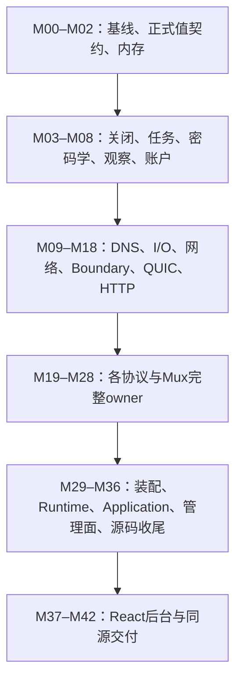

# Preview 全模块质量整改与 React 管理后台修改计划

## 1. 目标、范围与执行规则

本计划依据[Preview 全量质量分析报告](I:/code/Prism/docs/preview-refactor/2026-10-09-preview-comprehensive-quality-analysis.md)，覆盖报告中的 **R001–R038、F001–F030、P001–P033，共 101 项审查记录**，并加入完整的 React 后台后置阶段。已经修正的问题只保留复查任务，不重复改造或恢复旧实现。

本计划共 **43 张任务卡，编号 M00–M42**。任务按模块所有权、功能和生命周期闭环划分，每张卡同时处理正式接口、实际调用者、资源所有权和旧入口删除，不按固定文件数量拆任务。

按照本轮已确认的选择：

- **本阶段规划和实施源码整改。** 不新增测试用例、不重组测试目录，不执行构建、测试、真实请求、互操作或性能测量。现有测试及工具中的接口引用必须随 API 迁移同步更新，保留原输入、断言语义和超时。
- **React 后台纳入详细后置阶段。** 页面与 API 由本机管理监听器同源提供，保留 loopback，不加入远程多用户登录、公网监听或独立服务器。
- **项目热路径没有 throw/catch。** 普通错误、取消、超时和资源额度不足返回值结果；第三方不可恢复异常只在线程或进程入口收口，不修改第三方运行时。
- 保留当前脏工作树、用户进程、有效构建产物和依赖缓存，不执行 reset、checkout、clean、commit、push 或 amend。
- 禁止 Python。生产实现保持 header-only，不增加生产 `.cpp`；普通生产头不超过 600 行，函数不超过 120 行，lambda 不超过 10 行。
- 默认最多两个参数；复杂边界最多三个。参数类型必须表达真实领域操作与生命周期。
- 项目代码禁止三目运算符。C++ 项目标识符、代码目录及文件采用 PascalCase，公共接口补齐中文 Doxygen。
- 不保留旧 overload、兼容别名、旧结果形状、转发头、Legacy/Compat adapter 或双向同步字段。
- 协议私有 wire、认证、状态机、driver 和资源 owner 全部归本协议 `Detail`，按职责建立子目录。
- 最多主会话加两个子代理。共享 Contract、跨模块调用者、根 CMake、脚本、文档和最终集成由主会话串行负责。

计划进入实施阶段时，保存为：

`I:/code/Prism/docs/preview-refactor/2026-10-09-preview-quality-modification-plan.md`

每张任务卡统一使用以下完成状态：

`Pending → InProgress → SourceReview → SourceComplete`

`SourceComplete` 只表示源码闭环已经完成，不表示编译、运行、互操作或性能通过。

### 每张卡的统一源码交付标准

以下要求适用于全部任务，后文不重复列出：

1. 新接口已被真实生产调用者消费，旧接口、旧路径和旧结果已删除。
2. 输入拥有或借用期限、输出与错误、取消、半关闭、最终关闭者、executor 均在接口处写明。
3. 每份 buffer、队列节点、task slot、lease 和容量额度都有明确 owner 与释放条件。
4. include、CMake target/source 登记和实际文件归属一致。
5. 修改范围内完成命名、中文注释、禁三目和热路径异常整改。
6. 提交源码差异、调用链、接口退役清单、问题编号映射和未执行的运行验收项。
7. 不以空实现、固定成功、提前清零、缩小输入或忽略错误完成任务。

---

## 2. 必须先固定的接口与资源政策

### 2.1 唯一正式契约

| 领域 | 固定设计 |
|---|---|
| 业务失败 | `Fault::Failure { Code, Native }`；保留领域错误及原生 category/value，热路径不生成动态错误文本 |
| 普通操作结果 | `std::expected<T, Fault::Failure>`；协议私有 parser 错误只在正式边界映射一次 |
| 启动错误 | 保留独立 `StartupError`，可携带配置路径和非敏感说明；重要资源创建失败允许在冷路径使用项目 Exception 分类 |
| 流 I/O | `IoResult { Bytes, Failure }`，允许实际字节与 EOF/错误同时存在，不能因错误抹掉已完成字节 |
| 目标地址 | `Preview::Network::Target` 使用 typed Host、`uint16_t Port` 和 `RouteKind`；Host 为 IPv4Bytes、IPv6Bytes 或固定容量 DomainName |
| 域名 | DomainName 最多 253 字节；构造时校验标签及总长度，规范化末尾根点，不保存借用文本 |
| 字节所有权 | move-only `OwnedBytes` 持有可回收 chunk lease；跨异步边界必须拥有实际存储和 allocator/context pin |
| 资源取得 | `TryAcquire` 返回明确的 `ResourceUnavailable`；归还不分配、不抛异常 |
| 关闭 | 请求关闭、命令交付、I/O 退栈与资源释放分别表达；`Drain` 返回 typed 结果 |
| 任务 | move-only `TaskReservation` 同时保护任务槽、取消节点和 drain 预约，成功后转交实际 task owner |
| 观察 | 业务结果与日志、统计失败分离；观察失败进入 Dropped/Failed 及独立指标 |
| 管理操作 | 操作范围使用明确的 Process、Worker、Session、Stream、Task 身份类型，不能靠多个 optional ID 猜测目标 |

禁止用可抛的 PMR 分配加 `noexcept` 冒充不抛接口，也不能用 associated allocator 宣称已覆盖 Boost.Asio 协程帧分配。

普通取消显式关闭 Asio 的取消异常传播，以 `error_code`、`as_tuple` 或 `redirect_error` 返回。C ABI 回调内部只执行有预算的值操作，不抛出也不捕获异常。

### 2.2 默认资源预算

已有合法协议消息能力保留。新增预算用于约束累计拥有量，不通过缩小合法 payload 回避问题。

| 资源 | 默认政策 |
|---|---|
| 通用完整帧 writer | 64 个请求、累计 4 MiB；先准入后取得 buffer；流写按最多 64 KiB 分段，返回实际 partial count |
| QUIC 待 ACK 数据 | 每连接 4 MiB、每 stream 1 MiB；额度不足可取消等待，数据只能在 ACK 或 stream 关闭后退休 |
| QUIC 连接表 | 4096 个 live/closing owner，未认证最多 1024；每 owner 最多 8 个 CID alias |
| UDP association | 每方向 64 包、累计 4 MiB；最多 64 个最近授权 endpoint；IPv4/IPv6 各一个资源 |
| HTTP/2、HTTP/3 头 | raw block 64 KiB、128 字段、单字段 16 KiB、decoded 总量 64 KiB |
| SS2022 raw UDP | 每 binding 256 个在途操作/16 MiB；每 peer 16 个/1 MiB；MaxPeers 独立生效 |
| XHTTP | pre-download upload 1 MiB；单 packet body 1 MiB；32 个活动 body；累计 body 4 MiB |
| gRPC | 保留单 message 16 MiB；32 个排队 message、累计 64 MiB；完整 ClientResult 64 MiB |
| Mux | 保留现有每流 RX 4 MiB、session RX 16 MiB、pending write 32 MiB，并增加实际保留块计费 |
| 管理 HTTP | 128 个连接；请求头 16 KiB/32 字段；配置正文 1 MiB；读写 deadline 各 5 秒 |
| 配置文件 | 最多 1 MiB，读取前后均检查；集合数量及乘法溢出在冷校验阶段拒绝 |

预算进入所属领域 Options，启动期校验并冻结。不能为每个空闲连接预分配其最大预算；chunk 从进程/worker 拥有的有界池取得，共享总容量优先于局部上限。数据预算耗尽返回错误或等待额度，关闭与额度归还不得依赖新的数据 buffer 分配。

### 2.3 依赖顺序

同波次只有可写范围互不重叠的任务才能并行；公共接口未完成串行集成前，下游任务不能签收。

---

## 3. M00–M36：Preview 源码整改 ToDoList

### M00 — 建立实施基线与完整问题账

**依赖：无。范围：主会话、审查报告和现有任务台账。**

- [ ] 重新核对当前源码 hash、活动写者、进程和既有 TaskCards；明确本计划承接的未完成源码责任，不覆盖历史证据。
- [ ] 建立 101 项问题到 M01–M36 的映射，记录发现快照、当前状态、实施卡和源码签收状态。
- [ ] 将旧 TrustTunnel/XHTTP 引用环、SOCKS5 已修问题、Start/Main 已修文档标记为复查项，禁止重复修复或恢复旧实现。
- [ ] 为每卡登记 owner、可写范围、跨模块集成点及旧入口删除清单；采用本计划接口和预算作为共同输入。

**交付：** 完整问题账、源码基线、任务依赖和独占范围表。

### M01 — 固定错误、目标地址与正式值契约

**依赖：M00。范围：Foundation Fault/Error、Net Target、中立 Contract及实际目标调用者。覆盖：R026、P003、F030。**

- [ ] 定义唯一 `Fault::Failure`，明确 Success、EOF、Canceled、Timeout、AuthRejected、InvalidWire、ResourceUnavailable、Blocked 等分类与 Native 保留规则。
- [ ] 将 Target 的字符串 Host/Port 和 Positive 迁为 typed Host、数值 Port、RouteKind；配置和 wire 在正式边界转换一次。
- [ ] 同步 VLESS、Trojan、VMess、SS2022、SOCKS5、Mux、route、dial、datagram 和观察调用者；删除 raw16/text 猜测分支。
- [ ] 保留私有 wire 的 ATYP、端序和协议语义；显示文本只在日志/API输出边界格式化。

**交付：** 正式目标与错误只有一份事实，所有生产构造、转换和消费者闭合。

### M02 — 建立有界字节与资源拥有能力

**依赖：M01。范围：Foundation Memory、Resource 的真实内存 owner。覆盖：F003、F022。**

- [ ] 实现冷构造的有界 chunk pool、move-only OwnedBytes、容量预约与无分配归还。
- [ ] 预算同时计入块容量、节点、排队和在途拥有量；不能只统计未消费 payload。
- [ ] 区分可回收数据块与短期 FrameArena；禁止长期接收队列使用 monotonic arena 累积已消费数据。
- [ ] Resource 保留资源和身份职责；网络服务放回实际 worker/network owner，异步对象不能只持裸 MR 指针。

**交付：** 每个跨异步字节对象均保活真实资源，额度耗尽有明确值结果。

### M03 — 原 executor 的关闭交付与退休

**依赖：M02。范围：Foundation Executor、SessionControl/ClosePolicy及关闭消费者。覆盖：R001、R003、R020、R038、F003、F009、P029。**

- [ ] 关闭命令和一次性状态预建在真实 owner，删除关闭时临时 `make_shared` 标记与动态闭包。
- [ ] 继续使用 ContextOwner、ExecutorReclaimer、ClosingStorage；投递失败保留实际资源并标记 Blocked。
- [ ] 取消和关闭都通过原 executor；禁止投递失败后异线程析构 socket、空 catch 或假成功。
- [ ] 将 typed 关闭结果贯穿 registry、listener和应用；资源退休必须等待活动操作真实退出。

**交付：** 每条关闭路径可定位执行 executor、交付结果和最终释放条件。

### M04 — Task、身份、取消树与 drain 预约闭环

**依赖：M03。范围：Lifecycle及全部 SpawnTracked 消费者。覆盖：R002、R004、R016、F009–F011、F026。**

- [ ] TaskReservation 取得后立即拥有所有预约；拒绝、构造失败、取消、未启动和完成均归还一次。
- [ ] SpawnTracked 返回 expected；删除 Enter 后、保护之外创建取消子域的路径。
- [ ] TaskId 采用进程单调生成、不回绕；有界活动槽只保存活动身份，删除累计 GlobalTaskIds/Reservations 历史树。
- [ ] 取消子树在绑定 executor 维护预建节点，不复制整个兄弟快照；普通取消与实际失败分别记录。
- [ ] 每个顶层 task 显式采用取消值结果；第三方不可恢复异常统一进入线程/进程致命边界。

**交付：** 所有 Enter/Acquire 有立即成立的 owner，活动与历史记录不混用。

### M05 — Crypto 输出与失败契约

**依赖：M01。范围：Foundation Utility Crypto及真实握手消费者。覆盖：F028。**

- [ ] HMAC、HKDF、SHA、多段摘要、随机和 keypair 返回明确结果，检查 init/update/final。
- [ ] 删除失败全零值和继续返回 Success 的路径；调用者必须先检查失败再使用输出。
- [ ] 动态输出使用调用者 span/OwnedBytes，校验长度；HKDF 不隐式截断有效 PRK。
- [ ] 复用统一 FillRandom 与受控秘密拥有材料；成功算法、nonce、密钥更新和 wire字节保持原正式语义。

**交付：** 真实握手不能在底层计算失败后继续派生成功状态。

### M06 — Diagnose 提交、上下文、脱敏和关闭

**依赖：M02、M03。范围：Diagnose、中立文本契约、Application日志桥。覆盖：R001、R031、R032、F001–F006。**

- [ ] 保留稳定 facade和唯一 Application backend；消息采用编译期描述、固定参数快照和有界拥有记录，格式化转移到后台消费阶段。
- [ ] 保留一条正式提交队列；删除请求线程上的多层格式化/capture/render catch，不新建第二套日志事实。
- [ ] 长期 Context直接拥有当前字段文本，替换时释放旧值；per-call借用在提交前形成有界快照。
- [ ] trace选择和脱敏下沉中立 Foundation；敏感字段比较不分配，quoted值正确处理转义。
- [ ] barrier非阻塞入队和等待共用绝对 deadline；普通观察失败不触发业务停机或改写业务退出结果。

**交付：** 请求日志路径无项目 throw/catch、无无界增长；Accepted、落盘和最终drain含义独立。

### M07 — Statistics、事件保留和采样事实

**依赖：M04、M06。范围：Statistics、TrafficSink、Runtime统计聚合。覆盖：R036、F029及事件保留缺口。**

- [ ] 数值业务终态携带真实 Fault；Errors、观察丢弃、聚合失败分别计数，stream key包含父 session。
- [ ] 定义真实事件环：容量保留1024，终态预留沿现有配置；覆盖旧事件时维护单调序号、最早可读游标和 Lost 标记。
- [ ] SampleTracer只返回实际已写样本；明确直方图秩和近似桶边界，P100不得返回未观察的配置上限。
- [ ] counter按真实 scope 生命周期退休；历史曲线使用有界采样序列，公开时间统一为 Unix毫秒。
- [ ] 聚合只在所属控制 executor，热路径只提交数值，失败不保活业务Session。

**交付：** 公开统计能追溯到真实生产更新，不使用默认零值表示未实现指标。

### M08 — 唯一账户运行状态与一致发布

**依赖：M01、M04。范围：Account、账户装配和协议凭据索引。覆盖：R005、F007、F008。**

- [ ] 一份 AccountBinding同时pin材料、PolicySnapshot和唯一AccountRuntime，目录一次发布，删除两阶段发布和认证忙等。
- [ ] 同一AccountId跨协议共享运行账本；各协议只有不同credential index/view。
- [ ] 连接与child admission统一撤销门禁，竞态取得额度必须回滚；旧lease保留自己的策略快照。
- [ ] 更新策略不重置活动连接、字节或速率账本；lease只管理额度，I/O关闭仍归协议owner。
- [ ] 账户查询从唯一store派生；存量会话关闭命令在M32完成，不提前声称已经兑现CloseSessions。

**交付：** 身份、策略和账本无分叉，撤销后新准入有同一个门禁。

### M09 — DNS规则、应答关联与TTL

**依赖：M01、M05。范围：DNS纯codec、Rules、Answer和应答检查。覆盖：F013–F015。**

- [ ] 在DomainName上逆序遍历全部标签，删除16标签Buffer/Overflow分叉。
- [ ] 查询owner保存规范化question、ID、type、class；验证QR/opcode、完整question、class及地址/CNAME关联。
- [ ] query ID使用CSPRNG和在途登记，冲突及资源耗尽返回值错误。
- [ ] TTL保留存在性；真实零TTL不缓存，A/AAAA最小值包含零。
- [ ] 统一纯解析事实和有界读取，保留NXDOMAIN、NODATA、取消、超时与网络失败。

**交付：** 成功应答属于完整当前问题，域名标签和零TTL语义准确。

### M10 — DNS缓存、flight、pool和deadline owner

**依赖：M02、M04、M09、M12、M13。范围：DNS Cache/Coalescer/ConnPool/Transport/DoH/Detail。覆盖：F012、F016、F017、F019。**

- [ ] 每个活跃缓存记录只有一个LRU节点；覆盖、过期和命中不追加无界历史。
- [ ] flight、waiter、连接池、在途查询和应答字节分别有预算及预约。
- [ ] timer/read/write共同持operation owner，双方handler退栈后才归还lease；删除raw-this deadline回调。
- [ ] DNS、TCP、TLS、DoH共同消费一个绝对deadline。
- [ ] 提取中立HTTP响应framing，DNS和Http1共同消费；处理大小写、重复长度、chunked、内容类型及残余，Net不反依赖完整Http1协议。

**交付：** 没有无界历史队列，连接复用和timeout均有明确退休条件。

### M11 — 唯一Dial与通用Relay

**依赖：M09、M10、M12、M13。范围：Net Dialer/Services/Relay和Application旧dial消费者。覆盖：R026、R027、R030、F018、F019、P003、P030。**

- [ ] WorkerDialService、StreamEgress和carrier dial消费同一个typed目标和拨号操作。
- [ ] IPv4/IPv6候选共享总deadline，使用可取消的地址竞速，并收回所有败者。
- [ ] 删除Application跳过IPv6、重复字符串port解析和DNS错误统一BadAddress的路径。
- [ ] Relay保留双向独立pump和半关闭，按成功partial写统计字节；禁用idle采用取消/完成信号，删除24小时伪无限timer。
- [ ] 保留Canceled、Timeout、Refused、DnsFailed和Native，不折叠为通用IoError。

**交付：** 普通session与carrier使用同一网络能力，失败、字节与最终关闭事实一致。

### M12 — Transmission完成、取消与Asio association

**依赖：M01–M04。范围：Transport正式I/O与所有生产读写消费者。覆盖：R004、F020、F026、P028。**

- [ ] coroutine和callback前门消费同一个operation owner与IoResult，移除普通错误异常bridge。
- [ ] associated executor、cancellation slot和allocator穿过所有wrapper及Connector层。
- [ ] 预读与真实I/O遵守同一非同步重入完成合同；完成只一次，buffer借用延续到completion。
- [ ] exact read/write复用partial操作，不在每个step新建动态scratch。
- [ ] Cancel、WriteShutdown和Close使用M03交付/退休合同，删除detached callback桥和未绑定lambda。

**交付：** 所有wrapper对字节、错误、取消与完成executor的承诺相同。

### M13 — 通用writer、TLS半关闭和装饰器

**依赖：M12、M02、M03。范围：Transport私有writer、Encrypted/NativeTls/Replay/Snapshot/Pad。覆盖：R013、F003、F019、F021、P028。**

- [ ] 建立仅负责完整字节顺序、准入、partial I/O、ticket和drain的通用writer，不感知协议、认证或StreamId。
- [ ] 失败/Cancel/Close统一完成active与pending；底层操作退出后才归还资源。
- [ ] TLS应用写、close_notify和最终Close串行化；写半关闭保留反向读，不直接下发裸TCP FIN。
- [ ] prefix probe、handshake和cleanup共用deadline；Replay/Snapshot保留唯一候选回放owner。
- [ ] Pad冷编译typed ranges，运行不再数字→字符串→解析；关闭路径不做热shrink或临时共享状态分配。

**交付：** 通用writer没有协议依赖，TLS和装饰器均兑现完整I/O合同。

### M14 — 通用UDP association双向数据面

**依赖：M11、M13、M04。范围：Net datagram、中立Datagram契约和协议适配。覆盖：F018、P017–P020、P030。**

- [ ] 删除一般数据面的Exchange单reply模型；association提供拥有型Send/Receive、Cancel、Close、Drain。
- [ ] IPv4/IPv6各持一个私有资源；up/down pump独立，目标无回复不阻塞下一上传。
- [ ] 发送准入时登记实际IP+port授权endpoint；不相关、过期及旧关联来源在封回协议前拒绝并计数。
- [ ] 单包DNS/send deadline和association idle分开；合法空UDP有效，多回复不被误当下一请求应答。
- [ ] 所有packet、socket、lease和任务归同一association，关闭不影响共享listener或兄弟关联。

**交付：** 通用UDP没有串行一问一答依赖，来源与关闭边界明确。

### M15 — Boundary中立句柄、索引与唯一socket权限

**依赖：M01–M04。范围：Boundary和中立QUIC/Datagram契约。覆盖：R017–R022、R035。**

- [ ] QuicConnectionOwner只公开Start、ReceivePacket、Snapshot、RequestClose、Drain，删除Native Server暴露。
- [ ] 公共socket最终关闭权留在Boundary；协议只取得窄Send、Executor和缓存LocalEndpoint能力。
- [ ] 一个connection owner为唯一事实，建立固定CID、peer索引；删除每包string key和全表Native查找。
- [ ] factory调用前预留owner/CID容量；closing仍计入容量，状态只在listener executor更新。
- [ ] Dispatcher同步借用admission、真正消费时move；统一所有接受/拒绝计数，listener提交失败回滚Ready并完成completion。

**交付：** Boundary不依赖具体Native实现，socket权限和连接预算由唯一owner兑现。

### M16 — QUIC ACK、credit、FIN/reset和callback

**依赖：M15、M12、M13。范围：Quic及Hysteria2/TUIC接口适配。覆盖：P001、P015、P021–P023。**

- [ ] 实现TransmitLedger，按稳定chunk、stream offset、Submitted/Acknowledged保活已接受数据。
- [ ] 安装ACK callback；write按已接受字节返回，数据异步保活到ACK或stream_close，UDP排空不参与退休。
- [ ] 每stream只选callback或accept queue一种交付，关闭后回收State并补远端stream credit。
- [ ] FIN采用Queued/Submitted/WriteClosed状态，Blocked时保留并由pump重试；Reset保留应用code，不变普通EOF。
- [ ] C callback只使用预留存储和值失败，所有loop、send、FIN和关闭任务进入正式task tree。

**交付：** 数据、credit和半关闭的完整生命周期可从源码追踪。

### M17 — HTTP/2帧、HPACK和流控

**依赖：M02、M13。范围：Http2及其正式消费者。覆盖：P006–P011、P013。**

- [ ] 9字节header解析后立即拒绝超限frame；RX使用有预算chunk/游标。
- [ ] raw block、字段数、单字段、decoded总量四层预算在复制前检查。
- [ ] 修未知frame忽略、CONTINUATION顺序、GOAWAY offset/u32，并从最新settings初始化新stream。
- [ ] SubmitData明确返回Accepted/Blocked/Closed/Invalid；提供可取消AwaitWritable。
- [ ] 接收credit由下游拥有数据的消费回执归还，不在OnData返回后自动恢复。

**交付：** 合法背压不变致命I/O，所有header/frame增长先准入。

### M18 — HTTP/3 native头和event owner

**依赖：M16、M17、M13。范围：Http3和Hysteria2 HTTP3认证适配。覆盖：P014、P015。**

- [ ] native nghttp3与独立QPACK共用HeaderLimits，设置field-section限制。
- [ ] HeaderBlock使用预留字节storage和字段索引，TryAppend返回值错误并映射ABI码。
- [ ] headers/data/event/response全部有预算，NativeClient/Server不得无限累计。
- [ ] 公共Session/HeaderBlock契约留正式入口，nghttp3状态、callback、input/output和native适配归Detail。
- [ ] client/server所有driver tracked，完成通知与Drain明确。

**交付：** native路径不绕过独立Decoder预算，回调无项目异常源。

### M19 — TrustTunnel完整carrier与writer owner

**依赖：M17、M13、M08。范围：Trusttunnel。覆盖：P002、P005、P011。**

- [ ] CarrierOwner拥有H2Session、driver、writer和TLS；返回transport view，owner仅弱观察view，避免引用环。
- [ ] 删除成功move空字段后driver仍使用的路径；退出通知使用受检查的观察句柄。
- [ ] 两层writer改用统一完整write owner，失败完成active与全部pending。
- [ ] FIN、driver、wire和最终Close全部tracked；Blocked等待窗口，不抛broken_pipe。
- [ ] Basic认证、CONNECT和凭据语法归协议Detail，lease一次移交。

**交付：** 成功、EOF、失败、取消和关闭都有同一个最终owner。

### M20 — 普通VLESS唯一wire与XUDP

**依赖：M14、M13、M08。范围：Vless。覆盖：P019、P020、P029、P033。**

- [ ] 普通UDP固定握手Target，客户端、服务端统一 `[uint16BE Length][Payload]`。
- [ ] 删除StandardWire选择、普通UDP payload地址解析、回复插地址和错误addressed helper。
- [ ] reader区分EOF、取消、timeout、截断和坏frame，不break后返回Success。
- [ ] XUDP独立归Detail/Xudp，保留每id lease、socket epoch和迟到结果身份校验，消费M14能力。
- [ ] root/child/writer停止与drain采用值结果，id复用前完成旧资源退休。

**交付：** 普通UDP只有标准固定目标事实，XUDP拥有独立多目标生命周期。

### M21 — WebSocket唯一frame writer

**依赖：M13。范围：Ws。覆盖：P004。**

- [ ] DATA、PONG、CLOSE全部排入同一个frame writer；reader不得直接写底层socket。
- [ ] mask/header/payload在取得预算后编码，stream write允许明确partial count。
- [ ] 保留消息、fragment和UTF8规则，随机失败和I/O失败返回typed结果。
- [ ] Close frame与最终carrier关闭分开，reader/writer真实drain后释放owner。

**交付：** 完整frame内部无读写协程交错路径。

### M22 — SS2022 raw UDP入口预约与peer资源

**依赖：M14、M15、M08。范围：Shadowsocks2022。覆盖：P016。**

- [ ] packet在post、Operation和task创建前同时取得binding/peer/bytes/task预算。
- [ ] peer lease与packet operation分开，posted、running、pending send和reply均计费。
- [ ] replay、nonce、credential和session替换仍归SS2022；closing peer保留到drain。
- [ ] Reap改有界expiry索引/定时owner，不逐包扫描全部peer。
- [ ] TCP与raw UDP只消费统一Target/OwnedBytes，保留冷trial不取业务lease。

**交付：** MaxPeers不再被误当在途上限，packet洪流不能绕过容量准入。

### M23 — XHTTP各模式资源与逻辑会话

**依赖：M17、M13。范围：Xhttp。覆盖：P011、P012。**

- [ ] Mode冷冻结为enum，分别拥有StreamOne/StreamUp/PacketUp状态。
- [ ] PendingUpload、PacketBodies先检查字节及数量预算，再取得存储。
- [ ] body完成、断开、拒绝、sequence和迟到callback归同一mode owner。
- [ ] wire/logical writer使用统一ticket；保留已修weak关系，明确driver通知和drain。
- [ ] 路径解析/生成只有一处，TLS委托统一Encrypted能力。

**交付：** 每份上传缓存都有预算和退休条件，所有等待者有终态。

### M24 — Gun/gRPC消息、背压和driver

**依赖：M17、M13。范围：Gun。覆盖：P013、P031、P032。**

- [ ] 声明message长度后预留完整message容量，再收body，保留16MiB能力。
- [ ] 消费credit与消息容量关联，避免完整message交付与小窗口互相等待。
- [ ] queue、ClientResult和handler输出有累计预算；不能只限制单消息。
- [ ] grpc-status检查完整数字、范围和重复一致性。
- [ ] 读写、response driver全部tracked，退出必通知，最终drain归session。

**交付：** 有界消息不会形成源码级credit死锁，driver没有静默结束路径。

### M25 — AnyTLS根、stream和首PSH

**依赖：M13、M08、M26。范围：Anytls。覆盖：P020、P029。**

- [ ] 首PSH消费中立目标原语，保留同frame尾部，不借用SingMux私有完整parser。
- [ ] Frame错误、非法command、EOF、取消和timeout明确写入根结果。
- [ ] SYN/PSH/FIN/ALERT/heartbeat进入同一frame writer。
- [ ] Stop使用原executor退休能力，nested mux、child、FIN和writer全部drain。
- [ ] lease、Prepared/Ingress和根状态保持一套事实。

**交付：** 坏frame不返回Success，停止不在noexcept内直接执行可抛dispatch。

### M26 — Mux可回收RX、writer与task tree

**依赖：M04、M08、M11–M13。范围：Mux根/session/stream。覆盖：F009、F022、F023、F026。**

- [ ] RX迁为可回收OwnedBytes，实际retained块计费，消费后可归还。
- [ ] 完整writer使用有界请求槽，partial完成后回执，失败完成全部ticket。
- [ ] WINDOW_UPDATE进入同一合并writer队列，删除每次消费启动detached发送。
- [ ] root/stream/FIN每次Enter立即持预约，取消、错误和drain保留值原因。
- [ ] child、writer、FIN结束后才释放根lease；StreamHandle直接消费正式Transmission，退役SessionBase及旧桥。

**交付：** 所有发送任务进入drain树，内存不随已消费流量持续保留。

### M27 — Mux唯一wire与控制事件

**依赖：M26、M17。范围：Smux、Yamux、H2Mux、SingMux。覆盖：F003、F024–F027。**

- [ ] frame事件同时表达payload和terminal/control flags，DATA+FIN先交付数据再发布EOF。
- [ ] Yamux Ping、GoAway、WindowUpdate有正式状态处理；构帧写入已取得buffer。
- [ ] H2Mux选择当前生产的标准HTTP/2实现作为正式双端，迁公开Client/Server并删除私有9字节伪wire入口。
- [ ] native H2装配统一streams/incoming/RX/writes预算，不把queued数据当已写。
- [ ] SingMux纯codec与异步reader使用同一解析事实；Padding实现有界行为或冷绑定拒绝，禁止接受后忽略。

**交付：** 同名公开入口wire一致，控制帧和输入规则只有一套事实。

### M28 — 剩余TLS、HTTP/1与ECH闭环

**依赖：M05、M10、M13。范围：Common、Ech、Http1、Native、Reality、Restls、Shadowtls。覆盖：P024–P028。**

- [ ] 各carrier握手I/O复用统一能力，wire/auth/record/control保留协议owner。
- [ ] Reality Carrier/Prepared共用唯一认证、server flight和Finished路径，保持拥有型输入快照。
- [ ] ECH key/scan职责明确，资源真正拥有，不把完整输入scanner宣称为增量跨record解析。
- [ ] Http1 request/response/header/trailer/chunk/Upgrade和半关闭迁入完整Detail owner，复用中立framing。
- [ ] Common只保留真实共享语义，移除协议专属处理和无用途兼容聚合。

**交付：** 小协议、共享工具和carrier不遗漏，私有实现不再平铺暴露。

### M29 — 唯一冷装配与一次性prepared识别

**依赖：M08、M15–M28。范围：Composition、协议prepare/binding、Application接线。覆盖：R022–R026、R031、P026、P028、P030。**

- [ ] 分开TCP proxy、TLS carrier、QUIC、Mux、ECH typed slots。
- [ ] wire解析、材料解释、credential trial及认证prepare迁回协议Detail。
- [ ] ProviderCatalog覆盖全部正式类别，删除Application协议switch和重复RegisterConfigured体系。
- [ ] 内外层识别共用中立协调owner和owned PreparedAdmission，winner Commit只消费一次。
- [ ] Commit后污染不得回退其他协议；失败候选不拿lease，选中后一次取得。
- [ ] listener只接一个新连接QUIC factory，构造即拒绝重复；既有CID继续路由到其原owner。

**交付：** Application/Composition没有协议业务，协议不反依赖装配层。

### M30 — Runtime窄权限、准入与稳定快照

**依赖：M04、M07、M11–M13、M29。范围：Runtime。覆盖：R002、R004、R012–R016、R034、R037。**

- [ ] 宽Context拆为不可变已认证输入、dial结果、decoration操作和relay拥有值；后续阶段不能改认证事实或lease。
- [ ] 删除每session动态单项Pad/Dial Pipeline，消费冷编译阶段。
- [ ] listener取得额度时立即持reservation，cover peer/transport/request构造及任务提交。
- [ ] Worker admission与控制命令分开；停止接入不阻止取消、关闭和drain命令交付。
- [ ] Registry由实际owner维护活动索引，控制侧发布稳定值快照；保留token退休/delivery，不逐会话复制整个观察表。
- [ ] Ban/Throttle使用明确owner、有界键和过期摘除；没有安装的能力不宣称生效。

**交付：** Runtime权限、准入、命令失败与观察事实具有明确边界。

### M31 — Application启动、回滚与停机

**依赖：M03、M04、M06、M07、M29、M30。范围：Application。覆盖：R001、R003、R032、R033、R037、R038。**

- [ ] 保留StartupTransaction唯一回滚者，按generation、process、protocol、boundary、operations、publish分阶段。
- [ ] typed Shutdown/Blocked贯穿listener/provider/task/application，删除忽略返回值和普通失败再throw。
- [ ] deadline到期返回失败时继续保活仍在清理的owner，不能提前Stop context或清表。
- [ ] worker join只在控制线程非协程阶段进行；检查ClosingStorage后才能标记资源已完成。
- [ ] 日志失败独立记账；保留已经修正的Start/Main保护和source-header编译owner，不重复改造。

**交付：** 启动失败和正常停机均有完整资源闭环，阶段结果准确。

### M32 — 管理查询、scoped命令与Operation owner

**依赖：M08、M07、M04、M31。范围：Operations值模型和Application管理服务。覆盖：R005–R008、R010、R011。**

- [ ] 实现Generation、Stream、Task查询，使用完整父身份；已有账户查询改唯一store。
- [ ] Revoke先封止准入；CloseSessions=true提交账户范围取消，真实结束后才Completed。
- [ ] ProcessDrain与WorkerDrain分开；Drain必定停止目标新接入，删除可被忽略的StopAccepting选项。
- [ ] Session、Stream、Task取消只定位目标owner，不盲目扩大范围；作用域不匹配明确Rejected。
- [ ] Accepted创建有界OperationId，真实完成、失败、timeout和blocked均更新终态。
- [ ] 管理监听采用独立context/controller，消费值快照并向应用提交typed命令；ProcessDrain完成数据面及worker回收后发布终态，管理入口最后关闭。

**交付：** 解析范围、执行范围、结果范围一致，没有提前Completed。

### M33 — 有界配置与两阶段Reload

**依赖：M29、M31、M32。范围：Application Configuration及Reload管理端口。覆盖：R028–R030。**

- [ ] 有界读取和解析配置，区分语法、语义、能力、secret获取和容量错误。
- [ ] Reload采用prepare token、worker ack、单一commit/rollback；失败不部分修改运行配置。
- [ ] 旧session保留原generation pin；新接入切换到新冻结绑定，旧generation退休后释放。
- [ ] worker数量、监听地址/端口、运行时池容量和QUIC engine种类改变明确返回RestartRequired；账户、日志、DNS策略、route及可重新准备的同类协议参数支持reload。
- [ ] 最多保留8个活动/退休generation，超限拒绝新reload；不强行释放旧owner。
- [ ] 前端配置编辑只修改公开配置，secret从原generation保留；ValidateOnly不发布，Apply携带BaseGeneration防止覆盖冲突。

**交付：** 没有bool callback隐含副作用或“部分worker已切换”的正式状态。

### M34 — 管理HTTP、命令令牌与静态资源owner

**依赖：M10、M13、M32、M33、M05。范围：Operations HTTP和Application Web服务。覆盖：R009、R010。**

- [ ] HttpServer与Connection分别拥有接入、socket、deadline、请求和drain，不通过模板访问完整万能State布局。
- [ ] 连接、header、body和response分别有预算，响应写有独立deadline。
- [ ] 保留loopback；校验Host/Origin，不开放跨源CORS。每次启动生成命令令牌，POST必须携带，令牌不进入URL或日志。
- [ ] 静态资源在冷启动按manifest加载为只读catalog；请求只查catalog，不接受任意文件系统路径。
- [ ] `/Operations`错误不回退SPA；GET/HEAD页面采用明确fallback，未知资源404。
- [ ] 程序启动成功才发布Web/API能力；静态资源缺失返回明确启动状态，不伪造页面可用。

**交付：** 页面、API、请求资源和操作权限有独立且可关闭的owner。

### M35 — 全协议Detail、命名与公共入口闭合

**依赖：各协议卡及M29–M31。范围：全部Protocols及关联引用。覆盖：P024–P027、F030、R034。**

- [ ] 逐模块确认public facade、Options/Result、Binding/Ingress与私有实现，按下一节目录表迁移。
- [ ] 每个迁移同步生产、现有工具/测试引用和CMake，删除旧路径，不留forward include。
- [ ] 项目标识符PascalCase、中文Doxygen；长namespace用所属作用域或class private/function local alias缩短。
- [ ] 第三方ABI、Asio官方接口、外部wire/config字段列精确例外，不豁免整个文件。
- [ ] 审查协议热路径可达调用，清除throw/catch、隐含错误抛出及三目；不把问题挪到另一个helper。

**交付：** 全部协议叶子目录有最终归属和调用闭环。

### M36 — CMake、源码门禁与无兼容层收尾

**依赖：M01–M35。范围：主会话串行集成。覆盖：R031、R033、R034、R037及全局规则。**

- [ ] 中立契约下沉后同步真实include与target依赖；Foundation、Net、Boundary和Runtime不依赖具体上层装配。
- [ ] 双向核对磁盘文件与target_sources，检查大小写、生产CPP、scope include及文本拼装。
- [ ] 按101项账逐项给出实现、已修复复查或明确保留理由；不能用“文件小于600行”替代设计判断。
- [ ] 删除旧aliases、overload、结果、fallback和重复生产入口；没有正式caller的实验按职责移出生产登记。
- [ ] 更新公共合同和维护文档，记录新的路径/接口映射及hash；不填写未执行的构建、测试或性能结果。

**交付：** Preview源码整改形成唯一可维护入口与完整问题闭合账。

### 协议私有目录最终表

表中只建立真实需要的职责目录，不生成空目录。公共facade与正式typed契约留在协议根。

| 模块 | Detail职责 |
|---|---|
| Anytls | Wire、Session、Stream、Io |
| Common | 真实共享Datagram、Lifetime、字节原语 |
| Ech | Key、Hello |
| Gun | Grpc/Wire、Metadata、Stream、Session；Io |
| Http1 | Request、Response、Header、Upgrade |
| Http2 | Connection、Stream、Wire、Hpack |
| Http3 | Session、Native、Qpack |
| Hysteria2 | Authentication、Admission、Stream、Datagram、Wire、Io |
| Native | Tls |
| Quic | Connection、Stream、Datagram、Transport、Tls、Callback |
| Reality | Hello、Authentication、Tls、Record、Key |
| Restls | Handshake、Record、Control、Io |
| Shadowsocks2022 | Authentication、Wire、Tcp、Datagram、Gateway、Key |
| Shadowtls | Hello、Handshake、Record、Io |
| Socks5 | Wire、Authentication、Handshake、Stream、Association、Io |
| Trojan | Credential、Wire、Handshake、Stream、Datagram、Io |
| Trusttunnel | Authentication、Http2、Stream、Datagram、Io |
| Tuic | Authentication、Admission、Stream、Datagram、Wire、Io |
| Vless | Wire、Handshake、Stream、Datagram、Xudp、Io |
| Vmess | Credential、Authentication、Wire、Chunk、Stream、Datagram、Io |
| Ws | Handshake、Frame、Stream、Io、Lifetime |
| Xhttp | StreamOne、StreamUp、PacketUp、Path、Wire、Tls |
| Mux | Root、Session、Stream、Writer，以及各wire的私有实现 |

---

## 4. M37–M42：React后台完整后置计划

### 4.1 固定前端与API方案

新前端位于：

`I:/code/Prism/Web`

采用客户端SPA：React、TypeScript、Vite、React Router、TanStack Query、Tailwind CSS、shadcn/ui源码组件和Lucide图标。React官方文档列出了Vite、路由及请求缓存的组合方式；shadcn/ui提供对应Vite安装流程。[React文档](https://react.dev/learn/build-a-react-app-from-scratch)、[shadcn/ui Vite文档](https://ui.shadcn.com/docs/installation/vite)

本轮查到并固定的核心版本：

- React/React DOM/types：19.3.0。
- Vite：8.3.4；React插件：6.1.2。
- TypeScript：7.0.2。
- React Router DOM：7.18.4。
- TanStack Query：5.104.1。
- Tailwind CSS/Vite插件：4.3.3。
- Lucide React：1.54.0。

直接依赖使用精确版本，传递依赖提交锁文件，不使用`latest`范围。现有Node 24.14.1满足该Vite版本的Node要求。[Vite文档](https://vite.dev/guide/)

前端按App、Api、Features、Components/Ui、Styles组织。业务状态留各Feature，QueryClient只负责服务端状态；不建立携带全部页面业务的万能Context。

API统一规定：

- 保留单一`/Operations`入口，不保留Status/Operation/Operations同义路由。
- 所有64位ID和计数以十进制字符串输出，前端使用string/BigInt，避免JavaScript精度损失。
- 时间为Unix毫秒，字节和速率有明确单位。
- 命令不得自动重试；Accepted后只轮询同一OperationId。
- 查询使用AbortSignal，页面退出停止订阅；后台页面不可见时暂停常规轮询。
- 错误使用typed状态与code，不从Message文字猜测。
- 敏感材料不进入公开配置、事件正文或页面缓存。

### 后台正式接口表

| 接口 | 行为 |
|---|---|
| GET `/Operations/Bootstrap` | 进程身份、API版本、真实能力和本机命令令牌 |
| GET `/Operations/Health` | 分层readiness及健康 |
| GET `/Operations/Generation` | 当前generation与退休状态 |
| GET `/Operations/Workers` | worker值快照 |
| GET `/Operations/Accounts` | 唯一账户运行状态 |
| GET `/Operations/Sessions` | session分页与过滤 |
| GET `/Operations/Sessions/{S}/Streams` | 指定父session的stream |
| GET `/Operations/Sessions/{S}/Tasks` | 指定父session的task |
| GET `/Operations/Events` | 游标分页、Lost及最早保留序号 |
| GET `/Operations/Metrics` | 有界真实历史采样 |
| GET `/Operations/Configuration` | 公开配置和BaseGeneration，不含secret |
| GET `/Operations/Status/{O}` | 操作真实状态 |
| POST `/Operations/Drain` | 进程数据面停止接入并排空 |
| POST `/Operations/Workers/{W}/Drain` | 仅指定worker |
| POST `/Operations/Accounts/{A}/Revoke` | 撤销，可选择关闭存量session |
| POST `/Operations/Sessions/{S}/Cancel` | 仅指定session |
| POST `/Operations/Sessions/{S}/Streams/{X}/Reset` | 仅指定stream |
| POST `/Operations/Sessions/{S}/Tasks/{T}/Cancel` | 仅可取消的指定task |
| POST `/Operations/Reload` | ValidateOnly或基于BaseGeneration发布 |

旧的裸StreamId Reset、session cancel附带child参数、worker=0猜process、重复状态路由在实际消费者迁移后删除。

### M37 — 前端工程与API基础

**依赖：M32–M36。**

- [ ] 建立固定依赖、锁文件、严格TypeScript配置和PascalCase源码组织。
- [ ] 定义DTO decoder、ApiFailure、ID/计数、时间和单位转换，拒绝不匹配API版本。
- [ ] ApiClient注入Bootstrap命令令牌；所有查询支持取消，命令单次提交。
- [ ] 定义页面路由、按路由加载模块、Query键及错误/空/加载状态。
- [ ] 项目TS/TSX同样禁三目，React及第三方要求的接口和hook拼写精确保留。

**交付：** 无业务万能Context、无字符串猜状态、无虚构数据。

### M38 — 概览、Worker与账户页面

**依赖：M37、M07、M08、M32。**

- [ ] 概览显示TCP/UDP/QUIC不同ready层、真实活动量、流量和观察丢弃。
- [ ] 图表只使用后端历史采样，缺失指标明确显示不可用。
- [ ] Worker表显示Running/Accepting/Draining、任务、流量及作用域正确的Drain。
- [ ] Account表显示统一活动状态和revoked，撤销对话框明确是否关闭存量session。
- [ ] Overview每2秒、普通列表每5秒更新，隐藏页面暂停。

**交付：** 所有展示与按钮来自真实能力和owner值快照。

### M39 — Session、Stream与Task页面

**依赖：M37、M30、M32。**

- [ ] Session分页、过滤和详情保存worker/account/generation身份。
- [ ] stream/task只能在完整父身份下查询和操作。
- [ ] 展示目标、状态、真实字节、活动任务及结束原因，ID不丢精度。
- [ ] 对话框准确描述目标；不可取消的系统task只读。
- [ ] 命令Accepted后显示进度，轮询Operation至终态；连接断开不自动显示成功。

**交付：** 页面没有跨session误操作或扩大取消范围。

### M40 — 事件、配置和操作中心

**依赖：M37、M33、M32。**

- [ ] Events支持游标、级别、终态过滤，显示日志丢失区间和截断标志。
- [ ] Configuration支持公开配置编辑、校验结果、差异和BaseGeneration冲突；不编辑或回传secret占位值。
- [ ] ValidateOnly与Apply分别执行，RestartRequired字段清楚标识。
- [ ] Operations中心显示目标、Accepted/Completed/Failed/TimedOut/Blocked及关联错误。
- [ ] 页面刷新后从当前进程Operation状态恢复；新进程身份变化清除旧临时状态。

**交付：** 配置、事件和操作结果均不靠前端模拟。

### M41 — 现代化视觉与可访问性

**依赖：M38–M40。**

- [ ] 默认浅色工作区、深色导航、蓝色强调，支持深色主题；统一颜色、间距、字体和圆角tokens。
- [ ] 使用清晰侧边栏、状态卡、响应式表格、详情抽屉和图表；桌面、平板、窄屏布局分别定义。
- [ ] 建立统一Button/Input/Select/Dialog/Tabs/Badge/Table/Skeleton/Tooltip/Sheet组件，不为每页复制样式。
- [ ] 明确键盘焦点、错误说明、图标文字、状态颜色和减少动画行为。
- [ ] 用户界面显示业务含义，技术诊断放可展开详情，不展示内部模块和实现流程。

**交付：** 所有页面状态与布局分支完整，视觉效果留后续浏览器验收确认。

### M42 — 同源资源、打包规则与维护交付

**依赖：M34、M37–M41、M36。**

- [ ] 前端产物规则统一输出到现有`build`树内，发布资源放在可执行文件关联的Web资源目录。
- [ ] 增加独立PrismWeb资源构建规则；源码阶段只编写规则，不执行构建。
- [ ] manifest记录文件、内容类型、hash和大小；资产不可变缓存，index/Bootstrap不缓存。
- [ ] 开发Vite以loopback运行，API代理到本机Operations；生产页面和API同源。
- [ ] 编写后台启动、配置、能力、操作状态和资源缺失说明，更新API与页面映射。
- [ ] 完成React源码和后端静态资源owner清单，不把未执行的浏览器检查写成通过。

**交付：** 后台源码、API、资源目录、构建规则和维护文档形成完整链路。

---

## 5. 源码签收清单与后续验收边界

### 本阶段最终ToDoList

- [ ] M00–M42均提交源码交付记录，所有依赖和共享接口已串行集成。
- [ ] R001–R038、F001–F030、P001–P033均有明确闭合任务，无遗漏编号。
- [ ] 全部生产模块、协议及Detail叶子有最终owner和引用映射；文件数量变化不作为完成目标。
- [ ] 已退役API、路径、结果、alias、fallback和第二正式入口删除。
- [ ] 输入拥有、错误、取消、半关闭、最终关闭者及executor写在公共接口处。
- [ ] 三目清零，项目热路径无throw/catch；冷路径及第三方ABI例外精确登记。
- [ ] Source include与CMake责任一致，header-only和大小写规则满足。
- [ ] React全部页面、状态、操作范围和同源资源规则有真实源码实现。
- [ ] 保留原测试行为，只同步API/路径消费者；不以源码签收宣称运行通过。
- [ ] 保存最终源码hash、接口清单、问题闭合账和未来验收清单。

### 后续专项验收预留场景

本轮不实施这些验收，但后续必须分别建立证据：

1. 配置、编译、链接、独立多TU与Linux大小写/ODR。
2. 错误、取消、partial I/O、资源额度耗尽和调度失败。
3. QUIC ACK/丢包重传/FIN/credit，HTTP窗口及header预算。
4. UDP空包、多回复、无回复、来源隔离和地址族。
5. 账户跨协议撤销、child准入、scoped管理操作和Reload回滚。
6. 真实Main请求、认证正负例、半关闭、drain及资源释放。
7. 分配、保留内存、吞吐和延迟的同输入比较。
8. React真实API、响应式布局、键盘操作、断线与操作终态。
9. 全量CTest及本轮自启动进程、临时产物清理。

未来获得构建授权后，只使用现有`build/`；每次构建前检查时间，08:00–22:00使用`-j16`，22:00–08:00使用`-j1`。不以某一层通过替代其他层。

**本计划的源码终点是：接口和所有权统一、错误准确、资源有界、模块职责清晰、协议细节归位、管理操作范围正确，以及完整的React后台源码。运行正确性与性能结论由后续专项验收给出。**

